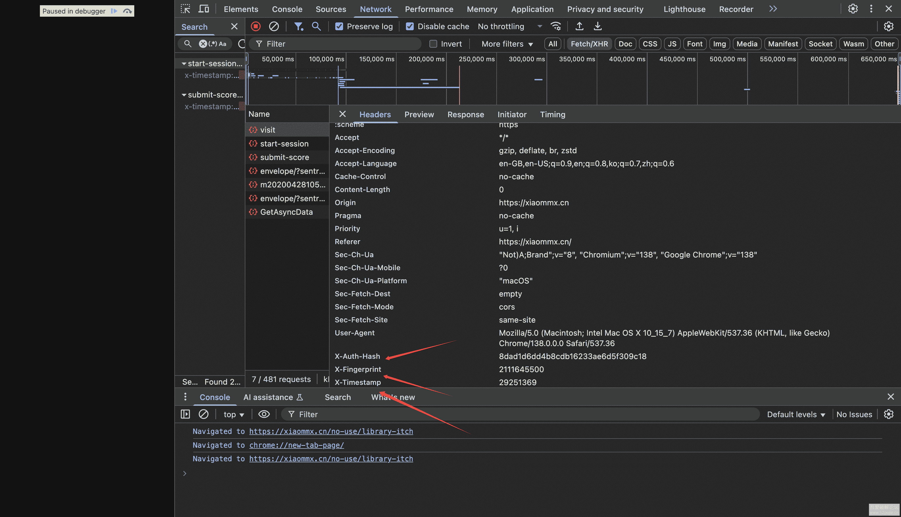
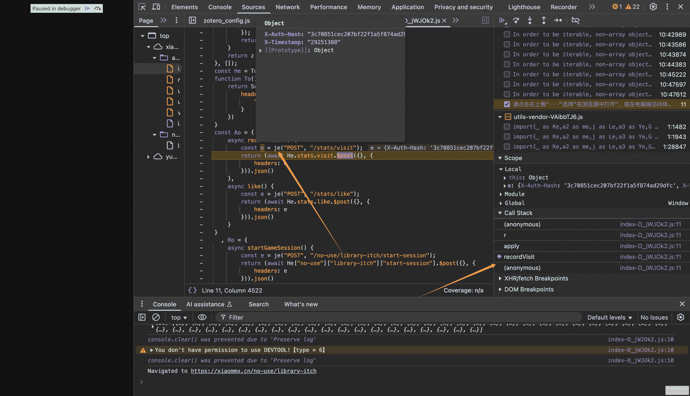
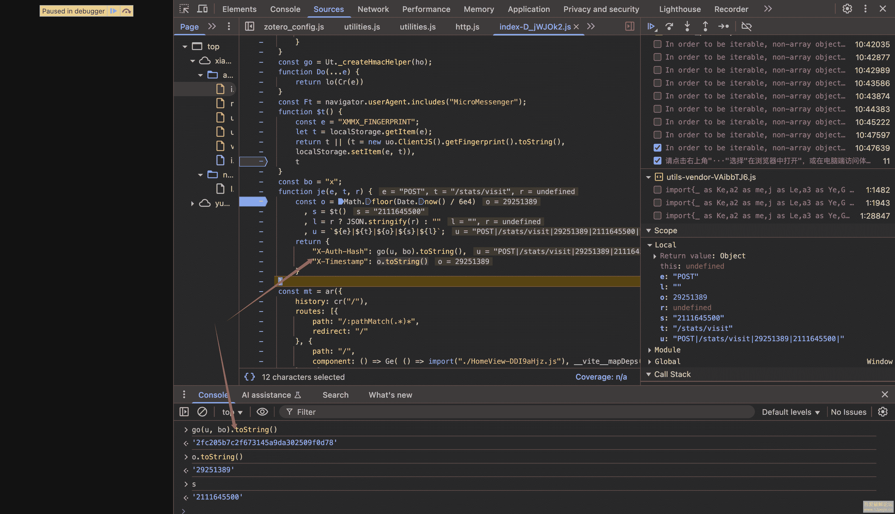
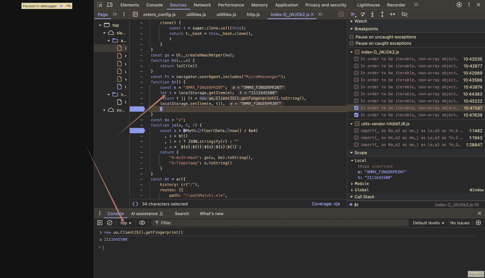
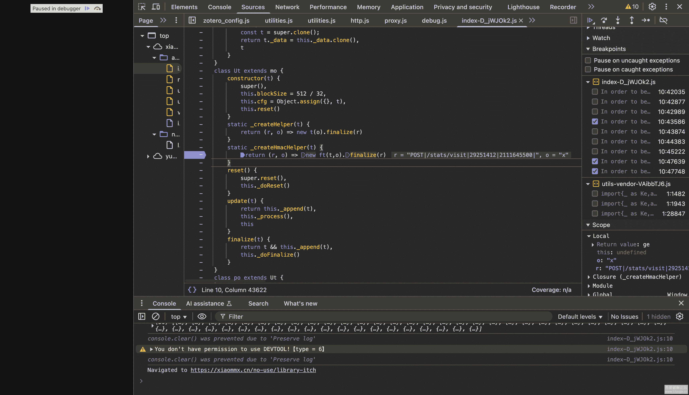
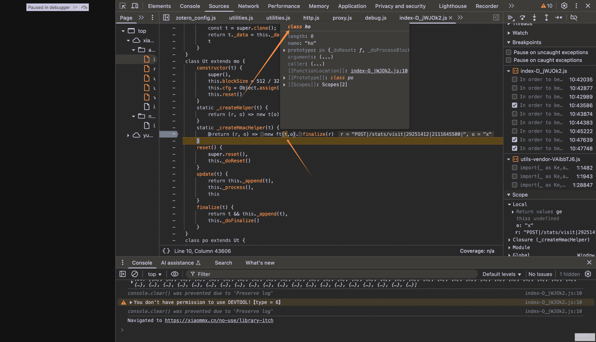
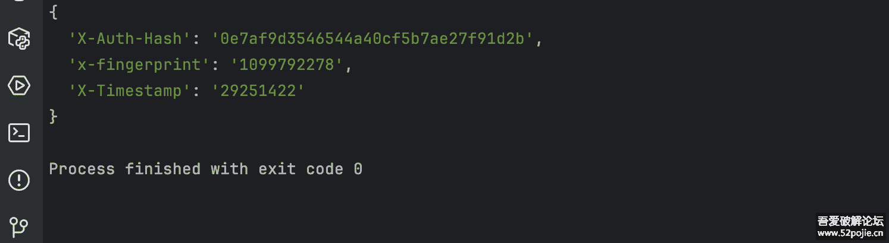
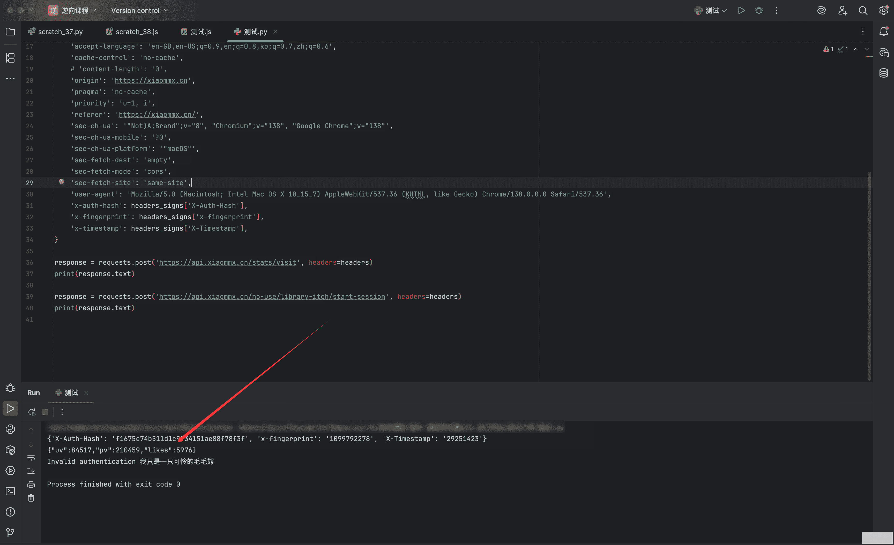

# [Web逆向] 【js逆向】图书馆挠痒大作战

- 原帖：https://www.52pojie.cn/forum.php?mod=viewthread&tid=2053165
- 抓取时间：`2026-11-01T22:05:34`

> 本文章中所有内容仅供学习交流使用，不用于其他任何目的，不提供完整代码，抓包内容、敏感网址、数据接口等均已做脱敏处理，严禁用于商业用途和非法用途，否则由此产生的一切后果均与作者无关。本文章未经许可禁止转载，禁止任何修改后二次传播，擅自使用本文讲解的技术而导致的任何意外，作者均不负责。

---

## 目标网址

目标网址：`aHR0cHM6Ly94aWFvbW14LmNuL25vLXVzZS9saWJyYXJ5LWl0Y2g=`

---

## 抓包与参数定位

重拾 js 逆向，请多指教！网站有点简单。`f12`，输入网址后回车，点击 `xhr` 查看数据包：



`1.png`（331.13 KB，下载：1；2025-8-14 03:18 上传）  
[附件下载](https://www.52pojie.cn/forum.php?mod=attachment&aid=Mjc5NjY4NHw4NjI3ZDFkZHwxNzkzNTcwNzMyfDE2ODA4NnwyMDUzMTY1&nothumb=yes)

三个加密参数，打开调用堆栈，直接跟栈，可以发现我们的参数在 `je()` 函数内部生成。



`2.png`（232.01 KB，下载：1；2025-8-14 03:18 上传）  
[附件下载](https://www.52pojie.cn/forum.php?mod=attachment&aid=Mjc5NjY4NXw3NWVlZDU1MXwxNzkzNTcwNzMyfDE2ODA4NnwyMDUzMTY1&nothumb=yes)

跟进函数内部，可以看到，是整个 `je()` 函数调用。



`3.png`（236.4 KB，下载：1；2025-8-14 03:18 上传）  
[附件下载](https://www.52pojie.cn/forum.php?mod=attachment&aid=Mjc5NjY4NnxjNTVmNTlhN3wxNzkzNTcwNzMyfDE2ODA4NnwyMDUzMTY1&nothumb=yes)

## 参数分析

### X-Timestamps

按顺序我们可以看到第一个参数 `o = Math.floor(Date.now() / 6e4)` 是生成了时间戳 `X-Timestamps`。



`4.png`（215.07 KB，下载：1；2025-8-14 03:18 上传）  
[附件下载](https://www.52pojie.cn/forum.php?mod=attachment&aid=Mjc5NjY4N3w4MDc3Zjc5OXwxNzkzNTcwNzMyfDE2ODA4NnwyMDUzMTY1&nothumb=yes)

### X-Fingerprint

第二个参数是 `X-Fingerprint`，由 `$t()` 生成。我们跟进函数内部可以看到，它做了一个逻辑判断：判断是否本地 `localStorage` 存储了该数据，否则重新生成。然后返回数值。后面在控制台打印发现，这个数值和本地存储的数值一样，可以确认这个数值是个静态的数据，我们怎么简单怎么来！（后面我扒了一下生成函数 `t = new uo.ClientJS().getFingerprint().toString()`，它需要做一个 Webpack 打包和补环境，相比较某红书及某马拉雅要简单一些！有想尝试的可以看我的 JS 源码）

### X-Auth-Hash

好啦！下面我们来到了最后一个参数 `X-Auth-Hash` 是由加密函数 `go(u, bo).toString()` 生成。



`5.png`（194.37 KB，下载：0；2025-8-14 03:18 上传）  
[附件下载](https://www.52pojie.cn/forum.php?mod=attachment&aid=Mjc5NjY4OHw4ZDUxZjg4OHwxNzkzNTcwNzMyfDE2ODA4NnwyMDUzMTY1&nothumb=yes)

跟进这个加密函数可以看到，他传入了 `(r, o)` 两个参数给一个 `new ft(t,o).finalize(r)`。



`6.png`（220.13 KB，下载：1；2025-8-14 03:18 上传）  
[附件下载](https://www.52pojie.cn/forum.php?mod=attachment&aid=Mjc5NjY4OXw2NzZkODI0N3wxNzkzNTcwNzMyfDE2ODA4NnwyMDUzMTY1&nothumb=yes)

这个地方的难点在于 `ft()` 和 `t` 都是一个 `class`。按照补环境的思路，我们把 `class ft` 和 `class h` 补完后慢慢补其他的 `class` 就行了！JS 代码打包放在最后，可以复制后直接调用！最后我们把请求头的参数打印出来。



`7.png`（16.43 KB，下载：1；2025-8-14 03:18 上传）  
[附件下载](https://www.52pojie.cn/forum.php?mod=attachment&aid=Mjc5NjY5MHw2YmE0YTQzOXwxNzkzNTcwNzMyfDE2ODA4NnwyMDUzMTY1&nothumb=yes)

## 补环境与请求测试

补完后我们发个包看一下！我们第一个请求成功了，第二个请求失败是因为网站做了请求 `session` 的加密处理，具体我还没找到应对方式，但肯定有大佬搞出来了！希望各位不吝赐教！




`8.png`（182.35 KB，下载：0；2025-8-14 03:18 上传）  
[附件下载](https://www.52pojie.cn/forum.php?mod=attachment&aid=Mjc5NjY5MXxhNjc4M2FiMnwxNzkzNTcwNzMyfDE2ODA4NnwyMDUzMTY1&nothumb=yes)

[JavaScript] 纯文本查看 复制代码


# 环境补丁与指纹生成代码

```javascript
// 补环境部分用于获取 参数 X-Fingerprint ---------------------------------------------------
window = global;
document = {
    getElementsByTagName: function(res) {
            if (res == 'body') {
            // console.log('document.createElement:::', res)
            return {
                0:{appendChild: function (){},
                   removeChild: function (){}}
            }
            }
    },
    createElement: function(res){
            if (res == 'span') {
            // console.log('document.createElement:::', res)
            return {
                style:{fontSize:{}}
            }
            }
    }
};
window.screen = {
    "width":1728,
    "height":1117,
    "availWidth":1728,
    "availHeight":1085,
    "pixelRatio":2
};
navigator = {
    userAgent: 'Mozilla/5.0 (Macintosh; Intel Mac OS X 10_15_7) AppleWebKit/537.36 (KHTML, like Gecko) Chrome/138.0.0.0 Safari/537.36',
    plugins: {
    "0": {
        "0": {},
        "1": {}
    },
    "1": {
        "0": {},
        "1": {}
    },
    "2": {
        "0": {},
        "1": {}
    },
    "3": {
        "0": {},
        "1": {}
    },
    "4": {
        "0": {},
        "1": {}
    }
}
};


// 补Class部分用于获取 参数 X-Auth-Hash ----------------------------------------------------
const St = ((Je = typeof globalThis  {
    const t = [];
    for (let r = 0; r  {
    const t = []
      , r = s => {
        let l = s
          , u = 987654321;
        const v = 4294967295;
        return () => {
            u = 36969 * (u & 65535) + (u >> 16) & v,
            l = 18e3 * (l & 65535) + (l >> 16) & v;
            let k = (u  .5 ? 1 : -1)
        }
    }
    ;
    let o;
    for (let s = 0; s >> 2] |= t[s] >> 2] >>> 24 - u % 4 * 8 & 255;
                r[s + u >>> 2] |= v >> 2] = o[u >>> 2];
        return this.sigBytes += l,
        this
    }
    clamp() {
        const {words: t, sigBytes: r} = this;
        t[r >>> 2] &= 4294967295 >> 2] >>> 24 - s % 4 * 8 & 255;
            o.push((l >>> 4).toString(16)),
            o.push((l & 15).toString(16))
        }
        return o.join("")
    },
    parse(e) {
        const t = e.length
          , r = [];
        for (let o = 0; o >> 3] |= parseInt(e.substr(o, 2), 16) >> 2] >>> 24 - s % 4 * 8 & 255;
            o.push(String.fromCharCode(l))
        }
        return o.join("")
    },
    parse(e) {
        const t = e.length
          , r = [];
        for (let o = 0; o >> 2] |= (e.charCodeAt(o) & 255)  new t(o).finalize(r)
    }
    static _createHmacHelper(t) {
        return (r, o) => new ft(t,o).finalize(r)
    }
    reset() {
        super.reset(),
        this._doReset()
    }
    update(t) {
        return this._append(t),
        this._process(),
        this
    }
    finalize(t) {
        return t && this._append(t),
        this._doFinalize()
    }
}
class po extends Ut {
}
class ft extends ut {
    constructor(t, r) {
        super();
        const o = new t;
        this._hasher = o;
        let s;
        typeof r == "string" ? s = Ht.parse(r) : s = r;
        const l = o.blockSize
          , u = l * 4;
        s.sigBytes > u && (s = o.finalize(s)),
        s.clamp();
        const v = s.clone();
        this._oKey = v;
        const k = s.clone();
        this._iKey = k;
        const z = v.words
          , M = k.words;
        for (let C = 0; C  {
    const v = e + (t & r | ~t & o) + s + u;
    return (v >> 32 - l) + t
}
  , J = (e, t, r, o, s, l, u) => {
    const v = e + (t & o | r & ~o) + s + u;
    return (v >> 32 - l) + t
}
  , Y = (e, t, r, o, s, l, u) => {
    const v = e + (t ^ r ^ o) + s + u;
    return (v >> 32 - l) + t
}
  , Q = (e, t, r, o, s, l, u) => {
    const v = e + (r ^ (t | ~o)) + s + u;
    return (v >> 32 - l) + t
}
;
class ho extends po {
    _doReset() {
        this._hash = new ge([1732584193, 4023233417, 2562383102, 271733878])
    }
    _doProcessBlock(t, r) {
        const o = t;
        for (let Z = 0; Z >> 24) & 16711935 | (ne >> 8) & 4278255360
        }
        const s = this._hash.words
          , l = o[r + 0]
          , u = o[r + 1]
          , v = o[r + 2]
          , k = o[r + 3]
          , z = o[r + 4]
          , M = o[r + 5]
          , C = o[r + 6]
          , H = o[r + 7]
          , F = o[r + 8]
          , L = o[r + 9]
          , P = o[r + 10]
          , W = o[r + 11]
          , G = o[r + 12]
          , ee = o[r + 13]
          , te = o[r + 14]
          , re = o[r + 15];
        let g = s[0]
          , b = s[1]
          , w = s[2]
          , i = s[3];
        g = X(g, b, w, i, l, 7, _[0]),
        i = X(i, g, b, w, u, 12, _[1]),
        w = X(w, i, g, b, v, 17, _[2]),
        b = X(b, w, i, g, k, 22, _[3]),
        g = X(g, b, w, i, z, 7, _[4]),
        i = X(i, g, b, w, M, 12, _[5]),
        w = X(w, i, g, b, C, 17, _[6]),
        b = X(b, w, i, g, H, 22, _[7]),
        g = X(g, b, w, i, F, 7, _[8]),
        i = X(i, g, b, w, L, 12, _[9]),
        w = X(w, i, g, b, P, 17, _[10]),
        b = X(b, w, i, g, W, 22, _[11]),
        g = X(g, b, w, i, G, 7, _[12]),
        i = X(i, g, b, w, ee, 12, _[13]),
        w = X(w, i, g, b, te, 17, _[14]),
        b = X(b, w, i, g, re, 22, _[15]),
        g = J(g, b, w, i, u, 5, _[16]),
        i = J(i, g, b, w, C, 9, _[17]),
        w = J(w, i, g, b, W, 14, _[18]),
        b = J(b, w, i, g, l, 20, _[19]),
        g = J(g, b, w, i, M, 5, _[20]),
        i = J(i, g, b, w, P, 9, _[21]),
        w = J(w, i, g, b, re, 14, _[22]),
        b = J(b, w, i, g, z, 20, _[23]),
        g = J(g, b, w, i, L, 5, _[24]),
        i = J(i, g, b, w, te, 9, _[25]),
        w = J(w, i, g, b, k, 14, _[26]),
        b = J(b, w, i, g, F, 20, _[27]),
        g = J(g, b, w, i, ee, 5, _[28]),
        i = J(i, g, b, w, v, 9, _[29]),
        w = J(w, i, g, b, H, 14, _[30]),
        b = J(b, w, i, g, G, 20, _[31]),
        g = Y(g, b, w, i, M, 4, _[32]),
        i = Y(i, g, b, w, F, 11, _[33]),
        w = Y(w, i, g, b, W, 16, _[34]),
        b = Y(b, w, i, g, te, 23, _[35]),
        g = Y(g, b, w, i, u, 4, _[36]),
        i = Y(i, g, b, w, z, 11, _[37]),
        w = Y(w, i, g, b, H, 16, _[38]),
        b = Y(b, w, i, g, P, 23, _[39]),
        g = Y(g, b, w, i, ee, 4, _[40]),
        i = Y(i, g, b, w, l, 11, _[41]),
        w = Y(w, i, g, b, k, 16, _[42]),
        b = Y(b, w, i, g, C, 23, _[43]),
        g = Y(g, b, w, i, L, 4, _[44]),
        i = Y(i, g, b, w, G, 11, _[45]),
        w = Y(w, i, g, b, re, 16, _[46]),
        b = Y(b, w, i, g, v, 23, _[47]),
        g = Q(g, b, w, i, l, 6, _[48]),
        i = Q(i, g, b, w, H, 10, _[49]),
        w = Q(w, i, g, b, te, 15, _[50]),
        b = Q(b, w, i, g, M, 21, _[51]),
        g = Q(g, b, w, i, G, 6, _[52]),
        i = Q(i, g, b, w, k, 10, _[53]),
        w = Q(w, i, g, b, P, 15, _[54]),
        b = Q(b, w, i, g, u, 21, _[55]),
        g = Q(g, b, w, i, F, 6, _[56]),
        i = Q(i, g, b, w, re, 10, _[57]),
        w = Q(w, i, g, b, C, 15, _[58]),
        b = Q(b, w, i, g, ee, 21, _[59]),
        g = Q(g, b, w, i, z, 6, _[60]),
        i = Q(i, g, b, w, W, 10, _[61]),
        w = Q(w, i, g, b, v, 15, _[62]),
        b = Q(b, w, i, g, L, 21, _[63]),
        s[0] = s[0] + g | 0,
        s[1] = s[1] + b | 0,
        s[2] = s[2] + w | 0,
        s[3] = s[3] + i | 0
    }
    _doFinalize() {
        const t = this._data
          , r = t.words
          , o = this._nDataBytes * 8
          , s = t.sigBytes * 8;
        r[s >>> 5] |= 128 >> 9 >> 24) & 16711935 | (l >> 8) & 4278255360,
        r[(s + 64 >>> 9 >> 24) & 16711935 | (u >> 8) & 4278255360,
        t.sigBytes = (r.length + 1) * 4,
        this._process();
        const v = this._hash
          , k = v.words;
        for (let z = 0; z >> 24) & 16711935 | (M >> 8) & 4278255360
        }
        return v
    }
    clone() {
        const t = super.clone.call(this);
        return t._hash = this._hash.clone(),
        t
    }
}

// 补环境部分用于获取 参数 X-Fingerprint ---------------------------------------------------
// 这个部分放在前面会报错。
(function(a) {
                var l = {};
                function s(o) {
                    if (l[o])
                        return l[o].exports;
                    var u = l[o] = {
                        i: o,
                        l: !1,
                        exports: {}
                    };
                    return a[o].call(u.exports, u, u.exports, s),
                    u.l = !0,
                    u.exports
                }
                global.s = s;
                return s.m = a,
                s.c = l,
                s.d = function(o, u, d) {
                    s.o(o, u) || Object.defineProperty(o, u, {
                        enumerable: !0,
                        get: d
                    })
                }
                ,
                s.r = function(o) {
                    typeof Symbol  1.0";
                        return i.textBaseline = "top",
                        i.font = "14px 'Arial'",
                        i.textBaseline = "alphabetic",
                        i.fillStyle = "#f60",
                        i.fillRect(125, 1, 62, 20),
                        i.fillStyle = "#069",
                        i.fillText(t, 2, 15),
                        i.fillStyle = "rgba(102, 204, 0, 0.7)",
                        i.fillText(t, 4, 17),
                        n.toDataURL()
                    }
                },
                l.ClientJS = h;
                global.uo = l
            }
            , function(a, l, s) {
                var o = s(2);
                a.exports = function() {
                    return typeof J == "object" && J && J.Math === Math && J.Array === Array ? J : o
                }
            }
            , function(a, l, s) {
                typeof self >> 16) * h & 65535) >> 17)) * i + (((n >>> 16) * i & 65535) >> 19)) + ((5 * (m >>> 16) & 65535) >> 16) & 65535) >> 16) * h & 65535) >> 17)) * i + (((n >>> 16) * i & 65535) >> 16)) + ((2246822507 * (m >>> 16) & 65535) >> 13)) + ((3266489909 * (m >>> 16) & 65535) >> 16) >>> 0
                }
            }
            , function(a, l, s) {
                var o;
                (function(u, d) {
                    var w = "function"
                      , m = "undefined"
                      , g = "object"
                      , h = "string"
                      , i = "model"
                      , n = "name"
                      , t = "type"
                      , r = "vendor"
                      , c = "version"
                      , C = "architecture"
                      , x = "console"
                      , p = "mobile"
                      , b = "tablet"
                      , A = "smarttv"
                      , L = "wearable"
                      , k = "embedded"
                      , B = "Amazon"
                      , z = "Apple"
                      , G = "ASUS"
                      , W = "BlackBerry"
                      , R = "Firefox"
                      , D = "Google"
                      , y = "Huawei"
                      , _ = "LG"
                      , O = "Microsoft"
                      , ge = "Motorola"
                      , He = "Opera"
                      , ae = "Samsung"
                      , se = "Sony"
                      , he = "Xiaomi"
                      , le = "Zebra"
                      , ve = "Facebook"
                      , $ = function(M) {
                        var P = {};
                        for (var T in M)
                            P[M[T].toUpperCase()] = M[T];
                        return P
                    }
                      , ye = function(M, P) {
                        return typeof M === h && Y(P).indexOf(Y(M)) !== -1
                    }
                      , Y = function(M) {
                        return M.toLowerCase()
                    }
                      , ue = function(M, P) {
                        if (typeof M === h)
                            return M = M.replace(/^\s\s*/, "").replace(/\s\s*$/, ""),
                            typeof P === m ? M : M.substring(0, 255)
                    }
                      , X = function(M, P) {
                        for (var T, U, v, S, q, E, Q = 0; Q  0 ? S.length == 2 ? typeof S[1] == w ? this[S[0]] = S[1].call(this, E) : this[S[0]] = S[1] : S.length == 3 ? typeof S[1] !== w || S[1].exec && S[1].test ? this[S[0]] = E ? E.replace(S[1], S[2]) : d : this[S[0]] = E ? S[1].call(this, E, S[2]) : d : S.length == 4 && (this[S[0]] = E ? S[3].call(this, E.replace(S[1], S[2])) : d) : this[S] = E || d;
                            Q += 2
                        }
                    }
                      , ce = function(M, P) {
                        for (var T in P)
                            if (typeof P[T] === g && P[T].length > 0) {
                                for (var U = 0; U  255 ? ue(v, 255) : v,
                            this
                        }
                        ,
                        this.setUA(T),
                        this
                    };
                    j.VERSION = "0.7.30",
                    j.BROWSER = $([n, c, "major"]),
                    j.CPU = $([C]),
                    j.DEVICE = $([i, r, t, x, p, A, b, L, k]),
                    j.ENGINE = j.OS = $([n, c]),
                    typeof l !== m ? (typeof a !== m && a.exports && (l = a.exports = j),
                    l.UAParser = j) : s(5) ? (o = (function() {
                        return j
                    }
                    ).call(l, s, l, a)) === d || (a.exports = o) : typeof u !== m && (u.UAParser = j);
                    var K = typeof u !== m && (u.jQuery || u.Zepto);
                    if (K && !K.ua) {
                        var Z = new j;
                        K.ua = Z.getResult(),
                        K.ua.get = function() {
                            return Z.getUA()
                        }
                        ,
                        K.ua.set = function(M) {
                            Z.setUA(M);
                            var P = Z.getResult();
                            for (var T in P)
                                K.ua[T] = P[T]
                        }
                    }
                }
                )(typeof window == "object" ? window : this)
            }
            , function(a, l) {
                (function(s) {
                    a.exports = s
                }
                ).call(this, {})
            }
            , function(a, l) {
                a.exports = function() {
                    var s = ["monospace", "sans-serif", "serif"]
                      , o = document.getElementsByTagName("body")[0]
                      , u = document.createElement("span");
                    u.style.fontSize = "72px",
                    u.innerHTML = "mmmmmmmmmmlli";
                    var d = {}
                      , w = {};
                    for (var m in s)
                        u.style.fontFamily = s[m],
                        o.appendChild(u),
                        d[s[m]] = u.offsetWidth,
                        w[s[m]] = u.offsetHeight,
                        o.removeChild(u);
                    this.detect = function(g) {
                        var h = !1;
                        for (var i in s) {
                            u.style.fontFamily = g + "," + s[i],
                            o.appendChild(u);
                            var n = u.offsetWidth != d[s[i]] || u.offsetHeight != w[s[i]];
                            o.removeChild(u),
                            h = h || n
                        }
                        return h
                    }
                }
            }
            ])

// 分割线 -------------------------------------------------------------------------------
// 参数2: X-Fingerprint 生成代码 ---------------------------------------------------------
function $t() {
    let t = new uo.ClientJS().getFingerprint().toString()
    return t
}
// 参数3: X-Auth-Hash 生成代码 -----------------------------------------------------------
function go(r, o) {
        return new ft(ho,o).finalize(r)
 }

// 封装je()函数 生成代码 ------------------------------------------------------------------
function je(e, t, r) {
    const o = Math.floor(Date.now() / 6e4)
      , s = $t()
      , l = r ? JSON.stringify(r) : ""
      , u = `${e}|${t}|${o}|${s}|${l}`;
    return {
        "X-Auth-Hash": go(u, 'x').toString(),
        "x-fingerprint": s,
        "X-Timestamp": o.toString()
    }
}

console.log(je('POST', '/stats/visit'))
```
