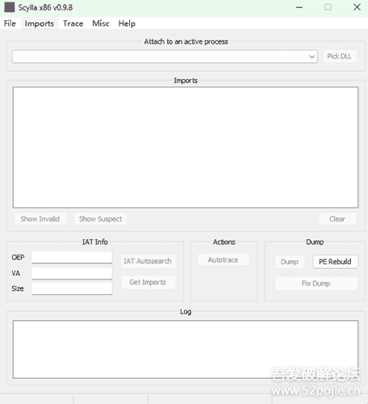
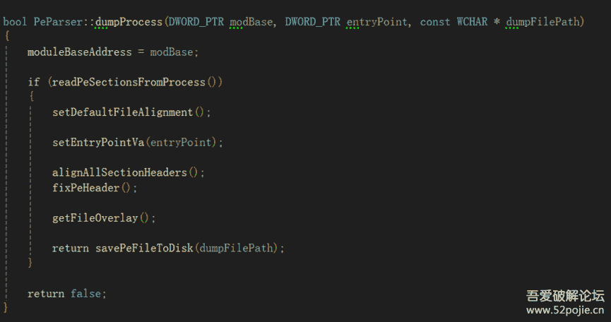
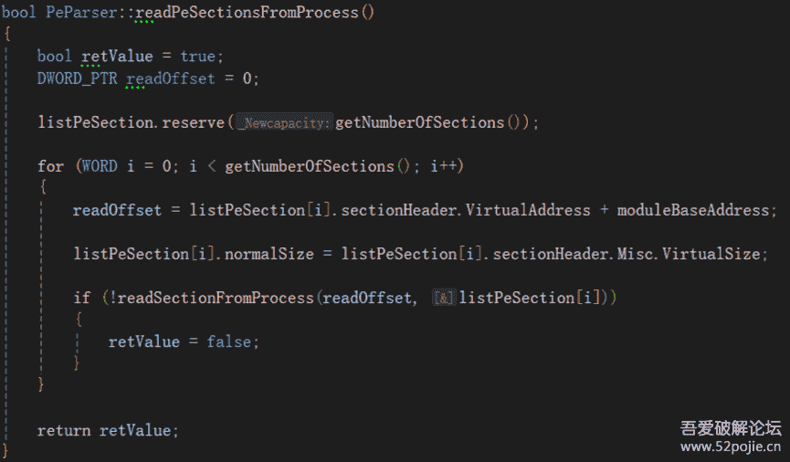
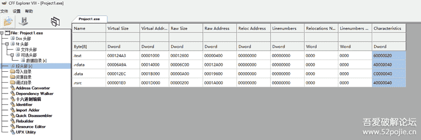
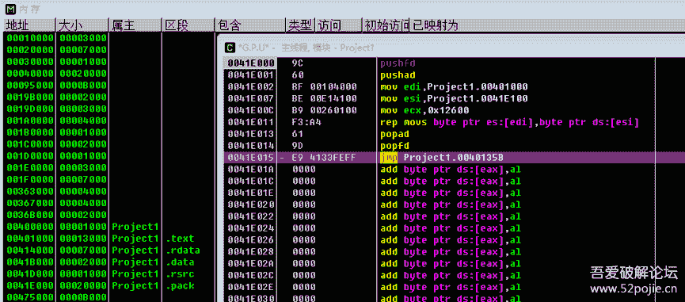
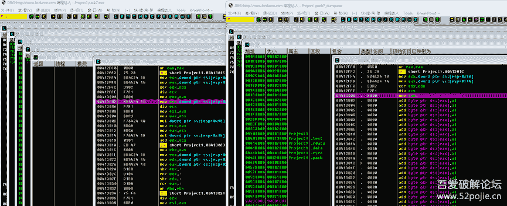
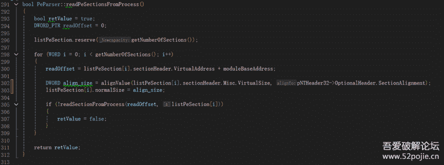

# [原创] 使用Scylla进行Dump时遇到的Bug分析、利用与修复

- 原帖: https://www.52pojie.cn/forum.php?mod=viewthread&tid=2054010
- 抓取时间: 2026-11-01T22:05:24

## 前言

Scylla是一个常用的内存转储（Dump）和导入表修复工具，你可以在很多[论坛教程](https://www.52pojie.cn/forum-5-1.html)中见到它，它是开源的（[GitHub](https://github.com/NtQuery/Scylla)）。

## 分析

下图中的代码展示了Scylla进行内存转储的主要过程。

阅读源码可以了解，在进行Dump时，Scylla假定每个区段的正常大小为对应的`Virtual Size`。

操作系统加载PE文件时，若`Virtual Size`大于`Raw Size`，会用0填充内存中的剩余空间。

`Virtual Size`也可以小于`Raw Size`，下图是用msvc编译出的一个例子。由于内存对齐，`.text`区段加载到内存中的大小为`0x13000`，这使得可以容纳略大一些的数据（`0x12600`）。

在未加壳情况下，Scylla Dump一般不会出现问题，即使`Virtual Size`小于`Raw Size`，Scylla也只是读取内存中的数据并覆盖掉前面部分的原始数据。但是当程序被加壳压缩时，`Raw Size`和`Raw Data`被清空，Scylla的Dump在特定情况下就会发生数据丢失问题。

## 利用

可以构造特定的区段结构进行反Dump。以下是手动修改程序的步骤，模拟被加壳时的状态。

1. 新增一个空的可执行区段，大小比`.text`略大一些。
2. 备份`.text`区段的数据至新区段中，清空`.text`区段的数据，清空`Raw Size`，修改`.text`区段属性可写。
3. 在新区段开头使用汇编恢复被清空的`.text`数据，修改入口点。
4. 修改`.text`区段的`Virtual Size`至一个比原始值略小的特殊值（`0x12001`），`.text`区段加载到内存中的大小仍为`0x13000`。

被加壳后的程序运行并不会发生问题。让被加壳的程序运行到OEP，再使用Scylla Dump，可以发现Dump后的程序丢失了末尾的代码，Dump后的程序无法正常运行。

## 修复

以下是我的修复，认定的正常大小不应为`Virtual Size`，修改为内存对齐后的大小。附件为修复后的Scylla。

[点击下载附件1](https://www.52pojie.cn/forum.php?mod=attachment&aid=Mjc5NzQzNXw2ZTU5NDA0N3wxNzkzNTcwNzIyfDE2ODA4NnwyMDU0MDEw)（221.26 KB，下载次数：138）

[点击下载附件2](https://www.52pojie.cn/forum.php?mod=attachment&aid=Mjc5NzQzNnwzYTQ1NDc3NHwxNzkzNTcwNzIyfDE2ODA4NnwyMDU0MDEw)（256.58 KB，下载次数：203）

下载积分：吾爱币 -1 CB
