# [Web逆向] 某验3AST分析及实现

- 原帖：https://www.52pojie.cn/forum.php?mod=viewthread&tid=2055730
- 抓取时间：2026-11-01T22:04:01

本文章中所有内容仅供学习交流使用，不用于其他任何目的，不提供完整代码，抓包内容、敏感网址、数据接口等均已做脱敏处理，严禁用于商业用途和非法用途，否则由此产生的一切后果均与作者无关。本文章未经许可禁止转载，禁止任何修改后二次传播，擅自使用本文讲解的技术而导致的任何意外，作者均不负责。某验系列一直是经典案例，很多大佬做逆向分析教程，做一期 ast 教程辅助分析。

工具站：

- batel 中文文档：[https://babel.nodejs.cn/docs/babel-core/](https://babel.nodejs.cn/docs/babel-core/)
- 在线 ast 解析：[https://astexplorer.net/](https://astexplorer.net/)
- demo 站点：[https://demos.geetest.com/slide-float.html](https://demos.geetest.com/slide-float.html)

解混淆文件：`fullpage.9.2.0-guwyxh.js` 和 `slide.7.9.3.js`

模板代码：

```javascript
let parse = require("@babel/parser").parse;
let traverse = require("@babel/traverse").default;
let generator = require("@babel/generator").default;
let fs = require("fs");
let types = require("@babel/types");

let js_code = fs.readFileSync("./源码.js", encoding = "utf-8")

// todo

let code = generator(ast).code;
fs.writeFileSync("./解混淆后.js", code)
```

如果模板文件运行有报错就安装环境，缺啥补啥

## 一、思路分析

因为两个文件整体都是一样的，所以就只分析一个，以此类推即可。先整体观察一下代码结果。

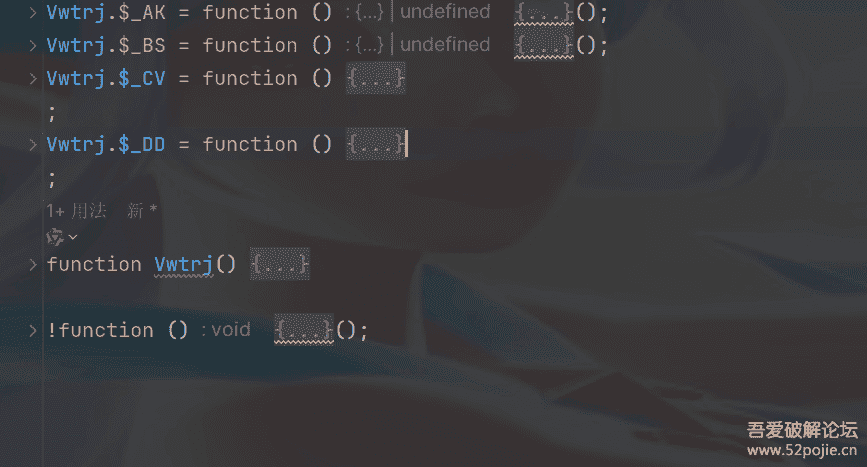

整体结构

2025-8-25 15:33 上传

附件：[下载](https://www.52pojie.cn/forum.php?mod=attachment&aid=Mjc5OTAyOHxhOGZlNzdkZXwxNzkzNTcwNjM5fDE2ODA4NnwyMDU1NzMw&nothumb=yes)

整体来说就两个部分，定义了一个对象 `Vwtrj`，同时设置了 `Vwtrj` 的一些函数方法，接着就是核心逻辑是一个大的自执行函数。很有可能是通过前面定义的对象和函数来进行混淆，我们一次对四个函数方法进行检索，看看是怎么使用的来进行混淆。

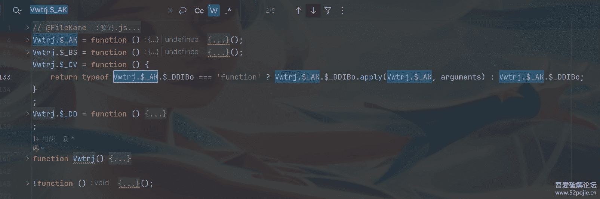

第一个函数执行

2025-8-25 15:34 上传

附件：[下载](https://www.52pojie.cn/forum.php?mod=attachment&aid=Mjc5OTAyOXxkZWU4NGNlOHwxNzkzNTcwNjM5fDE2ODA4NnwyMDU1NzMw&nothumb=yes)

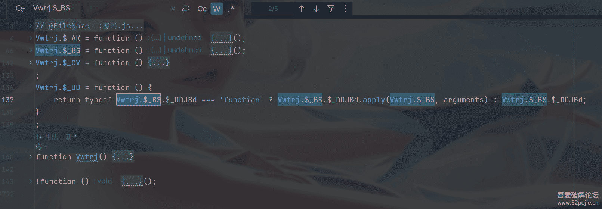

第二个函数执行

2025-8-25 15:34 上传

附件：[下载](https://www.52pojie.cn/forum.php?mod=attachment&aid=Mjc5OTAzMHw5YWI4YWRmOHwxNzkzNTcwNjM5fDE2ODA4NnwyMDU1NzMw&nothumb=yes)

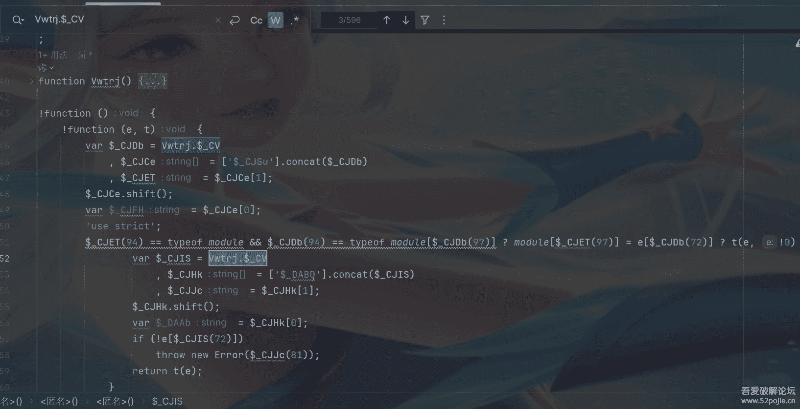

第三个函数执行

2025-8-25 15:34 上传

附件：[下载](https://www.52pojie.cn/forum.php?mod=attachment&aid=Mjc5OTAzMXw3NzJhOTZmZHwxNzkzNTcwNjM5fDE2ODA4NnwyMDU1NzMw&nothumb=yes)

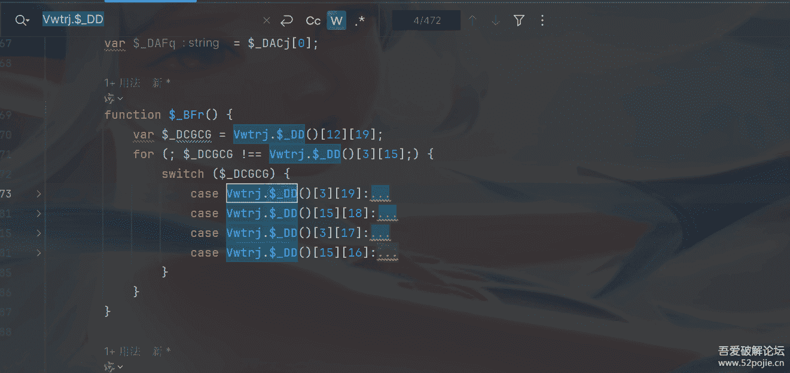

第四个函数执行

2025-8-25 15:35 上传

附件：[下载](https://www.52pojie.cn/forum.php?mod=attachment&aid=Mjc5OTAzMnwxNGFhYzc4ZHwxNzkzNTcwNjM5fDE2ODA4NnwyMDU1NzMw&nothumb=yes)

可以从搜索结果看出来，前两个函数是用来实现两个函数，后面两个函数应该是混淆的核心。所以我们有了第一部的思路，将前面的对象和函数存进内存，方便直接调用。

然后最熟悉的就是编码的混淆，很多教程也是从编码直接搜索 `w` 入手。

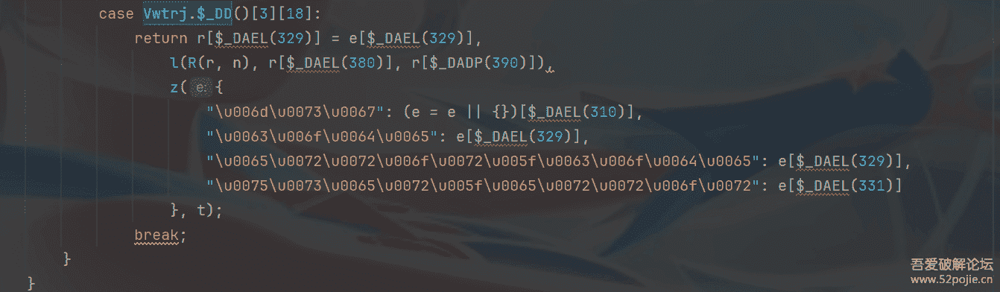

编码处理

2025-8-25 15:36 上传

附件：[下载](https://www.52pojie.cn/forum.php?mod=attachment&aid=Mjc5OTAzM3wzN2I3NGUzYXwxNzkzNTcwNjM5fDE2ODA4NnwyMDU1NzMw&nothumb=yes)

第二步就是来处理这些编码，接下来就是分析第三步的逻辑。既然前面的函数有调用，就要分析怎么实现混淆，怎么去还原，先随便找一组调用分析一下逻辑。

```javascript
var $_CJDb = Vwtrj.$_CV,
    $_CJCe = ['$_CJGu'].concat($_CJDb),
    $_CJET = $_CJCe[1];

$_CJCe.shift();

var $_CJFH = $_CJCe[0];
```

这一组代码是一个明显的 `Vwtrj.$_CV` 的重复调用，借助 pycharm（其他工具应该也有）可以发现 `$_CJFH` 最后是没有调用的，也就是说 `$_CJCe = ['$_CJGu'].concat($_CJDb)` 这也是垃圾代码，我们理一下整个代码的执行流程：

1. 将 `Vwtrj.$_CV` 赋值给 `$_CJDb`
2. 将 `$_CJDb` 放入数组 `['$_CJGu']` 中并赋值给 `$_CJET`
3. `$_CJET` 取数组索引为 1 的值
4. `$_CJCe` 去除数组首位

最后结果是 `$_CJDb = Vwtrj.$_CV`，`$_CJET = Vwtrj.$_CV`，所以这应该是我们最后解混淆出来的结果，然后我们搜一下这些最后的结果是怎么被调用的。

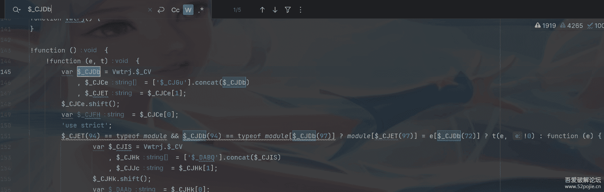

函数调用

2025-8-25 15:36 上传

附件：[下载](https://www.52pojie.cn/forum.php?mod=attachment&aid=Mjc5OTAzNHxkODU4NTg2NnwxNzkzNTcwNjM5fDE2ODA4NnwyMDU1NzMw&nothumb=yes)

这里整体调用比较少，可以多找一些类似结果用来去验证，整体来说和 ob 混淆中的解密函数逻辑类似，调用函数还原字符串。

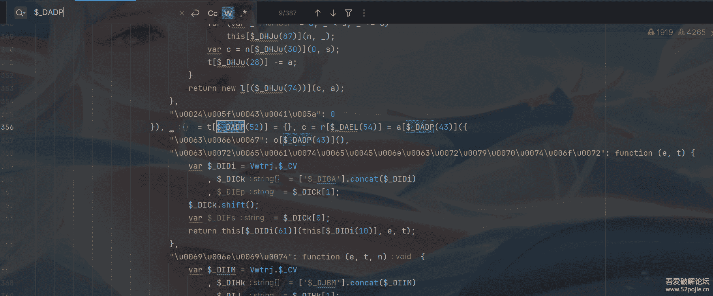

大量调用

2025-8-25 15:38 上传

附件：[下载](https://www.52pojie.cn/forum.php?mod=attachment&aid=Mjc5OTAzN3xkMGMzYzUyZnwxNzkzNTcwNjM5fDE2ODA4NnwyMDU1NzMw&nothumb=yes)

这里的一组调用逻辑就很明显了，这样的话我们就有了第三步的逻辑，我们要去处理重复逻辑的垃圾代码，类型 ob 混淆的解密函数来实现解混淆。然后我们去看另一个反复调用的函数的逻辑 `Vwtrj.$_DD` 的混淆处理。

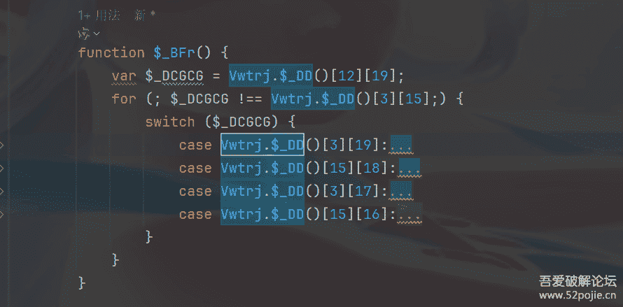

控制流

2025-8-25 15:39 上传

附件：[下载](https://www.52pojie.cn/forum.php?mod=attachment&aid=Mjc5OTAzOHw0YTQ2MzUzNnwxNzkzNTcwNjM5fDE2ODA4NnwyMDU1NzMw&nothumb=yes)

第二个混淆函数也是类似的解密函数调用逻辑，更多的是用来做控制流的处理，所以这里需要取判断控制流，来还原控制流的逻辑。

总结一下整体的思路：

1. 对象和函数存入内存，用来调用处理
2. 编码处理
3. 处理垃圾重复逻辑代码，实现函数调用还原
4. 控制流处理

这一套组合拳下来就搞定了

## 二、代码逻辑实现

首先将代码丢进在线的 ast 解析网站。

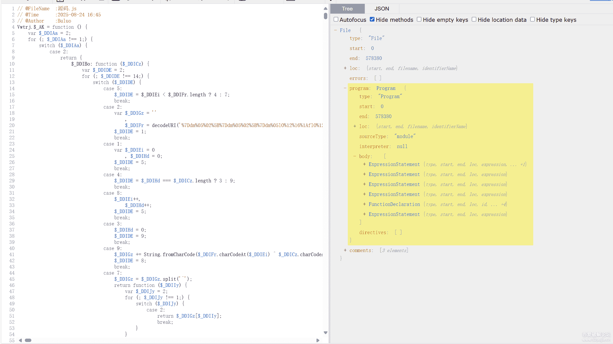

在线 ast

2025-8-25 15:39 上传

附件：[下载](https://www.52pojie.cn/forum.php?mod=attachment&aid=Mjc5OTAzOXxhM2VkMTg1M3wxNzkzNTcwNjM5fDE2ODA4NnwyMDU1NzMw&nothumb=yes)

我们可以看到需要存进内存的就是前面五个对象，后面一个是大自执行函数。我们就可以直接梭哈处理，利用 `eval` 存进内存。顺便把编码也给处理了


## 初始 AST 处理

```
let init_ast = parse(js_code)
// 读进内存
traverse(init_ast, {
    Program: function (path) {
        path.stop()
        path.get('body')[5].remove()
    }
});
eval(generator(init_ast).code)
// 编码处理
traverse(ast, {
    StringLiteral({node}) {
        if (node.extra && /\\[ux]/gi.test(node.extra.raw)) {
            node.extra = undefined;
        }
    }
});
traverse(ast, {
    NumericLiteral({node}) {
        if (node.extra && /^0[obx]/i.test(node.extra.raw)) {
            node.extra = undefined;
        }
    }
});
```

逻辑比较简单，大佬看一下就行了。接下来就是处理比较复杂的逻辑了。还是在在线网站上逐步分析。

## 混淆逻辑1

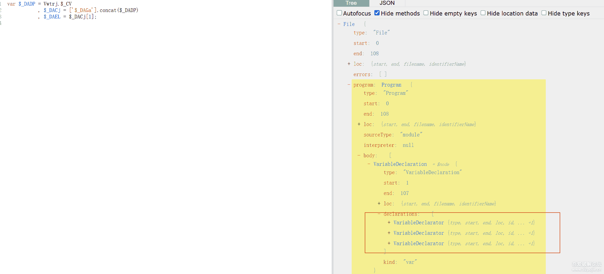

image.png (117.88 KB, 下载次数: 4)

[下载附件](https://www.52pojie.cn/forum.php?mod=attachment&aid=Mjc5OTA0MHxmM2NiMTliM3wxNzkzNTcwNjM5fDE2ODA4NnwyMDU1NzMw&nothumb=yes)

混淆逻辑1

2025-8-25 15:40 上传

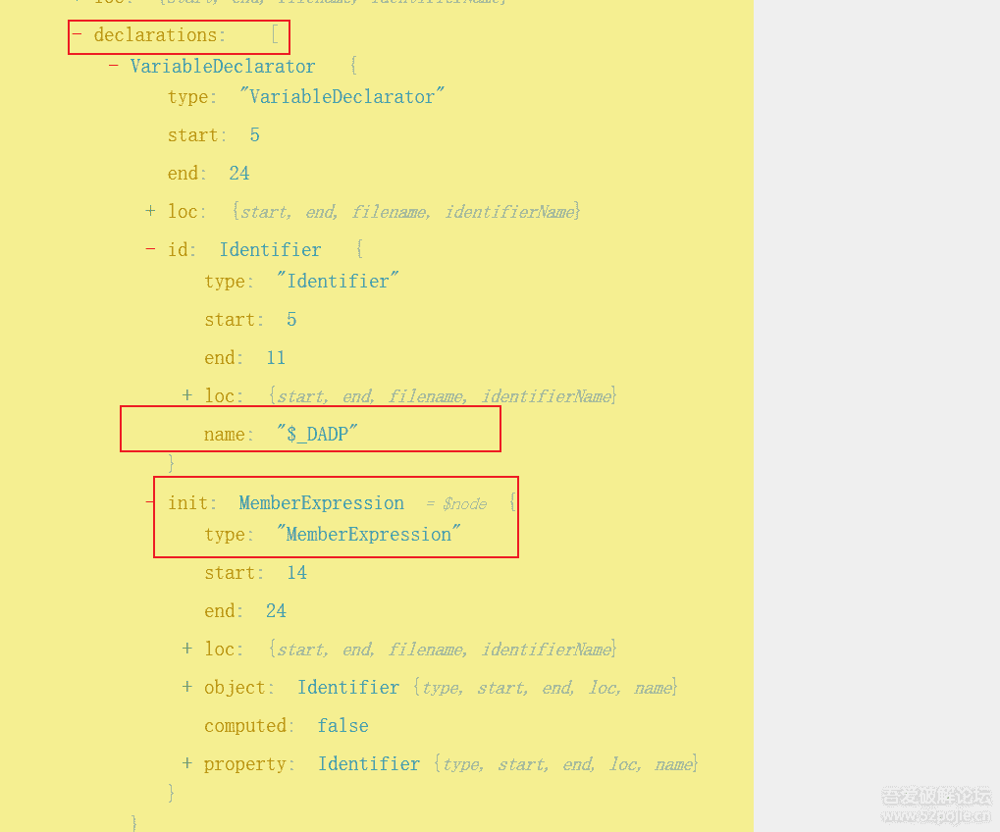

image.png (82.86 KB, 下载次数: 4)

[下载附件](https://www.52pojie.cn/forum.php?mod=attachment&aid=Mjc5OTA0MXw1NDcyODRiZHwxNzkzNTcwNjM5fDE2ODA4NnwyMDU1NzMw&nothumb=yes)

混淆逻辑1过滤

2025-8-25 15:42 上传

我们需要根据条件不断过滤，找到符合条件的所有表达式，首先需要是 `declarations` 需要数量为 3，`declarations` 第一个名称要符合 `$_` 开头，第一个的 `init` 类型应该是 `MemberExpression`，这是我的一个顾虑条件，可以根据自己分析的来写。

```
if (!/^\$_[A-Za-z_]+$/.test(node.declarations[0].id.name)) {
    return;
}

if (node.declarations.length !== 3) {
    return
}

if (!types.isMemberExpression(node.declarations[0].init)) {
    return;
}
```

接下来我们可以借助 `path.toString` 来查看是否全部符合条件，我们通过之前分析知道第二个表达式时没有用的，我们直接给他处理掉。

```
node.declarations = [node.declarations[0], node.declarations[2]]
```

因为我们将第一个表达式右侧的 `init` 属性即 `Vwtrj.$_CV` 赋值给第三个表达式。我们就先存一下这个属性值，然后赋值替换。

```
let replace_init = node.declarations[0].init

node.declarations[1].init = replace_init
```

这样我们就实现了一个简单的处理，因为这里是嵌套在逗号表达式里面的，我们需要重新构建节点，转化成变量声明。

## 节点重建与插入

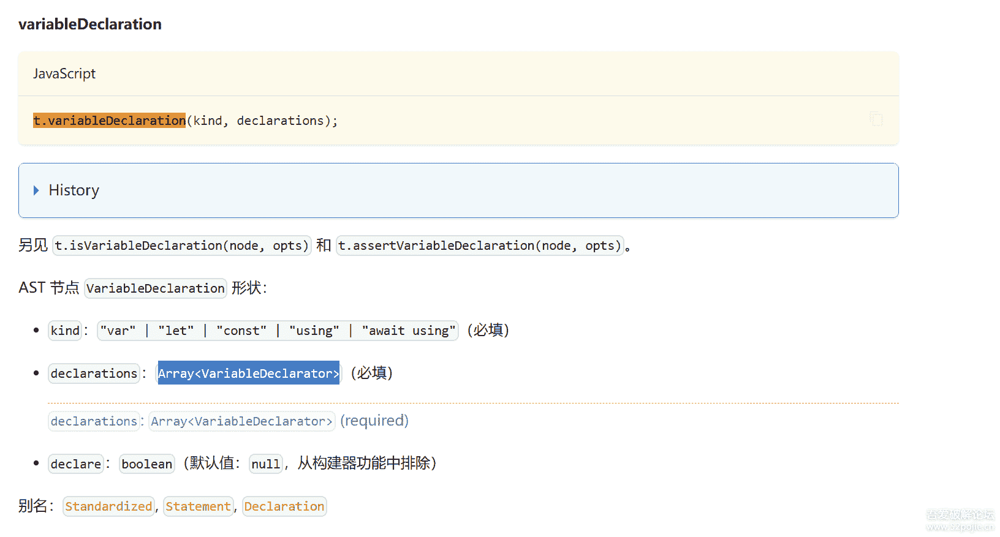

image.png (104.17 KB, 下载次数: 3)

[下载附件](https://www.52pojie.cn/forum.php?mod=attachment&aid=Mjc5OTA0MnwyYWFmNTdkNXwxNzkzNTcwNjM5fDE2ODA4NnwyMDU1NzMw&nothumb=yes)

节点1

2025-8-25 15:42 上传

根据 `types` 的官方文档，我们需要传入的是 `kind` 和 `Array` 的格式，我们就需要先构建 `VariableDeclarator` 节点。

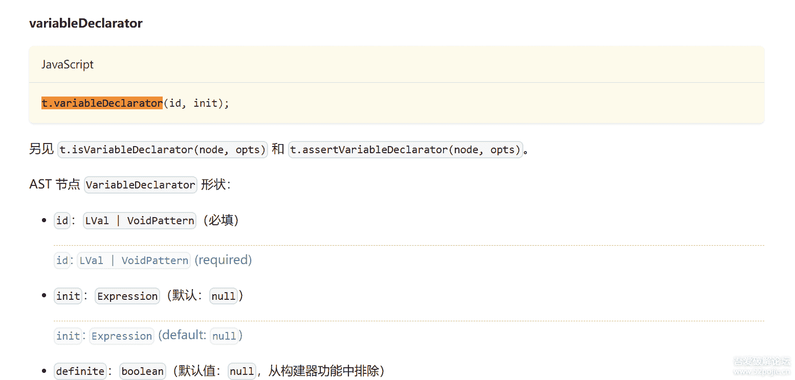

image.png (90.08 KB, 下载次数: 3)

[下载附件](https://www.52pojie.cn/forum.php?mod=attachment&aid=Mjc5OTA0M3xlNzIzY2RlOHwxNzkzNTcwNjM5fDE2ODA4NnwyMDU1NzMw&nothumb=yes)

节点2

2025-8-25 15:44 上传

可以看出我们需要传入 `id` 和 `init` 的值，同时 `init` 需要是 `Expression` 类型，这样我们直接就可以直接构建。

```
let {id, init} = declarations

let newNode = types.VariableDeclarator(id, init)

path.insertBefore(types.variableDeclaration('let', [newNode]))
```

这样我们就可以成功构建出节点，同时插入到当前节点之前。在我们分析的时候知道还有一些节点是没有用处的，我们可以通过 `getNextSibling()` 删除兄弟节点。查看一下结果。

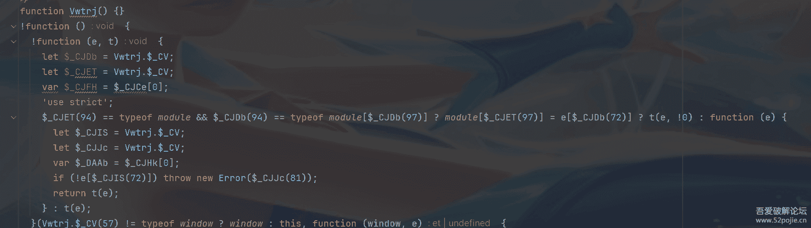

image.png (409.01 KB, 下载次数: 4)

[下载附件](https://www.52pojie.cn/forum.php?mod=attachment&aid=Mjc5OTA0NHw2M2FjMWQ4NXwxNzkzNTcwNjM5fDE2ODA4NnwyMDU1NzMw&nothumb=yes)

第一次混淆结果

2025-8-25 15:46 上传

稍微有一点瑕疵，有一个垃圾代码没有删除，其他的已经成功符合预期。接下来就是还原函数调用。先收集函数名称，然后替换，之前的文章以及提到过，不是这里的重点，我们继续分析控制流的处理方法和逻辑。

## 控制流处理

还是先丢到在线 `ast` 当中，帮助我们分析，我们随便选一个控制流的代码。

```
function r(e, t) {
    var $_DCGHt = Vwtrj.$_DD()[0][19];
    for (; $_DCGHt !== Vwtrj.$_DD()[3][16];) {
        switch ($_DCGHt) {
            case Vwtrj.$_DD()[12][19]:
                var n = 1;
                $_DCGHt = Vwtrj.$_DD()[0][18];
                break;
            case Vwtrj.$_DD()[0][18]:
                while (t--) n *= e--;
                $_DCGHt = Vwtrj.$_DD()[12][17];
                break;
            case Vwtrj.$_DD()[0][17]:
                return n;
                break;
        }
    }
}
```

整体来看控制流的核心是 `$_DCGHt` 或者说 `Vwtrj.$_DD()[0][19]` 的值，因为我们现在写 `ast` 的代码中已经将这个函数读进了内存，所以我们直接调用测试一下，写一个简单的执行代码，判断逻辑.

```
var $_DCGHt = Vwtrj.$_DD()[0][19];

for (; $_DCGHt !== Vwtrj.$_DD()[3][16];) {
    switch ($_DCGHt) {
        case Vwtrj.$_DD()[12][19]:
            console.log('执行控制流1')
            $_DCGHt = Vwtrj.$_DD()[0][18];
            break;
        case Vwtrj.$_DD()[0][18]:
            console.log('执行控制流2')
            $_DCGHt = Vwtrj.$_DD()[12][17];
            break;
        case Vwtrj.$_DD()[0][17]:
            console.log('执行控制流3')
            return
            break;
    }
}
```

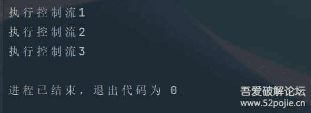

image.png (41.86 KB, 下载次数: 4)

[下载附件](https://www.52pojie.cn/forum.php?mod=attachment&aid=Mjc5OTA0NXw1MTI5OTlmZHwxNzkzNTcwNjM5fDE2ODA4NnwyMDU1NzMw&nothumb=yes)

控制流逻辑

2025-8-25 15:47 上传

发现一个有意思的事情，他是一个恒为真的，依次执行的一个逻辑所以我们只需要把他按照顺序从控制流里面拿出来，放到函数的块里，就可以实现。我们还是按照之前的步骤，丢进在线网站进行解析。

```
let {node, parentPath} = path;
if (parentPath.isBlockStatement() && parentPath.node.body.length !== 2) {
    return
}
if (node.init && node.update) {
    return;
}
let body = node.body.body[0]
if (!types.isSwitchStatement(body)) {
    return;
}
if (body.cases.length === 0) {
    path.remove()
    return;
}
if (!types.isMemberExpression(body.cases[0].test)) {
    return;
}
```

大概是这样的一个逻辑，这样我们就能取到所有的控制流代码，同时删除没用的代码。

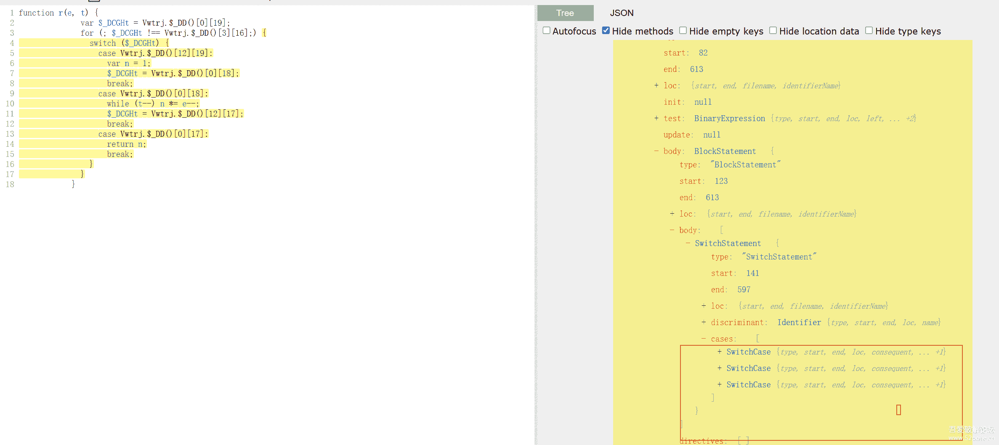

image.png (182.37 KB, 下载次数: 4)

[下载附件](https://www.52pojie.cn/forum.php?mod=attachment&aid=Mjc5OTA0OHxhMTEwNTMyNXwxNzkzNTcwNjM5fDE2ODA4NnwyMDU1NzMw&nothumb=yes)

case

2025-8-25 16:01 上传

可以看到所有的控制流代码丢在 `case` 里面，我们需要一个数组，依次将他们取出来，并按照顺序存储，有一点需要注意，`case` 中有一个固定的 `beark` 方法，需要利用切片处理一下。

```
let body_parent = parentPath.node.body

let consequent = []

if (body.cases.length > 1) {
    let consequents = body.cases
    for (let i of consequents) {
        i = i.consequent.slice(0, -1)
        consequent.push(...i)
    }
    body_parent.push(...consequent)
} else {
    body_parent.push(...consequent)
}
```

非常简单就搞定了，同时可以自行删除一下垃圾代码，看一下最后的整体效果，略有瑕疵，大佬们可以修改一下。

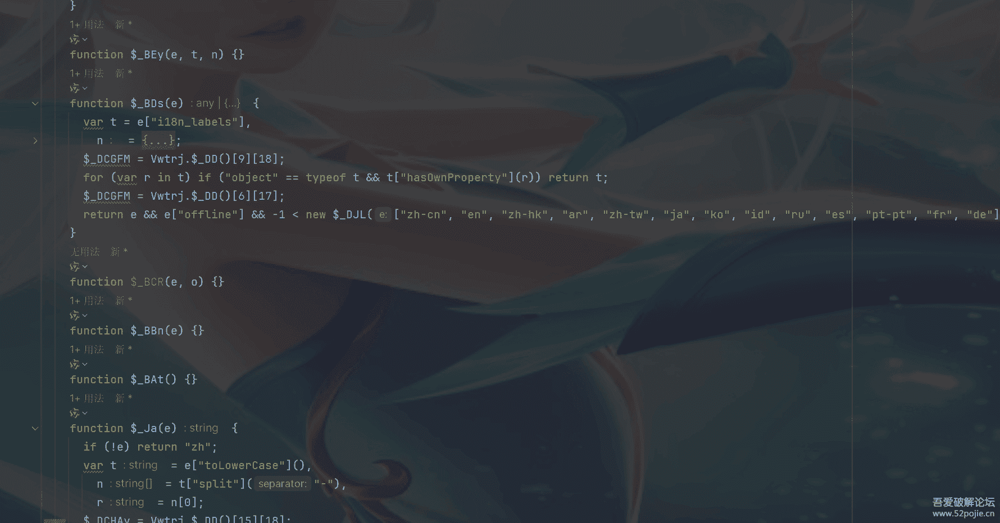

image.png (671.68 KB, 下载次数: 4)

[下载附件](https://www.52pojie.cn/forum.php?mod=attachment&aid=Mjc5OTA0OXwxNzg2MzcyNHwxNzkzNTcwNjM5fDE2ODA4NnwyMDU1NzMw&nothumb=yes)

最后结果

2025-8-25 16:07 上传

## 三、总结

整体代码量不大，主要是处理的思路，代码略有一些瑕疵，大佬们可以简单优化一下就行了{:1_932:}我的一个大致处理的思路，仁者见仁，智者见智。看文档真的嘎嘎重要，还有就是蔡老板的文章学到了很多{:1_932:}
