# [Web逆向] 彻底解决前端无限`debugger`

- 原帖: https://www.52pojie.cn/forum.php?mod=viewthread&tid=2056072
- 抓取时间: 2026-11-01T22:03:57

## 0x00 前言

在很久之前我发过一篇JS逆向系列14-Bypass `Debugger`，但是这篇文章写的还是不太全，我决定在本篇文章中一次性将所有可能遇到的情况都写出来，具体请看下文。

注：本文不涉及修改chrome内核绕过`debugger`。

## 0x01 正文

实现前端无限`debugger`的三种核心方式为：

## 无限 debugger 触发方式

1. `eval`
2. `Function`
3. `Function.prototype.constructor`

当然除了上面这三种方法外，也有别的方法可以实现，例如下面这种定时器：

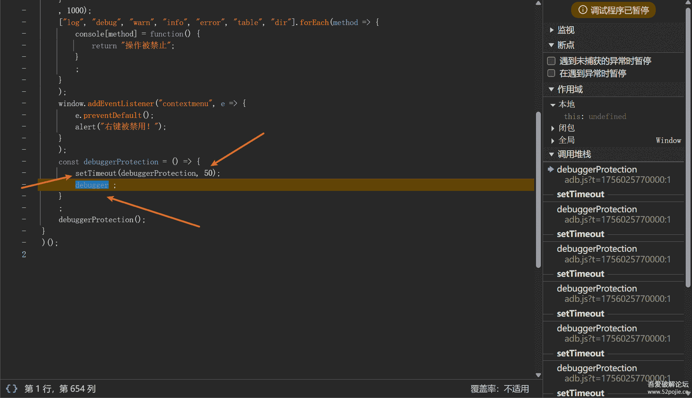

1756025843534.png (211.5 KB, 下载次数: 6)

[href="forum.php?mod=attachment&aid=Mjc5OTI5M3wzZDMwYzZmOHwxNzkzNTcwNjM1fDE2ODA4NnwyMDU2MDcy&nothumb=yes" target="_blank"](https://www.52pojie.cn/forum.php?mod=attachment&aid=Mjc5OTI5M3wzZDMwYzZmOHwxNzkzNTcwNjM1fDE2ODA4NnwyMDU2MDcy&nothumb=yes)

2025-8-27 00:11 上传

图上的代码使用了`setTimeout`定时每0.05秒调用一次`debuggerProtection`方法，方法内部有个`debugger`，通过这种方式就能引起无限`debugger`。

这种显式的将`debugger`写到前端代码里用来实现无限`debugger`的方法我称之为显式无限`debugger`，这种是可以直接绕过的。我提供了三种解决方案供大家参考：

- 条件断点
- 替换
- `hook`

前两个我都在之前的文章中讲过，现在我将那些内容搬到这篇文章中重新讲一遍。首先讲一下如何实现条件断点：右键执行`debugger`的那行代码的左侧，点击添加条件断点：

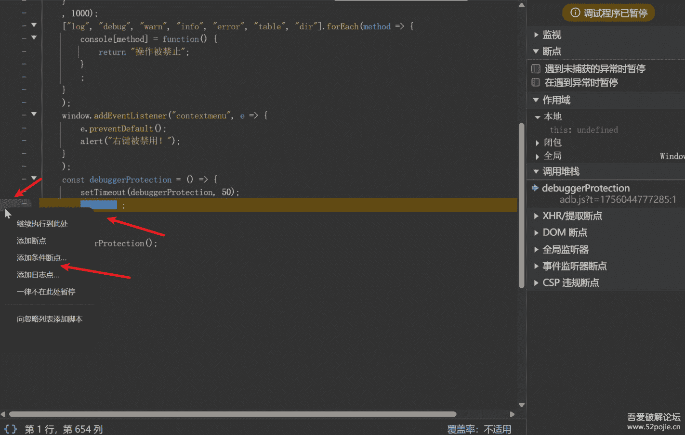

1756044841964.png (313.66 KB, 下载次数: 6)

[href="forum.php?mod=attachment&aid=Mjc5OTI5NHw3NDU1MTg0MHwxNzkzNTcwNjM1fDE2ODA4NnwyMDU2MDcy&nothumb=yes" target="_blank"](https://www.52pojie.cn/forum.php?mod=attachment&aid=Mjc5OTI5NHw3NDU1MTg0MHwxNzkzNTcwNjM1fDE2ODA4NnwyMDU2MDcy&nothumb=yes)

2025-8-27 00:12 上传

条件设置为false：

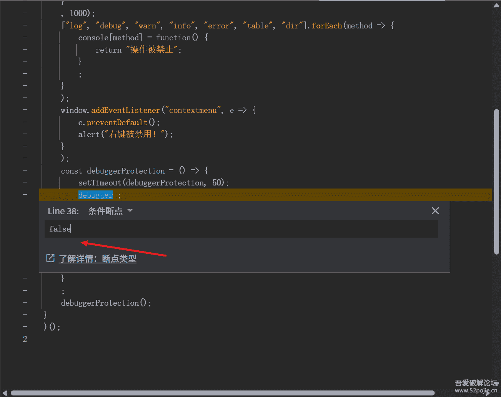

1756044856203.png (99.09 KB, 下载次数: 5)

[href="forum.php?mod=attachment&aid=Mjc5OTI5NXxjMWU5MWFiN3wxNzkzNTcwNjM1fDE2ODA4NnwyMDU2MDcy&nothumb=yes" target="_blank"](https://www.52pojie.cn/forum.php?mod=attachment&aid=Mjc5OTI5NXxjMWU5MWFiN3wxNzkzNTcwNjM1fDE2ODA4NnwyMDU2MDcy&nothumb=yes)

2025-8-27 00:12 上传

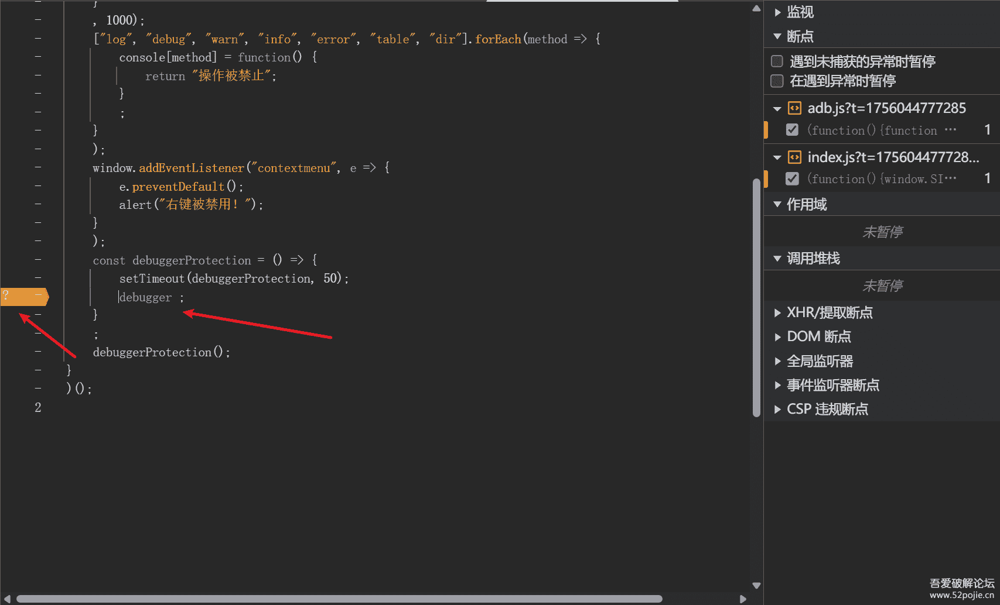

1756044940931.png (165.83 KB, 下载次数: 5)

[href="forum.php?mod=attachment&aid=Mjc5OTI5NnxmMWY5NzAxOXwxNzkzNTcwNjM1fDE2ODA4NnwyMDU2MDcy&nothumb=yes" target="_blank"](https://www.52pojie.cn/forum.php?mod=attachment&aid=Mjc5OTI5NnxmMWY5NzAxOXwxNzkzNTcwNjM1fDE2ODA4NnwyMDU2MDcy&nothumb=yes)

2025-8-27 00:12 上传

现在这个`debugger`就不会生效了，但是这东西只能生效一次，意思就是你刷新网站之后这个条件断点就没了，所以这时候就可以考虑使用替换或者`hook`的方式进行绕过，下面我继续讲一下该如何进行替换。

### 替换

`F12`打开`devtools`后，点击源代码，左上方有一些板块：

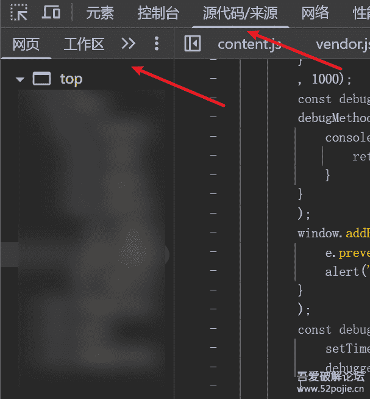

1756222888512.png (93 KB, 下载次数: 5)

[href="forum.php?mod=attachment&aid=Mjc5OTI5N3w2OTdiYWMzZXwxNzkzNTcwNjM1fDE2ODA4NnwyMDU2MDcy&nothumb=yes" target="_blank"](https://www.52pojie.cn/forum.php?mod=attachment&aid=Mjc5OTI5N3w2OTdiYWMzZXwxNzkzNTcwNjM1fDE2ODA4NnwyMDU2MDcy&nothumb=yes)

2025-8-27 00:12 上传

展开点击替换：

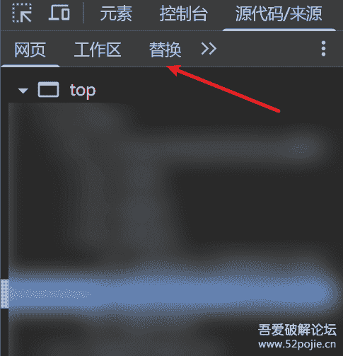

1756204067564.png (79.95 KB, 下载次数: 4)

[href="forum.php?mod=attachment&aid=Mjc5OTI5OHw0Njc4YzQ1NHwxNzkzNTcwNjM1fDE2ODA4NnwyMDU2MDcy&nothumb=yes" target="_blank"](https://www.52pojie.cn/forum.php?mod=attachment&aid=Mjc5OTI5OHw0Njc4YzQ1NHwxNzkzNTcwNjM1fDE2ODA4NnwyMDU2MDcy&nothumb=yes)

2025-8-27 00:12 上传

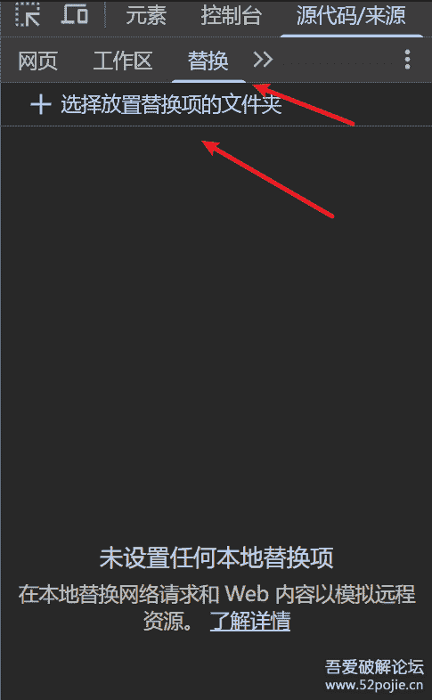

1756204079888.png (50.1 KB, 下载次数: 6)

[href="forum.php?mod=attachment&aid=Mjc5OTI5OXxhY2Q4MTZkNHwxNzkzNTcwNjM1fDE2ODA4NnwyMDU2MDcy&nothumb=yes" target="_blank"](https://www.52pojie.cn/forum.php?mod=attachment&aid=Mjc5OTI5OXxhY2Q4MTZkNHwxNzkzNTcwNjM1fDE2ODA4NnwyMDU2MDcy&nothumb=yes)

2025-8-27 00:13 上传

点击上面的选择放置替换项的文件夹，选择一个存放替换后的`js`文件的文件夹，并点击允许：

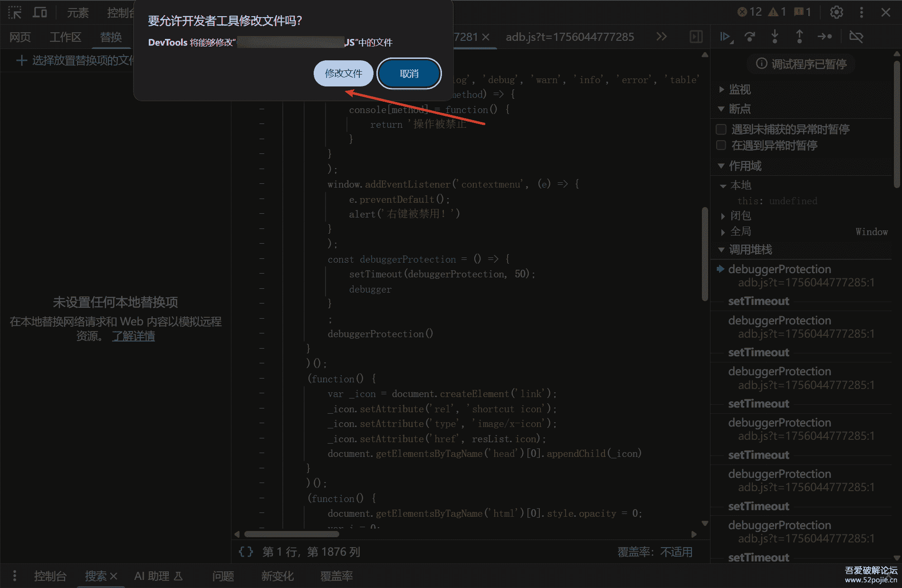

1756045573316.png (316.03 KB, 下载次数: 5)

[href="forum.php?mod=attachment&aid=Mjc5OTMwMHw5MDRlZWM0N3wxNzkzNTcwNjM1fDE2ODA4NnwyMDU2MDcy&nothumb=yes" target="_blank"](https://www.52pojie.cn/forum.php?mod=attachment&aid=Mjc5OTMwMHw5MDRlZWM0N3wxNzkzNTcwNjM1fDE2ODA4NnwyMDU2MDcy&nothumb=yes)

2025-8-27 00:13 上传

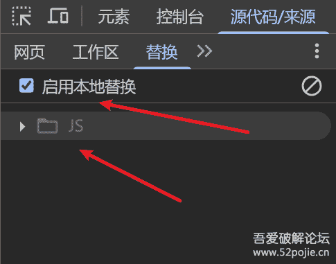

1756204110187.png (37.17 KB, 下载次数: 5)

[href="forum.php?mod=attachment&aid=Mjc5OTMwMXw3ODNiNWU1ZXwxNzkzNTcwNjM1fDE2ODA4NnwyMDU2MDcy&nothumb=yes" target="_blank"](https://www.52pojie.cn/forum.php?mod=attachment&aid=Mjc5OTMwMXw3ODNiNWU1ZXwxNzkzNTcwNjM1fDE2ODA4NnwyMDU2MDcy&nothumb=yes)

2025-8-27 00:13 上传

此时回到`js`中，找到执行`debugger`的位置：

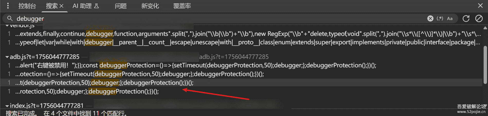

1756045702437.png (187.27 KB, 下载次数: 5)

[href="forum.php?mod=attachment&aid=Mjc5OTMwMnw5Zjg0YWE3OHwxNzkzNTcwNjM1fDE2ODA4NnwyMDU2MDcy&nothumb=yes" target="_blank"](https://www.52pojie.cn/forum.php?mod=attachment&aid=Mjc5OTMwMnw5Zjg0YWE3OHwxNzkzNTcwNjM1fDE2ODA4NnwyMDU2MDcy&nothumb=yes)

2025-8-27 00:13 上传

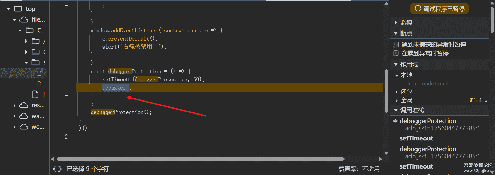

1756045725636.png (146.58 KB, 下载次数: 7)

[href="forum.php?mod=attachment&aid=Mjc5OTMwM3w1NDk1YTM5ZXwxNzkzNTcwNjM1fDE2ODA4NnwyMDU2MDcy&nothumb=yes" target="_blank"](https://www.52pojie.cn/forum.php?mod=attachment&aid=Mjc5OTMwM3w1NDk1YTM5ZXwxNzkzNTcwNjM1fDE2ODA4NnwyMDU2MDcy&nothumb=yes)

2025-8-27 00:13 上传

右键点击替换内容：

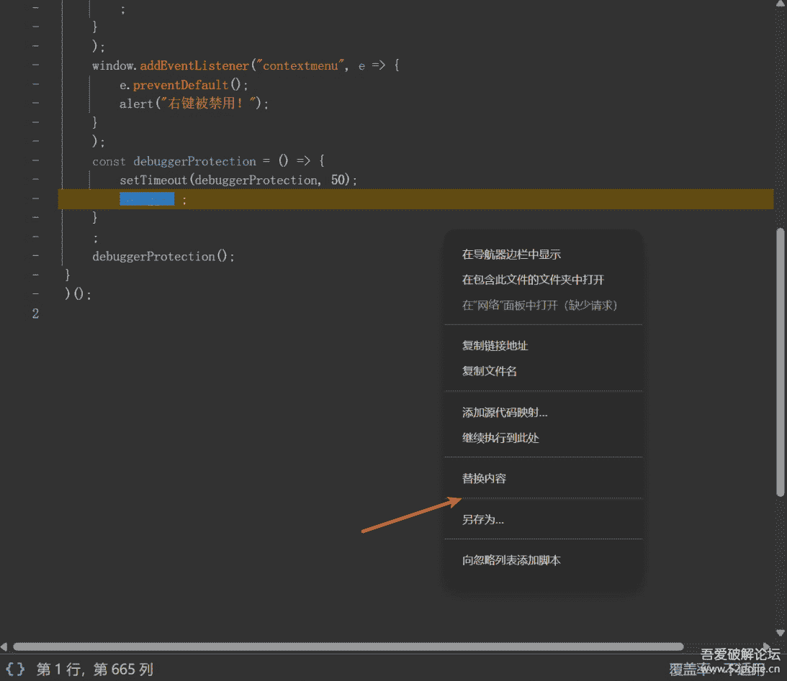

1756045755005.png (201.51 KB, 下载次数: 5)

[href="forum.php?mod=attachment&aid=Mjc5OTMwNHw1OTU5YTVmN3wxNzkzNTcwNjM1fDE2ODA4NnwyMDU2MDcy&nothumb=yes" target="_blank"](https://www.52pojie.cn/forum.php?mod=attachment&aid=Mjc5OTMwNHw1OTU5YTVmN3wxNzkzNTcwNjM1fDE2ODA4NnwyMDU2MDcy&nothumb=yes)

2025-8-27 00:14 上传

此时删去`debugger`：

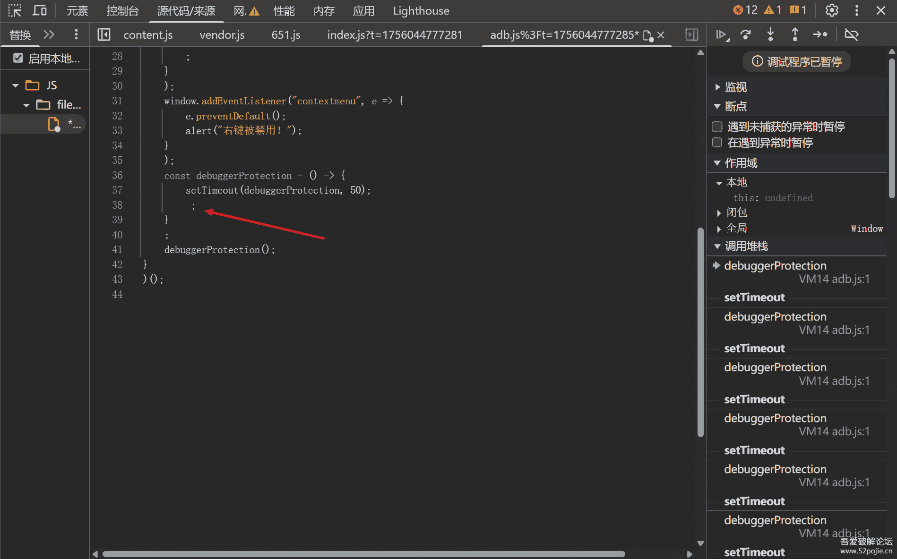

1756045780701.png (214.24 KB, 下载次数: 4)

[href="forum.php?mod=attachment&aid=Mjc5OTMwNXwzMGY3OGY1Y3wxNzkzNTcwNjM1fDE2ODA4NnwyMDU2MDcy&nothumb=yes" target="_blank"](https://www.52pojie.cn/forum.php?mod=attachment&aid=Mjc5OTMwNXwzMGY3OGY1Y3wxNzkzNTcwNjM1fDE2ODA4NnwyMDU2MDcy&nothumb=yes)

2025-8-27 00:14 上传

然后再`ctrl+s`保存即可：

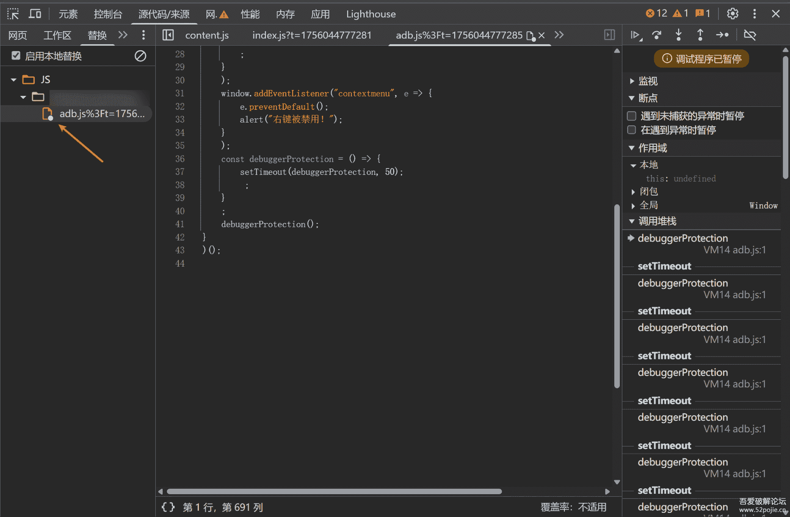

1756204140640.png (418.24 KB, 下载次数: 6)

[href="forum.php?mod=attachment&aid=Mjc5OTMwNnxkMjRlODIzMHwxNzkzNTcwNjM1fDE2ODA4NnwyMDU2MDcy&nothumb=yes" target="_blank"](https://www.52pojie.cn/forum.php?mod=attachment&aid=Mjc5OTMwNnxkMjRlODIzMHwxNzkzNTcwNjM1fDE2ODA4NnwyMDU2MDcy&nothumb=yes)

2025-8-27 00:14 上传

文件名左边没有*号就代表已经保存成功了，此时刷新就会加载我们替换过的`JS`：

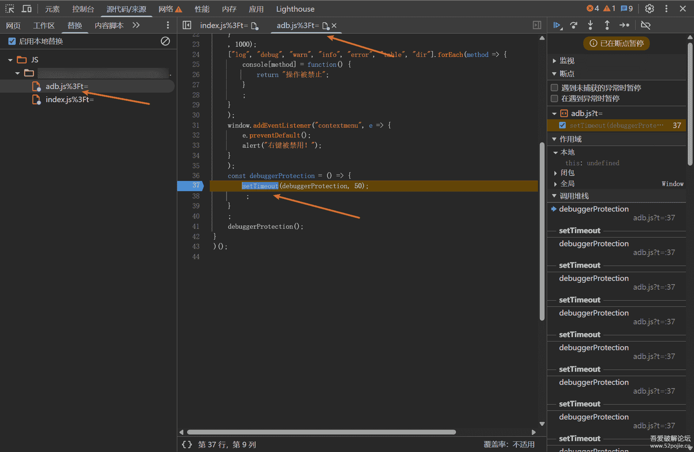

1756046507850.png (208.31 KB, 下载次数: 5)

[href="forum.php?mod=attachment&aid=Mjc5OTMwN3wyNTUyZGJhY3wxNzkzNTcwNjM1fDE2ODA4NnwyMDU2MDcy&nothumb=yes" target="_blank"](https://www.52pojie.cn/forum.php?mod=attachment&aid=Mjc5OTMwN3wyNTUyZGJhY3wxNzkzNTcwNjM1fDE2ODA4NnwyMDU2MDcy&nothumb=yes)

2025-8-27 00:14 上传

现在就不会再有`debugger`的干扰了。

这里我强调一下替换的两个注意事项：

- 替换`js`后需要开着`f12`访问网站才会执行替换后的`js`，否则加载的还是原本服务端的`js`。
- 如果发现修改后网站依然没有我们想要的效果，此时可以在替换后的`js`打个断点，检验一下网站是否加载的是我们替换后的`js`。

针对第二点我可以举个例子，例如下面这种情况：

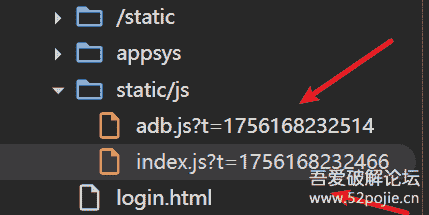

1756168251692.png (20.42 KB, 下载次数: 5)

[href="forum.php?mod=attachment&aid=Mjc5OTMwOHwyOTNhYTU5ZHwxNzkzNTcwNjM1fDE2ODA4NnwyMDU2MDcy&nothumb=yes" target="_blank"](https://www.52pojie.cn/forum.php?mod=attachment&aid=Mjc5OTMwOHwyOTNhYTU5ZHwxNzkzNTcwNjM1fDE2ODA4NnwyMDU2MDcy&nothumb=yes)

2025-8-27 00:14 上传

可以看到目标网站的`js`文件名后都加了一个时间戳，这个时间戳是会影响到我们替换`js`的，例如我现在替换一下`adb`文件，删除该文件的`debugger`字段并重新进入网站：

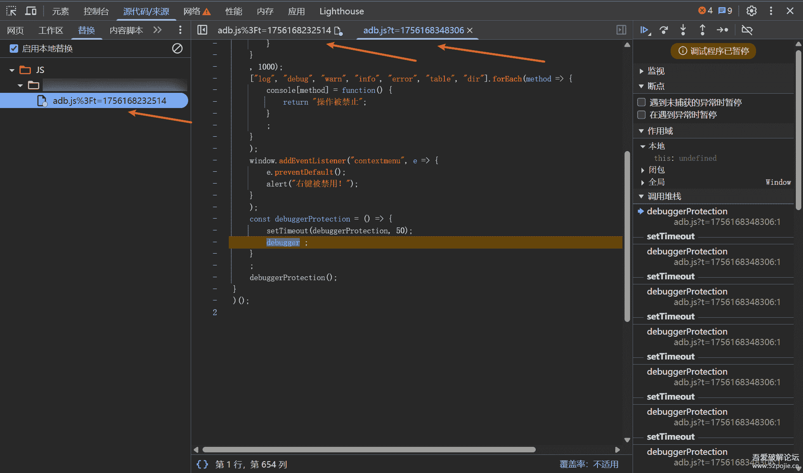

1756168376178.png (198.82 KB, 下载次数: 6)

[href="forum.php?mod=attachment&aid=Mjc5OTMwOXw4MjY3ZmYzYXwxNzkzNTcwNjM1fDE2ODA4NnwyMDU2MDcy&nothumb=yes" target="_blank"](https://www.52pojie.cn/forum.php?mod=attachment&aid=Mjc5OTMwOXw4MjY3ZmYzYXwxNzkzNTcwNjM1fDE2ODA4NnwyMDU2MDcy&nothumb=yes)

2025-8-27 00:14 上传

可见网站并没有加载我们替换的`js`，依然弹出了`debugger`，原因很简单，就是因为网站导入`js`时往文件名后面加了个时间戳：

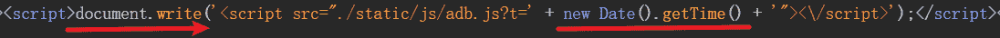

1756168471323.png (15.31 KB, 下载次数: 5)

[href="forum.php?mod=attachment&aid=Mjc5OTMxMHw3YTk3OTljMnwxNzkzNTcwNjM1fDE2ODA4NnwyMDU2MDcy&nothumb=yes" target="_blank"](https://www.52pojie.cn/forum.php?mod=attachment&aid=Mjc5OTMxMHw3YTk3OTljMnwxNzkzNTcwNjM1fDE2ODA4NnwyMDU2MDcy&nothumb=yes)

2025-8-27 00:15 上传

这就导致替换的`js`与刷新网站后加载的`js`文件名不一致，导致替换不成功。解决这种问题很简单，那就是删除`new Date().getTime()`：

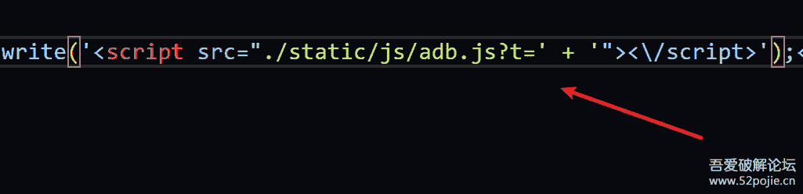

1756168600372.png (24.61 KB, 下载次数: 6)

[href="forum.php?mod=attachment&aid=Mjc5OTMxMXw4NWQxZDU5NHwxNzkzNTcwNjM1fDE2ODA4NnwyMDU2MDcy&nothumb=yes" target="_blank"](https://www.52pojie.cn/forum.php?mod=attachment&aid=Mjc5OTMxMXw4NWQxZDU5NHwxNzkzNTcwNjM1fDE2ODA4NnwyMDU2MDcy&nothumb=yes)

2025-8-27 00:15 上传

现在加载的`js`就不会带时间戳：

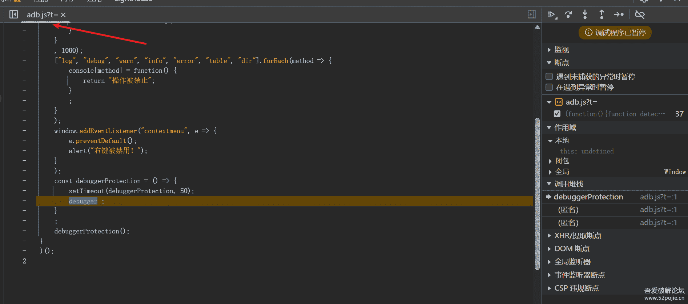

1756168627602.png (131.17 KB, 下载次数: 6)

[href="forum.php?mod=attachment&aid=Mjc5OTMxMnxjN2ViOWU2NXwxNzkzNTcwNjM1fDE2ODA4NnwyMDU2MDcy&nothumb=yes" target="_blank"](https://www.52pojie.cn/forum.php?mod=attachment&aid=Mjc5OTMxMnxjN2ViOWU2NXwxNzkzNTcwNjM1fDE2ODA4NnwyMDU2MDcy&nothumb=yes)

2025-8-27 00:15 上传

替换的时候就没问题了：

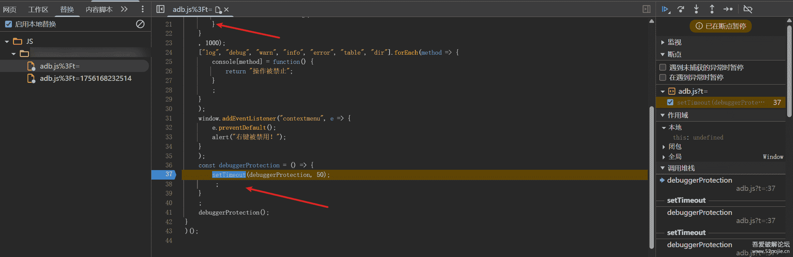

1756220994204.png (230.59 KB, 下载次数: 5)

[href="forum.php?mod=attachment&aid=Mjc5OTMxM3xhYzU3NGJlZXwxNzkzNTcwNjM1fDE2ODA4NnwyMDU2MDcy&nothumb=yes" target="_blank"](https://www.52pojie.cn/forum.php?mod=attachment&aid=Mjc5OTMxM3xhYzU3NGJlZXwxNzkzNTcwNjM1fDE2ODA4NnwyMDU2MDcy&nothumb=yes)

2025-8-27 00:15 上传

成功加载了我们替换后的`js`。

我在上面还提供了一个方案，那就是`hook`，首先`hook`肯定能解决使用`setTimeout`引起无限`debugger`的问题，但是我这里就不提供相关`hook`脚本了，主要是因为我对`hook` `setTimeout`不太放心，有些开发者可能会利用此类方法去实现动画渲染或者其他用处，所以我担心`hook`此类方法后会造成不必要的异常，并且解决此类无限`debugger`也很简单，所以我在这里也就不提供相关代码了。

## 核心方式绕过

讲完使用定时器引起无限`debugger`的解决方案后，现在我就来讲讲如何绕过我文章中最开始所说的那三种引起无限`debugger`的核心方式，目前市面上的主流方式，首先可以直接使用我的插件----`AntiDebug_Breaker`：

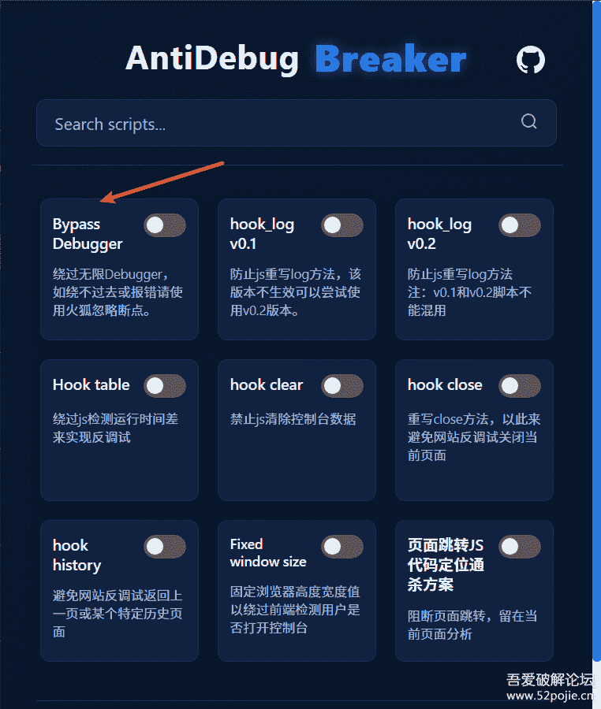

1756169318665.png (181.43 KB, 下载次数: 6)

[href="forum.php?mod=attachment&aid=Mjc5OTMxNHwxYTBkZDMxNnwxNzkzNTcwNjM1fDE2ODA4NnwyMDU2MDcy&nothumb=yes" target="_blank"](https://www.52pojie.cn/forum.php?mod=attachment&aid=Mjc5OTMxNHwxYTBkZDMxNnwxNzkzNTcwNjM1fDE2ODA4NnwyMDU2MDcy&nothumb=yes)

2025-8-27 00:15 上传

`github`地址：https://github.com/0xsdeo/AntiDebug_Breaker，该脚本可以绕过大部分存在无限`debugger`的网站，但是在某些网站可能会出现异常，例如下面这种情况：

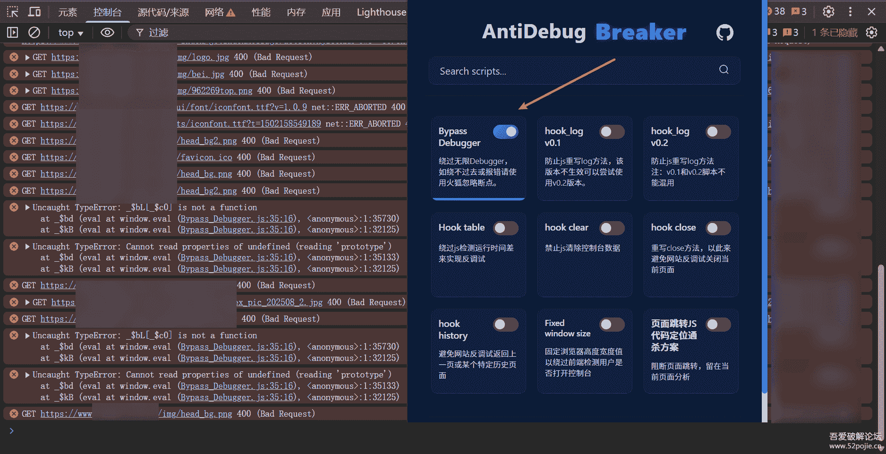

1756221140038.png (551.25 KB, 下载次数: 7)

[href="forum.php?mod=attachment&aid=Mjc5OTMxNXwwYTYwZmMxOHwxNzkzNTcwNjM1fDE2ODA4NnwyMDU2MDcy&nothumb=yes" target="_blank"](https://www.52pojie.cn/forum.php?mod=attachment&aid=Mjc5OTMxNXwwYTYwZmMxOHwxNzkzNTcwNjM1fDE2ODA4NnwyMDU2MDcy&nothumb=yes)

2025-8-27 00:16 上传

像这种出现一大堆异常的只有一种原因，那就是因为`eval`的作用域问题，如有兴趣的读者朋友们可以去看一下我这篇文章：`JS`逆向系列15-深入探究`Hook` `eval`后存在的作用域问题，首先我先说明一下，这个问题无解，如果有人能解出，那么从代码层面上就能彻底解决无限`debugger`的问题了，但至少从我目前的视角来看，这种语法限制的问题绝对是解决不了的，至少我解决不了，所以如果遇到这种情况可以先开启下面这个设置：

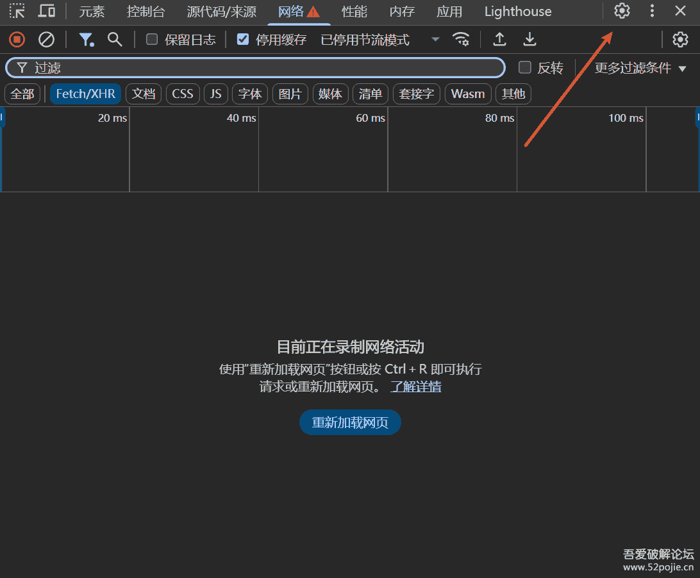

1756221220212.png (70.55 KB, 下载次数: 4)

[href="forum.php?mod=attachment&aid=Mjc5OTMxNnw2OTYyNjI4YnwxNzkzNTcwNjM1fDE2ODA4NnwyMDU2MDcy&nothumb=yes" target="_blank"](https://www.52pojie.cn/forum.php?mod=attachment&aid=Mjc5OTMxNnw2OTYyNjI4YnwxNzkzNTcwNjM1fDE2ODA4NnwyMDU2MDcy&nothumb=yes)

2025-8-27 00:16 上传

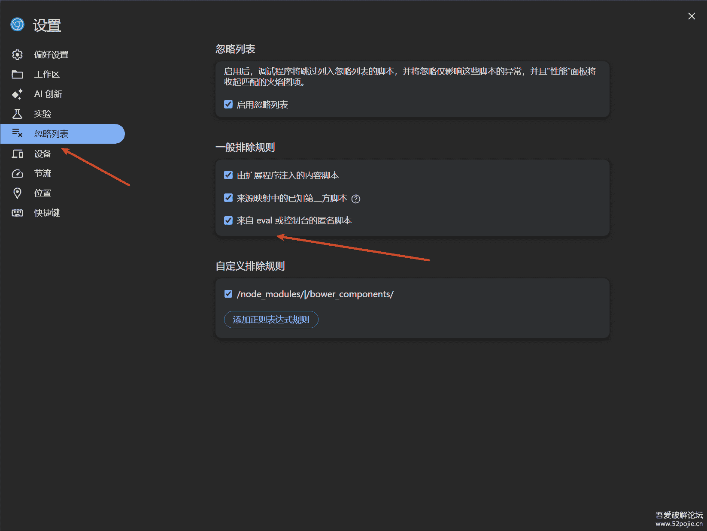

1756170038369.png (95.43 KB, 下载次数: 6)

[href="forum.php?mod=attachment&aid=Mjc5OTMxN3xiYjU0OTBjYnwxNzkzNTcwNjM1fDE2ODA4NnwyMDU2MDcy&nothumb=yes" target="_blank"](https://www.52pojie.cn/forum.php?mod=attachment&aid=Mjc5OTMxN3xiYjU0OTBjYnwxNzkzNTcwNjM1fDE2ODA4NnwyMDU2MDcy&nothumb=yes)

2025-8-27 00:16 上传

开启这个设置后就能彻底忽略掉由`eval`引起的无限`debugger`(注：此时必须将插件开启的绕过无限`debugger`的脚本关闭)，并且经实测，该选项也可忽略由`Function`实例的代码：

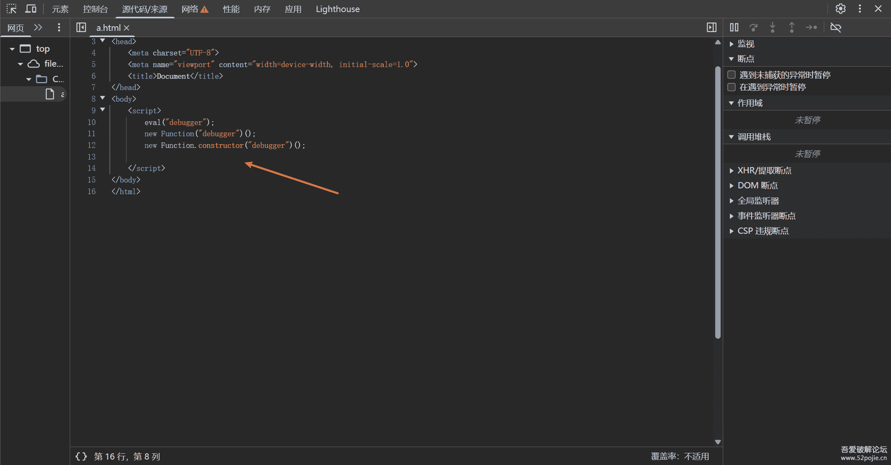

1756170873360.png (122.41 KB, 下载次数: 5)

[href="forum.php?mod=attachment&aid=Mjc5OTMxOXw4YzNlYTQ2ZnwxNzkzNTcwNjM1fDE2ODA4NnwyMDU2MDcy&nothumb=yes" target="_blank"](https://www.52pojie.cn/forum.php?mod=attachment&aid=Mjc5OTMxOXw4YzNlYTQ2ZnwxNzkzNTcwNjM1fDE2ODA4NnwyMDU2MDcy&nothumb=yes)

2025-8-27 00:16 上传

没有引起任何`debugger`，所以开启这个选项即可绕过我上述所说的那三种核心方式引起的无限`debugger`。

其实我这一年来一直都在致力于实现无感绕过无限`debugger`，之所以这样做是因为我在上文并没有提到的一个原因，那就是有些在`vm`中的代码也很重要，如果直接忽略掉来自`eval`和`Function`的匿名脚本，可能会影响到我们正常逆向，所以如果我们遇到了`eval`的作用域问题，不一定非要开启上面那个设置，也可以考虑使用下面这段备用脚本：

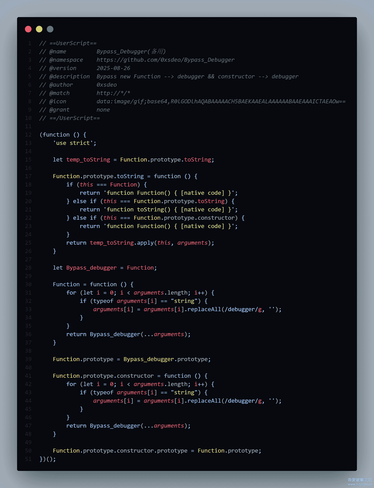

1756209421760.png (445.97 KB, 下载次数: 5)

[href="forum.php?mod=attachment&aid=Mjc5OTMyMHxkMTNhMTYwMXwxNzkzNTcwNjM1fDE2ODA4NnwyMDU2MDcy&nothumb=yes" target="_blank"](https://www.52pojie.cn/forum.php?mod=attachment&aid=Mjc5OTMyMHxkMTNhMTYwMXwxNzkzNTcwNjM1fDE2ODA4NnwyMDU2MDcy&nothumb=yes)

2025-8-27 00:16 上传

`github`地址：https://github.com/0xsdeo/Hook_JS/blob/main/hook_debugger/Bypass_Debugger/Bypass_Debugger(%E5%A4%87%E7%94%A8).js，这段脚本只`hook`了`Function`和`Function.prototype.constructor`，没有`hook` `eval`，也就是说如果目标网站是由`eval`引起的无限`debugger`就没办法了，但是这样能过滤掉由`Function`和`constructor`引起的无限`debugger`，所以需要读者朋友们自行判断。

## 总结

类型 | 特征 | 解决方案

显式无限`debugger`
