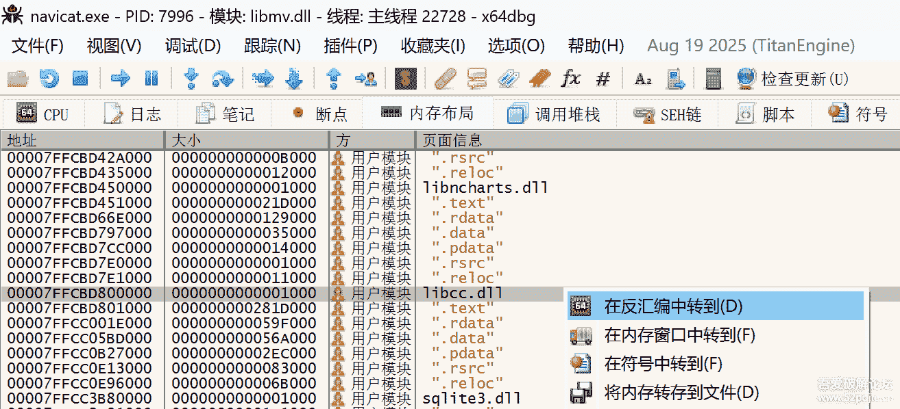
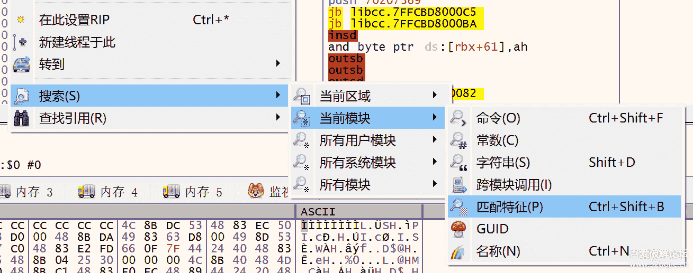
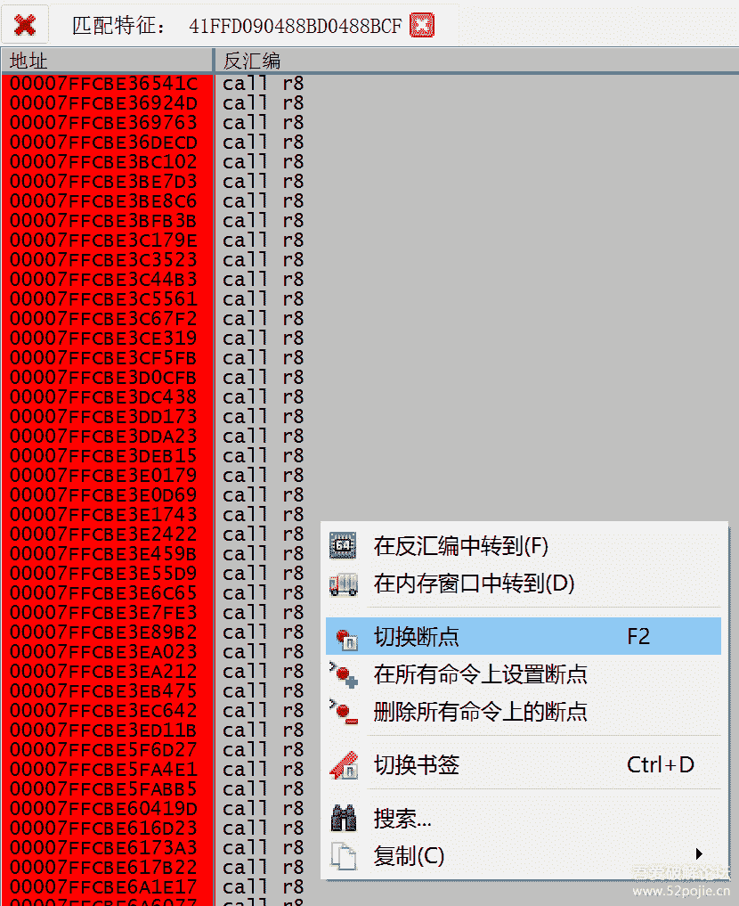
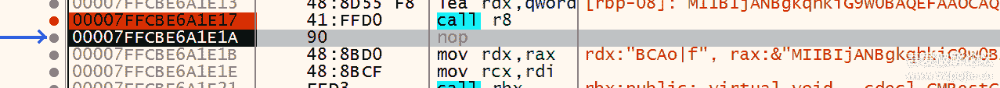
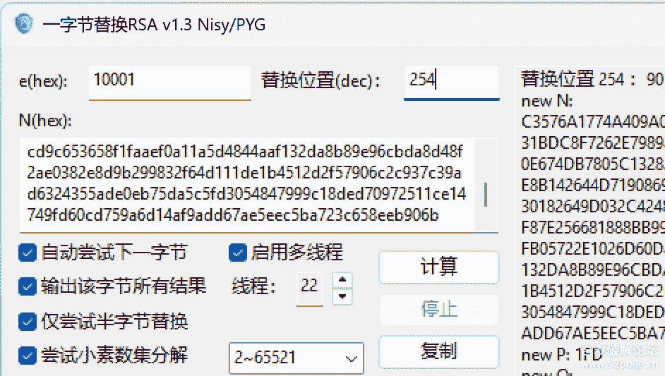
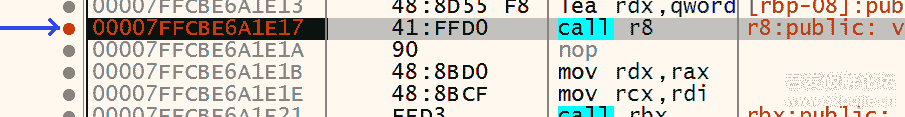
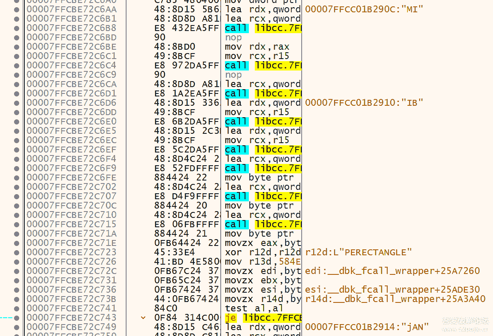
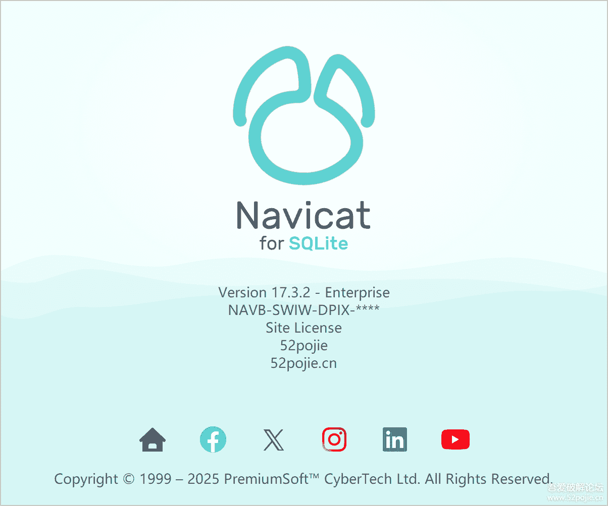

# [原创] Navicat for Sqlite 17.3.2 英文版 一字节替换RSA公钥

- 原帖：[https://www.52pojie.cn/forum.php?mod=viewthread&tid=2056733](https://www.52pojie.cn/forum.php?mod=viewthread&tid=2056733)
- 抓取时间：2026-11-01T22:03:52

在 [iwolf 大佬的帖子](https://www.52pojie.cn/thread-2052969-1-1.html) 中，iwolf 大佬详细分析了 Navicat Premium 17.1.3 的破解过程。分析发现，程序所使用的 RSA 公钥以碎片化的方式分散在 `libcc.dll` 的 `.rdata` 区段中，在运行时动态拼接而成。该教程采用 Hook 技术，拦截公钥拼接函数，将原始公钥替换为自定义的公钥，从而实现离线激活。

想到论坛中有一个[相关帖子](https://www.52pojie.cn/thread-2008824-1-1.html)，既然公钥是以碎片形式存储的，是否可以修改这些碎片中的单个字节，实现更简洁的破解。

## 0. 使用的工具

`x64dbg`、`Python`、`PatchRSA`、`010 editor`

## 1. 找到原始RSA公钥

`x64dbg` 打开 `navicat.exe`，内存布局发现 `libcc.dll` 尚未加载。监视内存布局并按几次 `F9` 运行，直到 `libcc.dll` 被加载。（第一次使用 `x64dbg`，用得不对请指正）



`c1.png` (154.69 KB, 下载次数: 4)，2025-8-29 21:22 上传。[附件下载](https://www.52pojie.cn/forum.php?mod=attachment&aid=Mjc5OTgxN3xhZjMyYTg2NXwxNzkzNTcwNjI5fDE2ODA4NnwyMDU2NzMz&nothumb=yes)

根据 iwolf 大佬的提示，可以通过搜索 `call r8` 对应的字节码，定位到调用公钥拼接函数的位置。在 `libcc.dll` 上右键单击，选择“在反汇编中转到”，进入CPU（反汇编）窗口；再次右键，选择“搜索”→“当前模块”→“匹配特征”。



`c2.png` (93.61 KB, 下载次数: 3)，2025-8-29 21:25 上传。[附件下载](https://www.52pojie.cn/forum.php?mod=attachment&aid=Mjc5OTgxOHxiMDM5ZmQ4N3wxNzkzNTcwNjI5fDE2ODA4NnwyMDU2NzMz&nothumb=yes)

在“搜索匹配特征”窗口中，使用十六进制搜索模式查找字节序列 `41 FF D0 90 48 8B D0 48 8B CF`，该字节序列对应以下汇编指令。

```
call r8
nop
mov rdx,rax
mov rcx,rdi
```

搜索后得到如下结果：



`c3.png` (134.14 KB, 下载次数: 5)，2025-8-29 21:29 上传。[附件下载](https://www.52pojie.cn/forum.php?mod=attachment&aid=Mjc5OTgxOXw0OWRjMGRkM3wxNzkzNTcwNjI5fDE2ODA4NnwyMDU2NzMz&nothumb=yes)

结果不多，使用 `Ctrl+A` 全选，按 `F2` 设置断点。

返回 CPU（反汇编）窗口，按几次 `F9` 运行，程序很快便到达目标断点。再按 `F8` 单步执行，此时寄存器 `rax` 所指向的内容即为拼接后的 RSA 公钥。



`c4.png` (39.96 KB, 下载次数: 4)，2025-8-29 21:29 上传。[附件下载](https://www.52pojie.cn/forum.php?mod=attachment&aid=Mjc5OTgyMHwxOTYzODQ3ZHwxNzkzNTcwNjI5fDE2ODA4NnwyMDU2NzMz&nothumb=yes)

## 2. 一字节替换RSA公钥

通过 AI 辅助生成以下 Python 脚本，从 PEM 格式的 RSA 公钥中提取参数 `n` 和 `e`。需要 `pip install cryptography`。

```
from cryptography.hazmat.primitives import serialization

from cryptography.hazmat.primitives.asymmetric import rsa

# PEM 格式的公钥（替换为你自己的）

pem_data = """-----BEGIN PUBLIC KEY-----

MIIBIjAN……QawIDAQAB

-----END PUBLIC KEY-----"""

# 编码为 bytes

pem_data = pem_data.encode('utf-8')

# 加载公钥

public_key = serialization.load_pem_public_key(pem_data)

# 确保是 RSA 公钥

if isinstance(public_key, rsa.RSAPublicKey):

    numbers = public_key.public_numbers()

    n = numbers.n

    e = numbers.e

    print("n (modulus) in hex:")

    print(hex(n))

    print("\ne (public exponent) in hex:")

    print(hex(e))

else:

    print("Not an RSA public key")
```

打开 `PatchRSA` 工具，填入获取的 RSA 参数 `n` 和 `e`，点击“计算”按钮，即可得到经单字节修改后的 `n`、`d`、`p`、`q` 参数。



`c5.png` (62.91 KB, 下载次数: 6)，2025-8-29 21:29 上传。[附件下载](https://www.52pojie.cn/forum.php?mod=attachment&aid=Mjc5OTgyMXwzYzgzNDE5MHwxNzkzNTcwNjI5fDE2ODA4NnwyMDU2NzMz&nothumb=yes)

通过 AI 辅助生成以下 Python 脚本，将 `n`、`e`、`d`、`p`、`q` 这些参数重新组装成 PEM 格式的 RSA 公钥和私钥。


```
from cryptography.hazmat.primitives.asymmetric import rsa
from cryptography.hazmat.primitives import serialization
import os

# RSA 参数（请替换为你自己的值）
n = int("xxxx", 16)  # 十六进制字符串
e = int("10001", 16) # e = 65537
d = int("xxxx", 16)
p = int("xxxx", 16)
q = int("xxxx", 16)

# 验证RSA参数
print("Validating RSA parameters...")

# 1. 检查 p * q == n
if p * q != n:
    raise ValueError(f"p * q ≠ n\np*q = {p * q}\nn   = {n}")

# 2. 检查 e 和 d 是否互为模逆
phi = (p - 1) * (q - 1)
if (e * d) % phi != 1:
    raise ValueError(f"e * d ≢ 1 mod φ(n)\n(e*d) % phi = {(e*d) % phi}")

# 3. 计算 CRT 参数
dmp1 = d % (p - 1)
dmq1 = d % (q - 1)
try:
    iqmp = pow(q, -1, p)  # q⁻¹ mod p
except ValueError:
    raise ValueError("q has no inverse mod p (gcd(q,p) ≠ 1?)")

# 构造密钥
try:
    private_numbers = rsa.RSAPrivateNumbers(
        p=p,
        q=q,
        d=d,
        dmp1=dmp1,
        dmq1=dmq1,
        iqmp=iqmp,
        public_numbers=rsa.RSAPublicNumbers(e=e, n=n)
    )

    private_key = private_numbers.private_key()
    print("Successfully constructed private key!")

    # 导出 PEM
    pem_private = private_key.private_bytes(
        encoding=serialization.Encoding.PEM,
        format=serialization.PrivateFormat.PKCS8,
        encryption_algorithm=serialization.NoEncryption()
    )

    pem_public = private_key.public_key().public_bytes(
        encoding=serialization.Encoding.PEM,
        format=serialization.PublicFormat.SubjectPublicKeyInfo
    )

    print("\nPrivate Key (PEM):")
    print(pem_private.decode())

    print("\nPublic Key (PEM):")
    print(pem_public.decode())

except Exception as ex:
    print("Failed to create private key:", str(ex))
```

对比原始公钥与替换后的公钥可以发现，仅需将字符`Q`修改为`T`即可完成公钥替换。

原始公钥：`MIIBI……QawIDAQAB`

替换公钥：`MIIBI……TawIDAQAB`

## 3. 找到 `RSA` 公钥的可修改位置

回到 `x64dbg`，按 `Ctrl+F2` 重新运行，按几次 `F9` 运行，回到第一次命中的目标断点。这一次，按 `F7` 单步进入 `RSA` 公钥的拼装函数，跟踪其执行流程。



`c6.png` (33.8 KB, 下载次数: 3)

[href="forum.php?mod=attachment&aid=Mjc5OTgyMnxlMjQ3ODE2MnwxNzkzNTcwNjI5fDE2ODA4NnwyMDU2NzMz&nothumb=yes" target="_blank"](https://www.52pojie.cn/forum.php?mod=attachment&aid=Mjc5OTgyMnxlMjQ3ODE2MnwxNzkzNTcwNjI5fDE2ODA4NnwyMDU2NzMz&nothumb=yes)

2025-8-29 21:45 上传

进入公钥拼装函数后，便可看到分散的公钥碎片。公钥碎片可能在区段中、可能是立即数、也可能是差值，等等。



`c7.png` (206.9 KB, 下载次数: 3)

[href="forum.php?mod=attachment&aid=Mjc5OTgyM3w3ZmNmZjMyM3wxNzkzNTcwNjI5fDE2ODA4NnwyMDU2NzMz&nothumb=yes" target="_blank"](https://www.52pojie.cn/forum.php?mod=attachment&aid=Mjc5OTgyM3w3ZmNmZjMyM3wxNzkzNTcwNjI5fDE2ODA4NnwyMDU2NzMz&nothumb=yes)

2025-8-29 21:45 上传

按 `F8` 单步运行，直到公钥拼接到 `QawIDAQAB` 这个位置。


`c8.png` (34.46 KB, 下载次数: 4)

[href="forum.php?mod=attachment&aid=Mjc5OTgyNHxiYTJiNzNlNHwxNzkzNTcwNjI5fDE2ODA4NnwyMDU2NzMz&nothumb=yes" target="_blank"](https://www.52pojie.cn/forum.php?mod=attachment&aid=Mjc5OTgyNHxiYTJiNzNlNHwxNzkzNTcwNjI5fDE2ODA4NnwyMDU2NzMz&nothumb=yes)

2025-8-29 21:45 上传

看到这里 `7FFCC01B29AC` 储存着 `Qa`，正是我们要替换的地方。

在内存窗口中转到 `7FFCC01B29AC`，记下 `Qa` 前后的字符。

关闭 `x64dbg`。`010 Editor` 打开 `libcc.dll`，`Hex Bytes` 搜索 `51 61 00 00`，刚好找到唯一的位置，修改 `51` 为 `54`，保存。（`51 61` 即是 `Qa`，改成 `54`，即是 `Q` 改成 `T`）

再次打开 `x64dbg`，回到第一次命中的目标断点。检查返回的 `RSA` 公钥，修改正确。

## 4. 离线激活

许可证密钥参考 [//www.52pojie.cn/thread-2052969-1-1.html](https://www.52pojie.cn/thread-2052969-1-1.html) 和 [//www.52pojie.cn/thread-688820-1-1.html](https://www.52pojie.cn/thread-688820-1-1.html)。

手工凑出 `68 2A 00 00 00 AC 88 78 10 FF` 这10个字节，上述参考中对字节意义有详细解释。对后8个字节 `00 00 00 AC 88 78 10 FF` 进行 `DES` 加密（`ECB` 模式，无填充，密钥为 `“E9 7F B0 60 77 45 90 AE”`），加密得到 `68 2A 19 59 16 1B D1 76 0F B9`，手工 `BASE32` 编码得到 `NAVBSWIWDPIXMD5Z`。断网离线激活不再赘述。注意 `ToolsFx` 不支持 `RSA` 参数是小素数因子，离线激活用到的 `RSA` 加解密需要其他工具计算。



`c9.png` (307.72 KB, 下载次数: 6)

[href="forum.php?mod=attachment&aid=Mjc5OTgyNXwyZTAwZDE2Y3wxNzkzNTcwNjI5fDE2ODA4NnwyMDU2NzMz&nothumb=yes" target="_blank"](https://www.52pojie.cn/forum.php?mod=attachment&aid=Mjc5OTgyNXwyZTAwZDE2Y3wxNzkzNTcwNjI5fDE2ODA4NnwyMDU2NzMz&nothumb=yes)

2025-8-29 21:45 上传

以上仅作技术交流，最后支持使用正版软件。

## 参考

[//www.52pojie.cn/thread-2052969-1-1.html](https://www.52pojie.cn/thread-2052969-1-1.html)

[//www.52pojie.cn/thread-2008824-1-1.html](https://www.52pojie.cn/thread-2008824-1-1.html)

[//www.52pojie.cn/thread-688820-1-1.html](https://www.52pojie.cn/thread-688820-1-1.html)
