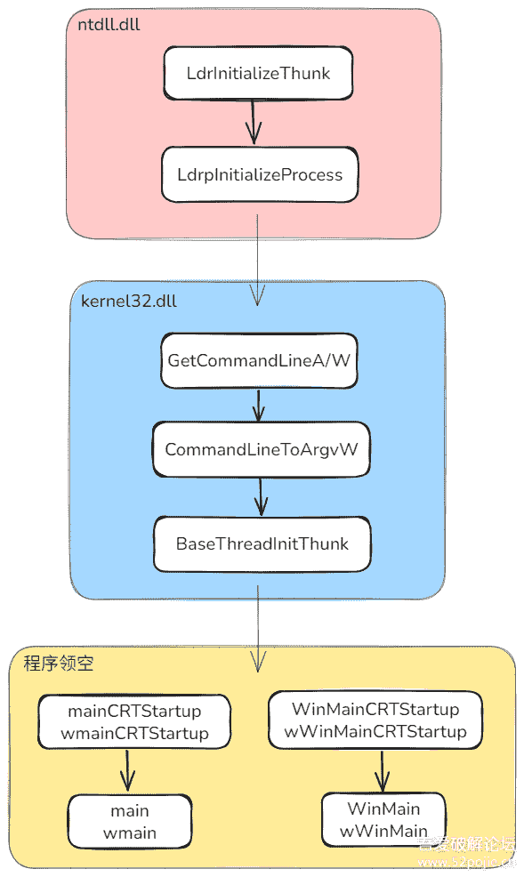
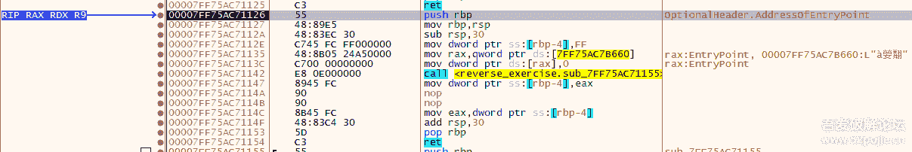

# [原创] Windows程序调试入口点分析：radare2 vs x64dbg

- 原帖: https://www.52pojie.cn/forum.php?mod=viewthread&tid=2056814
- 抓取时间: 2026-11-01T22:03:50

## 问题背景

在使用不同调试器分析Windows程序时，我发现radare2的调试模式入口断点与x64dbg的入口断点存在差异。这引发了我对Windows程序启动流程的深入探索。

### Windows程序启动调用流程回顾



`Pasted image 20250830132131.png` (103.63 KB, 下载次数: 5)

[href="forum.php?mod=attachment&aid=Mjc5OTg5MHxmMDhmZjZmM3wxNzkzNTcwNjI4fDE2ODA4NnwyMDU2ODE0&nothumb=yes" target="_blank"](https://www.52pojie.cn/forum.php?mod=attachment&aid=Mjc5OTg5MHxmMDhmZjZmM3wxNzkzNTcwNjI4fDE2ODA4NnwyMDU2ODE0&nothumb=yes)

2025-8-30 13:55 上传

如上图所示，当x64dbg仅选择"事件断点"时，程序应该在`mainCRTStartup`处中断。然而，radare2的初始断点却不在程序领空内。那么，如何让radare2的动态调试顺利走到`main`函数呢？

## 调试过程详解

### 第一步：启动调试

使用以下命令启动`radare2`调试器：

```
r2 -d .\reverse_exercise.exe
```

输出结果：

```
INFO: Spawned new process with pid 9312, tid = 26516

WARN: Relocs has not been applied. Please use `-e bin.relocs.apply=true` or `-e bin.cache=true` next time

[0x7ff8a343c320]>
```

对比x64dbg的断点位置：



`Pasted image 20250830132913.png` (56.07 KB, 下载次数: 2)

[href="forum.php?mod=attachment&aid=Mjc5OTg5MXxlY2E5MjQ0YnwxNzkzNTcwNjI4fDE2ODA4NnwyMDU2ODE0&nothumb=yes" target="_blank"](https://www.52pojie.cn/forum.php?mod=attachment&aid=Mjc5OTg5MXxlY2E5MjQ0YnwxNzkzNTcwNjI4fDE2ODA4NnwyMDU2ODE0&nothumb=yes)

2025-8-30 13:55 上传

可以看到，radare2停在了`0x7ff8a343c320`，而x64dbg显示的入口点是`0x00007FF75AC71126`。地址明显不同，这说明radare2需要进一步操作才能到达`mainCRTStartup`。

### 第二步：继续执行到入口点

输入命令`duc entry0`（继续执行直到`entry0`）：

```
INFO: Continue until 0x7ff75ac71126 using 1 bpsize
(9312) loading library at 0x00007FF8A3400000 (C:\Windows\System32\ntdll.dll) ntdll.dll
(9312) loading library at 0x00007FF8A2BF0000 (C:\Windows\System32\kernel32.dll) kernel32.dll
(9312) loading library at 0x00007FF8A07C0000 (C:\Windows\System32\KernelBase.dll) KernelBase.dll
(9312) loading library at 0x00007FF8A1550000 (C:\Windows\System32\msvcrt.dll) msvcrt.dll
(9312) Created thread 27308 (start @ 00007FF8A3492220) (teb @ 00000095BDE2E000)
[0x7ff8a352419a]>
```

程序开始加载系统库，但仍未到达目标位置。再次执行`duc entry0`：

```
INFO: Continue until 0x7ff75ac71126 using 1 bpsize
INFO: hit breakpoint at: 0x7ff75ac71126
[0x7ff75ac71126]>
```

现在程序已经到达了与x64dbg相同的位置。

### 第三步：分析入口函数

查看当前函数（`mainCRTStartup`）：

```
┌ 47: entry0 ();
│ afv: vars(1:sp[0x34..0x34])
│           0x7ff75ac71126      55             push rbp
│           0x7ff75ac71127      4889e5         mov rbp, rsp
│           0x7ff75ac7112a      4883ec30       sub rsp, 0x30
│           0x7ff75ac7112e      c745fcff00..   mov dword [var_4h], 0xff ; 255
│           0x7ff75ac71135      488b0524a5..   mov rax, qword [0x7ff75ac7b660]
│           0x7ff75ac7113c      c70000000000   mov dword [rax], 0
│           0x7ff75ac71142      e80e000000     call sym.__tmainCRTStartup
│           0x7ff75ac71147      8945fc         mov dword [var_4h], eax
│           0x7ff75ac7114a      90             nop
│           0x7ff75ac7114b      90             nop
│           0x7ff75ac7114c      8b45fc         mov eax, dword [var_4h]
│           0x7ff75ac7114f      4883c430       add rsp, 0x30
│           0x7ff75ac71153      5d             pop rbp
└           0x7ff75ac71154      c3             ret
```

可以看到，`mainCRTStartup`调用了`sym.__tmainCRTStartup`。让我们继续跟进这个函数。

### 第四步：追踪到`main`函数

在`__tmainCRTStartup`函数中，经过一系列初始化操作后，在地址`0x7ff75ac71336`处发现了关键的调用：

```
            ;-- rip:
            ; CALL XREF from sym.WinMainCRTStartup @ 0x7ff75ac71113(x)
            ; CALL XREF from entry0 @ 0x7ff75ac71142(x)
┌ 542: sym.__tmainCRTStartup ();
│ afv: vars(10:sp[0x34..0x80])
│           0x7ff75ac71155      55             push rbp
│           0x7ff75ac71156      4889e5         mov rbp, rsp
│           0x7ff75ac71159      4883ec70       sub rsp, 0x70
│           0x7ff75ac7115d      48c745f000..   mov qword [var_10h], 0
│           0x7ff75ac71165      c745e43000..   mov dword [var_1ch], 0x30 ; '0' ; 48
│           0x7ff75ac7116c      8b45e4         mov eax, dword [var_1ch]
│           0x7ff75ac7116f      65488b00       mov rax, qword gs:[rax]
│           0x7ff75ac71173      488945d8       mov qword [var_28h], rax
│           0x7ff75ac71177      488b45d8       mov rax, qword [var_28h]
│           0x7ff75ac7117b      488b4008       mov rax, qword [rax + 8]
│           0x7ff75ac7117f      488945e8       mov qword [var_18h], rax
│           0x7ff75ac71183      c745fc0000..   mov dword [var_4h], 0
│       ┌─ 0x7ff75ac7118c      488b45f0       mov rax, qword [var_10h]
│      ╎│   0x7ff75ac71190      483b45e8       cmp rax, qword [var_18h]
│     ┌─── 0x7ff75ac7119f      b9e8030000     mov ecx, 0x3e8          ; 1000
│    │ ╎│   0x7ff75ac711a4      488b059d00..   mov rax, qword [sym.imp.KERNEL32.dll_Sleep] ; [0x7ff75ac81248:8]=0x7ff8a2c21980
│    │ ╎│   0x7ff75ac711ab      ffd0           call rax
│    │ ╎│   ; CODE XREF from sym.__tmainCRTStartup @ 0x7ff75ac7118a(x)
│    │ ╎└─> 0x7ff75ac711ad      488b05fca4..   mov rax, qword [0x7ff75ac7b6b0] ; [0x7ff75ac7b6b0:8]=0x7ff75ac80bc8
│    │ ╎    0x7ff75ac711b4      488945d0       mov qword [var_30h], rax
│    │ ╎    0x7ff75ac711b8      488b45e8       mov rax, qword [var_18h]
│    │ ╎    0x7ff75ac711bc      488945c8       mov qword [var_38h], rax
│    │ ╎    0x7ff75ac711c0      48c745c000..   mov qword [var_40h], 0
│    │ ╎    0x7ff75ac711c8      488b4dc8       mov rcx, qword [var_38h]
│    │ ╎    0x7ff75ac711cc      488b45c0       mov rax, qword [var_40h]
│    │ ╎    0x7ff75ac711d0      488b55d0       mov rdx, qword [var_30h]
│    │ ╎    0x7ff75ac711d4      f0480fb10a     lock cmpxchg qword [rdx], rcx
│    │ ╎    0x7ff75ac711d9      488945f0       mov qword [var_10h], rax
│    │ ╎    0x7ff75ac711dd      48837df000     cmp qword [var_10h], 0
│    │ └── 0x7ff75ac711e4      488b05d5a4..   mov rax, qword [0x7ff75ac7b6c0] ; [0x7ff75ac7b6c0:8]=0x7ff75ac80bc0
│           0x7ff75ac711eb      8b00           mov eax, dword [rax]
│           0x7ff75ac711ed      83f801         cmp eax, 1              ; 1
│       ┌─ 0x7ff75ac711fe      488b05bba4..   mov rax, qword [0x7ff75ac7b6c0] ; [0x7ff75ac7b6c0:8]=0x7ff75ac80bc0
│      │    0x7ff75ac71205      8b00           mov eax, dword [rax]
│      │    0x7ff75ac71207      85c0           test eax, eax
│      │┌─ 0x7ff75ac71230      c705eaed00..   mov dword [0x7ff75ac80024], 1 ; [0x7ff75ac80024:4]=0
│     ││    ; CODE XREFS from sym.__tmainCRTStartup @ 0x7ff75ac711fc(x), 0x7ff75ac7122e(x)
│     └└──> 0x7ff75ac7123a      488b057fa4..   mov rax, qword [0x7ff75ac7b6c0] ; [0x7ff75ac7b6c0:8]=0x7ff75ac80bc0
│           0x7ff75ac71241      8b00           mov eax, dword [rax]
│           0x7ff75ac71243      83f801         cmp eax, 1              ; 1
│       ┌─ 0x7ff75ac7126b      837dfc00       cmp dword [var_4h], 0
│       ┌─ 0x7ff75ac7128f      488b057aa3..   mov rax, qword [0x7ff75ac7b610] ; [0x7ff75ac7b610:8]=0x7ff75ac7b108
│           0x7ff75ac71296      488b00         mov rax, qword [rax]
│           0x7ff75ac71299      4885c0         test rax, rax
│       ┌─ 0x7ff75ac712ba      e84f100000     call sym._pei386_runtime_relocator
│           0x7ff75ac712bf      488b058aa4..   mov rax, qword [0x7ff75ac7b750] ; [0x7ff75ac7b750:8]=0x7ff75ac72460 sym._gnu_exception_handler
│           0x7ff75ac712c6      4889c1         mov rcx, rax
│           0x7ff75ac712c9      488b0570ff..   mov rax, qword [sym.imp.KERNEL32.dll_SetUnhandledExceptionFilter] ; [0x7ff75ac81240:8]=0x7ff8a2c33600
│           0x7ff75ac712d0      ffd0           call rax
│           0x7ff75ac712d2      488b15c7a3..   mov rdx, qword [0x7ff75ac7b6a0] ; [0x7ff75ac7b6a0:8]=0x7ff75ac80120
│           0x7ff75ac712d9      488902         mov qword [rdx], rax
│           0x7ff75ac712dc      488d051dfd..   lea rax, [sym.__mingw_invalidParameterHandler] ; 0x7ff75ac71000
│           0x7ff75ac712e3      4889c1         mov rcx, rax
```


```
│           0x7ff75ac712e6      e8c5790000     call sym.mingw_set_invalid_parameter_handler
│           0x7ff75ac712eb      e820080000     call sym._fpreset
│           0x7ff75ac712f0      8b050eed0000   mov eax, dword [0x7ff75ac80004] ; [0x7ff75ac80004:4]=0
│           0x7ff75ac712f6      488d150bed..   lea rdx, [0x7ff75ac80008]
│           0x7ff75ac712fd      89c1           mov ecx, eax
│           0x7ff75ac712ff      e873010000     call sym.duplicate_ppstrings
│           0x7ff75ac71304      e88e050000     call sym.__main
│           0x7ff75ac71309      488b0520a3..   mov rax, qword [0x7ff75ac7b630] ; [0x7ff75ac7b630:8]=0x7ff75ac81298 sym.imp.msvcrt.dll___initenv
│           0x7ff75ac71310      488b00         mov rax, qword [rax]
│           0x7ff75ac71313      488b15f6ec..   mov rdx, qword [0x7ff75ac80010] ; [0x7ff75ac80010:8]=0
│           0x7ff75ac7131a      488910         mov qword [rax], rdx
│           0x7ff75ac7131d      488b0decec..   mov rcx, qword [0x7ff75ac80010] ; [0x7ff75ac80010:8]=0
│           0x7ff75ac71324      488b15ddec..   mov rdx, qword [0x7ff75ac80008] ; [0x7ff75ac80008:8]=0
│           0x7ff75ac7132b      8b05d3ec0000   mov eax, dword [0x7ff75ac80004] ; [0x7ff75ac80004:4]=0
│           0x7ff75ac71331      4989c8         mov r8, rcx
│           0x7ff75ac71334      89c1           mov ecx, eax
│           0x7ff75ac71336      e864040000     call sym.main           ; int main(int argc, char **argv, char **envp)
│           0x7ff75ac7133b      8905dbec0000   mov dword [0x7ff75ac8001c], eax ; [0x7ff75ac8001c:4]=0
│           0x7ff75ac71341      8b05d9ec0000   mov eax, dword [0x7ff75ac80020] ; [0x7ff75ac80020:4]=0
│           0x7ff75ac71347      85c0           test eax, eax
│       ┌─ 0x7ff75ac71358      8b05c6ec0000   mov eax, dword [0x7ff75ac80024] ; [0x7ff75ac80024:4]=0
│           0x7ff75ac7135e      85c0           test eax, eax
│       ┌─ 0x7ff75ac71367      8b05afec0000   mov eax, dword [0x7ff75ac8001c] ; [0x7ff75ac8001c:4]=0
│           0x7ff75ac7136d      4883c470       add rsp, 0x70
│           0x7ff75ac71371      5d             pop rbp
└           0x7ff75ac71372      c3             ret
```

最终 `0x7ff75ac71336` 这里就是 `main` 的 `call`。

## 总结：Windows 程序启动调用链

通过分析，我们可以清晰地看到从程序入口到 `main` 函数的完整调用链：

```
mainCRTStartup (entry0)
    ↓
__tmainCRTStartup
    ↓
__security_init_cookie（安全初始化）
    ↓
_pei386_runtime_relocator（运行时重定位）
    ↓
SetUnhandledExceptionFilter（设置异常处理）
    ↓
__mingw_invalidParameterHandler（设置参数验证处理）
    ↓
_fpreset（浮点环境重置）
    ↓
__main（C++全局构造函数）
    ↓
main(argc, argv, envp)
```

这个调试过程展示了 `radare2` 如何从系统加载器的初始断点逐步执行到用户程序的 `main` 函数，帮助我们深入理解了 Windows 程序的启动机制。

## 补充知识点：`main` 函数的参数传递

虽然我们编写 `main` 函数时可能没有显式使用参数，但系统会自动传递三个参数。从反汇编代码可以清晰看到参数准备过程：

```
0x7ff75ac71324      488b15ddec..   mov rdx, qword [0x7ff75ac80008]  ; argv (第二个参数)
0x7ff75ac7132b      8b05d3ec0000   mov eax, dword [0x7ff75ac80004]  ; argc 
0x7ff75ac71331      4989c8         mov r8, rcx                       ; envp (第三个参数)
0x7ff75ac71334      89c1           mov ecx, eax                      ; argc (第一个参数)
0x7ff75ac71336      e864040000     call sym.main
```

根据 Windows x64 调用约定：

- `RCX`：`argc`（参数个数）
- `RDX`：`argv`（参数数组）
- `R8`：`envp`（环境变量）

即使 `main` 函数定义为 `int main()`，系统仍会传递这些参数，只是我们选择不使用它们。
