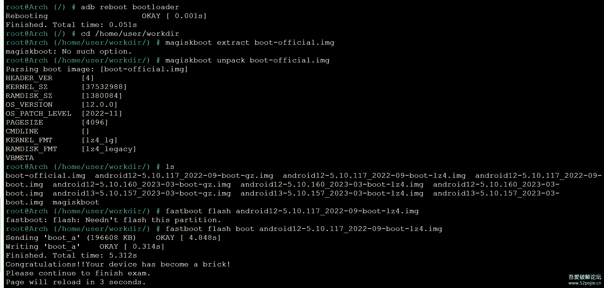
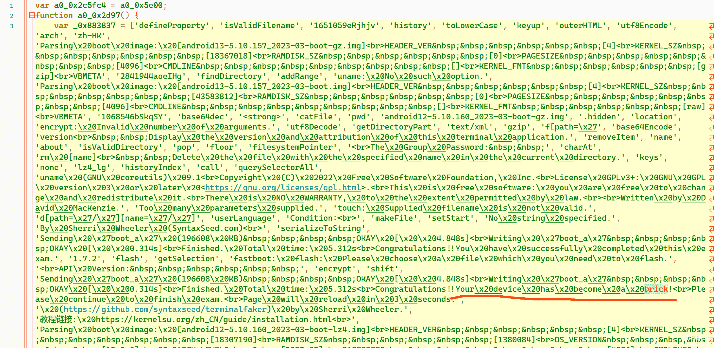
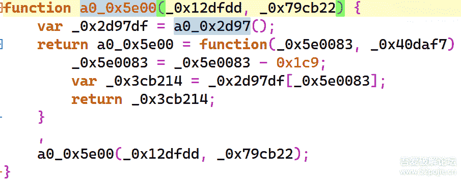
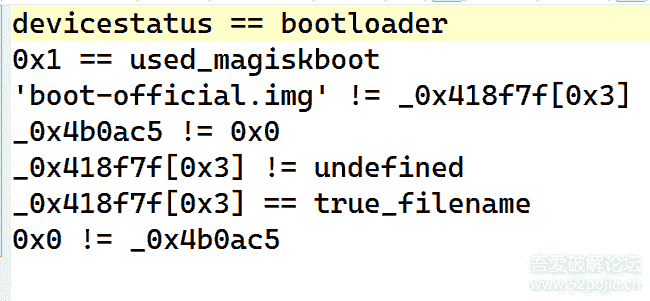
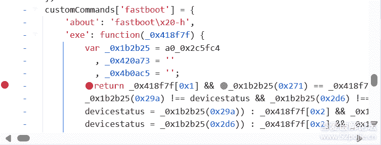
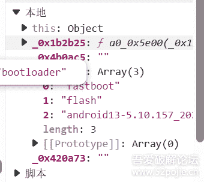

# [Web逆向] 某高考逆向分析

- 原帖: https://www.52pojie.cn/forum.php?mod=viewthread&tid=2056857
- 抓取时间: 2026-11-01T22:03:48

必读：本文章在相关软件的入群验证长时间取消后才发出，目前已经不涉及对相关软件的任何影响

## 0x00 前言

相关网址：`aHR0cHM6Ly9leGFtLmtlcm5lbHN1Lm9yZw==`。

## 0x01 分析方法

首先随机刷一个东西看看反应：

发现提示设备变砖了，不妨把 JS dump 下来，发现被混淆过，直接搜字符串可以发现相关字符串被包在了一个字符串池（`_0x883837`）里。因为他希望仿真，所以不妨推断下成功的提示里也有类似的刷写进度片段，搜一下发现 `index=166`。（划线的是刷写错误的提示）

追一下 `_0x883837` 的引用，发现 `_0x883837` 是作为 `a0_0x2d97` 的返回值使用的，再追 `a0_0x2d97` 的引用，发现有一个意义不明的自执行函数和一个 wrapper 函数 `a0_0x5e00`，先追 `a0_0x5e00`。

`_0x2d97df` 是我们前面追出来的字符串池，人工反混淆下是 `function(_0x12dfdd){ return _0x2d97df[_0x12dfdd-0x1c9] }`，参数里的 `_0x79cb22` 看起来并没有什么用，因此有新的 `index=166+457=623`。

继续追 `a0_0x5e00` 的引用，发现他有很多别名，但全局的只有一个 `a0_0x2c5fc4`。继续追 `a0_0x2c5fc4` 的引用，发现大部分已经直接调用这个函数来取字符串了，但被加了 hex，于是这个字符串实际的索引是 `0x26f`，直接搜 `0x26f` 找到引用在 `customCommands['fastboot']` 里，整理一下恶心的三目运算符。

重现一下上次的操作，下个断点看看。

发现除了倒数第二个外其他的都满足了，而 `_0x418f7f[0x3]` 正是我们刷入的映像，容易发现 `true_filename` 可以直接读取，于是我们就获取了正确答案，直接 `fastboot flash true_filename` 即可。

其实还有一个分析方法是通过 `TerminalFaker` 的 `customCommands` 去抓，但我不太了解 `TerminalFaker` 所以没想到。

逆向小白请多多指教
