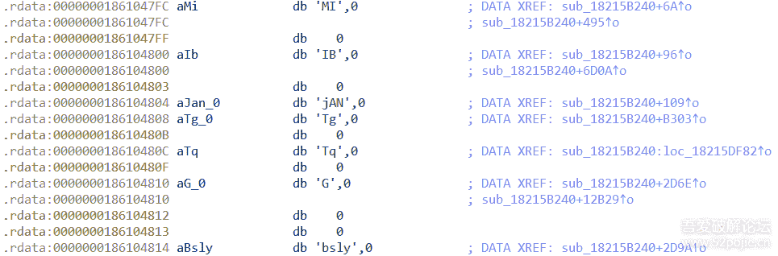
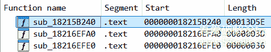
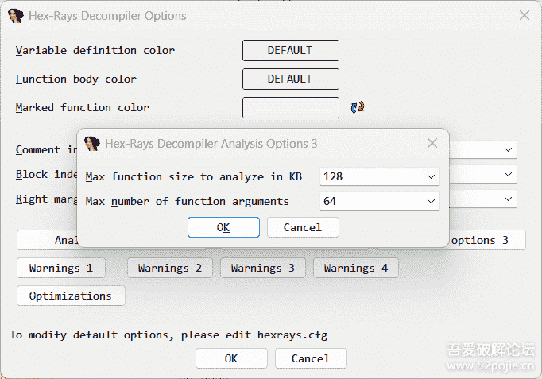
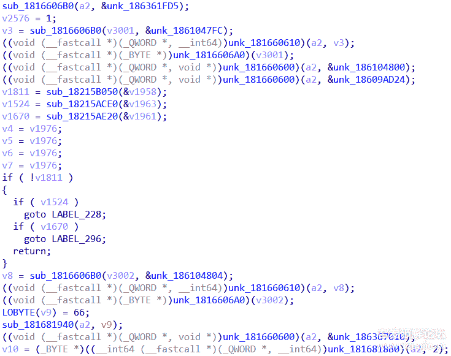
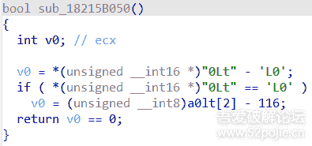
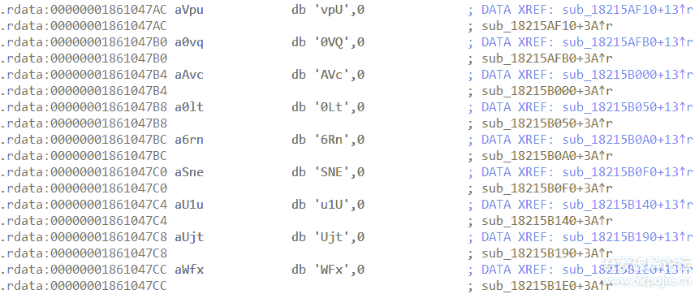
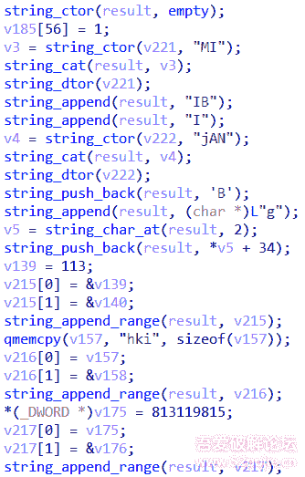
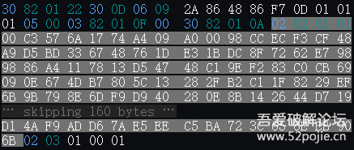

# [原创] Navicat 17.3.2 公钥拼接函数纯静态分析及提取

- 原帖：`https://www.52pojie.cn/forum.php?mod=viewthread&tid=2057483`
- 抓取时间：2026-11-01T22:03:38

## 定位公钥拼接函数

参考 [相关帖子](https://www.52pojie.cn/thread-2056733-1-1.html)，不难定位到公钥碎片地址，交叉引用查到公钥拼接函数 `sub_18215B240`。


`image-20250902151542015.png` (48.83 KB，下载次数: 4)  
[附件](https://www.52pojie.cn/forum.php?mod=attachment&aid=MjgwMDM1N3xjODE3MDE4N3wxNzkzNTcwNjE2fDE2ODA4NnwyMDU3NDgz&nothumb=yes)（2025-9-2 15:56 上传）


`image-20250902144831113.png` (15.76 KB，下载次数: 3)  
[附件](https://www.52pojie.cn/forum.php?mod=attachment&aid=MjgwMDM2MXxmOGYzOWU1ZnwxNzkzNTcwNjE2fDE2ODA4NnwyMDU3NDgz&nothumb=yes)（2025-9-2 15:56 上传）

公钥拼接函数很大，差不多有 80 KB。IDA 默认会拒绝反编译大小 64 KB 以上的函数，需要调整 `MAX_FUNCSIZE`。


`image-20250902144118453.png` (48.92 KB，下载次数: 3)  
[附件](https://www.52pojie.cn/forum.php?mod=attachment&aid=MjgwMDM2Mnw5ZjkxMTFkYXwxNzkzNTcwNjE2fDE2ODA4NnwyMDU3NDgz&nothumb=yes)（2025-9-2 15:56 上传）

## 处理不透明谓词

`F5` 生成的伪代码有一万多行，且经过不透明谓词混淆。搞半天还要自己拼。


`image-20250902145156478.png` (60 KB，下载次数: 3)  
[附件](https://www.52pojie.cn/forum.php?mod=attachment&aid=MjgwMDM2MHw3MGZkMzlhOHwxNzkzNTcwNjE2fDE2ODA4NnwyMDU3NDgz&nothumb=yes)（2025-9-2 15:56 上传）

其中 `v1811`、`v1524`、`v1670` 为不透明谓词，由一类相似的函数返回固定的 `bool` 值。


`image-20250902145916367.png` (13.67 KB，下载次数: 4)  
[附件](https://www.52pojie.cn/forum.php?mod=attachment&aid=MjgwMDM1OXxlOTQ4MDQ5Y3wxNzkzNTcwNjE2fDE2ODA4NnwyMDU3NDgz&nothumb=yes)（2025-9-2 15:56 上传）

不透明谓词求值用到的常量字符串如下：


`image-20250902151454029.png` (61.95 KB，下载次数: 2)  
[附件](https://www.52pojie.cn/forum.php?mod=attachment&aid=MjgwMDM1OHxkNzI4MzEyNnwxNzkzNTcwNjE2fDE2ODA4NnwyMDU3NDgz&nothumb=yes)（2025-9-2 15:56 上传）

`Patch` 掉不透明谓词后程序的结构就很清晰了，只有七百多行。不难看出 Navicat 应该是使用了 C++ 标准库的 `std::string`，适当重命名库函数可以得到以下结果：


`image-20250902152057377.png` (31.93 KB，下载次数: 3)  
[附件](https://www.52pojie.cn/forum.php?mod=attachment&aid=MjgwMDM1Nnw4ZjA5ZGNhOXwxNzkzNTcwNjE2fDE2ODA4NnwyMDU3NDgz&nothumb=yes)（2025-9-2 15:56 上传）

## 分析公钥拼接逻辑

不难看出这是 `base64` 编码的 `der` 格式，但是拼接时复用了部分公钥碎片，且拼接过程中存在前向引用公钥进行解密的操作。用正则表达式对伪代码进行适当替换可以得到以下代码：

```python
f = lambda x: x.to_bytes((x.bit_length() + 7) // 8, 'little')
t = bytearray()
t.extend(b'MI')
t.extend(b'IB')
t.extend(b'I')
t.extend(b'jAN')
t.extend(b'B')
t.extend(b'g')
v5 = t[2]
t.append(v5 + 34)
v139 = f(113)
v215 = v139
t.extend(v215)
v157 = b'hki'
v216 = v157
t.extend(v216)
v175 = f(813119815)
v217 = v175
t.extend(v217)
t.extend(b'BAQE')
# ...
t.extend(b'x')
v119 = t[86]
t.append(v119 + 3)
t.extend(b'ju')
v120 = t[381]
t.append(v120)
t.extend(b'Qa')
t.append(119)
v184 = f(1363231817)
v212 = v184
t.extend(v212)
v137 = b'A'
v213 = v137
t.extend(v213)
v123 = b'B'
v214 = v123
t.extend(v214)
print(t.decode())  # MIIBIjANBgkqhkiG9w0BAQE...xljuuQawIDAQAB
```

得到的结果能被完整解析，并可提取出 `N` 和 `e` 等常数。后续 `patch` 及 `keygen` 不在叙述。

## Patch 点位选择

由于公钥中存储的 `N` 前有一段 `header`，导致不好在伪代码中定位 `patch` 点位，故考虑尽可能修改靠近 `LSB` 的半字节，此时将 `Qa` 修改为 `Ta` 为最佳选项。

同时，如果从 `MSB` 出发，前几项结果会出现 `base64` 编码将三字节映射到四字节时半字节 `patch` 仍出现 `base64` 编码后出现两字节不同的问题，从 `LSB` 出发时第一个小质数（`0x1FD`）结果即满足 `base64` 编码后仅有一字节不同。


`image-20250902153821964.png` (14.3 KB，下载次数: 4)  
[附件](https://www.52pojie.cn/forum.php?mod=attachment&aid=MjgwMDM1NXw1ZWIxOTE4MXwxNzkzNTcwNjE2fDE2ODA4NnwyMDU3NDgz&nothumb=yes)（2025-9-2 15:56 上传）

## 附录：移除不透明谓词后的伪代码

p.s. 移除不透明谓词后伪代码如下：

```c
__int64 *__fastcall sub_18215B240(__int64 a1, __int64 *result)
{
  __int64 v3; // rax
  __int64 v4; // rax
  char *v5; // rax
  __int64 v6; // rax
  __int64 v7; // rax
  __int64 v8; // rax
  char *v9; // rax
  char *v10; // rax
  char *v11; // rax
  char *v12; // rax
  __int64 v13; // rax
  char *v14; // rax
  char *v15; // rax
  char *v16; // rax
  char *v17; // rax
  char *v18; // rax
  __int64 v19; // rax
  char *v20; // rax
  char *v21; // rax
  char *v22; // rax
  __int64 v23; // rax
  __int64 v24; // rax
  char *v25; // rax
  __int64 v26; // rax
  char *v27; // rax
  char *v28; // rax
  char *v29; // rax
  __int64 v30; // rax
  __int64 v31; // rax
  char *v32; // rax
  __int64 v33; // rax
  __int64 v34; // rax
  char *v35; // rax
  char *v36; // rax
  char *v37; // rax
  __int64 v38; // rax
  char *v39; // rax
  __int64 v40; // rax
  char *v41; // rax
  __int64 v42; // rax
  char *v43; // rax
  __int64 v44; // rax
  __int64 v45; // rax
  char *v46; // rax
  char *v47; // rax
  __int64 v48; // rax
  char *v49; // rax
  char *v50; // rax
  char *v51; // rax
  char *v52; // rax
  char *v53; // rax
  char *v54; // rax
  __int64 v55; // rax
  char *v56; // rax
  char *v57; // rax
  char *v58; // rax
  char *v59; // rax
  __int64 v60; // rax
  char *v61; // rax
  __int64 v62; // rax
  char *v63; // rax
  char *v64; // rax
  char *v65; // rax
  __int64 v66; // rax
  __int64 v67; // rax
  __int64 v68; // rax
  char *v69; // rax
  char *v70; // rax
  char *v71; // rax
  char *v72; // rax
  __int64 v73; // rax
  char *v74; // rax
  __int64 v75; // rax
  __int64 v76; // rax
  __int64 v77; // rax
  __int64 v78; // rax
  char *v79; // rax
  char *v80; // rax
  __int64 v81; // rax
  char *v82; // rax
  __int64 v83; // rax
  char *v84; // rax
  char *v85; // rax
  __int64 v86; // rax
  char *v87; // rax
  char *v88; // rax
  char *v89; // rax
  __int64 v90; // rax
  char *v91; // rax
  char *v92; // rax
  char *v93; // rax
  __int64 v94; // rax
  __int64 v95; // rax
  char *v96; // rax
  __int64 v97; // rax
  char *v98; // rax
  char *v99; // rax
  __int64 v100; // rax
  __int64 v101; // rax
  char *v102; // rax
  char *v103; // rax
  char *v104; // rax
  char *v105; // rax
  char *v106; // rax
  char *v107; // rax
  char *v108; // rax
  char *v109; // rax
  char *v110; // rax
  __int64 v111; // rax
  char *v112; // rax
  char *v113; // rax
  __int64 v114; // rax
  char *v115; // rax
  __int64 v116; // rax
  char *v117; // rax
  __int64 v118; // rax
  char *v119; // rax
  char *v120; // rax
  __int64 v121; // rax
  char v123; // [rsp+37h] [rbp-C9h] BYREF
  char v124; // [rsp+38h] [rbp-C8h] BYREF
  char v125; // [rsp+39h] [rbp-C7h] BYREF
  char v126; // [rsp+3Ah] [rbp-C6h] BYREF
  char v127; // [rsp+3Ch] [rbp-C4h] BYREF
  char v128; // [rsp+3Dh] [rbp-C3h] BYREF
  char v129; // [rsp+3Eh] [rbp-C2h] BYREF
  char v130; // [rsp+3Fh] [rbp-C1h] BYREF
  char v131; // [rsp+40h] [rbp-C0h] BYREF
  char v132; // [rsp+58h] [rbp-A8h] BYREF
  char v133; // [rsp+59h] [rbp-A7h] BYREF
  char v134; // [rsp+5Ah] [rbp-A6h] BYREF
  char v135; // [rsp+5Bh] [rbp-A5h] BYREF
```


```
char v136; // [rsp+5Ch] [rbp-A4h] BYREF
char v137; // [rsp+64h] [rbp-9Ch] BYREF
char v138; // [rsp+65h] [rbp-9Bh] BYREF
char v139; // [rsp+85h] [rbp-7Bh] BYREF
char v140; // [rsp+86h] [rbp-7Ah] BYREF
char v141[2]; // [rsp+ACh] [rbp-54h] BYREF
char v142; // [rsp+AEh] [rbp-52h] BYREF
char v143[2]; // [rsp+B0h] [rbp-50h] BYREF
char v144; // [rsp+B2h] [rbp-4Eh] BYREF
char v145[2]; // [rsp+B4h] [rbp-4Ch] BYREF
char v146; // [rsp+B6h] [rbp-4Ah] BYREF
char v147[2]; // [rsp+BCh] [rbp-44h] BYREF
char v148; // [rsp+BEh] [rbp-42h] BYREF
char v149[2]; // [rsp+144h] [rbp+44h] BYREF
char v150; // [rsp+146h] [rbp+46h] BYREF
char v151[2]; // [rsp+148h] [rbp+48h] BYREF
char v152; // [rsp+14Ah] [rbp+4Ah] BYREF
char v153[2]; // [rsp+14Ch] [rbp+4Ch] BYREF
char v154; // [rsp+14Eh] [rbp+4Eh] BYREF
char v155[2]; // [rsp+150h] [rbp+50h] BYREF
char v156; // [rsp+152h] [rbp+52h] BYREF
_BYTE v157[3]; // [rsp+218h] [rbp+118h] BYREF
char v158; // [rsp+21Bh] [rbp+11Bh] BYREF
_BYTE v159[3]; // [rsp+21Ch] [rbp+11Ch] BYREF
char v160; // [rsp+21Fh] [rbp+11Fh] BYREF
_BYTE v161[3]; // [rsp+220h] [rbp+120h] BYREF
char v162; // [rsp+223h] [rbp+123h] BYREF
_BYTE v163[3]; // [rsp+224h] [rbp+124h] BYREF
char v164; // [rsp+227h] [rbp+127h] BYREF
_BYTE v165[3]; // [rsp+228h] [rbp+128h] BYREF
char v166; // [rsp+22Bh] [rbp+12Bh] BYREF
_BYTE v167[3]; // [rsp+22Ch] [rbp+12Ch] BYREF
char v168; // [rsp+22Fh] [rbp+12Fh] BYREF
_BYTE v169[3]; // [rsp+230h] [rbp+130h] BYREF
char v170; // [rsp+233h] [rbp+133h] BYREF
_BYTE v171[3]; // [rsp+2B0h] [rbp+1B0h] BYREF
char v172; // [rsp+2B3h] [rbp+1B3h] BYREF
_BYTE v173[3]; // [rsp+2BCh] [rbp+1BCh] BYREF
char v174; // [rsp+2BFh] [rbp+1BFh] BYREF
char v175[4]; // [rsp+3A8h] [rbp+2A8h] BYREF
int v176; // [rsp+3ACh] [rbp+2ACh] BYREF
char v177[4]; // [rsp+3B4h] [rbp+2B4h] BYREF
char v178[4]; // [rsp+3B8h] [rbp+2B8h] BYREF
int v179; // [rsp+3BCh] [rbp+2BCh] BYREF
char v180[4]; // [rsp+430h] [rbp+330h] BYREF
int v181; // [rsp+434h] [rbp+334h] BYREF
char v182[4]; // [rsp+444h] [rbp+344h] BYREF
int v183; // [rsp+448h] [rbp+348h] BYREF
char v184[4]; // [rsp+464h] [rbp+364h] BYREF
_DWORD v185[58]; // [rsp+468h] [rbp+368h] BYREF
_QWORD v186[2]; // [rsp+660h] [rbp+560h] BYREF
_QWORD v187[2]; // [rsp+670h] [rbp+570h] BYREF
_QWORD v188[2]; // [rsp+680h] [rbp+580h] BYREF
_QWORD v189[2]; // [rsp+690h] [rbp+590h] BYREF
_QWORD v190[2]; // [rsp+6A0h] [rbp+5A0h] BYREF
_QWORD v191[2]; // [rsp+6B0h] [rbp+5B0h] BYREF
_QWORD v192[2]; // [rsp+6C0h] [rbp+5C0h] BYREF
_QWORD v193[2]; // [rsp+6D0h] [rbp+5D0h] BYREF
_QWORD v194[2]; // [rsp+6F0h] [rbp+5F0h] BYREF
_QWORD v195[2]; // [rsp+700h] [rbp+600h] BYREF
_QWORD v196[2]; // [rsp+740h] [rbp+640h] BYREF
_QWORD v197[2]; // [rsp+770h] [rbp+670h] BYREF
_QWORD v198[2]; // [rsp+780h] [rbp+680h] BYREF
_QWORD v199[2]; // [rsp+7B0h] [rbp+6B0h] BYREF
_QWORD v200[2]; // [rsp+ED0h] [rbp+DD0h] BYREF
_QWORD v201[2]; // [rsp+EE0h] [rbp+DE0h] BYREF
_QWORD v202[2]; // [rsp+EF0h] [rbp+DF0h] BYREF
_QWORD v203[2]; // [rsp+F00h] [rbp+E00h] BYREF
_QWORD v204[2]; // [rsp+F10h] [rbp+E10h] BYREF
_QWORD v205[2]; // [rsp+F20h] [rbp+E20h] BYREF
_QWORD v206[2]; // [rsp+F30h] [rbp+E30h] BYREF
_QWORD v207[2]; // [rsp+F40h] [rbp+E40h] BYREF
_QWORD v208[2]; // [rsp+F50h] [rbp+E50h] BYREF
_QWORD v209[2]; // [rsp+F60h] [rbp+E60h] BYREF
_QWORD v210[2]; // [rsp+FE0h] [rbp+EE0h] BYREF
_QWORD v211[2]; // [rsp+FF0h] [rbp+EF0h] BYREF
_QWORD v212[2]; // [rsp+11D0h] [rbp+10D0h] BYREF
_QWORD v213[2]; // [rsp+11E0h] [rbp+10E0h] BYREF
_QWORD v214[2]; // [rsp+1F30h] [rbp+1E30h] BYREF
_QWORD v215[2]; // [rsp+1F40h] [rbp+1E40h] BYREF
_QWORD v216[2]; // [rsp+1F50h] [rbp+1E50h] BYREF
_QWORD v217[2]; // [rsp+1F60h] [rbp+1E60h] BYREF
_QWORD v218[2]; // [rsp+1F70h] [rbp+1E70h] BYREF
_QWORD v219[2]; // [rsp+1F80h] [rbp+1E80h] BYREF
_QWORD v220[3]; // [rsp+1F90h] [rbp+1E90h] BYREF
__int64 v221[4]; // [rsp+1FA8h] [rbp+1EA8h] BYREF
__int64 v222[4]; // [rsp+1FC8h] [rbp+1EC8h] BYREF
__int64 v223[4]; // [rsp+1FE8h] [rbp+1EE8h] BYREF
__int64 v224[4]; // [rsp+2028h] [rbp+1F28h] BYREF
__int64 v225[4]; // [rsp+2048h] [rbp+1F48h] BYREF
__int64 v226[4]; // [rsp+2088h] [rbp+1F88h] BYREF
__int64 v227[4]; // [rsp+20A8h] [rbp+1FA8h] BYREF
__int64 v228[4]; // [rsp+20C8h] [rbp+1FC8h] BYREF
__int64 v229[4]; // [rsp+20E8h] [rbp+1FE8h] BYREF
__int64 v230[4]; // [rsp+2108h] [rbp+2008h] BYREF
__int64 v231[4]; // [rsp+2128h] [rbp+2028h] BYREF
__int64 v232[4]; // [rsp+2148h] [rbp+2048h] BYREF
__int64 v233[4]; // [rsp+2168h] [rbp+2068h] BYREF
__int64 v234[4]; // [rsp+2188h] [rbp+2088h] BYREF
__int64 v235[4]; // [rsp+21A8h] [rbp+20A8h] BYREF
__int64 v236[4]; // [rsp+21C8h] [rbp+20C8h] BYREF
__int64 v237[4]; // [rsp+21E8h] [rbp+20E8h] BYREF
__int64 v238[4]; // [rsp+2208h] [rbp+2108h] BYREF
__int64 v239[4]; // [rsp+2228h] [rbp+2128h] BYREF
__int64 v240[4]; // [rsp+2248h] [rbp+2148h] BYREF
__int64 v241[4]; // [rsp+22C8h] [rbp+21C8h] BYREF
__int64 v242[4]; // [rsp+23A8h] [rbp+22A8h] BYREF
__int64 v243[4]; // [rsp+23C8h] [rbp+22C8h] BYREF
__int64 v244[4]; // [rsp+23E8h] [rbp+22E8h] BYREF
__int64 v245[4]; // [rsp+2408h] [rbp+2308h] BYREF
__int64 v246[4]; // [rsp+2428h] [rbp+2328h] BYREF
__int64 v247[4]; // [rsp+2448h] [rbp+2348h] BYREF
__int64 v248[4]; // [rsp+2468h] [rbp+2368h] BYREF
__int64 v249[4]; // [rsp+2488h] [rbp+2388h] BYREF
__int64 v250[4]; // [rsp+2508h] [rbp+2408h] BYREF
__int64 v251[4]; // [rsp+2528h] [rbp+2428h] BYREF
__int64 v252[4]; // [rsp+2548h] [rbp+2448h] BYREF
__int64 v253[4]; // [rsp+2568h] [rbp+2468h] BYREF
__int64 v254[4]; // [rsp+3468h] [rbp+3368h] BYREF
__int64 v255[4]; // [rsp+3488h] [rbp+3388h] BYREF
__int64 v256[4]; // [rsp+34A8h] [rbp+33A8h] BYREF
__int64 v257[4]; // [rsp+34C8h] [rbp+33C8h] BYREF
__int64 v258[4]; // [rsp+34E8h] [rbp+33E8h] BYREF
__int64 v259[4]; // [rsp+3508h] [rbp+3408h] BYREF
__int64 v260[4]; // [rsp+3528h] [rbp+3428h] BYREF
__int64 v261[4]; // [rsp+3548h] [rbp+3448h] BYREF
__int64 v262[4]; // [rsp+3568h] [rbp+3468h] BYREF
__int64 v263[4]; // [rsp+3588h] [rbp+3488h] BYREF
__int64 v264[4]; // [rsp+3608h] [rbp+3508h] BYREF
__int64 v265[4]; // [rsp+39C8h] [rbp+38C8h] BYREF
v220[2] = result;
string_ctor(result, empty);
v185[56] = 1;
v3 = string_ctor(v221, "MI");
string_cat(result, v3);
string_dtor(v221);
string_append(result, "IB");
string_append(result, "I");
v4 = string_ctor(v222, "jAN");
string_cat(result, v4);
string_dtor(v222);
string_push_back(result, 'B');
string_append(result, (char *)L"g");
v5 = string_char_at(result, 2);
string_push_back(result, *v5 + 34);
v139 = 113;
v215[0] = &v139;
v215[1] = &v140;
string_append_range(result, v215);
qmemcpy(v157, "hki", sizeof(v157));
v216[0] = v157;
v216[1] = &v158;
string_append_range(result, v216);
*(_DWORD *)v175 = 813119815;
v217[0] = v175;
v217[1] = &v176;
string_append_range(result, v217);
v6 = string_ctor(v223, "BAQE");
string_cat(result, v6);
string_dtor(v223);
string_push_back(result, 'F');
v7 = string_ctor(v224, "AAO");
string_cat(result, v7);
string_dtor(v224);
v124 = 67;
v218[0] = &v124;
v218[1] = &v125;
string_append_range(result, v218);
v125 = 65;
v219[0] = &v125;
v219[1] = &v126;
string_append_range(result, v219);
string_append(result, "Q8A");
v8 = string_ctor(v225, "MI");
string_cat(result, v8);
string_dtor(v225);
string_push_back(result, 73);
v9 = string_char_at(result, 8);
string_push_back(result, *v9);
v10 = string_char_at(result, 6);
string_push_back(result, *v10 + 2);
string_push_back(result, 103);
qmemcpy(v159, "KCA", sizeof(v159));
v220[0] = v159;
v220[1] = &v160;
```


```
  string_append_range(result, v220);

  v11 = string_char_at(result, 21);

  string_push_back(result, *v11);

  v12 = string_char_at(result, 2);

  string_push_back(result, *v12 - 4);

  string_push_back(result, 'A');

  qmemcpy(v161, "w1d", sizeof(v161));

  v186[0] = v161;

  v186[1] = &v162;

  string_append_range(result, v186);

  v13 = string_ctor(v226, "qF3");

  string_cat(result, v13);

  string_dtor(v226);

  v14 = string_char_at(result, 39);

  string_push_back(result, *v14 + 16);

  string_append(result, "kC");

  *(_WORD *)v141 = 16737;

  v187[0] = v141;

  v187[1] = &v142;

  string_append_range(result, v187);

  v15 = string_char_at(result, 31);

  string_push_back(result, *v15);

  qmemcpy(v163, "mMz", sizeof(v163));

  v188[0] = v163;

  v188[1] = &v164;

  string_append_range(result, v188);

  string_push_back(result, 's');

  *(_DWORD *)v177 = 1228486712;

  v189[0] = v177;

  v189[1] = v178;

  string_append_range(result, v189);

  string_append(result, "qd");

  v16 = string_char_at(result, 59);

  string_push_back(result, *v16 - 28);

  v17 = string_char_at(result, 62);

  string_push_back(result, *v17);

  v18 = string_char_at(result, 14);

  string_push_back(result, *v18 - 28);

  v19 = string_ctor(v227, "2dId");

  string_cat(result, v19);

  string_dtor(v227);

  v20 = string_char_at(result, 45);

  string_push_back(result, *v20 + 55);

  v21 = string_char_at(result, 49);

  string_push_back(result, *v21);

  v22 = string_char_at(result, 5);

  string_push_back(result, *v22);

  string_push_back(result, 71);

  v23 = string_ctor(v228, "9yP");

  string_cat(result, v23);

  string_dtor(v228);

  v24 = string_ctor(v229, "cmLn");

  string_cat(result, v24);

  string_dtor(v229);

  v25 = string_char_at(result, 62);

  string_push_back(result, *v25 + 52);

  string_append(result, "JiG");

  qmemcpy(v165, "pBF", sizeof(v165));

  v190[0] = v165;

  v190[1] = &v166;

  string_append_range(result, v190);

  *(_WORD *)v143 = 17716;

  v191[0] = v143;

  v191[1] = &v144;

  string_append_range(result, v191);

  v26 = string_ctor(v230, "9VH");

  string_cat(result, v26);

  string_dtor(v230);

  v27 = string_char_at(result, 50);

  string_push_back(result, *v27);

  v28 = string_char_at(result, 22);

  string_push_back(result, *v28 + 8);

  string_append(result, "Ge8o");

  v29 = string_char_at(result, 94);

  string_push_back(result, *v29 - 6);

  string_push_back(result, 65);

  v30 = string_ctor(v231, "y2k");

  string_cat(result, v30);

  string_dtor(v231);

  string_push_back(result, 74);

  string_append(result, "Dmd");

  string_push_back(result, 78);

  v31 = string_ctor(v232, "t4B");

  string_cat(result, v31);

  string_dtor(v232);

  qmemcpy(v167, "cEy", sizeof(v167));

  v192[0] = v167;

  v192[1] = &v168;

  string_append_range(result, v192);

  v32 = string_char_at(result, 109);

  string_push_back(result, *v32 - 6);

  v33 = string_ctor(v233, "vssE");

  string_cat(result, v33);

  string_dtor(v233);

  v34 = string_ctor(v234, "fgin");

  string_cat(result, v34);

  string_dtor(v234);

  string_append(result, "v");

  v35 = string_char_at(result, 53);

  string_push_back(result, *v35);

  v36 = string_char_at(result, 51);

  string_push_back(result, *v36 - 54);

  string_append(result, "t");

  v37 = string_char_at(result, 129);

  string_push_back(result, *v37);

  v38 = string_ctor(v235, "jm3");

  string_cat(result, v38);

  string_dtor(v235);

  string_push_back(result, 53);

  v39 = string_char_at(result, 58);

  string_push_back(result, *v39 - 72);

  v40 = string_ctor(v236, "U");

  string_cat(result, v40);

  string_dtor(v236);

  string_push_back(result, 65);

  string_push_back(result, 111);

  string_append(result, "DosU");

  qmemcpy(v169, "JkT", sizeof(v169));

  v193[0] = v169;

  v193[1] = &v170;

  string_append_range(result, v193);

  string_push_back(result, 88);

  v41 = string_char_at(result, 87);

  string_push_back(result, *v41);

  string_append(result, "QhpA");

  v42 = string_ctor(v237, "WM");

  string_cat(result, v42);

  string_dtor(v237);

  v43 = string_char_at(result, 48);

  string_push_back(result, *v43);

  v44 = string_ctor(v238, "4");

  string_cat(result, v44);

  string_dtor(v238);

  v45 = string_ctor(v239, "f");

  string_cat(result, v45);

  string_dtor(v239);

  v46 = string_char_at(result, 19);

  string_push_back(result, *v46);

  string_append(result, "mB");

  v47 = string_char_at(result, 53);

  string_push_back(result, *v47 + 15);

  string_append(result, "O3Ee");

  v48 = string_ctor(v240, "dG62");

  string_cat(result, v48);

  string_dtor(v240);

  string_push_back(result, 114);

  v49 = string_char_at(result, 26);

  string_push_back(result, *v49);

  string_append(result, "s");

  v50 = string_char_at(result, 64);

  string_push_back(result, *v50);

  string_append(result, "MB");

  string_push_back(result, 103);

  *(_DWORD *)v178 = 1097093997;

  v194[0] = v178;

  v194[1] = &v179;

  string_append_range(result, v194);

  string_push_back(result, 121);

  *(_WORD *)v145 = 17272;

  v195[0] = v145;

  v195[1] = &v146;

  string_append_range(result, v195);

  string_push_back(result, 83);

  v51 = string_char_at(result, 32);

  string_push_back(result, *v51 + 3);

  v52 = string_char_at(result, 31);

  string_push_back(result, *v52 + 1);

  string_append(result, "RJ");

  v53 = string_char_at(result, 95);

  string_push_back(result, *v53 + 1);

  v54 = string_char_at(result, 171);

  string_push_back(result, *v54);

  v55 = string_ctor(v241, "FR0Q");

  string_cat(result, v55);

  string_dtor(v241);

  v56 = string_char_at(result, 183);

  string_push_back(result, *v56 + 36);

  string_push_back(result, 90);

  v57 = string_char_at(result, 23);

  string_push_back(result, *v57);

  v58 = string_char_at(result, 87);

  string_push_back(result, *v58 + 27);

  string_push_back(result, 82);

  v59 = string_char_at(result, 126);

  string_push_back(result, *v59);

  v60 = string_ctor(v242, "U");

  string_cat(result, v60);

  string_dtor(v242);

  v61 = string_char_at(result, 5);

  string_push_back(result, *v61 - 58);

  string_append(result, "f");

  string_append(result, "rj34");

  v127 = 102;

  v196[0] = &v127;

  v196[1] = &v128;

  string_append_range(result, v196);

  v62 = string_ctor(v243, "iVmg");

  string_cat(result, v62);

  string_dtor(v243);

  string_push_back(result, 89);

  v63 = string_char_at(result, 166);

  string_push_back(result, *v63 + 5);

  v64 = string_char_at(result, 11);

  string_push_back(result, *v64 - 37);

  v65 = string_char_at(result, 148);

  string_push_back(result, *v65 + 46);

  v66 = string_ctor(v244, "ZSAm");

  string_cat(result, v66);

  string_dtor(v244);

  v67 = string_ctor(v245, "Ibs");

  string_cat(result, v67);

  string_dtor(v245);

  *(_WORD *)v147 = 23096;

  v197[0] = v147;

  v197[1] = &v148;

  string_append_range(result, v197);

  v68 = string_ctor(v246, "xiH");

  string_cat(result, v68);

  string_dtor(v246);

  v69 = string_char_at(result, 56);

  string_push_back(result, *v69 - 29);

  string_push_back(result, 100);

  string_push_back(result, 112);

  v70 = string_char_at(result, 45);

  string_push_back(result, *v70);

  string_append(result, "oD");

  string_push_back(result, 52);

  string_append(result, "tU");

  string_append(result, "pvsF");

  v71 = string_char_at(result, 170);

  string_push_back(result, *v71 - 15);

  v72 = string_char_at(result, 86);

  string_push_back(result, *v72);

  v73 = string_ctor(v247, "4Q");

  string_cat(result, v73);

  string_dtor(v247);

  v74 = string_char_at(result, 124);

  string_push_back(result, *v74 - 29);

  v75 = string_ctor(v248, "tY");

  string_cat(result, v75);

  string_dtor(v248);

  string_append(result, "Nj");

  v129 = 78;

  v198[0] = &v129;

  v198[1] = &v130;

  string_append_range(result, v198);

  v76 = string_ctor(v249, "n");

  string_cat(result, v76);

  string_dtor(v249);

  v77 = string_ctor(v250, "GU");

  string_cat(result, v77);
```


## Dump 完整脚本如下：

```
string_dtor(v250);
v130 = 50;
v199[0] = &v130;
v199[1] = &v131;
string_append_range(result, v199);
string_push_back(result, 87);
v78 = string_ctor(v251, "PH");
string_cat(result, v78);
string_dtor(v251);
v79 = string_char_at(result, 106);
string_push_back(result, *v79 - 53);
v80 = string_char_at(result, 155);
string_push_back(result, *v80 + 44);
string_push_back(result, 118);
v81 = string_ctor(v252, "ChGl");
string_cat(result, v81);
string_dtor(v252);
v82 = string_char_at(result, 252);
string_push_back(result, *v82 - 61);
string_append(result, "IRKr");
string_push_back(result, 120);
v83 = string_ctor(v253, "M");
string_cat(result, v83);
string_dtor(v253);
string_append(result, "tqL");
v84 = string_char_at(result, 221);
string_push_back(result, *v84 + 32);
v85 = string_char_at(result, 87);
string_push_back(result, *v85 + 30);
v86 = string_ctor(v254, "ls");
string_cat(result, v86);
string_dtor(v254);
v87 = string_char_at(result, 261);
string_push_back(result, *v87);
v88 = string_char_at(result, 53);
string_push_back(result, *v88);
string_push_back(result, 106);
v89 = string_char_at(result, 137);
string_push_back(result, *v89);
v90 = string_ctor(v255, "jyrg");
string_cat(result, v90);
string_dtor(v255);
v91 = string_char_at(result, 26);
string_push_back(result, *v91);
v92 = string_char_at(result, 214);
string_push_back(result, *v92 - 38);
*(_DWORD *)v180 = 2037206582;
v200[0] = v180;
v200[1] = &v181;
string_append_range(result, v200);
string_append(result, "mY");
v93 = string_char_at(result, 191);
string_push_back(result, *v93 + 7);
string_push_back(result, 118);
v94 = string_ctor(v256, "ZN");
string_cat(result, v94);
string_dtor(v256);
v132 = 69;
v201[0] = &v132;
v201[1] = &v133;
string_append_range(result, v201);
string_append(result, "R");
v133 = 51;
v202[0] = &v133;
v202[1] = &v134;
string_append_range(result, v202);
v95 = string_ctor(v257, "htFE");
string_cat(result, v95);
string_dtor(v257);
v96 = string_char_at(result, 65);
string_push_back(result, *v96 + 16);
v97 = string_ctor(v258, "L1e");
string_cat(result, v97);
string_dtor(v258);
v98 = string_char_at(result, 284);
string_push_back(result, *v98 - 25);
string_append(result, "bCy");
*(_WORD *)v149 = 26196;
v203[0] = v149;
v203[1] = &v150;
string_append_range(result, v203);
string_push_back(result, 68);
v99 = string_char_at(result, 160);
string_push_back(result, *v99 + 43);
v100 = string_ctor(v259, "tY");
string_cat(result, v100);
string_dtor(v259);
v134 = 121;
v204[0] = &v134;
v204[1] = &v135;
string_append_range(result, v204);
v101 = string_ctor(v260, "Q1Wt");
string_cat(result, v101);
string_dtor(v260);
v102 = string_char_at(result, 9);
string_push_back(result, *v102 - 51);
*(_WORD *)v151 = 29775;
v205[0] = v151;
v205[1] = &v152;
string_append_range(result, v205);
v103 = string_char_at(result, 219);
string_push_back(result, *v103 - 16);
v104 = string_char_at(result, 261);
string_push_back(result, *v104 - 68);
string_push_back(result, 108);
*(_WORD *)v153 = 26232;
v206[0] = v153;
v206[1] = &v154;
string_append_range(result, v206);
v105 = string_char_at(result, 193);
string_push_back(result, *v105);
v106 = string_char_at(result, 17);
string_push_back(result, *v106);
string_append(result, "V");
v107 = string_char_at(result, 32);
string_push_back(result, *v107 - 4);
string_push_back(result, 82);
v135 = 53;
v207[0] = &v135;
v207[1] = &v136;
string_append_range(result, v207);
v108 = string_char_at(result, 211);
string_push_back(result, *v108);
v109 = string_char_at(result, 242);
string_push_back(result, *v109);
v110 = string_char_at(result, 66);
string_push_back(result, *v110 - 16);
v111 = string_ctor(v261, "N7X");
string_cat(result, v111);
string_dtor(v261);
v112 = string_char_at(result, 289);
string_push_back(result, *v112);
v113 = string_char_at(result, 174);
string_push_back(result, *v113 + 11);
v114 = string_ctor(v262, "JRH");
string_cat(result, v114);
string_dtor(v262);
string_append(result, "O");
v115 = string_char_at(result, 159);
string_push_back(result, *v115 - 39);
v116 = string_ctor(v263, "H");
string_cat(result, v116);
string_dtor(v263);
string_append(result, "Sf1");
qmemcpy(v171, "gzX", sizeof(v171));
v208[0] = v171;
v208[1] = &v172;
string_append_range(result, v208);
*(_WORD *)v155 = 24919;
v209[0] = v155;
v209[1] = &v156;
string_append_range(result, v209);
v117 = string_char_at(result, 198);
string_push_back(result, *v117);
string_push_back(result, 82);
string_push_back(result, 83);
string_append(result, "vmt");
*(_DWORD *)v182 = 1819438641;
v210[0] = v182;
v210[1] = &v183;
string_append_range(result, v210);
qmemcpy(v173, "7sW", sizeof(v173));
v211[0] = v173;
v211[1] = &v174;
string_append_range(result, v211);
v118 = string_ctor(v264, "6cj");
string_cat(result, v118);
string_dtor(v264);
string_append(result, "x");
v119 = string_char_at(result, 86);
string_push_back(result, *v119 + 3);
string_append(result, "ju");
v120 = string_char_at(result, 381);
string_push_back(result, *v120);
v121 = string_ctor(v265, "Qa");
string_cat(result, v121);
string_dtor(v265);
string_push_back(result, 119);
*(_DWORD *)v184 = 1363231817;
v212[0] = v184;
v212[1] = v185;
string_append_range(result, v212);
v137 = 'A';
v213[0] = &v137;
v213[1] = &v138;
string_append_range(result, v213);
v123 = 'B';
v214[0] = &v123;
v214[1] = &v124;
string_append_range(result, v214);
return result;
}
```


## 字节串构造脚本

```
f = lambda x: x.to_bytes((x.bit_length() + 7) // 8, 'little')
t = bytearray()
t.extend(b'MI')
t.extend(b'IB')
t.extend(b'I')
t.extend(b'jAN')
t.extend(b'B')
t.extend(b'g')
v5 = t[2]
t.append(v5 + 34)
v139 = f(113)
v215 = v139
t.extend(v215)
v157 = b'hki'
v216 = v157
t.extend(v216)
v175 = f(813119815)
v217 = v175
t.extend(v217)
t.extend(b'BAQE')
t.extend(b'F')
t.extend(b'AAO')
v124 = f(67)
v218 = v124
t.extend(v218)
v125 = f(65)
v219 = v125
t.extend(v219)
t.extend(b'Q8A')
t.extend(b'MI')
t.append(73)
v9 = t[8]
t.append(v9)
v10 = t[6]
t.append(v10 + 2)
t.append(103)
v159 = b'KCA'
v220 = v159
t.extend(v220)
v11 = t[21]
t.append(v11)
v12 = t[2]
t.append(v12 - 4)
t.extend(b'A')
v161 = b'w1d'
v186 = v161
t.extend(v186)
t.extend(b'qF3')
v14 = t[39]
t.append(v14 + 16)
t.extend(b'kC')
v141 = f(16737)
v187 = v141
t.extend(v187)
v15 = t[31]
t.append(v15)
v163 = b'mMz'
v188 = v163
t.extend(v188)
t.extend(b's')
v177 = f(1228486712)
v189 = v177
t.extend(v189)
t.extend(b'qd')
v16 = t[59]
t.append(v16 - 28)
v17 = t[62]
t.append(v17)
v18 = t[14]
t.append(v18 - 28)
t.extend(b'2dId')
v20 = t[45]
t.append(v20 + 55)
v21 = t[49]
t.append(v21)
v22 = t[5]
t.append(v22)
t.append(71)
t.extend(b'9yP')
t.extend(b'cmLn')
v25 = t[62]
t.append(v25 + 52)
t.extend(b'JiG')
v165 = b'pBF'
v190 = v165
t.extend(v190)
v143 = f(17716)
v191 = v143
t.extend(v191)
t.extend(b'9VH')
v27 = t[50]
t.append(v27)
v28 = t[22]
t.append(v28 + 8)
t.extend(b'Ge8o')
v29 = t[94]
t.append(v29 - 6)
t.append(65)
t.extend(b'y2k')
t.append(74)
t.extend(b'Dmd')
t.append(78)
t.extend(b't4B')
v167 = b'cEy'
v192 = v167
t.extend(v192)
v32 = t[109]
t.append(v32 - 6)
t.extend(b'vssE')
t.extend(b'fgin')
t.extend(b'v')
v35 = t[53]
t.append(v35)
v36 = t[51]
t.append(v36 - 54)
t.extend(b't')
v37 = t[129]
t.append(v37)
t.extend(b'jm3')
t.append(53)
v39 = t[58]
t.append(v39 - 72)
t.extend(b'U')
t.append(65)
t.append(111)
t.extend(b'DosU')
v169 = b'JkT'
v193 = v169
t.extend(v193)
t.append(88)
v41 = t[87]
t.append(v41)
t.extend(b'QhpA')
t.extend(b'WM')
v43 = t[48]
t.append(v43)
t.extend(b'4')
t.extend(b'f')
v46 = t[19]
t.append(v46)
t.extend(b'mB')
v47 = t[53]
t.append(v47 + 15)
t.extend(b'O3Ee')
t.extend(b'dG62')
t.append(114)
v49 = t[26]
t.append(v49)
t.extend(b's')
v50 = t[64]
t.append(v50)
t.extend(b'MB')
t.append(103)
v178 = f(1097093997)
v194 = v178
t.extend(v194)
t.append(121)
v145 = f(17272)
v195 = v145
t.extend(v195)
t.append(83)
v51 = t[32]
t.append(v51 + 3)
v52 = t[31]
t.append(v52 + 1)
t.extend(b'RJ')
v53 = t[95]
t.append(v53 + 1)
v54 = t[171]
t.append(v54)
t.extend(b'FR0Q')
v56 = t[183]
t.append(v56 + 36)
t.append(90)
v57 = t[23]
t.append(v57)
v58 = t[87]
t.append(v58 + 27)
t.append(82)
v59 = t[126]
t.append(v59)
t.extend(b'U')
v61 = t[5]
t.append(v61 - 58)
t.extend(b'f')
t.extend(b'rj34')
v127 = f(102)
v196 = v127
t.extend(v196)
t.extend(b'iVmg')
t.append(89)
v63 = t[166]
t.append(v63 + 5)
v64 = t[11]
t.append(v64 - 37)
v65 = t[148]
t.append(v65 + 46)
t.extend(b'ZSAm')
t.extend(b'Ibs')
v147 = f(23096)
v197 = v147
t.extend(v197)
t.extend(b'xiH')
v69 = t[56]
t.append(v69 - 29)
t.append(100)
t.append(112)
v70 = t[45]
t.append(v70)
t.extend(b'oD')
t.append(52)
t.extend(b'tU')
t.extend(b'pvsF')
v71 = t[170]
t.append(v71 - 15)
v72 = t[86]
t.append(v72)
t.extend(b'4Q')
v74 = t[124]
t.append(v74 - 29)
t.extend(b'tY')
t.extend(b'Nj')
v129 = f(78)
v198 = v129
t.extend(v198)
t.extend(b'n')
t.extend(b'GU')
v130 = f(50)
v199 = v130
t.extend(v199)
t.append(87)
t.extend(b'PH')
v79 = t[106]
t.append(v79 - 53)
v80 = t[155]
t.append(v80 + 44)
t.append(118)
t.extend(b'ChGl')
v82 = t[252]
t.append(v82 - 61)
t.extend(b'IRKr')
t.append(120)
t.extend(b'M')
t.extend(b'tqL')
v84 = t[221]
t.append(v84 + 32)
v85 = t[87]
t.append(v85 + 30)
t.extend(b'ls')
v87 = t[261]
t.append(v87)
v88 = t[53]
t.append(v88)
t.append(106)
v89 = t[137]
t.append(v89)
t.extend(b'jyrg')
v91 = t[26]
t.append(v91)
v92 = t[214]
t.append(v92 - 38)
v180 = f(2037206582)
v200 = v180
t.extend(v200)
t.extend(b'mY')
v93 = t[191]
t.append(v93 + 7)
t.append(118)
t.extend(b'ZN')
v132 = f(69)
v201 = v132
t.extend(v201)
t.extend(b'R')
v133 = f(51)
v202 = v133
t.extend(v202)
t.extend(b'htFE')
v96 = t[65]
t.append(v96 + 16)
t.extend(b'L1e')
v98 = t[284]
t.append(v98 - 25)
t.extend(b'bCy')
v149 = f(26196)
v203 = v149
t.extend(v203)
t.append(68)
v99 = t[160]
t.append(v99 + 43)
t.extend(b'tY')
v134 = f(121)
v204 = v134
t.extend(v204)
t.extend(b'Q1Wt')
v102 = t[9]
t.append(v102 - 51)
v151 = f(29775)
v205 = v151
t.extend(v205)
v103 = t[219]
t.append(v103 - 16)
v104 = t[261]
t.append(v104 - 68)
t.append(108)
v153 = f(26232)
v206 = v153
t.extend(v206)
v105 = t[193]
t.append(v105)
v106 = t[17]
t.append(v106)
t.extend(b'V')
v107 = t[32]
t.append(v107 - 4)
t.append(82)
v135 = f(53)
v207 = v135
t.extend(v207)
v108 = t[211]
t.append(v108)
v109 = t[242]
t.append(v109)
v110 = t[66]
t.append(v110 - 16)
t.extend(b'N7X')
v112 = t[289]
t.append(v112)
v113 = t[174]
t.append(v113 + 11)
t.extend(b'JRH')
t.extend(b'O')
v115 = t[159]
t.append(v115 - 39)
t.extend(b'H')
t.extend(b'Sf1')
v171 = b'gzX'
v208 = v171
t.extend(v208)
v155 = f(24919)
v209 = v155
t.extend(v209)
v117 = t[198]
t.append(v117)
t.append(82)
t.append(83)
t.extend(b'vmt')
v182 = f(1819438641)
v210 = v182
t.extend(v210)
v173 = b'7sW'
v211 = v173
t.extend(v211)
t.extend(b'6cj')
t.extend(b'x')
v119 = t[86]
t.append(v119 + 3)
t.extend(b'ju')
v120 = t[381]
t.append(v120)
t.extend(b'Qa')
t.append(119)
v184 = f(1363231817)
v212 = v184
t.extend(v212)
v137 = b'A'
v213 = v137
t.extend(v213)
v123 = b'B'
v214 = v123
t.extend(v214)
print(t.decode())
```

## 密钥对转换脚本

自己使用的密钥对转换脚本如下，需要`pycryptodome`。

```
from Crypto.PublicKey import RSA

e = 65537

n = 0xC3576A1774A409A00098CCECF3CF48A9D5BD336748761DE31BDC8F7262E7989886A4117813D54748C19EF283C0CB69090E674DB7805C13282FB2C11F8229EF6B9B798E6DF9D940280E8B142644D7190869016305E1F0660693B711E746EB6ACEB2A30182649D032C4248F0512483854744206456D19D4D1FAE3DF87E256681888BB994809886ECF19C621CF769D680F8B54A6FB05722E1026D60D8CD9C653658F1FAAEF0A11A5D4844AAF132DA8B89E96CBDA8D48F2AE0382E8D9B299832F64D111DE1B4512D2F57906C2C937C39AD6324355ADE0EB75DA5C5FD3054847999C18DED70972511CE14749FD60CD759A6D14AF9ADD67AE5EEC5BA723C658EEB936B

p = 0x1FD

q = 0x623F13A938263E2D4432B2823D4389A35FEE7F72D073BC8C607F06429553C9FB3C2C4B2CCD1E511E0DE44FB9769797E863C954DB08BB2247831E0DA4376813D38B0D5B3FDCB7B3A1797BC3B8B77ECAB442E5091089C6DD4F40BCA3E981B849D61A7936930EE4D8DB6A43DDF582858AF410286ED1A3438BE1A99D685B9C1D6CE7A14EC060DD8FCE2E134E0380F65CCBADDF746671D652ECE48D84B373FC2CDE7A3045C018753D0A336F7CB3A6E7A136C6E0AFDC34967722D04FBE6B359C844188D5CFA856AA967961DAFE9427FA13F4A082DEFBE8E4B2BAEB43E46ED07AF53CBBE0C7E421C530B01255D0A3FC66463CC3CB2D9B543BCCAA6270E271DD93D387

d = 0x1943036BDE740066B0A789C480EAD6D7312F7CBA3DA8D5BF616046107CAFAC52C72593409A3F286FCE36018D24560D3D881B749003B424F7BEFA4D3B077361AE322DE973AFBDD540A0D162D98226A629D0BDCE3D7034C7F2E4F8205C364277EB575829B1095A4CFBA99CB8E3C3F7712BC98410FF22E017559B70ADCCC8F4FCBBC82B8CFE37382EE56469B9CF4921A20E63A3AD240A1E3D5AF4FBCD2E068675BFF4BDB99B9C59293061B33E892CFBD42F31E6CC2C0230B0DD1FF50C216F4CE7422F4A876C1DEDC63923F793EA3DD46FE12E17768DFB30AD0CF982811F268F9C69C97DF26E1FC351B1AC3AC330AF0E52396CBACDCADC5BB747ABC3A1103EAE8BE1

k = RSA.construct((n, e, d, p, q))

print(k.export_key().decode('utf-8'))

print(k.public_key().export_key().decode('utf-8'))
```
