# [Web逆向] 百度旋转验证码算法逆向分析

- 原帖：https://www.52pojie.cn/forum.php?mod=viewthread&tid=2057521
- 抓取时间：2026-11-01T22:03:35

## 声明

本文章中所有内容仅供学习交流使用，不用于其他任何目的，严禁用于商业用途和非法用途，否则由此产生的一切后果均与作者无关！若有侵权，请联系作者删除。

## 逆向目标

目标网站：`aHR0cHM6Ly96aXl1YW4uYmFpZHUuY29tL2xpbmtzdWJtaXQvdXJs`

关键要点：`ac_c`、`p`、`fs`、`fuid`

## 抓包分析

在 demo 页面点击提交按钮后弹出验证码


`1.png` (86.4 KB, 下载次数: 3)
[href="forum.php?mod=attachment&aid=MjgwMDM5NHwzMWVjZTI5MXwxNzkzNTcwNjEzfDE2ODA4NnwyMDU3NTIx&nothumb=yes" target="_blank"](https://www.52pojie.cn/forum.php?mod=attachment&aid=MjgwMDM5NHwzMWVjZTI5MXwxNzkzNTcwNjEzfDE2ODA4NnwyMDU3NTIx&nothumb=yes)
2025-9-2 18:33 上传

### `init` 接口请求载荷

- `_`：时间戳
- `refer`：当前网站的 url
- `ak`：固定值，只在不同站点会不一样
- `ver`：固定值，验证码版本

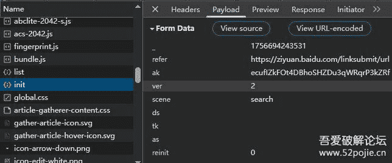
`2.png` (35.91 KB, 下载次数: 4)
[href="forum.php?mod=attachment&aid=MjgwMDQwNXw5OGQ4MWE0MHwxNzkzNTcwNjEzfDE2ODA4NnwyMDU3NTIx&nothumb=yes" target="_blank"](https://www.52pojie.cn/forum.php?mod=attachment&aid=MjgwMDQwNXw5OGQ4MWE0MHwxNzkzNTcwNjEzfDE2ODA4NnwyMDU3NTIx&nothumb=yes)
2025-9-2 18:33 上传

### `init` 接口响应

响应参数 `as` 和 `tk` 需要记录下来，后续会用到

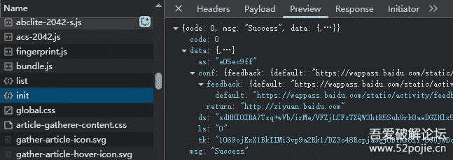
`3.png` (43.42 KB, 下载次数: 4)
[href="forum.php?mod=attachment&aid=MjgwMDQxMXw4NjI3ODAxMHwxNzkzNTcwNjEzfDE2ODA4NnwyMDU3NTIx&nothumb=yes" target="_blank"](https://www.52pojie.cn/forum.php?mod=attachment&aid=MjgwMDQxMXw4NjI3ODAxMHwxNzkzNTcwNjEzfDE2ODA4NnwyMDU3NTIx&nothumb=yes)
2025-9-2 18:33 上传

### `style` 接口请求载荷

用到了 `init` 接口获取到的 `tk`

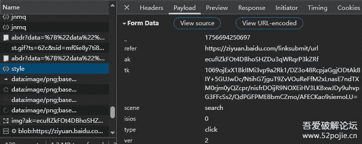
`4.png` (53.83 KB, 下载次数: 3)
[href="forum.php?mod=attachment&aid=MjgwMDQxMnwwNWExNWMyNXwxNzkzNTcwNjEzfDE2ODA4NnwyMDU3NTIx&nothumb=yes" target="_blank"](https://www.52pojie.cn/forum.php?mod=attachment&aid=MjgwMDQxMnwwNWExNWMyNXwxNzkzNTcwNjEzfDE2ODA4NnwyMDU3NTIx&nothumb=yes)
2025-9-2 18:33 上传

### `style` 接口响应

响应参数 `backstr`、`path`、`ext` 后续会用到

`path` 是验证码图片的地址

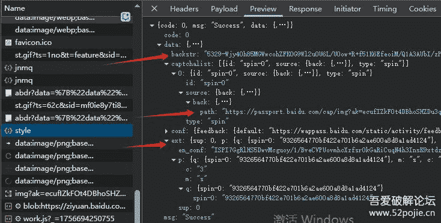
`5.png` (77.83 KB, 下载次数: 4)
[href="forum.php?mod=attachment&aid=MjgwMDQxM3w0ZDc0NWQyN3wxNzkzNTcwNjEzfDE2ODA4NnwyMDU3NTIx&nothumb=yes" target="_blank"](https://www.52pojie.cn/forum.php?mod=attachment&aid=MjgwMDQxM3w0ZDc0NWQyN3wxNzkzNTcwNjEzfDE2ODA4NnwyMDU3NTIx&nothumb=yes)
2025-9-2 18:33 上传

### `log` 接口请求载荷

滑动旋转验证码后会请求 `log` 接口

参数 `fs` 和 `fuid` 是我们主要分析的目标

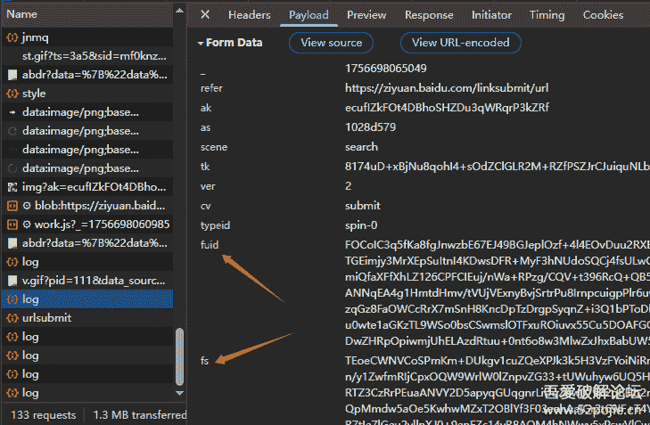
`6.png` (89.92 KB, 下载次数: 5)
[href="forum.php?mod=attachment&aid=MjgwMDQxNHw3M2E4MGUxZXwxNzkzNTcwNjEzfDE2ODA4NnwyMDU3NTIx&nothumb=yes" target="_blank"](https://www.52pojie.cn/forum.php?mod=attachment&aid=MjgwMDQxNHw3M2E4MGUxZXwxNzkzNTcwNjEzfDE2ODA4NnwyMDU3NTIx&nothumb=yes)
2025-9-2 18:33 上传

### `log` 接口响应

响应参数 `op` 值为 1 的时候说明结果正确

响应中的 `ds` 和 `tk` 就可用于后续你要想要请求的接口中使用

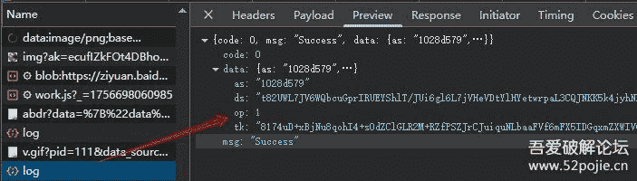
`7.png` (35.8 KB, 下载次数: 4)
[href="forum.php?mod=attachment&aid=MjgwMDQxNXwxYTRkMDY1YXwxNzkzNTcwNjEzfDE2ODA4NnwyMDU3NTIx&nothumb=yes" target="_blank"](https://www.52pojie.cn/forum.php?mod=attachment&aid=MjgwMDQxNXwxYTRkMDY1YXwxNzkzNTcwNjEzfDE2ODA4NnwyMDU3NTIx&nothumb=yes)
2025-9-2 18:33 上传

## 逆向过程

打上 `log` 接口的 xhr 断点往上跟栈

或者全局搜索 `n.fs`

可以定位到 `fs` 的生成位置在 `mkd_v2.js` 这个文件中

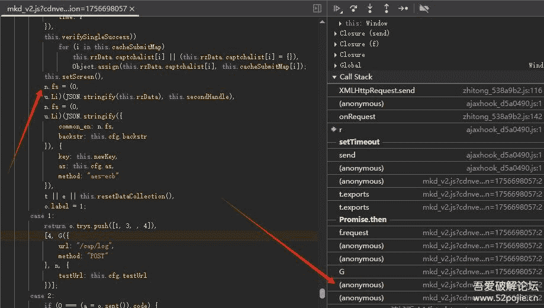
`8.png` (93.47 KB, 下载次数: 4)
[href="forum.php?mod=attachment&aid=MjgwMDQxNnxjMGM2ZjNmNXwxNzkzNTcwNjEzfDE2ODA4NnwyMDU3NTIx&nothumb=yes" target="_blank"](https://www.52pojie.cn/forum.php?mod=attachment&aid=MjgwMDQxNnxjMGM2ZjNmNXwxNzkzNTcwNjEzfDE2ODA4NnwyMDU3NTIx&nothumb=yes)
2025-9-2 18:33 上传

由于这个 js 文件后缀是带动态时间戳的

`mkd_v2.js?cdnversion=1756709834`

断点是打不上的

这里我们全局搜索 `cdnversion`

定位到一个 `url` 文件的如下位置

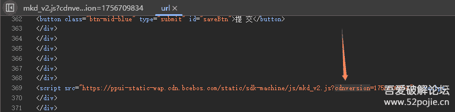
`9.png` (16.06 KB, 下载次数: 4)
[href="forum.php?mod=attachment&aid=MjgwMDQxN3xjMjIyYmI3YXwxNzkzNTcwNjEzfDE2ODA4NnwyMDU3NTIx&nothumb=yes" target="_blank"](https://www.52pojie.cn/forum.php?mod=attachment&aid=MjgwMDQxN3xjMjIyYmI3YXwxNzkzNTcwNjEzfDE2ODA4NnwyMDU3NTIx&nothumb=yes)
2025-9-2 18:33 上传

将后缀全部删除后保存文件

其实就是相当于 `overrides` 重写文件操作

刷新页面重试后看到已经没有后缀了

可以愉快的上断点了

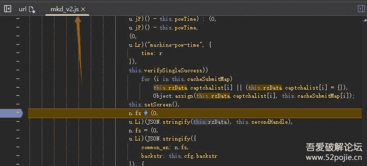
`9_5.png` (39.91 KB, 下载次数: 4)
[href="forum.php?mod=attachment&aid=MjgwMDQxOXxkMTRkZDhkNHwxNzkzNTcwNjEzfDE2ODA4NnwyMDU3NTIx&nothumb=yes" target="_blank"](https://www.52pojie.cn/forum.php?mod=attachment&aid=MjgwMDQxOXxkMTRkZDhkNHwxNzkzNTcwNjEzfDE2ODA4NnwyMDU3NTIx&nothumb=yes)
2025-9-2 18:37 上传

### `fs` 赋值分析

可以看到 `fs` 赋值了两次

先分析第一次的

```
n.fs = (0, u.Li)(JSON.stringify(this.rzData), this.secondHandle)
```

将 `this.rzData` 字符串序列化

`backstr` 是 `style` 接口响应中的

`ac_c` 是根据旋转角度计算的

`mv` 是轨迹

`p` 是根据 `style` 接口响应中 `ext` 参数计算来的

`common.mv` 这组轨迹不校验可有可无

其它的环境参数可以写死

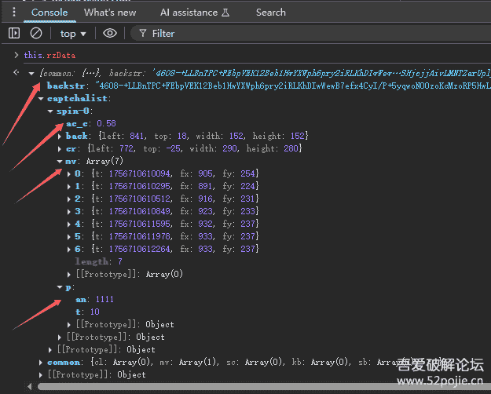
`10.png` (33.92 KB, 下载次数: 3)
[href="forum.php?mod=attachment&aid=MjgwMDM5NXw2NTNlNDhkNnwxNzkzNTcwNjEzfDE2ODA4NnwyMDU3NTIx&nothumb=yes" target="_blank"](https://www.52pojie.cn/forum.php?mod=attachment&aid=MjgwMDM5NXw2NTNlNDhkNnwxNzkzNTcwNjEzfDE2ODA4NnwyMDU3NTIx&nothumb=yes)
2025-9-2 18:33 上传

#### 定位 `ac_c` 的生成位置

往上跟栈先找到 `ac_c` 的生成位置

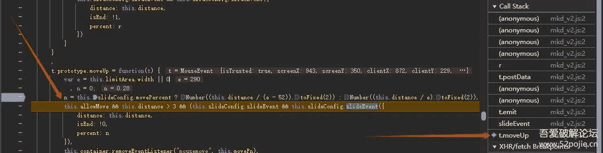
`11.png` (62.47 KB, 下载次数: 4)
[href="forum.php?mod=attachment&aid=MjgwMDM5NnxlMmFkNmFkN3wxNzkzNTcwNjEzfDE2ODA4NnwyMDU3NTIx&nothumb=yes" target="_blank"](https://www.52pojie.cn/forum.php?mod=attachment&aid=MjgwMDM5NnxlMmFkNmFkN3wxNzkzNTcwNjEzfDE2ODA4NnwyMDU3NTIx&nothumb=yes)
2025-9-2 18:33 上传

```
n = Number((this.distance / (e - 52)).toFixed(2))
```

`this.distance` 是滑动的距离

`e` 是固定值 290，也就是滑动框整体的长度

轨迹和角度识别直接用开源的就行


https://github.com/lumina37/rotate-captcha-crack

再找 `p` 的生成位置

赋值位置就在 `fs` 的上面

从 `this.powMap` 获取

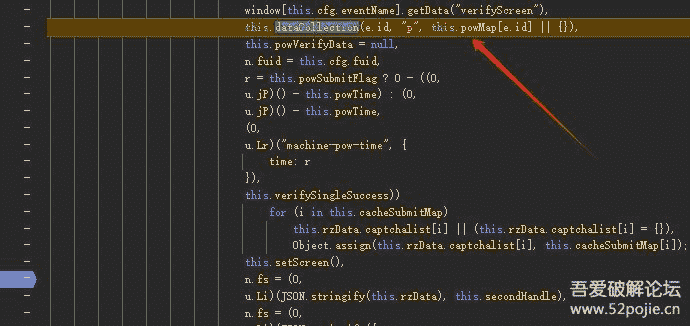

12.png (43.26 KB, 下载次数: 4)

[href="forum.php?mod=attachment&aid=MjgwMDM5N3xlOTQwZGMwM3wxNzkzNTcwNjEzfDE2ODA4NnwyMDU3NTIx&nothumb=yes" target="_blank"](https://www.52pojie.cn/forum.php?mod=attachment&aid=MjgwMDM5N3xlOTQwZGMwM3wxNzkzNTcwNjEzfDE2ODA4NnwyMDU3NTIx&nothumb=yes)

2025-9-2 18:33 上传

全局搜索 `powMap` 定位到如下位置

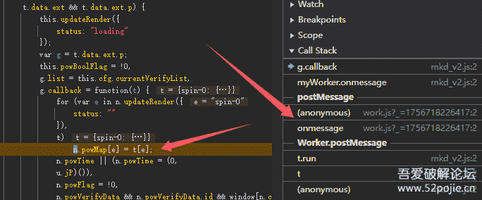

13.png (35.15 KB, 下载次数: 1)

[href="forum.php?mod=attachment&aid=MjgwMDM5OHw5ODZhM2ZiNHwxNzkzNTcwNjEzfDE2ODA4NnwyMDU3NTIx&nothumb=yes" target="_blank"](https://www.52pojie.cn/forum.php?mod=attachment&aid=MjgwMDM5OHw5ODZhM2ZiNHwxNzkzNTcwNjEzfDE2ODA4NnwyMDU3NTIx&nothumb=yes)

2025-9-2 18:33 上传

分析可知是个 worker 接口计算的

找到进入 `woke.js` 的入口位置

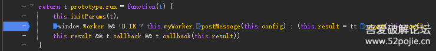

14.png (10.41 KB, 下载次数: 4)

[href="forum.php?mod=attachment&aid=MjgwMDM5OXwzYTFmZDM4NnwxNzkzNTcwNjEzfDE2ODA4NnwyMDU3NTIx&nothumb=yes" target="_blank"](https://www.52pojie.cn/forum.php?mod=attachment&aid=MjgwMDM5OXwzYTFmZDM4NnwxNzkzNTcwNjEzfDE2ODA4NnwyMDU3NTIx&nothumb=yes)

2025-9-2 18:33 上传

很明显，将 `i.pow` 方法还原出来即可，这样就得出了 `p` 值

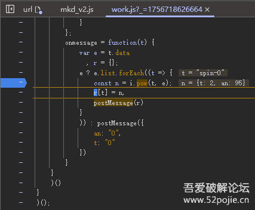

15.png (14.12 KB, 下载次数: 4)

[href="forum.php?mod=attachment&aid=MjgwMDQwMHwzY2ViMTAxNXwxNzkzNTcwNjEzfDE2ODA4NnwyMDU3NTIx&nothumb=yes" target="_blank"](https://www.52pojie.cn/forum.php?mod=attachment&aid=MjgwMDQwMHwzY2ViMTAxNXwxNzkzNTcwNjEzfDE2ODA4NnwyMDU3NTIx&nothumb=yes)

2025-9-2 18:33 上传

到此 `this.rzData` 分析完毕

再看 `this.secondHandle`

就个 `as`，由 `init` 接口响应中获取

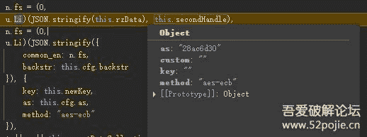

16.png (20.22 KB, 下载次数: 2)

[href="forum.php?mod=attachment&aid=MjgwMDQwMXwxZWU1ZWI3NnwxNzkzNTcwNjEzfDE2ODA4NnwyMDU3NTIx&nothumb=yes" target="_blank"](https://www.52pojie.cn/forum.php?mod=attachment&aid=MjgwMDQwMXwxZWU1ZWI3NnwxNzkzNTcwNjEzfDE2ODA4NnwyMDU3NTIx&nothumb=yes)

2025-9-2 18:33 上传

将这两个参数传入 `u.Li` 方法生成第一次的 `fs`

分析 `u.Li`

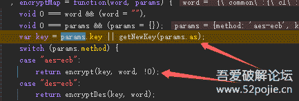

17.png (13.13 KB, 下载次数: 4)

[href="forum.php?mod=attachment&aid=MjgwMDQwMnw3ODc1ZmU1NHwxNzkzNTcwNjEzfDE2ODA4NnwyMDU3NTIx&nothumb=yes" target="_blank"](https://www.52pojie.cn/forum.php?mod=attachment&aid=MjgwMDQwMnw3ODc1ZmU1NHwxNzkzNTcwNjEzfDE2ODA4NnwyMDU3NTIx&nothumb=yes)

2025-9-2 18:33 上传

先走 `getNewKey` 方法传入 `as` 获取 `key`

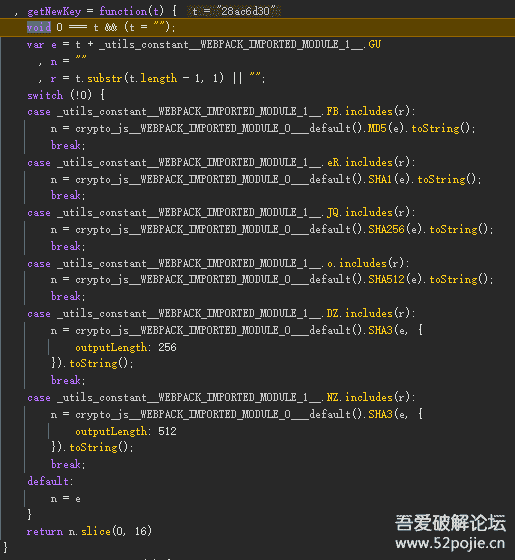

18.png (23.72 KB, 下载次数: 3)

[href="forum.php?mod=attachment&aid=MjgwMDQwM3xlNGY0YTkzMnwxNzkzNTcwNjEzfDE2ODA4NnwyMDU3NTIx&nothumb=yes" target="_blank"](https://www.52pojie.cn/forum.php?mod=attachment&aid=MjgwMDQwM3xlNGY0YTkzMnwxNzkzNTcwNjEzfDE2ODA4NnwyMDU3NTIx&nothumb=yes)

2025-9-2 18:33 上传

算法很简单直接还原

```
def get_aes_key(self, _as):
    mode_dict = {
        "DZ": ["0", "1", "2", "3", "4"],
        "FB": ["A", "B", "C", "D", "E", "F", "G", "a", "b", "c", "d", "e", "f", "g"],
        "JQ": ["O", "P", "Q", "R", "S", "T", "o", "p", "q", "r", "s", "t"],
        "NZ": ["5", "6", "7", "8", "9"],
        "eR": ["H", "I", "J", "K", "L", "M", "N", "h", "i", "j", "k", "l", "m", "n"],
        "o": ["U", "V", "W", "X", "Y", "Z", "u", "v", "w", "x", "y", "z"],
    }
    r = _as[-1]
    data = f'{_as}appsapi2'
    if r in mode_dict['FB']:
        n = hashlib.md5(data.encode('utf-8')).hexdigest()
    elif r in mode_dict['eR']:
        n = hashlib.sha1(data.encode('utf-8')).hexdigest()
    elif r in mode_dict['JQ']:
        n = hashlib.sha256(data.encode('utf-8')).hexdigest()
    elif r in mode_dict['o']:
        n = hashlib.sha512(data.encode('utf-8')).hexdigest()
    elif r in mode_dict['DZ']:
        n = hashlib.sha3_256(data.encode()).hexdigest()
    elif r in mode_dict['NZ']:
        n = hashlib.sha3_512(data.encode()).hexdigest()
    else:
        return
    return n[0:16]
```

再走分支 `aes-ecb` 的 `encrypt` 方法

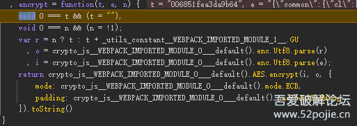

19.png (14.1 KB, 下载次数: 3)

[href="forum.php?mod=attachment&aid=MjgwMDQwNHwwNjY0MWJlYXwxNzkzNTcwNjEzfDE2ODA4NnwyMDU3NTIx&nothumb=yes" target="_blank"](https://www.52pojie.cn/forum.php?mod=attachment&aid=MjgwMDQwNHwwNjY0MWJlYXwxNzkzNTcwNjEzfDE2ODA4NnwyMDU3NTIx&nothumb=yes)

2025-9-2 18:33 上传

标准的 aes 加密没啥好说的，这里是 ecb 模式零填充

```
def zero_pad(self, data, block_size):
    padding_length = block_size - (len(data) % block_size)
    padding = b'\0' * padding_length
    return data + padding

def aes_zero_encrypt(self, data, key):
    plaintext_bytes = data.encode('utf-8')
    cipher = AES.new(key.encode('utf-8'), AES.MODE_ECB)
    padded_plaintext = self.zero_pad(plaintext_bytes, AES.block_size)
    ciphertext = cipher.encrypt(padded_plaintext)
    encoded_ciphertext = base64.b64encode(ciphertext)
    return encoded_ciphertext.decode()
```

到此第一次 `fs` 的加密 ok 了

然后第二次

参数全部已知，将第一次生成的 `fs` 加入进来再加密一遍就是最终的 `fs` 了

```
n.fs = (0, u.Li)(
  JSON.stringify(
    {
      common_en: n.fs,
      backstr: this.cfg.backstr
    }
  ), 
  {
    key: this.newKey,
    as: this.cfg.as,
    method: "aes-ecb"
  }
)
```

最后再来分析 `fuid`

全局搜索 `fuid` 定位到如下位置

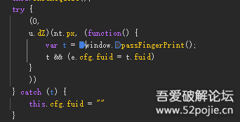

20.png (8.75 KB, 下载次数: 4)

[href="forum.php?mod=attachment&aid=MjgwMDQwNnxmZmI0MDc5ZnwxNzkzNTcwNjEzfDE2ODA4NnwyMDU3NTIx&nothumb=yes" target="_blank"](https://www.52pojie.cn/forum.php?mod=attachment&aid=MjgwMDQwNnxmZmI0MDc5ZnwxNzkzNTcwNjEzfDE2ODA4NnwyMDU3NTIx&nothumb=yes)

2025-9-2 18:33 上传

`fuid` 由 `window.passFingerPrint()` 方法生成

断点后进入 `fingerprint.js` 文件

拉倒最后

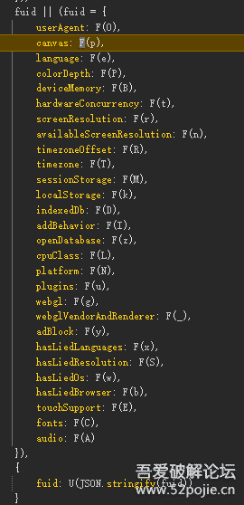

21.png (15.12 KB, 下载次数: 3)

[href="forum.php?mod=attachment&aid=MjgwMDQwN3wyNmU5ZjNjNXwxNzkzNTcwNjEzfDE2ODA4NnwyMDU3NTIx&nothumb=yes" target="_blank"](https://www.52pojie.cn/forum.php?mod=attachment&aid=MjgwMDQwN3wyNmU5ZjNjNXwxNzkzNTcwNjEzfDE2ODA4NnwyMDU3NTIx&nothumb=yes)

2025-9-2 18:33 上传

一些环境检测和 canvas 指纹

最后再将字典字符串序列化后走 `U` 方法

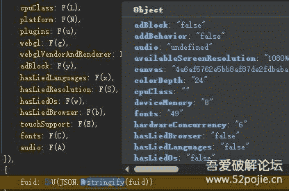

22.png (32.76 KB, 下载次数: 4)

[href="forum.php?mod=attachment&aid=MjgwMDQwOHw5OWEwMGY0ZnwxNzkzNTcwNjEzfDE2ODA4NnwyMDU3NTIx&nothumb=yes" target="_blank"](https://www.52pojie.cn/forum.php?mod=attachment&aid=MjgwMDQwOHw5OWEwMGY0ZnwxNzkzNTcwNjEzfDE2ODA4NnwyMDU3NTIx&nothumb=yes)

2025-9-2 18:33 上传

进入 `U` 方法

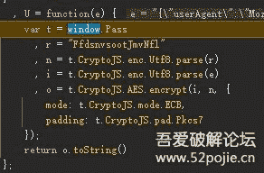

23.png (18.32 KB, 下载次数: 3)

[href="forum.php?mod=attachment&aid=MjgwMDQwOXwxOWFhZTM1MXwxNzkzNTcwNjEzfDE2ODA4NnwyMDU3NTIx&nothumb=yes" target="_blank"](https://www.52pojie.cn/forum.php?mod=attachment&aid=MjgwMDQwOXwxOWFhZTM1MXwxNzkzNTcwNjEzfDE2ODA4NnwyMDU3NTIx&nothumb=yes)

2025-9-2 18:33 上传

标准的 aes 加密，但和 `fs` 的加密不同，这里填充方式是 `Pkcs7`

```
def aes_encrypt(self, data, key):
    plaintext_bytes = data.encode('utf-8')
    cipher = AES.new(key.encode('utf-8'), AES.MODE_ECB)
    padded_plaintext = pad(plaintext_bytes, AES.block_size)
    ciphertext = cipher.encrypt(padded_plaintext)
    encoded_ciphertext = base64.b64encode(ciphertext)
    return encoded_ciphertext.decode()
```

3> 结果验证

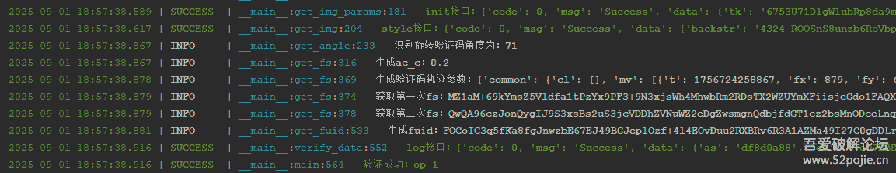

24.png (60.1 KB, 下载次数: 3)

[href="forum.php?mod=attachment&aid=MjgwMDQxMHw2NzVmMDNiZnwxNzkzNTcwNjEzfDE2ODA4NnwyMDU3NTIx&nothumb=yes" target="_blank"](https://www.52pojie.cn/forum.php?mod=attachment&aid=MjgwMDQxMHw2NzVmMDNiZnwxNzkzNTcwNjEzfDE2ODA4NnwyMDU3NTIx&nothumb=yes)

2025-9-2 18:33 上传
