# [原创] 破解 navicat 17.3.3 中文版

- 原帖：<https://www.52pojie.cn/forum.php?mod=viewthread&tid=2058007>
- 抓取时间：2026-11-01T22:03:27

navicat 更新到 17.3.3，地址也出现了变化，下面是新的[链接](https://www.52pojie.cn)。

## 对比上一个版本破解的改进

- 只需要注册码和激活码就可以激活
- 工具仅需要一个二进制编辑器，去掉了加密工具
- 增加了自动弹出手动激活，无需断网
- 仅需要处理 `libcc.dll` 文件即可

## 破解步骤

- 修改 `libcc.dll` `offset 0x062bE750` 的字符串为自己公钥内容，公钥最后补充 1 个 `00` 作为结束符。
- `patch` `libcc.dll` `offset 0x0214cf5b` 的内容如下：`488D0DEE2117044889084889C24889F9FFD348894620488B5510`，后面填充 `90` 到 `0x0214CFA4`。
- 可跳过（跳过后手动断网就行）：`patch` 网络，将错误代码从 `9001003` 改为 `9001001`，弹出手动激活；`patch` 后不需要断网。

  在 `offset 0x0214774e` 由原来 `48 8D 15 1B 9B FB 03` 改为 `48 8D 15 CB 9A FB 03`。

- `patch` `DI` 值，将 `DI` 值固定在 `DDDDDDDDDDDDDDDDDDDD`。

  `patch` `0x021532FB` 为 `488B0748B9444444444444444448890848B9444444444444444448894808C7401044444444C640140090909090`。

- 没做第 3 步的断开网络；做了的不需要断网。启动 `navicat`，输入 `key`：`NAVGVE7STTDEBCWB`，这里 `key` 必须是这个值，获取请求码。
- 输入激活码：

```
iI2Z2tkLwwgtiAYFC8+2pxkYrerRy9AqmLa5WoGPIBpz3aLt+iD6bKKu9Wei1zvwJ2zqUpddewkH9GugwZ+t6b2pwUBKeB23Qu3SMAfndj8nAA83FLiFaJBsFWGYnLeLGxqJ6qw+hkJ++bYwsRxdFxJ8Qkv8x0WNjU9Xr9fygM6ybtqz8rBm/XdrP1HGRlO33PGDE1hyq6Fut4BFTaFebNH68LZ6z8tjAnkD8bGX8OVXIQJc1DZF1V4nvZsSOHBP1Ei+395JMAOT28mZis9NlsXkloiU/VUs7jH9Nrjk9l25pcMMtA9cG5zQH34h8q/hDQg3PRuxHzzteMoZ3KDiGw==
```

## 注

- 固定 `DI` 操作让加密的变量全部固定，所以可以使用统一的激活码进行激活。
- 如果要自定义 `KEY`、`N`、`O` 的，也可以自行替换公私钥和 `key`，用 17.3.2 的破解方案后面的计算步骤即可。

## 图文并茂的详细步骤

### 1. 修改 `libcc.dll` 公钥字符串

修改 `libcc.dll` `offset 0x062bE750` 的字符串为自己公钥内容，公钥最后补充 1 个 `00` 作为结束符（这里借用了系统原有的一个字符串 `aOutputDocument_0` 存储公钥，可能导致查看某个帮助出现公钥）。

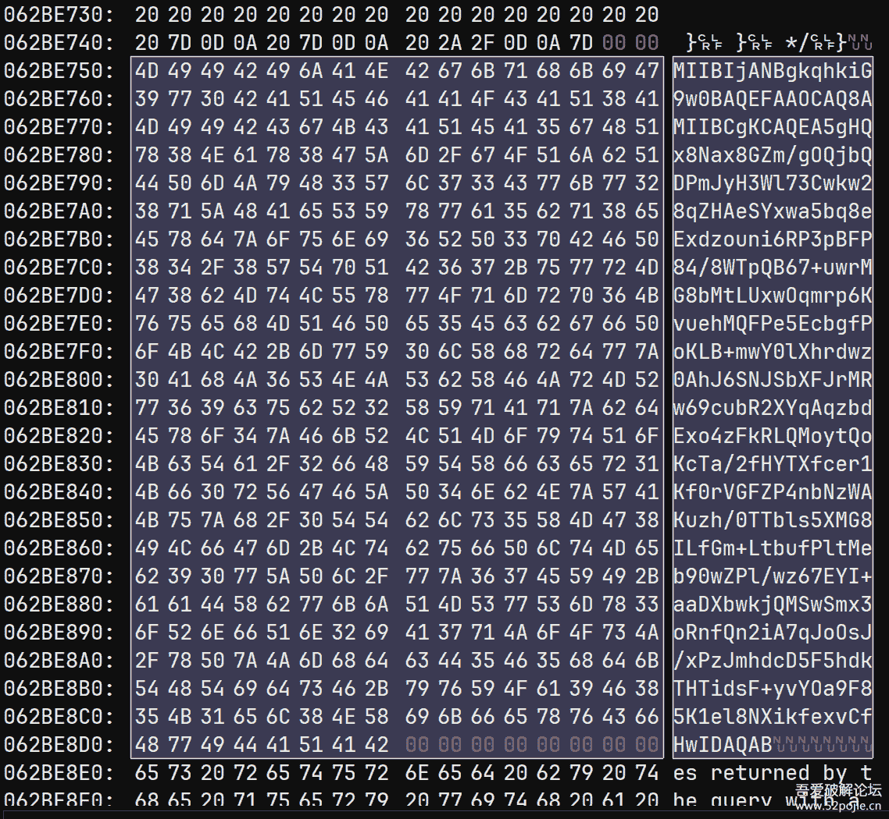

`1.png`（391.84 KB，下载次数：7）  
[附件](https://www.52pojie.cn/forum.php?mod=attachment&aid=MjgwMDgyOXxmOTBiN2IyYXwxNzkzNTcwNjA1fDE2ODA4NnwyMDU4MDA3&nothumb=yes)  
2025-9-4 20:03 上传

公钥内容：

```
MIIBIjANBgkqhkiG9w0BAQEFAAOCAQ8AMIIBCgKCAQEA5gHQx8Nax8GZm/gOQjbQDPmJyH3Wl73Cwkw28qZHAeSYxwa5bq8eExdzouni6RP3pBFP84/8WTpQB67+uwrMG8bMtLUxwOqmrp6KvuehMQFPe5EcbgfPoKLB+mwY0lXhrdwz0AhJ6SNJSbXFJrMRw69cubR2XYqAqzbdExo4zFkRLQMoytQoKcTa/2fHYTXfcer1Kf0rVGFZP4nbNzWAKuzh/0TTbls5XMG8ILfGm+LtbufPltMeb90wZPl/wz67EYI+aaDXbwkjQMSwSmx3oRnfQn2iA7qJoOsJ/xPzJmhdcD5F5hdkTHTidsF+yvYOa9F85K1el8NXikfexvCfHwIDAQAB
```

私钥内容（本次步骤已经不需要私钥，提供用来验证结果）：

```
MIIEvwIBADANBgkqhkiG9w0BAQEFAASCBKkwggSlAgEAAoIBAQDmAdDHw1rHwZmb+A5CNtAM+YnIfdaXvcLCTDbypkcB5JjHBrlurx4TF3Oi6eLpE/ekEU/zj/xZOlAHrv67Cswbxsy0tTHA6qaunoq+56ExAU97kRxuB8+gosH6bBjSVeGt3DPQCEnpI0lJtcUmsxHDr1y5tHZdioCrNt0TGjjMWREtAyjK1CgpxNr/Z8dhNd9x6vUp/StUYVk/ids3NYAq7OH/RNNuWzlcwbwgt8ab4u1u58+W0x5v3TBk+X/DPrsRgj5poNdvCSNAxLBKbHehGd9CfaIDuomg6wn/E/MmaF1wPkXmF2RMdOJ2wX7K9g5r0XzkrV6Xw1eKR97G8J8fAgMBAAECggEABjyMXa5FWt87/Aeo01DLKV7mxoHq/KhPjJcmckPh7wI0xki/ZGnpJdlf8E3pMiqxb0hs44zG6eBz5RFwpL+xMxub11aGZ9W0+U0hM/Xx3/NKJW6U18LsdU2UdubRcXqUqPMskHp5DpI/XXlJRDhcxfKOUBa9kuG7hWjya58tZRUD/d89e7zZSYth4tiO1pScU6ZBlxykID3WeI4vf8QrKNUGY4gJetikeKO33ou3iwjp3RUMjYsQq8NjFLa2ivmiG8zWhX8802dbQx11oXZKB7KzRvC2fbvo8gBUSla0RhgRmtKDaO+e4UeDACYL1jI0NjKEkWYLU0kcs0zlWNrtaQKBgQD/qU5LVJH5zNmkB0rtGtGKfGwkeEksqjlnQazdaGEsjpA4WhXegqf5AgTMUXK9BDXnpd+dESVUG9JIgBzys3ijq1trzNGbtoPNzM2XJG/XyEo+FVMzn2TjGbt+mQq7C64FNvWFvz0RKlObq0ilsCxRS5c9JagGbgMf74BtdZ12dQKBgQDmT893Li3dV8e2k34kA+oJJPPChd/mVb2GLQV3Ha4EO2GHbBK3/7UUFiMBDyYx90SXbwFVu3grBPGSvPxaG7Sl0J82i0S+AWP1lUisriNOdAF6not3sQ/4XmBXAem5pWlH0Pctbk2+6CkD/5269ebswMCxkWikwdGBvNYLNn1UwwKBgQC40JtYuXoNKpjqipsPbCOuCOPkOVAsiaGVk1RzedFFdImtMvI8OBdVWrA9Q2O+YBzXqIFN+ecSNkp9Pp+uky7Soj0kYJvmBLqjOzoj2KNBSfjhiGjtGHzF7wQrMFchf//8pQ438Vcj4YUvM1MA86oV2p8qBN7CRyTbITel6TA7QQKBgQCLKAHksuRHbvhemnOG805/Q/J8wELuezPOVHmO5UH1kKN3HZeZ0Ujp4A46X5rmac7p6MpXsLQE2jHURZf8Ie1emtT4MeHRJCnvgsmsfHMcvf7+xbjjEvrhSLTRHXjJEOax29Ldgl47US8nGVWGV3m15ykGoSMnGWyrBRwXHk9P3QKBgQD/mxZrUgjGLqgpqiqsFsCr88V51/FpATp7+2luZmyx+/Lz3D+MJ3UF1nehPGjcdMvHNR3y5pDyjiZVQWuiNprYh0Wqebg+avM9giQ5ZTGQNvO6W5/bQIhvIVi+ofw2zs0VMp9W2JDoZ7TFICEVjMXPVXR/JpPCCYxMoenXMt+BSg==
```

（可以用任何能编辑二进制的编辑器，下面是使用 `imhex` 的处理方法：复制字符串，选中位置，右键 -> `Paste as` -> `Paste all as String`，如下图，就能将字符串一次性粘贴过去；字符串最后需要补充一个 `00` 字节表示字符串结束。）

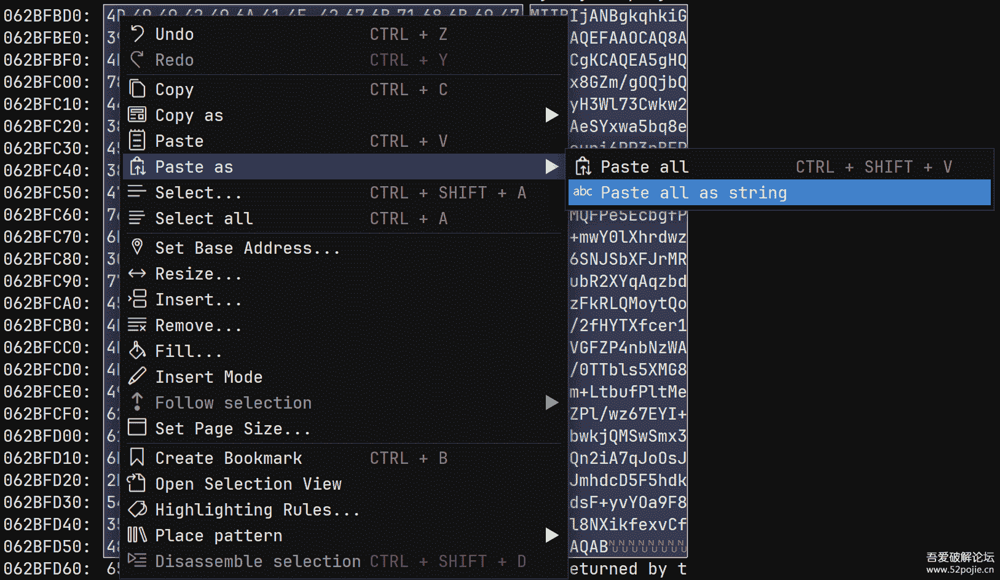

`2.png`（343.51 KB，下载次数：3）  
[附件](https://www.52pojie.cn/forum.php?mod=attachment&aid=MjgwMDgzMHw1MTA5MzRlM3wxNzkzNTcwNjA1fDE2ODA4NnwyMDU4MDA3&nothumb=yes)  
2025-9-4 20:03 上传

### 2. Patch `libcc.dll`

`patch` `libcc.dll` `offset 0x0214cf5b` 的内容如下：`488D0DEE2117044889084889C24889F9FFD348894620488B5510`，后面填充 `90` 到 `0x0214CFA4`。

作用是复制第一步的内容填充给公钥使用的地方。

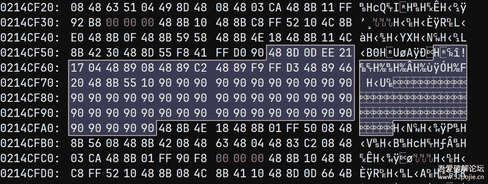

`3.png`（138.44 KB，下载次数：4）  
[附件](https://www.52pojie.cn/forum.php?mod=attachment&aid=MjgwMDgzMXxlNTQ1NDZjOXwxNzkzNTcwNjA1fDE2ODA4NnwyMDU4MDA3&nothumb=yes)  
2025-9-4 20:03 上传

（可以用任何能编辑二进制的编辑器，下面是使用 `imhex` 的处理方法：同样是复制内容，在地址上右键 -> `Paste as` -> `Paste all`，就能将 `hex` 的内容全部复制进去；选中剩余区域，右键 -> `Fill`，输入 `90` 即可全部填充 `90`。）下方的：

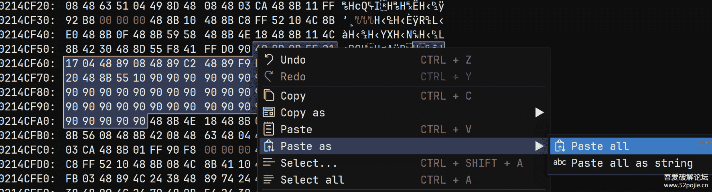

`4.png`（174.82 KB，下载次数：5）  
[附件](https://www.52pojie.cn/forum.php?mod=attachment&aid=MjgwMDgzMnwxMWIyNzgxMnwxNzkzNTcwNjA1fDE2ODA4NnwyMDU4MDA3&nothumb=yes)  
2025-9-4 20:03 上传

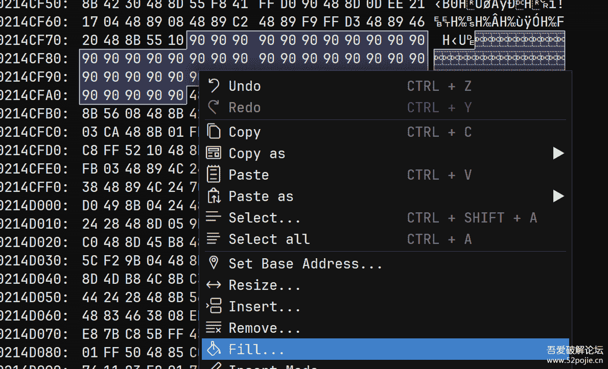

`5.png`（204.9 KB，下载次数：5）  
[附件](https://www.52pojie.cn/forum.php?mod=attachment&aid=MjgwMDgzM3w4NDVkMjAxOXwxNzkzNTcwNjA1fDE2ODA4NnwyMDU4MDA3&nothumb=yes)  
2025-9-4 20:04 上传

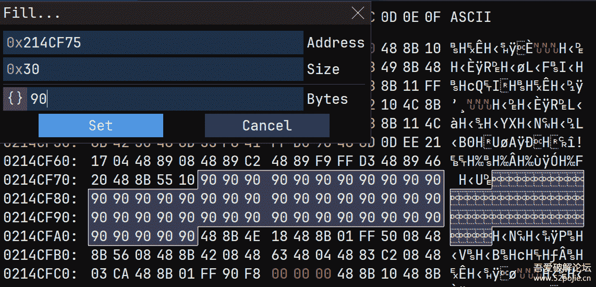

`6.png`（154.15 KB，下载次数：5）  
[附件](https://www.52pojie.cn/forum.php?mod=attachment&aid=MjgwMDgzNHwwZjI2NzFlZnwxNzkzNTcwNjA1fDE2ODA4NnwyMDU4MDA3&nothumb=yes)  
2025-9-4 20:04 上传

### 3. Patch 网络错误代码（可跳过）

可不做（断网就行）：`patch` 网络，将错误代码从 `9001003` 改为 `9001001`，弹出手动激活；`patch` 后不需要断网。

在 `offset 0x0214774e` 由原来 `48 8D 15 1B 9B FB 03` 改为 `48 8D 15 CB 9A FB 03`。

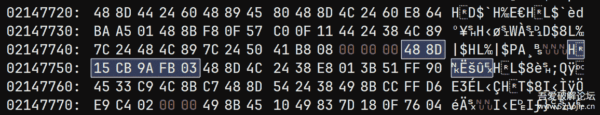

`7.png`（89.02 KB，下载次数：8）  
[附件](https://www.52pojie.cn/forum.php?mod=attachment&aid=MjgwMDgzNXw2YjhmZmRjN3wxNzkzNTcwNjA1fDE2ODA4NnwyMDU4MDA3&nothumb=yes)  
2025-9-4 20:04 上传

### 4. Patch `DI` 值

`patch` `DI` 值，将 `DI` 值固定在 `DDDDDDDDDDDDDDDDDDDD`。

`patch` `0x021532FB` 为 `488B0748B9444444444444444448890848B9444444444444444448894808C7401044444444C640140090909090`。

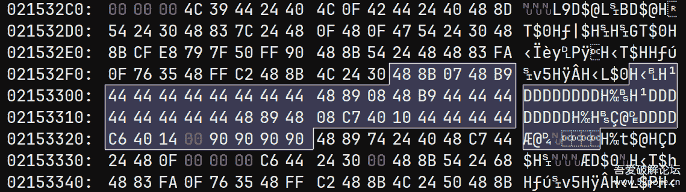

`8.png`（110.71 KB，下载次数：8）  
[附件](https://www.52pojie.cn/forum.php?mod=attachment&aid=MjgwMDgzNnwzODlkYmJmMXwxNzkzNTcwNjA1fDE2ODA4NnwyMDU4MDA3&nothumb=yes)  
2025-9-4 20:04 上传

### 5. 启动 `navicat` 并获取请求码

没做第 3 步的断开网络；做了的不需要断网。启动 `navicat`，输入 `key`：`NAVGVE7STTDEBCWB`，这里 `key` 必须是这个值，获取请求码。

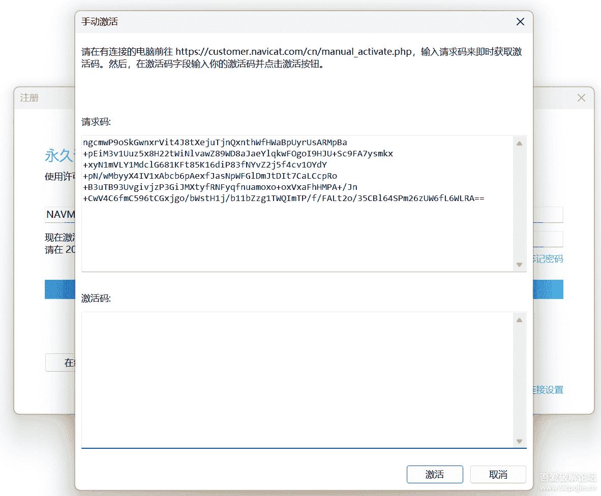

`9.png`（82.48 KB，下载次数：6）  
[附件](https://www.52pojie.cn/forum.php?mod=attachment&aid=MjgwMDgzN3w3ZGFhNWVlM3wxNzkzNTcwNjA1fDE2ODA4NnwyMDU4MDA3&nothumb=yes)  
2025-9-4 20:04 上传

### 6. 输入激活码：


`iI2Z2tkLwwgtiAYFC8+2pxkYrerRy9AqmLa5WoGPIBpz3aLt+iD6bKKu9Wei1zvwJ2zqUpddewkH9GugwZ+t6b2pwUBKeB23Qu3SMAfndj8nAA83FLiFaJBsFWGYnLeLGxqJ6qw+hkJ++bYwsRxdFxJ8Qkv8x0WNjU9Xr9fygM6ybtqz8rBm/XdrP1HGRlO33PGDE1hyq6Fut4BFTaFebNH68LZ6z8tjAnkD8bGX8OVXIQJc1DZF1V4nvZsSOHBP1Ei+395JMAOT28mZis9NlsXkloiU/VUs7jH9Nrjk9l25pcMMtA9cG5zQH34h8q/hDQg3PRuxHzzteMoZ3KDiGw==`

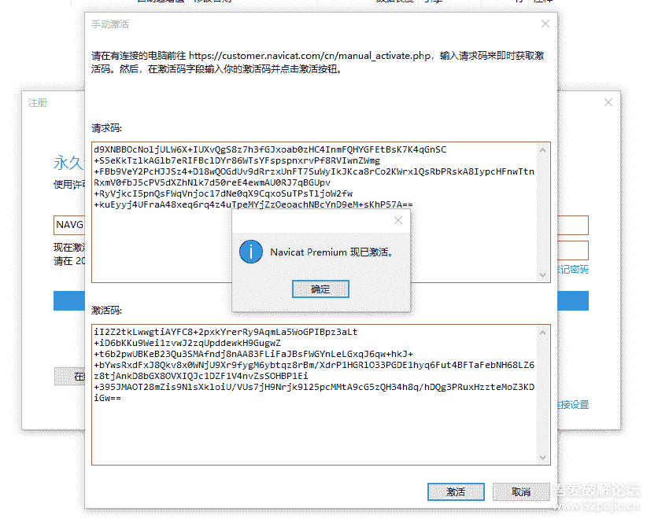

`10.png` (69.09 KB, 下载次数: 7)

[`forum.php?mod=attachment&aid=MjgwMDgzOHw2OWQ0M2JiOXwxNzkzNTcwNjA1fDE2ODA4NnwyMDU4MDA3&nothumb=yes`](https://www.52pojie.cn/forum.php?mod=attachment&aid=MjgwMDgzOHw2OWQ0M2JiOXwxNzkzNTcwNjA1fDE2ODA4NnwyMDU4MDA3&nothumb=yes)

2025-9-4 20:04 上传

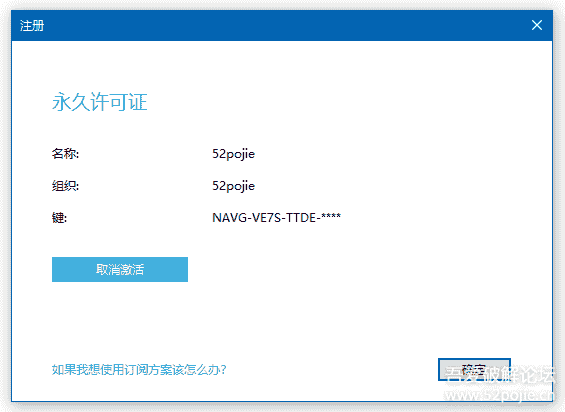

`11.png` (19.33 KB, 下载次数: 6)

[`forum.php?mod=attachment&aid=MjgwMDgzOXxkOGYxZWZjMnwxNzkzNTcwNjA1fDE2ODA4NnwyMDU4MDA3&nothumb=yes`](https://www.52pojie.cn/forum.php?mod=attachment&aid=MjgwMDgzOXxkOGYxZWZjMnwxNzkzNTcwNjA1fDE2ODA4NnwyMDU4MDA3&nothumb=yes)

2025-9-4 20:04 上传

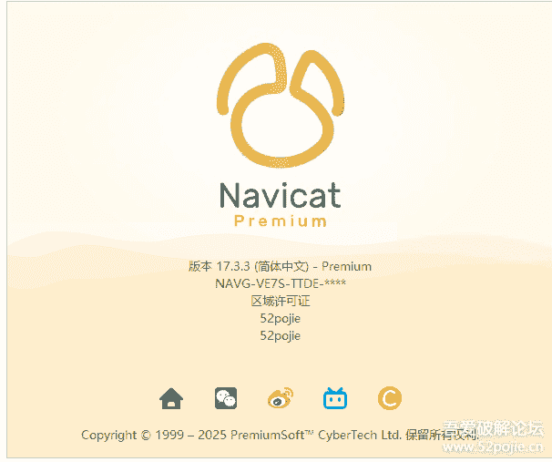

`12.png` (103.02 KB, 下载次数: 5)

[`forum.php?mod=attachment&aid=MjgwMDg0M3w2MWU4ZjAwM3wxNzkzNTcwNjA1fDE2ODA4NnwyMDU4MDA3&nothumb=yes`](https://www.52pojie.cn/forum.php?mod=attachment&aid=MjgwMDg0M3w2MWU4ZjAwM3wxNzkzNTcwNjA1fDE2ODA4NnwyMDU4MDA3&nothumb=yes)

2025-9-4 20:13 上传
