# [Web逆向] 某习通混淆代码及滑动验证码全协议分析

- 原帖：https://www.52pojie.cn/forum.php?mod=viewthread&tid=2058010
- 抓取时间：2026-11-01T22:03:26

网站：aHR0cHM6Ly92OC5jaGFveGluZy5jb20v

今天我们分析一下这个站的登录。按常规先抓包。

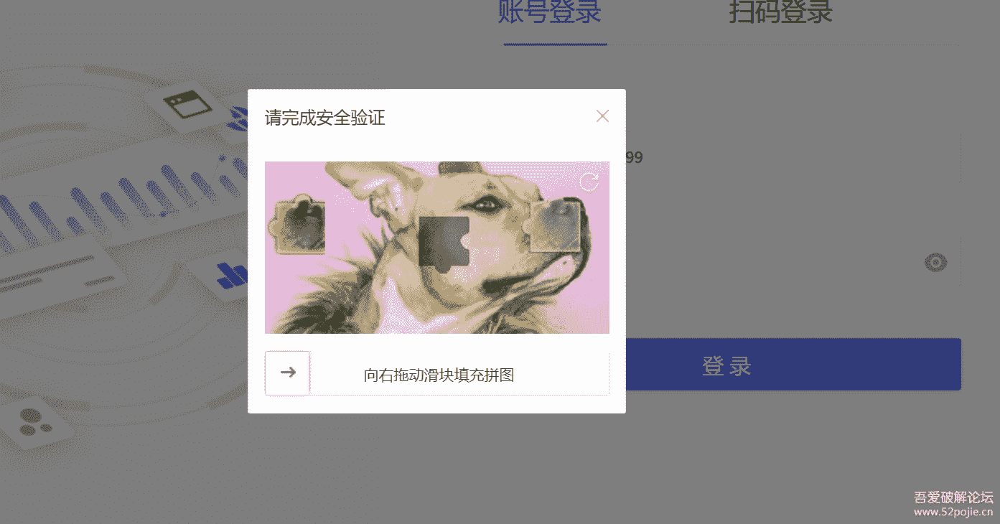
[附件下载](https://www.52pojie.cn/forum.php?mod=attachment&aid=MjgwMDg0MHw3ZmMxOTFhNnwxNzkzNTcwNjAzfDE2ODA4NnwyMDU4MDEw&nothumb=yes)（`1.png`，277.33 KB，下载次数：2；2025-9-4 20:12 上传；图题：滑动验证码）

可以看到点击登录后有滑动验证码。

因此我们需要先分析滑动验证码。

## 滑动验证码分析

抓包可以看到发送了五个可疑参数。

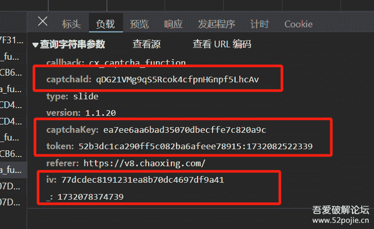
[附件下载](https://www.52pojie.cn/forum.php?mod=attachment&aid=MjgwMDg0MXxjOGZhN2YxYXwxNzkzNTcwNjAzfDE2ODA4NnwyMDU4MDEw&nothumb=yes)（`2.png`，46.41 KB，下载次数：2；2025-9-4 20:13 上传）

然后返回了滑动的底图、缺口，以及一个 `token`。

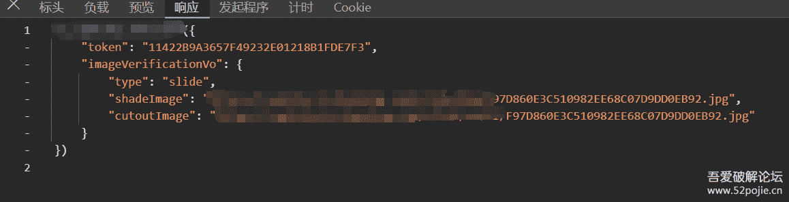
[附件下载](https://www.52pojie.cn/forum.php?mod=attachment&aid=MjgwMDg0MnwzMDYwZTk4M3wxNzkzNTcwNjAzfDE2ODA4NnwyMDU4MDEw&nothumb=yes)（`3.png`，32.25 KB，下载次数：1；2025-9-4 20:13 上传）

通过搜索，`captchaId` 这个参数是在 `login.min.js?t=20240708` 这个 JS 中写死的。我们固定即可。`_` 是个时间戳。

那么我们只需要看 `chptchKey`、`token`、`iv` 即可。查看栈，可以看到有两个可疑的函数。

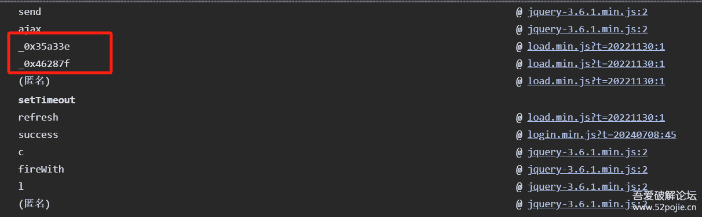
[附件下载](https://www.52pojie.cn/forum.php?mod=attachment&aid=MjgwMDg0NHw3OGYwOTE2NHwxNzkzNTcwNjAzfDE2ODA4NnwyMDU4MDEw&nothumb=yes)（`4.png`，46.85 KB，下载次数：3；2025-9-4 20:13 上传）

我们点进去，可以看到代码里面有赋值操作。但是代码都混淆了。

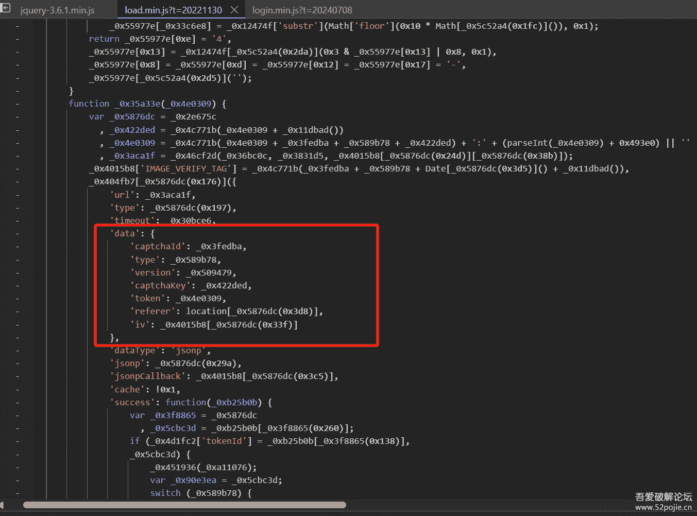
[附件下载](https://www.52pojie.cn/forum.php?mod=attachment&aid=MjgwMDg0NXw5MjJhMmM2NHwxNzkzNTcwNjAzfDE2ODA4NnwyMDU4MDEw&nothumb=yes)（`5.png`，161.04 KB，下载次数：3；2025-9-4 20:13 上传）

虽然混淆了，但是别慌。我们先下断点。

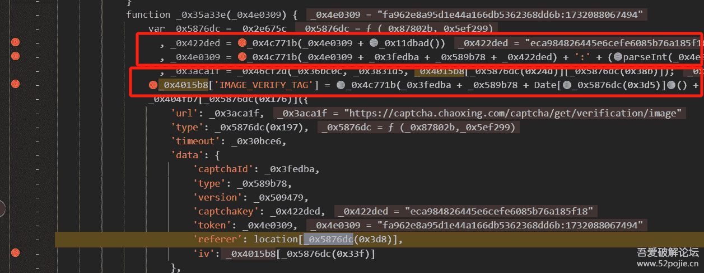
[附件下载](https://www.52pojie.cn/forum.php?mod=attachment&aid=MjgwMDg0Nnw4MzYyZjQ4MXwxNzkzNTcwNjAzfDE2ODA4NnwyMDU4MDEw&nothumb=yes)（`6.png`，111.44 KB，下载次数：1；2025-9-4 20:14 上传）

我们在相同的地方打上三个断点，刷新。

可以看到 `'captchaKey': _0x422ded;_0x422ded = _0x4c771b(_0x4e0309 + _0x11dbad())`。`_0x4e0309` 是个获取时间戳，`_0x11dbad()` 产生了一个 UUID，两个进行了字符串拼接后，传入 `_0x4c771b` 函数进行运算。

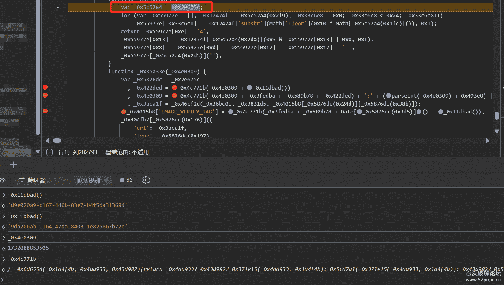
[附件下载](https://www.52pojie.cn/forum.php?mod=attachment&aid=MjgwMDg0N3w0NWIwN2ViZnwxNzkzNTcwNjAzfDE2ODA4NnwyMDU4MDEw&nothumb=yes)（`7.png`，142.26 KB，下载次数：1；2025-9-4 20:14 上传）

`'token': _0x4e0309;_0x4e0309 = _0x4c771b(_0x4e0309 + _0x3fedba + _0x589b78 + _0x422ded) + ':' + (parseInt(_0x4e0309) + 0x493e0) || ''`。`token` 也是先用 `_0x4e0309` 获取时间戳，`_0x3fedba` 是固定的 `captchaId` 这个参数，`_0x589b78` 是固定的 `slide` 字符串，`_0x422ded` 就是上面计算的 `captchaKey` 值。

这些值拼接后继续传入 `_0x4c771b` 函数进行运算。

最后再进行一次拼接。

`'iv': _0x4015b8[_0x5876dc(0x33f)];_0x4015b8['IMAGE_VERIFY_TAG'] = _0x4c771b(_0x3fedba + _0x589b78 + Date[_0x5876dc(0x3d5)]() + _0x11dbad())`。`iv` 值跟 `token` 算法大同小异，看起来复杂，其实就是不同字符串拼接。也是传入 `_0x4c771b` 函数进行运算。因此顺着 `_0x4c771b` 函数往下扣就行。

扣完就一百来行代码。结果如下。

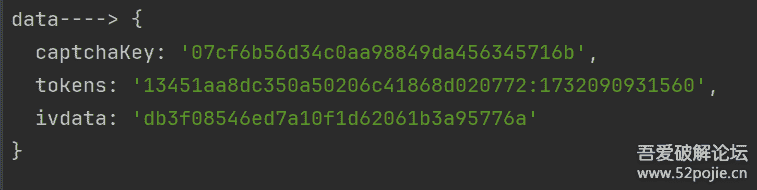
[附件下载](https://www.52pojie.cn/forum.php?mod=attachment&aid=MjgwMDg0OHwyMThmZjM3MnwxNzkzNTcwNjAzfDE2ODA4NnwyMDU4MDEw&nothumb=yes)（`8.png`，27.18 KB，下载次数：2；2025-9-4 20:14 上传）

有了参数及验证码地址。

## 使用 ddddocr 识别滑动验证码

接下来就可以识别了。直接用 `ddddocr` 就行。识别率基本百分百。

```python
det = ddddocr.DdddOcr(det=False, ocr=False)
with open('hk.jpg', 'rb') as f:
    target_bytes = f.read()
with open('yzm.jpg', 'rb') as f:
    background_bytes = f.read()
res = det.slide_match(target_bytes, background_bytes)
```

## 验证码发包分析

接下来。我们再看验证码的发包。

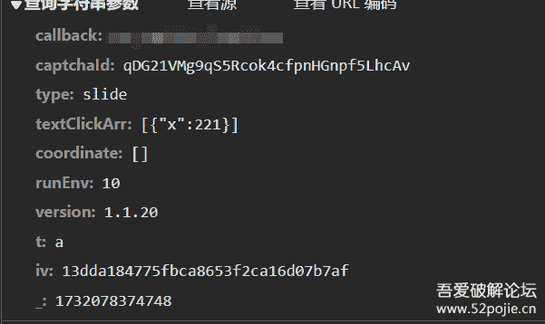
[附件下载](https://www.52pojie.cn/forum.php?mod=attachment&aid=MjgwMDg0OXw1MTRmZTY2N3wxNzkzNTcwNjAzfDE2ODA4NnwyMDU4MDEw&nothumb=yes)（`9.png`，26.86 KB，下载次数：3；2025-9-4 20:15 上传）

可以看到只有两个参数，一个是 `IV`，我们上面已经解决了。还有个 `textClickArr` 参数，按参数字面意思，只传入了一个 `X` 的坐标值。

为了保险，我们看一下调用。

照常点进调用栈。直接就出来了。

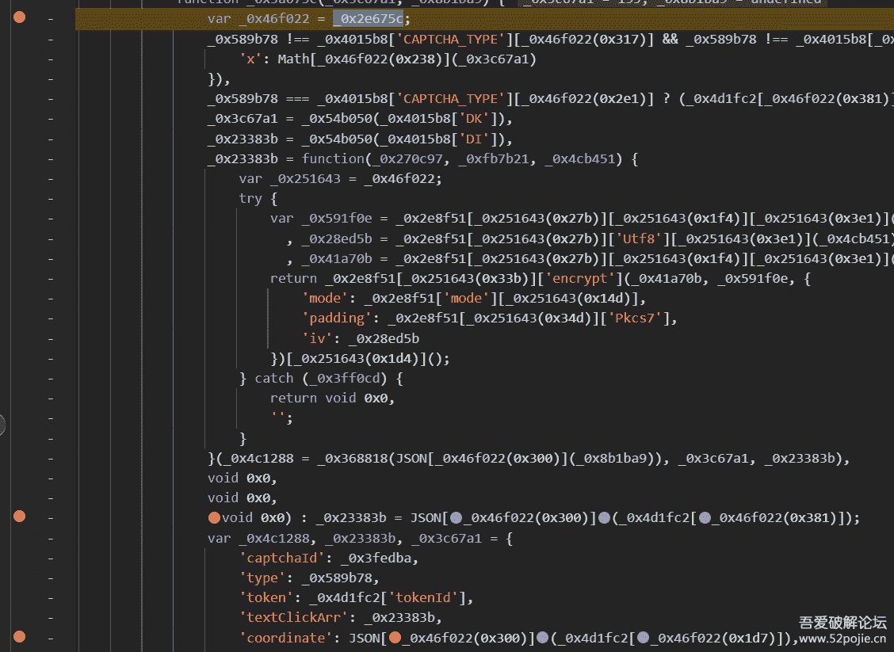
[附件下载](https://www.52pojie.cn/forum.php?mod=attachment&aid=MjgwMDg1NHw4YmM2OWFlNXwxNzkzNTcwNjAzfDE2ODA4NnwyMDU4MDEw&nothumb=yes)（`10.png`，146 KB，下载次数：2；2025-9-4 20:15 上传）

我们都打上断点。

跟下去可以看到这么一个代码：`i ? e : l ? t.call(e) : u ? t(e[0], n) : o`，核心是 `t(e[0], n)` 这个函数，获取了滑块的最左边的坐标。

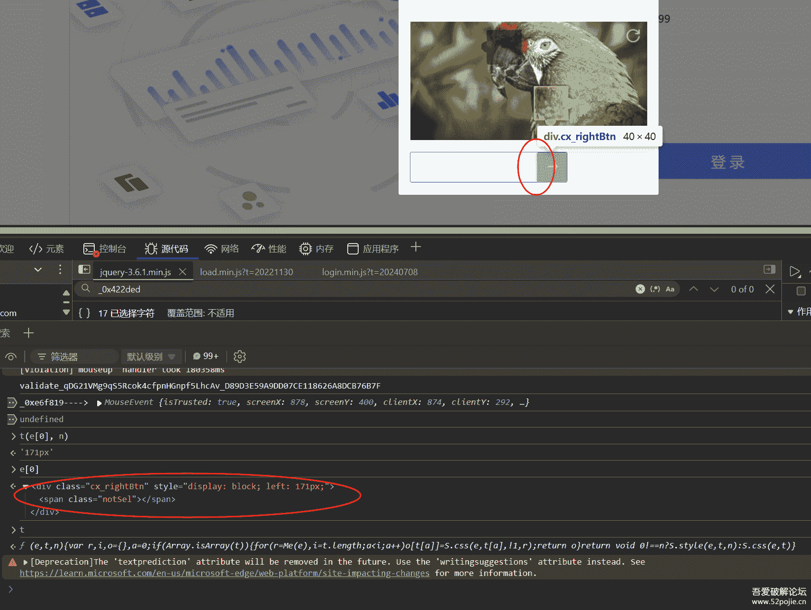
[附件下载](https://www.52pojie.cn/forum.php?mod=attachment&aid=MjgwMDg1NXxkNWVhOTY2MXwxNzkzNTcwNjAzfDE2ODA4NnwyMDU4MDEw&nothumb=yes)（`11.png`，420 KB，下载次数：2；2025-9-4 20:15 上传）

然后进行了运算：

`parseInt(_0x12404f) - _0x4015b8[_0x58cb01(0x25c)][_0x58cb01(0x30c)]`

`_0x12404f` 就是 `x` 的值，减去 `_0x4015b8[_0x58cb01(0x25c)][_0x58cb01(0x30c)]` 生成的 8，就是发送的参数。因此我们在 `ddddocr` 中识别的 `x` 坐标减去 2。

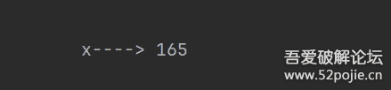
[附件下载](https://www.52pojie.cn/forum.php?mod=attachment&aid=MjgwMDg1Nnw2MDk5NDlmOXwxNzkzNTcwNjAzfDE2ODA4NnwyMDU4MDEw&nothumb=yes)（`12.png`，8.11 KB，下载次数：1；2025-9-4 20:16 上传）

## 登录验证结果

接下来发送成功后获取到 `validata` 值，随着 `login` 登录添加到 `post` 参数中 `data` 就行了。

因为登录没有加密，我们就不看了。

直接看验证码，可以看到 10 次发送，成功率百分之百。

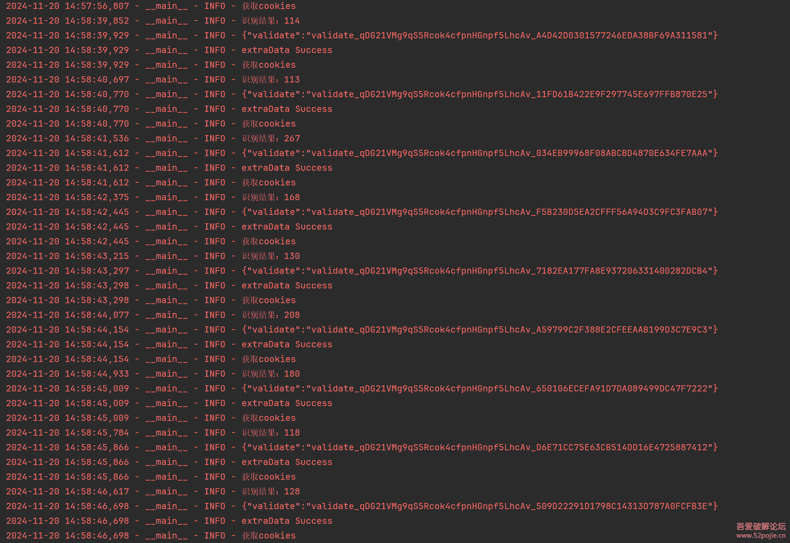
[附件下载](https://www.52pojie.cn/forum.php?mod=attachment&aid=MjgwMDg1N3w3MTQ0MDQ2NHwxNzkzNTcwNjAzfDE2ODA4NnwyMDU4MDEw&nothumb=yes)（`13.png`，326.62 KB，下载次数：2；2025-9-4 20:17 上传）
