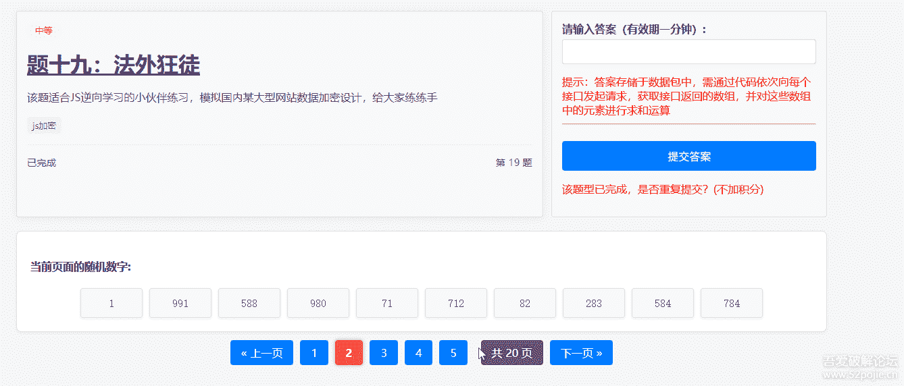
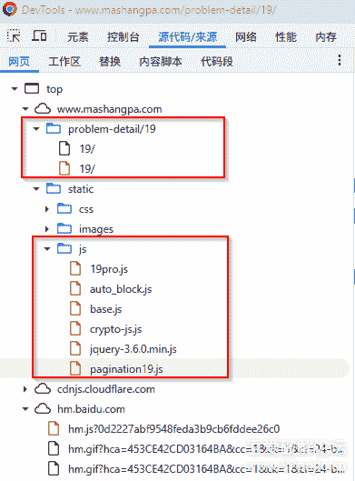
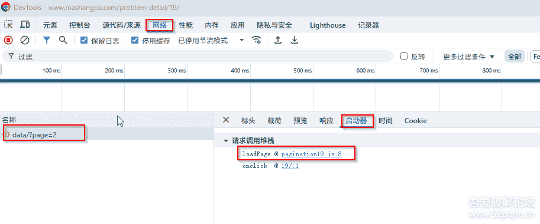
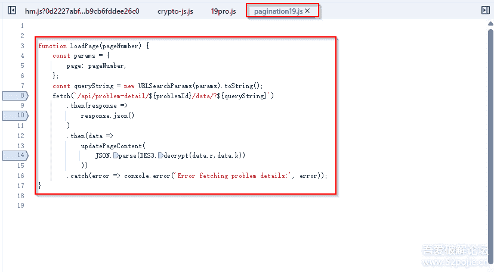
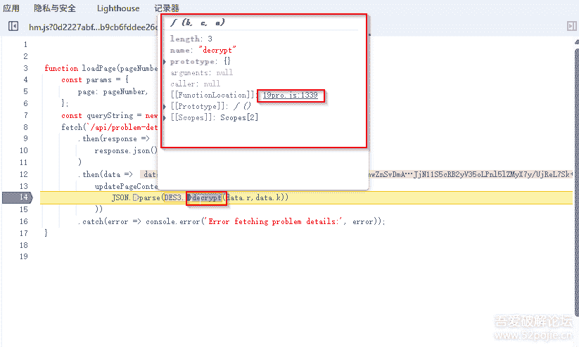
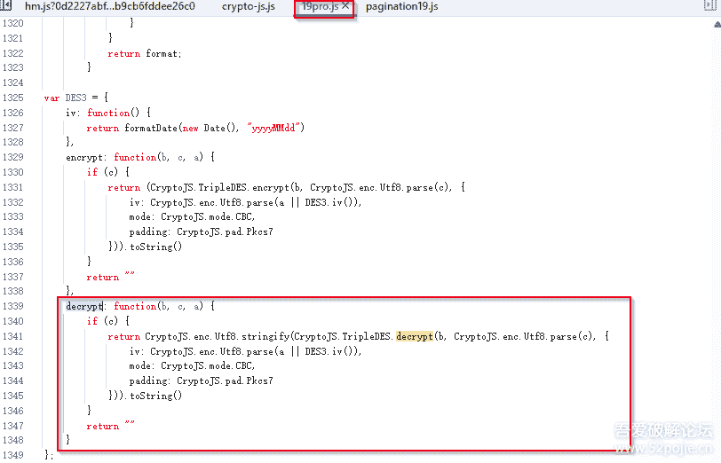

# [Web逆向] 码上爬 题十九：法外狂徒 逆向思路

- 原帖: https://www.52pojie.cn/forum.php?mod=viewthread&tid=2058139
- 抓取时间: 2026-11-01T22:03:23

最近在自己研究爬虫和逆向，做了几个网站的逆向练习，分享一下自己的经验，顺便希望大佬们指导一下思路是否正确。

分析网址：aHR0cHM6Ly93d3cubWFzaGFuZ3BhLmNvbS9wcm9ibGVtLWRldGFpbC8xOS8=

进入页面直接按照惯例F12 观察一下`header`和`response`看看有没有什么特别的地方



2025-09-05 10_17_09-题十九：法外狂徒 - 码上爬.png (56 KB, 下载次数: 1)

[href="forum.php?mod=attachment&aid=MjgwMDk4MXxhMWJhMTZkOXwxNzkzNTcwNjAxfDE2ODA4NnwyMDU4MTM5&nothumb=yes" target="_blank"](https://www.52pojie.cn/forum.php?mod=attachment&aid=MjgwMDk4MXxhMWJhMTZkOXwxNzkzNTcwNjAxfDE2ODA4NnwyMDU4MTM5&nothumb=yes)

2025-9-5 11:17 上传

从网络请求中看到请求头中没有特殊的参数，看到`response`返回了一个`r`和一个`k`，他俩都是乱码，我们先不着急去看他俩的解析逻辑，在回到页面上点击翻页看看网络请求中的请求头是否有变化。

（这道题比较简单，翻页后发现`cookie`中的数据都一样没有变化。）

综上，我们开始直接开始分析`r`和`k`的解析逻辑，打开源代码页面观察一下都有哪些js文件。



2025-09-05 10_29_50-DevTools - www.mashangpa.com_problem-detail_19_.png (42.68 KB, 下载次数: 1)

[href="forum.php?mod=attachment&aid=MjgwMDk4NXwwOTJiYTQwYnwxNzkzNTcwNjAxfDE2ODA4NnwyMDU4MTM5&nothumb=yes" target="_blank"](https://www.52pojie.cn/forum.php?mod=attachment&aid=MjgwMDk4NXwwOTJiYTQwYnwxNzkzNTcwNjAxfDE2ODA4NnwyMDU4MTM5&nothumb=yes)

2025-9-5 11:17 上传

注：这里我分享一下我的经验，先看下源代码里的js文件，看到`pagination19.js`和`19pro.js`这样比较明确的有指向性的名字的js的时候直接先看这样的js，如果这样的js文件分析后没有明确的参数生成或解析的过程再去断点分析生成或解析位置和逻辑，这样的话能节省一点时间。

我们按照正常流程来分析`r`和`k`的解析逻辑，我们来到网络请求tab点击网络请求，找到启动器看下堆栈调用，找到是哪个js的方法，这里我们看到是`pagination19.js`这个文件，我们直接点击进去看看这个方法



2025-09-05 10_37_22-DevTools - www.mashangpa.com_problem-detail_19_.png (45.9 KB, 下载次数: 1)

[href="forum.php?mod=attachment&aid=MjgwMDk4NnxlZjk5NTFjNHwxNzkzNTcwNjAxfDE2ODA4NnwyMDU4MTM5&nothumb=yes" target="_blank"](https://www.52pojie.cn/forum.php?mod=attachment&aid=MjgwMDk4NnxlZjk5NTFjNHwxNzkzNTcwNjAxfDE2ODA4NnwyMDU4MTM5&nothumb=yes)

2025-9-5 11:17 上传

点进去之后我们来到了`pagination19.js`，看到js代码如下



2025-09-05 10_38_07-DevTools - www.mashangpa.com_problem-detail_19_.png (25.06 KB, 下载次数: 1)

[href="forum.php?mod=attachment&aid=MjgwMDk4N3w1OWYyMGU0NXwxNzkzNTcwNjAxfDE2ODA4NnwyMDU4MTM5&nothumb=yes" target="_blank"](https://www.52pojie.cn/forum.php?mod=attachment&aid=MjgwMDk4N3w1OWYyMGU0NXwxNzkzNTcwNjAxfDE2ODA4NnwyMDU4MTM5&nothumb=yes)

2025-9-5 11:17 上传

看到这段代码是一个使用 `Promise` 的 JavaScript 方法

- `fetch(...)` 发起网络请求并返回一个 `Promise`
- `.then(response => response.json())` 处理第一个 `Promise` 的结果，返回新的 `Promise`（解析 `JSON` 后的结果）
- 第二个 `.then(...)` 处理解析后的 `JSON` 数据

从分析中我们可以知道这个js方法的逻辑是通过`url`获取数据，然后`json`解析`url`得到的结果，再去`DES3`去`decrypt`，所以我们直接来到第14行打上断点，来看看`decrypt`方法在哪里



2025-09-05 11_15_46-DevTools - www.mashangpa.com_problem-detail_19_.png (32.44 KB, 下载次数: 1)

[href="forum.php?mod=attachment&aid=MjgwMDk4MHw4Y2UzY2UyYXwxNzkzNTcwNjAxfDE2ODA4NnwyMDU4MTM5&nothumb=yes" target="_blank"](https://www.52pojie.cn/forum.php?mod=attachment&aid=MjgwMDk4MHw4Y2UzY2UyYXwxNzkzNTcwNjAxfDE2ODA4NnwyMDU4MTM5&nothumb=yes)

2025-9-5 11:16 上传

通过断点看到`decrypt`方法在`19pro.js`里我们直接点进去看下逻辑。



2025-09-05 11_20_10-DevTools - www.mashangpa.com_problem-detail_19_.png (29.63 KB, 下载次数: 2)

[href="forum.php?mod=attachment&aid=MjgwMDk5MHwwOGU3NDIxZHwxNzkzNTcwNjAxfDE2ODA4NnwyMDU4MTM5&nothumb=yes" target="_blank"](https://www.52pojie.cn/forum.php?mod=attachment&aid=MjgwMDk5MHwwOGU3NDIxZHwxNzkzNTcwNjAxfDE2ODA4NnwyMDU4MTM5&nothumb=yes)

2025-9-5 11:20 上传

这里我们有两个方法去解析`r`和`k`，一种是扣代码然后暴露出去用python调用，一种是直接把js复制出来让ai还原解密逻辑生成python代码，这里就不再啰嗦了直接上代码

js代码：

[JavaScript] 纯文本查看 复制代码


```
var CryptoJS = CryptoJS || function(y, h) {
    var j = {}
      , g = j.lib = {}
      , f = function() {}
      , z = g.Base = {
        extend: function(b) {
            f.prototype = this;
            var d = new f;
            b && d.mixIn(b);
            d.hasOwnProperty("init") || (d.init = function() {
                d.$super.init.apply(this, arguments)
            }
            );
            d.init.prototype = d;
            d.$super = this;
            return d
        },
        create: function() {
            var b = this.extend();
            b.init.apply(b, arguments);
            return b
        },
        init: function() {},
        mixIn: function(b) {
            for (var d in b) {
                b.hasOwnProperty(d) && (this[d] = b[d])
            }
            b.hasOwnProperty("toString") && (this.toString = b.toString)
        },
        clone: function() {
            return this.init.prototype.extend(this)
        }
    }
      , c = g.WordArray = z.extend({
        init: function(b, d) {
            b = this.words = b || [];
            this.sigBytes = d != h ? d : 4 * b.length
        },
        toString: function(b) {
            return (b || t).stringify(this)
        },
        concat: function(d) {
            var n = this.words
              , b = d.words
              , l = this.sigBytes;
            d = d.sigBytes;
            this.clamp();
            if (l % 4) {
                for (var e = 0; e >> 2] |= (b[e >>> 2] >>> 24 - 8 * (e % 4) & 255) >> 2] = b[e >>> 2]
                    }
                } else {
                    n.push.apply(n, b)
                }
            }
            this.sigBytes += d;
            return this
        },
        clamp: function() {
            var b = this.words
              , d = this.sigBytes;
            b[d >>> 2] &= 4294967295 >> 2] >>> 24 - 8 * (l % 4) & 255;
                b.push((e >>> 4).toString(16));
                b.push((e & 15).toString(16))
            }
            return b.join("")
        },
        parse: function(d) {
            for (var l = d.length, b = [], e = 0; e >> 3] |= parseInt(d.substr(e, 2), 16) >> 2] >>> 24 - 8 * (e % 4) & 255))
            }
            return b.join("")
        },
        parse: function(d) {
            for (var l = d.length, b = [], e = 0; e >> 2] |= (d.charCodeAt(e) & 255) >> 2] >>> 24 - 8 * (h % 4) & 255) >> 2] >>> 24 - 8 * ((h + 1) % 4) & 255) >> 2] >>> 24 - 8 * ((h + 2) % 4) & 255, f = 0; 4 > f && h + 0.75 * f >> 6 * (3 - f) & 63))
                }
            }
            if (j = g.charAt(64)) {
                for (; i.length % 4; ) {
                    i.push(j)
                }
            }
            return i.join("")
        },
        parse: function(j) {
            var k = j.length
              , i = this._map
              , g = i.charAt(64);
            g && (g = j.indexOf(g),
            -1 != g && (k = g));
            for (var g = [], h = 0, e = 0; e >> 6 - 2 * (e % 4);
                    g[h >>> 2] |= (f | c) >> 32 - q) + r
    }
    function g(l, r, n, s, d, q, p) {
        l = l + (r & s | n & ~s) + d + p;
        return (l >> 32 - q) + r
    }
    function e(l, r, n, s, d, q, p) {
        l = l + (r ^ n ^ s) + d + p;
        return (l >> 32 - q) + r
    }
    function c(l, r, n, s, d, q, p) {
        l = l + (n ^ (r | ~s)) + d + p;
        return (l >> 32 - q) + r
    }
    for (var o = CryptoJS, a = o.lib, j = a.WordArray, k = a.Hasher, a = o.algo, h = [], i = 0; 64 > i; i++) {
        h[i] = 4294967296 * m.abs(m.sin(i + 1)) | 0
    }
    a = a.MD5 = k.extend({
        _doReset: function() {
            this._hash = new j.init([1732584193, 4023233417, 2562383102, 271733878])
        },
        _doProcessBlock: function(J, T) {
            for (var V = 0; 16 > V; V++) {
                var U = T + V
                  , N = J[U];
                J[U] = (N >> 24) & 16711935 | (N >> 8) & 4278255360
            }
            var V = this._hash.words
              , U = J[T + 0]
              , N = J[T + 1]
              , S = J[T + 2]
              , F = J[T + 3]
              , d = J[T + 4]
              , L = J[T + 5]
              , H = J[T + 6]
              , n = J[T + 7]
              , p = J[T + 8]
              , E = J[T + 9]
              , l = J[T + 10]
              , b = J[T + 11]
              , M = J[T + 12]
              , K = J[T + 13]
              , I = J[T + 14]
              , G = J[T + 15]
              , R = V[0]
              , Q = V[1]
              , P = V[2]
              , O = V[3]
              , R = f(R, Q, P, O, U, 7, h[0])
              , O = f(O, R, Q, P, N, 12, h[1])
              , P = f(P, O, R, Q, S, 17, h[2])
              , Q = f(Q, P, O, R, F, 22, h[3])
              , R = f(R, Q, P, O, d, 7, h[4])
              , O = f(O, R, Q, P, L, 12, h[5])
              , P = f(P, O, R, Q, H, 17, h[6])
              , Q = f(Q, P, O, R, n, 22, h[7])
              , R = f(R, Q, P, O, p, 7, h[8])
              , O = f(O, R, Q, P, E, 12, h[9])
              , P = f(P, O, R, Q, l, 17, h[10])
              , Q = f(Q, P, O, R, b, 22, h[11])
              , R = f(R, Q, P, O, M, 7, h[12])
              , O = f(O, R, Q, P, K, 12, h[13])
              , P = f(P, O, R, Q, I, 17, h[14])
              , Q = f(Q, P, O, R, G, 22, h[15])
              , R = g(R, Q, P, O, N, 5, h[16])
              , O = g(O, R, Q, P, H, 9, h[17])
              , P = g(P, O, R, Q, b, 14, h[18])
              , Q = g(Q, P, O, R, U, 20, h[19])
              , R = g(R, Q, P, O, L, 5, h[20])
              , O = g(O, R, Q, P, l, 9, h[21])
              , P = g(P, O, R, Q, G, 14, h[22])
              , Q = g(Q, P, O, R, d, 20, h[23])
              , R = g(R, Q, P, O, E, 5, h[24])
              , O = g(O, R, Q, P, I, 9, h[25])
              , P = g(P, O, R, Q, F, 14, h[26])
              , Q = g(Q, P, O, R, p, 20, h[27])
              , R = g(R, Q, P, O, K, 5, h[28])
              , O = g(O, R, Q, P, S, 9, h[29])
              , P = g(P, O, R, Q, n, 14, h[30])
              , Q = g(Q, P, O, R, M, 20, h[31])
              , R = e(R, Q, P, O, L, 4, h[32])
              , O = e(O, R, Q, P, p, 11, h[33])
              , P = e(P, O, R, Q, b, 16, h[34])
              , Q = e(Q, P, O, R, I, 23, h[35])
              , R = e(R, Q, P, O, N, 4, h[36])
              , O = e(O, R, Q, P, d, 11, h[37])
              , P = e(P, O, R, Q, n, 16, h[38])
              , Q = e(Q, P, O, R, l, 23, h[39])
              , R = e(R, Q, P, O, K, 4, h[40])
              , O = e(O, R, Q, P, U, 11, h[41])
              , P = e(P, O, R, Q, F, 16, h[42])
              , Q = e(Q, P, O, R, H, 23, h[43])
              , R = e(R, Q, P, O, E, 4, h[44])
              , O = e(O, R, Q, P, M, 11, h[45])
              , P = e(P, O, R, Q, G, 16, h[46])
              , Q = e(Q, P, O, R, S, 23, h[47])
              , R = c(R, Q, P, O, U, 6, h[48])
              , O = c(O, R, Q, P, n, 10, h[49])
              , P = c(P, O, R, Q, I, 15, h[50])
              , Q = c(Q, P, O, R, L, 21, h[51])
              , R = c(R, Q, P, O, M, 6, h[52])
              , O = c(O, R, Q, P, F, 10, h[53])
              , P = c(P, O, R, Q, l, 15, h[54])
              , Q = c(Q, P, O, R, N, 21, h[55])
              , R = c(R, Q, P, O, p, 6, h[56])
              , O = c(O, R, Q, P, G, 10, h[57])
              , P = c(P, O, R, Q, H, 15, h[58])
              , Q = c(Q, P, O, R, K, 21, h[59])
              , R = c(R, Q, P, O, d, 6, h[60])
              , O = c(O, R, Q, P, b, 10, h[61])
              , P = c(P, O, R, Q, S, 15, h[62])
              , Q = c(Q, P, O, R, E, 21, h[63]);
            V[0] = V[0] + R | 0;
            V[1] = V[1] + Q | 0;
            V[2] = V[2] + P | 0;
            V[3] = V[3] + O | 0
        },
        _doFinalize: function() {
            var l = this._data
              , p = l.words
              , n = 8 * this._nDataBytes
              , q = 8 * l.sigBytes;
            p[q >>> 5] |= 128 >> 9 >> 24) & 16711935 | (d >> 8) & 4278255360;
            p[(q + 64 >>> 9 >> 24) & 16711935 | (n >> 8) & 4278255360;
            l.sigBytes = 4 * (p.length + 1);
            this._process();
            l = this._hash;
            p = l.words;
            for (n = 0; 4 > n; n++) {
                q = p[n],
                p[n] = (q >> 24) & 16711935 | (q >> 8) & 4278255360
            }
            return l
        },
        clone: function() {
            var d = k.clone.call(this);
            d._hash = this._hash.clone();
            return d
        }
    });
    o.MD5 = k._createHelper(a);
    o.HmacMD5 = k._createHmacHelper(a)
}
)(Math);
(function() {
    var b = CryptoJS
      , a = b.lib
      , e = a.Base
      , f = a.WordArray
      , a = b.algo
      , c = a.EvpKDF = e.extend({
        cfg: e.extend({
            keySize: 4,
            hasher: a.MD5,
            iterations: 1
        }),
        init: function(g) {
            this.cfg = this.cfg.extend(g)
        },
        compute: function(k, i) {
            for (var h = this.cfg, o = h.hasher.create(), m = f.create(), q = m.words, g = h.keySize, h = h.iterations; q.length >> 2] & 255
        }
    };
    m.BlockCipher = B.extend({
        cfg: B.cfg.extend({
            mode: t,
            padding: f
        }),
        reset: function() {
            B.reset.call(this);
            var e = this.cfg
              , l = e.iv
              , e = e.mode;
            if (this._xformMode == this._ENC_XFORM_MODE) {
                var d = e.createEncryptor
            } else {
                d = e.createDecryptor,
                this._minBufferSize = 1
            }
            this._mode = d.call(e, this, l && l.words)
        },
        _doProcessBlock: function(b, d) {
            this._mode.processBlock(b, d)
        },
        _doFinalize: function() {
            var b = this.cfg.padding;
            if (this._xformMode == this._ENC_XFORM_MODE) {
                b.pad(this._data, this.blockSize);
                var d = this._process(!0)
            } else {
                d = this._process(!0),
                b.unpad(d)
            }
            return d
        },
        blockSize: 4
    });
    var k = m.CipherParams = i.extend({
        init: function(b) {
            this.mixIn(b)
        },
        toString: function(b) {
            return (b || this.formatter).stringify(this)
        }
    })
      , t = (j.format = {}).OpenSSL = {
        stringify: function(b) {
            var d = b.ciphertext;
            b = b.salt;
            return (b ? h.create([1398893684, 1701076831]).concat(b).concat(d) : d).toString(g)
        },
        parse: function(e) {
            e = g.parse(e);
            var l = e.words;
            if (1398893684 == l[0] && 1701076831 == l[1]) {
                var d = h.create(l.slice(2, 4));
                l.splice(0, 4);
                e.sigBytes -= 16
            }
            return k.create({
                ciphertext: e,
                salt: d
            })
        }
    }
      , y = m.SerializableCipher = i.extend({
        cfg: i.extend({
            format: t
        }),
        encrypt: function(p, r, e, q) {
            q = this.cfg.extend(q);
            var n = p.createEncryptor(e, q);
            r = n.finalize(r);
            n = n.cfg;
            return k.create({
                ciphertext: r,
                key: e,
                iv: n.iv,
                algorithm: p,
                mode: n.mode,
                padding: n.padding,
                blockSize: p.blockSize,
                formatter: q.format
            })
        },
        decrypt: function(l, p, d, n) {
            n = this.cfg.extend(n);
            p = this._parse(p, n.format);
            return l.createDecryptor(d, n).finalize(p.ciphertext)
        },
        _parse: function(b, d) {
            return "string" == typeof b ? d.parse(b, this) : b
        }
    })
      , j = (j.kdf = {}).OpenSSL = {
        execute: function(l, p, e, n) {
            n || (n = h.random(8));
            l = A.create({
                keySize: p + e
            }).compute(l, n);
            e = h.create(l.words.slice(p), 4 * e);
            l.sigBytes = 4 * p;
            return k.create({
                key: l,
                iv: e,
                salt: n
            })
        }
    }
      , o = m.PasswordBasedCipher = y.extend({
        cfg: y.cfg.extend({
            kdf: j
        }),
        encrypt: function(p, a, l, n) {
            n = this.cfg.extend(n);
            l = n.kdf.execute(l, p.keySize, p.ivSize);
            n.iv = l.iv;
            p = y.encrypt.call(this, p, a, l.key, n);
            p.mixIn(l);
            return p
        },
        decrypt: function(p, a, l, n) {
            n = this.cfg.extend(n);
            a = this._parse(a, n.format);
            l = n.kdf.execute(l, p.keySize, p.ivSize, a.salt);
            n.iv = l.iv;
            return y.decrypt.call(this, p, a, l.key, n)
        }
    })
}();
(function() {
    function o(d, l) {
        var n = (this._lBlock >>> d ^ this._rBlock) & l;
        this._rBlock ^= n;
        this._lBlock ^= n >> d ^ this._lBlock) & l;
        this._lBlock ^= n;
        this._rBlock ^= n  u; u++) {
                var s = c[u] - 1;
                q[u] = n[s >>> 5] >>> 31 - s % 32 & 1
            }
            n = this._subKeys = [];
            for (s = 0; 16 > s; s++) {
                for (var r = n[s] = [], p = m[s], u = 0; 24 > u; u++) {
                    r[u / 6 | 0] |= q[(k[u] - 1 + p) % 28] >> 31;
                for (u = 1; 7 > u; u++) {
                    r[u] >>>= 4 * (u - 1) + 3
                }
                r[7] = r[7] >> 27
            }
            q = this._invSubKeys = [];
            for (u = 0; 16 > u; u++) {
                q[u] = n[15 - u]
            }
        },
        encryptBlock: function(d, l) {
            this._doCryptBlock(d, l, this._subKeys)
        },
        decryptBlock: function(d, l) {
            this._doCryptBlock(d, l, this._invSubKeys)
        },
        _doCryptBlock: function(w, z, y) {
            this._lBlock = w[z];
            this._rBlock = w[z + 1];
            o.call(this, 4, 252645135);
            o.call(this, 16, 65535);
            g.call(this, 2, 858993459);
            g.call(this, 8, 16711935);
            o.call(this, 1, 1431655765);
            for (var x = 0; 16 > x; x++) {
                for (var v = y[x], u = this._lBlock, s = this._rBlock, l = 0, b = 0; 8 > b; b++) {
                    l |= i[b][((s ^ v[b]) & j[b]) >>> 0]
                }
                this._lBlock = s;
                this._rBlock = u ^ l
            }
            y = this._lBlock;
            this._lBlock = this._rBlock;
            this._rBlock = y;
            o.call(this, 1, 1431655765);
            g.call(this, 8, 16711935);
            g.call(this, 2, 858993459);
            o.call(this, 16, 65535);
            o.call(this, 4, 252645135);
            w[z] = this._lBlock;
            w[z + 1] = this._rBlock
        },
        keySize: 2,
        ivSize: 2,
        blockSize: 2
    });
    h.DES = f._createHelper(a);
    t = t.TripleDES = f.extend({
        _doReset: function() {
            var d = this._key.words;
            this._des1 = a.createEncryptor(e.create(d.slice(0, 2)));
            this._des2 = a.createEncryptor(e.create(d.slice(2, 4)));
            this._des3 = a.createEncryptor(e.create(d.slice(4, 6)))
        },
        encryptBlock: function(d, l) {
            this._des1.encryptBlock(d, l);
            this._des2.decryptBlock(d, l);
            this._des3.encryptBlock(d, l)
        },
        decryptBlock: function(d, l) {
            this._des3.decryptBlock(d, l);
            this._des2.encryptBlock(d, l);
            this._des1.decryptBlock(d, l)
        },
        keySize: 6,
        ivSize: 2,
        blockSize: 2
    });
    h.TripleDES = f._createHelper(t)
}
)();

formatDate= function(v, format) {
            if (!v)
                return "";
            var d = v;
            if (typeof v === 'string') {
                if (v.indexOf("/Date(") > -1)
                    d = new Date(parseInt(v.replace("/Date(", "").replace(")/", ""), 10));
                else
                    d = new Date(Date.parse(v.replace(/-/g, "/").replace("T", " ").split(".")[0]));
                // 用来处理出现毫秒的情况，截取掉.xxx，否则会出错
            } else if (typeof v === "number") {
                d = new Date(v);
            }
            var o = {
                "M+": d.getMonth() + 1,
                // month
                "d+": d.getDate(),
                // day
                "h+": d.getHours(),
                // hour
                "m+": d.getMinutes(),
                // minute
                "s+": d.getSeconds(),
                // second
                "q+": Math.floor((d.getMonth() + 3) / 3),
                // quarter
                "S": d.getMilliseconds()// millisecond
            };
            format = format || "yyyy-MM-dd";
            if (/(y+)/.test(format)) {
                format = format.replace(RegExp.$1, (d.getFullYear() + "").substr(4 - RegExp.$1.length));
            }
            for (var k in o) {
                if (new RegExp("(" + k + ")").test(format)) {
                    format = format.replace(RegExp.$1, RegExp.$1.length == 1 ? o[k] : ("00" + o[k]).substr(("" + o[k]).length));
                }
            }
            return format;
        }

var DES3 = {
    iv: function() {
        return formatDate(new Date(), "yyyyMMdd")
    },
    encrypt: function(b, c, a) {
        if (c) {
            return (CryptoJS.TripleDES.encrypt(b, CryptoJS.enc.Utf8.parse(c), {
                iv: CryptoJS.enc.Utf8.parse(a || DES3.iv()),
                mode: CryptoJS.mode.CBC,
                padding: CryptoJS.pad.Pkcs7
            })).toString()
        }
        return ""
    },
    decrypt: function(b, c, a) {
        if (c) {
            return CryptoJS.enc.Utf8.stringify(CryptoJS.TripleDES.decrypt(b, CryptoJS.enc.Utf8.parse(c), {
                iv: CryptoJS.enc.Utf8.parse(a || DES3.iv()),
                mode: CryptoJS.mode.CBC,
                padding: CryptoJS.pad.Pkcs7
            })).toString()
        }
        return ""
    }
};
function main(str,key) {
    return DES3.decrypt(str,key);
}
module.exports = { main };
if (require.main === module) {
    const str = process.argv[2];
    const key = process.argv[3];
    console.log(main(str,key));
}

python代码：

[Python] 纯文本查看 复制代码
```


```python
import json
import subprocess
import httpx
import asyncio
import base64
from datetime import datetime
from Crypto.Cipher import DES3
from Crypto.Util.Padding import unpad

cookies = {
    'sessionid': 'xxxxxxxx', #这里是你自己的sessionId
    'v': 'QTBzQUM5NXZxSkd1WlB0eVdTZGRYclZnMnVRdzRGOWkyZlFqRnIxSUp3cmgzR1dhUmJEdnN1bkVzMlRPMTc1NjY4OTUwMzAzMA==',
    'HMACCOUNT': '453CE42CD03164BA',
    '_nano_fp': 'Xpmyn5CJX5EJn5XbnC_CMlPMU1kFffKffta8GRIB'
}

header = {
    'User-Agent': 'Mozilla/5.0 (Windows NT 10.0; Win64; x64) AppleWebKit/537.36 (KHTML, like Gecko) Chrome/89.0.4389.90 Safari/537.36',
    'Referer': 'https://www.mashangpa.com/problem-detail/19',
    'X-Requested-With': 'XMLHttpRequest'
}

total_sum = 0
res = {}

def _iv() -> bytes:
    return datetime.now().strftime("%Y%m%d").encode("utf-8")

def decrypt(enc_b64: str, key: str, iv: bytes | None = None) -> str:
    if iv is None:
        iv = _iv()
    enc_bytes = base64.b64decode(enc_b64)
    cipher = DES3.new(key.encode("utf-8"), DES3.MODE_CBC, iv)
    plain = unpad(cipher.decrypt(enc_bytes), DES3.block_size)
    return plain.decode("utf-8")

async def async_h2_request(url):
    global total_sum
    async with httpx.AsyncClient(http2=True, cookies=cookies, headers=header) as client:
        try:
            response = await client.get(url)
            res['r'] = response.json().get('r', [])
            res['k'] = response.json().get('k', [])
            # 使用js方式获取数据
            # output_text = subprocess.run(['node', './Q19.js', res['r'], res['k']], capture_output=True, text=True,
            #                              encoding='utf-8').stdout
            number_arr = json.loads(decrypt(res['r'], res['k']))
            total_sum += sum(number_arr['current_array'])
        except Exception as e:
            print(f"异步请求出错: {e}")

for i in range(1, 21):
    test_url = f"https://www.mashangpa.com/api/problem-detail/19/data/?page={i}"
    asyncio.run(async_h2_request(test_url))

print(f"最终和为：{total_sum}")
```

至此，是我对这道题的分析过程，如果有不足和错误的地方希望大佬指正，新人第一次发帖还希望大家多多包涵，谢谢。
