# [原创] CrackMe01

- 原帖: https://www.52pojie.cn/forum.php?mod=viewthread&tid=2058186
- 抓取时间: 2026-11-01T22:03:19

写在前面，`Name/Serial`的分析比单独的`Serial`分析要复杂很多，分析期间对`movzx eax, byte ptr ds:[eax]`这个指令理解稍微模糊了，卡壳整个小时

## Name/Serial分析思路

输入`hacker/123456`，同样弹出`Try Again! Sorry, The serial is incorect !`

1.png (121.72 KB, 下载次数: 0)

[href="forum.php?mod=attachment&aid=MjgwMTcyNXw0MDk2NWZmNnwxNzkzNTcwNTk3fDE2ODA4NnwyMDU4MTg2&nothumb=yes" target="_blank"](https://www.52pojie.cn/forum.php?mod=attachment&aid=MjgwMTcyNXw0MDk2NWZmNnwxNzkzNTcwNTk3fDE2ODA4NnwyMDU4MTg2&nothumb=yes)

2025-9-9 15:11 上传

我们同样从字符串入手

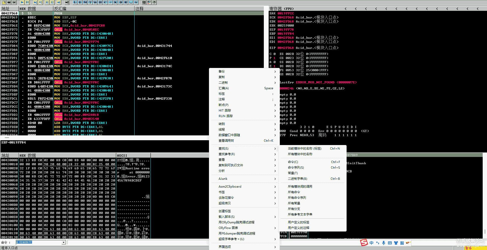

2.png (136.42 KB, 下载次数: 0)

[href="forum.php?mod=attachment&aid=MjgwMTcyNnw2MDRkNTQ1YXwxNzkzNTcwNTk3fDE2ODA4NnwyMDU4MTg2&nothumb=yes" target="_blank"](https://www.52pojie.cn/forum.php?mod=attachment&aid=MjgwMTcyNnw2MDRkNTQ1YXwxNzkzNTcwNTk3fDE2ODA4NnwyMDU4MTg2&nothumb=yes)

2025-9-9 15:11 上传

### 第一处 Sorry, The serial is incorect!

有两处地方出现提示错误

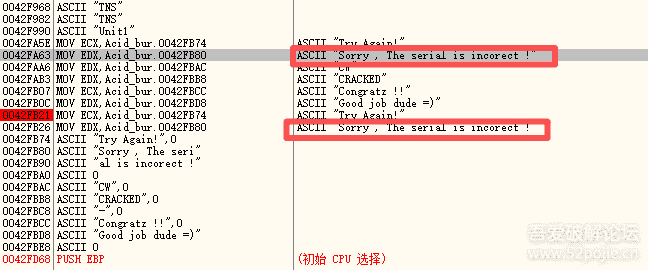

3.png (17.98 KB, 下载次数: 0)

[href="forum.php?mod=attachment&aid=MjgwMTcyN3w0NTY2NWY1N3wxNzkzNTcwNTk3fDE2ODA4NnwyMDU4MTg2&nothumb=yes" target="_blank"](https://www.52pojie.cn/forum.php?mod=attachment&aid=MjgwMTcyN3w0NTY2NWY1N3wxNzkzNTcwNTk3fDE2ODA4NnwyMDU4MTg2&nothumb=yes)

2025-9-9 15:11 上传

首先跟踪到`0042FA63`地址，双击对应的字符串即可

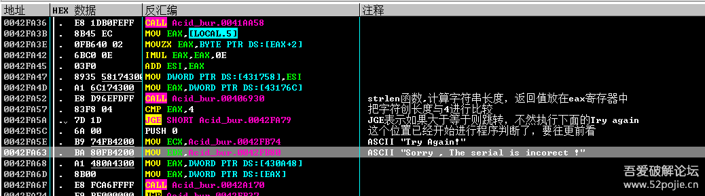

4.png (25.76 KB, 下载次数: 0)

[href="forum.php?mod=attachment&aid=MjgwMTcyOHw1Nzg4Y2Y3NXwxNzkzNTcwNTk3fDE2ODA4NnwyMDU4MTg2&nothumb=yes" target="_blank"](https://www.52pojie.cn/forum.php?mod=attachment&aid=MjgwMTcyOHw1Nzg4Y2Y3NXwxNzkzNTcwNTk3fDE2ODA4NnwyMDU4MTg2&nothumb=yes)

2025-9-9 15:11 上传

从`Sorry`字符串开始往下是`call 0042A170`，`0042A170`是`MessageBox`函数

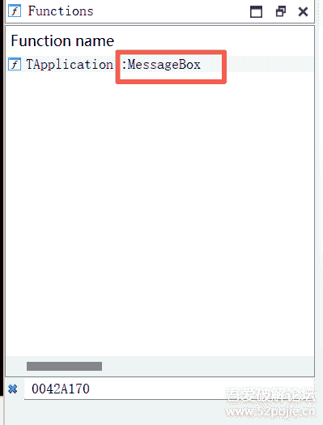

5.png (16.68 KB, 下载次数: 0)

[href="forum.php?mod=attachment&aid=MjgwMTcyOXw4NWRhMTNhM3wxNzkzNTcwNTk3fDE2ODA4NnwyMDU4MTg2&nothumb=yes" target="_blank"](https://www.52pojie.cn/forum.php?mod=attachment&aid=MjgwMTcyOXw4NWRhMTNhM3wxNzkzNTcwNTk3fDE2ODA4NnwyMDU4MTg2&nothumb=yes)

2025-9-9 15:11 上传

往上分析，`JGE`是关键跳转

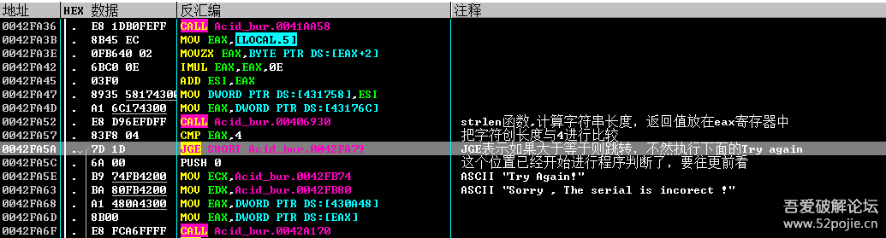

6.png (25.44 KB, 下载次数: 0)

[href="forum.php?mod=attachment&aid=MjgwMTczMHw3ZjZlMTg2Y3wxNzkzNTcwNTk3fDE2ODA4NnwyMDU4MTg2&nothumb=yes" target="_blank"](https://www.52pojie.cn/forum.php?mod=attachment&aid=MjgwMTczMHw3ZjZlMTg2Y3wxNzkzNTcwNTk3fDE2ODA4NnwyMDU4MTg2&nothumb=yes)

2025-9-9 15:11 上传

继续往上分析，`cmp`命令把`4`与`eax`进行比较，若`eax>4`，`S`标志位为`1`，`JGE`指令跳转到`0042FA79`

往上分析，`call 00406930`实际是调用了`strlen`函数，`strlen`函数用来计算字符串长度，返回值放在`eax`寄存器中

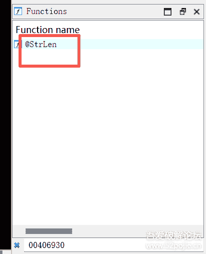

7.png (15.36 KB, 下载次数: 0)

[href="forum.php?mod=attachment&aid=MjgwMTczMXwxODUzMmNlOHwxNzkzNTcwNTk3fDE2ODA4NnwyMDU4MTg2&nothumb=yes" target="_blank"](https://www.52pojie.cn/forum.php?mod=attachment&aid=MjgwMTczMXwxODUzMmNlOHwxNzkzNTcwNTk3fDE2ODA4NnwyMDU4MTg2&nothumb=yes)

2025-9-9 15:11 上传

继续往上，找到`strlen`函数用来计算哪个字符串的长度呢？既然要分析这个函数，那就从这个函数的开始进行分析，这个函数的开始刚好是上一个函数结束的地方，因此往上找到最近的一个`call`，打上断点，单步调试

运行成功断下，我们发现这个指令是把`local.5`的值赋给`eax`，`local.5`是`ebp-14`，`14`是`16`进制值，通过寄存器窗口可以知道现在的`ebp`为`0019F708`，那么`ebp-14`要看右下的堆栈窗口，从`ebp`往上上移`5`个单位，到达地址`0019F6F4`，这里存放的是`ascii`值为`hacker`的地址：`0234D67C`

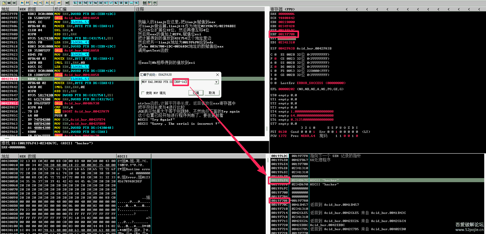

8.png (120.38 KB, 下载次数: 0)

[href="forum.php?mod=attachment&aid=MjgwMTczMnw3ZDdkNTM2MHwxNzkzNTcwNTk3fDE2ODA4NnwyMDU4MTg2&nothumb=yes" target="_blank"](https://www.52pojie.cn/forum.php?mod=attachment&aid=MjgwMTczMnw3ZDdkNTM2MHwxNzkzNTcwNTk3fDE2ODA4NnwyMDU4MTg2&nothumb=yes)

2025-9-9 15:11 上传

按`F8`执行下一步，`eax`的值变成了`0234D67C`

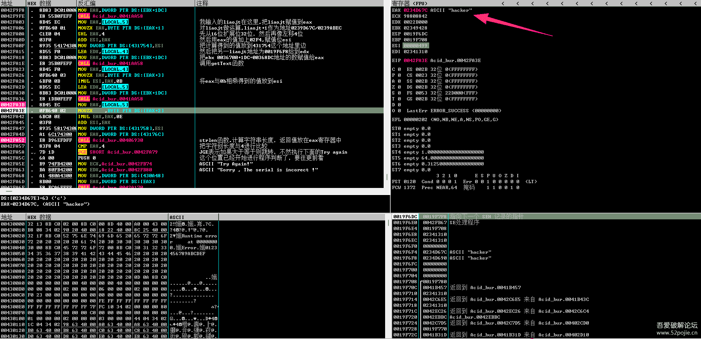

9.png (94.33 KB, 下载次数: 0)

[href="forum.php?mod=attachment&aid=MjgwMTczM3w5YTdlMjk4NXwxNzkzNTcwNTk3fDE2ODA4NnwyMDU4MTg2&nothumb=yes" target="_blank"](https://www.52pojie.cn/forum.php?mod=attachment&aid=MjgwMTczM3w5YTdlMjk4NXwxNzkzNTcwNTk3fDE2ODA4NnwyMDU4MTg2&nothumb=yes)

2025-9-9 15:11 上传

到下面的操作都是对`hacker`值进行计算，调用`strlen`函数后，我们可以看到`eax`的值变成了`5`，经过后续调试发现当`name`的值大于`4`时，`eax`的值都会大于`4`

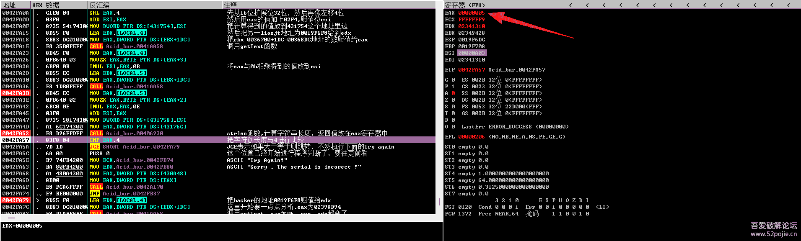

10.png (63.87 KB, 下载次数: 0)

[href="forum.php?mod=attachment&aid=MjgwMTczNHw0ODJmZjkxYXwxNzkzNTcwNTk3fDE2ODA4NnwyMDU4MTg2&nothumb=yes" target="_blank"](https://www.52pojie.cn/forum.php?mod=attachment&aid=MjgwMTczNHw0ODJmZjkxYXwxNzkzNTcwNTk3fDE2ODA4NnwyMDU4MTg2&nothumb=yes)

2025-9-9 15:11 上传

当我们`name`的位置数`abc`的时候，`eax`的值为`1`，经过后续调试发现`name`的值小于`1`，`eax`都为`1`

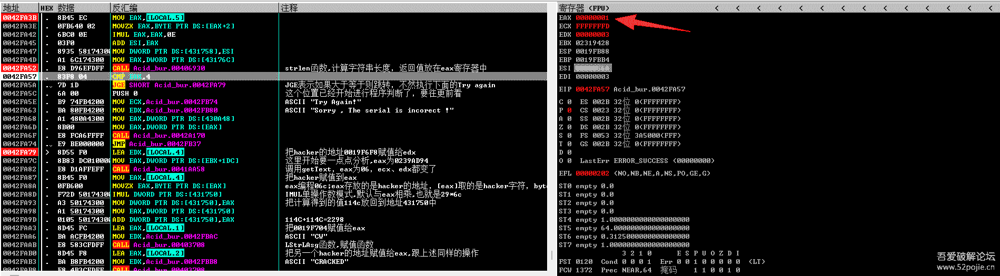

11.png (62.26 KB, 下载次数: 0)

[href="forum.php?mod=attachment&aid=MjgwMTczNXw2NzFkMDY4MXwxNzkzNTcwNTk3fDE2ODA4NnwyMDU4MTg2&nothumb=yes" target="_blank"](https://www.52pojie.cn/forum.php?mod=attachment&aid=MjgwMTczNXw2NzFkMDY4MXwxNzkzNTcwNTk3fDE2ODA4NnwyMDU4MTg2&nothumb=yes)

2025-9-9 15:11 上传

直接进入打印`sorry, the serial is incorect !`

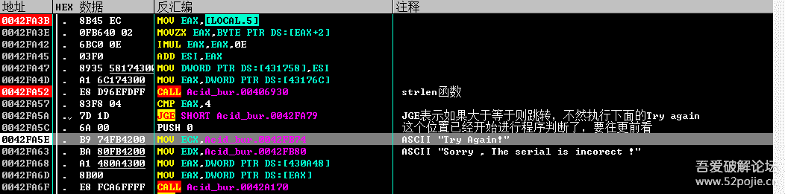

12.png (23.66 KB, 下载次数: 0)

[href="forum.php?mod=attachment&aid=MjgwMTczNnwzY2YwODNiOHwxNzkzNTcwNTk3fDE2ODA4NnwyMDU4MTg2&nothumb=yes" target="_blank"](https://www.52pojie.cn/forum.php?mod=attachment&aid=MjgwMTczNnwzY2YwODNiOHwxNzkzNTcwNTk3fDE2ODA4NnwyMDU4MTg2&nothumb=yes)

2025-9-9 15:11 上传

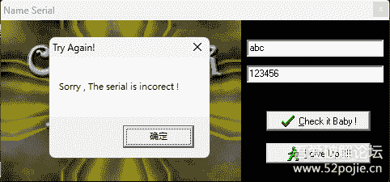

13.png (47.81 KB, 下载次数: 0)

[href="forum.php?mod=attachment&aid=MjgwMTczN3w2YzNmODNjY3wxNzkzNTcwNTk3fDE2ODA4NnwyMDU4MTg2&nothumb=yes" target="_blank"](https://www.52pojie.cn/forum.php?mod=attachment&aid=MjgwMTczN3w2YzNmODNjY3wxNzkzNTcwNTk3fDE2ODA4NnwyMDU4MTg2&nothumb=yes)

2025-9-9 15:11 上传

由此可以判断输入的`name`要大于`4`

### 第二处 Sorry, The serial is incorect!

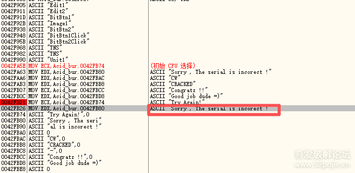

14.png (22.33 KB, 下载次数: 0)

[href="forum.php?mod=attachment&aid=MjgwMTczOHwwNGZlYWRmZXwxNzkzNTcwNTk3fDE2ODA4NnwyMDU4MTg2&nothumb=yes" target="_blank"](https://www.52pojie.cn/forum.php?mod=attachment&aid=MjgwMTczOHwwNGZlYWRmZXwxNzkzNTcwNTk3fDE2ODA4NnwyMDU4MTg2&nothumb=yes)

2025-9-9 15:11 上传

往上分析，`JNZ`关键跳转

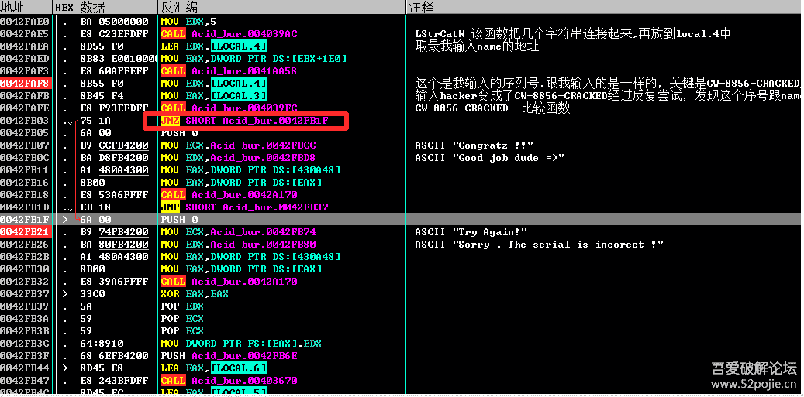

15.png (39.11 KB, 下载次数: 0)

[href="forum.php?mod=attachment&aid=MjgwMTczOXw3ZTkyYmJhY3wxNzkzNTcwNTk3fDE2ODA4NnwyMDU4MTg2&nothumb=yes" target="_blank"](https://www.52pojie.cn/forum.php?mod=attachment&aid=MjgwMTczOXw3ZTkyYmJhY3wxNzkzNTcwNTk3fDE2ODA4NnwyMDU4MTg2&nothumb=yes)

2025-9-9 15:11 上传

再往上分析，我们发现上一段打印调用`MessageBox`打印`Sorry`的代码之后会直接跳过以下红色框的代码，那么当`name`的字符大于等于`4`的时候会进入红色框代码，如果序列号正确，会打印`Good job dude`，错误打印`Sorry`

因此把这段代码分析透即可，打上断点，逐步调试，分析过程看以下注释即可

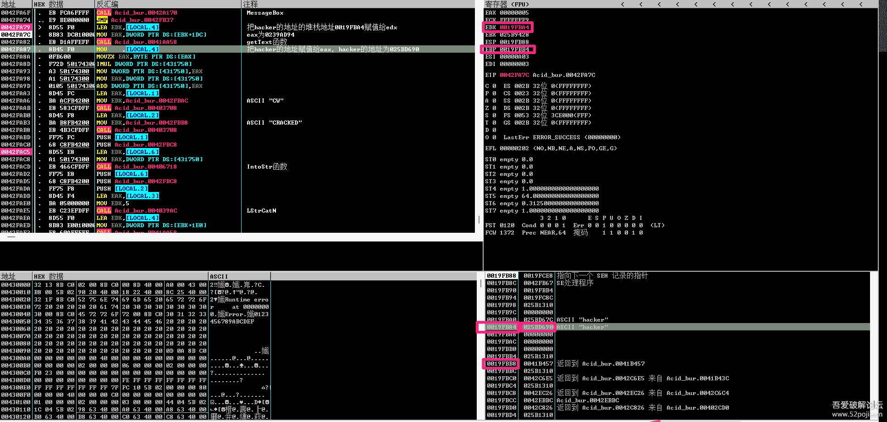

16.png (82.08 KB, 下载次数: 0)

[href="forum.php?mod=attachment&aid=MjgwMTc0MHwzOGFhOWFhMnwxNzkzNTcwNTk3fDE2ODA4NnwyMDU4MTg2&nothumb=yes" target="_blank"](https://www.52pojie.cn/forum.php?mod=attachment&aid=MjgwMTc0MHwzOGFhOWFhMnwxNzkzNTcwNTk3fDE2ODA4NnwyMDU4MTg2&nothumb=yes)

2025-9-9 15:11 上传

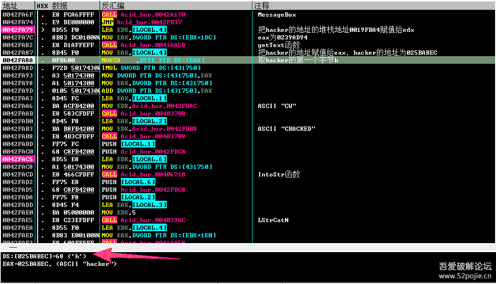

17.png (41.27 KB, 下载次数: 0)

[href="forum.php?mod=attachment&aid=MjgwMTc0MXxhZWY0MGRmMHwxNzkzNTcwNTk3fDE2ODA4NnwyMDU4MTg2&nothumb=yes" target="_blank"](https://www.52pojie.cn/forum.php?mod=attachment&aid=MjgwMTc0MXxhZWY0MGRmMHwxNzkzNTcwNTk3fDE2ODA4NnwyMDU4MTg2&nothumb=yes)

2025-9-9 15:11 上传

地址`431750`中存放的是`29`

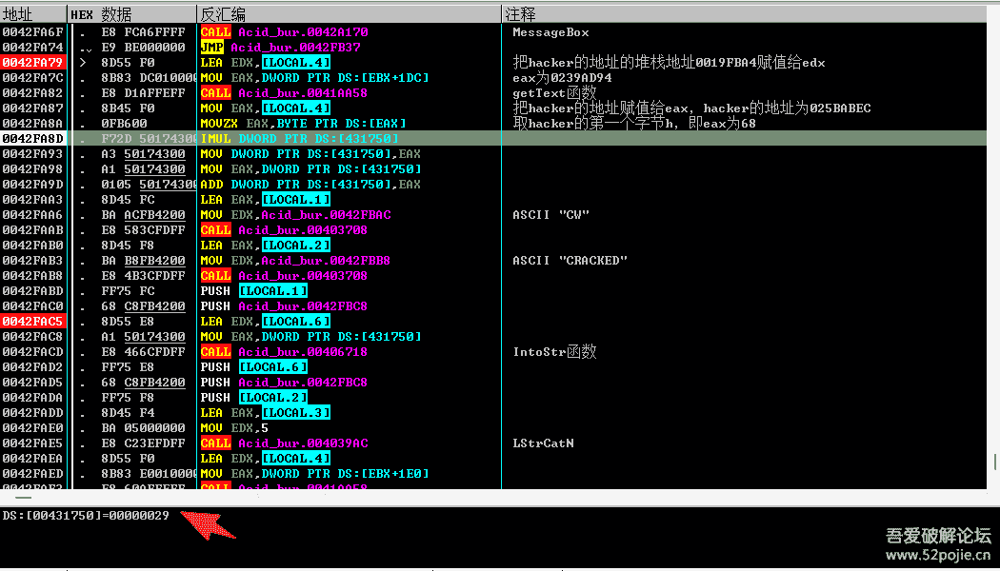

18.png (40.25 KB, 下载次数: 0)

[href="forum.php?mod=attachment&aid=MjgwMTc0Mnw2NzliMWVjY3wxNzkzNTcwNTk3fDE2ODA4NnwyMDU4MTg2&nothumb=yes" target="_blank"](https://www.52pojie.cn/forum.php?mod=attachment&aid=MjgwMTc0Mnw2NzliMWVjY3wxNzkzNTcwNTk3fDE2ODA4NnwyMDU4MTg2&nothumb=yes)

2025-9-9 15:11 上传

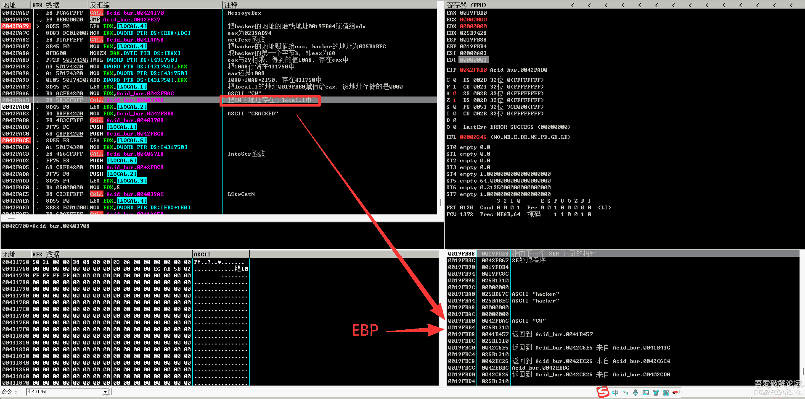

19.png (101.4 KB, 下载次数: 1)

[href="forum.php?mod=attachment&aid=MjgwMTc0M3wyMjBhMTU5YnwxNzkzNTcwNTk3fDE2ODA4NnwyMDU4MTg2&nothumb=yes" target="_blank"](https://www.52pojie.cn/forum.php?mod=attachment&aid=MjgwMTc0M3wyMjBhMTU5YnwxNzkzNTcwNTk3fDE2ODA4NnwyMDU4MTg2&nothumb=yes)

2025-9-9 15:11 上传

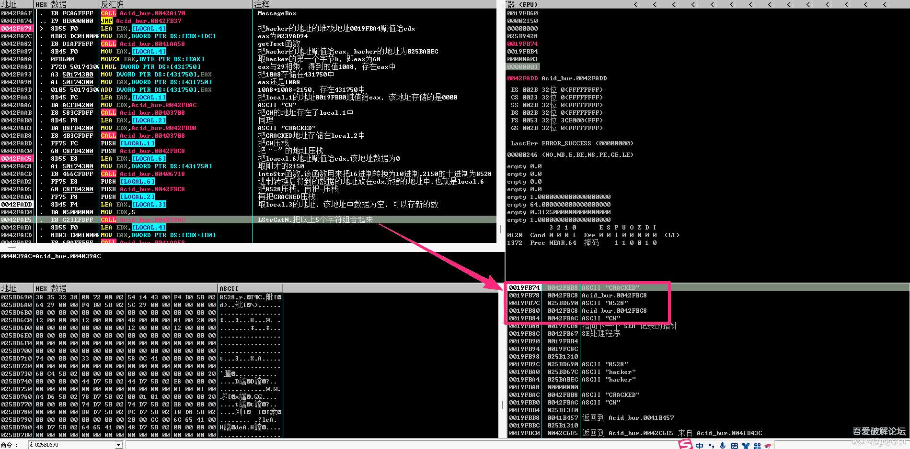

`20.png` (101.33 KB, 下载次数: 0)

[href="forum.php?mod=attachment&aid=MjgwMTc0NHwzN2NlZmJiNXwxNzkzNTcwNTk3fDE2ODA4NnwyMDU4MTg2&nothumb=yes" target="_blank"](https://www.52pojie.cn/forum.php?mod=attachment&aid=MjgwMTc0NHwzN2NlZmJiNXwxNzkzNTcwNTk3fDE2ODA4NnwyMDU4MTg2&nothumb=yes)

2025-9-9 15:11 上传

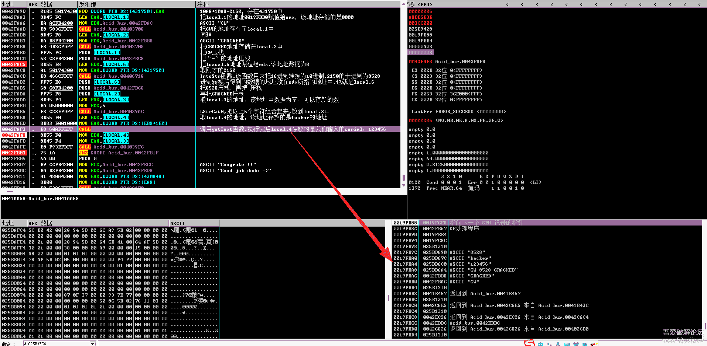

`21.png` (103.45 KB, 下载次数: 0)

[href="forum.php?mod=attachment&aid=MjgwMTc0NXw0NGM0NDBlNnwxNzkzNTcwNTk3fDE2ODA4NnwyMDU4MTg2&nothumb=yes" target="_blank"](https://www.52pojie.cn/forum.php?mod=attachment&aid=MjgwMTc0NXw0NGM0NDBlNnwxNzkzNTcwNTk3fDE2ODA4NnwyMDU4MTg2&nothumb=yes)

2025-9-9 15:11 上传

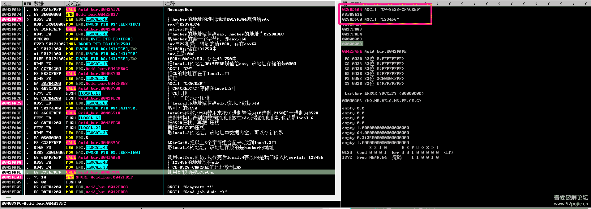

`22.png` (74.92 KB, 下载次数: 0)

[href="forum.php?mod=attachment&aid=MjgwMTc0NnxhY2Q0Y2Y3OHwxNzkzNTcwNTk3fDE2ODA4NnwyMDU4MTg2&nothumb=yes" target="_blank"](https://www.52pojie.cn/forum.php?mod=attachment&aid=MjgwMTc0NnxhY2Q0Y2Y3OHwxNzkzNTcwNTk3fDE2ODA4NnwyMDU4MTg2&nothumb=yes)

2025-9-9 15:11 上传

到此可以知道是把我们输入的序列号`123456`与`CW-8528-CRACKED`进行比较，相等则成功

`CW-8528-CRACKED`是我们正确的序列号，验证正确

`23.png` (143.56 KB, 下载次数: 0)

[href="forum.php?mod=attachment&aid=MjgwMTc0N3wwYTM1MWUwMXwxNzkzNTcwNTk3fDE2ODA4NnwyMDU4MTg2&nothumb=yes" target="_blank"](https://www.52pojie.cn/forum.php?mod=attachment&aid=MjgwMTc0N3wwYTM1MWUwMXwxNzkzNTcwNTk3fDE2ODA4NnwyMDU4MTg2&nothumb=yes)

2025-9-9 15:11 上传

完成的分析过程请看注释

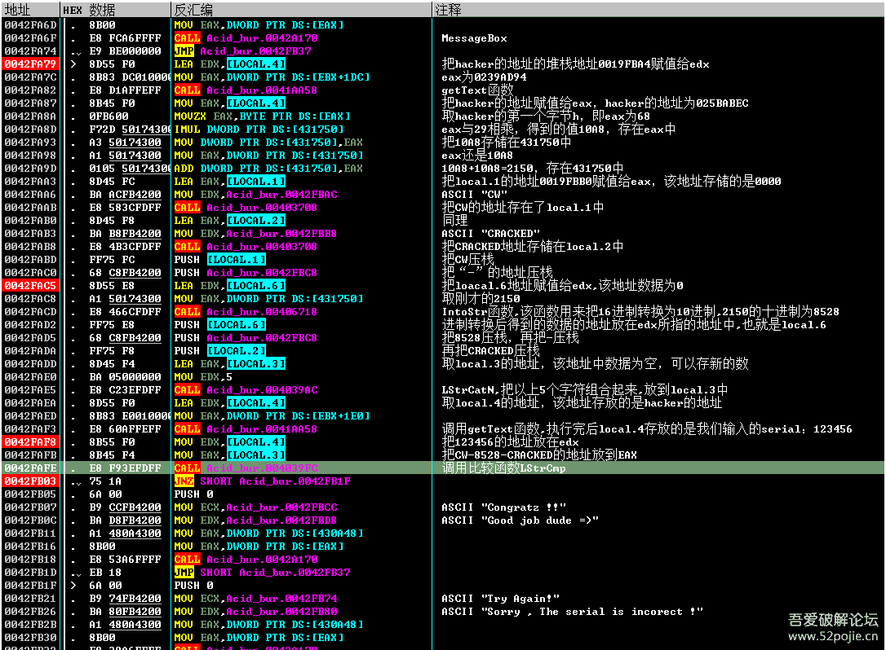

`24.png` (69.69 KB, 下载次数: 0)

[href="forum.php?mod=attachment&aid=MjgwMTc0OHw5NmRiNTJiNnwxNzkzNTcwNTk3fDE2ODA4NnwyMDU4MTg2&nothumb=yes" target="_blank"](https://www.52pojie.cn/forum.php?mod=attachment&aid=MjgwMTc0OHw5NmRiNTJiNnwxNzkzNTcwNTk3fDE2ODA4NnwyMDU4MTg2&nothumb=yes)

2025-9-9 15:11 上传

##### 注册机思路

- 输入字符
- 判断字符长度得大于等于4
- 取输入字符的首位
- 把它转换成`ascii`码
- 然后与16进制的`29`相乘
- 然后把得到的值乘以2
- 然后把16进制转换为10进制
- 拼接`CW-***-CRACKED`
- `CW-8528-CRACKED`
