# [Web逆向] [原创]boss直聘__zp_stoken__的控制平坦流纯算逆向思路

- 原帖: https://www.52pojie.cn/forum.php?mod=viewthread&tid=2058603
- 抓取时间: 2026-11-01T22:03:12

先看该token哪里来的.

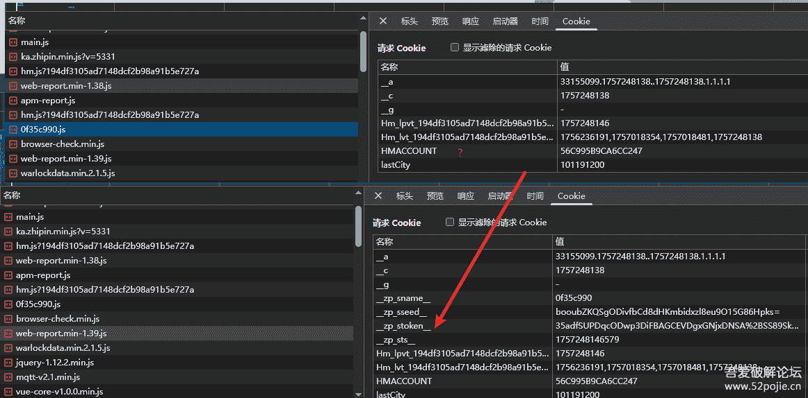

1.png (97.49 KB, 下载次数: 6)

[href="forum.php?mod=attachment&aid=MjgwMTM5N3wwZWVhMjFlZXwxNzkzNTcwNTkwfDE2ODA4NnwyMDU4NjAz&nothumb=yes" target="_blank"](https://www.52pojie.cn/forum.php?mod=attachment&aid=MjgwMTM5N3wwZWVhMjFlZXwxNzkzNTcwNTkwfDE2ODA4NnwyMDU4NjAz&nothumb=yes)

2025-9-8 00:06 上传

注意到下面的请求cookie才第一次使用到`__zp_stoken__`,推断出是在这个`0f35c990.js`里生成的.注意该文件以及文件名会在每天晚上0点-1点之间变动一次,固定为每天一次.

下面分析该js.

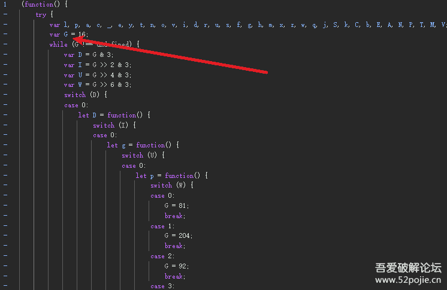

2.png (19.7 KB, 下载次数: 6)

[href="forum.php?mod=attachment&aid=MjgwMTM5OHwyMDFmYWVkOHwxNzkzNTcwNTkwfDE2ODA4NnwyMDU4NjAz&nothumb=yes" target="_blank"](https://www.52pojie.cn/forum.php?mod=attachment&aid=MjgwMTM5OHwyMDFmYWVkOHwxNzkzNTcwNTkwfDE2ODA4NnwyMDU4NjAz&nothumb=yes)

2025-9-8 00:07 上传

该js分为两部分,上面是一小段自执行函数,如上图.这里关键控制变量是`G`,并且是常量`16`.

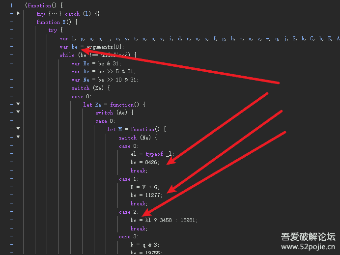

3.png (32.56 KB, 下载次数: 5)

[href="forum.php?mod=attachment&aid=MjgwMTM5OXxlMjBmZjg4NHwxNzkzNTcwNTkwfDE2ODA4NnwyMDU4NjAz&nothumb=yes" target="_blank"](https://www.52pojie.cn/forum.php?mod=attachment&aid=MjgwMTM5OXxlMjBmZjg4NHwxNzkzNTcwNTkwfDE2ODA4NnwyMDU4NjAz&nothumb=yes)

2025-9-8 00:07 上传

下面部分依然大同小异,只是控制变量不再为常量,而是由传入的参数决定.

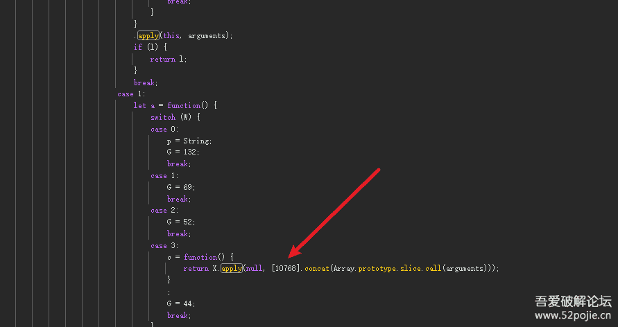

4.png (18.46 KB, 下载次数: 5)

[href="forum.php?mod=attachment&aid=MjgwMTQwMHw0NGU4Y2JiMnwxNzkzNTcwNTkwfDE2ODA4NnwyMDU4NjAz&nothumb=yes" target="_blank"](https://www.52pojie.cn/forum.php?mod=attachment&aid=MjgwMTQwMHw0NGU4Y2JiMnwxNzkzNTcwNTkwfDE2ODA4NnwyMDU4NjAz&nothumb=yes)

2025-9-8 00:07 上传

可能的传入参数,即下图示例中的`10768`诸如此类.

这是典型的控制平坦流.面对这种情况,我的思路是,首先要理解,它实际控制变量就一个,这里的`be`.后面的`Ee`,`Ae`,`Ne`这几个实际是由`be`经过固定算法得出的.

现在进行第一步,使用ast构建出一个map印射表,使每一个`be`值对应的执行内容印射出来.

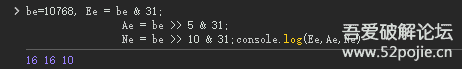

5.png (7.43 KB, 下载次数: 4)

[href="forum.php?mod=attachment&aid=MjgwMTQwMXxiZmQwNjkyNHwxNzkzNTcwNTkwfDE2ODA4NnwyMDU4NjAz&nothumb=yes" target="_blank"](https://www.52pojie.cn/forum.php?mod=attachment&aid=MjgwMTQwMXxiZmQwNjkyNHwxNzkzNTcwNTkwfDE2ODA4NnwyMDU4NjAz&nothumb=yes)

2025-9-8 00:07 上传

比如当`be = 10768`时,`Ee`,`Ae`,`Ne`对应的值就分别是`16` `16` `10`.然后我们去对应的分支查看,可以看到

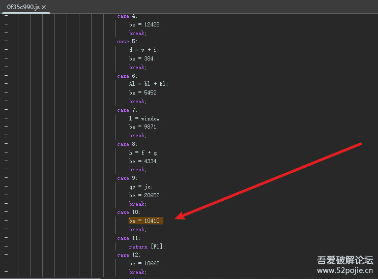

6.png (21 KB, 下载次数: 4)

[href="forum.php?mod=attachment&aid=MjgwMTQwMnxhZjJiMTA3YnwxNzkzNTcwNTkwfDE2ODA4NnwyMDU4NjAz&nothumb=yes" target="_blank"](https://www.52pojie.cn/forum.php?mod=attachment&aid=MjgwMTQwMnxhZjJiMTA3YnwxNzkzNTcwNTkwfDE2ODA4NnwyMDU4NjAz&nothumb=yes)

2025-9-8 00:07 上传

实际上执行的就是给`be`下一个赋值,然后循环,直到遇到`return`节点.

那第一步就是通过模拟这个流程,构建我们自己的map图.

流程就是`be = 10768`,得到`be = 10410`,然后继续...

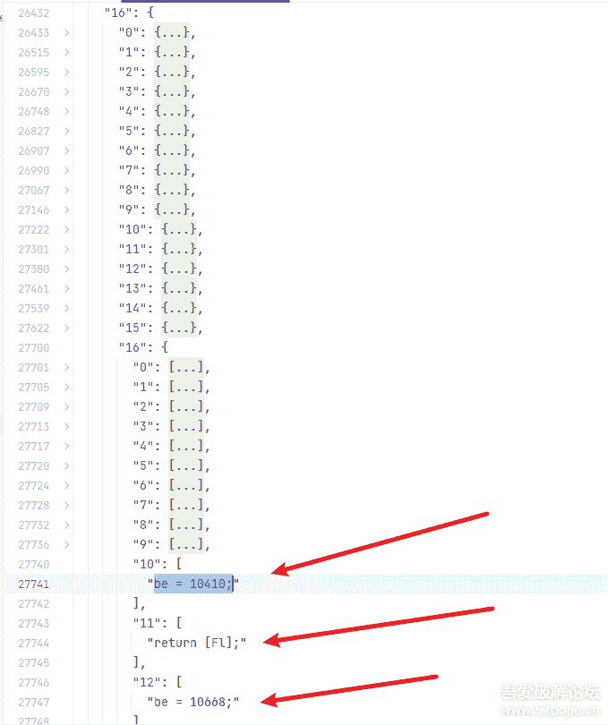

7.png (73.13 KB, 下载次数: 5)

[href="forum.php?mod=attachment&aid=MjgwMTQwM3xiZDA0ODM4MHwxNzkzNTcwNTkwfDE2ODA4NnwyMDU4NjAz&nothumb=yes" target="_blank"](https://www.52pojie.cn/forum.php?mod=attachment&aid=MjgwMTQwM3xiZDA0ODM4MHwxNzkzNTcwNTkwfDE2ODA4NnwyMDU4NjAz&nothumb=yes)

2025-9-8 00:07 上传

去除掉无用的break部分,我们得到这样的有效数据.

下一步就是给定指定的入口参数,然后我们模拟这个流程,以`return`和`be = undefined`未界,标记一整个函数的执行过程.

我们把只关于`be`跳转的部分无效信息移除掉,以`be = 1616`为入口为例,得到这样的结果.

```
'be = 1616;r = "cha";p = arguments[1];_ = "len";e = "gth";a = [];l = undefined;h = "At";o = "pus";q = 1;c = 0;u = "rCo";y = _ + e;v = "h";f = "de";s = r + u;i = o + v;g = s + f;m = g + h;t = p[y];S = c;n = S ;x = p[m];z = x["call"](p, S);w = d["call"](a, z);S = j;n = S'
```

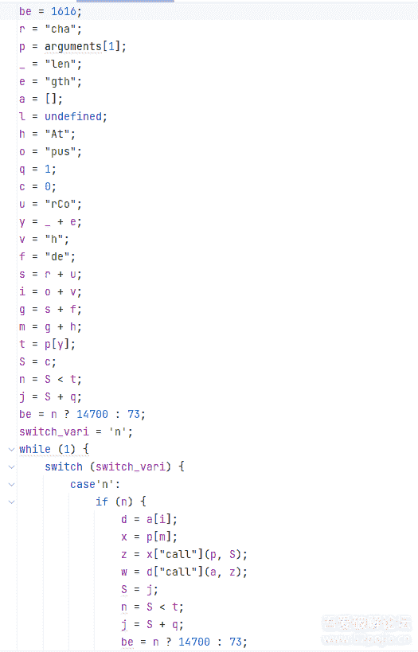

8.png (49.37 KB, 下载次数: 7)

[href="forum.php?mod=attachment&aid=MjgwMTQwNHw5ZGU5OGYxZXwxNzkzNTcwNTkwfDE2ODA4NnwyMDU4NjAz&nothumb=yes" target="_blank"](https://www.52pojie.cn/forum.php?mod=attachment&aid=MjgwMTQwNHw5ZGU5OGYxZXwxNzkzNTcwNTkwfDE2ODA4NnwyMDU4NjAz&nothumb=yes)

2025-9-8 00:07 上传


9.png (15.16 KB, 下载次数: 3)

[href="forum.php?mod=attachment&aid=MjgwMTQwNXw4MWJjNGYxNXwxNzkzNTcwNTkwfDE2ODA4NnwyMDU4NjAz&nothumb=yes" target="_blank"](https://www.52pojie.cn/forum.php?mod=attachment&aid=MjgwMTQwNXw4MWJjNGYxNXwxNzkzNTcwNTkwfDE2ODA4NnwyMDU4NjAz&nothumb=yes)

2025-9-8 00:07 上传

然后进行常量合并,如观察到`_ = "len"`;`e = "gth"`;`y = _ + e`;那么自然`y = "length"`.当然这一步不是必须的,不过可以方便我们观察代码逻辑.

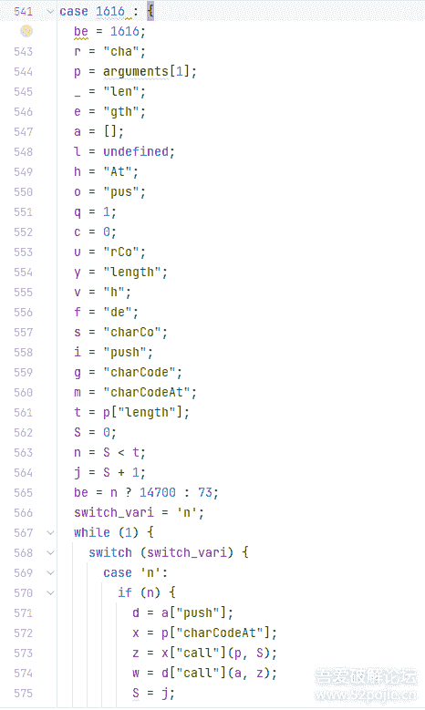

10.png (66.45 KB, 下载次数: 5)

[href="forum.php?mod=attachment&aid=MjgwMTQwNnxhZGIyYjY4MHwxNzkzNTcwNTkwfDE2ODA4NnwyMDU4NjAz&nothumb=yes" target="_blank"](https://www.52pojie.cn/forum.php?mod=attachment&aid=MjgwMTQwNnxhZGIyYjY4MHwxNzkzNTcwNTkwfDE2ODA4NnwyMDU4NjAz&nothumb=yes)

2025-9-8 00:07 上传

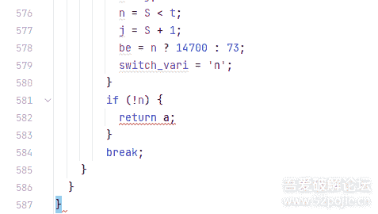

11.png (22.44 KB, 下载次数: 3)

[href="forum.php?mod=attachment&aid=MjgwMTQwN3wwNzgzNGFkN3wxNzkzNTcwNTkwfDE2ODA4NnwyMDU4NjAz&nothumb=yes" target="_blank"](https://www.52pojie.cn/forum.php?mod=attachment&aid=MjgwMTQwN3wwNzgzNGFkN3wxNzkzNTcwNTkwfDE2ODA4NnwyMDU4NjAz&nothumb=yes)

2025-9-8 00:07 上传

最终形成这种样式.并以此类推还原出全部算法.

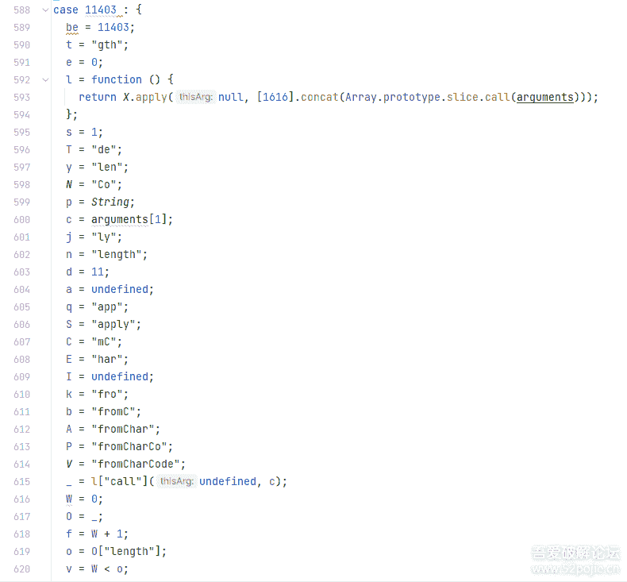

12.png (70.06 KB, 下载次数: 4)

[href="forum.php?mod=attachment&aid=MjgwMTQwOHw0MTRkOGYyNXwxNzkzNTcwNTkwfDE2ODA4NnwyMDU4NjAz&nothumb=yes" target="_blank"](https://www.52pojie.cn/forum.php?mod=attachment&aid=MjgwMTQwOHw0MTRkOGYyNXwxNzkzNTcwNTkwfDE2ODA4NnwyMDU4NjAz&nothumb=yes)

2025-9-8 00:07 上传

等等等等.

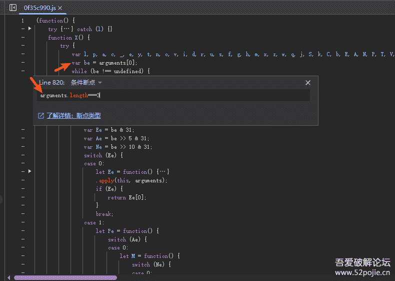

13.png (24.55 KB, 下载次数: 5)

[href="forum.php?mod=attachment&aid=MjgwMTQwOXxmYTliODY0NXwxNzkzNTcwNTkwfDE2ODA4NnwyMDU4NjAz&nothumb=yes" target="_blank"](https://www.52pojie.cn/forum.php?mod=attachment&aid=MjgwMTQwOXxmYTliODY0NXwxNzkzNTcwNTkwfDE2ODA4NnwyMDU4NjAz&nothumb=yes)

2025-9-8 00:07 上传

剩下的就是找到token生成的入口位置,然后使用我们自己构建的代码,依次调用即可.

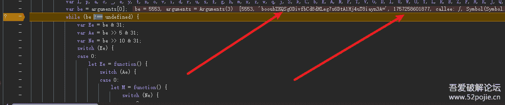

14.png (22 KB, 下载次数: 4)

[href="forum.php?mod=attachment&aid=MjgwMTQxMHxhYmEyNzJkM3wxNzkzNTcwNTkwfDE2ODA4NnwyMDU4NjAz&nothumb=yes" target="_blank"](https://www.52pojie.cn/forum.php?mod=attachment&aid=MjgwMTQxMHxhYmEyNzJkM3wxNzkzNTcwNTkwfDE2ODA4NnwyMDU4NjAz&nothumb=yes)

2025-9-8 00:07 上传

可以看到第一个参数`5553`,即`be = 5553`是关键入口,第二个第三个是前面请求或者token已过期时系统返回的种子参数.

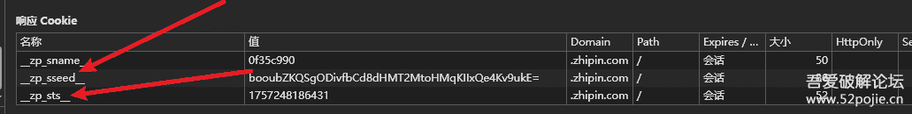

15.png (23.85 KB, 下载次数: 5)

[href="forum.php?mod=attachment&aid=MjgwMTQxMXw5N2RmOWM3NXwxNzkzNTcwNTkwfDE2ODA4NnwyMDU4NjAz&nothumb=yes" target="_blank"](https://www.52pojie.cn/forum.php?mod=attachment&aid=MjgwMTQxMXw5N2RmOWM3NXwxNzkzNTcwNTkwfDE2ODA4NnwyMDU4NjAz&nothumb=yes)

2025-9-8 00:07 上传

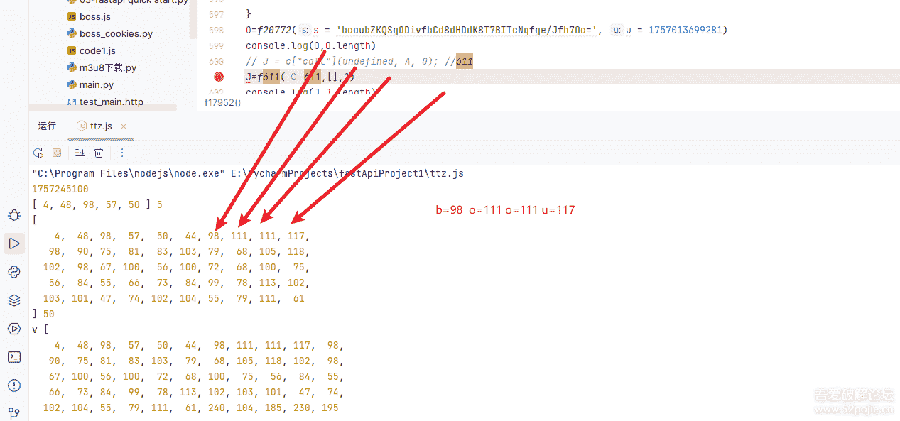

16.png (105.99 KB, 下载次数: 5)

[href="forum.php?mod=attachment&aid=MjgwMTQxMnxhOWU2YjU4N3wxNzkzNTcwNTkwfDE2ODA4NnwyMDU4NjAz&nothumb=yes" target="_blank"](https://www.52pojie.cn/forum.php?mod=attachment&aid=MjgwMTQxMnxhOWU2YjU4N3wxNzkzNTcwNTkwfDE2ODA4NnwyMDU4NjAz&nothumb=yes)

2025-9-8 00:07 上传

值得一提的是,部分参数的构成方式,靠肉眼就能看出规律,没事背一下ascii码表是真的有用家人们,比如这里我当时就肉眼看出端倪,`a = 97`总知道的吧,那`b`自然是`98`,包括后面俩一样的.这段长度50的代码计算逻辑是这样的.首先是字符串的长度,然后跟字符串对应的ascii码.

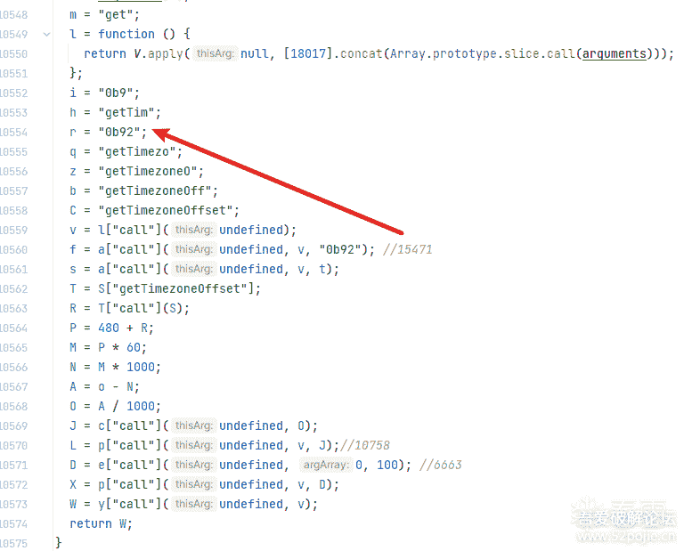

17.png (100.02 KB, 下载次数: 5)

[href="forum.php?mod=attachment&aid=MjgwMTQxNHxkNjVlZTgzYXwxNzkzNTcwNTkwfDE2ODA4NnwyMDU4NjAz&nothumb=yes" target="_blank"](https://www.52pojie.cn/forum.php?mod=attachment&aid=MjgwMTQxNHxkNjVlZTgzYXwxNzkzNTcwNTkwfDE2ODA4NnwyMDU4NjAz&nothumb=yes)

2025-9-8 00:07 上传

`48, 98, 57, 50`是`"0b92"`对应的ascii码,`4`代表该字符串的长度.同理`44`代表`'booubZKQSgODivfbCd8dHDdK8T7BITcNqfge/Jfh7Oo='`这个种子的长度.

以此类推,扣出最终的核心代码即可.

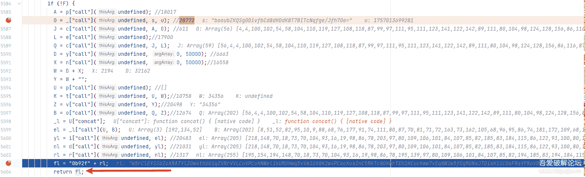

18.png (169.9 KB, 下载次数: 4)


## 实际的核心代表

[附件下载](https://www.52pojie.cn/forum.php?mod=attachment&aid=MjgwMTQxNXxjNWEzYzJlNnwxNzkzNTcwNTkwfDE2ODA4NnwyMDU4NjAz&nothumb=yes)（2025-9-8 00:07 上传）

实际的核心代表仅这一段,当然仍然需要一些耐心去仔细补全,不过剩下的确实也没什么难度了吧.

## 最后总结

1. 构建`map`，还原全部执行流程。
2. 提炼出有效信息并自行构建易辨认的格式。这里的难点在于对`if`语句的重构，逻辑比较绕。

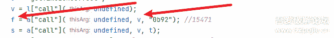

19.png (21.49 KB, 下载次数: 3)

[附件下载](https://www.52pojie.cn/forum.php?mod=attachment&aid=MjgwMTQxNnwxOGY1ZmRiN3wxNzkzNTcwNTkwfDE2ODA4NnwyMDU4NjAz&nothumb=yes)（2025-9-8 00:07 上传）

### 部分陷阱

比如这里的返回值`f`是`undefined`，是怎么回事呢？实际上因为`v`是数组，它是在函数内部对`v`进行了操作，最后没有返回任何东西，但实际上`v`已经变化了。对于这种，自己需要手动让它返回`v`的值。

## 测试

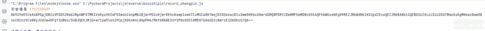

20.png (38.35 KB, 下载次数: 4)

[附件下载](https://www.52pojie.cn/forum.php?mod=attachment&aid=MjgwMTQxN3wyY2I2OTYwY3wxNzkzNTcwNTkwfDE2ODA4NnwyMDU4NjAz&nothumb=yes)（2025-9-8 00:07 上传）

### 问：这个初始值是什么？

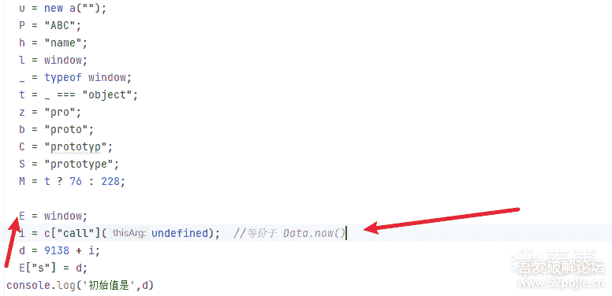

21.png (39.8 KB, 下载次数: 5)

[附件下载](https://www.52pojie.cn/forum.php?mod=attachment&aid=MjgwMTQxOXxkMWVlMDdlZXwxNzkzNTcwNTkwfDE2ODA4NnwyMDU4NjAz&nothumb=yes)（2025-9-8 00:13 上传）

答：这个是首次自执行该js时拿到的一个时间戳，会保存到`window['s']`中，后续计算会用到，作用我猜测是计算本js从开始执行到最后生成参数，相隔了多长时间。作用大概是判断你是正常用户（执行时间应该在1秒内）还是搞断点的。如果搞断点逆向的话，可能最后发生出去的时候这个时间已经过了几十分钟。不过实际上似乎并没有什么后果。

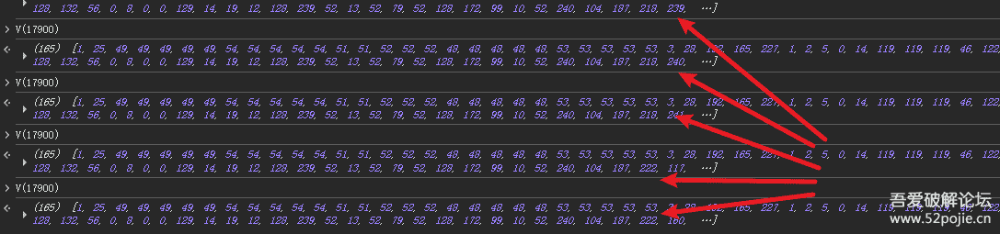

21.png (29.77 KB, 下载次数: 3)

[附件下载](https://www.52pojie.cn/forum.php?mod=attachment&aid=MjgwMTQxOHw5ZWQ2YTBhZXwxNzkzNTcwNTkwfDE2ODA4NnwyMDU4NjAz&nothumb=yes)（2025-9-8 00:07 上传）

可以观察到某部分数组明显是跟时间有关的.

### 问：怎么生成的结果会变，甚至长度都不是固定的？

答：还是由于上面的这个原因.
