# [Web逆向] 【js逆向】码上爬-题16 补环境，第一次补环境成功记录一下！

- 原帖: https://www.52pojie.cn/forum.php?mod=viewthread&tid=2059718
- 抓取时间: 2026-11-01T22:03:06

## 前言：

前几道都是补到一半，补不下去就去搜的详细教程才完成的。但是这个16题我找了半天硬是没看一个补完整的教程。所以只能自己硬着补完，被各种报错给折磨了一晚上。最终还是补成功了记录一下。

## 直接开始:

首先来到网址：`aHR0cHM6Ly93d3cubWFzaGFuZ3BhLmNvbS9wcm9ibGVtLWRldGFpbC8xNi8=` 
直接看数据接口：
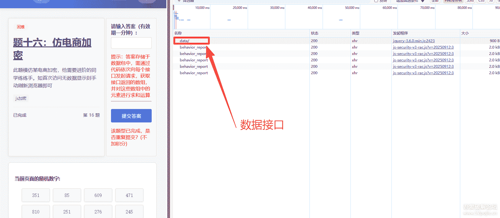
6fc5cb94-aaf5-4c93-8253-1c9c1eb8d87e.png (110.85 KB, 下载次数: 2)
[href="forum.php?mod=attachment&aid=MjgwMjI1NnwwMmUwNTQ3YnwxNzkzNTcwNTg0fDE2ODA4NnwyMDU5NzE4&nothumb=yes" target="_blank"](https://www.52pojie.cn/forum.php?mod=attachment&aid=MjgwMjI1NnwwMmUwNTQ3YnwxNzkzNTcwNTg0fDE2ODA4NnwyMDU5NzE4&nothumb=yes)
数据接口data
2025-9-12 09:20 上传
其中接口的负载数据就是一个时间戳和一个加密值`h5`（然后其余位置都没有看见明显加密位置，所以这一个`h5`值就是我们要逆向的点）
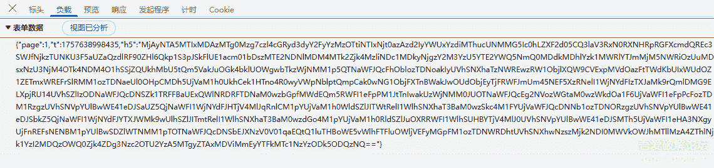
image.png (67.21 KB, 下载次数: 2)
[href="forum.php?mod=attachment&aid=MjgwMjI1N3xmYmIxYzRmOHwxNzkzNTcwNTg0fDE2ODA4NnwyMDU5NzE4&nothumb=yes" target="_blank"](https://www.52pojie.cn/forum.php?mod=attachment&aid=MjgwMjI1N3xmYmIxYzRmOHwxNzkzNTcwNTg0fDE2ODA4NnwyMDU5NzE4&nothumb=yes)
接口负载数据
2025-9-12 09:21 上传
知道是这个数据加密了，我们就直接开始跟栈找加密位置,使用`xhr`或者启动器来找都可以，我这里就直接使用启动器来找了（找的到加密位置的过程很简单，这里就不一一写出了）
最后我们会定位到这么一个函数，在这里时我们单步步过后，加密值就生成，所以就可以判断这个值肯定就是在这里生成的了，我们可以直接步进观察函数内部细节逻辑。
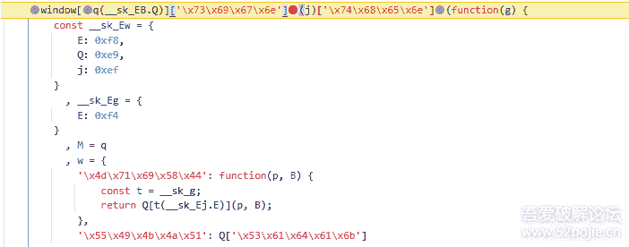
image.png (26.36 KB, 下载次数: 2)
[href="forum.php?mod=attachment&aid=MjgwMjI2MHw2MDgwMTVlMXwxNzkzNTcwNTg0fDE2ODA4NnwyMDU5NzE4&nothumb=yes" target="_blank"](https://www.52pojie.cn/forum.php?mod=attachment&aid=MjgwMjI2MHw2MDgwMTVlMXwxNzkzNTcwNTg0fDE2ODA4NnwyMDU5NzE4&nothumb=yes)
定位函数
2025-9-12 09:29 上传
步进之后我们就能看到这函数，其实这里就是真正的加密位置的函数了，`_$lR`传入的是一个翻页的页数和一个时间戳信息，然后加密值就通过`btoa(_$lw.h5st + String(_$lw.t))`函数返回给`_$lw`值里。
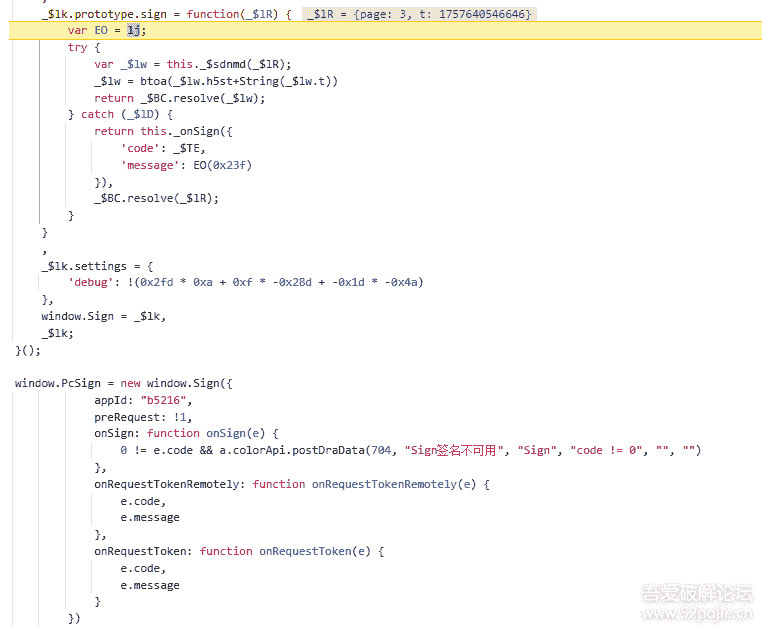
image.png (54.01 KB, 下载次数: 2)
[href="forum.php?mod=attachment&aid=MjgwMjI2MXxmZWRhYjVmZHwxNzkzNTcwNTg0fDE2ODA4NnwyMDU5NzE4&nothumb=yes" target="_blank"](https://www.52pojie.cn/forum.php?mod=attachment&aid=MjgwMjI2MXxmZWRhYjVmZHwxNzkzNTcwNTg0fDE2ODA4NnwyMDU5NzE4&nothumb=yes)
真加密位置
2025-9-12 09:32 上传
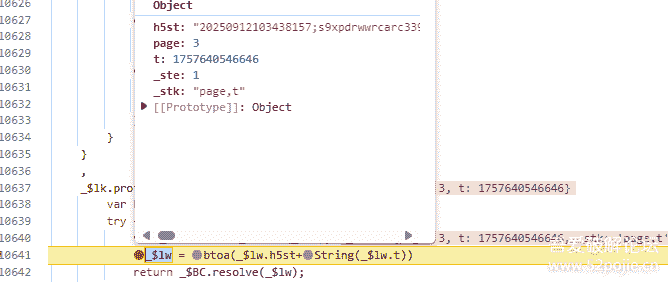
image.png (37.2 KB, 下载次数: 2)
[href="forum.php?mod=attachment&aid=MjgwMjI2Mnw2ZjE5ZTlkNnwxNzkzNTcwNTg0fDE2ODA4NnwyMDU5NzE4&nothumb=yes" target="_blank"](https://www.52pojie.cn/forum.php?mod=attachment&aid=MjgwMjI2Mnw2ZjE5ZTlkNnwxNzkzNTcwNTg0fDE2ODA4NnwyMDU5NzE4&nothumb=yes)
成功加密的返回
2025-9-12 09:35 上传
这里我们就直接开始把代码全部扣下来，在`node`里去补环境。（上环境代理，那里报了补那里）。
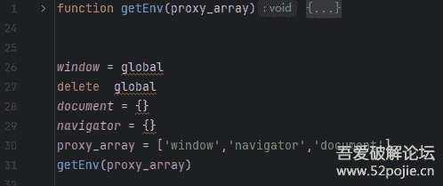
image.png (29.22 KB, 下载次数: 0)
[href="forum.php?mod=attachment&aid=MjgwMjI2NHxlMTc4ZmQwMnwxNzkzNTcwNTg0fDE2ODA4NnwyMDU5NzE4&nothumb=yes" target="_blank"](https://www.52pojie.cn/forum.php?mod=attachment&aid=MjgwMjI2NHxlMTc4ZmQwMnwxNzkzNTcwNTg0fDE2ODA4NnwyMDU5NzE4&nothumb=yes)
第一步步环境
2025-9-12 09:48 上传
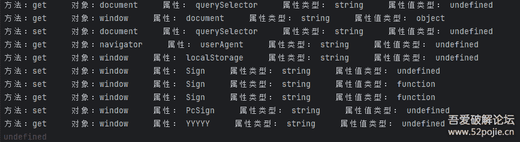
image.png (43.08 KB, 下载次数: 2)
[href="forum.php?mod=attachment&aid=MjgwMjI2NXxkNmY3OThlNnwxNzkzNTcwNTg0fDE2ODA4NnwyMDU5NzE4&nothumb=yes" target="_blank"](https://www.52pojie.cn/forum.php?mod=attachment&aid=MjgwMjI2NXxkNmY3OThlNnwxNzkzNTcwNTg0fDE2ODA4NnwyMDU5NzE4&nothumb=yes)
一点点
2025-9-12 09:48 上传
才补了一点点，我们的代码就没有报错了，然后我们就需要去模拟浏览器调用我们执行加密的方法。通过观察也是很不容易的找到了他的调用逻辑，有一个大的`Sign`方法，在这个大的`Sign`里面有一个`_$lk`方法，我们的加密函数就只是在`_$lk.prototype.sign`中，然后调用就是最下面的一个`window.PcSign = new window.Sign()`这个方法，我们可以直接使用这个`window.PcSign.sign({page:2,t:12345648479})`，就可以直接调用我们的加密函数。
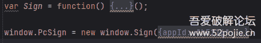
image.png (15.47 KB, 下载次数: 2)
[href="forum.php?mod=attachment&aid=MjgwMjI2Nnw4MjZlYmYwOHwxNzkzNTcwNTg0fDE2ODA4NnwyMDU5NzE4&nothumb=yes" target="_blank"](https://www.52pojie.cn/forum.php?mod=attachment&aid=MjgwMjI2Nnw4MjZlYmYwOHwxNzkzNTcwNTg0fDE2ODA4NnwyMDU5NzE4&nothumb=yes)
调用逻辑
2025-9-12 09:50 上传
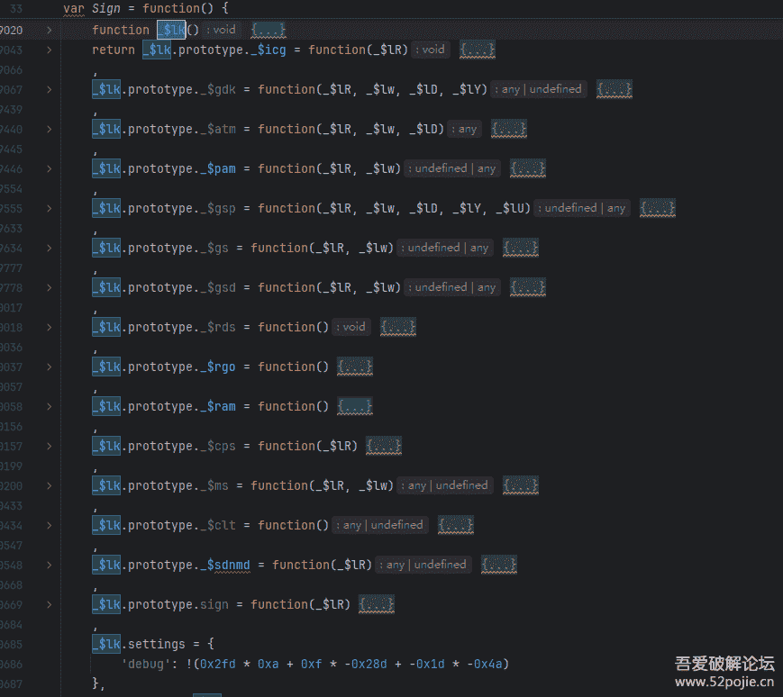
image.png (130.86 KB, 下载次数: 1)
[href="forum.php?mod=attachment&aid=MjgwMjI2OXw5Mjk5N2ViYnwxNzkzNTcwNTg0fDE2ODA4NnwyMDU5NzE4&nothumb=yes" target="_blank"](https://www.52pojie.cn/forum.php?mod=attachment&aid=MjgwMjI2OXw5Mjk5N2ViYnwxNzkzNTcwNTg0fDE2ODA4NnwyMDU5NzE4&nothumb=yes)
sign中的`_$lk`
2025-9-12 09:53 上传
在调用这个方法后，我们其实最好是不要改变代码的逻辑，所以我们还需要再加密函数里面去定义一个自己的变量去接受我们加密的结果比如：`window.YYYYY = _$lw`

## 调用函数的构造：

```
function get_res(page_,t_){
    window.PcSign = new window.Sign({page:page_,t:t_})
    console.log(window.YYYYY)
    return window.YYYYY
}
get_res(3,123456789)
```

然后运行发现没有值，很正常，因为环境肯定是不正常的，我们还需要通过我们的代理去补环境，这里我主要就写我在里面遇到的第一个问题，就是在补到一半时，他一直报一个错误 `load rac js fail!`
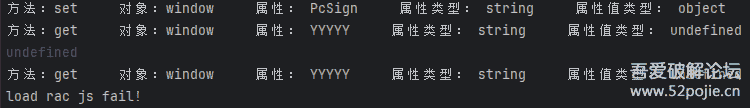
image.png (20.09 KB, 下载次数: 2)
[href="forum.php?mod=attachment&aid=MjgwMjI3NHwxZjIyOGZjZnwxNzkzNTcwNTg0fDE2ODA4NnwyMDU5NzE4&nothumb=yes" target="_blank"](https://www.52pojie.cn/forum.php?mod=attachment&aid=MjgwMjI3NHwxZjIyOGZjZnwxNzkzNTcwNTg0fDE2ODA4NnwyMDU5NzE4&nothumb=yes)
fail
2025-9-12 10:08 上传
这个就是因为没有去和浏览器的环境做对比，我一直以为是我自己补的环境出问题，我还把各种AI都拷打了一遍死活没有找到正确的解法，后来只能放弃去补其他的环境。（其实后面补着补着才发现浏览器一样也是报的这个`load rac js fail!`错误，所以。。。确实有些无语，在这个地方卡了很久）
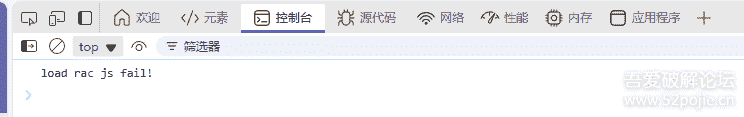
image.png (17.31 KB, 下载次数: 1)
[href="forum.php?mod=attachment&aid=MjgwMjI5OXwyYTY2NGIzZHwxNzkzNTcwNTg0fDE2ODA4NnwyMDU5NzE4&nothumb=yes" target="_blank"](https://www.52pojie.cn/forum.php?mod=attachment&aid=MjgwMjI5OXwyYTY2NGIzZHwxNzkzNTcwNTg0fDE2ODA4NnwyMDU5NzE4&nothumb=yes)
浏览器报错fail
2025-9-12 11:09 上传
最后就直接上我的成品补环境的代码了，我也不知道为什么他们都不发出来，哎！估计确实是补的很多吧。其中的`canvas`的代码是直接是前面有道题需要的环境（`canvas`的代码AI生成的，我写不来，代码中的`cookie`，`localStorage`的值在自己的浏览器上`copy`就可以了）

```
window = global

window.setInterval = function setInterval(selector) {

    console.log('setInterval的值:',selector)

}

window.setTimeout = function setTimeout(selector) {

    console.log('setTimeout的值:',selector)

}

// 创建一个Canvas元素模拟类

class Canvas {

  constructor(width, height) {

    this.width = width || 300;

    this.height = height || 150;

    this._context = null;

  }

  getContext(contextType) {

    if (contextType === '2d') {

      if (!this._context) {

        this._context = new CanvasRenderingContext2D(this);

      }

      return this._context;

    }

    return null;

  }

  toDataURL() {

    return 'data:image/png;base64,iVBORw0KGgoAAAANSUhEUgAAAAEAAAABCAYAAAAfFcSJAAAADUlEQVR42mP8z8BQDwAEhQGAhKmMIQAAAABJRU5ErkJggg==';

  }

  // 添加其他Canvas方法

  addEventListener() {}

  removeEventListener() {}

  getBoundingClientRect() {

    return {

      left: 0,

      top: 0,

      right: this.width,

      bottom: this.height,

      width: this.width,

      height: this.height

    };

  }

}

// 创建CanvasRenderingContext2D模拟类

class CanvasRenderingContext2D {

  constructor(canvas) {

    this.canvas = canvas;

    this._fillStyle = '#000000';

    this._strokeStyle = '#000000';

    this._lineWidth = 1;

    this._font = '10px sans-serif';

    this._textAlign = 'start';

    this._textBaseline = 'alphabetic';

    this._globalAlpha = 1.0;

    this._globalCompositeOperation = 'source-over';

    this._lineCap = 'butt';

    this._lineJoin = 'miter';

    this._miterLimit = 10;

    this._lineDashOffset = 0;

    this._shadowBlur = 0;

    this._shadowColor = 'rgba(0, 0, 0, 0)';

    this._shadowOffsetX = 0;

    this._shadowOffsetY = 0;

    // 初始化状态栈

    this._stateStack = [];

  }
```


# Canvas Mock 实现

## 属性getters和setters

```javascript
get fillStyle() {
  return this._fillStyle;
}
set fillStyle(value) {
  this._fillStyle = value;
}
get strokeStyle() {
  return this._strokeStyle;
}
set strokeStyle(value) {
  this._strokeStyle = value;
}
get lineWidth() {
  return this._lineWidth;
}
set lineWidth(value) {
  this._lineWidth = value;
}
get font() {
  return this._font;
}
set font(value) {
  this._font = value;
}
get textAlign() {
  return this._textAlign;
}
set textAlign(value) {
  this._textAlign = value;
}
get textBaseline() {
  return this._textBaseline;
}
set textBaseline(value) {
  this._textBaseline = value;
}
get globalAlpha() {
  return this._globalAlpha;
}
set globalAlpha(value) {
  this._globalAlpha = value;
}
get globalCompositeOperation() {
  return this._globalCompositeOperation;
}
set globalCompositeOperation(value) {
  this._globalCompositeOperation = value;
}
get lineCap() {
  return this._lineCap;
}
set lineCap(value) {
  this._lineCap = value;
}
get lineJoin() {
  return this._lineJoin;
}
set lineJoin(value) {
  this._lineJoin = value;
}
get miterLimit() {
  return this._miterLimit;
}
set miterLimit(value) {
  this._miterLimit = value;
}
get lineDashOffset() {
  return this._lineDashOffset;
}
set lineDashOffset(value) {
  this._lineDashOffset = value;
}
get shadowBlur() {
  return this._shadowBlur;
}
set shadowBlur(value) {
  this._shadowBlur = value;
}
get shadowColor() {
  return this._shadowColor;
}
set shadowColor(value) {
  this._shadowColor = value;
}
get shadowOffsetX() {
  return this._shadowOffsetX;
}
set shadowOffsetX(value) {
  this._shadowOffsetX = value;
}
get shadowOffsetY() {
  return this._shadowOffsetY;
}
set shadowOffsetY(value) {
  this._shadowOffsetY = value;
}
```

## 路径方法

```javascript
beginPath() {}
closePath() {}
moveTo(x, y) {}
lineTo(x, y) {}
bezierCurveTo(cp1x, cp1y, cp2x, cp2y, x, y) {}
quadraticCurveTo(cpx, cpy, x, y) {}
arc(x, y, radius, startAngle, endAngle, anticlockwise) {}
arcTo(x1, y1, x2, y2, radius) {}
ellipse(x, y, radiusX, radiusY, rotation, startAngle, endAngle, anticlockwise) {}
rect(x, y, width, height) {}
```

## 绘制方法

```javascript
fill() {}
stroke() {}
drawFocusIfNeeded() {}
scrollPathIntoView() {}
clip() {}
resetClip() {}
```

## 变换方法

```javascript
rotate(angle) {}
scale(x, y) {}
translate(x, y) {}
transform(a, b, c, d, e, f) {}
setTransform(a, b, c, d, e, f) {}
resetTransform() {}
```

## 合成方法

```javascript
save() {
  this._stateStack.push({
    fillStyle: this._fillStyle,
    strokeStyle: this._strokeStyle,
    lineWidth: this._lineWidth,
    font: this._font,
    textAlign: this._textAlign,
    textBaseline: this._textBaseline,
    globalAlpha: this._globalAlpha,
    globalCompositeOperation: this._globalCompositeOperation,
    lineCap: this._lineCap,
    lineJoin: this._lineJoin,
    miterLimit: this._miterLimit,
    lineDashOffset: this._lineDashOffset,
    shadowBlur: this._shadowBlur,
    shadowColor: this._shadowColor,
    shadowOffsetX: this._shadowOffsetX,
    shadowOffsetY: this._shadowOffsetY
  });
}
restore() {
  if (this._stateStack.length > 0) {
    const state = this._stateStack.pop();
    this._fillStyle = state.fillStyle;
    this._strokeStyle = state.strokeStyle;
    this._lineWidth = state.lineWidth;
    this._font = state.font;
    this._textAlign = state.textAlign;
    this._textBaseline = state.textBaseline;
    this._globalAlpha = state.globalAlpha;
    this._globalCompositeOperation = state.globalCompositeOperation;
    this._lineCap = state.lineCap;
    this._lineJoin = state.lineJoin;
    this._miterLimit = state.miterLimit;
    this._lineDashOffset = state.lineDashOffset;
    this._shadowBlur = state.shadowBlur;
    this._shadowColor = state.shadowColor;
    this._shadowOffsetX = state.shadowOffsetX;
    this._shadowOffsetY = state.shadowOffsetY;
  }
}
```

## 文本方法

```javascript
fillText(text, x, y, maxWidth) {}
strokeText(text, x, y, maxWidth) {}
measureText(text) {
  return {
    width: text.toString().length * 6,
    actualBoundingBoxAscent: 10,
    actualBoundingBoxDescent: 2,
    actualBoundingBoxLeft: 0,
    actualBoundingBoxRight: text.toString().length * 6,
    fontBoundingBoxAscent: 10,
    fontBoundingBoxDescent: 2
  };
}
```

## 图像方法

```javascript
drawImage(image, sx, sy, sWidth, sHeight, dx, dy, dWidth, dHeight) {}
createImageData(width, height) {
  return {
    width: width,
    height: height,
    data: new Uint8ClampedArray(width * height * 4)
  };
}
getImageData(sx, sy, sw, sh) {
  return this.createImageData(sw, sh);
}
putImageData(imagedata, dx, dy, dirtyX, dirtyY, dirtyWidth, dirtyHeight) {}
```

## 像素操作

```javascript
createPattern(image, repetition) {
  return {};
}
createLinearGradient(x0, y0, x1, y1) {
  return {
    addColorStop: function(offset, color) {}
  };
}
createRadialGradient(x0, y0, r0, x1, y1, r1) {
  return {
    addColorStop: function(offset, color) {}
  };
}
```

## 其他方法

```javascript
setLineDash(segments) {
  this._lineDash = segments;
}
getLineDash() {
  return this._lineDash || [];
}
clearRect(x, y, width, height) {}
fillRect(x, y, width, height) {}
strokeRect(x, y, width, height) {}
isPointInPath(x, y) {
  return false;
}
isPointInStroke(x, y) {
  return false;
}
}
```

## 环境变量

```javascript
canvas = new Canvas(800, 600);
location={
  "ancestorOrigins": {},
  "href": "https://www.mashangpa.com/problem-detail/16/",
  "origin": "https://www.mashangpa.com",
  "protocol": "https:",
  "host": "www.mashangpa.com",
  "hostname": "www.mashangpa.com",
  "port": "",
  "pathname": "/problem-detail/16/",
  "search": "",
  "hash": ""
}
localStorage = {
  getItem : function getItem(selector) {
    console.log('getItem的值:',selector)
    if (selector === 'WQ_gather_cv1' ) {
      return localStorage['WQ_gather_cv1']
    }
    if (selector === 'WQ_gather_wgl1') {
      return localStorage['WQ_gather_wgl1']
    }
  },
  setItem : function setItem(selector,value) {
    console.log('setItem的值:',selector,value)
  }
}
head = {}
script = {
  parentNode : head
}
script.parentNode.removeChild  = function removeChild(selector) {
  console.log('removeChild的值:',selector)
}
document = {
  querySelector : function querySelector(selector) {},
  createElement : function createElement(selector) {
    console.log('createElement的值:',selector)
    if ( selector === 'script') {
      return script
    }
    if (selector === 'canvas'){
      return canvas
    }
  },
  createEvent : function createEvent(selector) {
    console.log('createEvent的值:',selector)
  },
  getElementsByTagName : function getElementsByTagName(selector) {
    console.log('getElementsByTagName的值:',selector)
    if ( selector === 'head') {
      return {
        "0": {
          appendChild : function appendChild(selector) {
            console.log('appendChild的值:',selector)
            return script;
          }
        }
      }
    }
  },
  cookie :"",
  documentElement: {
    html:{
      lang : 'zh-CN'
    },
  },
  body :{
    nav :{
      class: 'navbar',
    }
  },
  head :{
    meta:{
      charset : 'UTF-8'
    },
    title: '\n' +
          '        \n' +
          '            题十六：仿电商加密 - 码上爬\n' +
          '        \n' +
  }
}
```


```
            '    '

    }

}

navigator = {

    userAgent : 'Mozilla/5.0 (Windows NT 10.0; Win64; x64) AppleWebKit/537.36 (KHTML, like Gecko) Chrome/139.0.0.0 Safari/537.36',

    hardwareConcurrency : 20,

    webdriver : false,

    platform : 'Win32',

    languages : [

        "zh-CN",

        "ja-JP",

        "ja",

        "zh"

    ],

    plugins:{

    "0": {

        "0": {},

        "1": {}

    },

    "1": {

        "0": {},

        "1": {}

    },

    "2": {

        "0": {},

        "1": {}

    },

    "3": {

        "0": {},

        "1": {}

    },

    "4": {

        "0": {},

        "1": {}

    }

}

}
```
补到这一步之后，其实还是有问题的，我们会发现生成出来的加密值和，浏览器中的少一一大截，然后我通过一步一步的调试发现了这么一个位置：

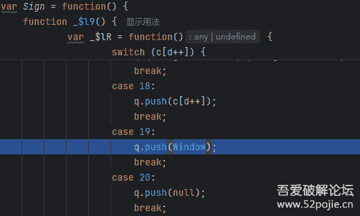

image.png (32.9 KB, 下载次数: 2)

[href="forum.php?mod=attachment&aid=MjgwMjI3NnwwZTZmYTQ5MnwxNzkzNTcwNTg0fDE2ODA4NnwyMDU5NzE4&nothumb=yes" target="_blank"](https://www.52pojie.cn/forum.php?mod=attachment&aid=MjgwMjI3NnwwZTZmYTQ5MnwxNzkzNTcwNTg0fDE2ODA4NnwyMDU5NzE4&nothumb=yes)

大window

2025-9-12 10:29 上传

这里的函数明显是`push()`了一个大`Window`进去，而我的环境里并没有大`Window`这个属性,因为我并没有按照补原型的方式来部环境，所以这里我们还要把这个大`Window`,直接在代码上改成 小 `window`就能够和浏览器输出一样的加密长度的值了，然后用`python`测试，结果也是通过的，这里就不写`python`代码了，很简单就没有写的必要了。

## 最终的结果

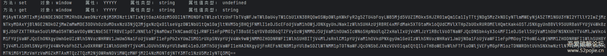

image.png (78.93 KB, 下载次数: 2)

[href="forum.php?mod=attachment&aid=MjgwMjI5NHwxMjA2OWVmMnwxNzkzNTcwNTg0fDE2ODA4NnwyMDU5NzE4&nothumb=yes" target="_blank"](https://www.52pojie.cn/forum.php?mod=attachment&aid=MjgwMjI5NHwxMjA2OWVmMnwxNzkzNTcwNTg0fDE2ODA4NnwyMDU5NzE4&nothumb=yes)

最终结果

2025-9-12 11:05 上传

## 结果对比

和浏览器的结果对比：一致

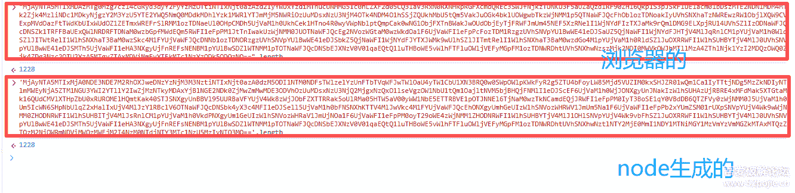

image.png (106.16 KB, 下载次数: 1)

[href="forum.php?mod=attachment&aid=MjgwMjI5N3w2MmE0MzU1ZXwxNzkzNTcwNTg0fDE2ODA4NnwyMDU5NzE4&nothumb=yes" target="_blank"](https://www.52pojie.cn/forum.php?mod=attachment&aid=MjgwMjI5N3w2MmE0MzU1ZXwxNzkzNTcwNTg0fDE2ODA4NnwyMDU5NzE4&nothumb=yes)

结果对比

2025-9-12 11:07 上传

## 结尾

第一次写帖子，写的不好还请见谅。
