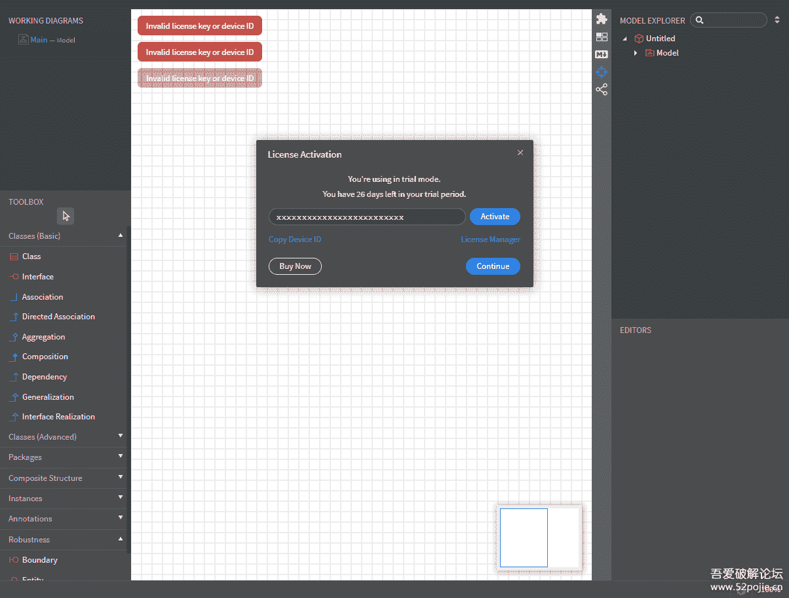
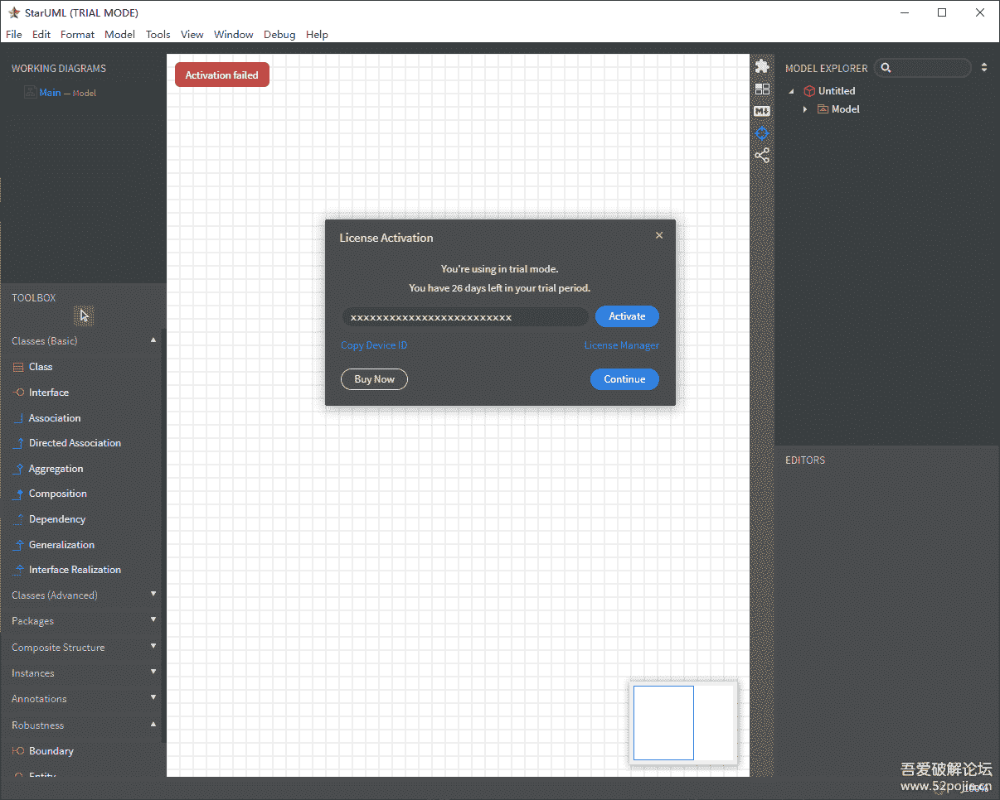
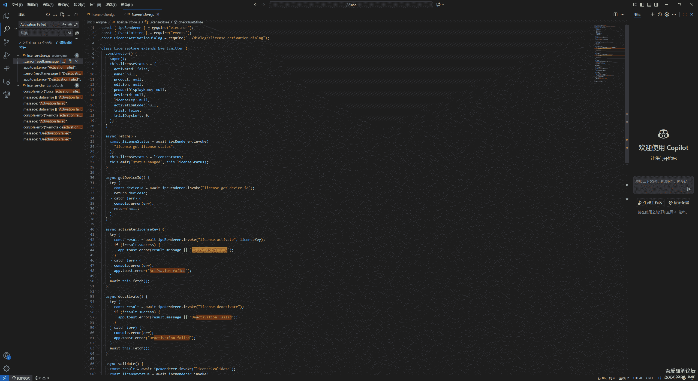
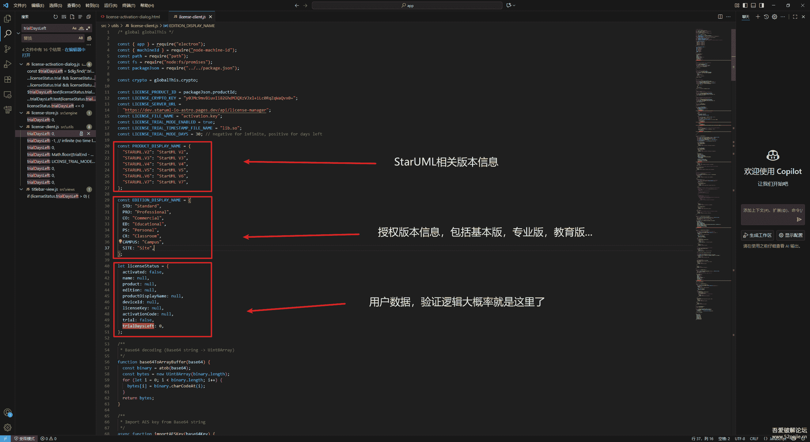
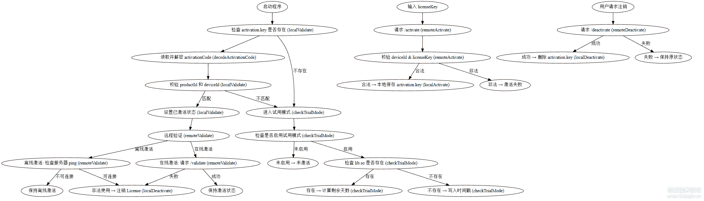
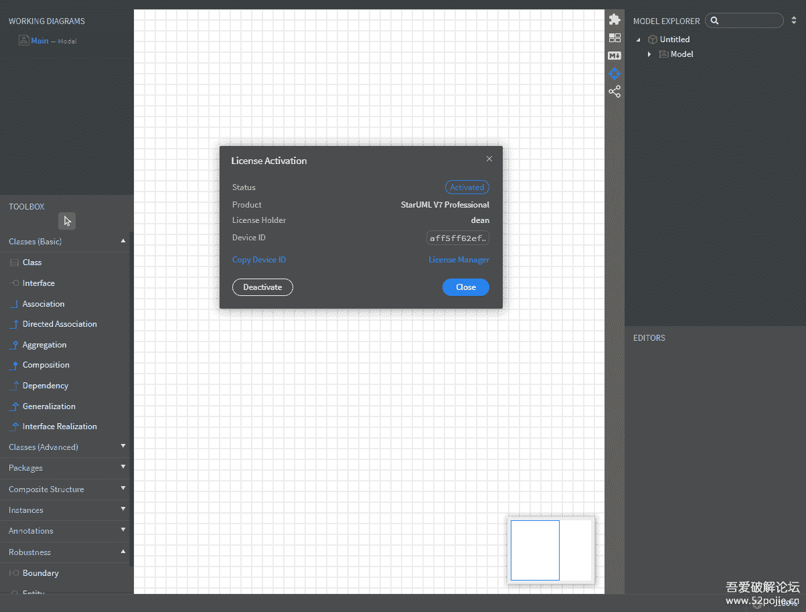

# [原创] StarUML Keygen分析

- 原帖: https://www.52pojie.cn/forum.php?mod=viewthread&tid=2059853
- 抓取时间: 2026-11-01T22:03:05

## 前言

有关于 staruml.io v7.0+ 的逆向方案，仅供用于学习交流

软件是由 Electron 开发，如下是所需要的工具

- `nodejs`：编写 Keygen 所需的语言
- `npm`：包管理器，安装打包解包的工具 (`asar extract app.asar app`)
- `asar`：打包和解包的工具

## 1 查找突破点

### 1.1 找的方法

随便输入激活码点激活，搜索红色的激活失败提示词，结果没搜到，一开始猜测是网络请求返回的错误提示所以搜不到(后面发现确实如此)



把网络断开再激活测试一下，发现有了不一样的提示词



直接定位到两个文件中：`client-license.js` -> (核心激活逻辑) 和 `license-store.js` -> (模块进程，与主进程通信)，只管分析核心逻辑即可





### 1.2 常量分析

看到了一些关键常量，分析一下

```
const LICENSE_PRODUCT_ID = packageJson.productId;
// 字符串，值为'STARUML.V7'，对应了软件版本

const LICENSE_CRYPTO_KEY = "y0JMc9mvB1uvIi82GhdMJQXzVJxl+1Lc0RqZqWaQvx0=";
// AES对称加密算法，很可能是activation.key激活文件的生成密钥

const LICENSE_SERVER_URL = "https://dev.staruml-io-astro.pages.dev/api/license-manager";
// 官方服务器的激活url

const LICENSE_FILE_NAME = "activation.key";
// 激活文件的名称

const LICENSE_TRIAL_MODE_ENABLED = true;
// 启用试用方案

const LICENSE_TRIAL_TIMESTAMP_FILE_NAME = "lib.so";
// 试用的时间戳信息，内容为用户首次打开软件的时间，这个时间加上下面的试用时长得出试用失效日期

const LICENSE_TRIAL_MODE_DAYS = 30; // negative for infinite, positive for days left
// 这一段官方说的，负数即可破解，无限试用，但我试了没用😂
```

## 2 修改方案

看到这里有两个方案，一个是直接修改 `lib.so` 的时间戳实现无限试用，二是尝试分析激活逻辑

### 2.1 无限试用

文本形式修改 `lib.so` 文件内容为 `4102329600000`，也就是2099年，就可以无限试用了，但是每次都有弹窗，有点麻烦

### 2.2 Keygen

#### 2.2.1 AI分析

直接把 `license-client.js` 丢给 AI 分析一波，得到了流程图突然就豁然开朗了



#### 2.2.2 分析 `localValidate` 方法

```
async function localValidate() {
  try {
    const filePath = path.join(app.getPath("userData"), LICENSE_FILE_NAME);
    // %appdata%/StarUML/activation.key，这是授权文件的绝对路径
    const activationCode = await fs.readFile(filePath, "utf8");
    const decoded = await decodeActivationCode(activationCode); // 这个函数就是解码activation.key的逻辑了，其实就是AES对称加密，key就是之前看到的常量，直接喂给AI生成Keygen
    const deviceId = await getDeviceId();
    const isProductMatched = decoded.product === LICENSE_PRODUCT_ID;
    const isDeviceIdMatched =
      decoded.deviceId === "*" || decoded.deviceId === deviceId;  // 设备id区别'*'为通配，和个人设备id，两者均通过(但后面发现'*'只能离线激活)
    if (!isProductMatched) { // 判断产品软件版本是否匹配
      await checkTrialMode();
      await localDeactivate();
      return {
        success: false,
        message: "Invalid activation code (product mismatch)",
      };
    }
    if (!isDeviceIdMatched) { // 判断产品授权的设备id是否匹配
      await checkTrialMode();
      await localDeactivate();
      return {
        success: false,
        message: "Invalid activation code (device ID mismatch)",
      };
    }
    // 上面两条判断均通过则成功授权，赋值产品信息
    licenseStatus = {
      activated: true,
      name: decoded.name,
      product: decoded.product,
      edition: decoded.edition,
      productDisplayName: getProductDisplayName(
        decoded.product,
        decoded.edition,
      ),
      deviceId: decoded.deviceId,
      licenseKey: decoded.licenseKey,
      activationCode: activationCode,
      trial: false,
      trialDaysLeft: 0,
    };
    return {
      success: true,
      message: "Local validation successful (activated)",
    };
  } catch (err) {
    // if the file does not exist, assume the license is not activated
  }
  await localDeactivate();
  return {
    success: true,
    message: "Local validation successful (not activated)",
  };
}
```

#### 2.2.3 生成 Keygen

已知算法和解码方法，直接把 `license-client.js` 丢给 AI，生成 Keygen，下面是 AI 给的代码

```js
// aes-gcm-node.js
// Node.js AES-GCM (Base64 key) encrypt/decrypt compatible with WebCrypto output format:
// "ivBase64:encryptedBase64" where encryptedBase64 = base64(ciphertext || authTag)
const crypto = require("crypto");
/**
 * Base64 -> Buffer
 * @param {string} b64
 * @returns {Buffer}
 */
function base64ToBuffer(b64) {
    return Buffer.from(b64, "base64");
}
/**
 * Buffer -> Base64
 * @param {Buffer} buf
 * @returns {string}
 */
function bufferToBase64(buf) {
    return buf.toString("base64");
}
/**
 * Encrypt a UTF-8 string with AES-GCM using a base64-encoded raw key.
 * @param {string} plaintext
 * @param {string} base64Key  // raw AES key in base64 (e.g. 32 bytes -> AES-256-GCM)
 * @returns {string} "ivBase64:encryptedBase64"
 */
function encryptString(plaintext, base64Key) {
    const key = base64ToBuffer(base64Key);
    // 12 bytes IV is recommended for AES-GCM
    const iv = crypto.randomBytes(12);
    const cipher = crypto.createCipheriv(`aes-${key.length * 8}-gcm`, key, iv);
    const ptBuf = Buffer.from(plaintext, "utf8");
    const ct = Buffer.concat([cipher.update(ptBuf), cipher.final()]);
    const authTag = cipher.getAuthTag();
    // Put ciphertext and tag together (WebCrypto expects ciphertext||tag)
    const encryptedBuffer = Buffer.concat([ct, authTag]);
    return `${bufferToBase64(iv)}:${bufferToBase64(encryptedBuffer)}`;
}
/**
 * Decrypt a string in the "ivBase64:encryptedBase64" format using base64-encoded raw key.
 * @param {string} encryptedText
 * @param {string} base64Key
 * @returns {string} plaintext
 */
function decryptString(encryptedText, base64Key) {
    const key = base64ToBuffer(base64Key);
    const [ivB64, encryptedB64] = encryptedText.split(":");
    if (!ivB64 || !encryptedB64) {
        throw new Error("Invalid encryptedText format. Expect iv:encrypted");
    }
    const iv = base64ToBuffer(ivB64);
    const encryptedBuffer = base64ToBuffer(encryptedB64);
    // authTag is last 16 bytes for AES-GCM
    const authTag = encryptedBuffer.slice(encryptedBuffer.length - 16);
    const ciphertext = encryptedBuffer.slice(0, encryptedBuffer.length - 16);
    const decipher = crypto.createDecipheriv(`aes-${key.length * 8}-gcm`, key, iv);
    decipher.setAuthTag(authTag);
    const pt = Buffer.concat([decipher.update(ciphertext), decipher.final()]);
    return pt.toString("utf8");
}
module.exports = {
    encryptString,
    decryptString,
};
```

自己再写一个命令行交互接口，调用 AI 给的代码方法 `encryptString()`

`plaintext` 为 `JSON.stringify(licenseStatus)`

`key` 是 `y0JMc9mvB1uvIi82GhdMJQXzVJxl+1Lc0RqZqWaQvx0=`

示例:

```
> staruml_keygen@25.09.12 start
```


> `node main.js`

2. {STARUML.V2: StarUML V2}
3. {STARUML.V3: StarUML V3}
4. {STARUML.V4: StarUML V4}
5. {STARUML.V5: StarUML V5}
6. {STARUML.V6: StarUML V6}
7. {STARUML.V7: StarUML V7}

choose product version:

7

--------------------------------

0. {STD: Standard}
1. {PRO: Professional}
2. {CO: Commercial}
3. {ED: Educational}
4. {PS: Personal}
5. {CR: Classroom}
6. {CAMPUS: Campus}
7. {SITE: Site}

choose product edition:

1

--------------------------------

input your user name:

dean

--------------------------------

input your `deviceId` (default '*', not recommend):

--------------------------------

YQisnVjmlSZFrp/5:6mSudJku7gJhSc7zijcOolZGG83zJ9e8yaIx2RJCc0qVDqrZM6gfM+jlyf/gnaG41iSLuq7EeFc4RcjYP0r+X97xgBRSMd8cA/1QrtQaEJ/BbNbUTRD0xkFUZgueeabpgX7xEqN5jzyVtk1x12Ocf94ymuyxtzTa

## 2.3 潜在问题修改

发现联网状态下会在执行`localvalidate`后会调用`remoteValidate`方法进行联网验证，导致激活失败。有两种解决思路，一是防火墙出站规则拦截掉，二是修改远程验证函数。前者防火墙拦截会导致每次启动都有网络验证耗时，导致启动缓慢，后者则需要拆包修改

### 2.3.1 拆包修改

防火墙拦截百度一下即可，这里聊一下拆包。确保执行`npm i asar -g`安装完成

打包: `asar pack app app.asar`

解包: `asar extract app.asar app`

找到`src\utils\license-client.js`中的`remoteValidate()`

直接把网络请求注释掉，添加返回成功结果即可，修改后打包回去覆盖

```
/**
 * Validate the activation code with the server.
 */
async function remoteValidate() {
  const { activated, activationCode, deviceId } = licenseStatus;
  if (!activated) {
    return {
      success: true,
      message: "Validation successful (not activated)",
    };
  }
  try {
    if (deviceId === "*") {
      // if offline activation, deactivate if the server is reachable
      const response = await fetch(`${LICENSE_SERVER_URL}/ping`, {
        method: "POST",
      });
      if (response.ok) {
        await localDeactivate();
        return {
          success: false,
          message: "License deactivated (illegal offline use)",
        };
      }
    } else {
      // if online activation, validate the activation code with the server
      /* modify
      const response = await fetch(`${LICENSE_SERVER_URL}/validate`, {
        method: "POST",
        headers: {
          "Content-Type": "application/json",
        },
        body: JSON.stringify({
          activation_code: activationCode,
        }),
      });
      if (response.ok) {
        const data = await response.json();
        if (data.success) {
          const decoded = await decodeValidationCode(data.validation_code);
          if (decoded.deviceId === deviceId) {
            return {
              success: true,
              message: "Validation successful (activated)",
            };
          }
        }
      }
      */
      return {
        success: true,
        message: "Validation successful (activated)",
      };  
      await localDeactivate();
      return {
        success: false,
        message: "License deactivated by server",
      };
    }
  } catch (err) {
    // if server is not accessible, assume the validation is success.
    return {
      success: true,
      message: "Validation successful (offline)",
    };
  }
}
```

## 3 结尾

测试成功

附件:


[href="forum.php?mod=attachment&aid=MjgwMjcxM3wwZTliODE3M3wxNzkzNTcwNTgyfDE2ODA4NnwyMDU5ODUz" target="_blank"](https://www.52pojie.cn/forum.php?mod=attachment&aid=MjgwMjcxM3wwZTliODE3M3wxNzkzNTcwNTgyfDE2ODA4NnwyMDU5ODUz)

(2.49 KB, 下载次数: 162)

2025-9-12 21:13 上传

点击文件名下载附件
仅供交流学习下载积分: 吾爱币 -1 CB



2.png (74.93 KB, 下载次数: 2)

[href="forum.php?mod=attachment&aid=MjgwMjcxNHw3NmFlYzJhYXwxNzkzNTcwNTgyfDE2ODA4NnwyMDU5ODUz&nothumb=yes" target="_blank"](https://www.52pojie.cn/forum.php?mod=attachment&aid=MjgwMjcxNHw3NmFlYzJhYXwxNzkzNTcwNTgyfDE2ODA4NnwyMDU5ODUz&nothumb=yes)

2025-9-12 21:23 上传
