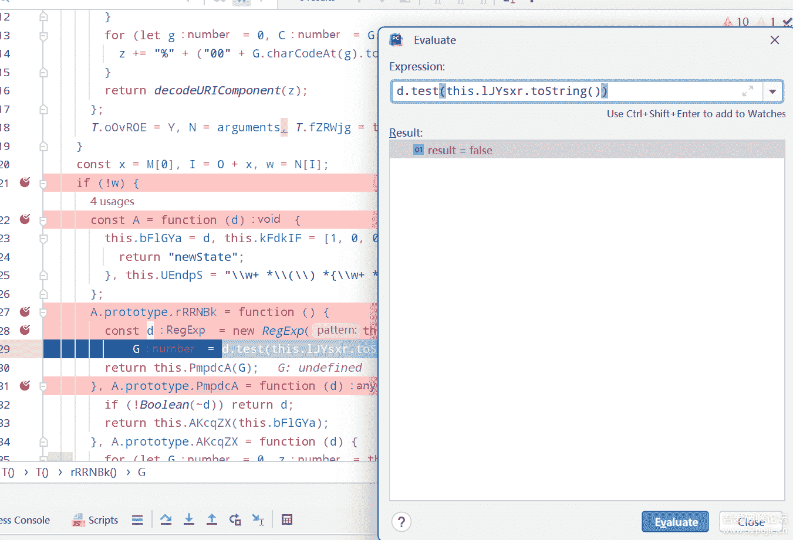
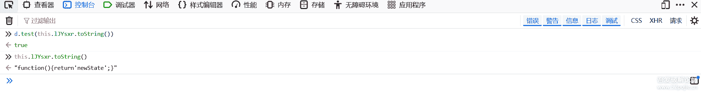
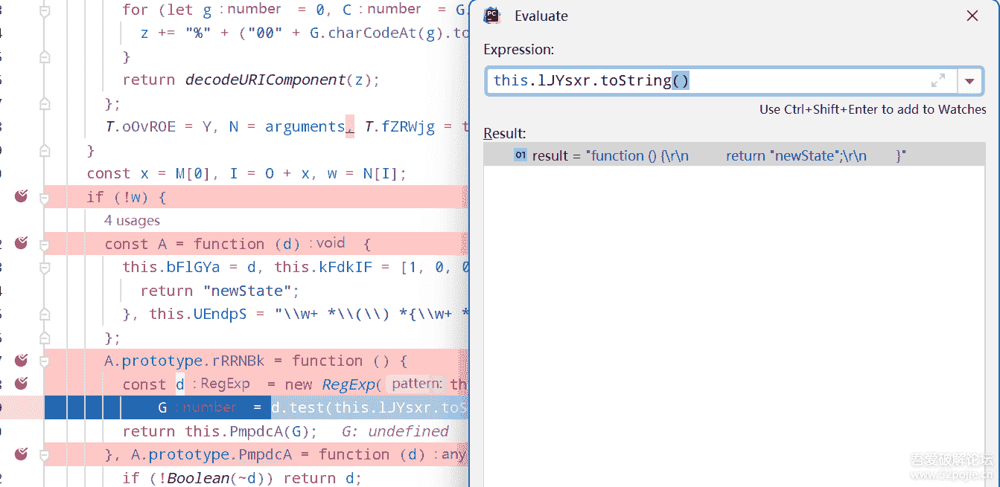

# [Web逆向] 码上爬 1~7关js逆向代码

- 原帖：<https://www.52pojie.cn/forum.php?mod=viewthread&tid=2060789>
- 抓取时间：2026-11-01T22:02:52

记录一下码上爬1~7关js逆向结果，代码在附件。

前面1~6关基本上就将方法补全即可。

但是在第七关，有轻微的代码混淆，和反爬虫的小坑。就在解混淆方法`T()`和`y()`的位置。主要就是这个`d['test'](this['lJYsxr']['toString']())`方法。

如果在本地跑的话，你难免会格式化代码，导致他用来判断是否处于浏览器运行环境的代码会加上`\n`，空格等字符。让你本地的代码环境判断不通过，然后无限递归直到内存耗尽。

`T()`和`y()`方法中都有这种判断是否为浏览器的代码。

```javascript
A['prototype']['rRRNBk'] = function () {
  const d = new RegExp(this['UEndpS'] + this['cLlcyX']),
  G = d['test'](this['lJYsxr']['toString']()) ? --this['kFdkIF'][ - 2 * 289 + - 1 * 9726 + 10305] : --this['kFdkIF'][1 * 1471 + - 7432 + 3 * 1987];
  return this['PmpdcA'](G);
}
```

## 本地环境判断代码运行结果



`Pasted image 20250916145310.png`（166.09 KB，下载次数：3）

<https://www.52pojie.cn/forum.php?mod=attachment&aid=MjgwMzQyNXw0N2MzZWI0MXwxNzkzNTcwNTcwfDE2ODA4NnwyMDYwNzg5&nothumb=yes>

2025-9-17 11:42 上传

## 浏览器环境中运行结果



`Pasted image 20250916145440.png`（38.77 KB，下载次数：1）

<https://www.52pojie.cn/forum.php?mod=attachment&aid=MjgwMzQyN3wyNTJiMmJmMHwxNzkzNTcwNTcwfDE2ODA4NnwyMDYwNzg5&nothumb=yes>

2025-9-17 11:42 上传

## 其不同结果的原因

`this.lJYsxr.toString()`值不一致。

本地的结果为



`Pasted image 20250916145557.png`（125 KB，下载次数：2）

<https://www.52pojie.cn/forum.php?mod=attachment&aid=MjgwMzQyOXwxYjRhNDJjY3wxNzkzNTcwNTcwfDE2ODA4NnwyMDYwNzg5&nothumb=yes>

2025-9-17 11:42 上传

后续将解密的js代码补全即可。刚开始本菜逼还想着手动解析所有被混淆的代码来着，后面发现混淆的代码实在有点多 。
