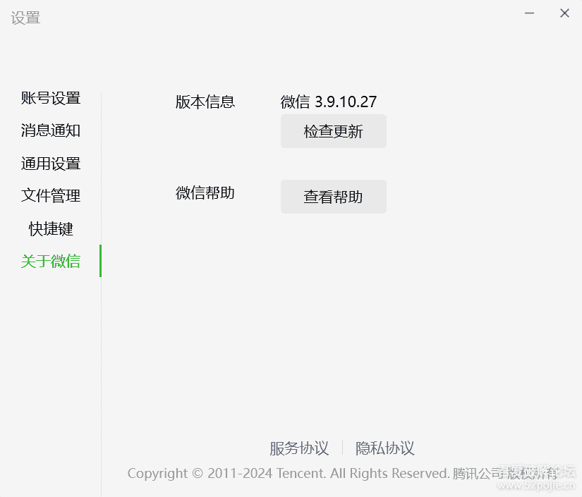
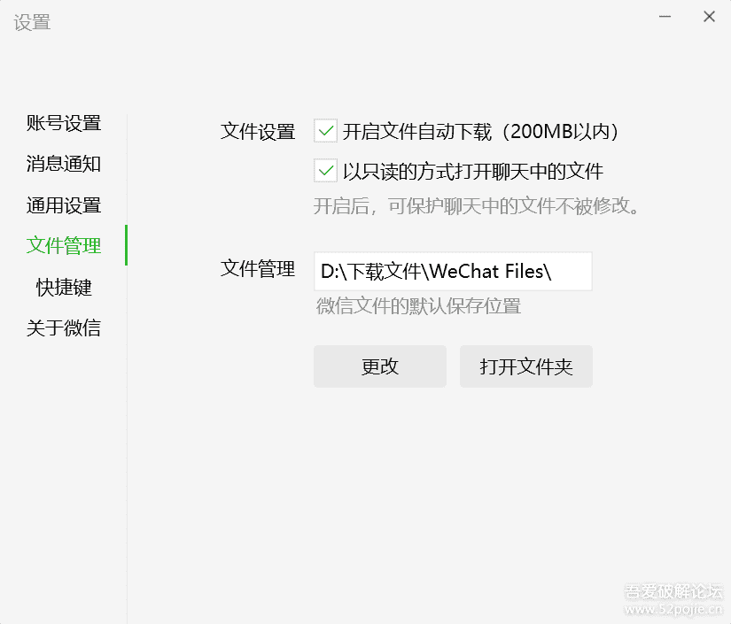
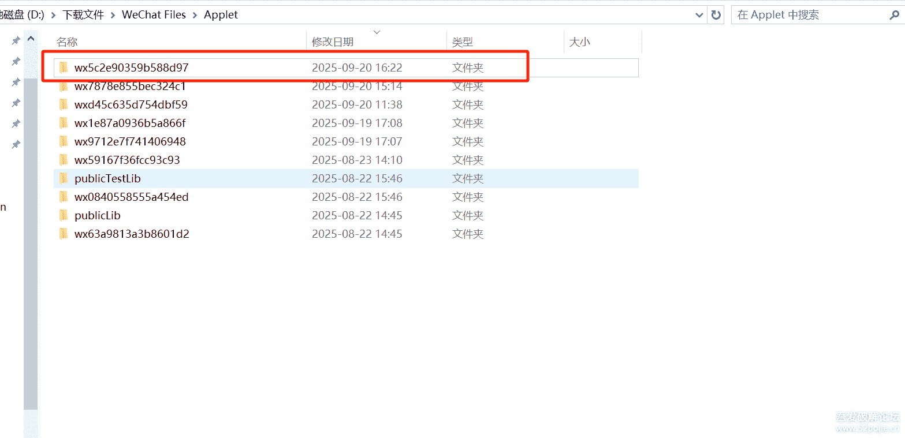
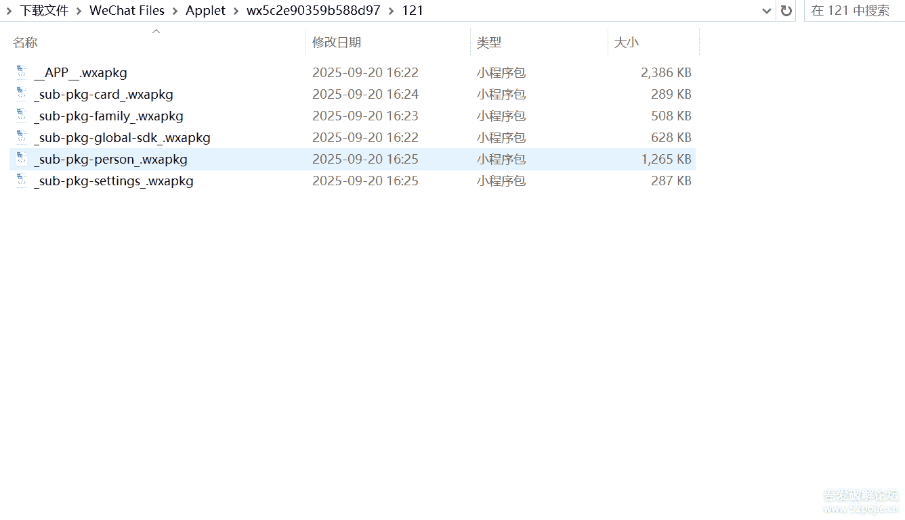
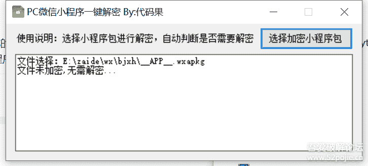
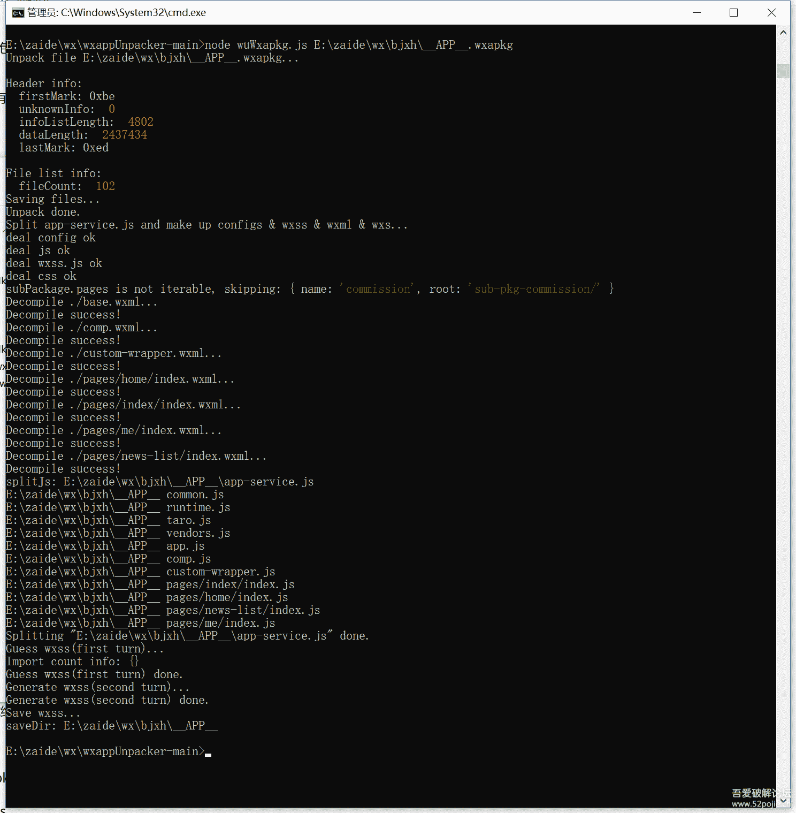
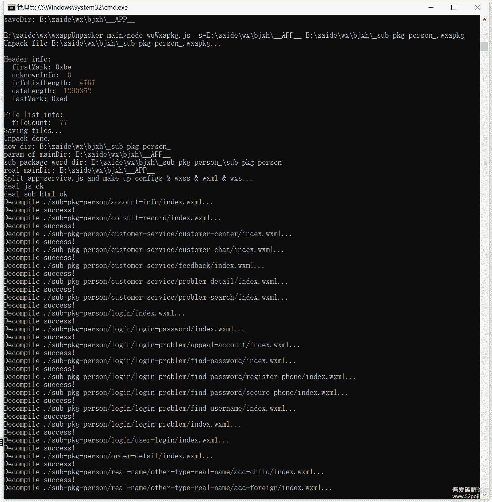

# [分享] 千呼万唤始出来《WX小程序反编译教程》

- 原帖: https://www.52pojie.cn/forum.php?mod=viewthread&tid=2061802
- 抓取时间: 2026-11-01T22:02:41

应大家的强烈要求，我把 我平时反编译WX小程序的教程整理发出来，供大家学习一下，有不对的地方也希望指正一下，互相交流，这篇先主要讲PC端小程序如何反编译，所需要的文件我会放在最后

## 第一步：先看看WX版本，新版和旧版的小程序文件不一样，3.x.xx.xx

image.png (33.13 KB, 下载次数: 1)
[href="forum.php?mod=attachment&aid=MjgwNDQzMXw4YWNhMWJiZnwxNzkzNTcwNTU4fDE2ODA4NnwyMDYxODAy&nothumb=yes" target="_blank"](https://www.52pojie.cn/forum.php?mod=attachment&aid=MjgwNDQzMXw4YWNhMWJiZnwxNzkzNTcwNTU4fDE2ODA4NnwyMDYxODAy&nothumb=yes)
2025-9-22 10:25 上传

image.png (37.41 KB, 下载次数: 1)
[href="forum.php?mod=attachment&aid=MjgwNDQzMHw2MWFmMGM3NXwxNzkzNTcwNTU4fDE2ODA4NnwyMDYxODAy&nothumb=yes" target="_blank"](https://www.52pojie.cn/forum.php?mod=attachment&aid=MjgwNDQzMHw2MWFmMGM3NXwxNzkzNTcwNTU4fDE2ODA4NnwyMDYxODAy&nothumb=yes)
2025-9-22 10:25 上传
如图所示 可以看到我的WX版本 以及文件管理路径，那么我的小程序文件所在位置就是：`D:\下载文件\WeChat Files\Applet`

## 第二步：打开我们的目标小程序 这次拿

image.png (9.84 KB, 下载次数: 0)
[href="forum.php?mod=attachment&aid=MjgwNDQzNHxjMTYwOWE1ZXwxNzkzNTcwNTU4fDE2ODA4NnwyMDYxODAy&nothumb=yes" target="_blank"](https://www.52pojie.cn/forum.php?mod=attachment&aid=MjgwNDQzNHxjMTYwOWE1ZXwxNzkzNTcwNTU4fDE2ODA4NnwyMDYxODAy&nothumb=yes)
2025-9-22 10:30 上传
做测试，如果不清楚打开的小程序具体是生成的哪个目录，可以先把`D:\下载文件\WeChat Files\Applet`下面的所有文件删除了，这样就只会生成对应目标的目录
打开之后 会发现目录下面生成了 一个文件夹，文件夹名称是小程序的`appid`，进去之后 会看到对应的小程序包文件

image.png (69.14 KB, 下载次数: 1)
[href="forum.php?mod=attachment&aid=MjgwNDQzNnw0MTUwY2M5YXwxNzkzNTcwNTU4fDE2ODA4NnwyMDYxODAy&nothumb=yes" target="_blank"](https://www.52pojie.cn/forum.php?mod=attachment&aid=MjgwNDQzNnw0MTUwY2M5YXwxNzkzNTcwNTU4fDE2ODA4NnwyMDYxODAy&nothumb=yes)
2025-9-22 10:32 上传

image.png (51.19 KB, 下载次数: 0)
[href="forum.php?mod=attachment&aid=MjgwNDQzN3w4NzQwODk3M3wxNzkzNTcwNTU4fDE2ODA4NnwyMDYxODAy&nothumb=yes" target="_blank"](https://www.52pojie.cn/forum.php?mod=attachment&aid=MjgwNDQzN3w4NzQwODk3M3wxNzkzNTcwNTU4fDE2ODA4NnwyMDYxODAy&nothumb=yes)
2025-9-22 10:33 上传

## 第三步 反编译小程序，这里我们需要使用两个工具UnpackMiniApp和wxappUnpacker，分别用于解密小程序 和 反编译小程序，上面小程序文件 `APP`那个是主包，其他都是分包 `sub`标识很好辨认

我们把`APP` 先拖到UnpackMiniApp 进行解密 如果未加密也会有提示，我一般喜欢把这些文件复制到一个指定目录，反编译后的源码也会在这个目录下面
然后使用wxappUnpacker 进行反编译，wxappUnpacker的使用方法如下，（需要有node环境，源码是js实现的）
1.进入wxappUnpacker目录下 先安装程序所需的依赖，`npm install` 即可
2.反编译主包使用命令 `node wuWxapkg.js` 小程序包路径(`.wxapkg`格式) 例如：`node wuWxapkg.js E:\zaide\wx\all\__APP__.wxapkg`
3.反编译分包使用命令 `node wuWxapkg.js -s=E:\zaide\wx\all\__APP__ E:\zaide\wx\all\_sub-pkg-card_.wxapkg`

image.png (28.43 KB, 下载次数: 1)
[href="forum.php?mod=attachment&aid=MjgwNDQ0NnxkNWJhYzExNHwxNzkzNTcwNTU4fDE2ODA4NnwyMDYxODAy&nothumb=yes" target="_blank"](https://www.52pojie.cn/forum.php?mod=attachment&aid=MjgwNDQ0NnxkNWJhYzExNHwxNzkzNTcwNTU4fDE2ODA4NnwyMDYxODAy&nothumb=yes)
2025-9-22 10:36 上传

image.png (182.7 KB, 下载次数: 1)
[href="forum.php?mod=attachment&aid=MjgwNDQ1MXw4ZGJiMTYzMXwxNzkzNTcwNTU4fDE2ODA4NnwyMDYxODAy&nothumb=yes" target="_blank"](https://www.52pojie.cn/forum.php?mod=attachment&aid=MjgwNDQ1MXw4ZGJiMTYzMXwxNzkzNTcwNTU4fDE2ODA4NnwyMDYxODAy&nothumb=yes)
2025-9-22 10:49 上传

image.png (201.48 KB, 下载次数: 0)
[href="forum.php?mod=attachment&aid=MjgwNDQ1Mnw4NzcxZWRkZHwxNzkzNTcwNTU4fDE2ODA4NnwyMDYxODAy&nothumb=yes" target="_blank"](https://www.52pojie.cn/forum.php?mod=attachment&aid=MjgwNDQ1Mnw4NzcxZWRkZHwxNzkzNTcwNTU4fDE2ODA4NnwyMDYxODAy&nothumb=yes)
2025-9-22 10:50 上传
好了 再目前为止 反编译过程已完成，最后送上 反编译工具

[href="forum.php?mod=attachment&aid=MjgwNDQ1NHw1YjA1YmU2OHwxNzkzNTcwNTU4fDE2ODA4NnwyMDYxODAy" target="_blank"](https://www.52pojie.cn/forum.php?mod=attachment&aid=MjgwNDQ1NHw1YjA1YmU2OHwxNzkzNTcwNTU4fDE2ODA4NnwyMDYxODAy)
(565.83 KB, 下载次数: 1428)
2025-9-22 10:57 上传
点击文件名下载附件
下载积分: 吾爱币 -1 CB
WX：4.0及以上版本的小程序路径 `C:\Users\Administrator\AppData\Roaming\Tencent\xwechat\radium\Applet`
其他步骤都一样的，只有路径不一样
