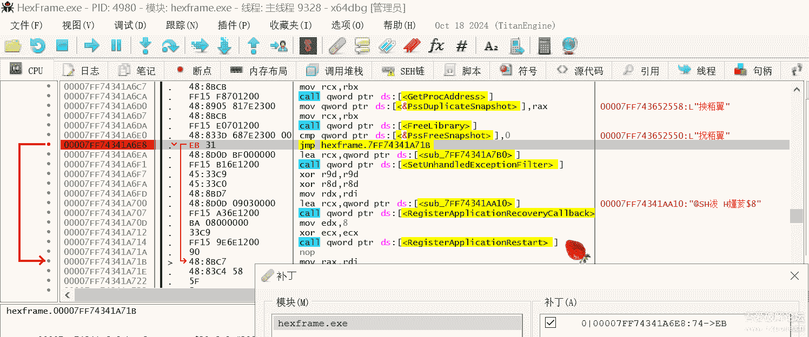

# [原创] HHD Software Hex Editor Neo 7.5爆破后遗症(重启或关闭的治愈)

- 原帖: https://www.52pojie.cn/forum.php?mod=viewthread&tid=2061818
- 抓取时间: 2026-11-01T22:02:37

在看雪论坛下载了一个7.5的PJ的DLL后发现 多等一会 进行一些操作，还是会重启 或 退出程序（一般是前者）

回贴反馈，作者说 没测试出来。。。无果。。。。

算了求人还是不如求己。。。还是自己来吧。

打开AI （[//ai.dangbei.com/chat/369881136872058693" target="_blank"](https://ai.dangbei.com/chat/369881136872058693:rel="nofollow noopener" href="https)）

还是先问一下它吧。

> 
问题：
`qt`程序是如何实现的重启自身的？请从编程机制上 和 `x64dbg`反汇编修改(取消重启)两方面 来说说解决策略。

## Qt程序实现自身重启的机制及反汇编修改策略

### 编程机制实现重启

`Qt`程序通常通过以下几种方式实现自身重启：

#### 1. `QProcess`方式（最常用）

```cpp
void restartApplication() {
    qApp->quit();
    QProcess::startDetached(qApp->applicationFilePath(), qApp->arguments());
}
```

#### 2. 系统特定方法

在Windows上：

```cpp
#include
void restartApplication() {
    QString program = qApp->applicationFilePath();
    QStringList args = qApp->arguments();
    ShellExecuteW(NULL, L"open", program.toStdWString().c_str(), args.join(" ").toStdWString().c_str(), NULL, SW_SHOWNORMAL);
    qApp->quit();
}
```

#### 3. 使用定时器延迟重启

```cpp
void delayedRestart() {
    QTimer::singleShot(1000, [](){
        QProcess::startDetached(qApp->applicationFilePath(), qApp->arguments());
        qApp->quit();
    });
}
```

### `x64dbg`反汇编修改策略

要取消`Qt`程序的重启功能，可以通过`x64dbg`进行逆向修改：

#### 1. 定位重启代码

- 搜索字符串：搜索"restart"、"reboot"等关键词
- API断点：在以下API设置断点：
  - `QProcess::startDetached`
  - `ShellExecute`/`ShellExecuteW`
  - `CreateProcess`
  - `system`或`_wsystem`
  - 调用堆栈分析：触发重启功能后查看调用堆栈

#### 2. 修改策略

找到重启代码后，可以：

##### 方案1：NOP填充

将调用重启功能的指令替换为`NOP`(0x90)指令

原指令： `call QProcess::startDetached` 修改为： `nop nop nop nop nop`

##### 方案2：修改跳转

找到重启的条件判断，修改跳转逻辑：

原指令： `jne 地址A` ; 如果条件满足则跳转到重启代码
修改为： `jmp 地址B` ; 直接跳转到不重启的代码

##### 方案3：修改返回值

如果重启是通过函数返回值决定的：

原指令： `mov eax, 1` ; 返回1表示需要重启
修改为： `mov eax, 0` ; 返回0表示不需要重启

#### 3. 具体操作步骤

- 在`x64dbg`中运行目标程序
- 触发重启功能，让程序暂停在重启代码处
- 分析反汇编代码，找到关键跳转或调用
- 右键选择"汇编"或"补丁"功能修改指令
- 保存修改后的可执行文件

#### 4. 注意事项

- 修改前备份原始文件
- 注意指令长度，新指令不应比原指令长
- 修改后需要测试程序其他功能是否正常
- 对于加壳程序，需要先脱壳再修改

通过以上方法，可以有效定位并取消`Qt`程序的重启功能。

先把已经搜集的资料进行去伪存真，进行断点设置 和 模块中进行搜索 和 跨模块调用中进行一通查找。。。下断。

接下来到软件中不停的切换编码，搜索 字符串 和 16进制 数据，以便更快的触发 重启。。。结果发现不久断到了下面的地方。修改后卡顿了一下，之后就不再触发了。



image.png (186.73 KB, 下载次数: 0)

[href="forum.php?mod=attachment&aid=MjgwNDQ2MHxkYzY2NjFmY3wxNzkzNTcwNTU1fDE2ODA4NnwyMDYxODE4&nothumb=yes" target="_blank"](https://www.52pojie.cn/forum.php?mod=attachment&aid=MjgwNDQ2MHxkYzY2NjFmY3wxNzkzNTcwNTU1fDE2ODA4NnwyMDYxODE4&nothumb=yes)

2025-9-22 11:37 上传

最终实测发现修改上面的地方，似乎就可以了，更多有待观察和发现。
