# [Web逆向] 某招投标服务平台AST详细解析

- 原帖: https://www.52pojie.cn/forum.php?mod=viewthread&tid=2062927
- 抓取时间: 2026-11-01T22:02:22

## 一、前言

网站：

aHR0cHM6Ly9idWxsZXRpbi5jZWJwdWJzZXJ2aWNlLmNvbS94eGZiY21zZXMvc2VhcmNoL2J1bGxldGluLmh0bWw/ZGF0ZXM9MzAwJmNhdGVnb3J5SWQ9ODgmcGFnZT0xJnNob3dTdGF0dXM9MSZ0aW1lX18yNjUyPW40angyRGNEQmpEJTNEJTNEREtEc1RxQklLN0kxS09XRFJtWU9ZRA==

适合AST学习

## 二、定位参数

抓包可以看到`time__2652`参数是加密的，每一页都是不同的

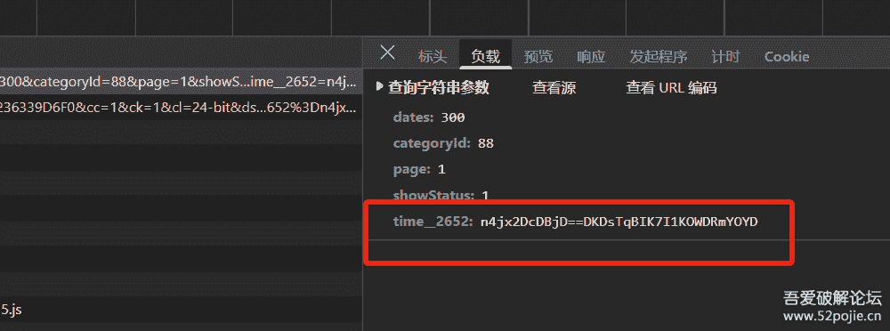
1.png (32.51 KB, 下载次数: 2)
[href="forum.php?mod=attachment&aid=MjgwNTU3MHw2YzUwMTUxZnwxNzkzNTcwNTQwfDE2ODA4NnwyMDYyOTI3&nothumb=yes" target="_blank"](https://www.52pojie.cn/forum.php?mod=attachment&aid=MjgwNTU3MHw2YzUwMTUxZnwxNzkzNTcwNTQwfDE2ODA4NnwyMDYyOTI3&nothumb=yes)
2025-9-27 10:59 上传

不带这个参数的话会返回一个ob混淆的js。

通过调用栈可以定位到核心代码

```
V = m[lK(GF.m)](m[lK(GF.G)](m[lK(GF.k)](m[lK(GF.Q)](m[lK(GF.t)](L[lK(GF.b)](O), '|'), m[lK(GF.Y)](r)), '|'), new Date()[lK(GF.u)]()), '|1')
O = F['ua'](V, !(-0x1c67 + 0x544 + 0x1723))
```

`O`即为`time__2652`参数，但是混淆的太多，不利于我们扣代码。因此需要先解混淆

## 三、还原数字数组

我们先看一下代码结构

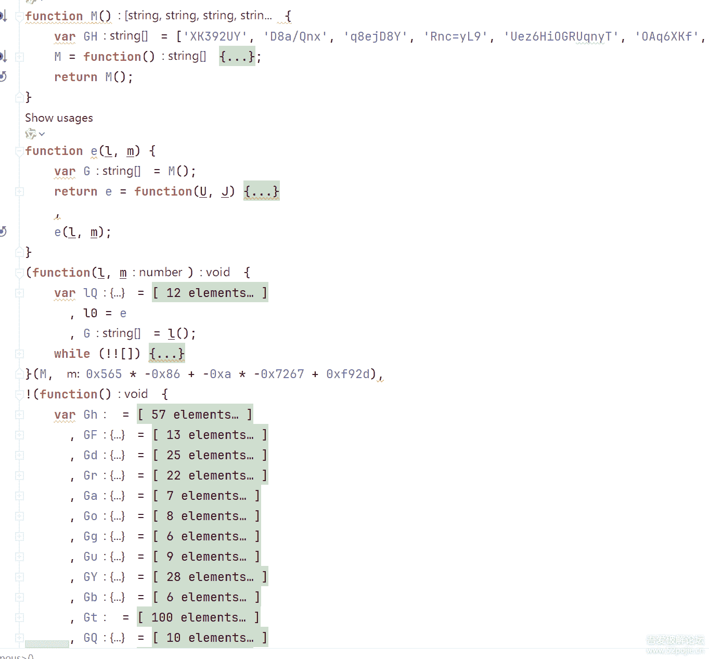
2.png (151.2 KB, 下载次数: 2)
[href="forum.php?mod=attachment&aid=MjgwNTU3MXxiMjM0ZjYwNnwxNzkzNTcwNTQwfDE2ODA4NnwyMDYyOTI3&nothumb=yes" target="_blank"](https://www.52pojie.cn/forum.php?mod=attachment&aid=MjgwNTU3MXxiMjM0ZjYwNnwxNzkzNTcwNTQwfDE2ODA4NnwyMDYyOTI3&nothumb=yes)
2025-9-27 10:59 上传

可以看到是由一个字符串大数组和许多十六进制小数组组成。

在加密代码中`m[lK(GF.m)]`，由最里面的两个小数组在嵌套外面的大数组组成。因此我们先要还原`lK(GF.m)`两个十六进制小数组。

通过解析，可以看到都是`VariableDeclarator`类型初始化是`ObjectExpression`

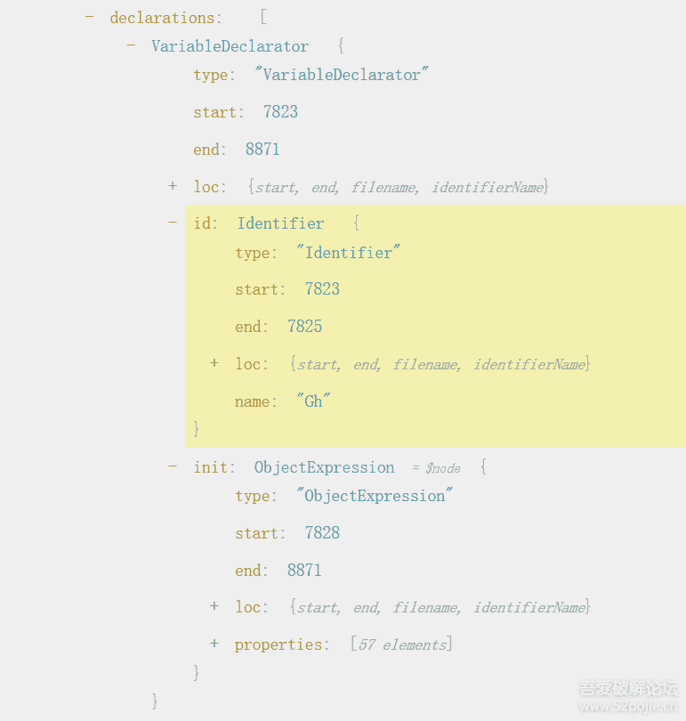
3.png (60.68 KB, 下载次数: 1)
[href="forum.php?mod=attachment&aid=MjgwNTU3Mnw3OTY2N2Y2YXwxNzkzNTcwNTQwfDE2ODA4NnwyMDYyOTI3&nothumb=yes" target="_blank"](https://www.52pojie.cn/forum.php?mod=attachment&aid=MjgwNTU3Mnw3OTY2N2Y2YXwxNzkzNTcwNTQwfDE2ODA4NnwyMDYyOTI3&nothumb=yes)
2025-9-27 11:00 上传

因此先用`type`类型判断下

```
traverse(ast, {

    VariableDeclarator(path) {

        if (types.isObjectExpression(path.node.init)) {

        }

    }});
```

接着取`id`里面的`name`参数就是赋值参数，然后查找参数的绑定函数

```
let bingname = path.scope.getBinding(path.node.id.name);
let arrbd = bingname.referencePaths;
for (let i = 0; i 
```

接下来找绑定函数的父对象。

```
arrbd[i].parentPath
```

即如下函数

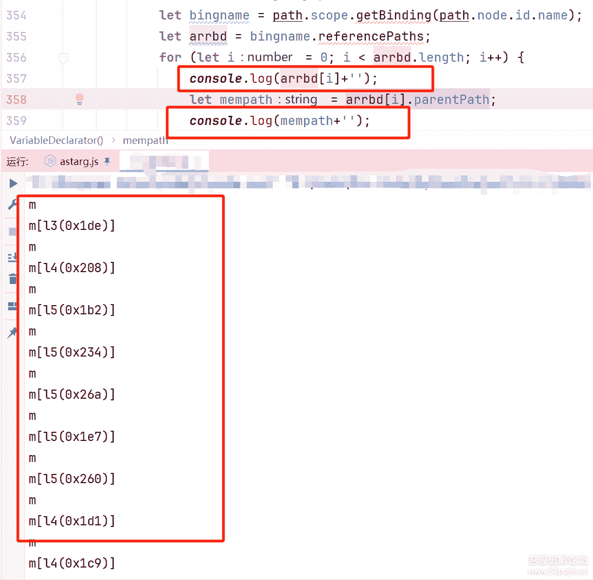
4.png (110.59 KB, 下载次数: 2)
[href="forum.php?mod=attachment&aid=MjgwNTU3M3w0MGE4OWIxNXwxNzkzNTcwNTQwfDE2ODA4NnwyMDYyOTI3&nothumb=yes" target="_blank"](https://www.52pojie.cn/forum.php?mod=attachment&aid=MjgwNTU3M3w0MGE4OWIxNXwxNzkzNTcwNTQwfDE2ODA4NnwyMDYyOTI3&nothumb=yes)
2025-9-27 11:00 上传

解析如下

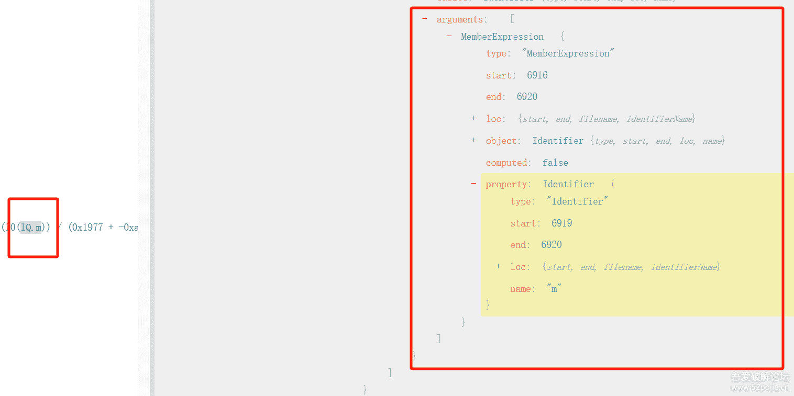
5.png (62.38 KB, 下载次数: 2)
[href="forum.php?mod=attachment&aid=MjgwNTU3NHxlYTg2NTViZnwxNzkzNTcwNTQwfDE2ODA4NnwyMDYyOTI3&nothumb=yes" target="_blank"](https://www.52pojie.cn/forum.php?mod=attachment&aid=MjgwNTU3NHxlYTg2NTViZnwxNzkzNTcwNTQwfDE2ODA4NnwyMDYyOTI3&nothumb=yes)
2025-9-27 11:00 上传

接下来判断下类型是否是`MemberExpression`，并取其中的`name`参数

```
if (mempath.isMemberExpression()) {
    let propname = mempath.node.property.name
}
```

我们现在有了值，接下来返回前面把数组我们保存下来

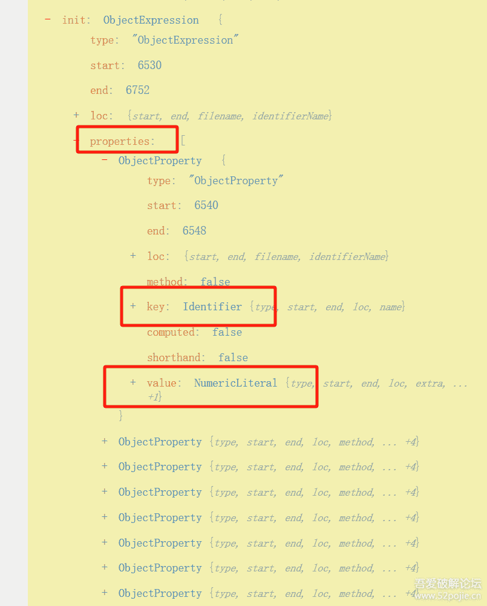
6.png (98.88 KB, 下载次数: 2)
[href="forum.php?mod=attachment&aid=MjgwNTU3N3w3ODM3ZjMyOHwxNzkzNTcwNTQwfDE2ODA4NnwyMDYyOTI3&nothumb=yes" target="_blank"](https://www.52pojie.cn/forum.php?mod=attachment&aid=MjgwNTU3N3w3ODM3ZjMyOHwxNzkzNTcwNTQwfDE2ODA4NnwyMDYyOTI3&nothumb=yes)
2025-9-27 11:01 上传

我们取`init`里面的`properties`，把`key`和`value`保存到一个数组里面。

```
let props = path.node.init.properties;

let obj = {};

for (let i = 0; i 
```

然后在下面匹配这个数组,并替换。

```
 if (types.isNumericLiteral(obj[propname])) {
     mempath.replaceWith(obj[propname])
 }
```

可以看到还原后的代码已经变灰，没有调用了.

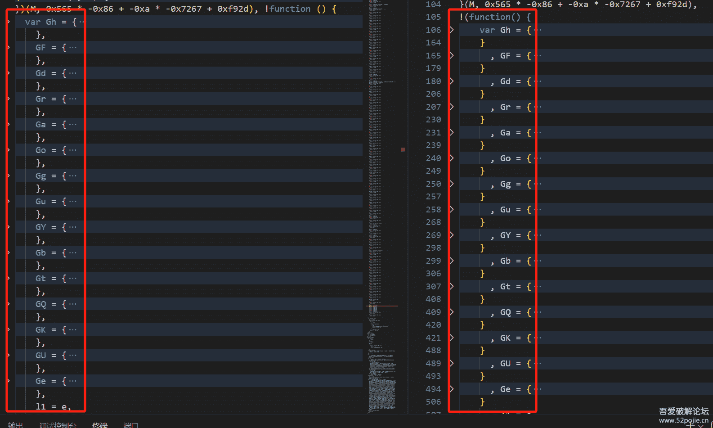
7.png (169.66 KB, 下载次数: 2)
[href="forum.php?mod=attachment&aid=MjgwNTU3OHw1Njc0NjJiNHwxNzkzNTcwNTQwfDE2ODA4NnwyMDYyOTI3&nothumb=yes" target="_blank"](https://www.52pojie.cn/forum.php?mod=attachment&aid=MjgwNTU3OHw1Njc0NjJiNHwxNzkzNTcwNTQwfDE2ODA4NnwyMDYyOTI3&nothumb=yes)
2025-9-27 11:01 上传

## 四、还原字符串数组

接下来我们还原第二层，字符串的数组还原

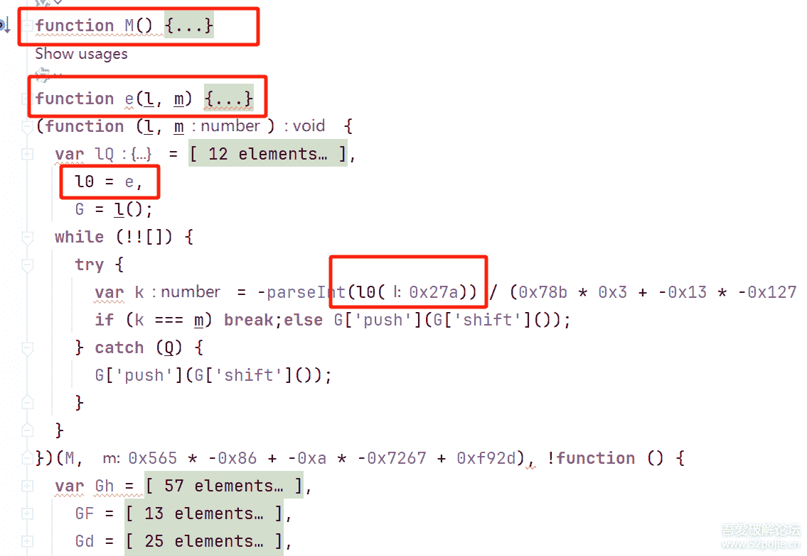
8.png (94.75 KB, 下载次数: 2)
[href="forum.php?mod=attachment&aid=MjgwNTU3OXxjMDY2OWI3Y3wxNzkzNTcwNTQwfDE2ODA4NnwyMDYyOTI3&nothumb=yes" target="_blank"](https://www.52pojie.cn/forum.php?mod=attachment&aid=MjgwNTU3OXxjMDY2OWI3Y3wxNzkzNTcwNTQwfDE2ODA4NnwyMDYyOTI3&nothumb=yes)
2025-9-27 11:01 上传

可以看到如图，`e`赋值到`l0`调用。而`e`调用了`M`和`e`函数进行偏移解密。

先判断类型，这时我们要限定一下`name`是`e`

```
traverse(ast, {

    VariableDeclarator(path) {

        if (types.isIdentifier(path.node.init, {name: 'e'})) {

        }

    }

});
```

然后继续找他的绑定函数

```
let bingname = mempath.scope.getBinding(mempath.node.id.name);
let arrbd = bingname.referencePaths;
for (let i = 0; i 
```

接下来判断下是否是`CallExpression`类型，并取`arguments`

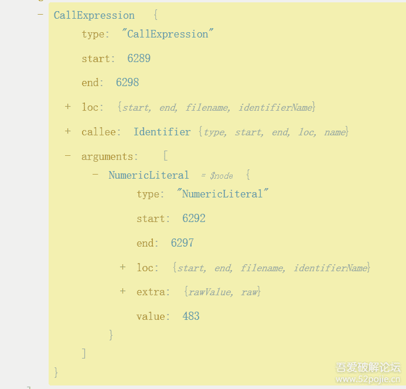
9.png (49.7 KB, 下载次数: 2)
[href="forum.php?mod=attachment&aid=MjgwNTU4MHwyYzUzZWJiYnwxNzkzNTcwNTQwfDE2ODA4NnwyMDYyOTI3&nothumb=yes" target="_blank"](https://www.52pojie.cn/forum.php?mod=attachment&aid=MjgwNTU4MHwyYzUzZWJiYnwxNzkzNTcwNTQwfDE2ODA4NnwyMDYyOTI3&nothumb=yes)
2025-9-27 11:02 上传

```
if (mempath.isCallExpression()) {

    let argu = mempath.get('arguments') + '';

}
```

我们把`e`函数剪切出来放到最上面，并且把检测函数去掉。

```
b['prototype']['LdIFdg'] = function() {
    var Y = new RegExp(this['JbuAMo'] + this['DNmxyA'])
        , u = Y['test'](this['UULPjk']['toString']()) ? --this['OEswPC'][0x75d * 0x5 + -0x17ee + -0xce2] : --this['OEswPC'][0x26fb + 0x191 * -0x10 + -0xdeb];
    return this['MxGFtc'](u);
}
//改为
b['prototype']['LdIFdg'] = function() {
var Y = new RegExp(this['JbuAMo'] + this['DNmxyA'])
    , u = --this['OEswPC'][0x75d * 0x5 + -0x17ee + -0xce2];
return this['MxGFtc'](u);
}
```

然后直接调用替换即可

```
let vl = e(argu)

mempath.replaceWith(types.stringLiteral(vl))
```

最后可以看到混淆代码嵌套调用，因此要进行判断循环。

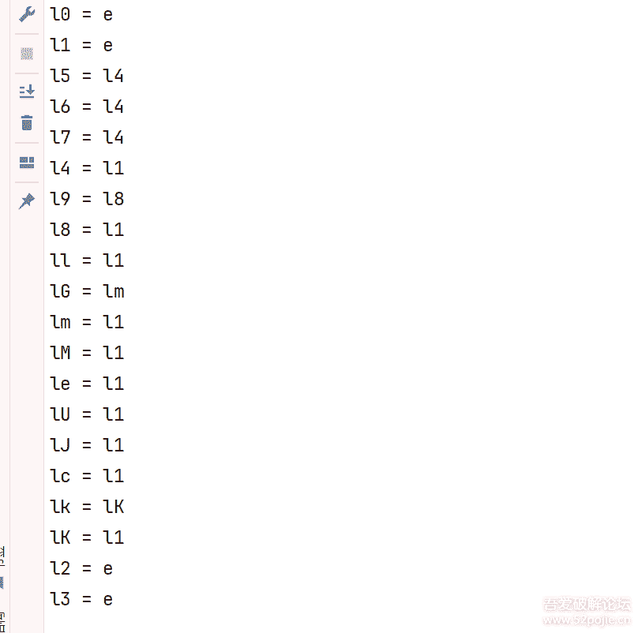
10.png (30.91 KB, 下载次数: 2)
[href="forum.php?mod=attachment&aid=MjgwNTU4MXxmNjE4ZGQ2ZnwxNzkzNTcwNTQwfDE2ODA4NnwyMDYyOTI3&nothumb=yes" target="_blank"](https://www.52pojie.cn/forum.php?mod=attachment&aid=MjgwNTU4MXxmNjE4ZGQ2ZnwxNzkzNTcwNTQwfDE2ODA4NnwyMDYyOTI3&nothumb=yes)
2025-9-27 11:02 上传

## 五、还原字符串大数组

接下来剩最后一个`m`数组。因为包含字符串和函数，我们最后处理。

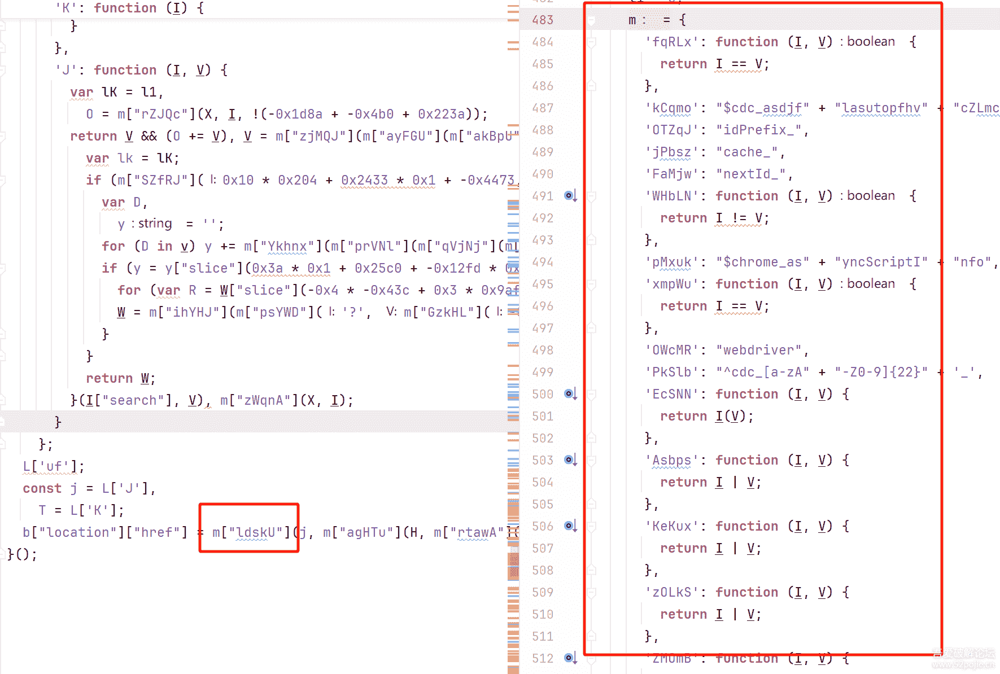
11.png (268.29 KB, 下载次数: 2)
[href="forum.php?mod=attachment&aid=MjgwNTU4Mnw0YWVhYzBkOHwxNzkzNTcwNTQwfDE2ODA4NnwyMDYyOTI3&nothumb=yes" target="_blank"](https://www.52pojie.cn/forum.php?mod=attachment&aid=MjgwNTU4Mnw0YWVhYzBkOHwxNzkzNTcwNTQwfDE2ODA4NnwyMDYyOTI3&nothumb=yes)
2025-9-27 11:02 上传

跟上面一样，先判断类型，在查找绑定，最后写入数组进行查询替换。

```
VariableDeclarator(path) {
    if (types.isObjectExpression(path.node.init)) {
        let props = path.node.init.properties;
        let obj = {};
        for (let i = 0; i 
```

因为这个数组的`FunctionExpression`类型下有`CallExpression`和`BinaryExpression`两个类型。因此我们要分开处理

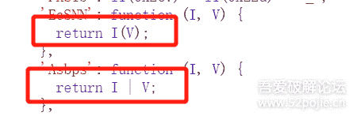
12.png (18.27 KB, 下载次数: 2)
[href="forum.php?mod=attachment&aid=MjgwNTU4M3wzZDc3YmU0OHwxNzkzNTcwNTQwfDE2ODA4NnwyMDYyOTI3&nothumb=yes" target="_blank"](https://www.52pojie.cn/forum.php?mod=attachment&aid=MjgwNTU4M3wzZDc3YmU0OHwxNzkzNTcwNTQwfDE2ODA4NnwyMDYyOTI3&nothumb=yes)
2025-9-27 11:03 上传

继续在`if(types.isStringLiteral(obj[arg]))`下写判断。

我们先判断是否是函数类型。接着取函数的`body`。然后对`CallExpression`和`BinaryExpression`两个类型进行判断。

当为`CallExpression`类型时取参数和调用，写入到原来的`path`替换

当为`BinaryExpression`类型时取`left`，`right`和`operator`，写入到原来的`path`替换

```
else if(types.isFunctionExpression(obj[arg])){

    let bd=obj[arg].body.body

    if(bd.length===1&&types.isReturnStatement(bd[0])){

        let argu=bd[0].argument;

        if(types.isCallExpression(argu)){

            let argus=mempath.parent.arguments;
```


```
let calleename=argus[0];

let newcall=types.callExpression(calleename,argus.slice(1))

mempath.parentPath.replaceWith(newcall)

}else if(types.isBinaryExpression(argu)){

let argus=mempath.parent.arguments;

let left=argus[0];

let right=argus[1];

let newcall=types.binaryExpression(argu.operator,left,right)

mempath.parentPath.replaceWith(newcall)

}

}
```

至此我们就完成了大部分还原

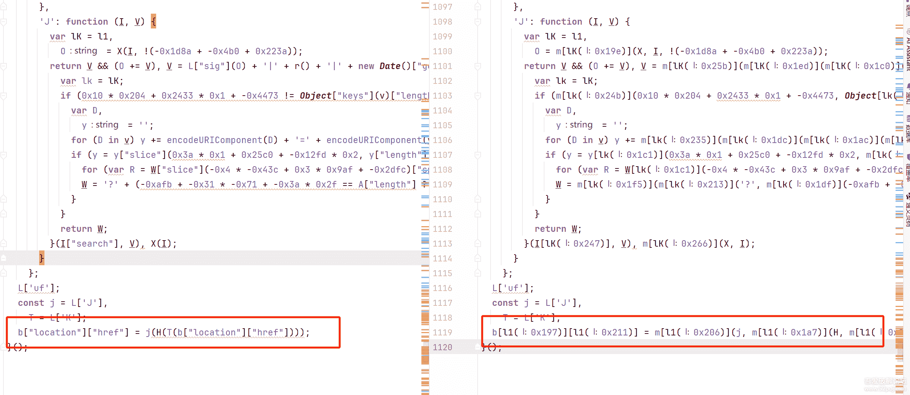

13.png (191.11 KB, 下载次数: 2)

[href="forum.php?mod=attachment&aid=MjgwNTU4NHw3YTNlZDkxOXwxNzkzNTcwNTQwfDE2ODA4NnwyMDYyOTI3&nothumb=yes" target="_blank"](https://www.52pojie.cn/forum.php?mod=attachment&aid=MjgwNTU4NHw3YTNlZDkxOXwxNzkzNTcwNTQwfDE2ODA4NnwyMDYyOTI3&nothumb=yes)

2025-9-27 11:03 上传

## 5> 六、参数`time__2652`生成

还原后我们就可以很明显看到核心代码了

```
let data=sig(O) + '|' + r() + '|' + new Date()["getTime"]() + '|1'
console.log(ua(data))
```

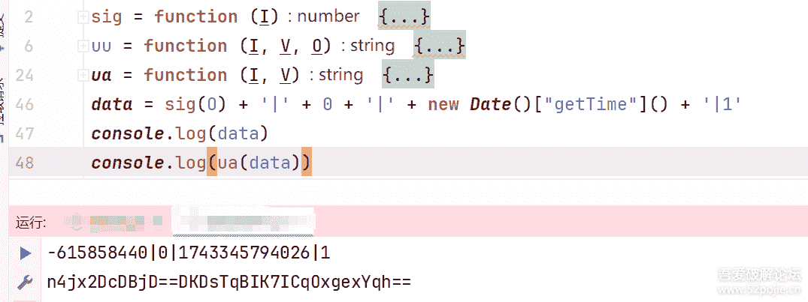

14.png (66.58 KB, 下载次数: 2)

[href="forum.php?mod=attachment&aid=MjgwNTU4NXxhZDMyYzM4NHwxNzkzNTcwNTQwfDE2ODA4NnwyMDYyOTI3&nothumb=yes" target="_blank"](https://www.52pojie.cn/forum.php?mod=attachment&aid=MjgwNTU4NXxhZDMyYzM4NHwxNzkzNTcwNTQwfDE2ODA4NnwyMDYyOTI3&nothumb=yes)

2025-9-27 11:06 上传

只有46行

## 5> 总结

网站难度不高，就是嵌套的很繁琐。有兴趣的朋友可以试试。
