# [Web逆向] 某验3纯算逆向分析

- 原帖: https://www.52pojie.cn/forum.php?mod=viewthread&tid=2063429
- 抓取时间: 2026-11-01T22:02:07

## 前言

js解混淆和风控一直是我的弱点，js混淆我基本都是强看写算法，最近逛了下吾爱，看了很多大佬对某验的分析，研究了一段时间，会了点`ast`看代码轻松好多啊，虽然有很多大佬研究了，但还是来献献丑混点cb，谢谢，没写过文章，多见谅下哈

## 声明

本文章中所有内容仅供学习交流使用，不用于其他任何目的，不提供完整代码，严禁用于商业用途和非法用途，否则由此产生的一切后果均与作者无关. 本文章未经许可禁止转载，禁止任何修改后二次传播，擅自使用本文讲解的技术而导致的任何意外，作者均不负责，若有侵权，请联系作者立即删除.

## 正文

那么，让我们开始吧

网址：`aHR0cHMlM0ElMkYlMkZkZW1vcyUyRWdlZXRlc3QlMkVjb20lMkZzbGlkZSUyRGZsb2F0JTJFaHRtbA==`

### 第一步：先分析流程

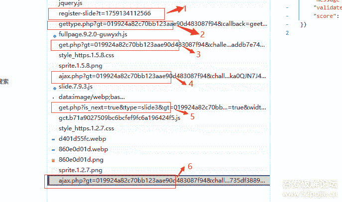

`1.png` (46 KB, 下载次数: 3)

[附件](https://www.52pojie.cn/forum.php?mod=attachment&aid=MjgwNTk5OHxiODRiYmE4OXwxNzkzNTcwNTI1fDE2ODA4NnwyMDYzNDI5&nothumb=yes)

第一步

2025-9-29 16:25 上传

总共6个请求

1. 就是获取`gt`和`challenge`
2. 获取第一次`w`加密需要的加密参
3. 第一次`w`加密请求，我觉得是先给服务器钥匙，顺便获取过风控的类型，这一步如果把第二步返回参写死，可以不用2
4. 第二次`w`加密请求，无感验证、认证了`gt`和`challenge`才能进行之后的步骤，上一步给他钥匙了，他就能看我们行为，过了才能继续
5. 获取新参数，以便最后请求
6. 最后一步`w`加密请求，根据滑动轨迹加密跟第一步`w`加密差不多

我们看了这几个请求知道了，加密参只有一个`w`需要解，至于`callback`，看时间戳多了就会知道`callback=geetest_13位时间戳`

### 第二步：分析JS文件，解混淆

我们根据`w`加密的请求知道了调用栈，主要都是`fullpage`和`slide`进行，那么我们先用`ast`解混淆，去看看吾爱中大佬发的解某验混淆把，我也刚学`ast`，就不误人子弟了

`ast`解他们，大概需要解`ob`混淆、合并`switch`语句、`unicode`解码，这三步完，在我来看够了，跟之前强看不知道幸福多少，你们有能力可以继续解花指令

刚入门可以想我一样解完一步，替换`js`文件测试过风控，看能不能行，能就继续下一步，不行就继续研究，或者强看，我是就只能解到合并`switch`，能力不足阿，哈哈哈...........

### 第三步：分析JS文件，解w算法

#### 解第一步`w`算法

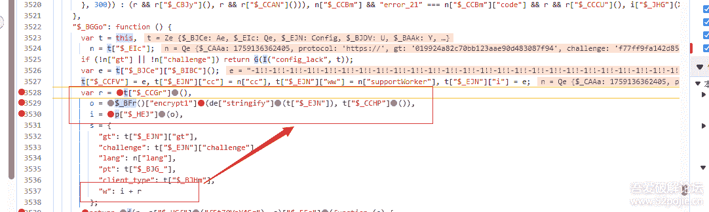

`2.png` (64.49 KB, 下载次数: 4)

[附件](https://www.52pojie.cn/forum.php?mod=attachment&aid=MjgwNjAxNXw5ODg4NzY3YXwxNzkzNTcwNTI1fDE2ODA4NnwyMDYzNDI5&nothumb=yes)

2025-9-29 17:04 上传

导入解完的`js`文件，根据请求调用栈我们知道第一步`w`是`i+r`

先解决`r`算法如何生成

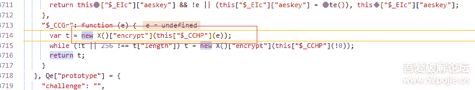

`3.png` (26.47 KB, 下载次数: 4)

[附件](https://www.52pojie.cn/forum.php?mod=attachment&aid=MjgwNjAxN3xmYmRhNjQwMXwxNzkzNTcwNTI1fDE2ODA4NnwyMDYzNDI5&nothumb=yes)

`r`加密

2025-9-29 17:07 上传

跟进去我们知道`e`是`undefind`拿去生成什么数据，然后进行加密

跟栈，我们先进去`x()`方法生成加密算法

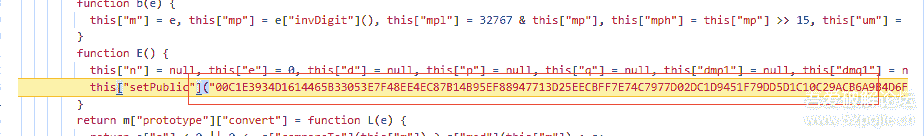

`4.png` (26.27 KB, 下载次数: 5)

[附件](https://www.52pojie.cn/forum.php?mod=attachment&aid=MjgwNjAyMHwzZGE4MzBlY3wxNzkzNTcwNTI1fDE2ODA4NnwyMDYzNDI5&nothumb=yes)

2025-9-29 17:19 上传

你们有经验了就会知道这个是`rsa`中`n`，`e`生成`pubkey`公钥的，跟栈走下去你们也会看到

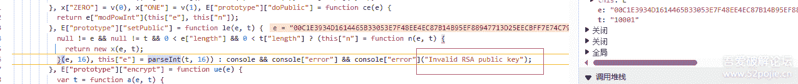

`5.png` (41.4 KB, 下载次数: 5)

[附件](https://www.52pojie.cn/forum.php?mod=attachment&aid=MjgwNjAyMXw4YTZjYjkyZHwxNzkzNTcwNTI1fDE2ODA4NnwyMDYzNDI5&nothumb=yes)

2025-9-29 17:21 上传

看这边不是写着`rsapubkey`，可能你们会觉得我逆完了，正向看肯定是这样，但是你们不懂可以先记下，想好大概流程，后面走完这个请求伪造试试嘛，试试又不会怀孕

我为什么说伪造请求试试，不是叫你们加密看看和浏览器对不对，`rsa`加密是非对称加密，每次加密都不一样的，有些可以对，有些对不了的

这个`x()`方法跟完后进去--`e`是`undefind`拿去生成什么东西的方法

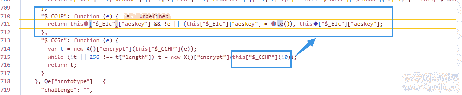

`6.png` (32.57 KB, 下载次数: 5)

[附件](https://www.52pojie.cn/forum.php?mod=attachment&aid=MjgwNjAyM3w4OGU3NWNhMnwxNzkzNTcwNTI1fDE2ODA4NnwyMDYzNDI5&nothumb=yes)

2025-9-29 17:30 上传

这边又提示我们`aeskey`，姑且先记下来，继续跟栈

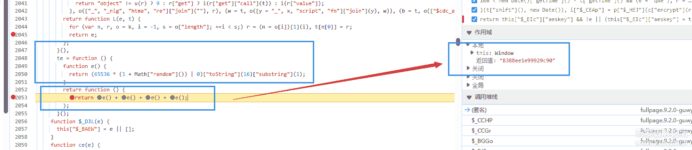

`7.png` (70.26 KB, 下载次数: 4)

[附件](https://www.52pojie.cn/forum.php?mod=attachment&aid=MjgwNjAyNnw3ZGM4MmIxY3wxNzkzNTcwNTI1fDE2ODA4NnwyMDYzNDI5&nothumb=yes)

2025-9-29 17:36 上传

这个算法，自己多试几次就知道生成16位16进制随机数了，我们也给他记下来`aeskey`的值

然后拿去加密了，我们跟栈出来就是这个结果

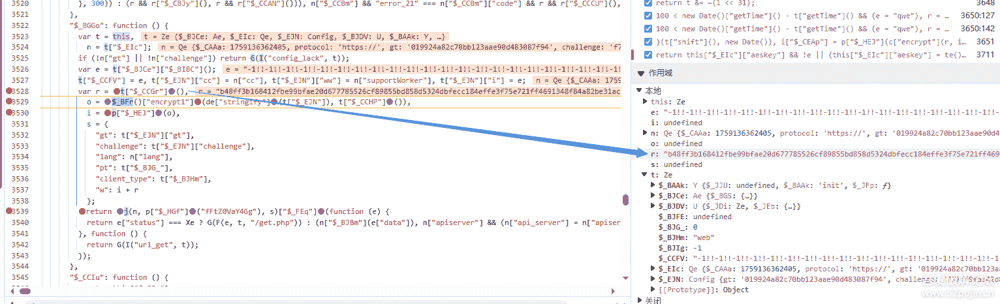

`8.png` (139.75 KB, 下载次数: 5)

[附件](https://www.52pojie.cn/forum.php?mod=attachment&aid=MjgwNjAyN3w4YTQ0ZTY3OXwxNzkzNTcwNTI1fDE2ODA4NnwyMDYzNDI5&nothumb=yes)

2025-9-29 17:40 上传

这个结果没有`=`大小写字母混合，所以不是加密后`base64`编码，我看是加密后转16进制

接下去就是解`o`算法，这也是什么加密，跟进去看看

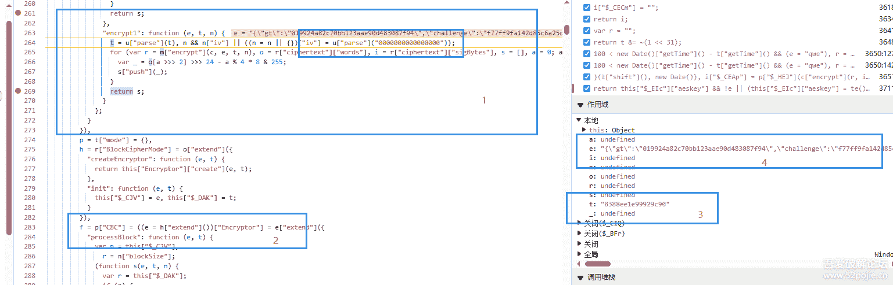

`9.png` (106.08 KB, 下载次数: 3)

[附件](https://www.52pojie.cn/forum.php?mod=attachment&aid=MjgwNjAyOXwxNjNjNjUxNXwxNzkzNTcwNTI1fDE2ODA4NnwyMDYzNDI5&nothumb=yes)

2025-9-29 17:53 上传

看这个3，是不是之前`aeskey`生成的，还有1中的`iv`，我们就能知道不是`aes`就是`des`，2这边也写了模式`cbc`

那我们可以根据4中的数据自己去写加密算法试试嘛，转成字节数组来对对这个`s`是不是一样，就会知道这个就是`aes`加密了，`aes`是对称加密可以拿来对的，还有这个`e`，其中参数有一部分不就是之前所得第二步请求返回参嘛

得出的`o`是数组，在进行`i`加密就能得到`w`了，跟进去

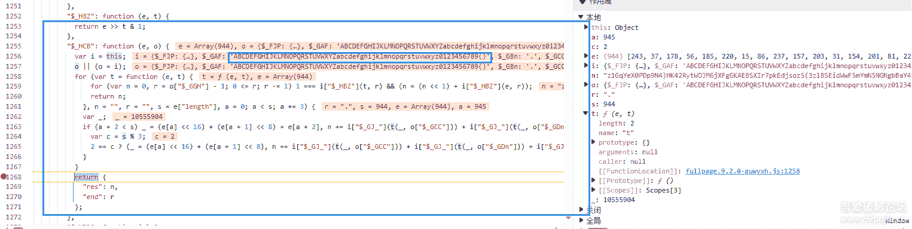

`10.png` (101.53 KB, 下载次数: 4)

[附件](https://www.52pojie.cn/forum.php?mod=attachment&aid=MjgwNjAzMHwzZjMzZDhmZXwxNzkzNTcwNTI1fDE2ODA4NnwyMDYzNDI5&nothumb=yes)

2025-9-29 18:01 上传

看这个会不会熟悉

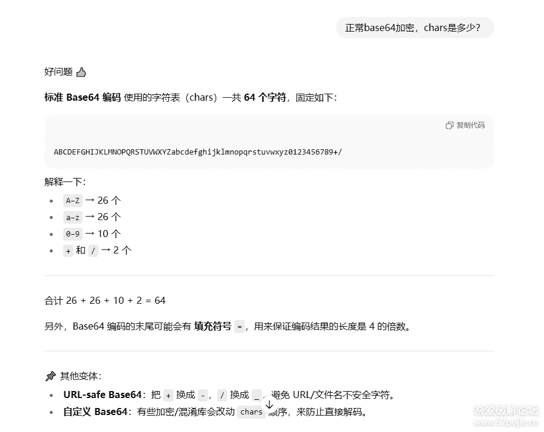

`11.png` (57.35 KB, 下载次数: 4)

[附件](https://www.52pojie.cn/forum.php?mod=attachment&aid=MjgwNjAzMXwyMDlmY2MwMHwxNzkzNTcwNTI1fDE2ODA4NnwyMDYzNDI5&nothumb=yes)

2025-9-29 18:04 上传

所以我们可以得出这个是魔改的，那是不是换`chars`字符表就行了？试试呗

我得出来是不行哦，那照着`js`写这个算法呗，自己学着写写，不贴出来了，后面还有其他修改算法也要写的，不是像`md5`，`base64`，`aes`这些造好的轮子

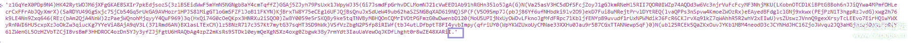

`12.png` (57.54 KB, 下载次数: 3)

[附件](https://www.52pojie.cn/forum.php?mod=attachment&aid=MjgwNjAzMnwxODcyMDVhZXwxNzkzNTcwNTI1fDE2ODA4NnwyMDYzNDI5&nothumb=yes)

`mgbase64str`

2025-9-29 18:12 上传

像不像`base64`，`=`换了`.`，然后就是`i`、参数`aes`加密魔改`base64`编码加，`r`、我们猜`rsa`加密`aeskey`生成得16进制字符串

去试试呗，看看第一次`w`生成能不能过这个请求

#### 解第二步`w`算法

第二步`w`和第一步不一样，没有`rsa`加密16进制字符串了，又要重新逆，下断点跟栈

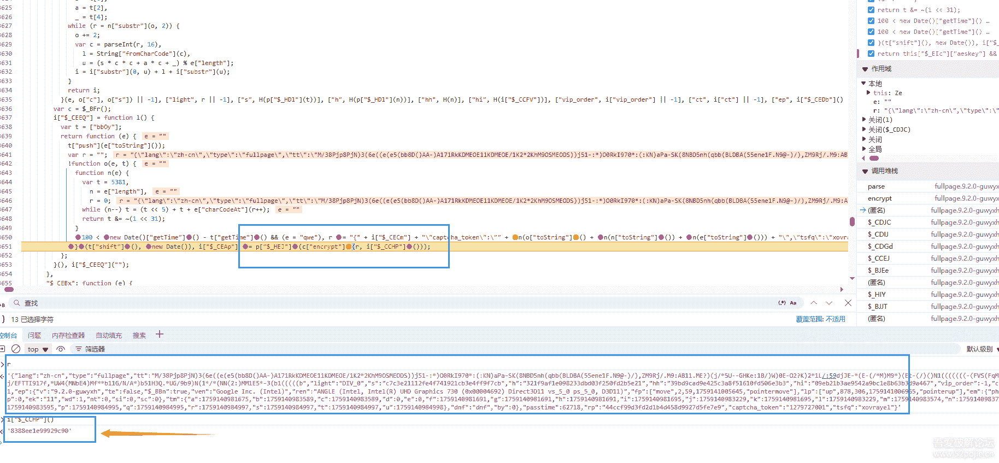

`13.png` (190.35 KB, 下载次数: 5)

[附件](https://www.52pojie.cn/forum.php?mod=attachment&aid=MjgwNjAzNHxjMDlmOTdjN3wxNzkzNTcwNTI1fDE2ODA4NnwyMDYzNDI5&nothumb=yes)

第二步`w`算法

2025-9-29 19:14 上传

熟不熟悉，那个又是我们之前得`aeskey`，根据抓包第二次`w`请求来对比，所以这个`w`加密大概是`aes`加密、魔改`base64`编码，所以我们现在要先解`r`的参数算法，找到这个方法最上层下断点

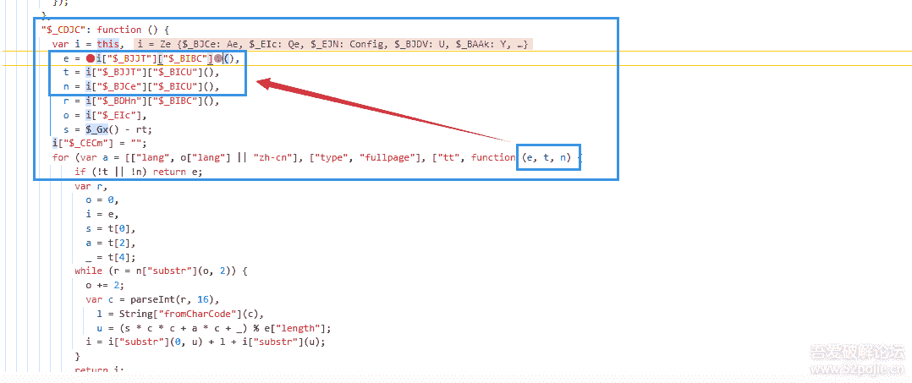

`14.png` (46.27 KB, 下载次数: 5)

[附件](https://www.52pojie.cn/forum.php?mod=attachment&aid=MjgwNjAzNXw3Y2EyNDA0MnwxNzkzNTcwNTI1fDE2ODA4NnwyMDYzNDI5&nothumb=yes)

2025-9-29 19:24 上传

根据`r`中，第一个加密参`tt`，由`e`，`t`，`n`三个生成的，那先逆`e`，跟进去

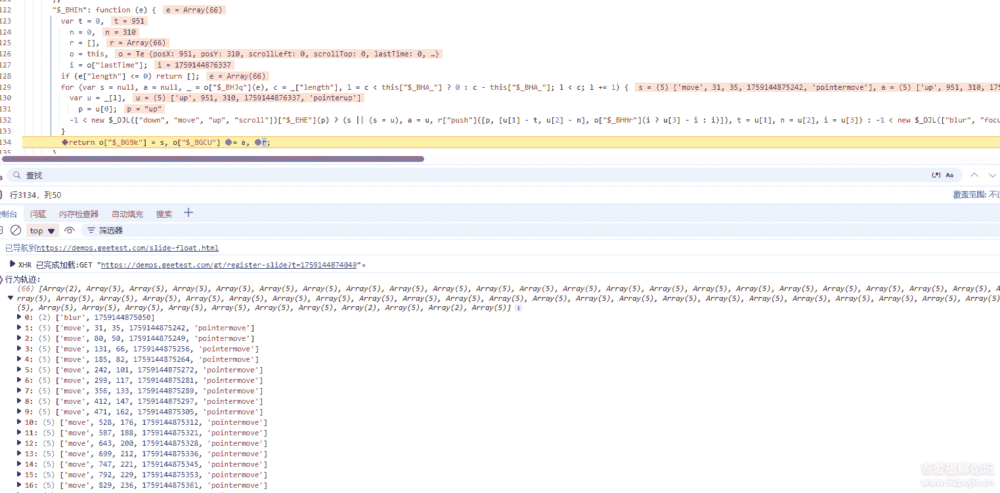

`15.png` (124.88 KB, 下载次数: 4)

[附件](https://www.52pojie.cn/forum.php?mod=attachment&aid=MjgwNjAzNnwwNTBmNDU5YXwxNzkzNTcwNTI1fDE2ODA4NnwyMDYzNDI5&nothumb=yes)

2025-9-29 19:28 上传

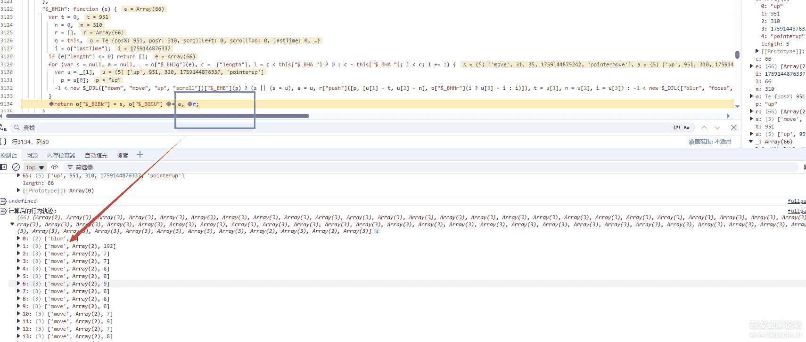

`16.png` (128.53 KB, 下载次数: 3)

[href="forum.php?mod=attachment&aid=MjgwNjAzN3xmNGU0ZWVkOHwxNzkzNTcwNTI1fDE2ODA4NnwyMDYzNDI5&nothumb=yes" target="_blank"](https://www.52pojie.cn/forum.php?mod=attachment&aid=MjgwNjAzN3xmNGU0ZWVkOHwxNzkzNTcwNTI1fDE2ODA4NnwyMDYzNDI5&nothumb=yes)

2025-9-29 19:29 上传

`e`传进来的值是滑动轨迹列表、`r`则是轨迹差

我之前看了一个大佬文章，全程手撕很牛，他对这个无感验证有个思路很好，他说这个检测行为不会因为，我轨迹少就封我吧，我深以为然

所以这个轨迹想想，是个小彩蛋

继续往下走

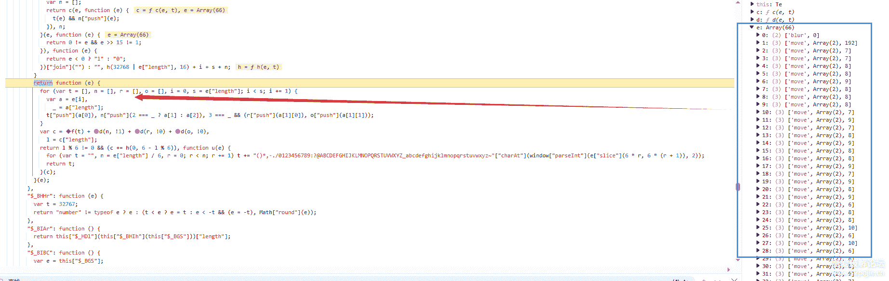

17.png (136.11 KB, 下载次数: 3)

[href="forum.php?mod=attachment&aid=MjgwNjAzOHxlNWRiYjc1M3wxNzkzNTcwNTI1fDE2ODA4NnwyMDYzNDI5&nothumb=yes" target="_blank"](https://www.52pojie.cn/forum.php?mod=attachment&aid=MjgwNjAzOHxlNWRiYjc1M3wxNzkzNTcwNTI1fDE2ODA4NnwyMDYzNDI5&nothumb=yes)

行为列表

2025-9-29 19:43 上传

这个轨迹差，重新整合了4个列表

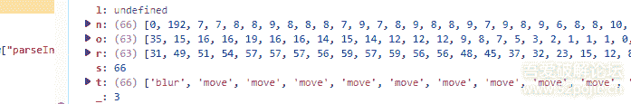

18.png (19.68 KB, 下载次数: 4)

[href="forum.php?mod=attachment&aid=MjgwNjAzOXxjOGU3MGRlMXwxNzkzNTcwNTI1fDE2ODA4NnwyMDYzNDI5&nothumb=yes" target="_blank"](https://www.52pojie.cn/forum.php?mod=attachment&aid=MjgwNjAzOXxjOGU3MGRlMXwxNzkzNTcwNTI1fDE2ODA4NnwyMDYzNDI5&nothumb=yes)

2025-9-29 19:45 上传

行为列表、`x`、`y`、时间差列表，然后行为列表一个算法，其他三个一个算法，这几个算法都要手动还原，没有什么轮子

跟进`f`方法

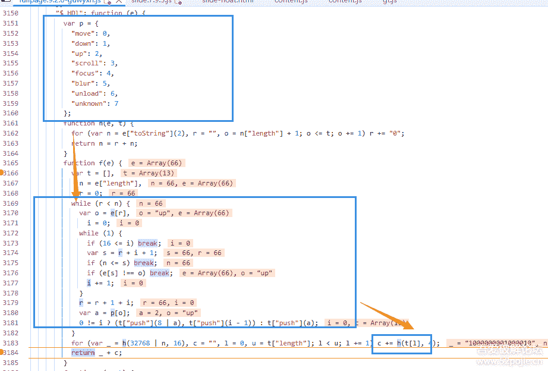

19.png (73.15 KB, 下载次数: 4)

[href="forum.php?mod=attachment&aid=MjgwNjA0MHw1OTc5ZWNhOHwxNzkzNTcwNTI1fDE2ODA4NnwyMDYzNDI5&nothumb=yes" target="_blank"](https://www.52pojie.cn/forum.php?mod=attachment&aid=MjgwNjA0MHw1OTc5ZWNhOHwxNzkzNTcwNTI1fDE2ODA4NnwyMDYzNDI5&nothumb=yes)

2025-9-29 19:51 上传

大概就是根据行为得`p`中的值拿去运算，最后转为二进制，前面补零，在相加成为`str`

然后就是`d`算法

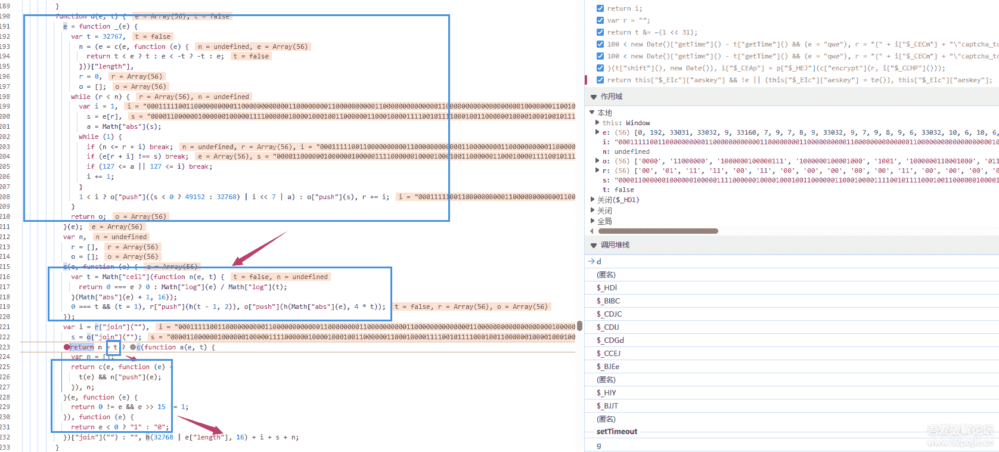

20.png (155 KB, 下载次数: 1)

[href="forum.php?mod=attachment&aid=MjgwNjA0Mnw5NjEzMTVlZnwxNzkzNTcwNTI1fDE2ODA4NnwyMDYzNDI5&nothumb=yes" target="_blank"](https://www.52pojie.cn/forum.php?mod=attachment&aid=MjgwNjA0Mnw5NjEzMTVlZnwxNzkzNTcwNTI1fDE2ODA4NnwyMDYzNDI5&nothumb=yes)

2025-9-29 20:07 上传

也是什么运算之后得到一个列表，再拿去转二进制，根据`t`判断是否需要多运算转二进制，再相加成为`str`

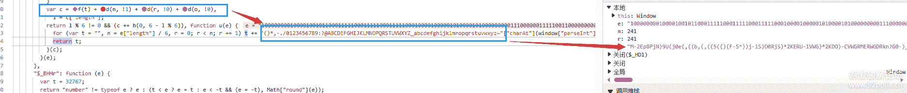

21.png (48.58 KB, 下载次数: 4)

[href="forum.php?mod=attachment&aid=MjgwNjA0M3xkMGQ5Njk3OHwxNzkzNTcwNTI1fDE2ODA4NnwyMDYzNDI5&nothumb=yes" target="_blank"](https://www.52pojie.cn/forum.php?mod=attachment&aid=MjgwNjA0M3xkMGQ5Njk3OHwxNzkzNTcwNTI1fDE2ODA4NnwyMDYzNDI5&nothumb=yes)

2025-9-29 20:07 上传

最后4个二进制`str`相加，余6，有剩补0，最后每6个转10进制对应`chars`的数，得出`tt`，这个可不是最后`tt`的值啊

`t`算法跟刚刚轨迹算法一样

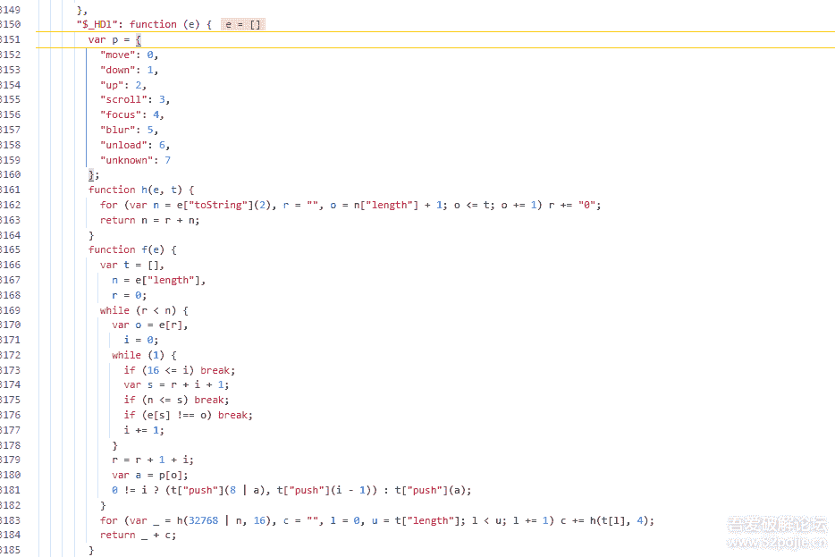

22.png (58.53 KB, 下载次数: 4)

[href="forum.php?mod=attachment&aid=MjgwNjA0NHwzMWE2YzU3YXwxNzkzNTcwNTI1fDE2ODA4NnwyMDYzNDI5&nothumb=yes" target="_blank"](https://www.52pojie.cn/forum.php?mod=attachment&aid=MjgwNjA0NHwzMWE2YzU3YXwxNzkzNTcwNTI1fDE2ODA4NnwyMDYzNDI5&nothumb=yes)

`t`算法

2025-9-29 20:13 上传

不过进来的是空列表，生成的可以写死值

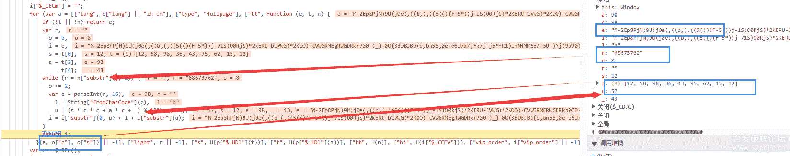

25.png (87.13 KB, 下载次数: 4)

[href="forum.php?mod=attachment&aid=MjgwNjA1MXxlZjc3ZjczZHwxNzkzNTcwNTI1fDE2ODA4NnwyMDYzNDI5&nothumb=yes" target="_blank"](https://www.52pojie.cn/forum.php?mod=attachment&aid=MjgwNjA1MXxlZjc3ZjczZHwxNzkzNTcwNTI1fDE2ODA4NnwyMDYzNDI5&nothumb=yes)

2025-9-29 20:33 上传

`tt`生成还需要一步，第一步`w`请求后返回的`c`、`s`拿去运算，这边的`c`、`s`才是`t`和`n`

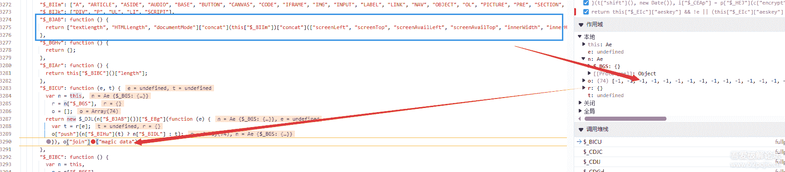

23.png (87.52 KB, 下载次数: 2)

[href="forum.php?mod=attachment&aid=MjgwNjA0NXw0NTkzMDEzMnwxNzkzNTcwNTI1fDE2ODA4NnwyMDYzNDI5&nothumb=yes" target="_blank"](https://www.52pojie.cn/forum.php?mod=attachment&aid=MjgwNjA0NXw0NTkzMDEzMnwxNzkzNTcwNTI1fDE2ODA4NnwyMDYzNDI5&nothumb=yes)

`n`算法

2025-9-29 20:16 上传

这些`win`对象转74个-1再用`magic data`拼接

`s`是无感认证时间，一定要比轨迹时间长

接下去就是`twe_w_str` `json`字符串拼接

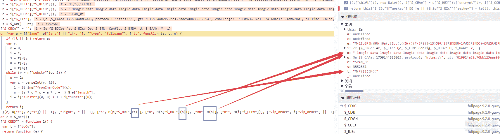

24.png (110.87 KB, 下载次数: 3)

[href="forum.php?mod=attachment&aid=MjgwNjA0NnxiZWZhNzk1YXwxNzkzNTcwNTI1fDE2ODA4NnwyMDYzNDI5&nothumb=yes" target="_blank"](https://www.52pojie.cn/forum.php?mod=attachment&aid=MjgwNjA0NnxiZWZhNzk1YXwxNzkzNTcwNTI1fDE2ODA4NnwyMDYzNDI5&nothumb=yes)

2025-9-29 20:24 上传

`s`、`h`、`hh`、`hi`加密，本身`str`就是死值可以写死，要弄算法也行

`s`、`h`比`hh`、`hi`多了一层算法

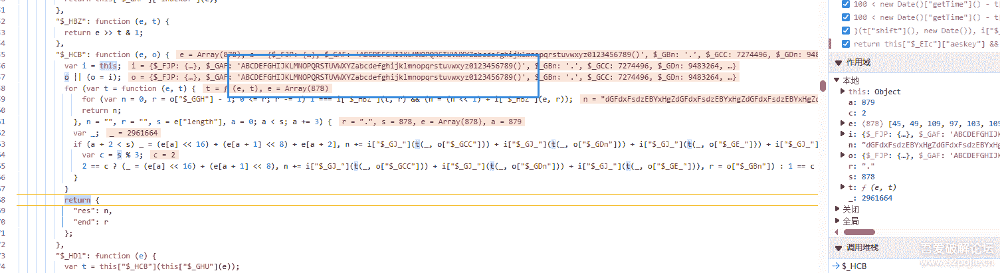

26.png (97.72 KB, 下载次数: 3)

[href="forum.php?mod=attachment&aid=MjgwNjA1MnxmNjU2OWQzN3wxNzkzNTcwNTI1fDE2ODA4NnwyMDYzNDI5&nothumb=yes" target="_blank"](https://www.52pojie.cn/forum.php?mod=attachment&aid=MjgwNjA1MnxmNjU2OWQzN3wxNzkzNTcwNTI1fDE2ODA4NnwyMDYzNDI5&nothumb=yes)

2025-9-29 20:37 上传

熟悉不，之前叫你们自己练手的魔改`base64`

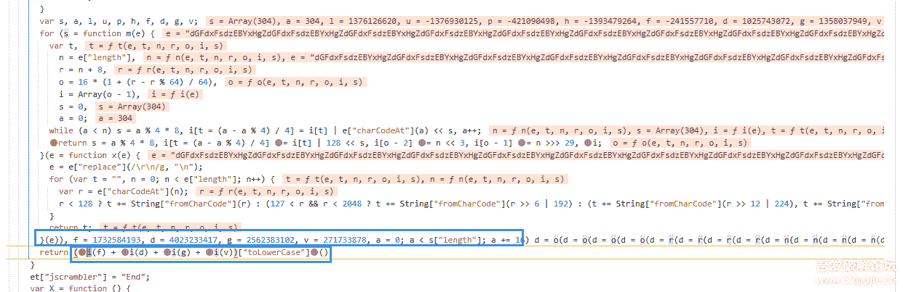

27.png (84.08 KB, 下载次数: 3)

[href="forum.php?mod=attachment&aid=MjgwNjA1M3xiZjBjYTU1MXwxNzkzNTcwNTI1fDE2ODA4NnwyMDYzNDI5&nothumb=yes" target="_blank"](https://www.52pojie.cn/forum.php?mod=attachment&aid=MjgwNjA1M3xiZjBjYTU1MXwxNzkzNTcwNTI1fDE2ODA4NnwyMDYzNDI5&nothumb=yes)

`md5`

2025-9-29 20:39 上传

`h`算法根据这两个标记，大概可以确认`md5`，可以自己去试试，算法贴给`gpt`问问也行，这种表长整数的，基本都是有轮子的那种算法，不用手敲

写文章真的比我逆向还要累，我都敲了半天了....................有点烦，想直接贴

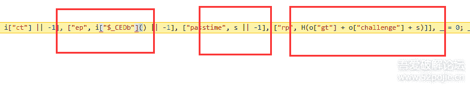

28.png (11.16 KB, 下载次数: 4)

[href="forum.php?mod=attachment&aid=MjgwNjA1N3w1ZTExMGJmOHwxNzkzNTcwNTI1fDE2ODA4NnwyMDYzNDI5&nothumb=yes" target="_blank"](https://www.52pojie.cn/forum.php?mod=attachment&aid=MjgwNjA1N3w1ZTExMGJmOHwxNzkzNTcwNTI1fDE2ODA4NnwyMDYzNDI5&nothumb=yes)

2025-9-29 20:47 上传

然后就是`ep`、`passtime`就是之前说的`s`值、`rp`就是`gt`+`challenge`+`passtime`拿去`md5`加密

`ep`去跟栈

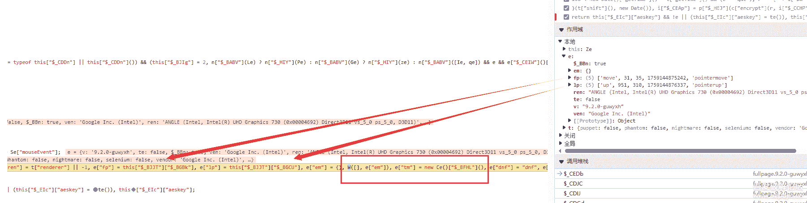

29.png (88.88 KB, 下载次数: 4)

[href="forum.php?mod=attachment&aid=MjgwNjA2MXw2ZjkwNjhiM3wxNzkzNTcwNTI1fDE2ODA4NnwyMDYzNDI5&nothumb=yes" target="_blank"](https://www.52pojie.cn/forum.php?mod=attachment&aid=MjgwNjA2MXw2ZjkwNjhiM3wxNzkzNTcwNTI1fDE2ODA4NnwyMDYzNDI5&nothumb=yes)

2025-9-29 20:52 上传

`fp`是轨迹最开始运动的参，`lp`是最后的运动参、跟进`em`，不过都是死参

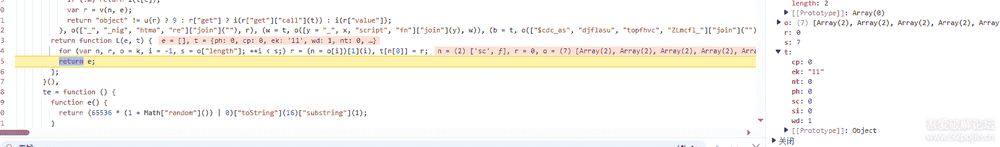

30.png (45.91 KB, 下载次数: 4)

[href="forum.php?mod=attachment&aid=MjgwNjA2MnxhNDU3OWM5YnwxNzkzNTcwNTI1fDE2ODA4NnwyMDYzNDI5&nothumb=yes" target="_blank"](https://www.52pojie.cn/forum.php?mod=attachment&aid=MjgwNjA2MnxhNDU3OWM5YnwxNzkzNTcwNTI1fDE2ODA4NnwyMDYzNDI5&nothumb=yes)

2025-9-29 20:57 上传

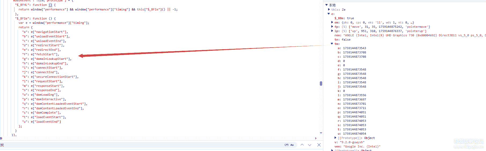

31.png (94.39 KB, 下载次数: 3)

[href="forum.php?mod=attachment&aid=MjgwNjA2M3w1OWIxOGZiNHwxNzkzNTcwNTI1fDE2ODA4NnwyMDYzNDI5&nothumb=yes" target="_blank"](https://www.52pojie.cn/forum.php?mod=attachment&aid=MjgwNjA2M3w1OWIxOGZiNHwxNzkzNTcwNTI1fDE2ODA4NnwyMDYzNDI5&nothumb=yes)

2025-9-29 21:04 上传

`tm`根据自己返回的参数对照的伪造吧

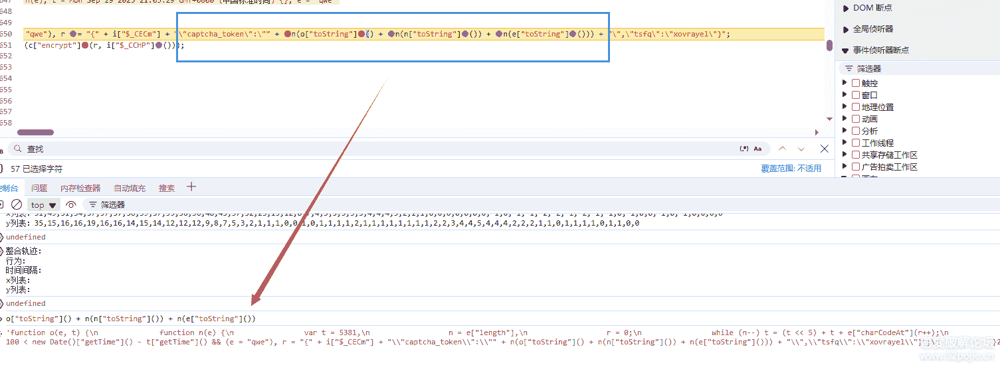

32.png (75.56 KB, 下载次数: 4)

[href="forum.php?mod=attachment&aid=MjgwNjA2NHw0NDk0ODJkZHwxNzkzNTcwNTI1fDE2ODA4NnwyMDYzNDI5&nothumb=yes" target="_blank"](https://www.52pojie.cn/forum.php?mod=attachment&aid=MjgwNjA2NHw0NDk0ODJkZHwxNzkzNTcwNTI1fDE2ODA4NnwyMDYzNDI5&nothumb=yes)

`captcha`

2025-9-29 21:06 上传

`captcha`，伪造没有任何意义，本身就是通过`js`代码生成的，真要计较，我们`ast`解码后的这个也不能用，只能写死

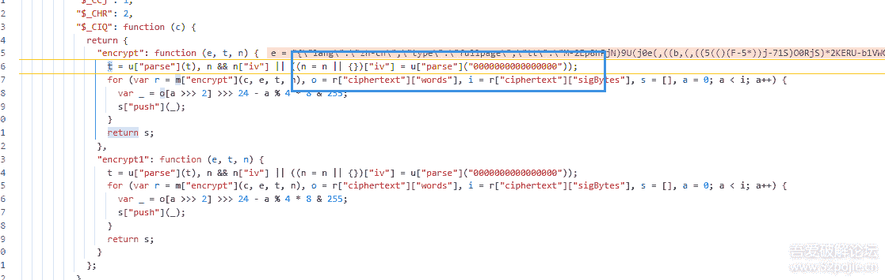

33.png (49.71 KB, 下载次数: 3)

[href="forum.php?mod=attachment&aid=MjgwNjA2NXxiYzRmYmQxNnwxNzkzNTcwNTI1fDE2ODA4NnwyMDYzNDI5&nothumb=yes" target="_blank"](https://www.52pojie.cn/forum.php?mod=attachment&aid=MjgwNjA2NXxiYzRmYmQxNnwxNzkzNTcwNTI1fDE2ODA4NnwyMDYzNDI5&nothumb=yes)

2025-9-29 21:09 上传

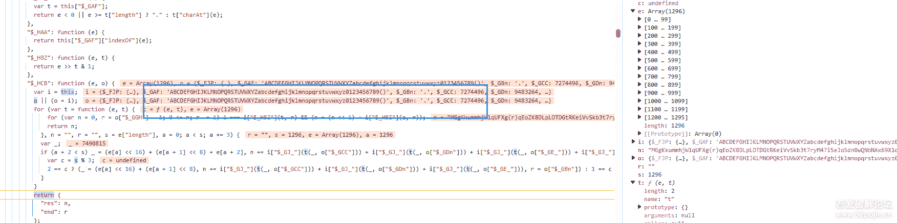

34.png (109.27 KB, 下载次数: 4)

[href="forum.php?mod=attachment&aid=MjgwNjA2NnwzZjE3OGY2MXwxNzkzNTcwNTI1fDE2ODA4NnwyMDYzNDI5&nothumb=yes" target="_blank"](https://www.52pojie.cn/forum.php?mod=attachment&aid=MjgwNjA2NnwzZjE3OGY2MXwxNzkzNTcwNTI1fDE2ODA4NnwyMDYzNDI5&nothumb=yes)

`gmbadse64`

2025-9-29 21:10 上传

最后就是整合`twe_w_str`加密了，熟悉不？

这步请求完，再把第五步请求完，就剩第三个`w`加密了

解第三步`w`算法

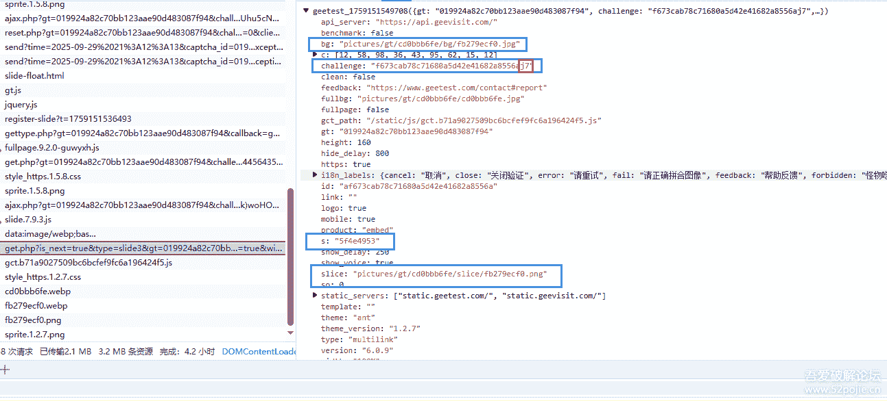

35.png (113.13 KB, 下载次数: 3)

[href="forum.php?mod=attachment&aid=MjgwNjA2N3wyMWRiZjNjM3wxNzkzNTcwNTI1fDE2ODA4NnwyMDYzNDI5&nothumb=yes" target="_blank"](https://www.52pojie.cn/forum.php?mod=attachment&aid=MjgwNjA2N3wyMWRiZjNjM3wxNzkzNTcwNTI1fDE2ODA4NnwyMDYzNDI5&nothumb=yes)

### 2025-9-29 21:16 上传
这是第五步返回需要的参
`challenge`比原本多最后两位数，`bg`切割混乱的背景图、`slice`滑块图、`s`值

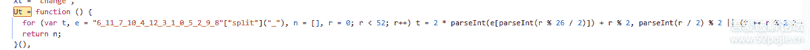

36.png (16 KB, 下载次数: 3)

[href="forum.php?mod=attachment&aid=MjgwNjA2OHxhMDFiMjNlOXwxNzkzNTcwNTI1fDE2ODA4NnwyMDYzNDI5&nothumb=yes" target="_blank"](https://www.52pojie.cn/forum.php?mod=attachment&aid=MjgwNjA2OHxhMDFiMjNlOXwxNzkzNTcwNTI1fDE2ODA4NnwyMDYzNDI5&nothumb=yes)

`ut`算法

### 2025-9-29 21:24 上传
`bg`切割混乱的背景图`Ut`算法

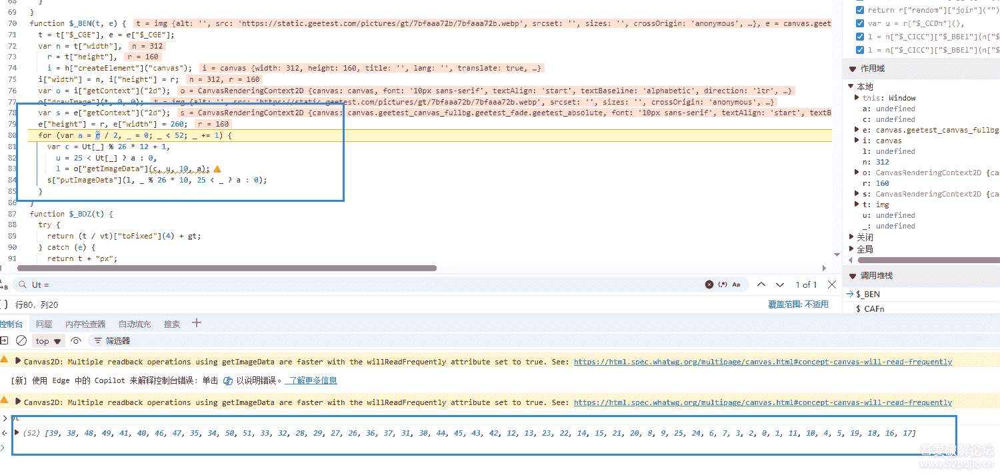

37.png (131.16 KB, 下载次数: 4)

[href="forum.php?mod=attachment&aid=MjgwNjA2OXwyMWY1YThiOXwxNzkzNTcwNTI1fDE2ODA4NnwyMDYzNDI5&nothumb=yes" target="_blank"](https://www.52pojie.cn/forum.php?mod=attachment&aid=MjgwNjA2OXwyMWY1YThiOXwxNzkzNTcwNTI1fDE2ODA4NnwyMDYzNDI5&nothumb=yes)

图片还原

### 2025-9-29 21:24 上传
`bg`还原图片，可以先等图片出来后，断着`Canvas`，按刷新直接就断到`bg`还原图片了，我`Ut`也是直接写死的
像这个`bg`图片还原、滑块`x`值，还有滑块轨迹都有现成的，k哥里面`get_slide_track()`这个就能使用
原本我是想自己写轨迹的，`x`、`y`值好伪造，就是`ts`时间差没整好过不去，后续能力强了，自己多试试看行不行

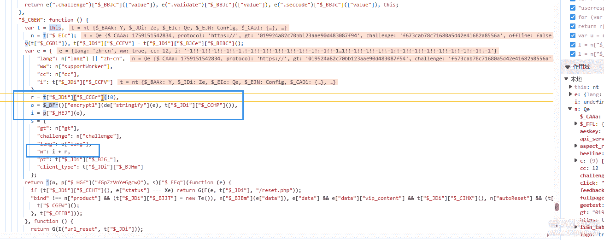

38.png (101.79 KB, 下载次数: 4)

[href="forum.php?mod=attachment&aid=MjgwNjA3MXxhZGNjNTE0MHwxNzkzNTcwNTI1fDE2ODA4NnwyMDYzNDI5&nothumb=yes" target="_blank"](https://www.52pojie.cn/forum.php?mod=attachment&aid=MjgwNjA3MXxhZGNjNTE0MHwxNzkzNTcwNTI1fDE2ODA4NnwyMDYzNDI5&nothumb=yes)

### 2025-9-29 21:44 上传
终于到了最后的`w`生成，看抓包生成的`w`和第一次`w`生成差不多

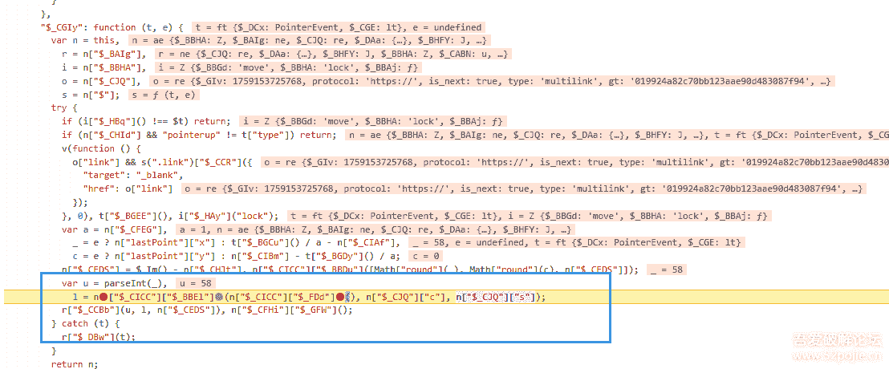

39.png (90.22 KB, 下载次数: 4)

[href="forum.php?mod=attachment&aid=MjgwNjA3NHxkNTM4Yjk0YnwxNzkzNTcwNTI1fDE2ODA4NnwyMDYzNDI5&nothumb=yes" target="_blank"](https://www.52pojie.cn/forum.php?mod=attachment&aid=MjgwNjA3NHxkNTM4Yjk0YnwxNzkzNTcwNTI1fDE2ODA4NnwyMDYzNDI5&nothumb=yes)

### 2025-9-29 21:52 上传
先跟着找参数，最早轨迹生产加密算法在这，跟着进去

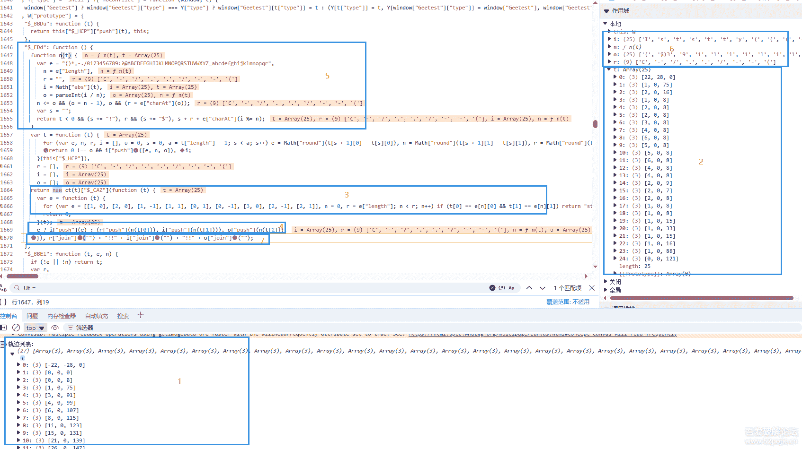

40.png (185.96 KB, 下载次数: 4)

[href="forum.php?mod=attachment&aid=MjgwNjA3NXw2MjhmZmVmMnwxNzkzNTcwNTI1fDE2ODA4NnwyMDYzNDI5&nothumb=yes" target="_blank"](https://www.52pojie.cn/forum.php?mod=attachment&aid=MjgwNjA3NXw2MjhmZmVmMnwxNzkzNTcwNTI1fDE2ODA4NnwyMDYzNDI5&nothumb=yes)

### 2025-9-29 21:58 上传
且听我说，1是滑动轨迹、2是滑动轨迹差，真正需要的是轨迹差、当每个轨迹差头两个差等于3中`e`的列表时则计算完生成`str`添加到`i`列表，不符合时候，就通过4步骤进入5中的`n()`方法来计算`str`，添加到`r`、`i`中，`o`中单独计算轨迹差中的时间差，通过5中的`n()`方法转换`str`
最后生成6中的`r`、`i`、`n`列表，再通过！！拼接，要记得这边也有个`passtime`，这个`passtime`就是根据轨迹差中的时间差总和

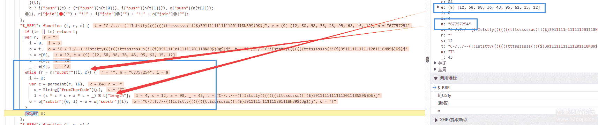

41.png (83.74 KB, 下载次数: 3)

[href="forum.php?mod=attachment&aid=MjgwNjA3N3xjMDI1MGQ2ZHwxNzkzNTcwNTI1fDE2ODA4NnwyMDYzNDI5&nothumb=yes" target="_blank"](https://www.52pojie.cn/forum.php?mod=attachment&aid=MjgwNjA3N3xjMDI1MGQ2ZHwxNzkzNTcwNTI1fDE2ODA4NnwyMDYzNDI5&nothumb=yes)

### 2025-9-29 22:09 上传
这个像不像第二次`w`中`tt`最后生成的算法

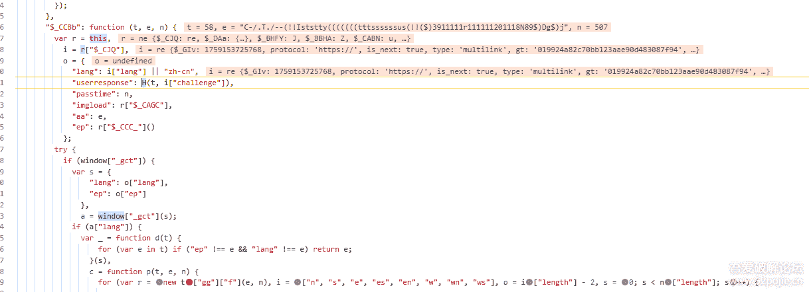

42.png (63.29 KB, 下载次数: 4)

[href="forum.php?mod=attachment&aid=MjgwNjA3OHwzZWRmNzZkMnwxNzkzNTcwNTI1fDE2ODA4NnwyMDYzNDI5&nothumb=yes" target="_blank"](https://www.52pojie.cn/forum.php?mod=attachment&aid=MjgwNjA3OHwzZWRmNzZkMnwxNzkzNTcwNTI1fDE2ODA4NnwyMDYzNDI5&nothumb=yes)

### 2025-9-29 22:11 上传
来咯，这个就是最后`w`生成算法了，刚刚生成的轨迹差参数就叫`aa`，现在我们继续逆`userresponse`

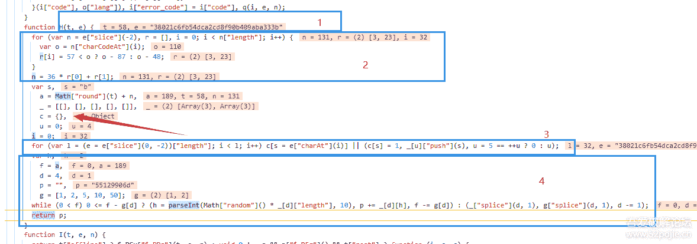

43.png (60.49 KB, 下载次数: 4)

[href="forum.php?mod=attachment&aid=MjgwNjA3OXxmMmM4NmFjMnwxNzkzNTcwNTI1fDE2ODA4NnwyMDYzNDI5&nothumb=yes" target="_blank"](https://www.52pojie.cn/forum.php?mod=attachment&aid=MjgwNjA3OXxmMmM4NmFjMnwxNzkzNTcwNTI1fDE2ODA4NnwyMDYzNDI5&nothumb=yes)

### 2025-9-29 22:14 上传
1中的`t`就是滑块滑倒缺口的`x`距离，`e`就是`challge`，在第五步返回的
2根据`challge`中最后两个参数进行36进制转10进制
3遍历`challge`的前32位，通过计算把`c`中没有`key`添加进去，最后再把计算的参添加到`_`列表中
4我也不懂这什么算法，gpt说是贪心算法，取随机数，最后就生成`p`了
不懂算法真没啥，这种照抄写成自己算法也不难，`userresponse`就出来了
`imgload`是图片载入时间，随机整数咯，自己伪造，然后进入`ep`

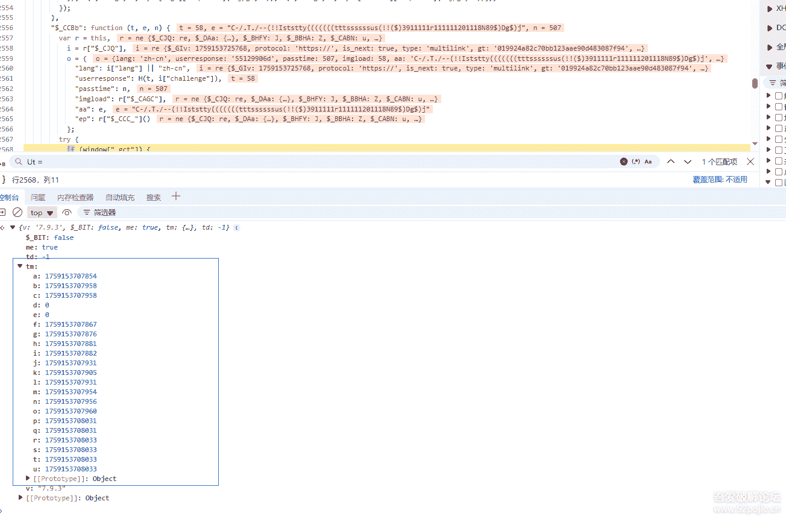

44.png (112.77 KB, 下载次数: 4)

[href="forum.php?mod=attachment&aid=MjgwNjA4NHw5NjBjNTU4MHwxNzkzNTcwNTI1fDE2ODA4NnwyMDYzNDI5&nothumb=yes" target="_blank"](https://www.52pojie.cn/forum.php?mod=attachment&aid=MjgwNjA4NHw5NjBjNTU4MHwxNzkzNTcwNTI1fDE2ODA4NnwyMDYzNDI5&nothumb=yes)

### 2025-9-29 22:27 上传
`ep`其他值都是死的，就`tm`和第二步一样，自己伪造咯

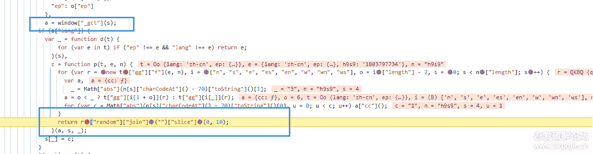

45.png (46.34 KB, 下载次数: 4)

[href="forum.php?mod=attachment&aid=MjgwNjA4NXxiOTI1ODUxNnwxNzkzNTcwNTI1fDE2ODA4NnwyMDYzNDI5&nothumb=yes" target="_blank"](https://www.52pojie.cn/forum.php?mod=attachment&aid=MjgwNjA4NXxiOTI1ODUxNnwxNzkzNTcwNTI1fDE2ODA4NnwyMDYzNDI5&nothumb=yes)

### 2025-9-29 22:31 上传
`h9s9`跟前面的`captcha`差不多，先是代码生成一个`h9s9`，在进入第二个`p()`方法中重新生成新的`h9s9`，没意义，写死把

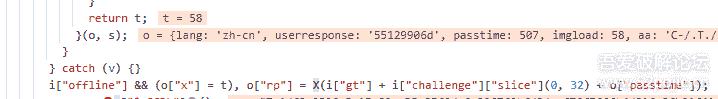

49.png (18.01 KB, 下载次数: 3)

[href="forum.php?mod=attachment&aid=MjgwNjA4OXxkNDYxYmFjNHwxNzkzNTcwNTI1fDE2ODA4NnwyMDYzNDI5&nothumb=yes" target="_blank"](https://www.52pojie.cn/forum.php?mod=attachment&aid=MjgwNjA4OXxkNDYxYmFjNHwxNzkzNTcwNTI1fDE2ODA4NnwyMDYzNDI5&nothumb=yes)

### 2025-9-29 22:40 上传
`rp`不是和之前第二次`w`生成一样嘛`gt`+`challenge`【：32】+`passtime`

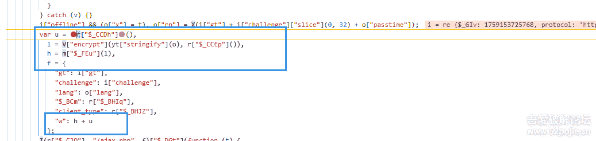

46.png (30.07 KB, 下载次数: 3)

[href="forum.php?mod=attachment&aid=MjgwNjA4NnwyMTY4OWMzMHwxNzkzNTcwNTI1fDE2ODA4NnwyMDYzNDI5&nothumb=yes" target="_blank"](https://www.52pojie.cn/forum.php?mod=attachment&aid=MjgwNjA4NnwyMTY4OWMzMHwxNzkzNTcwNTI1fDE2ODA4NnwyMDYzNDI5&nothumb=yes)

### 2025-9-29 22:33 上传
通过抓包，我们也能猜出来最后`w`和第一次差不多，看这边是不是也很像第一次加密，只是加密参不同罢了

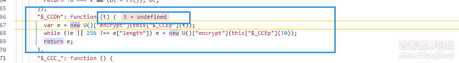

47.png (21.51 KB, 下载次数: 4)

[href="forum.php?mod=attachment&aid=MjgwNjA4N3xiNDMyYmI2M3wxNzkzNTcwNTI1fDE2ODA4NnwyMDYzNDI5&nothumb=yes" target="_blank"](https://www.52pojie.cn/forum.php?mod=attachment&aid=MjgwNjA4N3xiNDMyYmI2M3wxNzkzNTcwNTI1fDE2ODA4NnwyMDYzNDI5&nothumb=yes)

### 2025-9-29 22:36 上传
和第一次一样把，不过这个`t`是`undefined`，说明他重新生成了`aeskey`

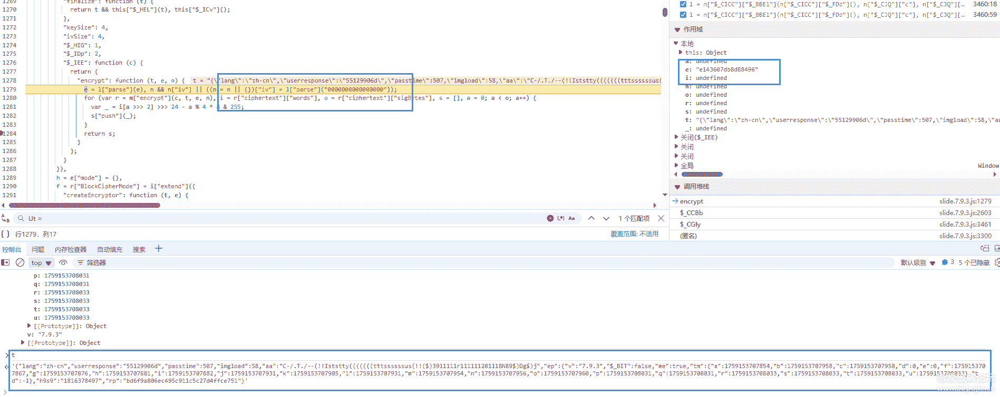

48.png (134.38 KB, 下载次数: 4)

[href="forum.php?mod=attachment&aid=MjgwNjA4OHxlMTNlMGQ5M3wxNzkzNTcwNTI1fDE2ODA4NnwyMDYzNDI5&nothumb=yes" target="_blank"](https://www.52pojie.cn/forum.php?mod=attachment&aid=MjgwNjA4OHxlMTNlMGQ5M3wxNzkzNTcwNTI1fDE2ODA4NnwyMDYzNDI5&nothumb=yes)

### 2025-9-29 22:38 上传
`aes`加密，`aeskey`变了，加密参不就是我们前面逆的参

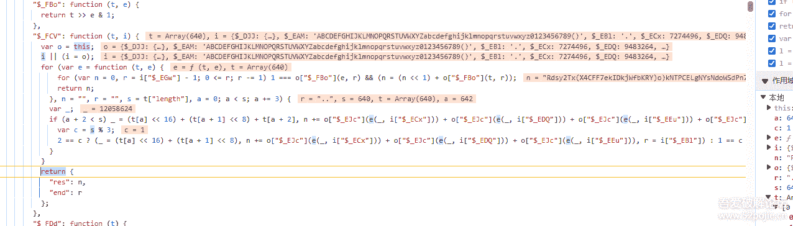

50.png (76.46 KB, 下载次数: 3)

[href="forum.php?mod=attachment&aid=MjgwNjA5MHwyNDY2ZmZlOHwxNzkzNTcwNTI1fDE2ODA4NnwyMDYzNDI5&nothumb=yes" target="_blank"](https://www.52pojie.cn/forum.php?mod=attachment&aid=MjgwNjA5MHwyNDY2ZmZlOHwxNzkzNTcwNTI1fDE2ODA4NnwyMDYzNDI5&nothumb=yes)

### 2025-9-29 22:42 上传
最后魔改`base64`加密，结束
第一次写这个，这么累，快敲了我一天时间，越写到后面越没耐心了，不好意思啊，下次改正，拜拜
