# [Web逆向] 某迪汽车vx小程序逆向及每日签到--站在巨人的肩膀上确实可以少走弯路

- 原帖：<https://www.52pojie.cn/forum.php?mod=viewthread&tid=2063588>
- 抓取时间：2026-11-01T22:02:04

最近在论坛上无意中看到了某大佬写的某迪小程序逆向，一时手痒，也来试试，主要是想搞定自动签到功能。

原文链接如下：

[某迪汽车品牌小程序逆向](https://www.52pojie.cn/thread-1934663-1-1.html)

大佬在文中已经给出了算法，不过他这篇文章是2024年写的，现在小程序已经升级了，很多 `js` 文件都不一样了。

于是，站在大佬的肩膀上，有了此次的分析。

先说结论：已经分析/破解了小程序的加密算法，但是目前尚未完成完整的签到流程，主要原因是无法获取微信登录的 `code`，如哪位大佬有思路，欢迎赐教。

以下内容仅涉及技术分析，如有侵权，请联系我删帖。

## 一、所用到的软件

- Reqable：抓包工具，免费版的就已经非常好用了。下载地址：<https://reqable.com>
- unveilr：解包工具，不太好找，在 Github 上找了好久，很多都失效了，最终找到的地址是：<https://github.com/0day404/unveilr>
- Nopepad++
- 微信桌面版

## 二、打开 Reqable 开始抓包

打开 Reqable，在最左侧，找到应用程序，只勾选 `Wechatappex`，然后点击开始即可。

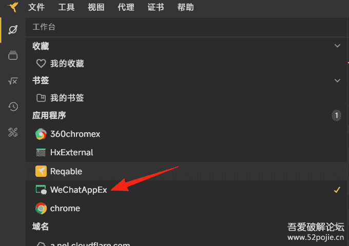

## 三、获取小程序并解包

每台电脑上安装的微信位置不同，所以小程序的路径也不同。我脑子不好使，记不住这个路径，一般是用 Everything 搜索小程序的后缀 `wxapkg`，然后找到小程序的路径。这次找到的路径如下：

`C:\Users\A\AppData\Roaming\Tencent\xwechat\radium\Applet\packages\wxa75efa648b60994b\124`

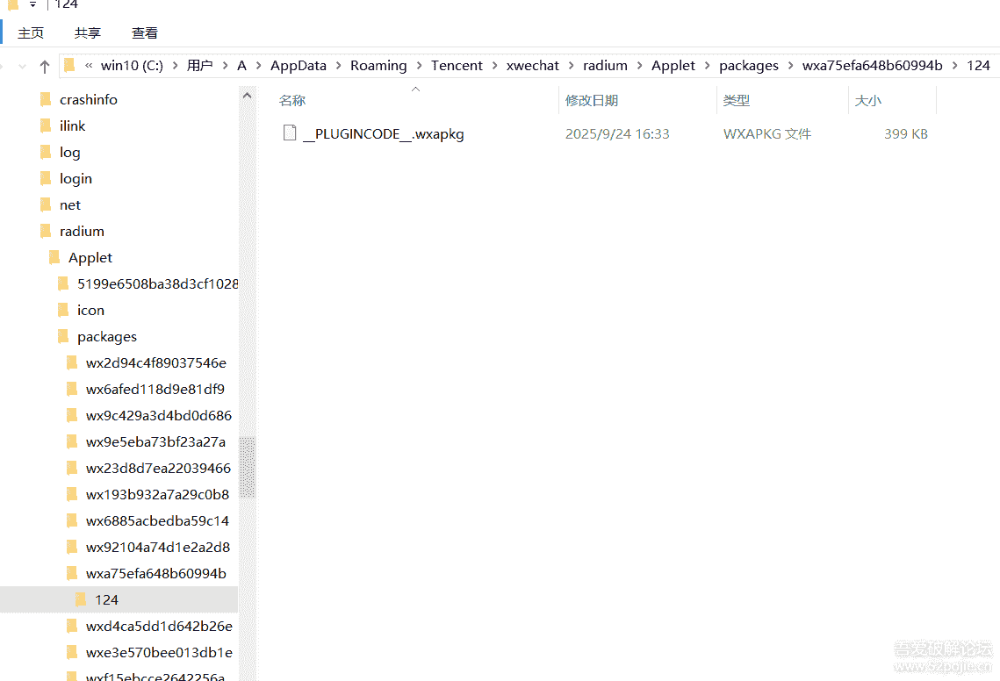

上图中，左侧窗口那一串不规律字符的文件夹，就是不同小程序所在的文件夹。

先把它们都删除，然后从微信电脑版打开某迪小程序，随意点击一些界面，特别是要包括签到的界面。然后回到文件管理器，在 `C:\Users\A\AppData\Roaming\Tencent\xwechat\radium\Applet\packages` 目录下，唯一的一个文件夹就是某迪的所有程序了。

这时记得停止 Reqable 抓包。

打开 `cmd` 窗口，切换到 `unveilr` 所在的文件夹，输入以下命令：

```shell
unveilr.exe "C:\Users\A\AppData\Roaming\Tencent\xwechat\radium\Applet\packages\wxf62054ec313d6f53\112"
```

就可以解包了。

## 四、开始分析算法

抓包得到的数据如下：

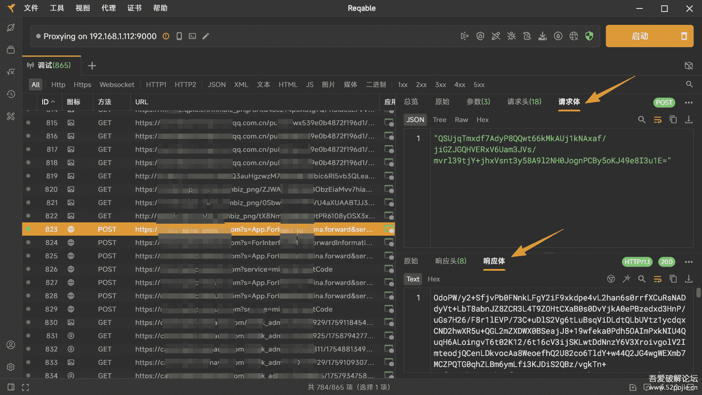

请求体和响应体都是加密的。

在请求头里面，还有3个参数是加密的，如下图所示：

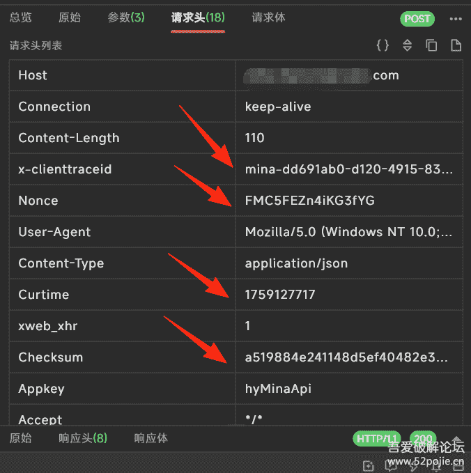

### 4.1 分析请求头

这个请求头有18个，大部分看起来比较正常，不正常的有4个，分别是 `x-clienttraceid`、`Checksum`、`Nonce`、`Curtime`。

使用 NotePad++，在解包出来的文件夹中，全文检索一下 `Checksum`，发现只在 `header.js` 中存在。

把 `header.js` 里面的内容格式化一下，然后上传到豆包 ai，让豆包帮我看看算法。

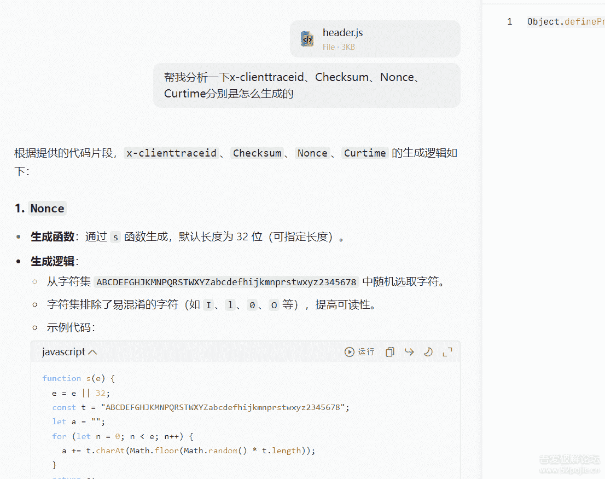

话说现在有了 ai，破解程序是真方便，有问题了随时让它解答就行。

经过豆包的分析：

- `x-clienttraceid` 是带前缀的类 `UUID` 字符串，里面的字符都是随机的。
- `Nonce` 是随机字符串。
- `Curtime` 是时间戳。

`Checksum` 生成逻辑如下：

1. 拼接字符串：`appSecret + Nonce + Curtime`（其中 `appSecret` 是外部传入的密钥）。
2. 对拼接结果进行 SHA256 哈希计算。
3. 将哈希结果转为小写字母。

这个 `appSecret` 是未知的，在 Notepad++ 中全盘搜索，也没有这个 `appSecret`。

这个 `header.js` 文件中，引入了 `./constant/constant-obfuscated.js`。

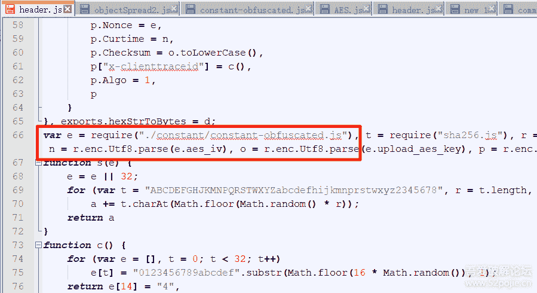

这个 `constant-obfuscated.js` 文件开头，有一个数组 `a`，里面是一堆字符串。

把 `constant-obfuscated.js` 文件和 `header.js` 文件一起丢给豆包，让它看看 `appSecret` 是怎么生成的。

豆包说是 `constant-obfuscated.js` 文件中数组 `a` 的某一个，经豆包分析，应该是 `3917763gCFENO`。

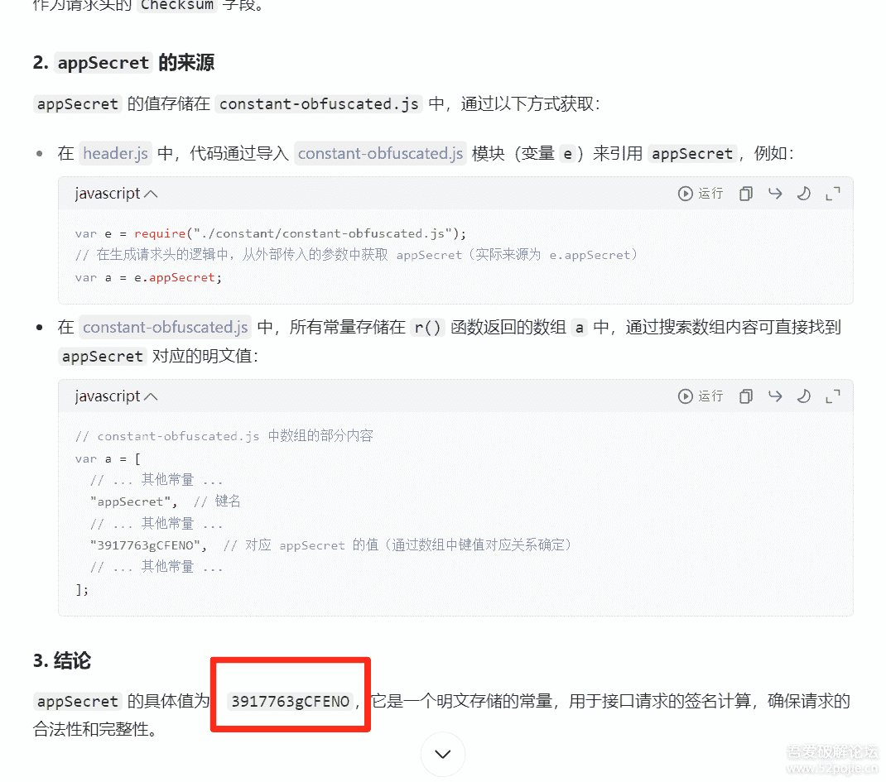

但是，我用这个计算了一下，发现不对。使用现有的 `Nonce`：`FMC5FEZn4iKG3fYG`，`Curtime`：`1759127717`，计算得到的 `Checksum` 是 `50fd8cc550c1d6610a76b3b770bc670b128fba452eb64f5f9dee3482f4cf3437`，与实际的 `a519884e241148d5ef40482e309b906e18f6254dee092c01d3281615bc0ff958` 不一致。

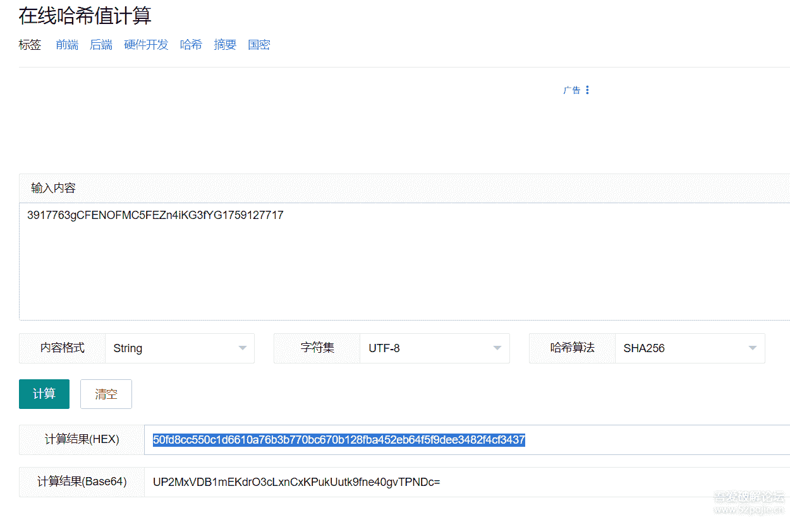

仔细分析了一下 `constant-obfuscated.js` 文件，感觉数组 `a` 非常可疑，里面定义了很多参数，但是不直接引用，而是在 `js` 中加入了很多混淆，绕来绕去的，把豆包都搞晕了。

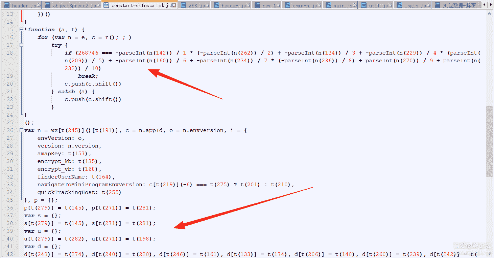

我猜这么混淆是为了把逆向的人搞晕，实际使用的字符串应该就在这个数组 `a` 中。

那就写个程序把数组 `a` 遍历一下，看看里面会不会有 `appSecret`。

基本思路是，使用现有的 `Nonce`：`FMC5FEZn4iKG3fYG`，`Curtime`：`1759127717`，将 `a` 里面每个字符串都遍历一遍，假设它就是 `appSecret`，看计算出来的 `Checksum` 是否等于 `a519884e241148d5ef40482e309b906e18f6254dee092c01d3281615bc0ff958`。

具体程序是用豆包写的，就不贴了，最终计算出来的 `appSecret` 结果是 `Kfl%BOk6C5PwARw8`，还真是数组 `a` 中的一部分。

### 4.2 分析请求体

这个请求体是 `QSUjqTmxdf7AdyP8QQwt66kMkAUj1kNAxaf/jiGZJGQHVERxV6Uam3JVs/mvrl39tjY+jhxVsnt3y58A9l2NH0JognPCBy5oKJ49e8I3u1E=`。

像这种带等号的字符串，大概率是 `base64` 或者是 `aes` 加密。

从 `header.js` 中能看出来，应该是 `aes` 加密的，模式是 `cbc` 和 `Pkcs7`。

关键是如何找到加密的 `key` 和偏移 `iv`。

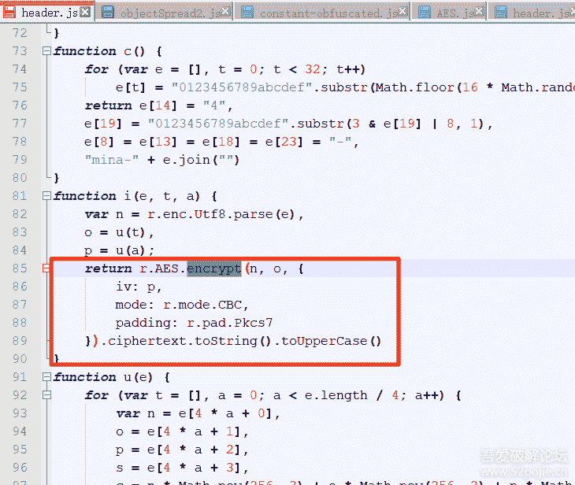

问问豆包，这个 `aes` 的 `key` 和 `iv` 是什么，豆包认真分析了 `constant-obfuscated.js` 文件中数组 `a`，给了一个错误的答案。

看来这个混淆确实太复杂了，ai 都搞不定。

那就再写个程序跑一下吧。

基本思路是，假设 `key` 和 `iv` 都是取自数组 `a`，搞个2层嵌套的循环，一个个尝试。

Python 代码如下：

```python
import base64
import json
from Crypto.Cipher import AES
from Crypto.Util.Padding import unpad

# 从constant-obfuscated.js中提取的数组a
constant_array = [XXXXX]

# 加密后的字符串
encrypted_string = "QSUjqTmxdf7AdyP8QQwt66kMkAUj1kNAxaf/jiGZJGQHVERxV6Uam3JVs/mvrl39tjY+jhxVsnt3y58A9l2NH0JognPCBy5oKJ49e8I3u1E="

def try_decrypt(key_candidate, iv_candidate, encrypted_data):
    """尝试使用给定的key和iv解密数据"""
    try:
        # 确保key和iv是UTF-8编码的字节
        key = key_candidate.encode('utf-8')
        iv = iv_candidate.encode('utf-8')

        # 检查key和iv的长度是否符合AES要求
        if len(key) not in [16, 24, 32]:  # AES-128, AES-192, AES-256
            return None

        if len(iv) != 16:  # CBC模式下IV必须是16字节
            return None

        # 创建解密器
        cipher = AES.new(key, AES.MODE_CBC, iv)

        # 解密并去除填充
        decrypted_bytes = unpad(cipher.decrypt(encrypted_data), AES.block_size)

        # 尝试将解密结果转换为字符串
        decrypted_str = decrypted_bytes.decode('utf-8')

        return decrypted_str

    except (ValueError, UnicodeDecodeError, Exception):
        # 解密失败、填充错误或无法解码为UTF-8都返回None
        return None
```


# AES 密钥与 IV 查找

## 代码实现

```python
def filter_candidates(arr):
    """过滤可能的候选值（基本长度校验）"""
    return [
        item for item in arr
        if isinstance(item, str) and len(item) in [16, 24, 32]
    ]

def find_correct_key_and_iv():
    """主函数：遍历所有可能的key和iv组合"""
    print("开始查找正确的AES密钥和IV...")
    print(f"原始数组长度: {len(constant_array)}")
    # 解码加密字符串
    try:
        encrypted_data = base64.b64decode(encrypted_string)
    except Exception as e:
        print(f"加密字符串解码失败: {str(e)}")
        return
    # 过滤可能的候选值
    candidates = filter_candidates(constant_array)
    print(f"过滤后的候选值数量: {len(candidates)}")
    print("开始双重遍历...（这可能需要一段时间）")
    total = len(candidates)
    found = False
    # 双重遍历所有可能的key和iv组合
    for i, key in enumerate(candidates):
        # 输出进度
        if i % 10 == 0:
            print(f"已尝试 {i}/{total} 个密钥，尚未找到匹配...")
        for j, iv in enumerate(candidates):
            # 尝试解密
            decrypted = try_decrypt(key, iv, encrypted_data)
            if decrypted:
                # 检查是否为有效的JSON（如果预期是JSON格式）
                is_json = False
                json_data = None
                try:
                    json_data = json.loads(decrypted)
                    is_json = True
                except json.JSONDecodeError:
                    pass
                # 输出结果
                print("\n找到匹配的密钥和IV!")
                print(f"密钥 (key) 索引: {i}")
                print(f"密钥 (key) 值: {key}")
                print(f"初始向量 (iv) 索引: {j}")
                print(f"初始向量 (iv) 值: {iv}")
                print(f"解密结果: {decrypted}")
                if is_json:
                    print("解密结果为有效的JSON格式")
                found = True
        if found:
            break
    if not found:
        print("\n未找到匹配的密钥和IV组合")

if __name__ == "__main__":
    # 运行程序前请确保已安装pycryptodome库
    # 安装命令: pip install pycryptodome
    find_correct_key_and_iv()
```

## 程序运行结果

```
开始查找正确的AES密钥和IV...
原始数组长度: 161
过滤后的候选值数量: 17
开始双重遍历...（这可能需要一段时间）
已尝试 0/17 个密钥，尚未找到匹配...
已尝试 10/17 个密钥，尚未找到匹配...

找到匹配的密钥和IV!
密钥 (key) 索引: 13
密钥 (key) 值: 3993014457161851
初始向量 (iv) 索引: 2
初始向量 (iv) 值: 8765432187654321
解密结果: Q$^pW9
67ity","is_new":"2","location":"banner","session_id":""}

找到匹配的密钥和IV!
密钥 (key) 索引: 13
密钥 (key) 值: 3993014457161851
初始向量 (iv) 索引: 3
初始向量 (iv) 值: 5949577785312731
解密结果: _(XpUity","is_new":"2","location":"banner","session_id":""}

找到匹配的密钥和IV!
密钥 (key) 索引: 13
密钥 (key) 值: 3993014457161851
初始向量 (iv) 索引: 12
初始向量 (iv) 值: serviceProgress1
解密结果: XCgBDB?:hQ@Jw7ity","is_new":"2","location":"banner","session_id":""}

找到匹配的密钥和IV!
密钥 (key) 索引: 13
密钥 (key) 值: 3993014457161851
初始向量 (iv) 索引: 13
初始向量 (iv) 值: 3993014457161851
解密结果: "[}W>17ity","is_new":"2","location":"banner","session_id":""}

找到匹配的密钥和IV!
密钥 (key) 索引: 13
密钥 (key) 值: 3993014457161851
初始向量 (iv) 索引: 14
初始向量 (iv) 值: 1234567812345678
解密结果: T%WyRity","is_new":"2","location":"banner","session_id":""}

找到匹配的密钥和IV!
密钥 (key) 索引: 13
密钥 (key) 值: 3993014457161851
初始向量 (iv) 索引: 15
初始向量 (iv) 值: a12e93c9edadeaa4
解密结果: JWtDV-nG@Xe2ity","is_new":"2","location":"banner","session_id":""}

找到匹配的密钥和IV!
密钥 (key) 索引: 13
密钥 (key) 值: 3993014457161851
初始向量 (iv) 索引: 16
初始向量 (iv) 值: 1234567890123456
10ity","is_new":"2","location":"banner","session_id":""}

进程已结束，退出代码为 0
```

真是用魔法打败魔法，找到的`key`和`iv`如下：

`key`：3993014457161851

`iv`：PDVcDRWMrBlLHTqh

到这里，我才发现，原来aes加密如此有趣，

同一个`key`，不同的`iv`，得到的结果可能会有大部分是相同的。

比如：

`iv`值是 a12e93c9edadeaa4时，解密结果:

JWtDV-nG@Xe2ity","is_new":"2","location":"banner","session_id":""}

`iv`值是 1234567890123456时，解密结果是：

10ity","is_new":"2","location":"banner","session_id":""}

看来也不是“失之毫厘，差之千里”。

不像md5加密，差一个字符就会完全不同。

有了正确的`key`和`iv`，剩下的就好办多了，请求体和响应体都是aes加密，算法用的是相同的参数。

## 五、模拟签到

签到的网址是https://XXXXX?s=ForCommonUcSrv.forward&serviceDir=activity/sign/signIn

请求体是"1+T1TfWyawJTYxJBmnYuqEs6P5vDM6Jx1dIfMda81lMdq2t5Eb4UztUOwFKk1bEI5nSRmxz7U4IK2z5TlcaB06DrtNOtFk3MA03MBY/DN6I="

翻译过来就是：（实际字符用X代替了，下同）

```json
{
  "date": "",
  "belong_brand": "hy",
  "session_id": "XXXXXXXXXXXXX"
}
```

响应体是OdoPW/y2+SfjvPb0FNnkLDfdGj8EInM6PX42TDn7CPbcAk8xUuXCtI0NNns70DozZ7fMU0W8YaCQPSR2jKBU0B7xuFSOY9b86hPQ5WfpWjlOh4sTf+DblYVUUX0/9GRybDmCoWfXR7RS/iXx2MDxL7crRMK859pvd71ktt7Rl/I=

翻译过来就是：

```json
{
  "ret": 200,
  "data": {
    "duplicate": false,
    "durationDays": 4,
    "integral": 1,
    "reward_type": "1",
    "mode": 1
  },
  "msg": "success!"
}
```

`durationDays`值为4，意思是我已经连续签到了4天。

这个签到，知道了url，也能够计算出请求头，难点就是如何获取`session_id`。

全文搜索url中的activity/sign/signIn，在`main.js`中发现了一处：

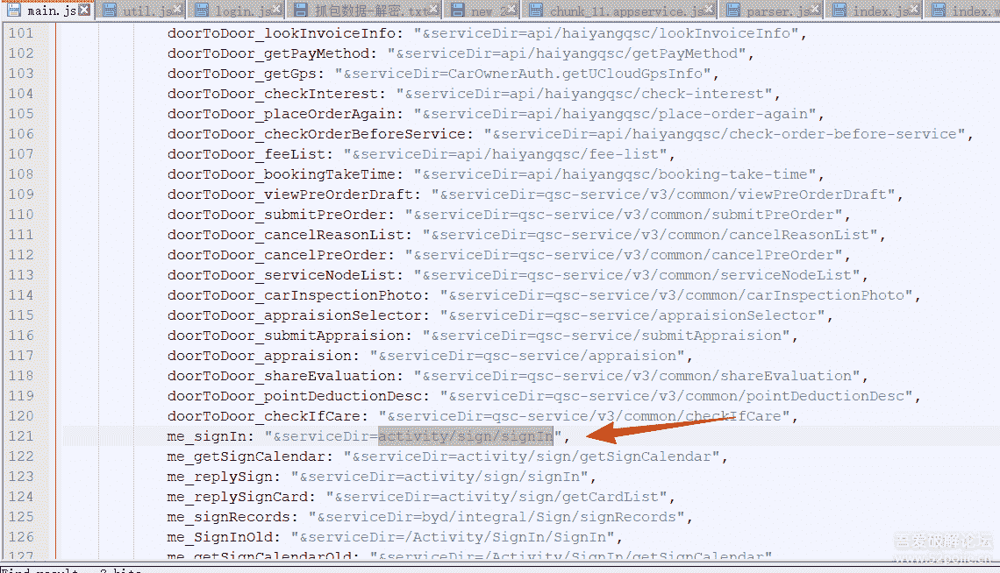

image.png (144.22 KB, 下载次数: 3)

[href="forum.php?mod=attachment&aid=MjgwNjE5Mnw2NWIyMDc2M3wxNzkzNTcwNTIxfDE2ODA4NnwyMDYzNTg4&nothumb=yes" target="_blank"](https://www.52pojie.cn/forum.php?mod=attachment&aid=MjgwNjE5Mnw2NWIyMDc2M3wxNzkzNTcwNTIxfDE2ODA4NnwyMDYzNTg4&nothumb=yes)

2025-9-30 11:34 上传

`main.js`好像只是定义，再搜索一下`me_signIn`，

发现了3处，在`sign.js`中找到了，但是没有`session_id`

把`sign.js`丢给豆包，豆包说，`session_id`通常在用户登录后由服务器返回并保存到本地，不会在页面代码中处理。

感觉这次豆包说的没错。

那就全部推倒重来试试。

删除小程序文件，然后开启抓包，

重新打开小程序，发现还是登录状态，

分析了一下抓包的数据，

第1条

https://XXXXX?s=App.ForInterfaceMina.forward&serverFlag=mallHost&serviceDir=App.Banner.getCommunityList

请求体解密后：

```json
{
  "group": "community",
  "is_new": "2",
  "location": "banner",
  "session_id": ""
}
```

响应体解密后：

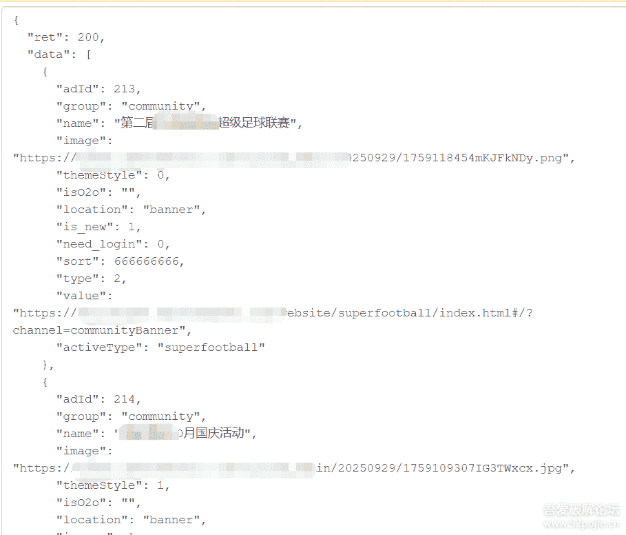

image.png (50.39 KB, 下载次数: 2)

[href="forum.php?mod=attachment&aid=MjgwNjI2NnwxMjE3NTIzOXwxNzkzNTcwNTIxfDE2ODA4NnwyMDYzNTg4&nothumb=yes" target="_blank"](https://www.52pojie.cn/forum.php?mod=attachment&aid=MjgwNjI2NnwxMjE3NTIzOXwxNzkzNTcwNTIxfDE2ODA4NnwyMDYzNTg4&nothumb=yes)

2025-9-30 16:49 上传

第2条

https://XXXXX?s=ForInterfaceMina.forwardInformationFlow&serviceDir=App.Community.topicList

请求体解密后：

```json
{
  "pageNum": 1,
  "numPerPage": 5,
  "orderType": "Hot",
  "status": 3,
  "session_id": ""
}
```

响应体解密后：

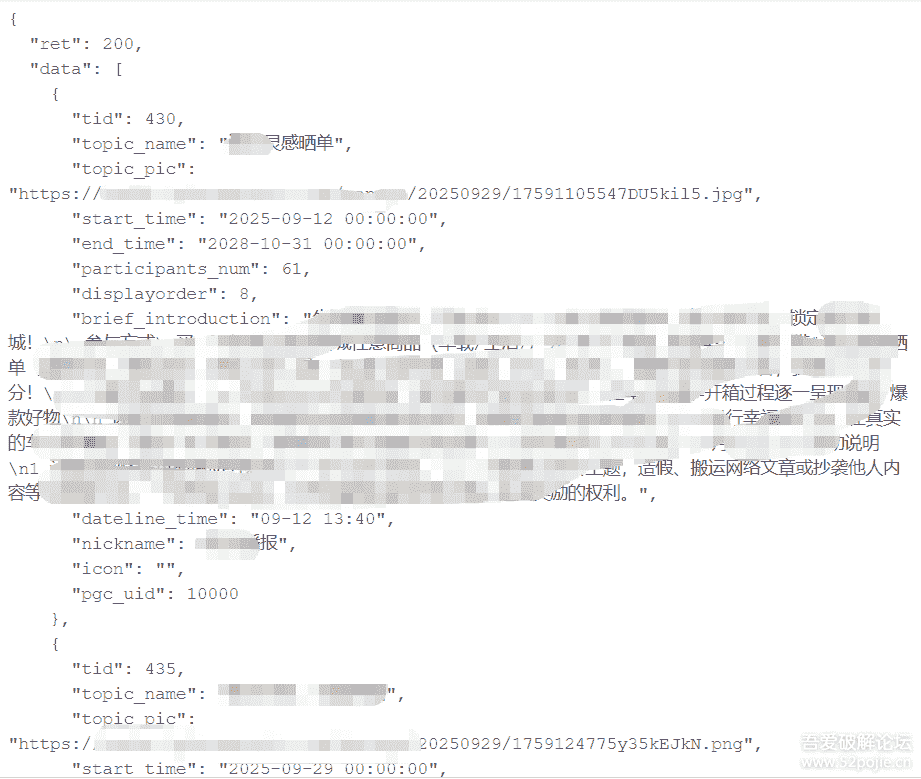

image.png (72.12 KB, 下载次数: 2)

[href="forum.php?mod=attachment&aid=MjgwNjI2N3w4ZTAzZWUxYXwxNzkzNTcwNTIxfDE2ODA4NnwyMDYzNTg4&nothumb=yes" target="_blank"](https://www.52pojie.cn/forum.php?mod=attachment&aid=MjgwNjI2N3w4ZTAzZWUxYXwxNzkzNTcwNTIxfDE2ODA4NnwyMDYzNTg4&nothumb=yes)

2025-9-30 16:50 上传

第3条

https://XXXXX?s=App.ForInterfaceMina.forward&serverFlag=mallHost&serviceDir=App.Banner.getCommunityList

请求体解密后：

```json
{
  "group": "community",
  "is_new": "2",
  "location": "banner",
  "session_id": ""
}
```

响应体解密后：

也是广告，就不再贴图了。

第4条（重要的来了）

https://XXXXX?service=mina.decryptCode

请求体解密后：（实际字符用X代替了，下同）

```json
{
  "code": "XXXXXXXXXXXXX"
}
```

响应体解密后：

```json
{
  "ret": 200,
  "data": {
    "openid": "XXXXXXXXXXXXX",
    "unionid": "XXXXXXXXXXXX",
    "session_id": "XXXXXXXXXXXXX",
    "expired_timestamp": 1759134918
  },
  "msg": ""
}
```

在这一条url里，发送了一个`code`，然后从服务器获得了`session_id`。

这个`code`应该是通过微信登录获得的，没法逆向了。

尝试从小程序里退出登录，看看能否使用用户名和密码登录，结果发现不行。

小程序只能使用手机号加验证码的方式登录，

所以想要搞自动签到，通过小程序这条路径，应该是实现不了了。

这个帖子先到这里吧，顺便挖个坑。

某迪除了小程序能签到，在app上也能签到，而且app是可以使用用户名+密码登录的

改天有时间了逆向一下app，试试看能否搞定自动签到。

也欢迎各位大佬提供思路。

收工。
