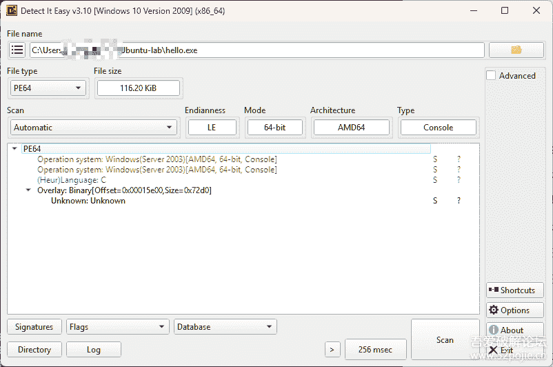
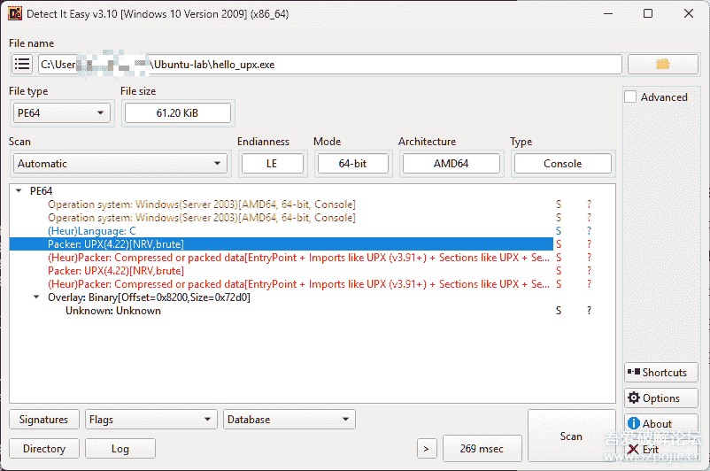

# [原创] 关于upx打包解包识别实验

- 原帖：https://www.52pojie.cn/forum.php?mod=viewthread&tid=2064494
- 抓取时间：2026-11-01T22:01:57

## 目的

编写一个最简单的程序，打包（UPX），用工具识别“它是被 UPX 打包的”，再把它解包回原样，验证差异。

## 前置准备（只需两个小工具）

- Windows：下载并放到 `PATH` 的工具
  - `upx`（UPX 打包/解包工具，命令行）
  - Detect It Easy (DIE) 或 CFF Explorer（GUI 用于查看 PE 信息）https://github.com/horsicq/DIE-engine
- Linux / WSL2：安装

```
#Windows wsl2环境下Ubuntu
PS C:\Users\flyxm> wsl -l -v
  NAME              STATE           VERSION
* Ubuntu-24.04      Running         2
  docker-desktop    Stopped         2

PS C:\Users\flyxm> wsl -d Ubuntu-24.04 -u root
sudo apt update
sudo apt install upx-ucl gcc-mingw-w64 mingw-w64-tools binutils
sudo apt install build-essential    # 若在原生 Linux 编译 Linux 程序
```

## STEP 1 — 写一个最简单的 C 程序（Hello）

在任意目录新建 `hello.c`，保存。内容：

```
#include

int main(){ puts("hello_upx"); return 0; }
```

```
root@flyxm777:/mnt/c/Users/flyxm/Ubuntu-lab# touch hello.c
root@flyxm777:/mnt/c/Users/flyxm/Ubuntu-lab# vim hello.c

root@flyxm777:/mnt/c/Users/flyxm/Ubuntu-lab# cat hello.c
#include
int main(){ puts("hello_upx"); return 0;}
```

## STEP 2 — 编译成 Windows 可执行（示例用 mingw）

- 在 Linux/WSL 或 Windows 的 mingw shell 执行：

```
x86_64-w64-mingw32-gcc hello.c -o hello.exe
```

- 结果：会生成 `hello.exe`（这是未加壳、可直接运行的原始 EXE）。

```
root@flyxm777:/mnt/c/Users/flyxm/Ubuntu-lab# ls
hello.c  hello.exe
```

期望验证：

- 双击或在命令行运行 `./hello.exe` 会打印 `hello_upx`。

```
root@flyxm777:/mnt/c/Users/flyxm/Ubuntu-lab# ./hello.exe
hello_upx
```

## STEP 3 — 用简单方法看“当前是否被加壳”（静态检查）

### 方法 A：看文件体积与字符串（Linux）

```
ls -lh hello.exe
strings hello.exe | head -n 20
```

```
root@flyxm777:/mnt/c/Users/flyxm/Ubuntu-lab# ls -lh hello.exe
-rwxrwxrwx 1 flyxm flyxm 117K Oct  7 10:18 hello.exe
root@flyxm777:/mnt/c/Users/flyxm/Ubuntu-lab# strings hello.exe | head -n 20
!This program cannot be run in DOS mode.
.text
`.data
.rdata
@.pdata
@.xdata
@.bss
.idata
.CRT
.tls
.reloc
B/19
B/31
B/45
B/57
B/70
B/81
B/97
B/113
8MZu
root@flyxm777:/mnt/c/Users/flyxm/Ubuntu-lab# upx -l hello.exe
                       Ultimate Packer for eXecutables
                          Copyright (C) 1996 - 2024
UPX 4.2.2       Markus Oberhumer, Laszlo Molnar & John Reiser    Jan 3rd 2024

        File size         Ratio      Format      Name
   --------------------   ------   -----------   -----------
upx: hello.exe: NotPackedException: not packed by UPX
```

- `strings` 输出中的 `B/19`、`B/31` … `8MZu` 不是乱码，而是 PE 文件的结构信息和编译器填充的随机字节。
- 返回 `NotPackedException: not packed by UPX` → 文件没有被 UPX 压缩过，壳检测 100% 否定。
- 标准 PE 段名：
  - `.text`：代码段
  - `.data`：已初始化全局/静态变量
  - `.rdata`：只读常量（字符串字面量、导入表等）
  - `.pdata`：异常处理表（x64 必须）
  - `.xdata`：异常处理数据
  - `.bss`：未初始化全局变量（不占文件空间）
  - `.idata`：导入表（Import Directory）
  - `.CRT`：C 运行时初始化块
  - `.tls`：线程局部存储目录
  - `.reloc`：重定位表（用于 ASLR）
  → 这些都是 PE 标准节区名称，出现即代表正常编译器生成的 EXE。
- 编译器内部记号：`B/19`、`B/31`、`B/45`... → MSVC 的 COFF 重定位记号（字符串表索引），对人无意义，可忽略。→ 出现它说明：用 VS2019+ 的 MSVC 工具链、Release 模式、打开 ASLR 编译。
- 随机填充/对齐字节：`8MZu` → 段末尾为了对齐 512 字节而填充的随机垃圾；不是代码也不是数据。→ 每次重新编译都会变，不具备签名价值。

说明：如果可以看到 `hello_upx` 字样或其他可读字符串，说明文件内容可读，可能未压缩。

### 方法 B：用 Detect It Easy（GUI，Windows）



`Snipaste_2025-10-08_09-58-23.png`（48.51 KB，下载次数：4）

[附件链接](https://www.52pojie.cn/forum.php?mod=attachment&aid=MjgwNzE3MHxkZmEyMmVmZnwxNzkzNTcwNTE1fDE2ODA4NnwyMDY0NDk0&nothumb=yes)

2025-10-8 10:26 上传

## STEP 4 — 用 UPX 打包（压缩）

在相同目录执行：

```
upx -9 hello.exe -o hello_upx.exe
```

这会生成 `hello_upx.exe`（被 UPX 压缩的版本）。

期望变化：

- 文件体积明显变小。
- `strings hello_upx.exe` 显示的可读字符串变少或看起来“被混合”。

```
root@flyxm777:/mnt/c/Users/flyxm/Ubuntu-lab# ls -la
-rwxrwxrwx 1 flyxm flyxm 118992 Oct  7 10:18 hello.exe
-rwxrwxrwx 1 flyxm flyxm  62672 Oct  7 10:18 hello_upx.exe
```

## STEP 5 — 再次检查（识别是否被 UPX）

- 用 DIE（Detect It Easy）打开 `hello_upx.exe`，Packers 行应该显示 UPX。
- 或用命令行（Linux）：

```
strings hello_upx.exe | head -n 20
```

```
root@flyxm777:/mnt/c/Users/flyxm/Ubuntu-lab# strings hello_upx.exe | head -n 20

!This program cannot be run in DOS mode.

UPX0

UPX1

UPX2

4.22

UPX!

8MZu

HcP7

xt:D

#=Pt

TWVSS(%l

#5k2

([^_A\A]

#anuyuo

tC      t"

ZO l

$$$$$$$$$$$$$$$$$$$$$$$$$$$$$$$$__X

9zE52

|$$$$$$$$$$$$$$$$$$$$$$$$$$$$$$$$(_kL

\+]y
```

你会发现原来可见的字符串可能被压缩掉了或看起来杂乱。

> 结论：如果 DIE 显示 UPX、或 section 名称含 `.UPX`、或 entropy 高，那么这个文件被 UPX 加壳/压缩。



`Snipaste_2025-10-08_09-55-45.png`（56.75 KB，下载次数：3）

[附件链接](https://www.52pojie.cn/forum.php?mod=attachment&aid=MjgwNzE3MXxlMzJjZmM4MnwxNzkzNTcwNTE1fDE2ODA4NnwyMDY0NDk0&nothumb=yes)

2025-10-8 10:26 上传

### DIE 识别结果

#### 1. 文件身份

- 路径：`C:\Users\iflyxm\Ubuntu-lab\hello_upx.exe`
- 格式：PE64（64 位 Windows 可执行文件）
- 大小：61.20 KiB
- 类型：控制台程序（Console）

#### 2. 编译与语言特征

- 编译器：Detected 为 C 语言编译生成（heuristic）
- 目标平台：Windows Server 2003 x64 及以上

#### 3. 加壳情况（重点）

- 壳名：UPX 4.22
- 壳特征：
  - 入口点、导入表、区段名均符合 UPX 典型签名
  - 存在“`UPX0/UPX1`”双区段，区段名碰撞
  - 熵值高，表明数据被压缩
- 附加数据：尾部有 29 440 字节（`0x72D0`）的 Overlay（二进制残留），不属于 UPX 解压范围，可能是作者追加的数据或配置信息

#### 4. 快速利用建议

- [https://www.52pojie.cn/forum-5-1.html](https://www.52pojie.cn/forum-5-1.html)：直接 `upx -d hello_upx.exe` 即可完整还原原始 PE64 文件
- 分析：Overlay 数据需单独切出查看，可能是密钥、脚本或补丁；可用十六进制工具或 `binwalk` 继续分离
- 查毒：UPX 4.22 为官方最新版，目前杀软误报率已降低，但仍需 VT 二次确认

## STEP 6 — 用 UPX 解包（最简单的解壳）

```
upx -d hello_upx.exe -o hello_unpacked.exe
```

这会生成 `hello_unpacked.exe`（解压后的文件）。

```
root@flyxm777:/mnt/c/Users/flyxm/Ubuntu-lab# upx -d hello_upx.exe -o hello_unpacked.exe
                       Ultimate Packer for eXecutables
                          Copyright (C) 1996 - 2024
UPX 4.2.2       Markus Oberhumer, Laszlo Molnar & John Reiser    Jan 3rd 2024

        File size         Ratio      Format      Name
   --------------------   ------   -----------   -----------
    118992 
```

```
root@flyxm777:/mnt/c/Users/flyxm/Ubuntu-lab# ls
hello.c  hello.exe  hello_unpacked.exe  hello_upx.exe

root@flyxm777:/mnt/c/Users/flyxm/Ubuntu-lab# ls -la
-rwxrwxrwx 1 flyxm flyxm 118992 Oct  7 10:18 hello.exe
-rwxrwxrwx 1 flyxm flyxm 118992 Oct  7 10:18 hello_unpacked.exe
-rwxrwxrwx 1 flyxm flyxm  62672 Oct  7 10:18 hello_upx.exe
```

## STEP 7 — 验证解包是否成功

- 比对原始 `hello.exe` 与 `hello_unpacked.exe`：

```
sha256sum hello.exe hello_unpacked.exe
ls -lh hello.exe hello_upx.exe hello_unpacked.exe
strings hello_unpacked.exe | grep hello_upx
```

- 看到 `hello_unpacked.exe` 与原始 `hello.exe` 极其相似（或相同），并且能运行打印 `hello_upx`。

```
root@flyxm777:/mnt/c/Users/flyxm/Ubuntu-lab# sha256sum hello.exe hello_unpacked.exe
7c0e05ba62e6556b30c639abac0af9cdd40385972935dc5586d4a5028d9fcf2b  hello.exe
bbee3622e4366758209680dc45098903369d37ac15bebb75218ff25d09e88eac  hello_unpacked.exe

root@flyxm777:/mnt/c/Users/flyxm/Ubuntu-lab# ls -lh hello.exe hello_upx.exe hello_unpacked.exe
-rwxrwxrwx 1 flyxm flyxm 117K Oct  7 10:18 hello.exe
-rwxrwxrwx 1 flyxm flyxm 117K Oct  7 10:18 hello_unpacked.exe
-rwxrwxrwx 1 flyxm flyxm  62K Oct  7 10:18 hello_upx.exe

root@flyxm777:/mnt/c/Users/flyxm/Ubuntu-lab# strings hello_unpacked.exe | grep hello_upx
hello_upx
```

```
root@flyxm777:/mnt/c/Users/flyxm/Ubuntu-lab# upx -l hello.exe
                       Ultimate Packer for eXecutables
                          Copyright (C) 1996 - 2024
UPX 4.2.2       Markus Oberhumer, Laszlo Molnar & John Reiser    Jan 3rd 2024

        File size         Ratio      Format      Name
   --------------------   ------   -----------   -----------
upx: hello.exe: NotPackedException: not packed by UPX

root@flyxm777:/mnt/c/Users/flyxm/Ubuntu-lab# upx -l hello_upx.exe
                       Ultimate Packer for eXecutables
                          Copyright (C) 1996 - 2024
UPX 4.2.2       Markus Oberhumer, Laszlo Molnar & John Reiser    Jan 3rd 2024

        File size         Ratio      Format      Name
   --------------------   ------   -----------   -----------
    118992 ->     62672   52.67%    win64/pe     hello_upx.exe

root@flyxm777:/mnt/c/Users/flyxm/Ubuntu-lab# upx -l hello_unpacked.exe
```


```
                       Ultimate Packer for eXecutables

                          Copyright (C) 1996 - 2024

UPX 4.2.2       Markus Oberhumer, Laszlo Molnar & John Reiser    Jan 3rd 2024

        File size         Ratio      Format      Name

   --------------------   ------   -----------   -----------

upx: hello_unpacked.exe: NotPackedException: not packed by UPX
```

## STEP 8 — 简单解释发生了什么（用通俗话）

- 原始`exe` = 程序的真实二进制代码（能看到字符串、导入表等）。
- `UPX`打包后 = 程序里被放入一个“压缩器 + 压缩数据”。运行时，`UPX`的解压器先在内存里把原始代码解压出来，然后跳到原始入口点继续执行。
- `Detect It Easy`通过识别 PE 的 section 名称 / 标志 / 签名来判断“这是`UPX`壳”。

## STEP 9 — 如果 `upx -d` 解不开怎么办（简单提示，不必现在做）

- 有些程序在`UPX`的基础上还加了别的保护（或手工改过），这时需要动态分析（用`x64dbg`运行到解压后在内存中`Dump`），这是下一阶段的内容，不急。

## STEP 10 — 学习建议（最简单）

做一遍，完成能让你理解“识别+打包+解包”的基本循环。

## 简单术语速查（纯新手版）

- `EXE`：Windows 可执行文件。
- 打包/加壳（`pack/protect`）：把程序包起来，防止别人直接看代码或减小体积。
- `UPX`：一种常见的免费压缩壳，能被解包。
- `Detect It Easy (DIE)`：用来检测一个`EXE`是不是被某种壳处理过。
- `strings`：查看二进制文件里的可打印文本（简单的判断工具）。
