# [Web逆向] 某平台登录参数扣代码

- 原帖: https://www.52pojie.cn/forum.php?mod=viewthread&tid=2064583
- 抓取时间: 2026-11-01T22:01:55

> 
aHR0cHM6Ly93d3cuY252ZC5vcmcuY24vdXNlci9kb0xvZ2luL2xvZ2luRm9ybQ==

各位老师傅早上、上午、中午、下午、晚上好啊
最近逆向不顺，jsvmp日志看不懂，补环境过不了，混淆看眼花
赶紧来一个简单的扣代码来稳住道心

## 1. 登录抓包

登录输入固定：`email`= 1233333333@qq.com，`password`= 123456

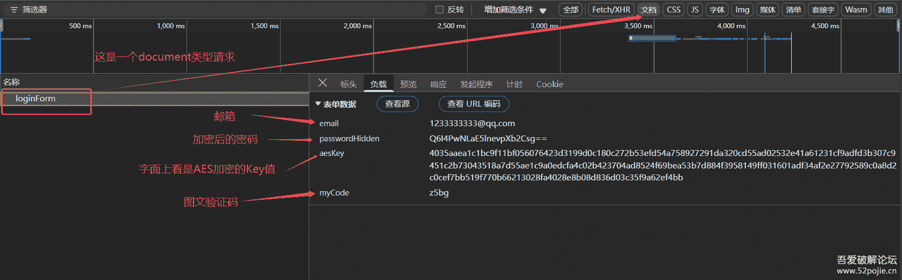

loginTest.png (79.09 KB, 下载次数: 4)

[href="forum.php?mod=attachment&aid=MjgwNzIzM3wzZWJiNGJkMXwxNzkzNTcwNTEzfDE2ODA4NnwyMDY0NTgz&nothumb=yes" target="_blank"](https://www.52pojie.cn/forum.php?mod=attachment&aid=MjgwNzIzM3wzZWJiNGJkMXwxNzkzNTcwNTEzfDE2ODA4NnwyMDY0NTgz&nothumb=yes)

2025-10-8 22:04 上传

多次抓包测试，发现携带参数动态变化，我们模拟参数生成错误的情况下请求

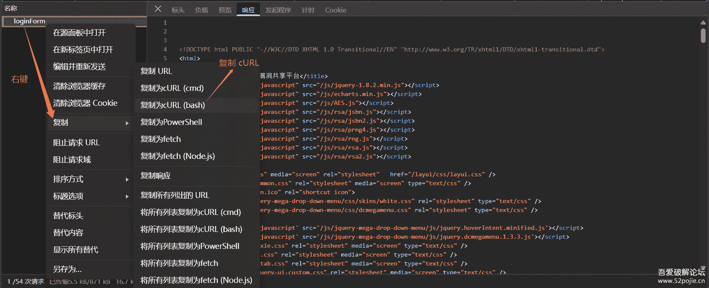

copycURL.png (354.16 KB, 下载次数: 4)

[href="forum.php?mod=attachment&aid=MjgwNzIzNHw0MzJhM2MwZXwxNzkzNTcwNTEzfDE2ODA4NnwyMDY0NTgz&nothumb=yes" target="_blank"](https://www.52pojie.cn/forum.php?mod=attachment&aid=MjgwNzIzNHw0MzJhM2MwZXwxNzkzNTcwNTEzfDE2ODA4NnwyMDY0NTgz&nothumb=yes)

2025-10-8 22:05 上传

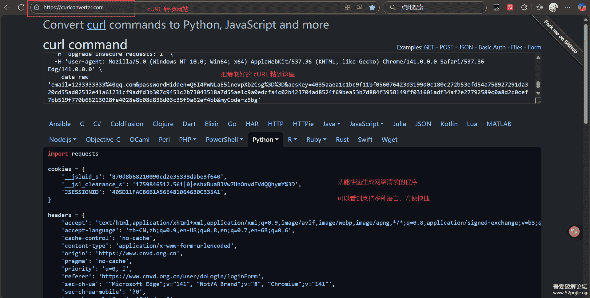

quickget.png (233.52 KB, 下载次数: 4)

[href="forum.php?mod=attachment&aid=MjgwNzIzNXw1NjBiMjJiZXwxNzkzNTcwNTEzfDE2ODA4NnwyMDY0NTgz&nothumb=yes" target="_blank"](https://www.52pojie.cn/forum.php?mod=attachment&aid=MjgwNzIzNXw1NjBiMjJiZXwxNzkzNTcwNTEzfDE2ODA4NnwyMDY0NTgz&nothumb=yes)

2025-10-8 22:05 上传

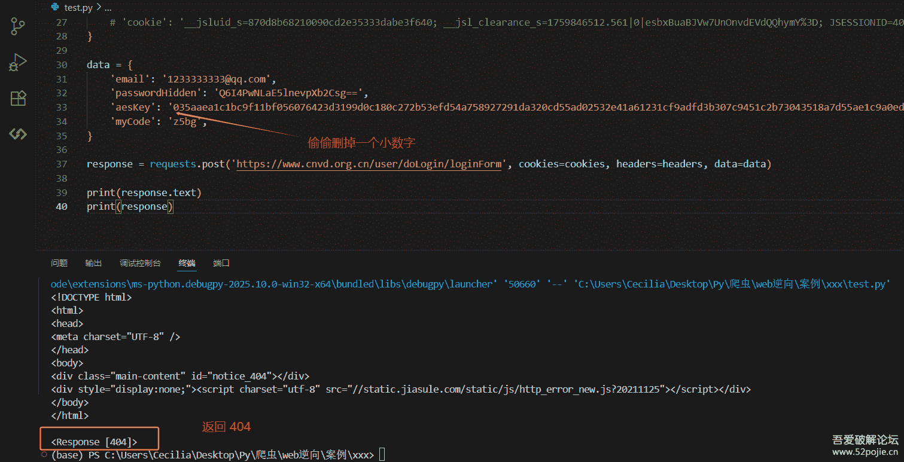

errorData.png (96.79 KB, 下载次数: 4)

[href="forum.php?mod=attachment&aid=MjgwNzIzNnwyYTM1NDVlZXwxNzkzNTcwNTEzfDE2ODA4NnwyMDY0NTgz&nothumb=yes" target="_blank"](https://www.52pojie.cn/forum.php?mod=attachment&aid=MjgwNzIzNnwyYTM1NDVlZXwxNzkzNTcwNTEzfDE2ODA4NnwyMDY0NTgz&nothumb=yes)

2025-10-8 22:05 上传

确定了参数正确加密，状态码 200，返回 HTML 文档，否则 404

## 2. 寻参

由 `document` 发出的请求，不能用常用的 `xhr` 断点，幸运的是，此站没有混淆，可以直接全局搜关键词

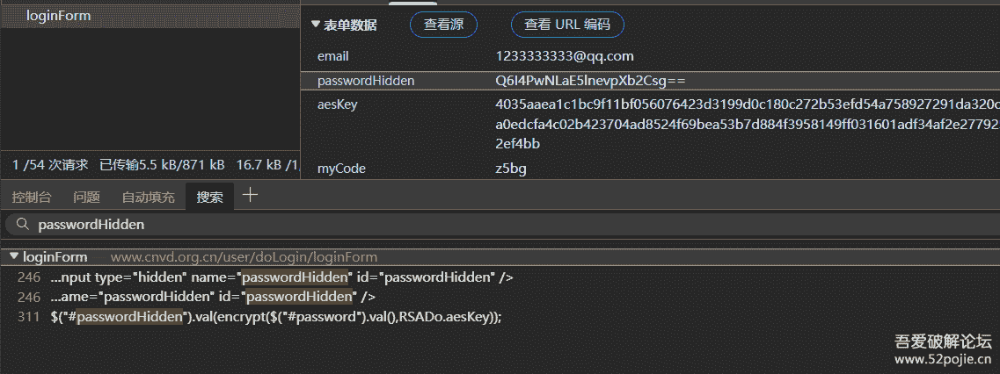

searchWord.png (58.64 KB, 下载次数: 3)

[href="forum.php?mod=attachment&aid=MjgwNzIzN3w2YWU1NWEyY3wxNzkzNTcwNTEzfDE2ODA4NnwyMDY0NTgz&nothumb=yes" target="_blank"](https://www.52pojie.cn/forum.php?mod=attachment&aid=MjgwNzIzN3w2YWU1NWEyY3wxNzkzNTcwNTEzfDE2ODA4NnwyMDY0NTgz&nothumb=yes)

2025-10-8 22:06 上传

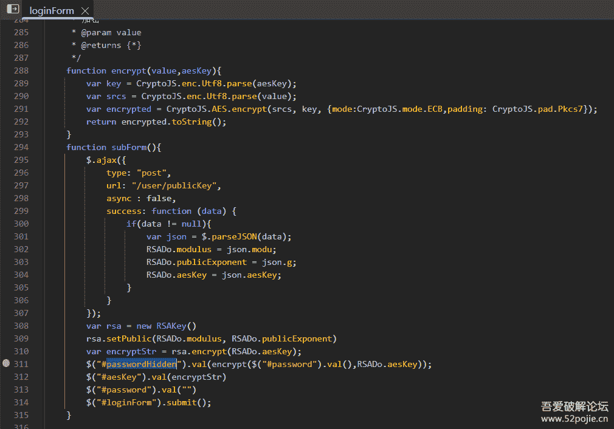

parse.png (89.75 KB, 下载次数: 5)

[href="forum.php?mod=attachment&aid=MjgwNzIzOHxkNWNkNjE3Y3wxNzkzNTcwNTEzfDE2ODA4NnwyMDY0NTgz&nothumb=yes" target="_blank"](https://www.52pojie.cn/forum.php?mod=attachment&aid=MjgwNzIzOHxkNWNkNjE3Y3wxNzkzNTcwNTEzfDE2ODA4NnwyMDY0NTgz&nothumb=yes)

2025-10-8 22:07 上传

得知加密逻辑就在返回的文档中

## 3. 扣代码

初步扣下代码

```
function encrypt(value,aesKey){
    var key = CryptoJS.enc.Utf8.parse(aesKey);
    var srcs = CryptoJS.enc.Utf8.parse(value);
    var encrypted = CryptoJS.AES.encrypt(srcs, key, {mode:CryptoJS.mode.ECB,padding: CryptoJS.pad.Pkcs7});
    return encrypted.toString();
}

var rsa = new RSAKey()
rsa.setPublic(RSADo.modulus, RSADo.publicExponent)

var encryptStr = rsa.encrypt(RSADo.aesKey);         // 这个就是用于发送的 aesKey 字段值
var passwordHidden = encrypt("123456",RSADo.aesKey);  // $("#passwordHidden").val(encrypt($("#password").val(),RSADo.aesKey));
```

把 `RSADo.aesKey` 固定住，引入 `crypto-js` 包，`passwordHidden` 参数就生成成功了，接下来要解决 `RSADo` 对象的生成

在寻参过程中发现，`RSADo` 对象的赋值，是在 `jQuery` 的 `ajax` 请求成功的回调函数中进行的

```
$.ajax({

    type: "post",

    url: "/user/publicKey",

    async : false,

    success: function (data) {

        if(data != null){

            var json = $.parseJSON(data);

            RSADo.modulus = json.modu;      // 在这里

            RSADo.publicExponent = json.g;

            RSADo.aesKey = json.aesKey;

        }
    }

});
```

也就是说，`RSADo` 对象的参数都由服务器下发，接口为 `/user/publicKey`，这样 `RSADo` 对象的属性值也解决了

然后是解决 `RSAKey` 的实例化对象 `rsa`，这个对象调用 `rsa.encrypt` 方法，传入 `RSADo.aesKey`，得到用于发送的 `aesKey` 字段值

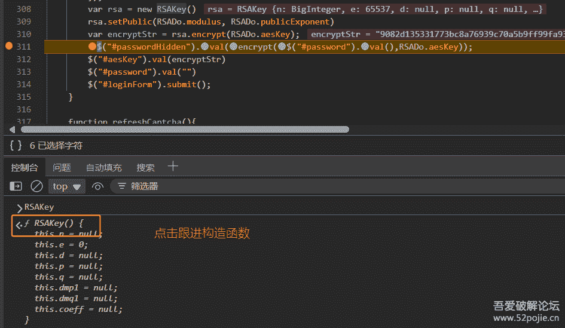

RSAKey.png (65.99 KB, 下载次数: 4)

[href="forum.php?mod=attachment&aid=MjgwNzIzOXxjNzRhMjNjM3wxNzkzNTcwNTEzfDE2ODA4NnwyMDY0NTgz&nothumb=yes" target="_blank"](https://www.52pojie.cn/forum.php?mod=attachment&aid=MjgwNzIzOXxjNzRhMjNjM3wxNzkzNTcwNTEzfDE2ODA4NnwyMDY0NTgz&nothumb=yes)

2025-10-8 22:09 上传

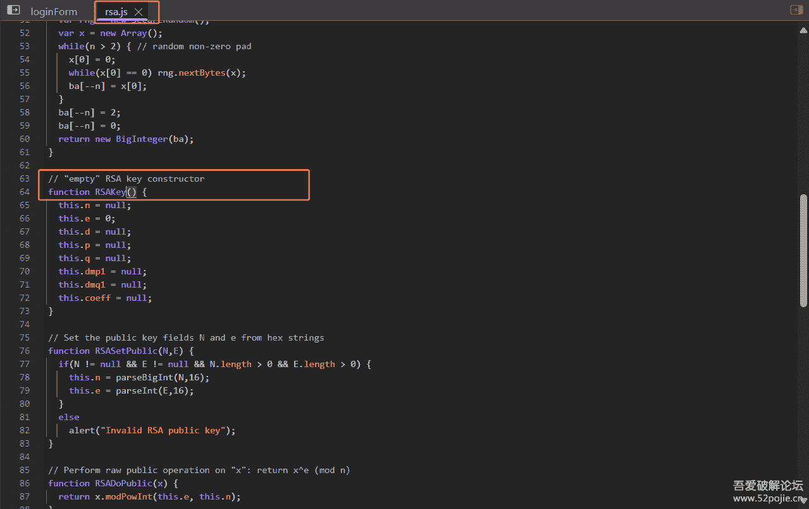

rsa.png (76.64 KB, 下载次数: 3)

[href="forum.php?mod=attachment&aid=MjgwNzI0MHxiNGY4ZjM1M3wxNzkzNTcwNTEzfDE2ODA4NnwyMDY0NTgz&nothumb=yes" target="_blank"](https://www.52pojie.cn/forum.php?mod=attachment&aid=MjgwNzI0MHxiNGY4ZjM1M3wxNzkzNTcwNTEzfDE2ODA4NnwyMDY0NTgz&nothumb=yes)

2025-10-8 22:09 上传

可以看到跟进了 `rsa.js` 文件，百来行，直接全扣下来，将构造函数 `RSAKey` 以 Nodejs 模块导出

```
// 扣下的全部 rsa.js

module.exports = {
    RSAKey: RSAKey
}
```

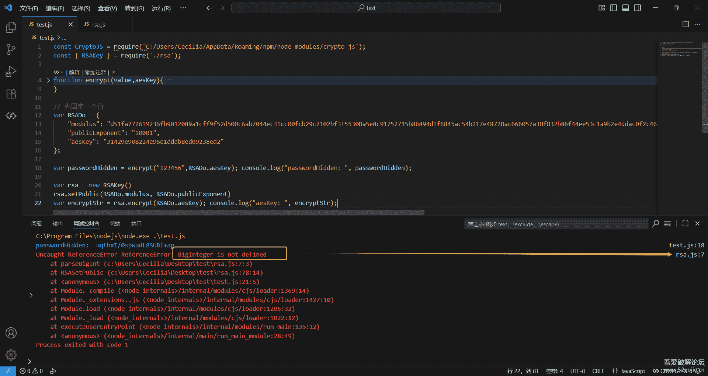

bigInteger.png (174.13 KB, 下载次数: 4)

[href="forum.php?mod=attachment&aid=MjgwNzI0MXxkNDdjYzMzZHwxNzkzNTcwNTEzfDE2ODA4NnwyMDY0NTgz&nothumb=yes" target="_blank"](https://www.52pojie.cn/forum.php?mod=attachment&aid=MjgwNzI0MXxkNDdjYzMzZHwxNzkzNTcwNTEzfDE2ODA4NnwyMDY0NTgz&nothumb=yes)

2025-10-8 22:10 上传

试执行，`rsa.js` 缺了 `BigInteger`

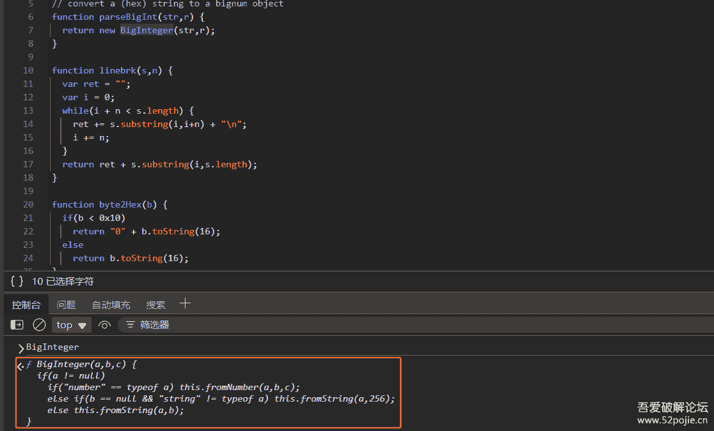

Big.png (63.15 KB, 下载次数: 3)

[href="forum.php?mod=attachment&aid=MjgwNzI0MnxkMzhhZmQxNnwxNzkzNTcwNTEzfDE2ODA4NnwyMDY0NTgz&nothumb=yes" target="_blank"](https://www.52pojie.cn/forum.php?mod=attachment&aid=MjgwNzI0MnxkMzhhZmQxNnwxNzkzNTcwNTEzfDE2ODA4NnwyMDY0NTgz&nothumb=yes)

2025-10-8 22:11 上传

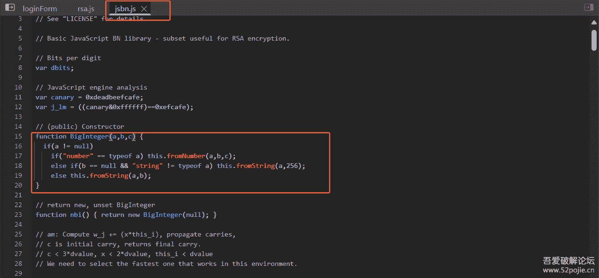

jsbn.png (66.61 KB, 下载次数: 4)

[href="forum.php?mod=attachment&aid=MjgwNzI0M3w5ZTIxZWU4NHwxNzkzNTcwNTEzfDE2ODA4NnwyMDY0NTgz&nothumb=yes" target="_blank"](https://www.52pojie.cn/forum.php?mod=attachment&aid=MjgwNzI0M3w5ZTIxZWU4NHwxNzkzNTcwNTEzfDE2ODA4NnwyMDY0NTgz&nothumb=yes)

2025-10-8 22:11 上传

跟上面一样的步骤，全扣下，以 Nodejs 模块导出，谁缺东西就导出给它（如 `rsa.js` 缺 `BigInteger`，就在 `rsa.js` 内导入 `BigInteger`）

就这样一直扣，直到正确出值，要扣下 `rsa.js`、`jsbn.js`、`rng.js`、`prng.js` 共4个文件

运行时会出现 `navigator` 等对象未定义，新建一个 `envs.js`，在里面定义好缺失的环境，再将此文件引入缺了环境的模块中

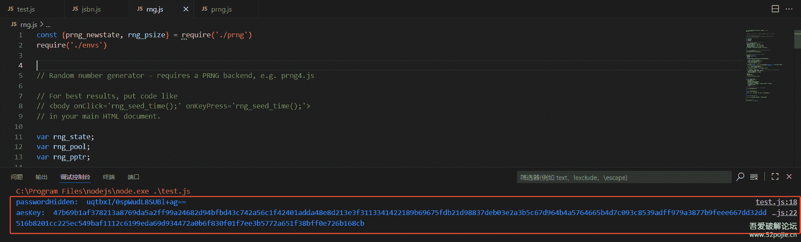

success.png (86.14 KB, 下载次数: 4)

[href="forum.php?mod=attachment&aid=MjgwNzI0NHw0ZjhjNjlhZXwxNzkzNTcwNTEzfDE2ODA4NnwyMDY0NTgz&nothumb=yes" target="_blank"](https://www.52pojie.cn/forum.php?mod=attachment&aid=MjgwNzI0NHw0ZjhjNjlhZXwxNzkzNTcwNTEzfDE2ODA4NnwyMDY0NTgz&nothumb=yes)

2025-10-8 22:12 上传

## 4. 图文验证码

此站的验证码很简单，获取验证码图片的二进制数据，然后使用 `dddocr` 识别即可

```
from ddddocr import DdddOcr

# ......

ocr = DdddOcr(show_ad=False)

codeImg = requests.get('https://www.cnvd.org.cn/common/myCodeNew', cookies=cookies, headers=codeHeaders)

ocrCode = ocr.classification(codeImg.content)
```

还有，拿验证码图片和 `publicKey` 时，`cookie` 会过期而拿不到东西，记得更新一下 `cookie`

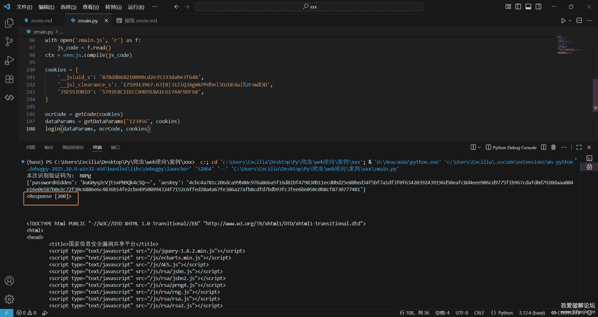

finally.png (165.14 KB, 下载次数: 2)

[href="forum.php?mod=attachment&aid=MjgwNzI0NXw5Mjk3NjJjZnwxNzkzNTcwNTEzfDE2ODA4NnwyMDY0NTgz&nothumb=yes" target="_blank"](https://www.52pojie.cn/forum.php?mod=attachment&aid=MjgwNzI0NXw5Mjk3NjJjZnwxNzkzNTcwNTEzfDE2ODA4NnwyMDY0NTgz&nothumb=yes)

2025-10-8 22:13 上传


[href="forum.php?mod=attachment&aid=MjgwNzI0Nnw3MWIxNDlmYXwxNzkzNTcwNTEzfDE2ODA4NnwyMDY0NTgz" target="_blank"](https://www.52pojie.cn/forum.php?mod=attachment&aid=MjgwNzI0Nnw3MWIxNDlmYXwxNzkzNTcwNTEzfDE2ODA4NnwyMDY0NTgz)

(10.82 KB, 下载次数: 16)

2025-10-8 22:13 上传

点击文件名下载附件

下载积分: 吾爱币 -1 CB
