# [.NET逆向] 关于一个CrackMe的逆向分析【可能不是很简单的】

- 原帖：[https://www.52pojie.cn/forum.php?mod=viewthread&tid=2065222](https://www.52pojie.cn/forum.php?mod=viewthread&tid=2065222)
- 抓取时间：2026-11-01T22:01:49

大家好，我是 wasdzjh，好久没有发表文章了，该更新了，索性就有时间写一篇。这个我觉得很有意义，废话不说了，开始教程。（如果有不对的，请评论出来）大家一起进步。

---

- 环境：Windows 11 64 位
- 工具：`die`（查壳）、`dnspy`（调试）、`ExtremeDumper`（[https://www.52pojie.cn/forum-5-1.html](https://www.52pojie.cn/forum-5-1.html)）
- 被逆向的软件：[https://www.52pojie.cn/thread-1933960-1-1.html](https://www.52pojie.cn/thread-1933960-1-1.html)

## 开始分析

### 第一步：信息分析提取

先分析软件，看软件的要求是什么，提取软件的信息。

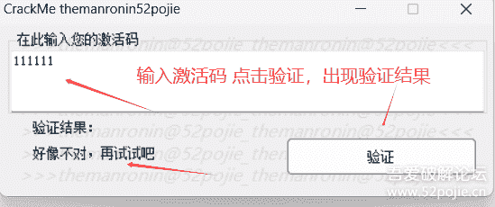

`1.png` (62.43 KB, 下载次数: 2) · [下载附件](https://www.52pojie.cn/forum.php?mod=attachment&aid=MjgwNzYwMHxiODBmYzg4ZHwxNzkzNTcwNTA3fDE2ODA4NnwyMDY1MjIy&nothumb=yes) · 1 · 2025-10-11 12:47 上传

我们可以了解到，软件有文本输入框，有错误提示，还有一个验证按钮。正常想法都是下文本断点、跟对话框断点。这个软件没有出现对话框，断点作废了。我们先查壳看看。

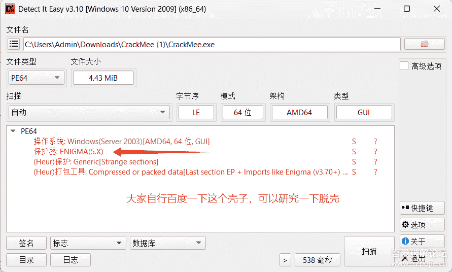

`查壳2.png` (47.81 KB, 下载次数: 1) · [下载附件](https://www.52pojie.cn/forum.php?mod=attachment&aid=MjgwNzYwMXwwZDIyYTg1YXwxNzkzNTcwNTA3fDE2ODA4NnwyMDY1MjIy&nothumb=yes) · 2 · 2025-10-11 13:00 上传

这个 `ENIGMA(5.X)` 大家可以自己百度一些脱壳教程，我也比较懒，也研究不出来这个脱壳，索性用工具脱（`ExtremeDumper`）。当然有的人又会问为啥用这些工具，其实我也比较菜。这些问题就留给大牛回答。

用这个软件脱壳需要注意的是你要先把软件打开，不然的话 `ExtremeDumper` 搜不到，看图：

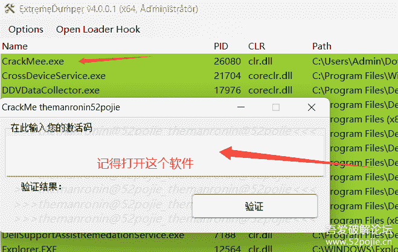

`打开.png` (107.41 KB, 下载次数: 3) · [下载附件](https://www.52pojie.cn/forum.php?mod=attachment&aid=MjgwNzYwNXxjMTE1N2Q5MnwxNzkzNTcwNTA3fDE2ODA4NnwyMDY1MjIy&nothumb=yes) · 打开 · 2025-10-11 13:57 上传

### 第二步：`ExtremeDumper` 脱壳

选中 `CracMee.exe`，右键 → `Dump Selected Process` → 保存文件即可，后面就可以再次查壳，看脱得怎么样：

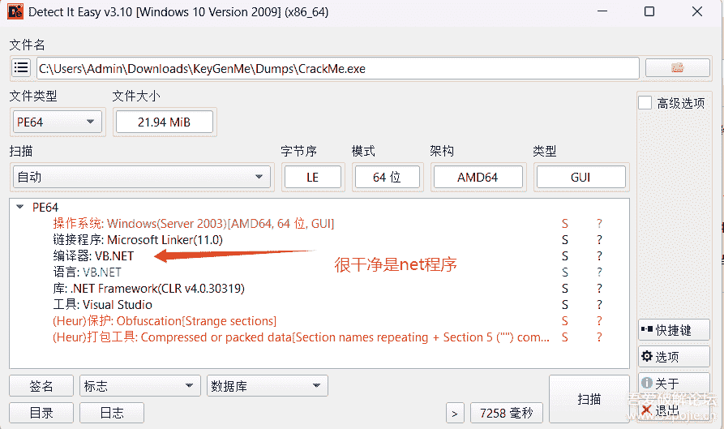

`脱1.png` (51.3 KB, 下载次数: 3) · [下载附件](https://www.52pojie.cn/forum.php?mod=attachment&aid=MjgwNzYwNnxmOTI5ZmRmNnwxNzkzNTcwNTA3fDE2ODA4NnwyMDY1MjIy&nothumb=yes) · 4 · 2025-10-11 14:04 上传

脱得很干净，是 .NET 程序写的。知道是 .NET 程序写的，那就想到了 `dnspy` 这个软件，接下来就可以分析了。

### 第三步：`dnspy` 分析

要知道 .NET 程序通常都会混淆，文件都很大，所以去混淆还是有必要的，看图：

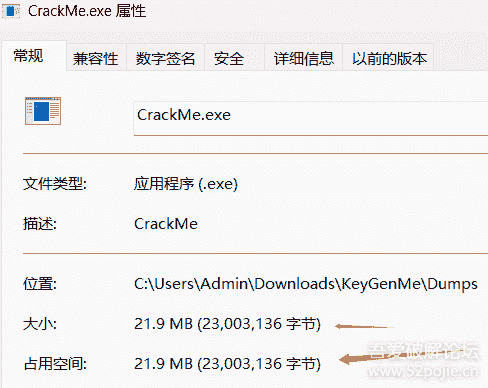

`大小5.png` (27.4 KB, 下载次数: 1) · [下载附件](https://www.52pojie.cn/forum.php?mod=attachment&aid=MjgwNzYwOHxhY2JkMzdkMHwxNzkzNTcwNTA3fDE2ODA4NnwyMDY1MjIy&nothumb=yes) · 大 · 2025-10-11 14:12 上传

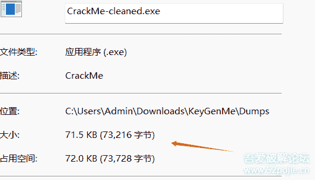

`小3.png` (19.85 KB, 下载次数: 2) · [下载附件](https://www.52pojie.cn/forum.php?mod=attachment&aid=MjgwNzYwOXw0Njk4NzgyYnwxNzkzNTcwNTA3fDE2ODA4NnwyMDY1MjIy&nothumb=yes) · 小 · 2025-10-11 14:12 上传

很明显去了混淆之后软件的大小就变了，去混淆的软件是：`de4dot`，直接将软件拖进去，出来后软件后缀会带 `-cleaned` 的字符。

当你脱壳后再次打开软件，软件会提示被更改了，存在自校验，如图：

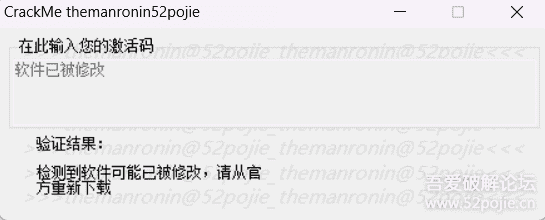

`存在0.png` (63.88 KB, 下载次数: 2) · [下载附件](https://www.52pojie.cn/forum.php?mod=attachment&aid=MjgwNzYxMHw4MjI3NDdjY3wxNzkzNTcwNTA3fDE2ODA4NnwyMDY1MjIy&nothumb=yes) · 3 · 2025-10-11 14:22 上传

将软件拖到 `dnspy`，查找“软件已被修改”，如图：

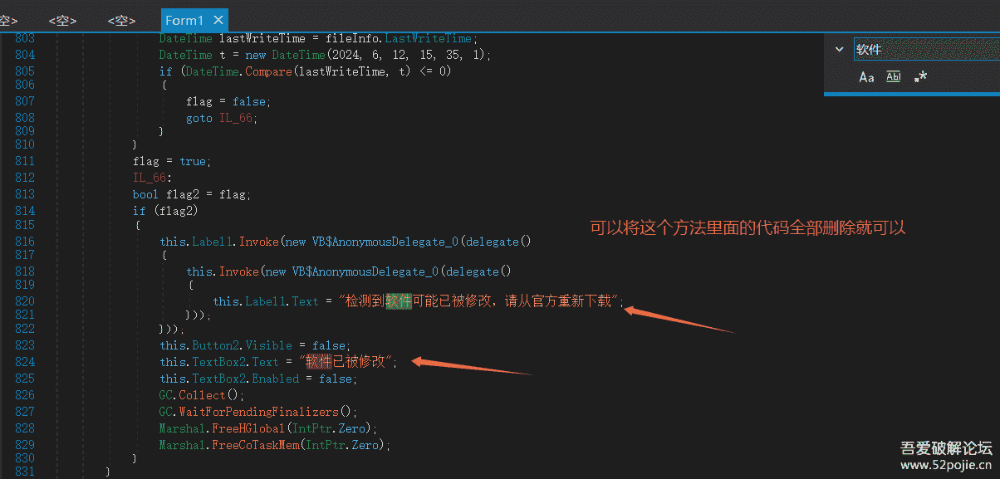

`删除.png` (47.17 KB, 下载次数: 2) · [下载附件](https://www.52pojie.cn/forum.php?mod=attachment&aid=MjgwNzYxMXw3NmU5YmViM3wxNzkzNTcwNTA3fDE2ODA4NnwyMDY1MjIy&nothumb=yes) · 删除 · 2025-10-11 14:30 上传

可以将这些代码直接删除，重新编译即可。步骤：随便找一行，然后右键 → 编辑方法 → 删除代码 → 编译，如图：

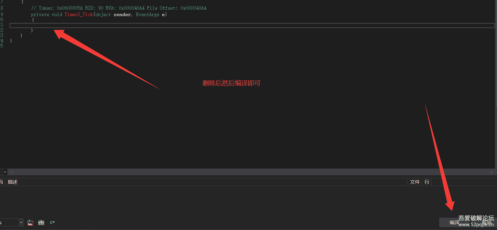

`编译.png` (36.01 KB, 下载次数: 2) · [下载附件](https://www.52pojie.cn/forum.php?mod=attachment&aid=MjgwNzYxNXwyZGU5OWRjNnwxNzkzNTcwNTA3fDE2ODA4NnwyMDY1MjIy&nothumb=yes) · 编译 · 2025-10-11 14:57 上传

然后就是：文件 → 全部保存 → 确定。至此自校验已经解决，接下来就是找激活码的时候。也可以不找激活码，直接爆破也行。

### 第一种方法：爆破（不找激活码）

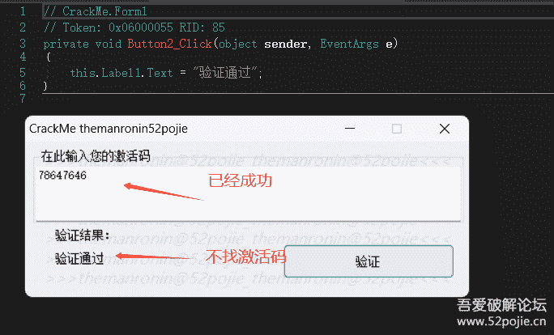

`不找.png` (68.42 KB, 下载次数: 2) · [下载附件](https://www.52pojie.cn/forum.php?mod=attachment&aid=MjgwNzY2MXw2YTMzODNiNHwxNzkzNTcwNTA3fDE2ODA4NnwyMDY1MjIy&nothumb=yes) · 45 · 2025-10-11 15:16 上传

### 第二种方法：找激活码（断点调试）

找到 `button2_click` 方法中的 `CompareString`，然后点进去这个方法，如图：

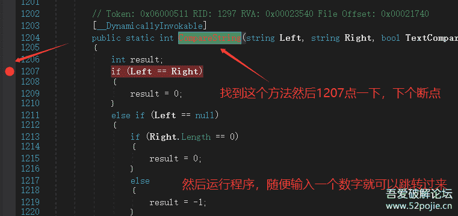

`断点6.png` (33.58 KB, 下载次数: 2) · [下载附件](https://www.52pojie.cn/forum.php?mod=attachment&aid=MjgwNzcwMXw4NTIzMTQ2ZHwxNzkzNTcwNTA3fDE2ODA4NnwyMDY1MjIy&nothumb=yes) · 46 · 2025-10-11 15:23 上传

然后点击启动，输入数字 `111`，就可以看到激活码，如图：

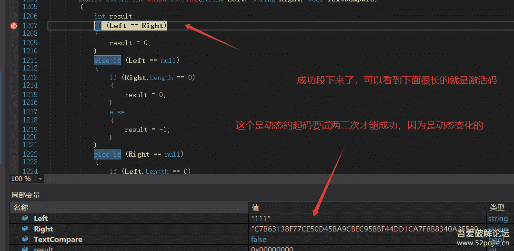

`成功.png` (53.13 KB, 下载次数: 2) · [下载附件](https://www.52pojie.cn/forum.php?mod=attachment&aid=MjgwNzcxMXxhNjFjNTBmMHwxNzkzNTcwNTA3fDE2ODA4NnwyMDY1MjIy&nothumb=yes) · 成功 · 2025-10-11 15:31 上传

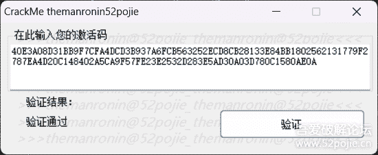

`成11.png` (73.33 KB, 下载次数: 0) · [下载附件](https://www.52pojie.cn/forum.php?mod=attachment&aid=MjgwNzcxNnxiZWZhYTVkZHwxNzkzNTcwNTA3fDE2ODA4NnwyMDY1MjIy&nothumb=yes) · 成 · 2025-10-11 15:33 上传

至此已经成功分析出来了，破解很快，就是写破文比较慢啊，费时间。如果大家喜欢我的破文，请记得打赏点、加热心什么的。大家有什么不懂的可以留言，文章只是献给跟我一样想进步的菜鸟。

大佬就别看了。大佬可以回答一下菜鸟问的问题。
