# [Web逆向] 某平台登录：加速乐

- 原帖: [https://www.52pojie.cn/forum.php?mod=viewthread&tid=2065287](https://www.52pojie.cn/forum.php?mod=viewthread&tid=2065287)
- 抓取时间: 2026-11-01T22:01:48

> `aHR0cHM6Ly93d3cuY252ZC5vcmcuY24vdXNlci9kb0xvZ2luL2xvZ2luRm9ybQ==`

各位老师傅早上、上午、中午、下午、晚上好啊

之前的一篇拙作，最后提到了 `cookie` 是有时间限的（跳转文章 -> [https://www.52pojie.cn/thread-2064583-1-1.html](https://www.52pojie.cn/thread-2064583-1-1.html)）

[大佬](https://www.52pojie.cn/home.php?mod=follow&uid=2241123)提醒了我，此站 `cookie` 使用了加速乐防护

说来惭愧，我挠头苦学几个月，竟从未听闻加速乐，瑞数、极验等也仅仅是听说过

既然有缘相遇，我们就以从未接触过加速乐的视角，慢慢摸索

## 观察 `cookie`

打开目标网站

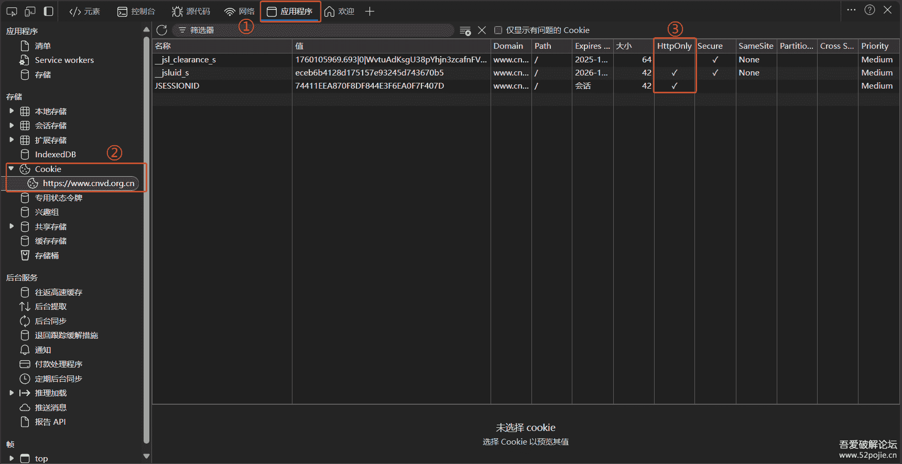

`cookies.png` (99.14 KB, 下载次数: 1)

[附件](https://www.52pojie.cn/forum.php?mod=attachment&aid=MjgwNzc2OHxiZTU4MjJhNnwxNzkzNTcwNTA2fDE2ODA4NnwyMDY1Mjg3&nothumb=yes)

2025-10-11 21:19 上传

`HttpOnly` 字段为 `true`，说明该 `cookie` 值是由服务器下发的，在响应头的 `Set-Cookie` 字段中，为空则是客户端 js 生成的

已知有 `cookie` 字段：

```
cookies = {
    '__jsl_clearance_s': '1760105969.693|0|WvtuAdKsgU38pYhjn3zcafnFVG4%3D', // 本地 js 生成
    '__jsluid_s': 'eceb6b4128d175157e93245d743670b5',   // 服务器下发
    'JSESSIONID': '74411EEA870F8DF844E3F6EA0F7F407D'    // 服务器下发
}
```

我们清空此站 `cookie`，刷新，让服务器下发新的 `cookie`，同时抓包观察

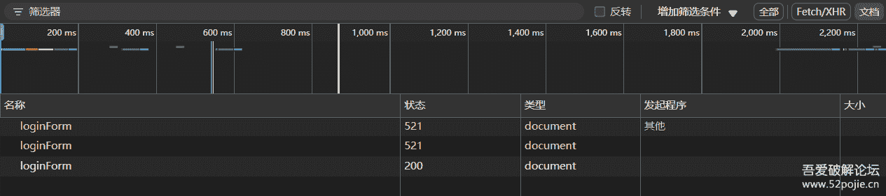

`newCookie.png` (27.97 KB, 下载次数: 1)

[附件](https://www.52pojie.cn/forum.php?mod=attachment&aid=MjgwNzc2OXwxNWZiNjcwZXwxNzkzNTcwNTA2fDE2ODA4NnwyMDY1Mjg3&nothumb=yes)

2025-10-11 21:21 上传

发现了 3 个可疑请求，观察响应内容，同时也观察响应头的 `Set-Cookie` 字段

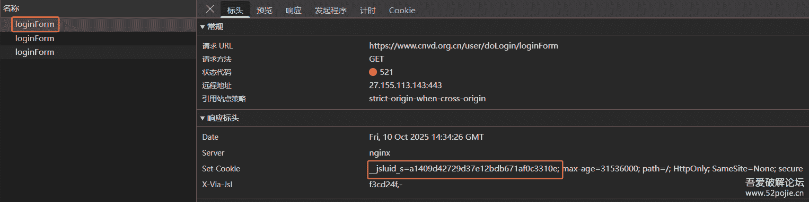

`setcookie1.png` (42.47 KB, 下载次数: 2)

[附件](https://www.52pojie.cn/forum.php?mod=attachment&aid=MjgwNzc3M3xlZWZiOTAzMXwxNzkzNTcwNTA2fDE2ODA4NnwyMDY1Mjg3&nothumb=yes)

2025-10-11 21:22 上传

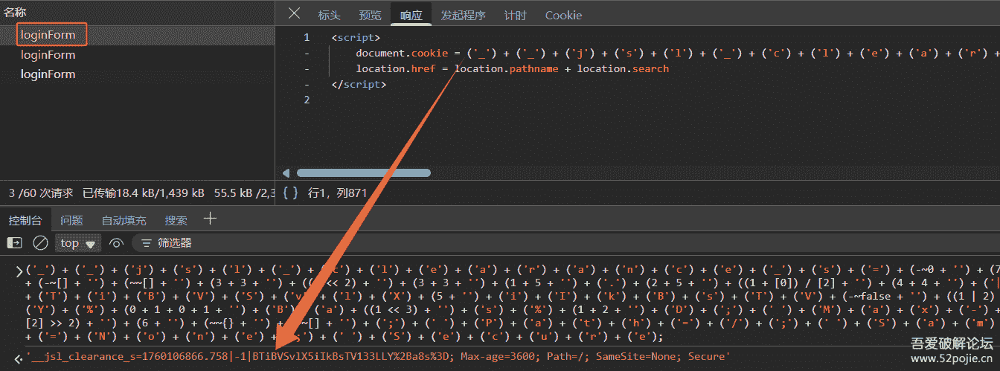

`setcookie2.png` (67 KB, 下载次数: 2)

[附件](https://www.52pojie.cn/forum.php?mod=attachment&aid=MjgwNzc3NHxhMDY1MWE4MnwxNzkzNTcwNTA2fDE2ODA4NnwyMDY1Mjg3&nothumb=yes)

2025-10-11 21:23 上传

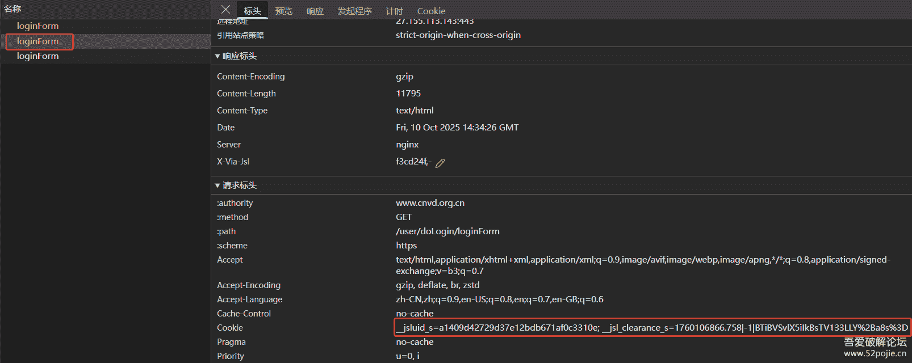

`setcookie3.png` (68.29 KB, 下载次数: 2)

[附件](https://www.52pojie.cn/forum.php?mod=attachment&aid=MjgwNzc3MHxiNDg3ZTkxYnwxNzkzNTcwNTA2fDE2ODA4NnwyMDY1Mjg3&nothumb=yes)

2025-10-11 21:22 上传

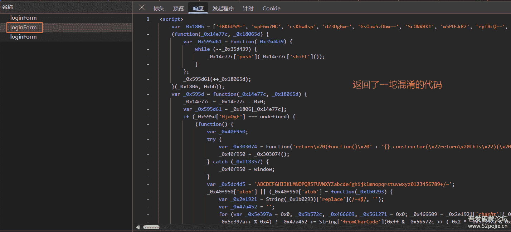

`setcookie4.png` (106.04 KB, 下载次数: 2)

[附件](https://www.52pojie.cn/forum.php?mod=attachment&aid=MjgwNzc3MXxkYjYyYjY3MnwxNzkzNTcwNTA2fDE2ODA4NnwyMDY1Mjg3&nothumb=yes)

2025-10-11 21:22 上传

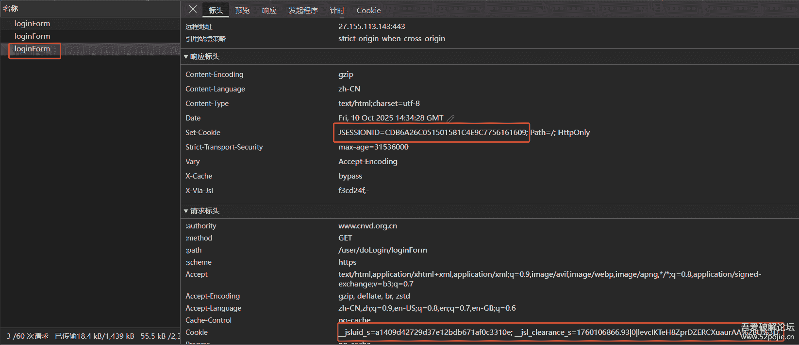

`setcookie5.png` (84.97 KB, 下载次数: 2)

[附件](https://www.52pojie.cn/forum.php?mod=attachment&aid=MjgwNzc3MnwzNDJhNzhmZHwxNzkzNTcwNTA2fDE2ODA4NnwyMDY1Mjg3&nothumb=yes)

2025-10-11 21:22 上传

我们理清过程：

- （1）响应头 `Set-Cookie` 字段得到 `__jsluid_s`，响应的混淆代码执行得到 `__jsl_clearance_s`，但此时 `__jsl_clearance_s` 还不是最终的值
- （2）拿了（1）的 `__jsluid_s` 和 `__jsl_clearance_s` 作为 `cookie`，请求得到了 1 份混淆的 js
- （3）以 `__jsluid_s` 和一个新的 `__jsl_clearance_s` 作为 `cookie` 去请求，这个 `__jsl_clearance_s` 确认为最终值，响应头 `Set-Cookie` 字段得到 `JSESSIONID`

此地无银三百两，（3）的最终 `__jsl_clearance_s` 字段，怀疑就在（2）的混淆 js 中生成，毕竟没东西干嘛要混淆呢

## Hook `document.cookie`

生成的 `cookie` 值总归是要赋值给 `document.cookie` 的，使用油猴脚本 hook 一下

```
(function () {
    var cookieTemp = '';
    Object.defineProperty(document, 'cookie', {
        set: function (val) {
            console.log(val);
            if (val.indexOf("__jsl_clearance_s=") != -1) {
                debugger;
            }
            cookieTemp = val;
            return val;
        },
        get: function () {
            return cookieTemp;
        }
    })
})();
```

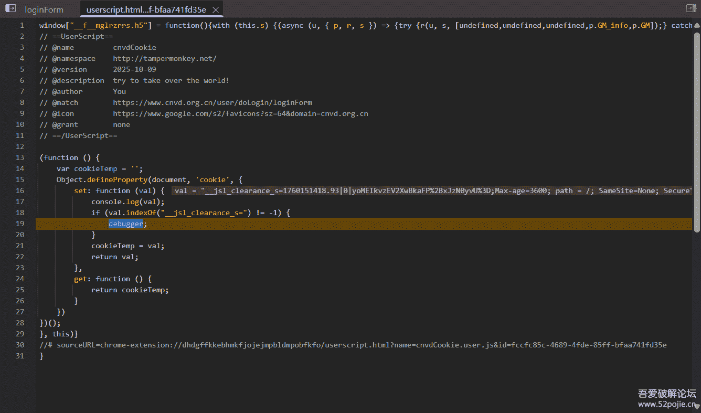

`hook1.png` (86.39 KB, 下载次数: 2)

[附件](https://www.52pojie.cn/forum.php?mod=attachment&aid=MjgwNzc3NnxmYmMxYWQ5NHwxNzkzNTcwNTA2fDE2ODA4NnwyMDY1Mjg3&nothumb=yes)

2025-10-11 21:28 上传

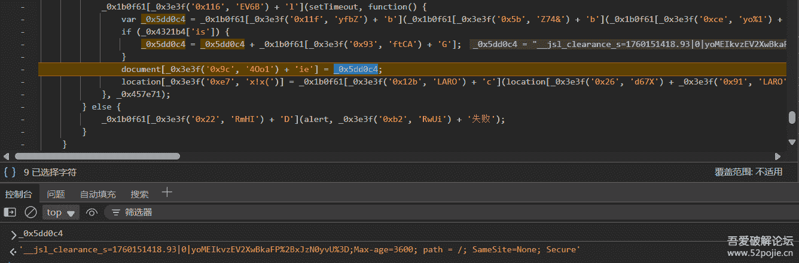

`hook2.png` (69.87 KB, 下载次数: 2)

[附件](https://www.52pojie.cn/forum.php?mod=attachment&aid=MjgwNzc3NXwyZjBiYzg3Y3wxNzkzNTcwNTA2fDE2ODA4NnwyMDY1Mjg3&nothumb=yes)

2025-10-11 21:28 上传

这里有一些问题（至少在我的机子上是这样）：

- 在（1）响应的内容有对 `document.cookie` 的赋值，但并未触发 hook；
- 试图放开断点，对比最终结果时，会导致（2）重复请求，关闭油猴脚本，则正常请求，像是被检测 hook 了

但是无所谓，我们可以先把当前断住的逻辑补全，然后关闭油猴脚本，使用本地结果与浏览器结果对比，看看是否一致

## 扣代码时间

在扣代码前，一般先看代码的整体结构，注意：（2）接口返回的混淆代码，变量名和混淆数组似乎会动态变化

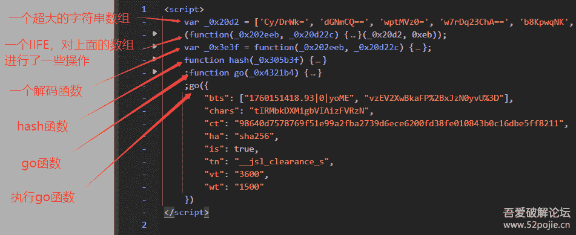

`structure.png` (72.81 KB, 下载次数: 2)

[附件](https://www.52pojie.cn/forum.php?mod=attachment&aid=MjgwNzc3N3w4N2RjZDE2OXwxNzkzNTcwNTA2fDE2ODA4NnwyMDY1Mjg3&nothumb=yes)

2025-10-11 21:30 上传

前三部分能看出是明显的 ob 混淆，首先有一个大数组，然后有一个自执行对数组元素重排，最后有一个解码函数，传入一个参数，解码得到一个字符串

这三部分全扣下，这样后续的代码就不需要再考虑混淆了，直接看逻辑

```
// 省略写法，实际记得扣干净
var _0x20d2 = ['Cy/DrWk=', 'dGNmCQ==', 'wptMVz0=', '......']
(function(_0x202eeb, _0x20d22c) {}(_0x20d2, 0xeb));
var _0x3e3f = function(_0x202eeb, _0x20d22c) {};
```

然后看断点处

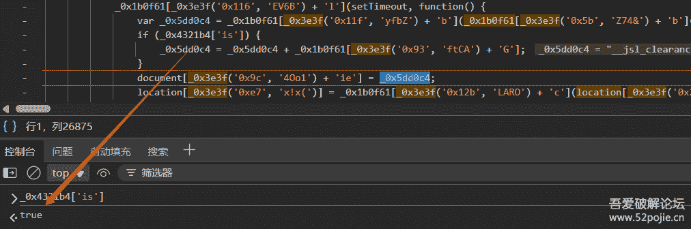

`jsl1.png` (52.23 KB, 下载次数: 1)

[附件](https://www.52pojie.cn/forum.php?mod=attachment&aid=MjgwNzc3OHxiZGYzZGIwOHwxNzkzNTcwNTA2fDE2ODA4NnwyMDY1Mjg3&nothumb=yes)

2025-10-11 21:31 上传

判断条件常驻为 `true`，扣下试执行

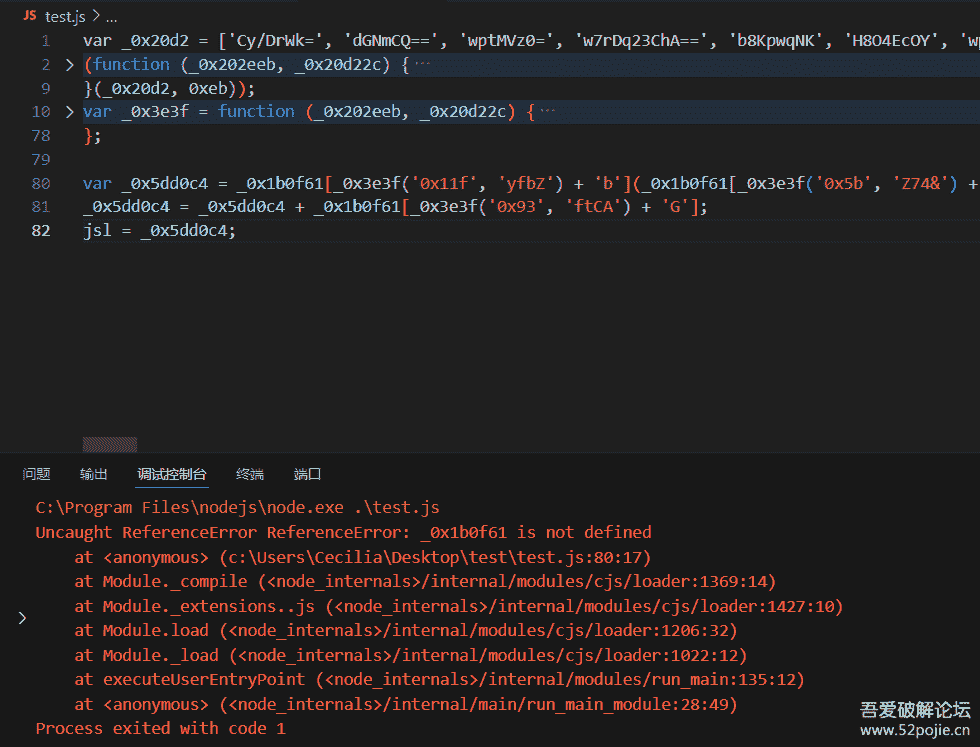

`jsl2.png` (84.78 KB, 下载次数: 2)

[附件](https://www.52pojie.cn/forum.php?mod=attachment&aid=MjgwNzc3OXwxN2IzNGFiM3wxNzkzNTcwNTA2fDE2ODA4NnwyMDY1Mjg3&nothumb=yes)

2025-10-11 21:32 上传

缺什么就搜索，扣下来，最后的类似结构：

```
var _0x20d2 = ['Cy/DrWk=', 'dGNmCQ==', 'wptMVz0=', '......']

(function(_0x202eeb, _0x20d22c) {}(_0x20d2, 0xeb));

var _0x3e3f = function(_0x202eeb, _0x20d22c) {};

function hash(_0x305b3f) {}

_0x4321b4 = {
    "bts": ["1760151418.93|0|yoME", "vzEV2XwBkaFP%2BxJzN0yvU%3D"],
    "chars": "tIRMbkDXMigbVIAizFVRzN",
    "ct": "98640d7578769f51e99a2fba2739d6ece6200fd38fe010843b0c16dbe5ff8211",
    "ha": "sha256",
    "is": true,
    "tn": "__jsl_clearance_s",
    "vt": "3600",
    "wt": "1500"
};

var _0x150902 = {};

_0x150902[_0x3e3f('0x8c', 'CN]8') + 'f'] = function(_0x469a9b, _0x14a5b2) {
    return _0x469a9b != _0x14a5b2;
}

// ......

var _0x1b0f61 = _0x150902;

var _0x2f69a9 = new Date();

function _0xa42228(_0x2fc481, _0x4c965c) {}

; var _0x3f0c4b = _0x1b0f61[_0x3e3f('0x125', '2cnT') + 'l'](_0xa42228, _0x4321b4['ct'], _0x4321b4[_0x3e3f('0xff', 'p33C')]);
```


```javascript
var _0x5dd0c4 = _0x1b0f61[_0x3e3f('0x11f', 'yfbZ') + 'b'](_0x1b0f61[_0x3e3f('0x5b', 'Z74&') + 'b'](_0x1b0f61[_0x3e3f('0xce', 'yo%1') + 'b'](_0x1b0f61[_0x3e3f('0xfd', '[OoV') + 'b'](_0x4321b4['tn'], '='), _0x3f0c4b[0x0]) + _0x1b0f61[_0x3e3f('0x40', 'yVRw') + 'l'], _0x4321b4['vt']), _0x3e3f('0x9b', 't[Yh') + _0x3e3f('0xbb', 'CN]8') + '\x20/');

_0x5dd0c4 = _0x5dd0c4 + _0x1b0f61[_0x3e3f('0x93', 'ftCA') + 'G'];

jsl = _0x5dd0c4;

console.log(jsl);   // 成功出值
```

注意到`go`函数传入的对象是随机的。

```javascript
{
    "bts": ["1760151418.93|0|yoME", "vzEV2XwBkaFP%2BxJzN0yvU%3D"],
    "chars": "tIRMbkDXMigbVIAizFVRzN",
    "ct": "98640d7578769f51e99a2fba2739d6ece6200fd38fe010843b0c16dbe5ff8211",
    "ha": "sha256",
    "is": true,
    "tn": "__jsl_clearance_s",
    "vt": "3600",
    "wt": "1500"
};
```

`ha`字段标记了哈希算法种类，目前发现有`md5`、`sha1`和`sha256`三种哈希算法，我们多刷新请求几次，采用笨办法，不同的哈希算法，扣下对应的 3 份代码。

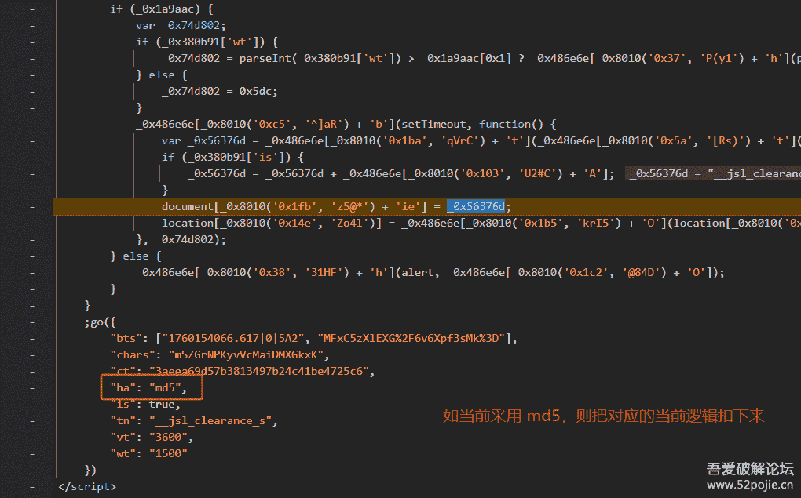

`jsl3.png` (82.78 KB, 下载次数: 2)

[下载附件](https://www.52pojie.cn/forum.php?mod=attachment&aid=MjgwNzc4MHwzMzkwN2FiN3wxNzkzNTcwNTA2fDE2ODA4NnwyMDY1Mjg3&nothumb=yes)

2025-10-11 21:34 上传

后续使用正则拿到这个对象，判断`ha`字段，调用相应的逻辑即可。

## 测试

关闭油猴脚本，清空 cookie，刷新

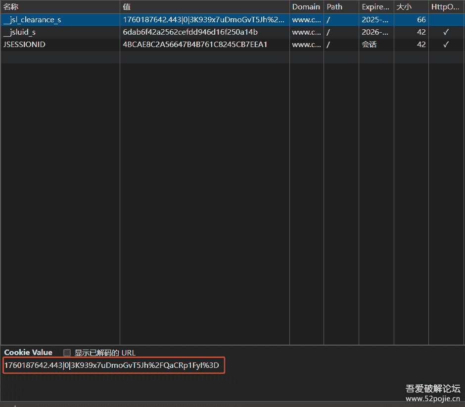

`jsl4.png` (35.49 KB, 下载次数: 2)

[下载附件](https://www.52pojie.cn/forum.php?mod=attachment&aid=MjgwNzc4MXw0OTZkNGE5OHwxNzkzNTcwNTA2fDE2ODA4NnwyMDY1Mjg3&nothumb=yes)

2025-10-11 21:35 上传

此时接口返回的动态对象为

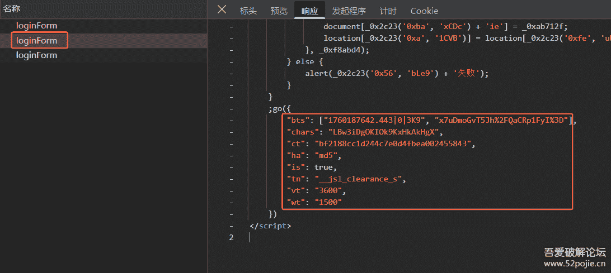

`jsl5.png` (46.87 KB, 下载次数: 1)

[下载附件](https://www.52pojie.cn/forum.php?mod=attachment&aid=MjgwNzc4MnxmNmVlZjQ5ZnwxNzkzNTcwNTA2fDE2ODA4NnwyMDY1Mjg3&nothumb=yes)

2025-10-11 21:35 上传

本地执行

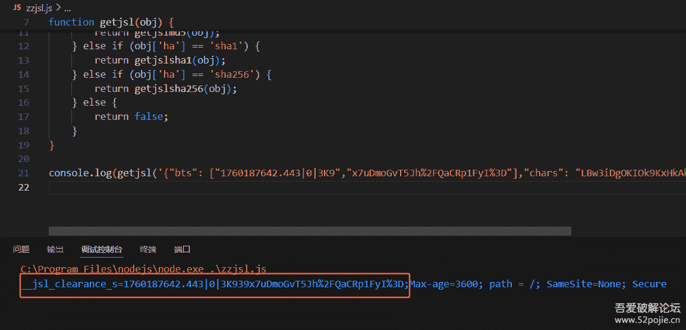

`jsl6.png` (56.81 KB, 下载次数: 0)

[下载附件](https://www.52pojie.cn/forum.php?mod=attachment&aid=MjgwNzc4M3wyNGRkNDNjOHwxNzkzNTcwNTA2fDE2ODA4NnwyMDY1Mjg3&nothumb=yes)

2025-10-11 21:36 上传

与上篇联动测试

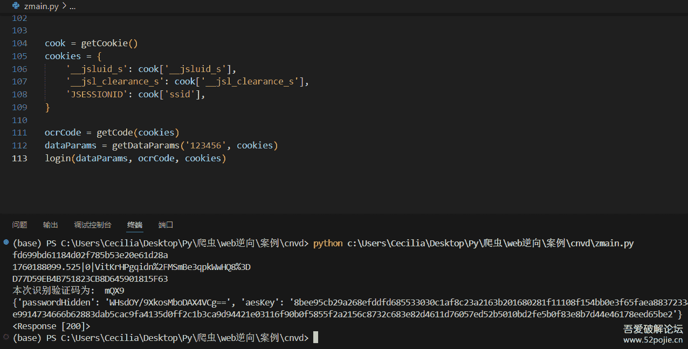

`jsl7.png` (77.46 KB, 下载次数: 1)

[下载附件](https://www.52pojie.cn/forum.php?mod=attachment&aid=MjgwNzc4NHxlNTNmMzgyN3wxNzkzNTcwNTA2fDE2ODA4NnwyMDY1Mjg3&nothumb=yes)

2025-10-11 21:36 上传

完美

## 总结

- 加速乐 cookie 防护，关键字段为`__jsl_clearance_s`
- 生成 cookie 的 js，会通过两个 521 状态码的请求获得
- 哈希算法随机，可以分别扣下各哈希算法的逻辑


[下载附件](https://www.52pojie.cn/forum.php?mod=attachment&aid=MjgwNzc4NXxiYzdkMTNkOXwxNzkzNTcwNTA2fDE2ODA4NnwyMDY1Mjg3)

(27.11 KB, 下载次数: 17)

2025-10-11 21:37 上传

点击文件名下载附件

下载积分: 吾爱币 -1 CB
