# [Web逆向] 某某Meta登录逆向

- 原帖: https://www.52pojie.cn/forum.php?mod=viewthread&tid=2065436
- 抓取时间: 2026-11-01T22:01:46

> 

aHR0cHM6Ly9tLnNoZW5ncWluZ3F5LmNuLyMvbG9naW4=

## 抓包

固定 `phone` = 12333333333，`password` = 123456

请求 `/login` 接口，携带动态参数 `timestamp`、`nonce` 和 `sign`，响应 {"code":500,...}

## 跟栈寻参

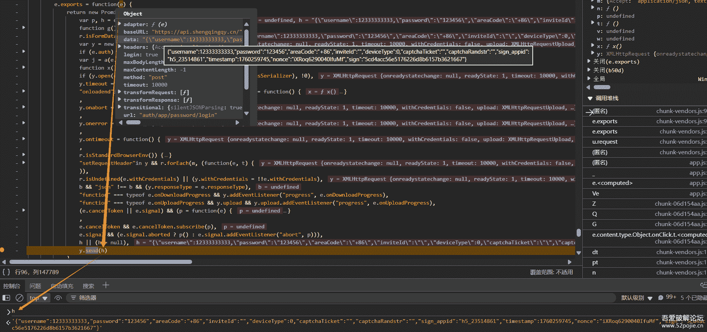
img1.png (257.94 KB, 下载次数: 1)
[href="forum.php?mod=attachment&aid=MjgwNzkxN3xhMzkxM2QxNHwxNzkzNTcwNTAzfDE2ODA4NnwyMDY1NDM2&nothumb=yes" target="_blank"](https://www.52pojie.cn/forum.php?mod=attachment&aid=MjgwNzkxN3xhMzkxM2QxNHwxNzkzNTcwNTAzfDE2ODA4NnwyMDY1NDM2&nothumb=yes)
2025-10-12 21:42 上传
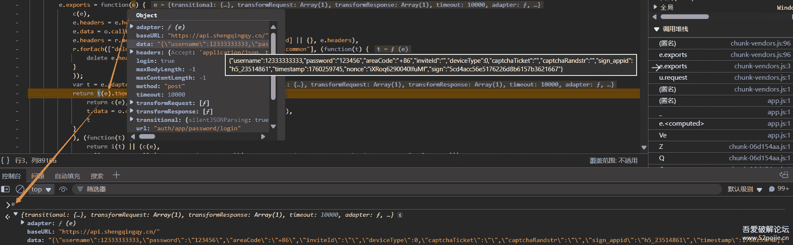
img2.png (157.01 KB, 下载次数: 1)
[href="forum.php?mod=attachment&aid=MjgwNzkxOHwxOTE3ZDNiNXwxNzkzNTcwNTAzfDE2ODA4NnwyMDY1NDM2&nothumb=yes" target="_blank"](https://www.52pojie.cn/forum.php?mod=attachment&aid=MjgwNzkxOHwxOTE3ZDNiNXwxNzkzNTcwNTAzfDE2ODA4NnwyMDY1NDM2&nothumb=yes)
2025-10-12 21:42 上传
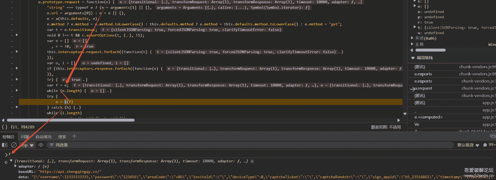
img3.png (153.36 KB, 下载次数: 1)
[href="forum.php?mod=attachment&aid=MjgwNzkxNXxiYzlkZWU5MnwxNzkzNTcwNTAzfDE2ODA4NnwyMDY1NDM2&nothumb=yes" target="_blank"](https://www.52pojie.cn/forum.php?mod=attachment&aid=MjgwNzkxNXxiYzlkZWU5MnwxNzkzNTcwNTAzfDE2ODA4NnwyMDY1NDM2&nothumb=yes)
2025-10-12 21:42 上传
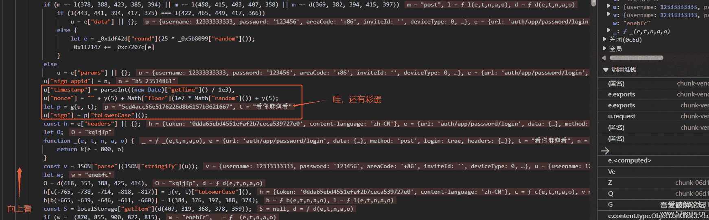
img4.png (153.29 KB, 下载次数: 2)
[href="forum.php?mod=attachment&aid=MjgwNzkxNnxkY2EwZDA0ZnwxNzkzNTcwNTAzfDE2ODA4NnwyMDY1NDM2&nothumb=yes" target="_blank"](https://www.52pojie.cn/forum.php?mod=attachment&aid=MjgwNzkxNnxkY2EwZDA0ZnwxNzkzNTcwNTAzfDE2ODA4NnwyMDY1NDM2&nothumb=yes)
2025-10-12 21:42 上传

```
let u = {
    "username": 12333333333,
    "password": "123456",
    "areaCode": "+86",
    "inviteId": "",
    "deviceType": 0,
    "captchaTicket": "",
    "captchaRandstr": "",
    "sign_appid": "h5_23514861"
};

u["timestamp"] = parseInt((new Date)["getTime"]() / 1e3);

u["nonce"] = "" + y(5) + Math["floor"](1e7 * Math["random"]()) + y(5);

let t = '看你麻痹看';   // 此值确认固定
let p = g(u, t);
u["sign"] = p["toLowerCase"]();

console.log(JSON.stringify(u));
```

### 扣代码

试执行，首先是 `y` is not defined

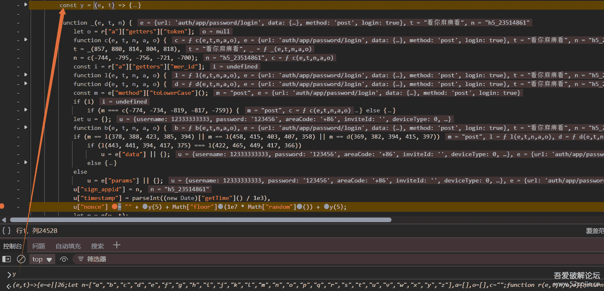
img5.png (141.07 KB, 下载次数: 1)
[href="forum.php?mod=attachment&aid=MjgwNzkyMXwxZGNiOGY4M3wxNzkzNTcwNTAzfDE2ODA4NnwyMDY1NDM2&nothumb=yes" target="_blank"](https://www.52pojie.cn/forum.php?mod=attachment&aid=MjgwNzkyMXwxZGNiOGY4M3wxNzkzNTcwNTAzfDE2ODA4NnwyMDY1NDM2&nothumb=yes)
2025-10-12 21:44 上传

扣下，然后 `k` is not defined

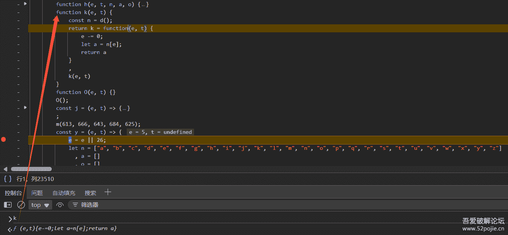
img6.png (52.13 KB, 下载次数: 1)
[href="forum.php?mod=attachment&aid=MjgwNzkyMnxhMDVjZWNhNHwxNzkzNTcwNTAzfDE2ODA4NnwyMDY1NDM2&nothumb=yes" target="_blank"](https://www.52pojie.cn/forum.php?mod=attachment&aid=MjgwNzkyMnxhMDVjZWNhNHwxNzkzNTcwNTAzfDE2ODA4NnwyMDY1NDM2&nothumb=yes)
2025-10-12 21:44 上传

扣下，然后 `d` is not defined

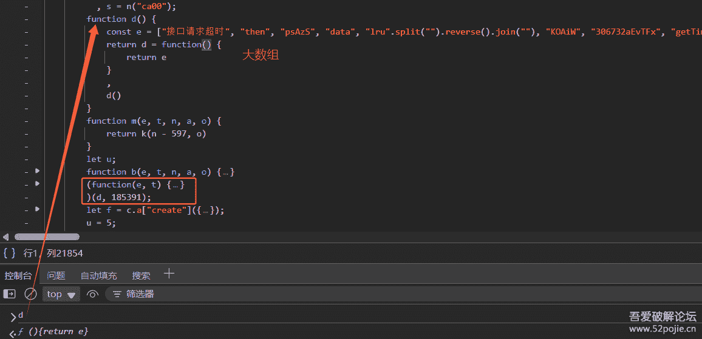
img7.png (50.79 KB, 下载次数: 0)
[href="forum.php?mod=attachment&aid=MjgwNzkyM3wyNzE3N2ZhNXwxNzkzNTcwNTAzfDE2ODA4NnwyMDY1NDM2&nothumb=yes" target="_blank"](https://www.52pojie.cn/forum.php?mod=attachment&aid=MjgwNzkyM3wyNzE3N2ZhNXwxNzkzNTcwNTAzfDE2ODA4NnwyMDY1NDM2&nothumb=yes)
2025-10-12 21:45 上传

看到一个大数组要警觉，很大概率后面会有一个自执行函数（IIFE）对这个大数组做重排处理，大数组 + 自执行重排，是常见的混淆手段

`d` 连带着自执行一并扣下，然后 `g` is not defined

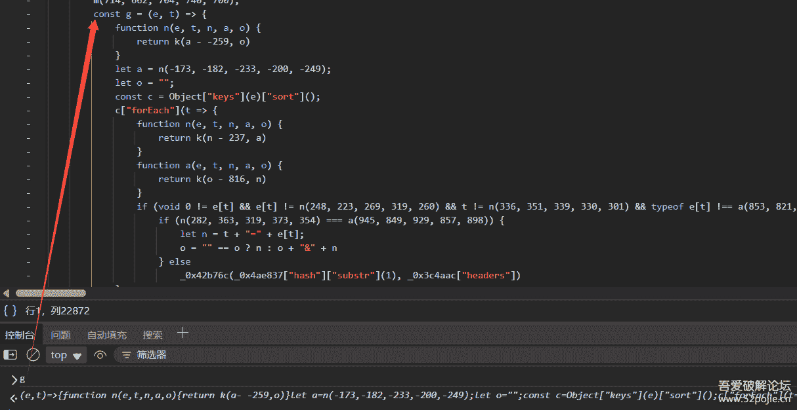
img8.png (72.89 KB, 下载次数: 0)
[href="forum.php?mod=attachment&aid=MjgwNzkyNHxkYjg1NDkwM3wxNzkzNTcwNTAzfDE2ODA4NnwyMDY1NDM2&nothumb=yes" target="_blank"](https://www.52pojie.cn/forum.php?mod=attachment&aid=MjgwNzkyNHxkYjg1NDkwM3wxNzkzNTcwNTAzfDE2ODA4NnwyMDY1NDM2&nothumb=yes)
2025-10-12 21:46 上传

扣下，然后 `l` is not defined，而 `l` 于开头定义

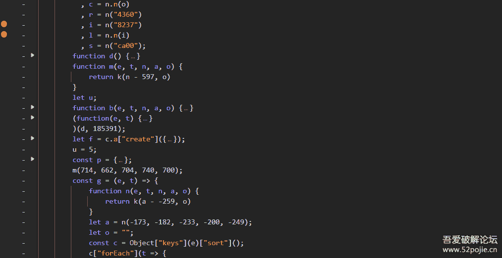
img9.png (45.12 KB, 下载次数: 0)
[href="forum.php?mod=attachment&aid=MjgwNzkyNXw0N2UxYzI1NHwxNzkzNTcwNTAzfDE2ODA4NnwyMDY1NDM2&nothumb=yes" target="_blank"](https://www.52pojie.cn/forum.php?mod=attachment&aid=MjgwNzkyNXw0N2UxYzI1NHwxNzkzNTcwNTAzfDE2ODA4NnwyMDY1NDM2&nothumb=yes)
2025-10-12 21:46 上传

`n("xxxx")` 形式，那必是 `webpack` 了，刷新网页断住，跟进 `n`

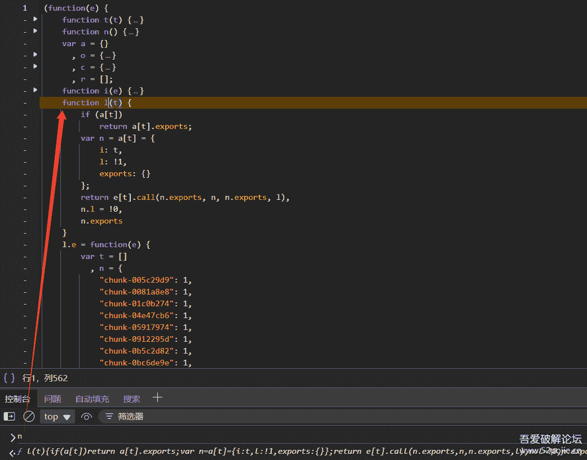
img10.png (65.21 KB, 下载次数: 0)
[href="forum.php?mod=attachment&aid=MjgwNzkyNnwxMTczOTU3OXwxNzkzNTcwNTAzfDE2ODA4NnwyMDY1NDM2&nothumb=yes" target="_blank"](https://www.52pojie.cn/forum.php?mod=attachment&aid=MjgwNzkyNnwxMTczOTU3OXwxNzkzNTcwNTAzfDE2ODA4NnwyMDY1NDM2&nothumb=yes)
2025-10-12 21:46 上传

文件内是一整个自执行，全扣下

在加载器 `l` 里插个桩并导出为 `myLoader`，并把整个 `webpack` 内初始化的执行注释掉

```
function l(t) {

    console.log(t); // 插桩，打印加载的模块

    if (a[t])

        return a[t].exports;

    var n = a[t] = {

        i: t,

        l: !1,

        exports: {}

    };

    return e[t].call(n.exports, n, n.exports, l),

    n.l = !0,

    n.exports

}
```

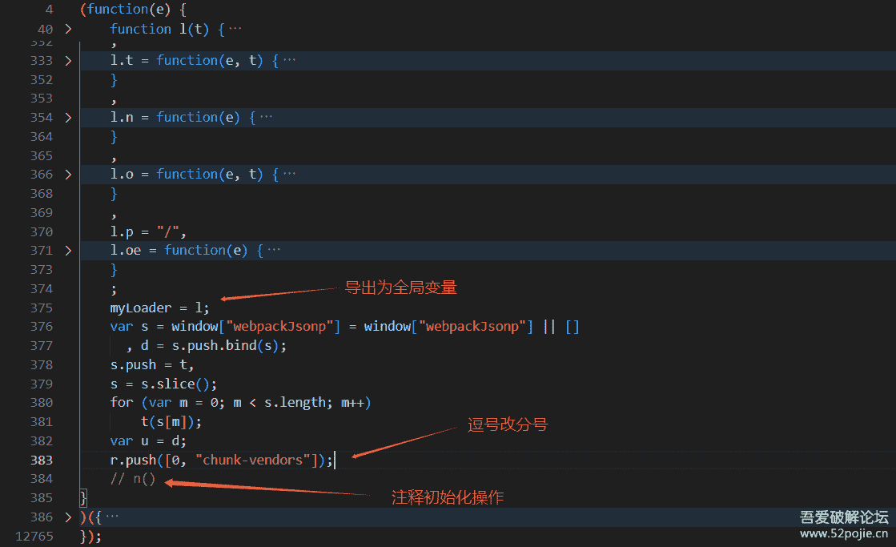
img11.png (67.7 KB, 下载次数: 1)
[href="forum.php?mod=attachment&aid=MjgwNzkyN3w2YWExNzJmN3wxNzkzNTcwNTAzfDE2ODA4NnwyMDY1NDM2&nothumb=yes" target="_blank"](https://www.52pojie.cn/forum.php?mod=attachment&aid=MjgwNzkyN3w2YWExNzJmN3wxNzkzNTcwNTAzfDE2ODA4NnwyMDY1NDM2&nothumb=yes)
2025-10-12 21:48 上传

执行，桩日志加载 8237，Cannot read properties of undefined (reading 'call')，说明缺了，全局搜，补上

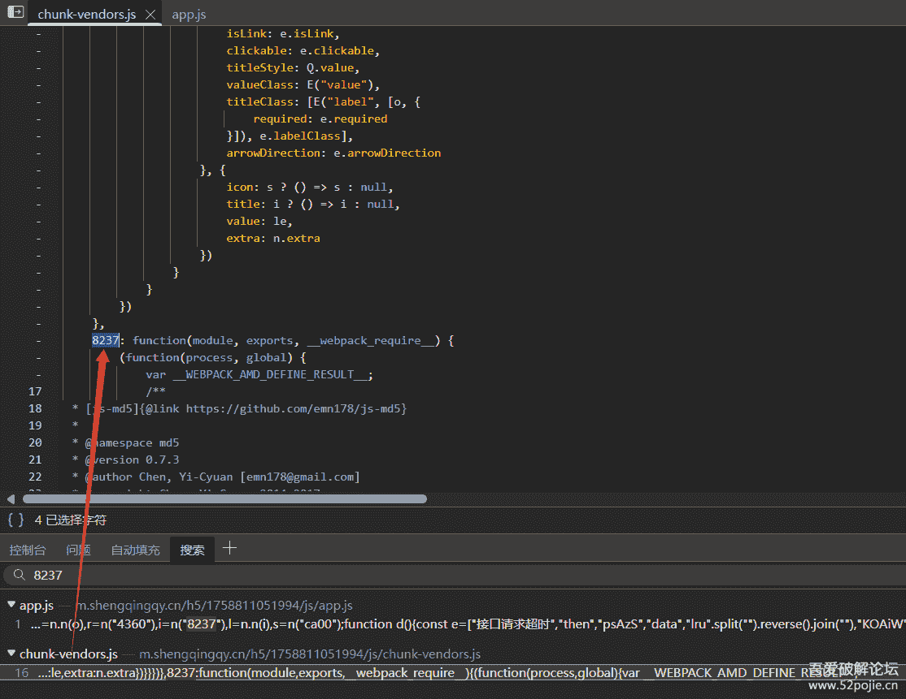
img12.png (86.53 KB, 下载次数: 0)
[href="forum.php?mod=attachment&aid=MjgwNzkyOHwwMDcxNGE2OHwxNzkzNTcwNTAzfDE2ODA4NnwyMDY1NDM2&nothumb=yes" target="_blank"](https://www.52pojie.cn/forum.php?mod=attachment&aid=MjgwNzkyOHwwMDcxNGE2OHwxNzkzNTcwNTAzfDE2ODA4NnwyMDY1NDM2&nothumb=yes)
2025-10-12 21:48 上传

此文件头语句为 `(window["webpackJsonp"] = window["webpackJsonp"] || []).push([["chunk-vendors"], {...}])`，与主 `webpack` 的绑定语句 `var s = window["webpackJsonp"] = window["webpackJsonp"] || []` 相对应

因为不知道还会加载哪些模块，直接全扣

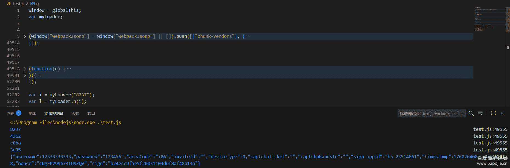
img13.png (77.91 KB, 下载次数: 1)
[href="forum.php?mod=attachment&aid=MjgwNzkyOXw5YzA5MjhiZHwxNzkzNTcwNTAzfDE2ODA4NnwyMDY1NDM2&nothumb=yes" target="_blank"](https://www.52pojie.cn/forum.php?mod=attachment&aid=MjgwNzkyOXw5YzA5MjhiZHwxNzkzNTcwNTAzfDE2ODA4NnwyMDY1NDM2&nothumb=yes)
2025-10-12 21:49 上传

成功出值

完整的程序结构如下，细节请自己扣喔

```
window = globalThis;
var myLoader;

(window["webpackJsonp"] = window["webpackJsonp"] || []).push([["chunk-vendors"], {...}]);

(function(e) {...})({...});

var i = myLoader("8237");
var l = myLoader.n(i);

function d() {...}

(function (e, t) {...})(d, 185391);

const g = (e, t) => {...};

function k(e, t) {...};

const y = (e, t) => {...};

let u = {
    "username": 12333333333,
    "password": "123456",
    "areaCode": "+86",
    "inviteId": "",
    "deviceType": 0,
    "captchaTicket": "",
    "captchaRandstr": "",
    "sign_appid": "h5_23514861"
};

u["timestamp"] = parseInt((new Date)["getTime"]() / 1e3);

u["nonce"] = "" + y(5) + Math["floor"](1e7 * Math["random"]()) + y(5);

let t = '看你麻痹看';
let p = g(u, t);
u["sign"] = p["toLowerCase"]();

console.log(JSON.stringify(u));
```

### Tip

真坏啊，6万多行代码竟只加载了4个模块，可以手动把其他模块的加载删掉，减小代码体积
