# [原创] FastCopy 简体中文汉化补全方法

- 原帖：[https://www.52pojie.cn/forum.php?mod=viewthread&tid=2066027](https://www.52pojie.cn/forum.php?mod=viewthread&tid=2066027)
- 抓取时间：2026-11-01T22:01:41

FastCopy 是一款很好用的文件快速复制工具，其官方版本自带简体中文语言，可惜简体中文语言汉化不全，现以 FastCopy Pro 5.11.3 为例，简要叙述 FastCopy 简体中文汉化补全方法，仅供初学汉化的同学参考，汉化大佬们可无视，在下班门弄斧了，若有不当之处，请多多指教！

## 一、标准资源简体中文汉化补全方法

用 Resource Hacker（[https://www.lanzouw.com/i7HHo38hax4b](https://www.lanzouw.com/i7HHo38hax4b)）打开主程序 `FastCopy.exe`，按照下列方法逐一修改，基本上就能完成对 FastCopy 5.X 的标准资源简体中文汉化补全。

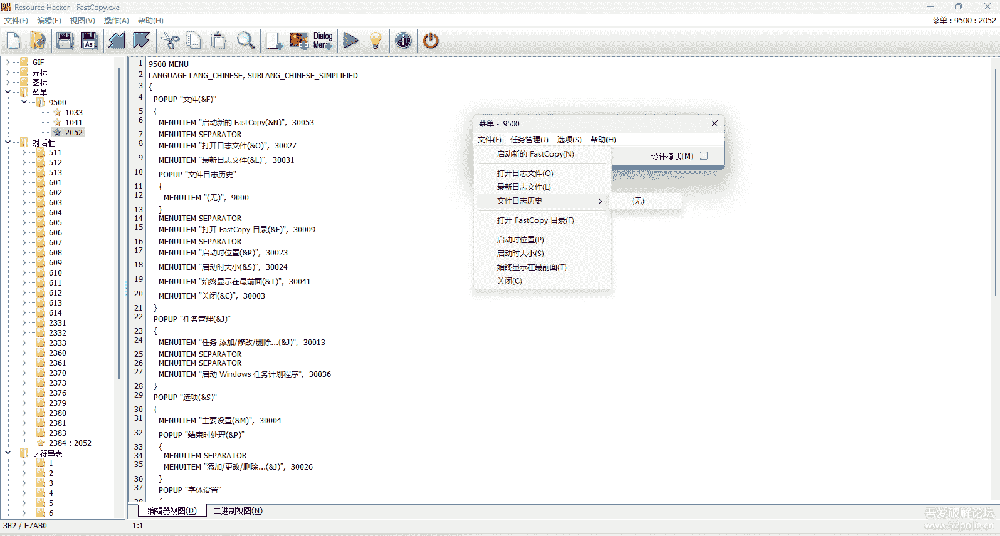

`1.png`（167.4 KB，下载次数：1）

[附件下载](https://www.52pojie.cn/forum.php?mod=attachment&aid=MjgwODI4Nnw4MGQzOWJjNHwxNzkzNTcwNDk5fDE2ODA4NnwyMDY2MDI3&nothumb=yes)

2025-10-15 17:48 上传

### 菜单资源 `9500` / `2052`

点击左侧的“菜单”-`9500`-`2052`。

将：

```rc
9500 MENU

LANGUAGE LANG_CHINESE, SUBLANG_CHINESE_SIMPLIFIED

{

POPUP "文件(&F)"

{

MENUITEM "开始新的FastCopy(&N)", 30053

MENUITEM SEPARATOR

MENUITEM "打开日志文件(&O)", 30027

MENUITEM "最新日志文件(&L)", 30031

POPUP "文件记录历史"

{

MENUITEM "(none)", 9000

}

MENUITEM SEPARATOR

MENUITEM "FastCopyDir(&F)", 30009

MENUITEM SEPARATOR

MENUITEM "启动时位置(&P)", 30023

MENUITEM "启动时尺寸(&S)", 30024

MENUITEM "始终显示在最前面(&T)", 30041

MENUITEM SEPARATOR

MENUITEM "关闭(&C)", 30003

}

POPUP "任务管理(&J)"

{

MENUITEM "任务添加/更新/删除...(&J)", 30013

MENUITEM SEPARATOR

MENUITEM SEPARATOR

MENUITEM "启动Windows任务调度程序", 30036

}

POPUP "设置(&S)"

{

MENUITEM "一般设置(&M)", 30004

POPUP "終了時処理(&P)"

{

MENUITEM SEPARATOR

MENUITEM "添加/更改/删除...", 30026

}

POPUP "字体设置"

{

MENUITEM "改变主字体", 30032

MENUITEM "重置主字体", 30033

}

MENUITEM SEPARATOR

POPUP "HDD模式"

{

MENUITEM "自动识别HDD", 30016

MENUITEM "相同HDD模式", 30017

MENUITEM "不同HDD模式", 30018

}

MENUITEM "MS Defender排除（要特权）", 30056

MENUITEM SEPARATOR

MENUITEM "显示扩展过滤器(&F)", 30028

MENUITEM "交换Source?DestDir(&W)", 30022

MENUITEM SEPARATOR

MENUITEM "许可证管理(&L)", 30008

}

POPUP "帮助(&H)"

{

MENUITEM "帮助(&H)", 30006

MENUITEM SEPARATOR

MENUITEM "检查更新(&U)", 30044

MENUITEM "最新版本URL(&N)", 30010

MENUITEM SEPARATOR

MENUITEM "支持论坛(&S)", 30011

MENUITEM "意见/印象(&V)", 30012

MENUITEM SEPARATOR

MENUITEM "关于FastCopy(&A)", 30007

}

}
```

修改为：

```rc
9500 MENU

LANGUAGE LANG_CHINESE, SUBLANG_CHINESE_SIMPLIFIED

{

POPUP "文件(&F)"

{

MENUITEM "启动新的 FastCopy(&N)", 30053

MENUITEM SEPARATOR

MENUITEM "打开日志文件(&O)", 30027

MENUITEM "最新日志文件(&L)", 30031

POPUP "文件日志历史"

{

MENUITEM "(无)", 9000

}

MENUITEM SEPARATOR

MENUITEM "打开 FastCopy 目录(&F)", 30009

MENUITEM SEPARATOR

MENUITEM "启动时位置(&P)", 30023

MENUITEM "启动时大小(&S)", 30024

MENUITEM "始终显示在最前面(&T)", 30041

MENUITEM "关闭(&C)", 30003

}

POPUP "任务管理(&J)"

{

MENUITEM "任务 添加/修改/删除...(&J)", 30013

MENUITEM SEPARATOR

MENUITEM SEPARATOR

MENUITEM "启动 Windows 任务计划程序", 30036

}

POPUP "选项(&S)"

{

MENUITEM "主要设置(&M)", 30004

POPUP "结束时处理(&P)"

{

MENUITEM SEPARATOR

MENUITEM "添加/更改/删除...", 30026

}

POPUP "字体设置"

{

MENUITEM "改变主字体", 30032

MENUITEM "重置主字体", 30033

}

MENUITEM SEPARATOR

POPUP "硬盘模式"

{

MENUITEM "自动识别硬盘", 30016

MENUITEM "相同硬盘模式", 30017

MENUITEM "不同硬盘模式", 30018

}

MENUITEM "MS Defender 排除(需提权)", 30056

MENUITEM SEPARATOR

MENUITEM "显示扩展过滤器(&F)", 30028

MENUITEM "交换 来源?目标(&W)", 30022

MENUITEM SEPARATOR

MENUITEM "许可证管理(&L)", 30008

}

POPUP "帮助(&H)"

{

MENUITEM "帮助(&H)", 30006

MENUITEM SEPARATOR

MENUITEM "检查更新(&U)", 30044

MENUITEM "最新版本(&N)", 30010

MENUITEM SEPARATOR

MENUITEM "支持论坛(&S)", 30011

MENUITEM "意见/印象(&V)", 30012

MENUITEM SEPARATOR

MENUITEM "关于 FastCopy(&A)", 30007

}

}
```

### 对话框资源 `512` / `2052`

点击左侧的“对话框”-`512`-`2052`。

将 `"OK", 1` 修改为：确定。

### 对话框资源 `513` / `2052`

点击左侧的“对话框”-`513`-`2052`。

将 `FONT 9, "Meiryo UI", FW_NORMAL, FALSE, 128` 修改为：`FONT 9, "Microsoft YaHei", FW_NORMAL, FALSE, 0`。

可使程序界面显示的字体由粗大变正常。

将 `CONTROL "贴近", 2, BUTTON, BS_PUSHBUTTON | WS_CHILD | WS_VISIBLE | WS_TABSTOP, 202, 136, 32, 14` 修改为：`CONTROL "关闭", 2, BUTTON, BS_PUSHBUTTON | WS_CHILD | WS_VISIBLE | WS_TABSTOP, 202, 136, 32, 14`。

### 对话框资源 `601` / `2052`

点击左侧的“对话框”-`601`-`2052`。

将：

```rc
"Full Speed", 3088,

"Language/语言", -1
```

修改为：

```rc
"全速", 3088

"语言", -1
```

### 对话框资源 `603` / `2052`

点击左侧的“对话框”-`603`-`2052`。

将：

```rc
"（C:与D:属于相同HDD，E:与F:属于相同HDD时，指定\"CD,EF\"）", -1,

"这里的设置用于确定相同/不同HDD模式的操作", -1
```

修改为：

```rc
（C:与D:属于相同硬盘，E:与F:属于相同硬盘时，指定\"CD,EF\"）

"这里的设置用于确定相同/不同硬盘模式的操作"
```

### 对话框资源 `604` / `2052`

点击左侧的“对话框”-`604`-`2052`。

将：

```rc
"如果另一个FastCopy正在运行同一个HDD，\r\n它将等待相关的FastCopy完成后再开始执行，\r\n即使同时执行的最大数量较少。\r\n可以在\"手动设置物理驱动器\" 中手动设置同一HDD的确定", -1
```

修改为：

```rc
"如果另一个FastCopy正在运行同一个硬盘，\r\n它将等待相关的FastCopy完成后再开始执行，\r\n即使同时执行的最大数量较少。\r\n可以在\"手动设置物理驱动器\" 中手动设置同一硬盘的确定", -1
```

### 对话框资源 `605` / `2052`

点击左侧的“对话框”-`605`-`2052`。

将：

```rc
"复制Junction/Symlink本身（不复制实体/内容）", 3104,

"msec", -1,
```

修改为：

```rc
"复制 目录链接/符号链接 本身 (不复制目标)", 3104

"毫秒", -1
```

### 对话框资源 `207` / `607` / `2052`

5.3.0 之前版本：点击左侧的“对话框”-`207`-`2052`。

5.7.11 之后版本：点击左侧的“对话框”-`607`-`2052`。

将：

```rc
"执行/Source/DestDir(来源/目标)的历史\r\n (新启动后有效)", -1,
```

修改为：

```rc
"执行/来源/目标 历史项目数\r\n (重启后生效)"
```

### 对话框资源 `608` / `2052`

点击左侧的“对话框”-`608`-`2052`。

将：

```rc
“移动”使用“移动（不覆盖）”（仅限Pro版）", 3477,
```

修改为：

```rc
“移动”使用“移动（不覆盖）”（仅限专业版）", 3477,
```

### 对话框资源 `609` / `2052`

点击左侧的“对话框”-`609`-`2052`。

将 `"Play", 3410,` 修改为：`"播放", 3410`。

### 对话框资源 `610` / `2052`

点击左侧的“对话框”-`610`-`2052`。

将：

```rc
CONTROL "速度以MB/s而不是MiB/s为单位", 3159, BUTTON, BS_AUTOCHECKBOX | WS_CHILD | WS_VISIBLE | WS_TABSTOP, 8, 46, 116, 10

CONTROL "TransRate 包含校验速度", 3161, BUTTON, BS_AUTOCHECKBOX | WS_CHILD | WS_VISIBLE | WS_TABSTOP, 8, 62, 144, 9

CONTROL "当前速度显示在 TransRate 字段中（包括校验速度）", -1, STATIC, SS_LEFT | WS_CHILD | WS_VISIBLE | WS_GROUP, 7, 79, 176, 8

CONTROL "Src速度", 2284, BUTTON, BS_AUTOCHECKBOX | WS_CHILD | WS_VISIBLE | WS_TABSTOP, 15, 91, 39, 9

CONTROL "Dest速度", 2285, BUTTON, BS_AUTOCHECKBOX | WS_CHILD | WS_VISIBLE | WS_TABSTOP, 59, 91, 39, 9

CONTROL "Src+Dest速度", 2286, BUTTON, BS_AUTOCHECKBOX | WS_CHILD | WS_VISIBLE | WS_TABSTOP, 105, 91, 58, 9

CONTROL "源按钮到默认的目录选择", 3054, BUTTON, BS_AUTOCHECKBOX | WS_CHILD | WS_VISIBLE | WS_TABSTOP, 5, 202, 186, 10

CONTROL "Console", 3426, BUTTON, BS_PUSHBUTTON | WS_CHILD | WS_VISIBLE | WS_TABSTOP, 144, 8, 33, 13
```

修改为：

```rc
CONTROL "速度以MB/秒而不是MiB/秒为单位", 3159, BUTTON, BS_AUTOCHECKBOX | WS_CHILD | WS_VISIBLE | WS_TABSTOP, 8, 46, 116, 10

CONTROL "传输速率 包括验证速度", 3161, BUTTON, BS_AUTOCHECKBOX | WS_CHILD | WS_VISIBLE | WS_TABSTOP, 11, 67, 189, 11

CONTROL "在 传输速率 中显示当前速度。(包括校验速度)", -1, STATIC, SS_LEFT | WS_CHILD | WS_VISIBLE | WS_GROUP, 9, 86, 190, 8

CONTROL "来源速度", 2284, BUTTON, BS_AUTOCHECKBOX | WS_CHILD | WS_VISIBLE | WS_TABSTOP, 17, 99, 47, 10

CONTROL "目标速度", 2285, BUTTON, BS_AUTOCHECKBOX | WS_CHILD | WS_VISIBLE | WS_TABSTOP, 68, 99, 51, 10

CONTROL "来源+目标速度", 2286, BUTTON, BS_AUTOCHECKBOX | WS_CHILD | WS_VISIBLE | WS_TABSTOP, 121, 99, 66, 10

CONTROL "来源按钮的默认操作是目录选择", 3054, BUTTON, BS_AUTOCHECKBOX | WS_CHILD | WS_VISIBLE | WS_TABSTOP, 5, 221, 191, 10

CONTROL "控制台", 3426, BUTTON, BS_PUSHBUTTON | WS_CHILD | WS_VISIBLE | WS_TABSTOP, 146, 11, 33, 13
```

### 对话框资源 `611` / `2052`

点击左侧的“对话框”-`611`-`2052`。

将：

```rc
"如果没有得到校验，src的哈希值将被记录在文件日志中", 3117,

"用于\"FC校验信息验证（仅限Pro版）\"等。\"？\"参考", -1

"完美校验只在Pro版中支持", -1
```

修改为：

```rc
"如果没有得到校验，来源的哈希值将被记录在文件日志中",

"用于\"FC校验信息验证（仅限专业版）\"等。\"？\"参考", -1

"完美校验仅在专业版中支持", -1
```

### 对话框资源 `2331` / `2052`

点击左侧的“对话框”-`2331`-`2052`。

将 `FONT 9, "Microsoft YaHei", FW_NORMAL, FALSE, 128` 修改为：`FONT 9, "Microsoft YaHei", FW_NORMAL, FALSE, 0`。

可使程序界面显示的字体由粗大变正常。

将：

```rc
CONTROL "Source", 3000, BUTTON, BS_PUSHBUTTON | BS_MULTILINE | WS_CHILD | WS_VISIBLE | WS_TABSTOP, 4, 3, 29, 12

CONTROL "DestDir", 3001, BUTTON, BS_PUSHBUTTON | WS_CHILD | WS_VISIBLE | WS_TABSTOP, 4, 27, 29, 12

CONTROL "Command", 3446, BUTTON, BS_PUSHBUTTON | WS_CHILD | WS_VISIBLE | WS_TABSTOP, 116, 41, 77, 14

CONTROL "ErrLog", 3031, STATIC, SS_LEFT | WS_CHILD | WS_VISIBLE | WS_GROUP, 4, 233, 28, 8

CONTROL "(ErrFiles : 0 / ErrDirs : 0)", 3032, STATIC, SS_LEFT | WS_CHILD | WS_VISIBLE | WS_GROUP, 36, 233, 146, 8

CONTROL "ToDate", 3150, STATIC, SS_LEFT | WS_CHILD | WS_VISIBLE | WS_GROUP, 53, 173, 32, 8

CONTROL "FromDate", 3149, STATIC, SS_LEFT | WS_CHILD | WS_VISIBLE | WS_GROUP, 6, 173, 38, 8

CONTROL "MaxSize", 3156, STATIC, SS_LEFT | WS_CHILD | WS_VISIBLE | WS_GROUP, 148, 173, 31, 8

CONTROL "MinSize", 3153, STATIC, SS_LEFT | WS_CHILD | WS_VISIBLE | WS_GROUP, 104, 173, 31, 8
```


# FastCopy 简体中文汉化修改说明

## 控件定义修改

原始定义：
```
CONTROL "Full Speed", 3088, STATIC, SS_CENTER | SS_NOTIFY | SS_SUNKEN | WS_CHILD | WS_VISIBLE | WS_GROUP, 118, 74, 36, 10
CONTROL "PauseL", 3099, BUTTON, BS_PUSHBUTTON | BS_ICON | BS_MULTILINE | WS_CHILD | WS_TABSTOP, 121, 126, 25, 13
CONTROL "PauseO", 3081, BUTTON, BS_PUSHBUTTON | BS_ICON | BS_MULTILINE | WS_CHILD | WS_TABSTOP, 161, 126, 26, 14
```
修改为：
```
CONTROL "来源", 3000, BUTTON, BS_PUSHBUTTON | BS_MULTILINE | WS_CHILD | WS_VISIBLE | WS_TABSTOP, 4, 3, 33, 14
CONTROL "目标", 3001, BUTTON, BS_PUSHBUTTON | WS_CHILD | WS_VISIBLE | WS_TABSTOP, 4, 29, 33, 14
CONTROL "命令", 3446, BUTTON, BS_PUSHBUTTON | WS_CHILD | WS_VISIBLE | WS_TABSTOP, 147, 47, 82, 16
CONTROL "错误记录", 3031, STATIC, SS_LEFT | WS_CHILD | WS_VISIBLE | WS_GROUP, 4, 263, 36, 8
CONTROL "(错误文件 : 0 / 错误目录 : 0)", 3032, STATIC, SS_LEFT | WS_CHILD | WS_VISIBLE | WS_GROUP, 44, 263, 140, 8
CONTROL "截止日期", 3150, STATIC, SS_LEFT | WS_CHILD | WS_VISIBLE | WS_GROUP, 73, 198, 32, 8
CONTROL "生效日期", 3149, STATIC, SS_LEFT | WS_CHILD | WS_VISIBLE | WS_GROUP, 14, 198, 37, 8
CONTROL "最大大小", 3156, STATIC, SS_LEFT | WS_CHILD | WS_VISIBLE | WS_GROUP, 187, 198, 33, 8
CONTROL "最小大小", 3153, STATIC, SS_LEFT | WS_CHILD | WS_VISIBLE | WS_GROUP, 132, 198, 32, 8
CONTROL "全速", 3088, STATIC, SS_CENTER | SS_NOTIFY | SS_SUNKEN | WS_CHILD | WS_VISIBLE | WS_GROUP, 147, 86, 39, 9
CONTROL "暂停L", 3099, BUTTON, BS_PUSHBUTTON | BS_ICON | BS_MULTILINE | WS_CHILD | WS_TABSTOP, 156, 149, 28, 14
CONTROL "暂停O", 3081, BUTTON, BS_PUSHBUTTON | BS_ICON | BS_MULTILINE | WS_CHILD | WS_TABSTOP, 193, 149, 28, 14
```

### 对话框 2333-2052
将
```
"OK", 1
CONTROL "采用", 9
CAPTION "一般设置"
```
修改为：
```
"确定", 1
CONTROL "应用", 9
CAPTION "主要设置"
```

### 对话框 2360-2052
将 `CONTROL "停产", 2,` 修改为： `CONTROL "停止", 2,`

### 对话框 2361-2052
将 `"Source", -1,` 修改为：`来源`
将 `"DestDir", 3157` 修改为：`目标`

### 对话框 2370-2052
将 `"OK", 1` 修改为：`确定`

### 对话框 2379-2052
将 `"OK", 1` 修改为：`确定`

### 对话框 2380-2052
将 `CONTROL "冬眠", 3143, BUTTON` 修改为： `CONTROL "休眠", 3143, BUTTON`

### 对话框 2384
点击左侧的“对话框”-“2384”将语言 “1041”更改为 “2052”
将 `"Copy To Clipboard", 3467` 修改为：`复制到剪切板`
将 `"Close", 3468` 修改为：`关闭`
将 `FONT 8, "Meiryo UI", FW_NORMAL, FALSE, 128` 修改为：`FONT 8, "Microsoft YaHei", FW_NORMAL, FALSE, 0`

## 字符串表修改

### 字符串表 1-2052
将
```
1, "创建"
2, "删除"
3, "选择Source目录\r\n（用Ctrl键，添加）"
4, "选择DestDir"
5, "相同HDD模式"
6, "不同HDD模式"
7, "固定相同HDD"
8, "固定不同HDD"
10, "差异（不覆盖）"
11, "差异（大小/日期）"
12, "差异（最新日期）"
13, "复制（全覆盖）"
14, "现存（大小/日期）"
15, "现存（最新日期）"
```
修改为：
```
STRINGTABLE
LANGUAGE LANG_CHINESE, SUBLANG_CHINESE_SIMPLIFIED
{
1, "创建"
2, "删除"
3, "选择 来源目录\r\n（用 Ctrl 键，添加）"
4, "选择 目标目录"
5, "相同硬盘模式"
6, "不同硬盘模式"
7, "固定相同硬盘"
8, "固定不同硬盘"
10, "差异 (不覆盖)"
11, "差异 (大小/日期)"
12, "差异 (最新日期)"
13, "复制 (覆盖)"
14, "现存 (大小/日期)"
15, "现存 (最新日期)"
}
```

### 字符串表 3-2052
将
```
33, "（所有操作模式）"
34, "（显示设置）"
41, "运行"
42, "中断..."
43, "行为的变化取决于DestDir规范是否以\\结尾\r\n（更多信息见帮助）"
45, "到文件\r\n选择对话..."
46, "对目录的选择..."
47, "源头和目的地是相同的"
```
修改为：
```
33, "(显示所有模式)"
34, "(自定义)"
41, "执行"
42, "取消..."
43, "行为的变化取决于目标目录是否以 \\ 结尾。\r\n (有关详细信息，请参阅“帮助”)"
45, "选择\r\n文件 ..."
46, "选择目录 ..."
47, "来源和目标是相同的"
```

### 字符串表 4-2052
将
```
56, "发生了一个异常情况，异常信息已被储存在下面。\r\n %s\r\n %s\r\n\n将其发送到[exp@fastcopy.jp" target="_blank"](mailto:exp@fastcopy.jp:rel="nofollow noopener" href="mailto)，同时附上发生的情况，以帮助确定原因。\r\n\r\n你会向开发者发送异常转储吗？\r\n（选择\"是\"以发送至 [//api.fastcopy.jp" target="_blank"](https://api.fastcopy.jp:rel="nofollow noopener" href="https)）"
57, "同步化"
58, "重新开张"
59, "暂停一下"
60, ": 的背后没有 \\。如果你想把 Source 的内容直接复制到 DestDir 下面，在 Source 目录的末尾添加一个 *"
```
修改为：
```
56, "发生异常.\r\n异常信息保存到 \r\n %s\r\n %s.\r\n\r\n请将这些文件 (附带发生情况) 发送到 [exp@fastcopy.jp" target="_blank"](mailto:exp@fastcopy.jp:rel="nofollow noopener" href="mailto).\r\n\r\n你是否要将异常转储发送给开发人员?\r\n (选择 \"是\" 发送到 [//api.fastcopy.jp" target="_blank"](https://api.fastcopy.jp:rel="nofollow noopener" href="https)))"
57, "同步"
58, "恢复"
59, "暂停"
60, "在 ':' 后丢失了 '\\'。 如果要将 来源目录 的内容复制到 目标目录, 请在 来源目录 末尾追加 '*'"
```

### 字符串表 5-2052
将
```
72, "需要有管理权限（特权）"
78, "特权"
```
修改为：
```
72, "需要有管理员权限（提升）"
78, "提升"
```

### 字符串表 8-2052
将
```
120, "无条件的"
121, "正常完成后"
122, "当错误结束时"
```
修改为：
```
120, "总是"
121, "无错误"
122, "错误"
```

### 字符串表 9-2052
将 `142, "标准"` 修改为： `142, "正常"`

### 字符串表 10-2052
将
```
144, "冬眠"
150, "价值太小"
151, "价值太大"
```
修改为：
```
144, "休眠"
150, "值太小"
151, "值太大"
```

### 字符串表 11-2052
将
```
166, "Main window always in front"
167, "发现最新版本(v%s)。\r\n你想升级吗？"
168, "发现最新版本(v%s)。\r\n（运行中无法升级）"
169, "不需要升级\r\n(%s -> %s)"
175, "Source历史记录"
```
修改为：
```
166, "主窗口总是前面"
167, "发现最新版本(v%s)。\r\n现在更新吗？"
168, "发现最新版本(v%s)。\r\n (运行中无法更新)"
169, "不需要更新\r\n(%s -> %s)"
175, "来源历史记录"
```

### 字符串表 12-2052
将
```
180, "没有什么"
181, "传统校验（仅检查Dest）"
182, "完美校验（检查Src/Dest）"
184, "激活了"
185, "过期了"
186, "残废"
```
修改为：
```
180, "无操作"
181, "传统校验（仅检查目标）"
182, "完美校验（检查来源/目标）"
184, "激活"
185, "过期"
186, "禁用"
```

### 字符串表 13-2052
将
```
192, "（如果你是一个工作场所的用户，请购买一个Pro许可证）"
199, "抱歉，需要Pro版许可证密钥"
```
修改为：
```
192, "(如果你是一个工作场所的用户，请购买一个专业版许可证)"
199, "抱歉，需要专业版许可证密钥"
```

### 字符串表 70-1041
将语言 “1041”更改为 “2052”
将
```
1104, "All Files(*.*)"
```
修改为：
```
1104, "所有文件(*.*)"
```

### 字符串表 71-1041
将语言 “1041”更改为 “2052”
将
```
1134, "UserDir(&U)"
```
修改为：
```
1134, "用户目录(&U)"
```

### 字符串表 72-1041
将语言 “1041”更改为 “2052”
将
```
1138, "UserOldDir"
```
修改为：
```
1138, "用户旧目录"
```

### 字符串表 73-1041
将语言 “1041”更改为 “2052”

## 二、非标准资源简体中文汉化补全方法

用 010 Editor（[//www.lanzouw.com/iBPwk37ro3id" target="_blank"](https://www.lanzouw.com/iBPwk37ro3id:rel="nofollow noopener" href="https)）、WinHex（[//www.lanzouw.com/iNr5o2yh9bze" target="_blank"](https://www.lanzouw.com/iNr5o2yh9bze:rel="nofollow noopener" href="https)）、Hex Editor Neo Ultimate Edition（[//www.lanzouw.com/ihtkY34kz8lc" target="_blank"](https://www.lanzouw.com/ihtkY34kz8lc:rel="nofollow noopener" href="https)）、Hex Workshop（[//www.lanzouw.com/iXotJ35v2m4d" target="_blank"](https://www.lanzouw.com/iXotJ35v2m4d:rel="nofollow noopener" href="https)）、UltraEdit（[//www.lanzouw.com/ioyKVmu6cxi" target="_blank"](https://www.lanzouw.com/ioyKVmu6cxi:rel="nofollow noopener" href="https)） 、PilotEdit（[//www.lanzouw.com/iskj138iykih" target="_blank"](https://www.lanzouw.com/iskj138iykih:rel="nofollow noopener" href="https)）等十六进制工具打开主程序 FastCopy.exe,按照下列方法逐一查找替换相关代码，基本上就能完成对FastCopy 5.X 的 非标准资源简体中文汉化补全

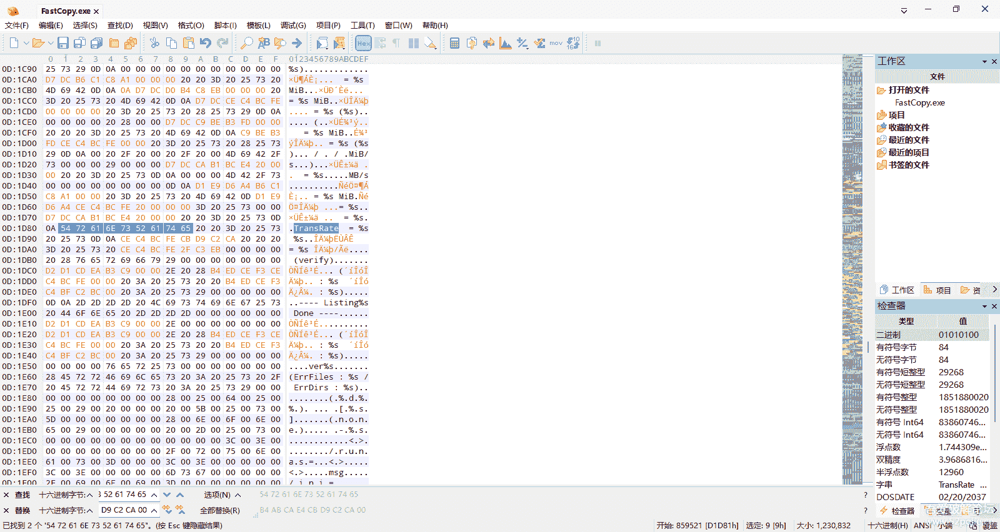

2.png (205.23 KB, 下载次数: 1)

[href="forum.php?mod=attachment&aid=MjgwODI4N3xlMDgwNjFjNHwxNzkzNTcwNDk5fDE2ODA4NnwyMDY2MDI3&nothumb=yes" target="_blank"](https://www.52pojie.cn/forum.php?mod=attachment&aid=MjgwODI4N3xlMDgwNjFjNHwxNzkzNTcwNDk5fDE2ODA4NnwyMDY2MDI3&nothumb=yes)

2025-10-15 17:48 上传

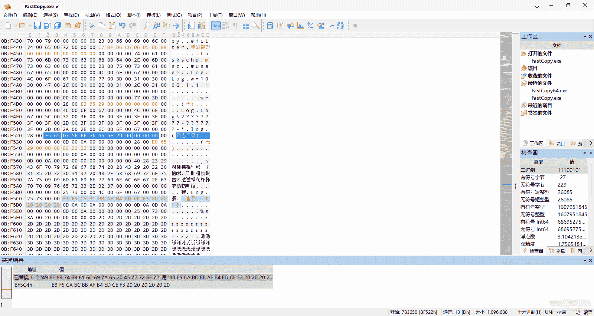

3.png (156.56 KB, 下载次数: 2)

[href="forum.php?mod=attachment&aid=MjgwODI4OHw4NGU0YjFlYXwxNzkzNTcwNDk5fDE2ODA4NnwyMDY2MDI3&nothumb=yes" target="_blank"](https://www.52pojie.cn/forum.php?mod=attachment&aid=MjgwODI4OHw4NGU0YjFlYXwxNzkzNTcwNDk5fDE2ODA4NnwyMDY2MDI3&nothumb=yes)

2025-10-15 17:48 上传

1. file is modified) 66 69 6C 65 20 69 73 20 6D 6F 64 69 66 69 65 64 29

文件已被修改 87 65 F6 4E F2 5D AB 88 EE 4F 39 65

查找 `66 00 69 00 6C 00 65 00 20 00 69 00 73 00 20 00 6D 00 6F 00 64 00 69 00 66 00 69 00 65 00 64 00 29`

替换 `87 65 F6 4E F2 5D EE 4F 39 65 29 00 00 00 00 00 00 00 00 00 00 00 00 00 00 00 00 00 00 00 00 00 00`

2. Too Many Errors 54 6F 6F 20 4D 61 6E 79 20 45 72 72 6F 72 73

错误太多... 19 95 EF 8B 2A 59 1A 59 2E 00 2E 00 2E 00

查找 `54 00 6F 00 6F 00 20 00 4D 00 61 00 6E 00 79 00 20 00 45 00 72 00 72 00 6F 00 72 00 73`

替换 `19 95 EF 8B 2A 59 1A 59 2E 00 2E 00 2E 00 00 00 00 00 00 00 00 00 00 00 00 00 00 00 00`

3. automatic 61 75 74 6F 6D 61 74 69 63

自动 EA 81 A8 52

查找 `61 00 75 00 74 00 6F 00 6D 00 61 00 74 00 69 00 63 00 29`

替换 `EA 81 A8 52 29 00 00 00 00 00 00 00 00 00 00 00 00 00 00`

4. Aborted by User 41 62 6F 72 74 65 64 20 62 79 20 55 73 65 72

已被用户中止 F2 5D AB 88 28 75 37 62 2D 4E 62 6B

查找 `41 00 62 00 6F 00 72 00 74 00 65 00 64 00 20 00 62 00 79 00 20 00 55 00 73 00 65 00 72`


替换 F2 5D AB 88 28 75 37 62 2D 4E 62 6B 00 00 00 00 00 00 00 00 00 00 00 00 00 00 00 00 00

### 5. `DeleteThreadFind` 44 65 6C 65 74 65 54 68 72 65 6164 46 69 6E 64
删除线程查找 20 52 64 96 BF 7E 0B 7A E5 67 7E 62 20 00
查找 44 00 65 00 6C 00 65 00 74 00 65 00 54 00 68 00 72 00 65 00 61 00 64
替换 20 52 64 96 BF 7E 0B 7A E5 67 7E 62 20 00 00 00 00 00 00 00 00 00 00

### 6. `FindFirstFileEx`(del 46 69 6E 64 46 6972 73 74 46 69 6C 65 45 78 28 64 65 6C
查找第一个文件扩展(删除 E5 67 7E 62 2C 7B 00 4E 2A 4E 87 65 F6 4E 69 62 55 5C 28 00 20 52 64 96
查找 46 00 69 00 6E 00 64 00 46 00 69 00 72 00 73 00 74 00 46 00 69 00 6C 00 65 00 45 00 78 00 28 00 64 00 65 00 6C 00 29
替换 E5 67 7E 62 2C 7B 00 4E 2A 4E 87 65 F6 4E 69 62 55 5C 28 00 20 52 64 96 00 00 00 00 00 00 00 00 00 00 00 00 00 00 00

### 7. Can't alloc memory 43 61 6E 27 74 20 61 6C 6C 6F 63 20 6D 65 6D 6F 72 79
无法分配内存 E0 65 D5 6C 06 52 4D 91 85 51 58 5B
查找 43 00 61 00 6E 00 27 00 74 00 20 00 61 00 6C 00 6C 00 6F 00 63 00 20 00 6D 00 65 00 6D 00 6F 00 72 00 79
替换 E0 65 D5 6C 06 52 4D 91 85 51 58 5B 00 00 00 00 00 00 00 00 00 00 00 00 00 00 00 00 00 00 00 00 00 00 00

### 8. `RemoveDirectory` 52 65 6D 6F 76 65 44 69 72 65 63 74 6F 72 79
删除目录 20 52 64 96 EE 76 55 5F
查找 52 00 65 00 6D 00 6F 00 76 00 65 00 44 00 69 00 72 00 65 00 63 00 74 00 6F 00 72 00 79
替换 20 52 64 96 EE 76 55 5F 00 00 00 00 00 00 00 00 00 00 00 00 00 00 00 00 00 00 00 00 00

### 9. `DeleteFile` 44 65 6C 65 74 65 46 69 6C 65
删除文件 20 52 64 96 87 65 F6 4E
查找 44 00 65 00 6C 00 65 00 74 00 65 00 46 00 69 00 6C 00 65
替换 20 52 64 96 87 65 F6 4E 00 00 00 00 00 00 00 00 00 00 00

### 10. Verify `src/dst` read error 56 65 72 69 66 79 20 73 72 63 2F 64 73 74 20 72 65 61 64 20 65 72 72 6F 72
验证 来源/目标 读取错误 8C 9A C1 8B 20 00 90 6E 2F 00 EE 76 07 68 20 00 FB 8B D6 53 19 95 EF 8B
查找 56 00 65 00 72 00 69 00 66 00 79 00 20 00 73 00 72 00 63 00 2F 00 64 00 73 00 74 00 20 00 72 00 65 00 61 00 64 00 20 00 65 00 72 00 72 00 6F 00 72
替换 8C 9A C1 8B 20 00 65 67 90 6E 2F 00 EE 76 07 68 20 00 FB 8B D6 53 19 95 EF 8B 00 00 00 00 00 00 00 00 00 00 00 00 00 00 00 00 00 00 00 00 00 00 00

### 11. Verify `src` read error 56 65 72 69 66 79 20 73 72 63 20 72 65 61 64 20 65 72 72 6F 72
验证 来源 读取错误 8C 9A C1 8B 20 00 65 67 90 6E 20 00 FB 8B D6 53 19 95 EF 8B
查找 56 00 65 00 72 00 69 00 66 00 79 00 20 00 73 00 72 00 63 00 20 00 72 00 65 00 61 00 64 00 20 00 65 00 72 00 72 00 6F 00 72
替换 65 67 90 6E 20 00 FB 8B D6 53 19 95 EF 8B 00 00 00 00 00 00 00 00 00 00 00 00 00 00 00 00 00 00 00 00 00 00 00 00 00 00 00

### 12. Verify `dst` read error 56 65 72 69 66 79 20 64 73 74 20 72 65 61 64 20 65 72 72 6F 72
验证 目标 读取错误 8C 9A C1 8B 20 00 EE 76 07 68 20 00 FB 8B D6 53 19 95 EF 8B
查找 56 00 65 00 72 00 69 00 66 00 79 00 20 00 64 00 73 00 74 00 20 00 72 00 65 00 61 00 64 00 20 00 65 00 72 00 72 00 6F 00 72
替换 8C 9A C1 8B 20 00 EE 76 07 68 20 00 FB 8B D6 53 19 95 EF 8B 00 00 00 00 00 00 00 00 00 00 00 00 00 00 00 00 00 00 00 00 00

### 13. and the timestamp was changed to 61 6E 64 20 74 68 65 20 74 69 6D 65 73 74 61 6D 70 20 77 61 73 20 63 68 61 6E 67 65 64 74 6F
时间戳已更改为 F6 65 F4 95 33 62 F2 5D F4 66 39 65 3A 4E
查找 61 00 6E 00 64 00 20 00 74 00 68 00 65 00 20 00 74 00 69 00 6D 00 65 00 73 00 74 00 61 00 6D 00 70 00 20 00 77 00 61 00 73 00 20 00 63 00 68 00 61 00 6E 00 67 00 65 00 64 00 20 00 74 00 6F
替换 F6 65 F4 95 33 62 F2 5D F4 66 39 65 3A 4E 00 00 00 00 00 00 00 00 00 00 00 00 00 00 00 00 00 00 00 00 00 00 00 00 00 00 00 00 00 00 00 00 00 00 00 00 00 00 00 00 00 00 00 0 00 00 00 00 00 00

### 14. and it was tried to change the timstamp, but it was failed 61 6E 64 20 69 74 20 77 61 73 20 74 72 69 65 64 20 74 6F 20 63 68 61 6E 67 65 20 74 68 65 20 74 69 6D 73 74 61 6D 70 2C 20 62 75 74 20 69 74 20 77 61 73 20 66 61 69 6C 65 64
试图改变时间戳失败。D5 8B FE 56 39 65 D8 53 F6 65 F4 95 33 62 31 59 25 8D 02 30
查找 61 00 6E 00 64 00 20 00 69 00 74 00 20 00 77 00 61 00 73 00 20 00 74 00 72 00 69 00 65 00 64 00 20 00 74 00 6F 00 20 00 63 00 68 00 61 00 6E 00 67 00 65 00 20 00 74 00 68 00 65 00 20 00 74 00 69 00 6D 00 73 00 74 00 61 00 6D 00 70 00 2C 00 20 00 62 00 75 00 74 00 20 00 69 00 74 00 20 00 77 00 61 00 73 00 20 00 66 00 61 00 69 00 6C 00 65 00 64
替换 D5 8B FE 56 39 65 D8 53 F6 65 F4 95 33 62 31 59 25 8D 02 30 00 00 00 00 00 00 00 00 00 00 00 00 00 00 00 00 00 00 00 00 00 00 00 00 00 00 00 00 00 00 00 00 00 00 00 00 00 00 00 00 00 00 0000 00 00 00 00 00 00 00 00 00 00 00 00 00 00 00 00 00 00 0000 00 00 00 00 00 00 00 00 00 00 00 00 00 00 00 00 00 00 00 00 00 00 00 00 00 00 00 00 00 00 00

### 15. So try to rename 20 53 6F 20 74 72 79 20 74 6F 20 72 65 6E 61 6D 65
因此尝试重命名 E0 56 64 6B 1D 5C D5 8B CD 91 7D 54 0D 54
查找 20 00 53 00 6F 00 20 00 74 00 72 00 79 00 20 00 74 00 6F 00 20 00 72 00 65 00 6E 00 61 00 6D 00 65
替换 E0 56 64 6B 1D 5C D5 8B CD 91 7D 54 0D 54 00 00 00 00 00 00 00 00 00 00 00 00 00 00 00 00 00 00 00

### 16. and it was deleted 61 6E 64 20 69 74 20 77 61 73 20 64 65 6C 65 74 65 64
文件已删除 87 65 F6 4E F2 5D 20 52 64 96
查找 61 00 6E 00 64 00 20 00 69 00 74 00 20 00 77 00 61 00 73 00 20 00 64 00 65 00 6C 00 65 00 74 00 65 00 64
替换 87 65 F6 4E F2 5D 20 52 64 96 00 00 20 00 00 00 00 00 00 00 00 00 00 00 00 00 00 00 00 00 00 00 00 00 00

### 17. and it was tried to delete, but it was failed 61 6E 64 20 69 74 20 77 61 73 20 74 72 69 65 64 20 74 6F 20 64 65 6C 65 74 65 2C 20 62 75 74 20 69 74 20 77 61 73 20 66 61 69 6C 65 64
尝试删除失败。1D 5C D5 8B 20 52 64 96 31 59 25 8D 02 30
查找 61 00 6E 00 64 00 20 00 69 00 74 00 20 00 77 00 61 00 73 00 20 00 74 00 72 00 69 00 65 00 64 00 20 00 74 00 6F 00 20 00 64 00 65 00 6C 00 65 00 74 00 65 00 2C 00 20 00 62 00 75 00 74 00 20 00 69 00 74 00 20 00 77 00 61 00 73 00 20 00 66 00 61 00 69 00 6C 00 65 00 64
替换 1D 5C D5 8B 20 52 64 96 31 59 25 8D 02 30 00 00 00 00 00 00 00 00 00 00 00 00 00 00 00 00 00 00 00 00 00 00 00 00 00 00 00 00 00 00 00 00 00 00 00 00 00 00 00 00 00 00 00 00 00 00 00 00 00 00 00 00 00 00 00 00 00 00 00 00 00 00 00 00 00 00 00 00 00 00 00 00 00 00 00

## 64位：
`fc_verify_err`...in and it was renamed (`.`fc_verify_err`) 66 63 5F 76 65 72 69 66 79 5F 65 72 72 00 00 00 00 00 69 6E 20 61 6E 64 20 69 74 20 77 61 73 20 72 65 6E 61 6D 65 64 20 28 2E 66 63 5F 76 65 72 69 66 79 5F 65 72 72 29
fc 验证有误..存在,并且它已被重命名为 (fc 验证有误) 66 00 63 00 20 00 8C 9A C1 8B 09 67 EF 8B 2E 00 2E 00 58 5B 28 57 2C 00 76 5E 14 4E 83 5B F2 5D AB 88 CD 91 7D 54 0D 54 3A 4E 20 00 28 00 66 00 63 00 20 00 8C 9A C1 8B 09 67 EF8B 29 00
查找 66 00 63 00 5F 00 76 00 65 00 72 00 69 00 66 00 79 00 5F 00 65 00 72 00 72 00 00 00 00 00 69 00 6E 00 20 00 61 00 6E 00 64 00 20 00 69 00 74 00 20 00 77 00 61 00 73 00 20 00 72 00 65 00 6E 00 61 00 6D 00 65 00 64 00 20 00 28 00 2E 00 66 00 63 00 5F 00 76 00 65 00 72 00 69 00 66 00 79 00 5F 00 65 00 72 00 72 00 29
替换 66 00 63 00 20 00 8C 9A C1 8B 09 67 EF 8B 2E 00 2E 00 58 5B 28 57 2C 00 76 5E 14 4E 83 5B F2 5D AB 88 CD 91 7D 54 0D 54 3A 4E 20 00 28 00 66 00 63 00 20 00 8C 9A C1 8B 09 67 EF 8B 29 00 00 00 00 00 00 00 00 00 00 00 00 00 00 00 00 00 00 00 00 00 00 00 00 00 00 00 00 00 00 00 00 00 00 00 00 00 00 00 00 00 00 00 00

## 32位：
`fc_verify_err` 66 63 5F 76 65 72 69 66 79 5F 65 72 72
fc 验证有误 66 00 63 00 20 00 8C 9A C1 8B 09 67 EF 8B 2E
查找 66 00 63 00 5F 00 76 00 65 00 72 00 69 00 66 00 79 00 5F 00 65 00 72 00 72
替换 66 00 63 00 20 00 8C 9A C1 8B 09 67 EF 8B 2E 00 00 00 00 00 00 00 00 00 00 替换第1处
in and it was renamed (`.`fc_verify_err`) 69 6E 20 61 6E 64 20 69 74 20 77 61 73 20 72 65 6E 61 6D 65 64 20 28 2E 66 63 5F 76 65 72 69 66 79 5F 65 72 72 29
存在,并且它已被重命名为 (fc 验证有误) 58 5B 28 57 2C 00 76 5E 14 4E 83 5B F2 5D AB 88 CD 91 7D 54 0D 54 3A 4E 20 00 28 00 66 00 63 00 20 00 8C 9A C1 8B 09 67 EF 8B 29 00
查找 69 00 6E 00 20 00 61 00 6E 00 64 00 20 00 69 00 74 00 20 00 77 00 61 00 73 00 20 00 72 00 65 00 6E 00 61 00 6D 00 65 00 64 00 20 00 28 00 2E 00 66 00 63 00 5F 00 76 00 65 00 72 00 69 00 66 00 79 00 5F 00 65 00 72 00 72 00 29 00


## 本地化字符串对照

替换 58 5B 28 57 2C 00 76 5E 14 4E 83 5B F2 5D AB 88 CD 91 7D 54 0D 54 3A 4E 20 00 28 00 66 00 63 00 20 00 8C 9A C1 8B 09 67 EF 8B 29 00 46 61 73 74 43 6F 70 79 4C 6D 00 00 00 00 00 00 00 00 00 00 00 00 00 00 00 00 00 00 00 00 00 00

### 19. and it was tried to rename, but it was failed

61 00 6E 00 64 00 20 00 69 00 74 00 20 00 77 00 61 00 73 00 20 00 74 00 72 00 69 00 65 00 64 00 20 00 74 00 6F 00 20 00 72 00 65 00 6E 00 61 00 6D 00 65 00 2C 00 20 00 62 00 75 00 74 00 20 00 69 00 74 00 20 00 77 00 61 00 73 00 20 00 66 00 61 00 69 00 6C 00 65 00 64

尝试重命名失败 1D 5C D5 8B CD 91 7D 54 0D 54 31 59 25 8D

查找 61 00 6E 00 64 00 20 00 69 00 74 00 20 00 77 00 61 00 73 00 20 00 74 00 72 00 69 00 65 00 64 00 20 00 74 00 6F 00 20 00 72 00 65 00 6E 00 61 00 6D 00 65 00 2C 00 20 00 62 00 75 00 74 00 20 00 69 00 74 00 20 00 77 00 61 00 73 00 20 00 66 00 61 00 69 00 6C 00 65 00 64

替换 1D 5C D5 8B CD 91 7D 54 0D 54 31 59 25 8D 00 00 00 00 00 00 00 00 00 00 00 00 00 00 00 00 00 00 00 00 00 00 00 00 00 00 00 00 00 00 00 00 00 00 00 00 00 00 00 00 00 00 00 00 00 00 00 00 20 00 69 00 00 00 00 00 00 00 00 00 00 00 00 00 00 00 00 00 00 00 00 00 00 00 00

### 20. Sorry, `FastCopy` is updated. Please reopen `FastCopy`

53 6F 72 72 79 2C 20 46 61 73 74 43 6F 70 79 20 69 73 20 75 70 64 61 74 65 64 2E 20 50 6C 65 61 73 65 20 72 65 6F 70 65 6E 20 46 61 73 74 43 6F 70 79

抱歉，`FastCopy` 已更新。请重新打开 `FastCopy` B1 A7 C7 B8 A3 AC 46 61 73 74 43 6F 70 79 20 D2 D1 B8 FC D0 C2 A1 A3 C7 EB D6 D8 D0 C2 B4 F2 BF AA 20 46 61 73 74 43 6F 70 79

查找 53 6F 72 72 79 2C 20 46 61 73 74 43 6F 70 79 20 69 73 20 75 70 64 61 74 65 64 2E 20 50 6C 65 61 73 65 20 72 65 6F 70 65 6E 20 46 61 73 74 43 6F 70 79

替换 B1 A7 C7 B8 A3 AC 46 61 73 74 43 6F 70 79 20 D2 D1 B8 FC D0 C2 A1 A3 C7 EB D6 D8 D0 C2 B4 F2 BF AA 20 46 61 73 74 43 6F 70 79 00 00 00 00 00 00 00 00

### 21.

**64位：**

msgToo many lines 6D 73 67 54 6F 6F 20 6D 61 6E 79 20 6C 69 6E 65 73

消息行数过多 CF FB CF A2 D0 D0 CA FD B9 FD B6 E0

查找 6D 73 67 00 54 00 6F 00 6F 00 20 00 6D 00 61 00 6E 00 79 00 20 00 6C 00 69 00 6E 00 65 00 73

替换 CF FB CF A2 D0 D0 CA FD B9 FD B6 E0 00 00 00 00 00 00 00 00 00 00 00 00 00 00 00 00 00 00 00

**32位：**

Too many lines 54 6F 6F 20 6D 61 6E 79 20 6C 69 6E 65 73

消息行数过多 CF FB CF A2 D0 D0 CA FD B9 FD B6 E0

查找 54 00 6F 00 6F 00 20 00 6D 00 61 00 6E 00 79 00 20 00 6C 00 69 00 6E 00 65 00 73

替换 CF FB CF A2 D0 D0 CA FD B9 FD B6 E0 00 00 00 00 00 00 00 00 00 00 00 00 00 00 00

### 22. Site License

53 00 69 00 74 00 65 00 20 00 4C 00 69 00 63 00 65 00 6E 00 73 00 65 00

站点许可 D9 7A B9 70 B8 8B EF 53 29 00

查找 53 00 69 00 74 00 65 00 20 00 4C 00 69 00 63 00 65 00 6E 00 73 00 65 00 29

替换 D9 7A B9 70 B8 8B EF 53 29 00 00 00 00 00 00 00 00 00 00 00 00 00 00 00 00

### 23. Can't initialize

43 61 6E 27 74 20 69 6E 69 74 69 61 6C 69 7A 65

无法初始化 D9 7A B9 70 B8 8B EF 53 29 00

查找 43 61 6E 27 74 20 69 6E 69 74 69 61 6C 69 7A 65

替换 CE DE B7 A8 B3 F5 CA BC BB AF 00 00 00 00 00 00

### 24. `CancelCopy` (aborted by system or etc.)

43 61 6E 27 74 20 69 6E 69 74 69 61 6C 69 7A 65

取消复制 (由系统等中止) C8 A1 CF FB B8 B4 D6 C6 20 28 D3 C9 CF B5 CD B3 B5 C8 D6 D0 D6 B9 29

查找 43 61 6E 63 65 6C 43 6F 70 79 20 28 61 62 6F 72 74 65 64 20 62 79 20 73 79 73 74 65 6D 20 6F 72 20 65 74 63 2E 29

替换 C8 A1 CF FB B8 B4 D6 C6 20 28 D3 C9 CF B5 CD B3 B5 C8 D6 D0 D6 B9 29 00 00 00 00 00 00 00 00 00 00 00 00 00 00 00

### 25. Open Explorer)

4F 70 65 6E 20 45 78 70 6C 6F 72 65 72 29

打开资源管理器) 53 62 5F 44 8D 90 6E A1 7B 06 74 68 56 29

查找 4F 00 70 00 65 00 6E 00 20 00 45 00 78 00 70 00 6C 00 6F 00 72 00 65 00 72 00 29

替换 53 62 00 5F 44 8D 90 6E A1 7B 06 74 68 56 29 00 00 00 00 00 00 00 00 00 00 00 00

### 26. (None)

28 4E 6F 6E 65 29

(无) 28 E6 97 A0 29 00

查找 28 4E 6F 6E 65 29

替换 28 E6 97 A0 29 00

### 27. 44 65 73 74 44 69 72

3C C4 BF B1 EA 3E

查找 3C 44 65 73 74 44 69 72 3E

替换 3C C4 BF B1 EA 3E 00 00 00

### 28. 3C 53 6F 75 72 63 65 3E

3C C0 B4 D4 B4 3E

查找 3C 53 6F 75 72 63 65 3E

替换 3C C0 B4 D4 B4 3E 00 00

### 29. 3C 45 78 63 6C 75 64 65 3E

3C C5 C5 B3 FD 3E

查找 3C 45 78 63 6C 75 64 65 3E

替换 3C C5 C5 B3 FD 3E 00 00 00

### 30. 3C 49 6E 63 6C 75 64 65 3E

3C B0 FC C0 A8 3E 20

查找 3C 49 6E 63 6C 75 64 65 3E

替换 3C B0 FC C0 A8 3E 20 00 00

### 31. 3C 43 6F 6D 6D 61 6E 64 3E

命令 3C C3 FC C1 EE 3E

查找 3C 43 6F 6D 6D 61 6E 64 3E

替换 3C C3 FC C1 EE 3E 00 00 00

### 32. `PerfectVerify`

50 65 72 66 65 63 74 56 65 72 69 66 79

完美验证 CD EA C3C0 D1 E9 D6 A4

查找 50 65 72 66 65 63 74 56 65 72 69 66 79

替换 CD EA C3 C0 D1 E9 D6 A4 00 00 00 00 00

### 33. `OverWrite`

4F 76 65 72 57 72 69 74 65

覆盖 B8 B2 B8 C7

查找 4F 76 65 72 57 72 69 74 65

替换 B8 B2 B8 C7 00 00 00 00 00

### 34. (Listing only)

28 4C 69 73 74 69 6E 67 20 6F 6E 6C 79 29

(仅列表) 28 BD F6 C1 D0 B1 ED 29

查找 28 4C 69 73 74 69 6E 67 20 6F 6E 6C 79 29

替换 28 BD F6 C1 D0 B1 ED 29 00 00 00 00 00 00

### 35. 3C 4A 6F 62 4E 61 6D 65 3E

3C B9 A4 D7 F7 C3 FB 3E

查找 3C 4A 6F 62 4E 61 6D 65 3E

替换 3C B9 A4 D7 F7 C3 FB 3E 00

### 36. Can't get `src` or `dst` field

43 61 6E 27 74 20 67 65 74 20 73 72 63 20 6F 72 20 64 73 74 20 66 69 65 6C 64

无法获取来源或目标字段 CE DE B7 A8 BB F1 C8 A1 C0 B4 D4 B4 BB F2 C4 BF B1 EA D7 D6 B6 CE

查找 43 61 6E 27 74 20 67 65 74 20 73 72 63 20 6F 72 20 64 73 74 20 66 69 65 6C 64

替换 CE DE B7 A8 BB F1 C8 A1 C0 B4 D4 B4 BB F2 C4 BF B1 EA D7 D6 B6 CE 00 00 00 00

### 37. Cancelled

43 61 6E 63 65 6C 6C 65 64

已取消 D2 D1 C8 A1 CF FB

查找 43 61 6E 63 65 6C 6C 65 64

替换 D2 D1 C8 A1 CF FB 00 00 00

### 38. Waiting for other

57 61 69 74 69 6E 67 20 66 6F 72 20 6F 74 68 65 72

正在等待其他 D5 FD D4 DA B5 C8 B4 FD C6 E4 CB FB

查找 57 61 69 74 69 6E 67 20 66 6F 72 20 6F 74 68 65 72

替换 D5 FD D4 DA B5 C8 B4 FD C6 E4 CB FB 00 00 00 00 00

### 39. Estimating

45 73 74 69 6D 61 74 69 6E 67

预计 D4 A4 BC C6

查找 45 73 74 69 6D 61 74 69 6E 67

替换 D4 A4 BC C6 20 20 20 20 20 20

### 40. Finished.

46 69 6E 69 73 68 65 64 2E

已完成. D2 D1 CD EA B3 C9 2E

查找 46 69 6E 69 73 68 65 64 2E

替换 D2 D1 CD EA B3 C9 2E 20 20

### 41. `PreFiles`

50 72 65 46 69 6C 65 73

预计文件 D4 A4 BC C6 CE C4 BC FE

查找 50 72 65 46 69 6C 65 73

替换 D4 A4 BC C6 CE C4 BC FE

### 42. `PreTime`

50 72 65 54 69 6D 65 20

预计时间 D4 A4 BC C6 CA B1 BC E4

查找 50 72 65 54 69 6D 65 20

替换 D4 A4 BC C6 CA B1 BC E4

### 43. `PreRate`

50 72 65 52 61 74 65 20

预计速率 D4 A4 BC C6 CB D9 C2 CA

查找 50 72 65 52 61 74 65 20

替换 D4 A4 BC C6 CB D9 C2 CA

### 44. `TotalDel`

54 6F 74 61 6C 44 65 6C

总删除 D7 DC C9 BE B3 FD

查找 54 6F 74 61 6C 44 65 6C

替换 D7 DC C9 BE B3 FD 20 20

### 45. `DelFiles`

44 65 6C 46 69 6C 65 73

删除文件 C9 BE B3 FD CE C4 BC FE

查找 44 65 6C 46 69 6C 65 73

替换 C9 BE B3 FD CE C4 BC FE

### 46. `TotalTime`

54 6F 74 61 6C 54 69 6D 65

总时间 D7 DC CA B1 BC E4 20

查找 54 6F 74 61 6C 54 69 6D 65

替换 D7 DC CA B1 BC E4 20 20 20

### 47. `FileRate`

46 69 6C 65 52 61 74 65

文件速率 CE C4 BC FE CB D9 C2 CA

查找 46 69 6C 65 52 61 74 65

替换 CE C4 BC FE CB D9 C2 CA

### 48. `TotalSize`

54 6F 74 61 6C 53 69 7A 65

总大小 D7 DC B4 F3 D0 A1 20

查找 54 6F 74 61 6C 53 69 7A 65

替换 D7 DC B4 F3 D0 A1 20 20 20

### 49. `TotalFiles`

54 6F 74 61 6C 46 69 6C 65 73

总文件 D7 DC CE C4 BC FE

查找 54 6F 74 61 6C 46 69 6C 65 73

替换 D7 DC CE C4 BC FE 20 20 20 20

### 50. `TotalRead`

54 6F 74 61 6C 52 65 61 64

总读取 D7 DC B6 C1 C8 A1

查找 54 6F 74 61 6C 52 65 61 64

替换 D7 DC B6 C1 C8 A1 20 20 20

### 51. `TotalWrite`

54 6F 74 61 6C 57 72 69 74 65

总写入 D7 DC D0 B4 C8 EB

查找 54 6F 74 61 6C 57 72 69 74 65

替换 D7 DC D0 B4 C8 EB 20 20 20 20

### 52. `TotalSkip`

54 6F 74 61 6C 53 6B 69 70

总跳过 D7 DC CC F8 B9 FD

查找 54 6F 74 61 6C 53 6B 69 70

替换 D7 DC CC F8 B9 FD 20 20 20

### 53. `SkipFiles`

53 6B 69 70 46 69 6C 65 73

跳过文件 CC F8 B9 FD CE C4 BC FE

查找 53 6B 69 70 46 69 6C 65 73

替换 CC F8 B9 FD CE C4 BC FE 20

### 54. `VerifyRead`

56 65 72 69 66 79 52 65 61 64

验证读取 D1 E9 D6 A4 B6 C1 C8 A1

查找 56 65 72 69 66 79 52 65 61 64

替换 D1 E9 D6 A4 B6 C1 C8 A1 20 20

### 55. `TransRate`

54 72 61 6E 73 52 61 74 65

传输速率 B4 AB CA E4 CB D9 C2 CA

查找 54 72 61 6E 73 52 61 74 65

替换 B4 AB CA E4 CB D9 C2 CA 20

### 56. `VerifyFiles`

56 65 72 69 66 79 46 69 6C 65 73

验证文件 D1 E9 D6 A4 CE C4 BC FE

查找 56 65 72 69 66 79 46 69 6C 65 73

替换 D1 E9 D6 A4 CE C4 BC FE 20 20 20

### 57. (verify)

28 76 65 72 69 66 79 29

(验证) 28 D1 E9 D6 A4 29

查找 28 76 65 72 69 66 79 29


替换 `28 D1 E9 D6 A4 29 20 20`

58. `ErrorFiles` `45 72 72 6F 72 46 69 6C 65 73`
    错误文件 `B4 ED CE F3 CE C4 BC FE`
    查找 `45 72 72 6F 72 46 69 6C 65 73`
    替换 `B4 ED CE F3 CE C4 BC FE 20 20`

59. `ErrorDirs` `45 72 72 6F 72 46 69 6C 65 73`
    错误目录 `B4 ED CE F3 C4 BF C2 BC`
    查找 `45 72 72 6F 72 44 69 72 73`
    替换 `B4 ED CE F3 C4 BF C2 BC 20`

60. `Listing` `4C 69 73 74 69 6E 67`
    列表 `C1 D0 B1 ED`
    查找 `4C 69 73 74 69 6E 67`
    替换 `C1 D0 B1 ED 20 20 20`

61. `Done` `44 6F 6E 65`
    完成 `CD EA B3 C9`
    查找 `44 6F 6E 65`
    替换 `CD EA B3 C9`

62. `ErrFiles` `45 72 72 46 69 6C 65 73`
    错误文件 `B4 ED CE F3 CE C4 BC FE`
    查找 `45 72 72 46 69 6C 65 73`
    替换 `B4 ED CE F3 CE C4 BC FE`

63. `ErrorDirs` `45 72 72 44 69 72 73 20`
    错误目录 `B4 ED CE F3 C4 BF C2 BC`
    查找 `45 72 72 44 69 72 73 20`
    替换 `B4 ED CE F3 C4 BF C2 BC`

64. `none)` `6E 00 6F 00 6E 00 65 00 29`
    无) `E0 65 29`
    查找 `6E 00 6F 00 6E 00 65 00 29`
    替换 `E0 65 29 00 00 00 00 00 00`

65. `force terminated` `66 6F 72 63 65 20 74 65 72 6D 69 6E 61 74 65 64`
    强制终止 `C7 BF D6 C6 D6 D5 D6 B9`
    查找 `66 6F 72 63 65 20 74 65 72 6D 69 6E 61 74 65 64`
    替换 `C7 BF D6 C6 D6 D5 D6 B9 00 00 00 00 00 00 00 00`

66. `LogDir)` `4C 00 6F 00 67 00 44 00 69 00 72 00 29 00`
    日志目录) `E5 65 D7 5F EE 76 55 5F 29 00`
    查找 `4C 00 6F 00 67 00 44 00 69 00 72 00 29`
    替换 `E5 65 D7 5F EE 76 55 5F 29 00 00 00 00`

67. `Initialize Error` `49 6E 69 74 69 61 6C 69 7A 65 20 45 72 72 6F 72`
    初始化错误 `B3 F5 CA BC BB AF B4 ED CE F3`
    查找 `49 6E 69 74 69 61 6C 69 7A 65 20 45 72 72 6F 72`
    替换 `B3 F5 CA BC BB AF B4 ED CE F3 20 20 20 20 20 20`

68. `FileLog> %s` `46 69 6C 65 4C 6F 67 3E 20 25 73 0D 0A`
    文件日志> %s `CE C4 BC FE C8 D5 D6 BE 3E 20 25 73`
    查找 `46 69 6C 65 4C 6F 67 3E 20 25 73 0D 0A 00`
    替换 `CE C4 BC FE C8 D5 D6 BE 3E 20 25 73 0D 0A`

69. `No Errors` `4E 6F 20 45 72 72 6F 72 73`
    无错误 `CE DE B4 ED CE F3`
    查找 `4E 6F 20 45 72 72 6F 72 73`
    替换 `CE DE B4 ED CE F3 20 20 20`

70. `Result` `52 65 73 75 6C 74`
    结果 `BD E1 B9 FB`
    查找 `52 65 73 75 6C 74`
    替换 `BD E1 B9 FB 20 20` 仅替换第1处

71. `too many errors` `74 6F 6F 20 6D 61 6E 79 20 65 72 72 6F 72 73`
    错误太多 `B4 ED CE F3 CC AB B6 E0`
    查找 `74 6F 6F 20 6D 61 6E 79 20 65 72 72 6F 72 73`
    替换 `B4 ED CE F3 CC AB B6 E0 20 20 20 20 20 20 20`

72. `Verify error` `56 65 72 69 66 79 20 65 72 72 6F 72`
    验证错误 `D1 E9 D6 A4 B4 ED CE F3`
    查找 `56 65 72 69 66 79 20 65 72 72 6F 72`
    替换 `D1 E9 D6 A4 B4 ED CE F3 00 00 00 00`

73. `key not found` `6B 65 79 20 6E 6F 74 20 66 6F 75 6E 64`
    未找到键 `CE B4 D5 D2 B5 BD BC FC`
    查找 `6B 65 79 20 6E 6F 74 20 66 6F 75 6E 64`
    替换 `CE B4 D5 D2 B5 BD BC FC 00 00 00 00 00`

74. `ver not found` `76 65 72 20 6E 6F 74 20 66 6F 75 6E 64`
    版本未找到 `B0 E6 B1 BE CE B4 D5 D2 B5 BD`
    查找 `76 65 72 20 6E 6F 74 20 66 6F 75 6E 64`
    替换 `B0 E6 B1 BE CE B4 D5 D2 B5 BD 00 00 00`

75. `vhash not found or size(%zd) err` `68 61 73 68 20 6E 6F 74 20 66 6F 75 6E 64 20 6F 72 20 73 69 7A 65 28 25 7A 64 29 20 65 72 72`
    未找到哈希值或大小(%zd) 错误 `CE B4 D5 D2 B5 BD B9 FE CF A3 D6 B5 BB F2 B4 F3 D0 A1 28 25 7A 64 29 20 B4 ED CE F3`
    查找 `68 61 73 68 20 6E 6F 74 20 66 6F 75 6E 64 20 6F 72 20 73 69 7A 65 28 25 7A 64 29 20 65 72 72`
    替换 `CE B4 D5 D2 B5 BD B9 FE CF A3 D6 B5 BB F2 B4 F3 D0 A1 28 25 7A 64 29 20 B4 ED CE F3 00 00 00`

76. `size not found err` `73 69 7A 65 20 6E 6F 74 20 66 6F 75 6E 64 20 65 72 72`
    大小未找到错误 `B4 F3 D0 A1 CE B4 D5 D2 B5 BD B4 ED CE F3`
    查找 `73 69 7A 65 20 6E 6F 74 20 66 6F 75 6E 64 20 65 72 72`
    替换 `B4 F3 D0 A1 CE B4 D5 D2 B5 BD B4 ED CE F3 00 00 00 00`

77. `This OSver is no longer supported` `54 68 69 73 20 4F 53 76 65 72 20 69 73 20 6E 6F 20 6C 6F 6E 67 65 72 20 73 75 70 70 6F 72 74 65 64`
    此操作系统版本不再受支持 `B4 CB B2 D9 D7 F7 CF B5 CD B3 B0 E6 B1 BE B2 BB D4 D9 CA DC D6 A7 B3 D6`
    查找 `54 68 69 73 20 4F 53 76 65 72 20 69 73 20 6E 6F 20 6C 6F 6E 67 65 72 20 73 75 70 70 6F 72 74 65 64`
    替换 `B4 CB B2 D9 D7 F7 CF B5 CD B3 B0 E6 B1 BE B2 BB D4 D9 CA DC D6 A7 B3 D6 00 00 00 00 00 00 00 00 00`

78. `Update digest init err` `55 70 64 61 74 65 20 64 69 67 65 73 74 20 69 6E 69 74 20 65 72 72`
    更新摘要初始化错误 `B8 FC D0 C2 D5 AA D2 AA B3 F5 CA BC BB AF B4 ED CE F3`
    查找 `55 70 64 61 74 65 20 64 69 67 65 73 74 20 69 6E 69 74 20 65 72 72`
    替换 `B8 FC D0 C2 D5 AA D2 AA B3 F5 CA BC BB AF B4 ED CE F3 00 00 00 00`

79. `Update download err` `55 70 64 61 74 65 20 64 6F 77 6E 6C 6F 61 64 20 65 72 72`
    更新下载错误 `B8 FC D0 C2 CF C2 D4 D8 B4 ED CE F3`
    查找 `55 70 64 61 74 65 20 64 6F 77 6E 6C 6F 61 64 20 65 72 72`
    替换 `B8 FC D0 C2 CF C2 D4 D8 B4 ED CE F3 00 00 00 00 00 00 00`

80. `Download error status` `44 6F 77 6E 6C 6F 61 64 20 65 72 72 6F 72 20 73 74 61 74 75 73`
    下载错误 状态 `CF C2 D4 D8 B4 ED CE F3 20 D7 B4 CC AC`
    查找 `44 6F 77 6E 6C 6F 61 64 20 65 72 72 6F 72 20 73 74 61 74 75 73`
    替换 `CF C2 D4 D8 B4 ED CE F3 20 D7 B4 CC AC 20 20 20 20 20 20 20 20`

81. `UpdateDlRes: reply size` `55 70 64 61 74 65 44 6C 52 65 73 3A 20 72 65 70 6C 79 20 73 69 7A 65`
    更新获取摘要错误 `B8 FC D0 C2 BB F1 C8 A1 D5 AA D2 AA B4 ED CE F3`
    查找 `55 70 64 61 74 65 44 6C 52 65 73 3A 20 72 65 70 6C 79 20 73 69 7A 65`
    替换 `B8 FC D0 C2 BB F1 C8 A1 D5 AA D2 AA B4 ED CE F3 00 00 00 00 00 00 00`

82. `Update size not correct` `55 70 64 61 74 65 20 73 69 7A 65 20 6E 6F 74 20 63 6F 72 72 65 63 74`
    更新大小不正确 `B8 FC D0 C2 B4 F3 D0 A1 B2 BB D5 FD C8 B7`
    查找 `55 70 64 61 74 65 20 73 69 7A 65 20 6E 6F 74 20 63 6F 72 72 65 63 74`
    替换 `B8 FC D0 C2 B4 F3 D0 A1 B2 BB D5 FD C8 B7 20 20 20 20 20 20 20 20 20`

83. `Update get digest err` `55 70 64 61 74 65 20 67 65 74 20 64 69 67 65 73 74 20 65 72 72`
    更新获取摘要错误 `B8 FC D0 C2 BB F1 C8 A1 D5 AA D2 AA B4 ED CE F3`
    查找 `55 70 64 61 74 65 20 67 65 74 20 64 69 67 65 73 74 20 65 72 72`
    替换 `B8 FC D0 C2 BB F1 C8 A1 D5 AA D2 AA B4 ED CE F3 20 20 20 20 20`

84. `Update digest update err` `55 70 64 61 74 65 20 64 69 67 65 73 74 20 75 70 64 61 74 65 20 65 72 72`
    更新摘要出错 `B8 FC D0 C2 D5 AA D2 AA B3 F6 B4 ED`
    查找 `55 70 64 61 74 65 20 64 69 67 65 73 74 20 75 70 64 61 74 65 20 65 72 72`
    替换 `B8 FC D0 C2 D5 AA D2 AA B3 F6 B4 ED 00 00 00 00 00 00 00 00 00 00 00 00`

85. `Update verify error` `55 70 64 61 74 65 20 76 65 72 69 66 79 20 65 72 72 6F 72`
    更新验证错误 `B8 FC D0 C2 D1 E9 D6 A4 B4 ED CE F3`
    查找 `55 70 64 61 74 65 20 76 65 72 69 66 79 20 65 72 72 6F 72`
    替换 `B8 FC D0 C2 D1 E9 D6 A4 B4 ED CE F3 00 00 00 00 00 00 00`

86. `Source is too long` `53 6F 75 72 63 65 20 69 73 20 74 6F 6F`
    来源路径过长 `C0 B4 D4 B4 C2 B7 BE B6 B9 FD B3 A4`
    查找 `53 6F 75 72 63 65 20 69 73 20 74 6F 6F`
    替换 `C0 B4 D4 B4 C2 B7 BE B6 B9 FD B3 A4 20`

87. `(max.8192 chars)` `28 6D 61 78 2E 38 31 39 32 20 63 68 61 72 73 29`
    (最多 8192 字符) 错误 `28 D7 EE B6 E0 20 38 31 39 32 20 D7 D6 B7 FB 29`
    查找 `28 6D 61 78 2E 38 31 39 32 20 63 68 61 72 73 29`
    替换 `28 D7 EE B6 E0 20 38 31 39 32 20 D7 D6 B7 FB 29`

88. `Add Job Error` `41 64 64 20 4A 6F 62 20 45 72 72 6F 72`
    添加工作错误 `CC ED BC D3 B9 A4 D7 F7 B4 ED CE F3 20`
    查找 `41 64 64 20 4A 6F 62 20 45 72 72 6F 72`
    替换 `CC ED BC D3 B9 A4 D7 F7 B4 ED CE F3 20`

89. `Add FinAct Error` `41 64 64 20 46 69 6E 41 63 74 20 45 72 72 6F 72`
    添加最后动作错误 `CC ED BC D3 D7 EE BA F3 B6 AF D7 F7 B4 ED CE F3`
    查找 `41 64 64 20 46 69 6E 41 63 74 20 45 72 72 6F 72`
    替换 `CC ED BC D3 D7 EE BA F3 B6 AF D7 F7 B4 ED CE F3`

90. `Can't delete buit-in Action` `43 61 6E 27 74 20 64 65 6C 65 74 65 20 62 75 69 74 2D 69 6E 20 41 63 74 69 6F 6E`
    无法删除内置动作 `CE DE B7 A8 C9 BE B3 FD C4 DA D6 C3 B6 AF D7 F7`
    查找 `43 61 6E 27 74 20 64 65 6C 65 74 65 20 62 75 69 74 2D 69 6E 20 41 63 74 69 6F 6E`
    替换 `CE DE B7 A8 C9 BE B3 FD C4 DA D6 C3 B6 AF D7 F7 00 00 00 00 00 00 00 00 00 00 00`

91. `Detect too many wait threads` `44 65 74 65 63 74 20 74 6F 6F 20 6D 61 6E 79 20 77 61 69 74 20 74 68 72 65 61 64 73`
    检测太多等待线程 `BC EC B2 E2 CC AB B6 E0 B5 C8 B4 FD CF DF B3 CC`
    查找 `44 65 74 65 63 74 20 74 6F 6F 20 6D 61 6E 79 20 77 61 69 74 20 74 68 72 65 61 64 73`
    替换 `BC EC B2 E2 CC AB B6 E0 B5 C8 B4 FD CF DF B3 CC 00 00 00 00 00 00 00 00 00 00 00 00`

92. `Too big file` `54 6F 6F 20 62 69 67 20 66 69 6C 65`
    文件太大 `CE C4 BC FE CC AB B4 F3`
    查找 `54 6F 6F 20 62 69 67 20 66 69 6C 65`
    替换 `CE C4 BC FE CC AB B4 F3 00 00 00 00`

93. `Already created` `41 6C 72 65 61 64 79 20 63 72 65 61 74 65 64`
    已创建 `D2 D1 B4 B4 BD A8`
    查找 `41 6C 72 65 61 64 79 20 63 72 65 61 74 65 64`
    替换 `D2 D1 B4 B4 BD A8 00 00 00 00 00 00 00 00 00`

94. `stack info` `73 74 61 63 6B 20 69 6E 66 6F`
    堆栈信息 `B6 D1 D5 BB D0 C5 CF A2`
    查找 `73 74 61 63 6B 20 69 6E 66 6F`
    替换 `B6 D1 D5 BB D0 C5 CF A2 20 20`


## 汉化条目

### 95. `reg point info`

`72 65 67 20 70 6F 69 6E 74 20 69 6E 66 6F`

注册点信息 `D7 A2 B2 E1 B5 E3 D0 C5 CF A2`

- 查找：`72 65 67 20 70 6F 69 6E 74 20 69 6E 66 6F`
- 替换：`D7 A2 B2 E1 B5 E3 D0 C5 CF A2 20 20 20 20`

### 96. `back trace info`

`62 61 63 6B 20 74 72 61 63 65 20 69 6E 66 6F`

返回跟踪信息 `B7 B5 BB D8 B8 FA D7 D9 D0 C5 CF A2`

- 查找：`62 61 63 6B 20 74 72 61 63 65 20 69 6E 66 6F`
- 替换：`B7 B5 BB D8 B8 FA D7 D9 D0 C5 CF A2 20 20 20`

32位：无此处汉化

### 97. `dump info`

`64 75 6D 70 20 69 6E 66 6F`

转储信息 `D7 AA B4 A2 D0 C5 CF A2`

- 查找：`64 75 6D 70 20 69 6E 66 6F`
- 替换：`D7 AA B4 A2 D0 C5 CF A2 20`

### 98. `OS Infos`

`4F 53 20 49 6E 66 6F 73`

系统信息 `CF B5 CD B3 D0 C5 CF A2`

- 查找：`4F 53 20 49 6E 66 6F 73`
- 替换：`CF B5 CD B3 D0 C5 CF A2`

### 99. `Mod Addr`

`4D 6F 64 20 41 64 64 72`

模组地址 `C4 A3 D7 E9 B5 D8 D6 B7`

- 查找：`4D 6F 64 20 41 64 64 72`
- 替换：`C4 A3 D7 E9 B5 D8 D6 B7`

### 100. `Mod Date`

`4D 6F 64 20 44 61 74 65`

模组日期 `C4 A3 D7 E9 C8 D5 C6 DA`

- 查找：`4D 6F 64 20 44 61 74 65`
- 替换：`C4 A3 D7 E9 C8 D5 C6 DA`

### 101. `Mod Size`

`4D 6F 64 20 53 69 7A 65`

模组大小 `C4 A3 D7 E9 B4 F3 D0 A1`

- 查找：`4D 6F 64 20 53 69 7A 65`
- 替换：`C4 A3 D7 E9 B4 F3 D0 A1`

### 102. `Build Date`

`42 75 69 6C 64 20 44 61 74 65`

构建日期 `B9 B9 BD A8 C8 D5 C6 DA`

- 查找：`42 75 69 6C 64 20 44 61 74 65`
- 替换：`B9 B9 BD A8 C8 D5 C6 DA 20 20`

### 103. `PreTrans`

`50 72 65 54 72 61 6E 73`

预计传输 `D4 A4 BC C6 B4 AB CA E4`

- 查找：`50 72 65 54 72 61 6E 73`
- 替换：`D4 A4 BC C6 B4 AB CA E4`

### 104. `start at`

`73 74 61 72 74 20 61 74`

开始于 `BF AA CA BC D3 DA`

- 查找：`73 74 61 72 74 20 61 74`
- 替换：`BF AA CA BC D3 DA 20 20`

### 105. `Error Message from HookHost`

`45 72 72 6F 72 20 4D 65 73 73 61 67 65 20 66 72 6F 6D 20 48 6F 6F 6B 48 6F 73 74`

来自`HookHost`的错误消息 `C0 B4 D 7D 44 86 F6 F6 B4 86 F7 37 4B 5C 4B 4E DC EF 3C FF BC FA2`

- 查找：`45 72 72 6F 72 20 4D 65 73 73 61 67 65 20 66 72 6F 6D 20 48 6F 6F 6B 48 6F 73 74`
- 替换：`C0 B4 D 7D 44 86 F6 F6 B4 86 F7 37 4B 5C 4B 4E DC EF 3C FF BC FA2 20 20 20 20 20 20`

### 106. `trace log info`

`74 72 61 63 65 20 6C 6F 67 20 69 6E 66 6F`

跟踪日志信息 `B8 FA D7 D9 C8 D5 D6 BE D0 C5 CF A2`

- 查找：`74 72 61 63 65 20 6C 6F 67 20 69 6E 66 6F`
- 替换：`B8 FA D7 D9 C8 D5 D6 BE D0 C5 CF A2 20 20`

### 107. `Wait for finish action`

`57 61 69 74 20 66 6F 72 20 66 69 6E 69 73 68 20 61 63 74 69 6F 6E`

等待完成动作 `B5 C8 B4 FD CD EA B3 C9 B6 AF D7 F7`

- 查找：`57 61 69 74 20 66 6F 72 20 66 69 6E 69 73 68 20 61 63 74 69 6F 6E`
- 替换：`B5 C8 B4 FD CD EA B3 C9 B6 AF D7 F7 20 20 20 20 20 20 20 20 20 20`

### 108. `%s %s`

`3C 50 6F 73 74 50 72 63 3E 20 25 73 0D 0A 25 73 0D`

`%s %s` `3C BD F8 B3 CC B6 AF D7 F7 3E 20 25 73 20 20 25 73`

- 查找：`3C 50 6F 73 74 50 72 63 3E 20 25 73 0D 0A 25 73 0D`
- 替换：`3C BD F8 B3 CC B6 AF D7 F7 3E 20 25 73 20 20 25 73`

### 109. `bit)`

`62 69 74 29`

位) `CE BB 29`

- 查找：`62 69 74 29`
- 替换：`CE BB 29 20`

### 110. `Start`

`53 74 61 72 74`

开始 `20 BF AA CA BC`

- 查找：`53 74 61 72 74`
- 替换：`20 BF AA CA BC` 仅替换第1处

### 111. `sec`

`73 65 63E`

秒 `C3 EB 00`

- 查找：`73 65 63`
- 替换：`C3 EB 00` 仅替换第1处

### 112. `Hash`

`48 61 73 68`

哈希值 `B9 FE CF A3 D6 B5`

- 查找：`48 61 73 68 20 20`
- 替换：`B9 FE CF A3 D6 B5`

### 113. `files/s`

`66 69 6C 65 73 2F 73`

文件/秒 `CE C4 BC FE 2F C3 EB`

- 查找：`66 69 6C 65 73 2F 73`
- 替换：`CE C4 BC FE 2F C3 EB`

### 114. `MB/s`

`4D 42 2F 73 20`

MB/秒 `4D 42 2F C3 EB`

- 查找：`4D 42 2F 73 00` 和 `4D 42 2F 73 20`
- 替换：`4D 42 2F C3 EB`

### 115. `Remain`

`52 65 6D 61 69 6E`

剩余 `CA A3 D3 E0`

- 查找：`52 65 6D 61 69 6E`
- 替换：`CA A3 D3 E0 20 20`

### 116. `(Size/Date)`

`20 28 53 69 7A 65 2F 44 61 74 65 29`

(大小/日期) `28 B4 F3 D0 A1 2F C8 D5 C6 DA 29 20`

- 查找：`20 28 53 69 7A 65 2F 44 61 74 65 29`
- 替换：`28 B4 F3 D0 A1 2F C8 D5 C6 DA 29 20`

### 117. `files`

`66 69 6C 65 73`

文件 `CE C4 BC FE`

- 查找：`66 69 6C 65 73`
- 替换：`CE C4 BC FE 20` 仅替换5处

### 118. `Verify`

`56 65 72 69 66 79`

验证 `D1 E9 D6 A4`

- 查找：`56 65 72 69 66 79`
- 替换：`D1 E9 D6 A4 00 00` 只替换第1处

### 119. `Error`

`45 72 72 6F 72`

错误 `B4 ED CE F3`

- 查找：`45 72 72 6F 72`
- 替换：`B4 ED CE F3 00` 最后2处不要替换

### 120. `Finished`

`46 69 6E 69 73 68 65 64`

已完成 `D2 D1 CD EA B3 C9`

- 查找：`46 69 6E 69 73 68 65 64`
- 替换：`D2 D1 CD EA B3 C9 00 00`

### 121. `Total`

`54 6F 74 61 6C`

总计 `D7 DC BC C6`

- 查找：`54 6F 74 61 6C`
- 替换：`D7 DC BC C6 20`

### 122. `can't get status`

`63 00 61 00 6E 00 27 00 74 00 20 00 67 00 65 00 74 00 20 00 73 00 74 00 61 00 74 00 75 00 73`

无法获取状态 `E0 65 D5 6C B7 83 D6 53 B6 72 01 60`

- 查找：`63 00 61 00 6E 00 27 00 74 00 20 00 67 00 65 00 74 00 20 00 73 00 74 00 61 00 74 00 75 00 73`
- 替换：`E0 65 D5 6C B7 83 D6 53 B6 72 01 60 00 00 00 00 00 00 00 00 00 00 00 00 00 00 00 00 00 00 00`

## 三、成果展示

【仅提供完全汉化完成后程序运行测试截图，不提供汉化成品】

### `1.png`

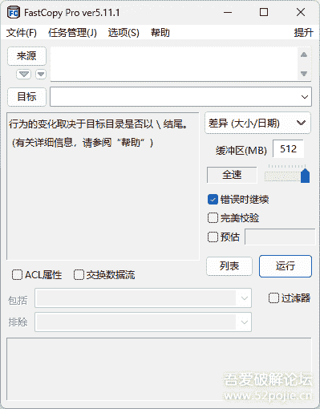

`1.png` (31.58 KB, 下载次数: 1)

[`href="forum.php?mod=attachment&aid=MjgwODI4OXw3NjM0NjYxYnwxNzkzNTcwNDk5fDE2ODA4NnwyMDY2MDI3&nothumb=yes" target="_blank"`](https://www.52pojie.cn/forum.php?mod=attachment&aid=MjgwODI4OXw3NjM0NjYxYnwxNzkzNTcwNDk5fDE2ODA4NnwyMDY2MDI3&nothumb=yes)

2025-10-15 17:52 上传

### `2.png`

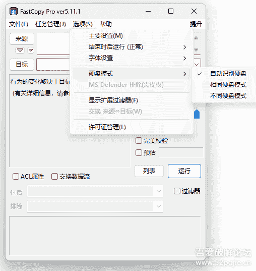

`2.png` (45.8 KB, 下载次数: 2)

[`href="forum.php?mod=attachment&aid=MjgwODI5MHwwMWMwMjk2YnwxNzkzNTcwNDk5fDE2ODA4NnwyMDY2MDI3&nothumb=yes" target="_blank"`](https://www.52pojie.cn/forum.php?mod=attachment&aid=MjgwODI5MHwwMWMwMjk2YnwxNzkzNTcwNDk5fDE2ODA4NnwyMDY2MDI3&nothumb=yes)

2025-10-15 17:52 上传

### `3.png`

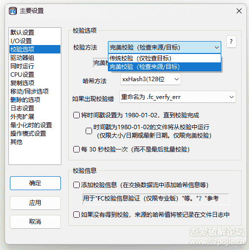

`3.png` (60.56 KB, 下载次数: 1)

[`href="forum.php?mod=attachment&aid=MjgwODI5MXw4MjNhZjFmYnwxNzkzNTcwNDk5fDE2ODA4NnwyMDY2MDI3&nothumb=yes" target="_blank"`](https://www.52pojie.cn/forum.php?mod=attachment&aid=MjgwODI5MXw4MjNhZjFmYnwxNzkzNTcwNDk5fDE2ODA4NnwyMDY2MDI3&nothumb=yes)

2025-10-15 17:52 上传

### `4.png`

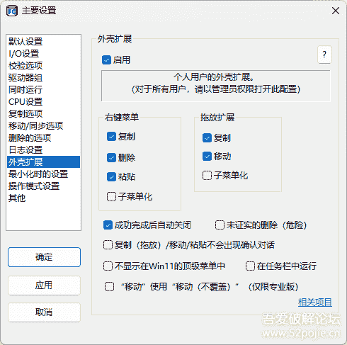

`4.png` (46.04 KB, 下载次数: 2)

[`href="forum.php?mod=attachment&aid=MjgwODI5MnxlMjY4NjdkNXwxNzkzNTcwNDk5fDE2ODA4NnwyMDY2MDI3&nothumb=yes" target="_blank"`](https://www.52pojie.cn/forum.php?mod=attachment&aid=MjgwODI5MnxlMjY4NjdkNXwxNzkzNTcwNDk5fDE2ODA4NnwyMDY2MDI3&nothumb=yes)

2025-10-15 17:52 上传

### `5.png`

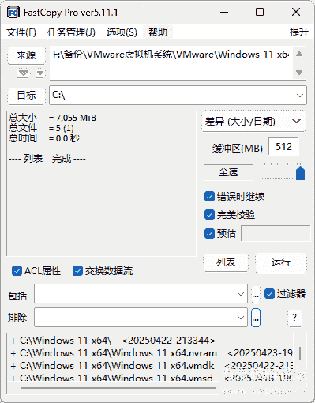

`5.png` (38.58 KB, 下载次数: 1)

[`href="forum.php?mod=attachment&aid=MjgwODI5M3wyOTdlNDMwY3wxNzkzNTcwNDk5fDE2ODA4NnwyMDY2MDI3&nothumb=yes" target="_blank"`](https://www.52pojie.cn/forum.php?mod=attachment&aid=MjgwODI5M3wyOTdlNDMwY3wxNzkzNTcwNDk5fDE2ODA4NnwyMDY2MDI3&nothumb=yes)

2025-10-15 17:52 上传

### `6.png`

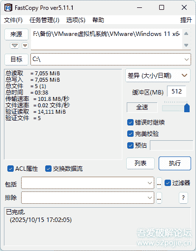

`6.png` (38.38 KB, 下载次数: 2)

[`href="forum.php?mod=attachment&aid=MjgwODI5NHxiNWU4YWJmM3wxNzkzNTcwNDk5fDE2ODA4NnwyMDY2MDI3&nothumb=yes" target="_blank"`](https://www.52pojie.cn/forum.php?mod=attachment&aid=MjgwODI5NHxiNWU4YWJmM3wxNzkzNTcwNDk5fDE2ODA4NnwyMDY2MDI3&nothumb=yes)

2025-10-15 17:52 上传

### `7.png`

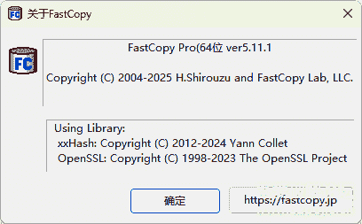

`7.png` (19.4 KB, 下载次数: 2)

[`href="forum.php?mod=attachment&aid=MjgwODI5NXwxNDk1NTllM3wxNzkzNTcwNDk5fDE2ODA4NnwyMDY2MDI3&nothumb=yes" target="_blank"`](https://www.52pojie.cn/forum.php?mod=attachment&aid=MjgwODI5NXwxNDk1NTllM3wxNzkzNTcwNDk5fDE2ODA4NnwyMDY2MDI3&nothumb=yes)

2025-10-15 17:52 上传

### `复制测试运行录屏gif动图.gif`

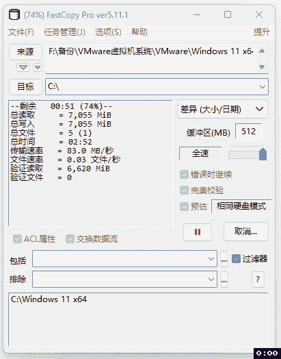

`复制测试运行录屏gif动图.gif` (133.27 KB, 下载次数: 2)

[`href="forum.php?mod=attachment&aid=MjgwODI5NnxjZDBmYTIxNnwxNzkzNTcwNDk5fDE2ODA4NnwyMDY2MDI3&nothumb=yes" target="_blank"`](https://www.52pojie.cn/forum.php?mod=attachment&aid=MjgwODI5NnxjZDBmYTIxNnwxNzkzNTcwNDk5fDE2ODA4NnwyMDY2MDI3&nothumb=yes)

2025-10-15 17:52 上传

设置外壳扩展后打开右键菜单复制粘贴测试gif动态录屏

## 相关链接

1. [`https://www.52pojie.cn/thread-2064549-1-1.html`](https://www.52pojie.cn/thread-2064549-1-1.html)
2. [`https://www.52pojie.cn/thread-2066027-1-1.html`](https://www.52pojie.cn/thread-2066027-1-1.html)
