# [Web逆向] WebSocket通信逆向实战：加解密剖析与完整HTML重构（内附源码）

- 原帖: https://www.52pojie.cn/forum.php?mod=viewthread&tid=2066191
- 抓取时间: 2026-11-01T22:01:37

## 声明

本文章中所有内容仅供学习交流使用，不用于其他任何目的，严禁用于商业用途和非法用途，否则由此产生的一切后果均与作者无关！若有侵权，请联系作者删除。

## 前言

难得遇到个用`websocket`的网站，但遇到了都是比较恶心人的，以这个网站为例，记录一下分析过程，加解密不难，难的是`websocket`的消息处理还原`html`，话不多说，开搞！

## 逆向目标

目标网站：

`aHR0cDovL3d3dy5jcnNjLmNuL2cyNjcwL202MDkzL21wMS5hc3B4`

关键要点：

`aes`加密、通信消息获取与还原

## 过无限debugger

开局一个无限`debugger`

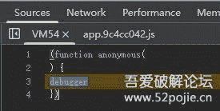

1.png (10.64 KB, 下载次数: 1)

[href="forum.php?mod=attachment&aid=MjgwODQzM3w0ZjJjNDgyOXwxNzkzNTcwNDk1fDE2ODA4NnwyMDY2MTkx&nothumb=yes" target="_blank"](https://www.52pojie.cn/forum.php?mod=attachment&aid=MjgwODQzM3w0ZjJjNDgyOXwxNzkzNTcwNDk1fDE2ODA4NnwyMDY2MTkx&nothumb=yes)

2025-10-16 13:47 上传

两种方法过

### 第一种无脑型：

直接右键选择 Never pause here

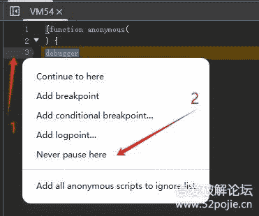

2.png (20.26 KB, 下载次数: 1)

[href="forum.php?mod=attachment&aid=MjgwODQzNHxhY2UwZDVmNHwxNzkzNTcwNDk1fDE2ODA4NnwyMDY2MTkx&nothumb=yes" target="_blank"](https://www.52pojie.cn/forum.php?mod=attachment&aid=MjgwODQzNHxhY2UwZDVmNHwxNzkzNTcwNDk1fDE2ODA4NnwyMDY2MTkx&nothumb=yes)

2025-10-16 13:47 上传

### 第二种钻研型：

往上跟一个栈进入`js`文件

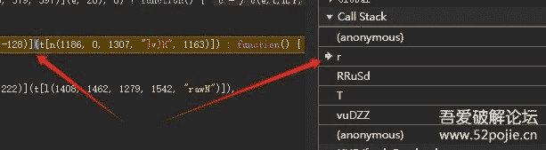

3.png (19.62 KB, 下载次数: 1)

[href="forum.php?mod=attachment&aid=MjgwODQzNXwyNGNlZTZlOXwxNzkzNTcwNDk1fDE2ODA4NnwyMDY2MTkx&nothumb=yes" target="_blank"](https://www.52pojie.cn/forum.php?mod=attachment&aid=MjgwODQzNXwyNGNlZTZlOXwxNzkzNTcwNDk1fDE2ODA4NnwyMDY2MTkx&nothumb=yes)

2025-10-16 13:47 上传

把这段函数 `r` 混淆解一下看看

```
function r(e) {
    if (false) {
        return function(e) {}["constructor"]("while (true) {}")["apply"]("counter")
    }
    ("" + (e / e))["length"] !== 1 || e % 20 === 0 ? function() {
        return !0
    }["constructor"]("debugger")["call"]("action") : function() {
        return !1
    }["constructor"]("debugger")["apply"]("stateObject"),
    r(++e)
}
```

第一部分：永远不会执行的代码（迷惑性代码）

```
if (false) {
        return function(e) {}["constructor"]("while (true) {}")["apply"]("counter")
    }
}
```

第二部分：核心逻辑（反调试）

```
("" + (e / e))["length"] !== 1 || e % 20 === 0
```

如果 `e` 是 0（或非法值），或者 `e` 是 20 的倍数，则执行第一个分支；否则执行第二个分支。

条件为真时：

```
function() { return !0 }["constructor"]("debugger")["call"]("action")
```

条件为假时：

```
function() { return !1 }["constructor"]("debugger")["apply"]("stateObject")
```

这两段代码本质相同，都是：

利用函数的 `constructor`（即 `Function`）动态创建一个包含 "`debugger`" 语句的函数

然后立即调用它（`.call()` 或 `.apply()`）

`Function("debugger")()` 等价于直接写 `debugger`;

所以无论哪个分支，都会执行 `debugger` 语句

最后再递归调用 `r(++e)`

对 `e` 自增 1导致函数无限递归下去（直到栈溢出或触发调试器）

原理弄清了就能想到很多技巧绕过了

不想打开控制台每次都右键绕过`debugger`

要么写`hook`脚本注入

```
Function.prototype.constructor = function(){}
```

或者

```
const originalConstructor = Function.prototype.constructor;
Function.prototype.constructor = function (val) {
    if (val == "debugger") {
        return function (){};
    }
    return originalConstructor(a);
};
```

要么修改替换`js`文件

往上再跟栈可以找到执行 `r` 函数的位置

直接注释掉就行了

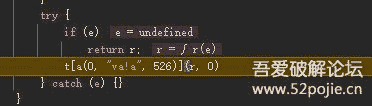

4.png (9.08 KB, 下载次数: 0)

[href="forum.php?mod=attachment&aid=MjgwODQzNnxjZGE5NDFhOXwxNzkzNTcwNDk1fDE2ODA4NnwyMDY2MTkx&nothumb=yes" target="_blank"](https://www.52pojie.cn/forum.php?mod=attachment&aid=MjgwODQzNnxjZGE5NDFhOXwxNzkzNTcwNDk1fDE2ODA4NnwyMDY2MTkx&nothumb=yes)

2025-10-16 13:47 上传

### 抓包分析

`sessions`接口

载荷加密

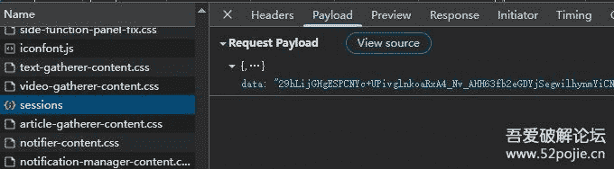

5.png (28.24 KB, 下载次数: 1)

[href="forum.php?mod=attachment&aid=MjgwODQzN3xlYjVjZTU3Y3wxNzkzNTcwNDk1fDE2ODA4NnwyMDY2MTkx&nothumb=yes" target="_blank"](https://www.52pojie.cn/forum.php?mod=attachment&aid=MjgwODQzN3xlYjVjZTU3Y3wxNzkzNTcwNDk1fDE2ODA4NnwyMDY2MTkx&nothumb=yes)

2025-10-16 13:47 上传

响应也是加密的

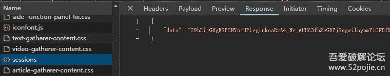

6.png (23.4 KB, 下载次数: 1)

[href="forum.php?mod=attachment&aid=MjgwODQzOHw1NTdmZWRlOHwxNzkzNTcwNDk1fDE2ODA4NnwyMDY2MTkx&nothumb=yes" target="_blank"](https://www.52pojie.cn/forum.php?mod=attachment&aid=MjgwODQzOHw1NTdmZWRlOHwxNzkzNTcwNDk1fDE2ODA4NnwyMDY2MTkx&nothumb=yes)

2025-10-16 13:47 上传

然后是`websocket`请求

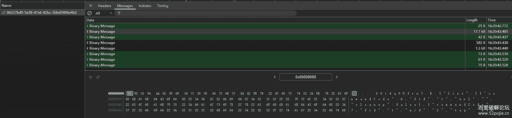

7.png (91.1 KB, 下载次数: 2)

[href="forum.php?mod=attachment&aid=MjgwODQzOXxhMDQ2YmNkOHwxNzkzNTcwNDk1fDE2ODA4NnwyMDY2MTkx&nothumb=yes" target="_blank"](https://www.52pojie.cn/forum.php?mod=attachment&aid=MjgwODQzOXxhMDQ2YmNkOHwxNzkzNTcwNDk1fDE2ODA4NnwyMDY2MTkx&nothumb=yes)

2025-10-16 13:47 上传

`ws`链接也是有加密的

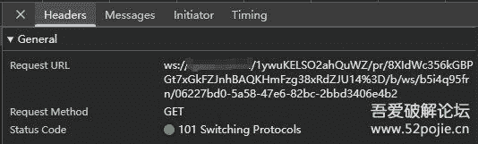

8.png (22.37 KB, 下载次数: 2)

[href="forum.php?mod=attachment&aid=MjgwODQ0MHxlZGUwNjNmMHwxNzkzNTcwNDk1fDE2ODA4NnwyMDY2MTkx&nothumb=yes" target="_blank"](https://www.52pojie.cn/forum.php?mod=attachment&aid=MjgwODQ0MHxlZGUwNjNmMHwxNzkzNTcwNDk1fDE2ODA4NnwyMDY2MTkx&nothumb=yes)

2025-10-16 13:47 上传

### 加解密分析

打上`xhr`断点刷新页面

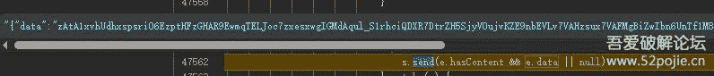

9.png (19.25 KB, 下载次数: 0)

[href="forum.php?mod=attachment&aid=MjgwODQ0MXw1Mjg5M2JjYXwxNzkzNTcwNDk1fDE2ODA4NnwyMDY2MTkx&nothumb=yes" target="_blank"](https://www.52pojie.cn/forum.php?mod=attachment&aid=MjgwODQ0MXw1Mjg5M2JjYXwxNzkzNTcwNDk1fDE2ODA4NnwyMDY2MTkx&nothumb=yes)

2025-10-16 13:48 上传

可以看到发送请求前的加密载荷

再往上跟栈找加密位置

发现请求整体是在`sessionData`方法中处理

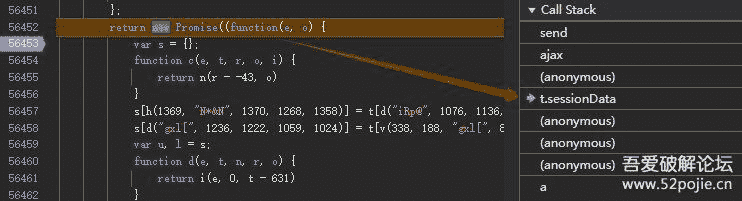

10.png (33.26 KB, 下载次数: 1)

[href="forum.php?mod=attachment&aid=MjgwODQ0Mnw2OGI0ZjNkYnwxNzkzNTcwNDk1fDE2ODA4NnwyMDY2MTkx&nothumb=yes" target="_blank"](https://www.52pojie.cn/forum.php?mod=attachment&aid=MjgwODQ0Mnw2OGI0ZjNkYnwxNzkzNTcwNDk1fDE2ODA4NnwyMDY2MTkx&nothumb=yes)

2025-10-16 13:48 上传

在`Promise`第一行代码打上断点进去看看

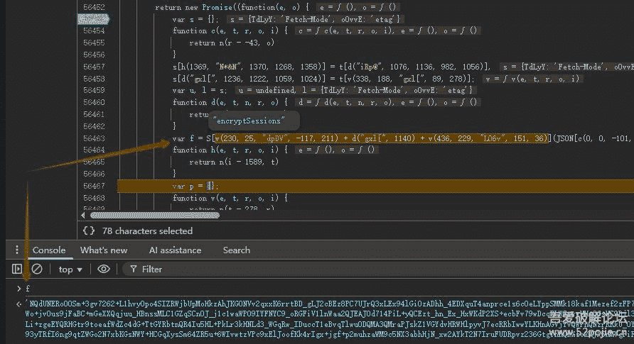

11.png (98.05 KB, 下载次数: 2)

[href="forum.php?mod=attachment&aid=MjgwODQ0M3xmOGJkZDdkYnwxNzkzNTcwNDk1fDE2ODA4NnwyMDY2MTkx&nothumb=yes" target="_blank"](https://www.52pojie.cn/forum.php?mod=attachment&aid=MjgwODQ0M3xmOGJkZDdkYnwxNzkzNTcwNDk1fDE2ODA4NnwyMDY2MTkx&nothumb=yes)

2025-10-16 13:48 上传

`f` 就是我们所需的载荷

通过`encryptSessions`方法加密而来

把这段代码还原如下

```
var f = S["encryptSessions"](JSON.stringify(N));
```

再看看要加密的参数 `N`

只有`cid`、`tabId`、`uuid`是动态随机生成的

`_` 需要拼接`cid`

`referrer`和`url`是要访问的列表页地址

全都写死也是可以的

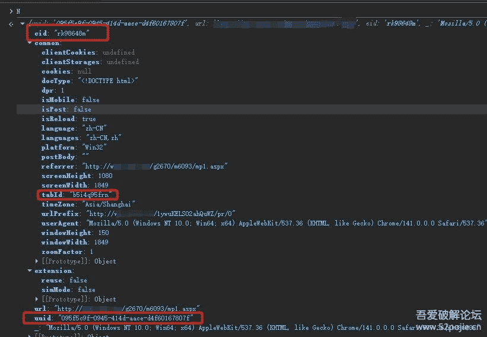

12.png (66.42 KB, 下载次数: 1)

[href="forum.php?mod=attachment&aid=MjgwODQ0NHwzODUyYjYxMXwxNzkzNTcwNDk1fDE2ODA4NnwyMDY2MTkx&nothumb=yes" target="_blank"](https://www.52pojie.cn/forum.php?mod=attachment&aid=MjgwODQ0NHwzODUyYjYxMXwxNzkzNTcwNDk1fDE2ODA4NnwyMDY2MTkx&nothumb=yes)

2025-10-16 13:48 上传

`N` 参数的生成位置就在`Promise`上方

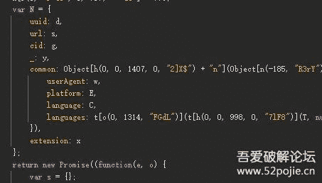

13.png (19.78 KB, 下载次数: 2)

[href="forum.php?mod=attachment&aid=MjgwODQ0NXwxOGQ1M2ZlNXwxNzkzNTcwNDk1fDE2ODA4NnwyMDY2MTkx&nothumb=yes" target="_blank"](https://www.52pojie.cn/forum.php?mod=attachment&aid=MjgwODQ0NXwxOGQ1M2ZlNXwxNzkzNTcwNDk1fDE2ODA4NnwyMDY2MTkx&nothumb=yes)

2025-10-16 13:48 上传

随机代码

```
import uuid
import random
import string

def random_id(self, k):
    return ''.join(random.choices(string.ascii_lowercase + string.digits, k=k))

self.cid = self.random_id(8)
self.tab_id = self.random_id(10)
self._uuid = str(uuid.uuid4())
```

进入`encryptSessions`方法分析

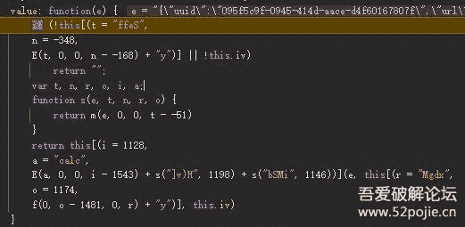

14.png (25.27 KB, 下载次数: 2)

[href="forum.php?mod=attachment&aid=MjgwODQ0NnwxNTg4YTE4M3wxNzkzNTcwNDk1fDE2ODA4NnwyMDY2MTkx&nothumb=yes" target="_blank"](https://www.52pojie.cn/forum.php?mod=attachment&aid=MjgwODQ0NnwxNTg4YTE4M3wxNzkzNTcwNDk1fDE2ODA4NnwyMDY2MTkx&nothumb=yes)

2025-10-16 13:48 上传

还原看看

```
function (e) {
    if (!this.priKey || !this.iv)
        return "";
    return this["_dynamicEncrypt"](e, this.priKey, this.iv)
}
```

还要进`_dynamicEncrypt`方法


15.png (50.44 KB, 下载次数: 1)

[href="forum.php?mod=attachment&aid=MjgwODQ0N3w0OGRkYjhiMXwxNzkzNTcwNDk1fDE2ODA4NnwyMDY2MTkx&nothumb=yes" target="_blank"](https://www.52pojie.cn/forum.php?mod=attachment&aid=MjgwODQ0N3w0OGRkYjhiMXwxNzkzNTcwNDk1fDE2ODA4NnwyMDY2MTkx&nothumb=yes)

2025-10-16 13:48 上传

继续还原

```
function (e, t, n) {
    var u = c['createCipheriv']("aes-128-cbc", t, n)
    , l = u["update"](e, "utf8", "base64");
    return l += u["final"]("base64"),
    l["replace"](/\//g, "_")
}
```

很明显了

标准的`aes-128-cbc`加密

接着我们要找到 `key` 和 `iv`

分析可知 `key` 是固定的 `iv` 每次都不一样

重点找下`iv`的生成逻辑

回到 `f` 位置

鼠标放在 `S` 上可以看到 `iv` 早已生成了

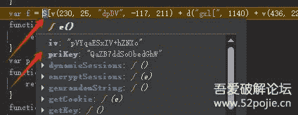

16.png (18.48 KB, 下载次数: 2)

[href="forum.php?mod=attachment&aid=MjgwODQ0OHxiZWYyYzIxNnwxNzkzNTcwNDk1fDE2ODA4NnwyMDY2MTkx&nothumb=yes" target="_blank"](https://www.52pojie.cn/forum.php?mod=attachment&aid=MjgwODQ0OHxiZWYyYzIxNnwxNzkzNTcwNDk1fDE2ODA4NnwyMDY2MTkx&nothumb=yes)

2025-10-16 13:48 上传

往上在刚进入`sessionData`处打上断点

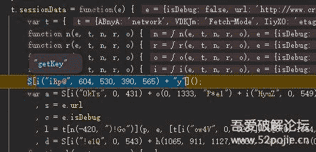

17.png (35.06 KB, 下载次数: 2)

[href="forum.php?mod=attachment&aid=MjgwODQ0OXwyNjhjYmEyZXwxNzkzNTcwNDk1fDE2ODA4NnwyMDY2MTkx&nothumb=yes" target="_blank"](https://www.52pojie.cn/forum.php?mod=attachment&aid=MjgwODQ0OXwyNjhjYmEyZXwxNzkzNTcwNDk1fDE2ODA4NnwyMDY2MTkx&nothumb=yes)

2025-10-16 13:48 上传

`getKey`方法执行完后 `S` 中就有`key`值了

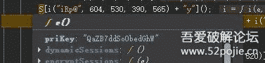

18.png (12.01 KB, 下载次数: 2)

[href="forum.php?mod=attachment&aid=MjgwODQ1MHw4NDJkYjUxOXwxNzkzNTcwNDk1fDE2ODA4NnwyMDY2MTkx&nothumb=yes" target="_blank"](https://www.52pojie.cn/forum.php?mod=attachment&aid=MjgwODQ1MHw4NDJkYjUxOXwxNzkzNTcwNDk1fDE2ODA4NnwyMDY2MTkx&nothumb=yes)

2025-10-16 13:48 上传

继续往下走

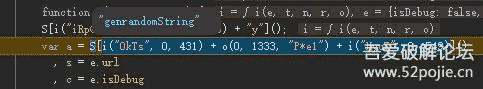

19.png (14.85 KB, 下载次数: 1)

[href="forum.php?mod=attachment&aid=MjgwODQ1MXwyMDY0YjhlN3wxNzkzNTcwNDk1fDE2ODA4NnwyMDY2MTkx&nothumb=yes" target="_blank"](https://www.52pojie.cn/forum.php?mod=attachment&aid=MjgwODQ1MXwyMDY0YjhlN3wxNzkzNTcwNDk1fDE2ODA4NnwyMDY2MTkx&nothumb=yes)

2025-10-16 13:48 上传

执行完`genrandomString`方法 `S` 就有 `iv`了

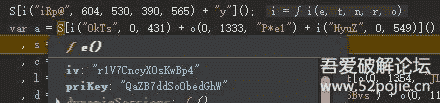

20.png (15.68 KB, 下载次数: 2)

[href="forum.php?mod=attachment&aid=MjgwODQ1MnxhMTA3MmZlZnwxNzkzNTcwNDk1fDE2ODA4NnwyMDY2MTkx&nothumb=yes" target="_blank"](https://www.52pojie.cn/forum.php?mod=attachment&aid=MjgwODQ1MnxhMTA3MmZlZnwxNzkzNTcwNDk1fDE2ODA4NnwyMDY2MTkx&nothumb=yes)

2025-10-16 13:48 上传

进方法看看

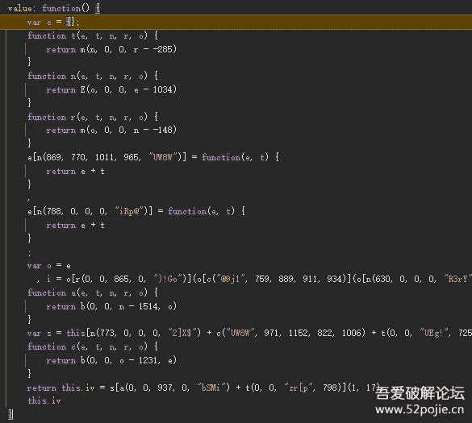

21.png (43.05 KB, 下载次数: 1)

[href="forum.php?mod=attachment&aid=MjgwODQ1M3xkMTNkYzljMXwxNzkzNTcwNDk1fDE2ODA4NnwyMDY2MTkx&nothumb=yes" target="_blank"](https://www.52pojie.cn/forum.php?mod=attachment&aid=MjgwODQ1M3xkMTNkYzljMXwxNzkzNTcwNDk1fDE2ODA4NnwyMDY2MTkx&nothumb=yes)

2025-10-16 13:48 上传

还原

```
functio() {

    var i = Math["random"]()["toString"](36)["slice"](-8) + "-" + Math["random"]()["toString"](36)["slice"](-8) + (new Date)["getTime"]();

    var s = this["_dynamicEncrypt"](i, C, w)["replace"]("_", "");

    return this.iv = s["substring"](1, 17),

    this.iv

}
```

创建一个随机字符串还是用上面的aes加密

这次用的`key` 和 `iv` 是固定的

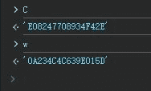

22.png (7.36 KB, 下载次数: 2)

[href="forum.php?mod=attachment&aid=MjgwODQ1NHwwZjBiM2FiMXwxNzkzNTcwNDk1fDE2ODA4NnwyMDY2MTkx&nothumb=yes" target="_blank"](https://www.52pojie.cn/forum.php?mod=attachment&aid=MjgwODQ1NHwwZjBiM2FiMXwxNzkzNTcwNDk1fDE2ODA4NnwyMDY2MTkx&nothumb=yes)

2025-10-16 13:48 上传

生成的就是我们需要的动态 `iv` 值

还原代码如下

```
def random_iv(self):
    part1 = self.random_id(8)
    part2 = self.random_id(8)
    timestamp = str(int(time.time() * 1000))
    crypto = AesCbcCrypto(b"E08247708934F42E", b"0A234C4C639E015D")
    encrypt_info = crypto.aes_encrypt(f"{part1}-{part2}{timestamp}")
    return encrypt_info[1:17].encode()
```

请求看看结果

注意请求头`headers`中需要有`Fetch-Mode`和`etag`（动态 `iv` 值）

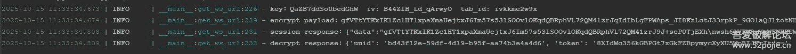

23.png (40.82 KB, 下载次数: 2)

[href="forum.php?mod=attachment&aid=MjgwODQ1NXw2ZDk5ZDljMnwxNzkzNTcwNDk1fDE2ODA4NnwyMDY2MTkx&nothumb=yes" target="_blank"](https://www.52pojie.cn/forum.php?mod=attachment&aid=MjgwODQ1NXw2ZDk5ZDljMnwxNzkzNTcwNDk1fDE2ODA4NnwyMDY2MTkx&nothumb=yes)

2025-10-16 13:48 上传

3> `websocket`分析

`ws`链接

```
ws://www.****.cn/1ywuKELSO2ahQuWZ/pr/8XIdWc356kGBPGt7xGkFZKdv19oQMigyzm9H3A3Wupo%3D/b/ws/af10no7t8e/095f5c9f-0945-414d-aace-d4f60167807f

8XIdWc356kGBPGt7xGkFZKdv19oQMigyzm9H3A3Wupo%3D  sessions接口返回的token值

af10no7t8e  tab_id

095f5c9f-0945-414d-aace-d4f60167807f  uuid
```

跟着`ws`请求的堆栈进去

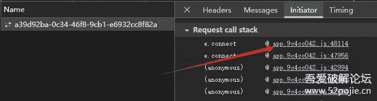

24.png (22.35 KB, 下载次数: 2)

[href="forum.php?mod=attachment&aid=MjgwODQ1NnwzY2FiZTgwZHwxNzkzNTcwNDk1fDE2ODA4NnwyMDY2MTkx&nothumb=yes" target="_blank"](https://www.52pojie.cn/forum.php?mod=attachment&aid=MjgwODQ1NnwzY2FiZTgwZHwxNzkzNTcwNDk1fDE2ODA4NnwyMDY2MTkx&nothumb=yes)

2025-10-16 13:48 上传

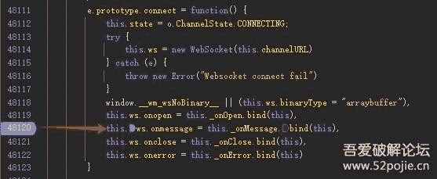

25.png (30.67 KB, 下载次数: 2)

[href="forum.php?mod=attachment&aid=MjgwODQ1N3xjZTU3ZTYwYnwxNzkzNTcwNDk1fDE2ODA4NnwyMDY2MTkx&nothumb=yes" target="_blank"](https://www.52pojie.cn/forum.php?mod=attachment&aid=MjgwODQ1N3xjZTU3ZTYwYnwxNzkzNTcwNDk1fDE2ODA4NnwyMDY2MTkx&nothumb=yes)

2025-10-16 13:48 上传

在这里可以看到创建了`websocket`的实例以及四个关键事件注册回调函数

`onmessage` 是收到服务器消息时触发的回调函数

这里绑定到了`this._onMessage`方法里

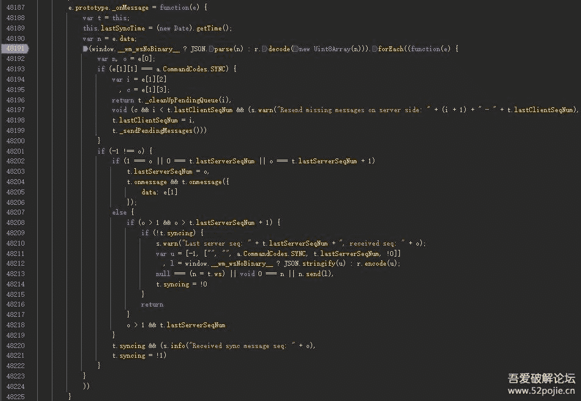

26.png (82.06 KB, 下载次数: 2)

[href="forum.php?mod=attachment&aid=MjgwODQ1OHxhNjc5YTc5MnwxNzkzNTcwNDk1fDE2ODA4NnwyMDY2MTkx&nothumb=yes" target="_blank"](https://www.52pojie.cn/forum.php?mod=attachment&aid=MjgwODQ1OHxhNjc5YTc5MnwxNzkzNTcwNDk1fDE2ODA4NnwyMDY2MTkx&nothumb=yes)

2025-10-16 13:48 上传

一步步来看看

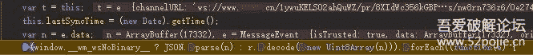

27.png (19.56 KB, 下载次数: 2)

[href="forum.php?mod=attachment&aid=MjgwODQ1OXw4NzJlMTBkNXwxNzkzNTcwNDk1fDE2ODA4NnwyMDY2MTkx&nothumb=yes" target="_blank"](https://www.52pojie.cn/forum.php?mod=attachment&aid=MjgwODQ1OXw4NzJlMTBkNXwxNzkzNTcwNDk1fDE2ODA4NnwyMDY2MTkx&nothumb=yes)

2025-10-16 13:48 上传

用 `t = this` 保存当前实例引用（避免在回调中 `this` 指向错误）

`lastSyncTime`记录最后一次收到消息的时间（用于心跳、超时判断等）

`n` 获取原始消息数据

如果：

`window.__wm_wsNoBinary__` 为真

消息是 JSON 字符串，用 `JSON.parse(n)` 解析

否则：

消息是二进制数据（`ArrayBuffer`）先转为`Uint8Array`，再用`r.decode`解码

接着遍历解码后的消息进行处理

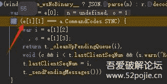

28.png (19.64 KB, 下载次数: 2)

[href="forum.php?mod=attachment&aid=MjgwODQ2MHw2OTA1NjU3ZnwxNzkzNTcwNDk1fDE2ODA4NnwyMDY2MTkx&nothumb=yes" target="_blank"](https://www.52pojie.cn/forum.php?mod=attachment&aid=MjgwODQ2MHw2OTA1NjU3ZnwxNzkzNTcwNDk1fDE2ODA4NnwyMDY2MTkx&nothumb=yes)

2025-10-16 13:48 上传

`e[1][1]`是取当前消息的指令

`a.CommandCodes` 是指令集如下


```json
{
    "TAB_OPS": 0,
    "DOM_EVENT": 4,
    "DOM_METHOD": 5,
    "RESET_DOM": 6,
    "ADD_DOC_TYPE": 7,
    "ADD_HTML_ELEMENT": 8,
    "ADD_SVG_ELEMENT": 9,
    "ADD_NS_ELEMENT": 10,
    "MOVE_ELEMENT": 11,
    "SHUFFLE_CHILDREN": 12,
    "EDIT_ELEMENT": 13,
    "DELETE_ELEMENT": 14,
    "ADD_STYLE": 15,
    "ADD_TEXT": 16,
    "MODIFY_TEXT": 17,
    "MODIFY_PROPERTY": 18,
    "MODIFY_ATTRIBUTES": 19,
    "SET_SELECTIONS": 20,
    "INSERT_RULE": 21,
    "DELETE_RULE": 22,
    "DISABLED_STYLE": 24,
    "SET_CANVAS_DATA": 23,
    "WEBRTC": 30,
    "NAVIGATE": 31,
    "SYNC": 32,
    "SYNC_COOKIE": 34,
    "FILE": 35,
    "TAB_ACTIVE": 42,
    "NATIVE_METHOD": 44,
    "MODIFY_DOC_TYPE": 47,
    "CHANGE_BLOCK": 48,
    "RELOAD": 49,
    "SYNC_ALL_COOKIE": 50,
    "SYNC_WRITE_COOKIE": 51,
    "MEDIA_STATE": 52,
    "DOM_READY": 53,
    "AUGMENT_CSS": 54,
    "MULTI_CMD": 55,
    "REDIRECT_REQUEST": 56,
    "TEXTAREA_RESIZE": 57,
    "SIMPLE_HTML": 58
}
```

`o = e[0]` → 消息的序列号（seq number）

如果 `e[1][1]` 等于 `a.CommandCodes.SYNC`（32），则执行 `_cleanUpPendingQueue(i)` 清除已确认的消息（ACK 机制）。

- `i = e[1][2]` → 服务器确认已收到的客户端最新的消息内容
- `c = e[1][3]` → 是否需要客户端重发（布尔值）

如果 `c` 为真且服务器确认的消息序列小于本地记录的 `lastClientSeqNum`，说明服务器丢失了部分客户端消息：

- 打印警告日志
- 重置 `lastClientSeqNum = i`
- 调用 `_sendPendingMessages()` 重新发送未确认的消息

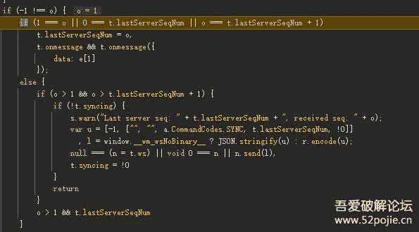

[29.png](https://www.52pojie.cn/forum.php?mod=attachment&aid=MjgwODQ2MXw4ZjhmMTZkYXwxNzkzNTcwNDk1fDE2ODA4NnwyMDY2MTkx&nothumb=yes) (35.32 KB, 下载次数: 1)  
2025-10-16 13:48 上传

先说 `eles`。

如果收到的 `seq` 跳过了中间某些号（比如期望 5，却收到 8），说明中间消息丢失或乱序。

如果当前未处于同步状态（`!t.syncing`）：

- 打印警告日志
- 构造一条 `SYNC` 请求消息：`[-1, ["", "", SYNC, lastServerSeqNum, true]]`
- `-1` 表示这条 `SYNC` 消息本身无 `seq`
- 最后一个 `true` 表示“请服务器重发缺失的消息”
- 根据是否二进制，用 `JSON.stringify` 或 `r.encode` 编码
- 通过 `ws.send(l)` 发送给服务器
- 设置 `t.syncing = true` 防止重复请求
- `return`：不处理这条乱序消息（等同步完成后再处理）

再说 `if`。

如果满足以下任一条件，说明消息是按序到达的：

- 第一条消息（`o === 1`）
- 还没收到过任何消息（`lastServerSeqNum === 0`）
- 当前 `seq` 正好是上一条的下一个（`o === lastServerSeqNum+ 1`）

则：

- 更新 `lastServerSeqNum = o`
- 触发回调函数 `onmessage`

跟着再进 `onmessage`，进入了一个 `onReceive` 方法里。

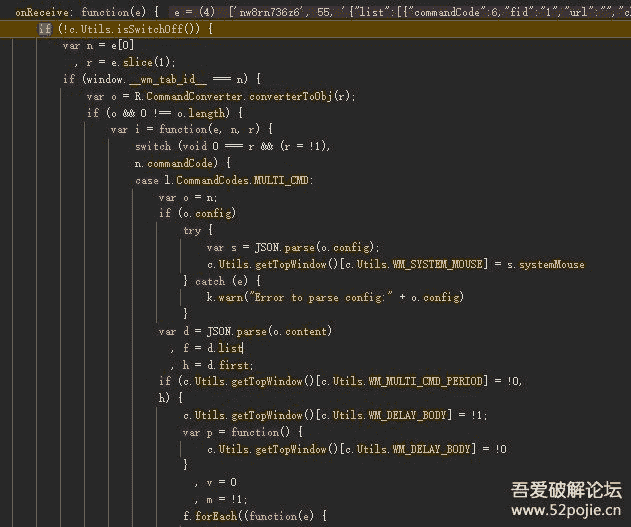

[30.png](https://www.52pojie.cn/forum.php?mod=attachment&aid=MjgwODQ2MnxiZmE5YTMwNnwxNzkzNTcwNDk1fDE2ODA4NnwyMDY2MTkx&nothumb=yes) (55.95 KB, 下载次数: 2)  
2025-10-16 13:48 上传

碍于篇幅问题，这里就不一步步解释了，直接捡重点的说。

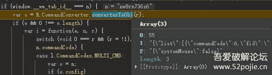

[31.png](https://www.52pojie.cn/forum.php?mod=attachment&aid=MjgwODQ2M3xhOWEyOTVhZHwxNzkzNTcwNDk1fDE2ODA4NnwyMDY2MTkx&nothumb=yes) (24.67 KB, 下载次数: 1)  
2025-10-16 13:48 上传

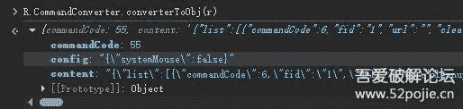

[32.png](https://www.52pojie.cn/forum.php?mod=attachment&aid=MjgwODQ2NHxkM2EyMjUyYXwxNzkzNTcwNDk1fDE2ODA4NnwyMDY2MTkx&nothumb=yes) (17.08 KB, 下载次数: 2)  
2025-10-16 13:48 上传

这里将数组类型的消息转为对象类型。

看看具体怎么转的。

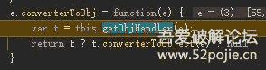

[32_1.png](https://www.52pojie.cn/forum.php?mod=attachment&aid=MjgwODQ2NXw4NzUxMzFiM3wxNzkzNTcwNDk1fDE2ODA4NnwyMDY2MTkx&nothumb=yes) (9.11 KB, 下载次数: 2)  
2025-10-16 13:49 上传

先走 `getObjHandler` 方法。

根据 `e` 中的指令码从一个映射表中取相对应的转换函数。

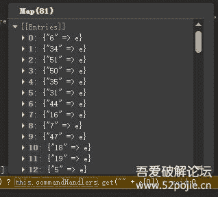

[32_2.png](https://www.52pojie.cn/forum.php?mod=attachment&aid=MjgwODQ2NnxkMmZiZTg5M3wxNzkzNTcwNDk1fDE2ODA4NnwyMDY2MTkx&nothumb=yes) (18.93 KB, 下载次数: 2)  
2025-10-16 13:49 上传

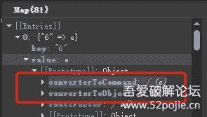

[32_3.png](https://www.52pojie.cn/forum.php?mod=attachment&aid=MjgwODQ2N3w2N2YzMDY2OHwxNzkzNTcwNDk1fDE2ODA4NnwyMDY2MTkx&nothumb=yes) (12.93 KB, 下载次数: 2)  
2025-10-16 13:49 上传

转换函数。

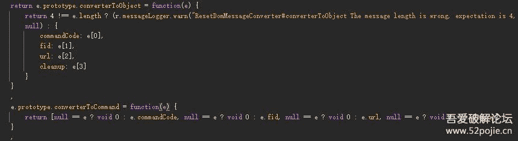

[32_4.png](https://www.52pojie.cn/forum.php?mod=attachment&aid=MjgwODQ2OHxjNWQ3YmMxNHwxNzkzNTcwNDk1fDE2ODA4NnwyMDY2MTkx&nothumb=yes) (23.85 KB, 下载次数: 2)  
2025-10-16 13:49 上传

转换成对象类型后再继续往下处理。

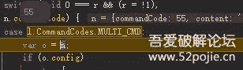

[33.png](https://www.52pojie.cn/forum.php?mod=attachment&aid=MjgwODQ2OXw2YjI0NWQxMXwxNzkzNTcwNDk1fDE2ODA4NnwyMDY2MTkx&nothumb=yes) (10.77 KB, 下载次数: 2)  
2025-10-16 13:49 上传

`MULTI_CMD` 指令码 `55`，是批量命令，说明需要一次性执行多个子命令。

取出 `content` 消息集合。

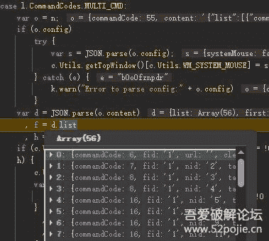

[34.png](https://www.52pojie.cn/forum.php?mod=attachment&aid=MjgwODQ3MHw4ZDMyNjQxNHwxNzkzNTcwNDk1fDE2ODA4NnwyMDY2MTkx&nothumb=yes) (37.41 KB, 下载次数: 1)  
2025-10-16 13:49 上传

递归调用 `i` 方法处理消息集合。

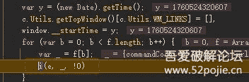

[35.png](https://www.52pojie.cn/forum.php?mod=attachment&aid=MjgwODQ3MXwyNDYyOWFlOXwxNzkzNTcwNDk1fDE2ODA4NnwyMDY2MTkx&nothumb=yes) (15.04 KB, 下载次数: 2)  
2025-10-16 13:49 上传

实际是在 `html` 创建一个 `dom` 元素，再处理指令集合渲染 `html`。

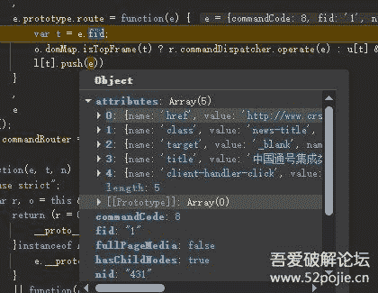

[36.png](https://www.52pojie.cn/forum.php?mod=attachment&aid=MjgwODQ3MnwzNjM1NWM2NXwxNzkzNTcwNDk1fDE2ODA4NnwyMDY2MTkx&nothumb=yes) (37.71 KB, 下载次数: 2)  
2025-10-16 13:49 上传

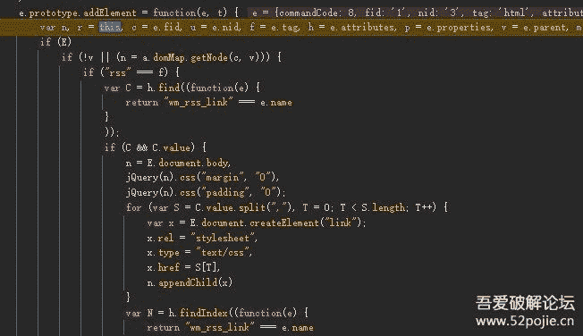

[36_1.png](https://www.52pojie.cn/forum.php?mod=attachment&aid=MjgwODQ3M3xiMmVhYzFlM3wxNzkzNTcwNDk1fDE2ODA4NnwyMDY2MTkx&nothumb=yes) (43.13 KB, 下载次数: 2)  
2025-10-16 13:49 上传

流程弄明白后，接着我们就可以模拟 `websocket` 请求。

将这些关键的方法进行还原。

### 3> python版源代码

```python
import json

import time

import uuid

import random

import string

import base64

import msgpack

import requests

import websocket

from loguru import logger

from pyquery import PyQuery as pq

from Crypto.Cipher import AES

from Crypto.Util.Padding import pad, unpad

class AesCbcCrypto:

    def __init__(self, key, iv):

        self.key = key

        self.iv = iv

    def aes_encrypt(self, plaintext):

        cipher = AES.new(self.key, AES.MODE_CBC, self.iv)

        padded_data = pad(plaintext.encode('utf-8'), AES.block_size)

        ciphertext = cipher.encrypt(padded_data)

        b64 = base64.b64encode(ciphertext).decode('utf-8')

        return b64.replace('/', '_')

    def aes_decrypt(self, encrypted_data):

        ciphertext = base64.b64decode(encrypted_data.replace('_', '/').replace('\n', ''))

        cipher = AES.new(self.key, AES.MODE_CBC, self.iv)

        padded_plaintext = cipher.decrypt(ciphertext)

        plaintext_bytes = unpad(padded_plaintext, AES.block_size)

        return plaintext_bytes.decode('utf-8')

class WebsocketClient:
```


```python
    def __init__(self, list_ws_url):

        self.html = ''

        self.command_list = []

        self.last_server_seq_num = 0

        self.handle_fun = {

            'converter_to_command': self.converter_to_command,

            'converter_to_object': self.converter_to_object

        }

        # 定义所有命令码

        all_codes = (

            # 数字命令码

            ["6", "34", "51", "50", "35", "31", "44", "16", "7", "47", "18", "19",

             "5", "8", "9", "10", "11", "12", "13", "14", "17", "20", "21", "22",

             "24", "23", "48", "30", "42", "49", "52", "53", "54", "55", "56", "57", "58"] +

            # 4-前缀命令码

            [f"4-{code}"for code in ["drag", "groupdrag", "scroll", "input", "replacetext",

                                      "inserttext", "deletebycut", "copy", "change", "shadow",

                                      "key", "groupmouse", "mouse", "contextmenu", "click",

                                      "selection", "wheel", "paste", "touch", "grouppointer",

                                      "pointer", "forceblur", "forcefocus", "focus",

                                      "fullscreen", "continue"]] +

            # 0-前缀命令码

            [f"0-{code}"for code in ["new", "resize", "nativemethodresult", "inputattack",

                                      "fingerprint", "feedback", "decrypt", "canceldownload",

                                      "filedownloaded", "neterroralert", "suspectedphishing",

                                      "targetlocation", "syncfingerprint", "pop", "newwindow",

                                      "emailuserfeedbackresult", "browseraction", "visible"]]

        )

        self.command_handlers = {code: self.handle_fun for code in all_codes}

        self.ws = websocket.WebSocketApp(list_ws_url, on_message=self.on_message)

    def run(self):

        self.ws.run_forever()

    def close(self):

        self.ws.close()

    def converter_to_command(self, e):

        return [

            e["commandCode"] if e isnotNoneelseNone,

            e["content"] if e isnotNoneelseNone,

            e["config"] if e isnotNoneelseNone

        ]

    def converter_to_object(self, e):

        if len(e) != 3:

            logger.error("MultiCmdMessageConverter#converterToObject The message length is wrong, expectation is 3, the actual is " + len(e))

            returnNone

        return {

            "commandCode": e[0],

            "content": e[1],

            "config": e[2]

        }

    def on_message(self, ws, message):

        unpack_message = msgpack.unpackb(message)

        for msg in unpack_message:

            o = msg[0]

            if o == -1or msg[1][1] == 32:

                self.close()

                self.html = self.format_html()

            elif-1 != o:

                if1 == o or0 == self.last_server_seq_num or o == self.last_server_seq_num + 1:

                    self.last_server_seq_num = o

                    self.on_receive(msg[1])

    def on_receive(self, e):

        r = e[1:]

        obj = self.command_converter_to_obj(r)

        ifnot obj:

            returnNone

        self.command_converter(obj)

    def command_converter(self, e):

        if e['commandCode'] == 55:

            d = json.loads(e['content'])

            for c in d['list']:

                if c['commandCode'] == 8or c['commandCode'] == 16:

                    self.command_list.append(c)

    def get_handle(self, e, t):

        if t:

            n = e + '-' + t.replace('-', '')

            if n in self.command_handlers:

                return self.command_handlers[n]

            logger.error("handler is undefined of handlerName = " + n)

        else:

            logger.error("opsCodeOrType or commandCode is undefined opsCodeOrType==>" + t + " commandCode==> " + e)

    def get_obj_handler(self, e):

        if e[0] == 0:

            return self.get_handle(e[0], e[1])

        elif e[0] == 4:

            return self.get_handle(e[0], e[3])

        elif str(e[0]) in self.command_handlers:

            return self.command_handlers[str(e[0])]

        else:

            returnNone

    def command_converter_to_obj(self, e):

        t = self.get_obj_handler(e)

        if t:

            return t['converter_to_object'](e)

        returnNone

    def format_html(self):

        ifnot self.command_list:

            returnNone

        doc = pq('')

        for cmd in self.command_list:

            cmd_code = cmd.get('commandCode')

            nid = cmd.get('nid')

            parent_id = cmd.get('parent')

            if cmd_code == 8andnot parent_id:

                doc('html').attr('nid', f'{nid}')

                continue

            parent = doc(f'*[nid="{parent_id}"]')

            ifnot parent:

                continue

            if cmd_code == 8:

                attrs = ' '.join(f'{a["name"]}="{a["value"]}"'for a in cmd.get('attributes', []))

                tag = cmd.get('tag')

                html = f''

                parent.append(html)

            elif cmd_code == 16:

                text = cmd.get('textContent', '')

                if text.strip():

                    parent.append(text)

        return doc.outer_html()

class Session:

    def __init__(self):

        self.iv = self.random_iv()

        self.cid = self.random_id(8)

        self.tab_id = self.random_id(10)

        self._uuid = str(uuid.uuid4())

        self.session_url = 'http://www.脱敏处理.cn/1ywuKELSO2ahQuWZ/api/v1/sessions'

        self.ua = 'Mozilla/5.0 (Windows NT 10.0; Win64; x64) AppleWebKit/537.36 (KHTML, like Gecko) Chrome/140.0.0.0 Safari/537.36'

        self.headers = {

            'Fetch-Mode': self.ua,

            'User-Agent': self.ua,

            'etag': self.iv.decode()

        }

    def random_iv(self):

        part1 = self.random_id(8)

        part2 = self.random_id(8)

        timestamp = str(int(time.time() * 1000))

        crypto = AesCbcCrypto(b"E08247708934F42E", b"0A234C4C639E015D")

        encrypt_info = crypto.aes_encrypt(f"{part1}-{part2}{timestamp}")

        return encrypt_info[1:17].encode()

    def random_id(self, k):

        return''.join(random.choices(string.ascii_lowercase + string.digits, k=k))

    def get_ws_url(self, list_url):

        data = {

            "uuid": self._uuid,

            "url": list_url,

            "cid": self.cid,

            "_": f"{self.ua}|{self.cid}",

            "common": {

                "isPost": False,

                "postBody": "",

                "timeZone": "Asia/Shanghai",

                "tabId": self.tab_id,

                "referrer": "",

                "isReload": False,

                "docType": "",

                "screenWidth": 1849,

                "screenHeight": 1080,

                "windowWidth": 1849,

                "windowHeight": 222,

                "isMobile": False,

                "urlPrefix": "http://www.脱敏处理.cn/1ywuKELSO2ahQuWZ/pr/0",

                "cookies": None,

                "zoomFactor": 1,

                "dpr": 1,

                "userAgent": self.ua,

                "platform": "Win32",

                "language": "zh-CN",

                "languages": "zh-CN,zh"

            },

            "extension": {

                "reuse": False,

                "simMode": False

            }

        }

        key = b"QaZB7ddSo0bedGhW"

        logger.info(f'key：{key.decode()}  iv: {self.iv.decode()}  tab_id: {self.tab_id}')

        crypto = AesCbcCrypto(key, self.iv)

        encrypt_data = crypto.aes_encrypt(json.dumps(data, separators=(',', ':')))

        logger.info(f'encrypt payload：{encrypt_data}')

        response = requests.post(self.session_url, headers=self.headers, json={'data': encrypt_data})

        logger.success(f'session response：{response.text}')

        session_data = json.loads(crypto.aes_decrypt(response.json()['data']))

        logger.info(f'decrypt response：{session_data}')
```


```
        token = session_data['token']

        ws_list_url = f'ws://www.脱敏处理.cn/1ywuKELSO2ahQuWZ/pr/{token}/b/ws/{self.tab_id}/{self._uuid}'

        return ws_list_url

    def main(self, list_url):

        ws_url = self.get_ws_url(list_url)

        client = WebsocketClient(ws_url)

        client.run()

        logger.info(client.html)

if __name__ == '__main__':

    url = 'http://www.脱敏处理.cn/g2670/m6093/mp1.aspx'             # 列表页url

    # url = 'http://www.脱敏处理.cn/news/tsi_7267_6093_91201.html'  # 详情页url

    Session().main(url)
```

### 结果验证

#### 列表页

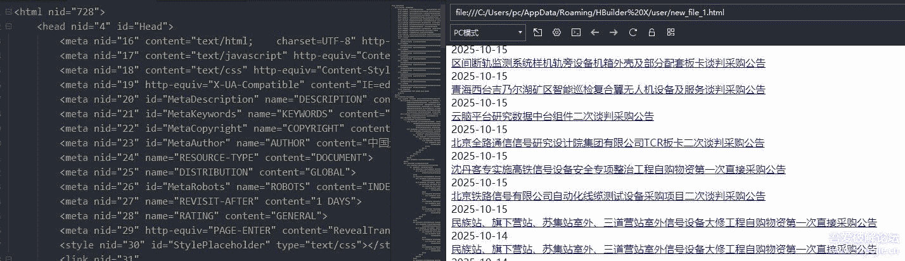

37.png (159.79 KB, 下载次数: 2)

[href="forum.php?mod=attachment&aid=MjgwODQ3NHxkOGI5ODgzMnwxNzkzNTcwNDk1fDE2ODA4NnwyMDY2MTkx&nothumb=yes" target="_blank"](https://www.52pojie.cn/forum.php?mod=attachment&aid=MjgwODQ3NHxkOGI5ODgzMnwxNzkzNTcwNDk1fDE2ODA4NnwyMDY2MTkx&nothumb=yes)

2025-10-16 13:49 上传

#### 详情页

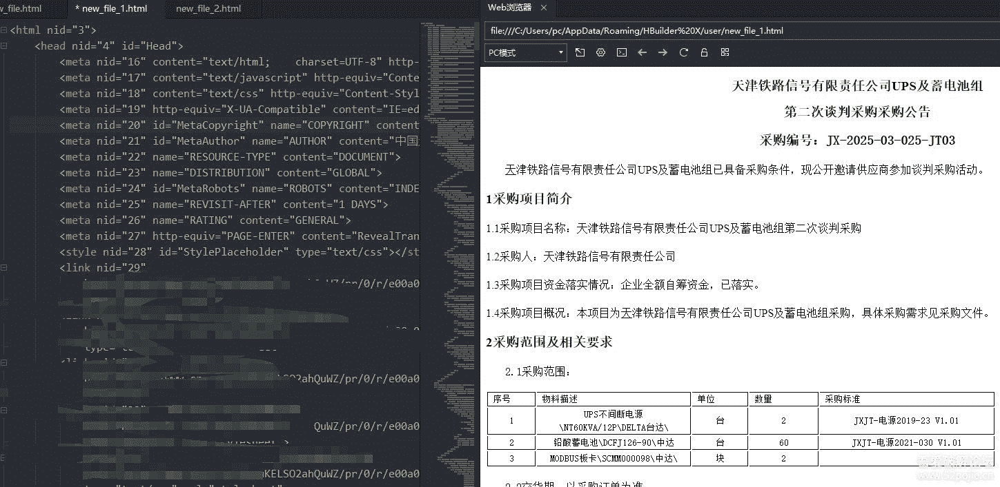

38.png (198.68 KB, 下载次数: 1)

[href="forum.php?mod=attachment&aid=MjgwODQ3NXw1ZjU2NzBjNXwxNzkzNTcwNDk1fDE2ODA4NnwyMDY2MTkx&nothumb=yes" target="_blank"](https://www.52pojie.cn/forum.php?mod=attachment&aid=MjgwODQ3NXw1ZjU2NzBjNXwxNzkzNTcwNDk1fDE2ODA4NnwyMDY2MTkx&nothumb=yes)

2025-10-16 13:49 上传
