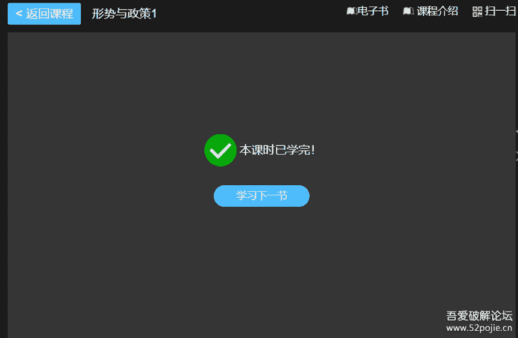
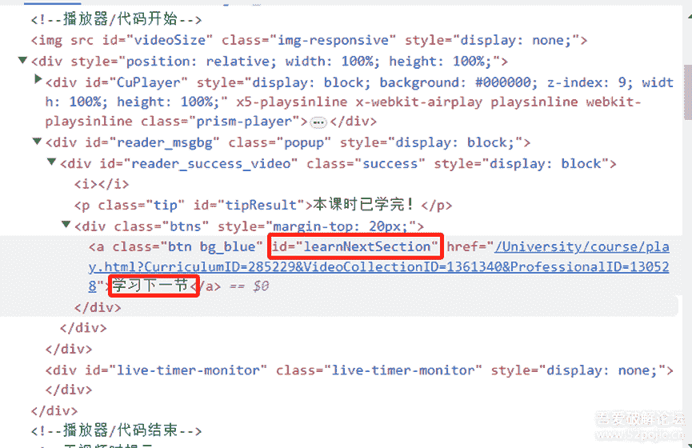

# [Web逆向] 某师在线教育平台刷课

- 原帖：https://www.52pojie.cn/forum.php?mod=viewthread&tid=2066374
- 抓取时间：2026-11-01T22:01:34

近期，某同学需要在某师在线教育平台上面上课，由于课程多、时间紧，于是问我能不能刷课。

既然群众有要求，那就试试吧。

## 一、初步尝试

先登陆网站看看。

网址：`aHR0cHM6Ly9oYnVjbS5sczM2NS5uZXQv`

使用账号密码登陆，这是正常播放界面：


`image.png`（472.95 KB，下载次数：2）

[附件下载](https://www.52pojie.cn/forum.php?mod=attachment&aid=MjgwODU4M3xiZWIxODBlMHwxNzkzNTcwNDkyfDE2ODA4NnwyMDY2Mzc0&nothumb=yes)

2025-10-17 11:00 上传

这是播放完一节后的界面



`image.png`（45.79 KB，下载次数：3）

[附件下载](https://www.52pojie.cn/forum.php?mod=attachment&aid=MjgwODU4NHxlNDExNGNiY3wxNzkzNTcwNDkyfDE2ODA4NnwyMDY2Mzc0&nothumb=yes)

2025-10-17 11:00 上传

对应的网页代码，这代码写得还挺贴心，加了一些注释：



`image.png`（239.42 KB，下载次数：3）

[附件下载](https://www.52pojie.cn/forum.php?mod=attachment&aid=MjgwODU4NXw0N2EwOGFhY3wxNzkzNTcwNDkyfDE2ODA4NnwyMDY2Mzc0&nothumb=yes)

2025-10-17 11:01 上传

```html
本课时已学完！

[学习下一节](/University/course/play.html?CurriculumID=285229&VideoCollectionID=1361338&ProfessionalID=130528)
```

这个`id="learnNextSection"`是比较关键的。

尝试着往后拖动进度条，竟然可以拖动，拖到最后一段，看完一节后，提示该节已经学过了。

看来该网站没有限制拖动视频，也没有检测视频是否被拖动过。

在控制台里尝试使用调节视频速度的代码，竟然真的能以16倍速播放视频（HTML5规定了最大倍速只能是16倍）。

代码如下：

```javascript
document.querySelector('video').playbackRate = 16;
```

如此看来，这个网站是什么限制都没有加啊，那就直接抄家伙上吧。

目前主流的网上课堂，比如超星学习通、智慧树、职教云系列、雨课堂、考试星、168网校、继续教育类、绎通云课堂、九江系列、柠檬文才、亿学宝云、优课学堂、小鹅通等等，基本上都会添加很多限制，各位老师为了让大家好好学习，也算是煞费苦心。

但是如果真的不想学，油猴里有一大堆的脚本，是道高一尺还是魔高一丈，还真不好说。

综合看来，那些主流的网上课堂还不如这个某师教育平台呢，直接躺平得了，免得浪费彼此时间。


`image.png`（421.11 KB，下载次数：3）

[附件下载](https://www.52pojie.cn/forum.php?mod=attachment&aid=MjgwODU4NnxlZDYwZTQ0OXwxNzkzNTcwNDkyfDE2ODA4NnwyMDY2Mzc0&nothumb=yes)

2025-10-17 11:01 上传

## 二、开始写代码

### 主要思路

1. 先检查当前视频页面的状态，主要是检测“学习下一节”的按钮有没有出现，如果已出现，那就点击该按钮。

   代码：

   ```javascript
   const nextSection = document.querySelector("#learnNextSection");
   if (isElementVisible(nextSection)) {
       nextSection.click();
       console.log("检测到下一课按钮，已点击");
   }
   ```

2. 如果“学习下一节”的按钮没有出现，那就是在播放视频，就直接把视频拖放到最后1秒，并且继续播放视频，同时，把视频速度调整为16倍。

   代码：

   ```javascript
   const video = document.querySelector('video');
   if (video) {
       // 设置当前时间为总时长减1秒
       video.currentTime = video.duration - 1;

       // 继续播放
       video.play();
       video.playbackRate = 16;
       console.log("未检测到下一课按钮，已设置16倍速");
   }
   ```

3. 开始循环以上2个步骤，每1秒检测一次，代码：`setInterval(XXX, 1000);` 剩下的，就是写一个油猴脚本，把以上代码串起来，就OK了。

经过实际测试，10门课，可以同时开10个窗口刷，几分钟就全部搞定。

PS：据说老师在后台可以看到每节课的学习时长，但是好像也没人管。
