# [.NET逆向] .NET VMP 脱壳

> 原帖：<https://www.52pojie.cn/forum.php?mod=viewthread&tid=2066562>  
> 抓取时间：2026-11-01T22:01:25

本次演示我用一个小程序，程序和工具最后会给大家打包。VMP加壳软件版本3.4（其它高版本如3.8的脱后运行不起来，希望得到大佬们的指导。）

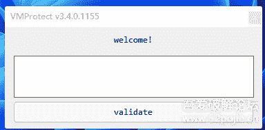

`1.png`（18.88 KB，下载次数：3）  
[附件链接](https://www.52pojie.cn/forum.php?mod=attachment&aid=MjgwODcyOHxmOTAzNTg3ZHwxNzkzNTcwNDgzfDE2ODA4NnwyMDY2NTYy&nothumb=yes)  
2025-10-18 11:42 上传

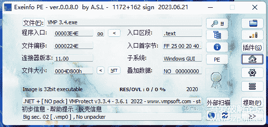

`2.png`（125.86 KB，下载次数：2）  
[附件链接](https://www.52pojie.cn/forum.php?mod=attachment&aid=MjgwODcyOXxkMzgxMTRjOHwxNzkzNTcwNDgzfDE2ODA4NnwyMDY2NTYy&nothumb=yes)  
2025-10-18 11:45 上传

## 脱壳流程

### 1. 使用 DNSPY 保存模块

首先我们把加壳的程序 `DUMP` 出来（怎么 `DUMP` 都行，各显神通，只要 `DUMP` 出来就行。）

我是用 DNSPY- 模块里保存出来的，如下图：

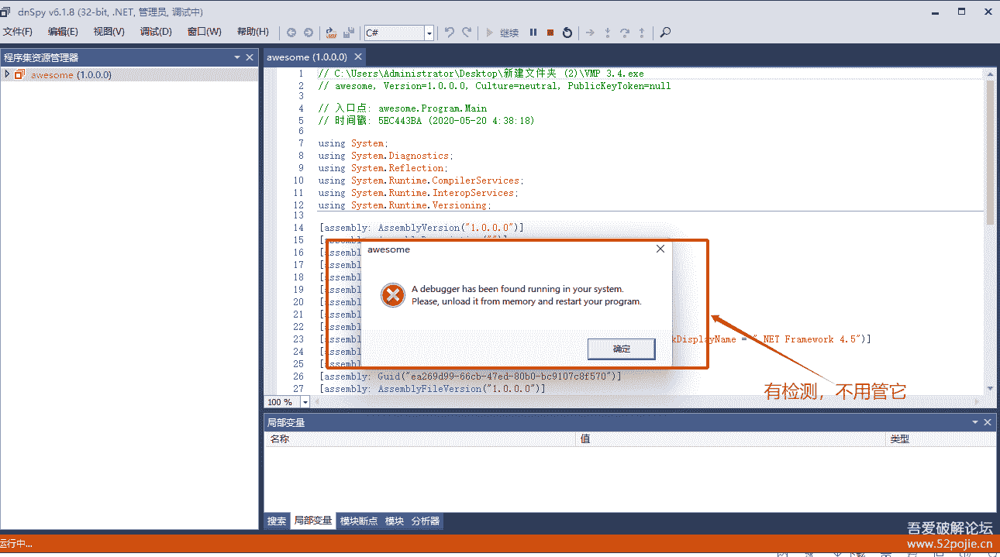

`3.png`（77.7 KB，下载次数：3）  
[附件链接](https://www.52pojie.cn/forum.php?mod=attachment&aid=MjgwODczMHxkZmE3N2Q5M3wxNzkzNTcwNDgzfDE2ODA4NnwyMDY2NTYy&nothumb=yes)  
2025-10-18 11:49 上传

载入 DNSPY 后点运行。有检测-不用管它。点下面的模块。

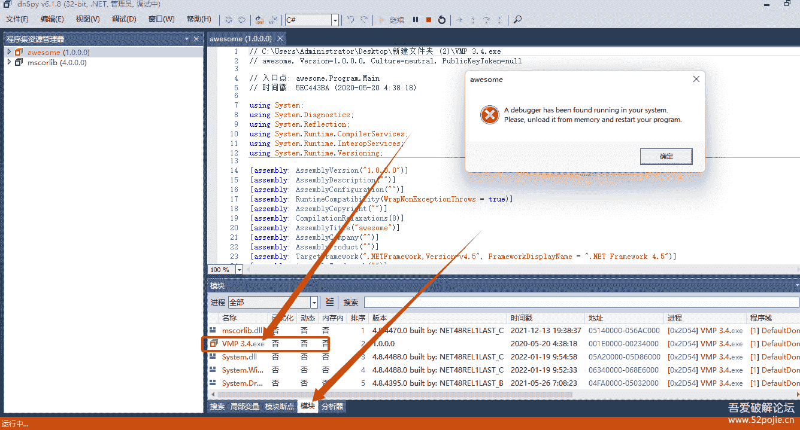

`4.png`（110.46 KB，下载次数：3）  
[附件链接](https://www.52pojie.cn/forum.php?mod=attachment&aid=MjgwODczMnxmYmQ4ZGVkN3wxNzkzNTcwNDgzfDE2ODA4NnwyMDY2NTYy&nothumb=yes)  
2025-10-18 11:52 上传

其中那个 `VMP3.4.EXE`，就是我们要DUNP的程序，点右键保存模块。

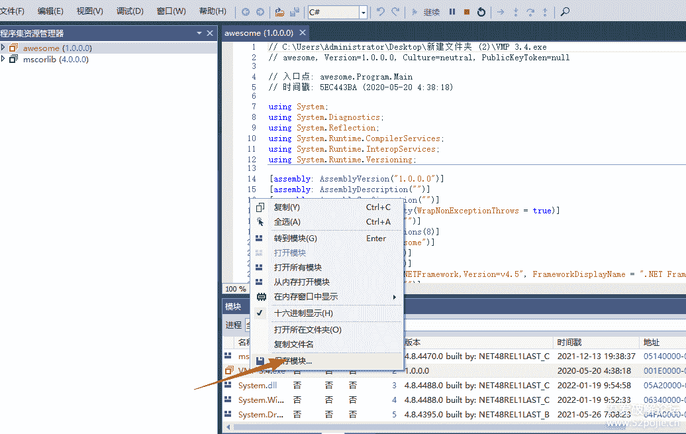

`5.png`（72.45 KB，下载次数：4）  
[附件链接](https://www.52pojie.cn/forum.php?mod=attachment&aid=MjgwODczM3xiYjRmZDc1M3wxNzkzNTcwNDgzfDE2ODA4NnwyMDY2NTYy&nothumb=yes)  
2025-10-18 11:52 上传

### 2. 去除变异

保存出来后的程序，我们要对它去除变异。使用工具 `DeMutation` 即可。

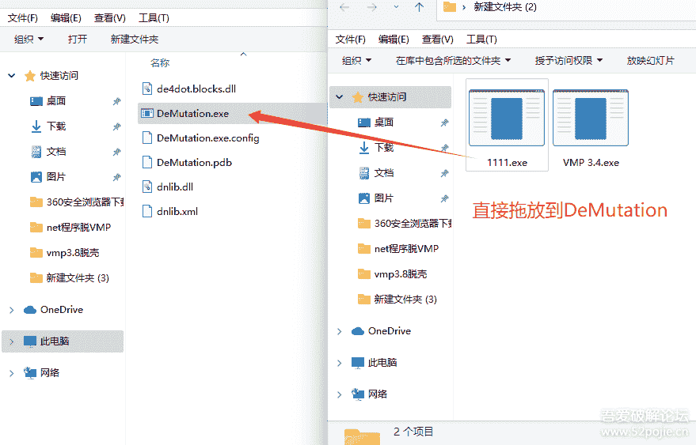

`6.png`（72.96 KB，下载次数：3）  
[附件链接](https://www.52pojie.cn/forum.php?mod=attachment&aid=MjgwODczNHxhZDg2YTZmNHwxNzkzNTcwNDgzfDE2ODA4NnwyMDY2NTYy&nothumb=yes)  
2025-10-18 11:58 上传

### 3. 使用 DE4DOT 处理

接下来我们用 `DE4DOT` 处理一下。我们去除变异的程序。

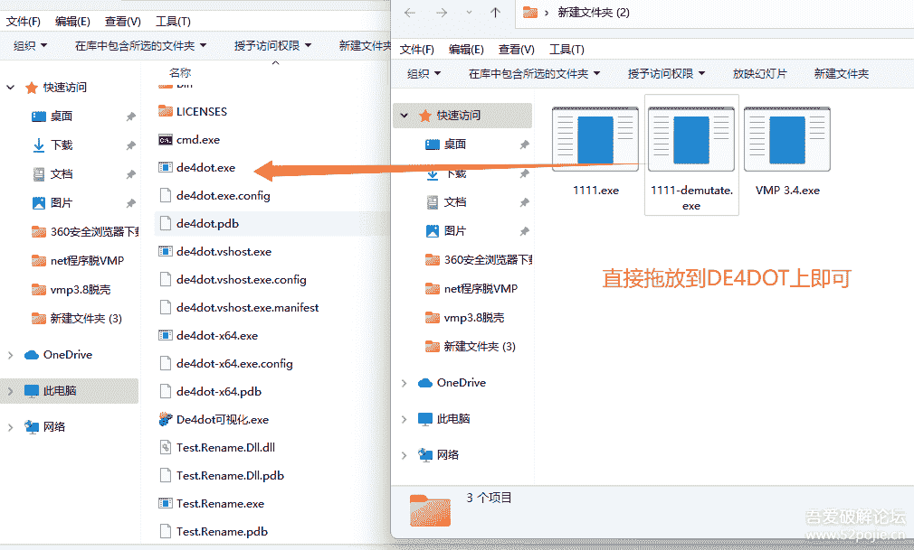

`7.png`（87.6 KB，下载次数：0）  
[附件链接](https://www.52pojie.cn/forum.php?mod=attachment&aid=MjgwODc0OXw5MzIwYjE2ZHwxNzkzNTcwNDgzfDE2ODA4NnwyMDY2NTYy&nothumb=yes)  
2025-10-18 12:00 上传

### 4. 使用 DNSPY 处理 `Module`

最后使用 DNSPY 处理 `Module`，具体操作如下图：

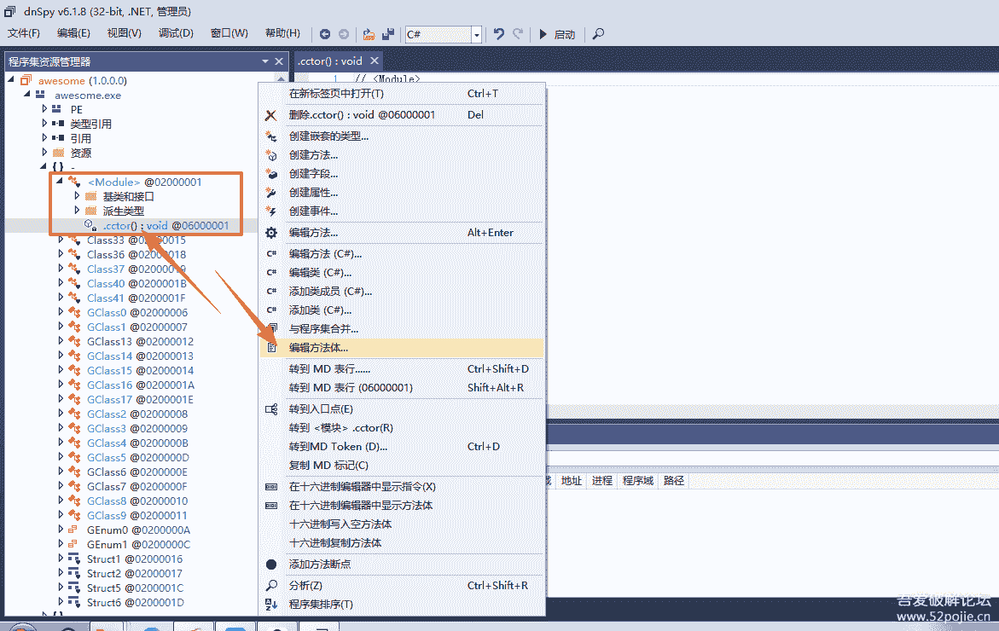

`007.png`（139.19 KB，下载次数：1）  
[附件链接](https://www.52pojie.cn/forum.php?mod=attachment&aid=MjgwODc1MHxjYzZkMWI4OHwxNzkzNTcwNDgzfDE2ODA4NnwyMDY2NTYy&nothumb=yes)  
2025-10-18 12:06 上传

将调用 `NOP` 掉，然后全部保存。

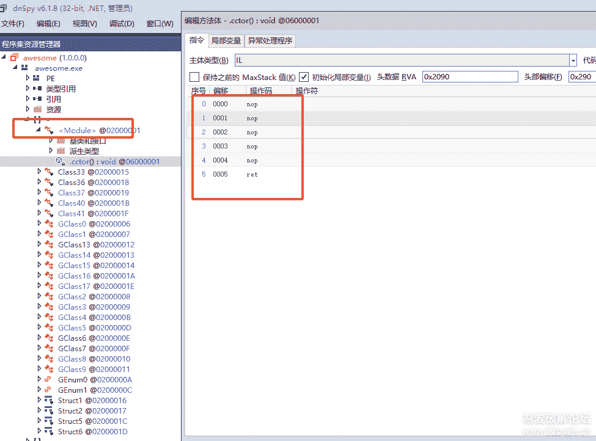

`8.png`（82.99 KB，下载次数：2）  
[附件链接](https://www.52pojie.cn/forum.php?mod=attachment&aid=MjgwODc1MXxjNDM1Mjk1Y3wxNzkzNTcwNDgzfDE2ODA4NnwyMDY2NTYy&nothumb=yes)  
2025-10-18 12:06 上传

### 5. 测试运行

最后我们来测试，程序是否可以运行。

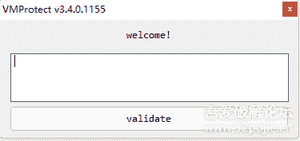

`9.png`（9.43 KB，下载次数：3）  
[附件链接](https://www.52pojie.cn/forum.php?mod=attachment&aid=MjgwODc1Mnw5YzNjNjNlY3wxNzkzNTcwNDgzfDE2ODA4NnwyMDY2NTYy&nothumb=yes)  
2025-10-18 12:10 上传

## 查壳与附件

查壳

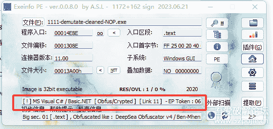

`10.png`（117.46 KB，下载次数：3）  
[附件链接](https://www.52pojie.cn/forum.php?mod=attachment&aid=MjgwODc1M3w5YjZjYTk3OXwxNzkzNTcwNDgzfDE2ODA4NnwyMDY2NTYy&nothumb=yes)  
2025-10-18 12:10 上传

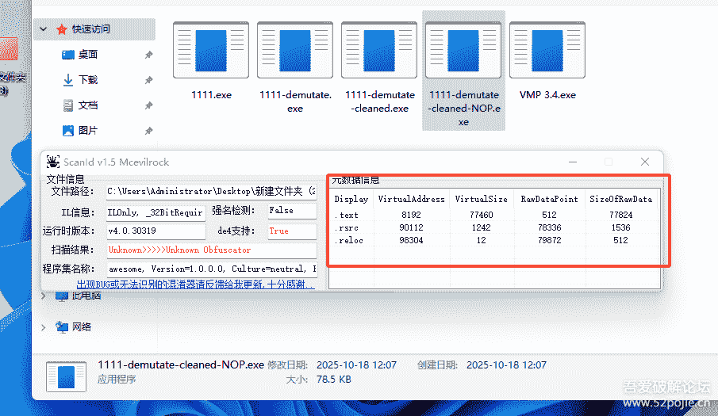

`11.png`（96.88 KB，下载次数：3）  
[附件链接](https://www.52pojie.cn/forum.php?mod=attachment&aid=MjgwODc1NHwwYTYxMWNkMHwxNzkzNTcwNDgzfDE2ODA4NnwyMDY2NTYy&nothumb=yes)  
2025-10-18 12:11 上传

后大小为78K。

[附件下载](https://www.52pojie.cn/forum.php?mod=attachment&aid=MjgwODc1NXwwOGVmNWY5MXwxNzkzNTcwNDgzfDE2ODA4NnwyMDY2NTYy)（861.6 KB，下载次数：259）  
2025-10-18 12:14 上传  
点击文件名下载附件  
下载积分：吾爱币 -1 CB
