# [原创] Navicat被大家玩死了

- 原帖: https://www.52pojie.cn/forum.php?mod=viewthread&tid=2067565
- 抓取时间: 2026-11-01T22:01:18

最近这里太多讨论Navicat的帖子了，我连着看了好几个，从中学到了不少的东西，自己上手操作了一下，也有一些收获。

把我的心得放出来大家共享。（以`17.3.6`为例，`17.3.4`，`17.3.5`，`17.3.6`都是一样的）

我们按照[//www.52pojie.cn" target="_blank" class="relatedlink"](https://www.52pojie.cn:href="https)的先后顺序说：

## 1、首先我们要拿到Navicat的有效注册序列号
那么在 《[//www.52pojie.cn/thread-688820-1-1.html" target="_blank"](https://www.52pojie.cn/thread-688820-1-1.html:href="https) 》(引用1)中，详细说明了序列号是怎么生成的。但是关键问题是，我们怎么获得"DES加密密钥"？

用`x64dbg`加载`Navicat.exe`，在内存布局中找到 `libcc.dll`，右键选择"在反汇编中转到"，如下图所示：

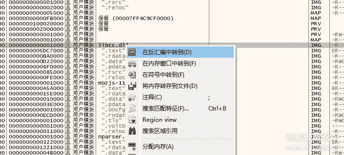

VeryCapture_20251023143435.jpg (79.93 KB, 下载次数: 3)

[href="forum.php?mod=attachment&aid=MjgwOTUwN3wzYjNkMWEyZnwxNzkzNTcwNDc2fDE2ODA4NnwyMDY3NTY1&nothumb=yes" target="_blank"](https://www.52pojie.cn/forum.php?mod=attachment&aid=MjgwOTUwN3wzYjNkMWEyZnwxNzkzNTcwNDc2fDE2ODA4NnwyMDY3NTY1&nothumb=yes)

2025-10-23 14:35 上传

然后在CPU窗口，也就是汇编窗口，点右键，搜索-当前模块-匹配特征：

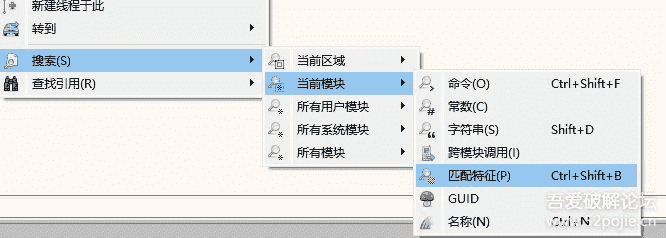

VeryCapture_20251023141551.jpg (27.29 KB, 下载次数: 2)

[href="forum.php?mod=attachment&aid=MjgwOTUxM3w0MmNjNzgwYnwxNzkzNTcwNDc2fDE2ODA4NnwyMDY3NTY1&nothumb=yes" target="_blank"](https://www.52pojie.cn/forum.php?mod=attachment&aid=MjgwOTUxM3w0MmNjNzgwYnwxNzkzNTcwNDc2fDE2ODA4NnwyMDY3NTY1&nothumb=yes)

2025-10-23 14:37 上传

在搜索窗口输入：`80 78 01 2A`

这一句是 `cmp byte ptr ds:[rax+1],2A`，也就是比较第二个字符是不是"*"，为什么要比较这个，在 《[//www.52pojie.cn/thread-2052969-1-1.html" target="_blank"](https://www.52pojie.cn/thread-2052969-1-1.html:href="https)》(引用2)的帖子中有说明，“参数2是输入的16个字符许可证密钥的指针，参数1存放`Base32`解码后的数据，数据应为10个字节，且前两个字节必须为字符“`h*`”。”

然后会找到几处符合条件的地址：

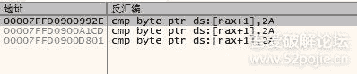

VeryCapture_20251023144753.jpg (10.46 KB, 下载次数: 4)

[href="forum.php?mod=attachment&aid=MjgwOTUxOXxmZDFjOWJmYXwxNzkzNTcwNDc2fDE2ODA4NnwyMDY3NTY1&nothumb=yes" target="_blank"](https://www.52pojie.cn/forum.php?mod=attachment&aid=MjgwOTUxOXxmZDFjOWJmYXwxNzkzNTcwNDc2fDE2ODA4NnwyMDY3NTY1&nothumb=yes)

2025-10-23 14:47 上传

逐一双击进去查看：

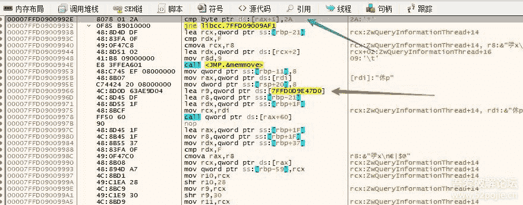

VeryCapture_20251023145115.jpg (101.67 KB, 下载次数: 3)

[href="forum.php?mod=attachment&aid=MjgwOTUyMnwzMmY1ZDZhMHwxNzkzNTcwNDc2fDE2ODA4NnwyMDY3NTY1&nothumb=yes" target="_blank"](https://www.52pojie.cn/forum.php?mod=attachment&aid=MjgwOTUyMnwzMmY1ZDZhMHwxNzkzNTcwNDc2fDE2ODA4NnwyMDY3NTY1&nothumb=yes)

2025-10-23 14:51 上传

蓝色箭头是我们查找道的特征语句，红色箭头指向的常量，就是我们要找的`DESKEY`。

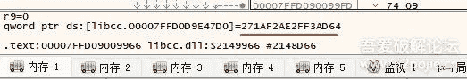

VeryCapture_20251023142057.jpg (17.5 KB, 下载次数: 2)

[href="forum.php?mod=attachment&aid=MjgwOTUyMHw1NjMxYTQzZHwxNzkzNTcwNDc2fDE2ODA4NnwyMDY3NTY1&nothumb=yes" target="_blank"](https://www.52pojie.cn/forum.php?mod=attachment&aid=MjgwOTUyMHw1NjMxYTQzZHwxNzkzNTcwNDc2fDE2ODA4NnwyMDY3NTY1&nothumb=yes)

2025-10-23 14:48 上传

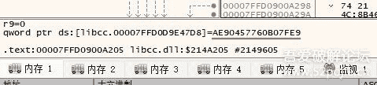

VeryCapture_20251023142122.jpg (20.43 KB, 下载次数: 3)

[href="forum.php?mod=attachment&aid=MjgwOTUyMXxkYjE4NTdhYXwxNzkzNTcwNDc2fDE2ODA4NnwyMDY3NTY1&nothumb=yes" target="_blank"](https://www.52pojie.cn/forum.php?mod=attachment&aid=MjgwOTUyMXxkYjE4NTdhYXwxNzkzNTcwNDc2fDE2ODA4NnwyMDY3NTY1&nothumb=yes)

2025-10-23 14:48 上传

因为我这里有三处符合特征的，第一处的值是`64ADF32FAEF21A27`（要把得到的16进制按字节倒序），这个恰好是《引用1》帖子中，Navicat 12版本的`DESKEY`。

后面两处，常量值都是`AE90457760B07FE9`，所以这个倒序“`E9 7F B0 60 77 45 90 AE`”就是这个版本的`DESKEY`。

题外话：上面那个12版本的DESKEY在这里还能不能用，我没自己研究。软件作者为啥在这里保留这个，我没搞明白。

好了，到这里，第一步就完成了，可以按照《引用1》帖子里的方法去计算序列号了。

又是题外话：我用《引用1》里的DESKEY，用同样的值，Base32的结果跟作者得到的序列号不一样，一度让我以为我的Base32算法写错了。请原作者也核实一下吧。

## 2、拿到原软件公钥
用《[//www.52pojie.cn/thread-2008824-1-1.html" target="_blank"](https://www.52pojie.cn/thread-2008824-1-1.html:href="https)》（引用3）生成自己的公钥私钥，这个在《[//www.52pojie.cn/thread-2056733-1-1.html" target="_blank"](https://www.52pojie.cn/thread-2056733-1-1.html:href="https)》（引用4）帖子里写的很详细，我这里就不赘述了。

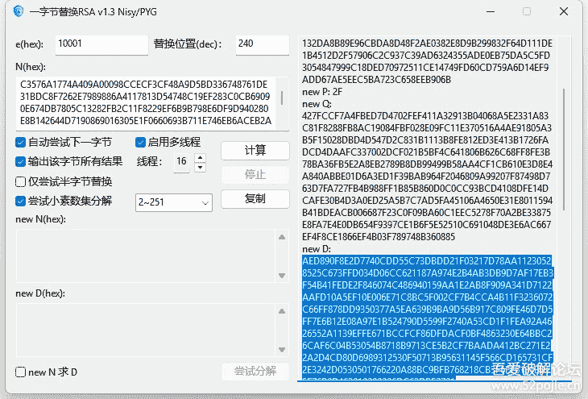

未命名-1.png (504.76 KB, 下载次数: 4)

[href="forum.php?mod=attachment&aid=MjgwOTUzMXxmYTQ0ZGMyYnwxNzkzNTcwNDc2fDE2ODA4NnwyMDY3NTY1&nothumb=yes" target="_blank"](https://www.52pojie.cn/forum.php?mod=attachment&aid=MjgwOTUzMXxmYTQ0ZGMyYnwxNzkzNTcwNDc2fDE2ODA4NnwyMDY3NTY1&nothumb=yes)

2025-10-23 15:11 上传

我生成的这个公钥，正好只需要替换一个字节。把"`S`"替换成"`T`"

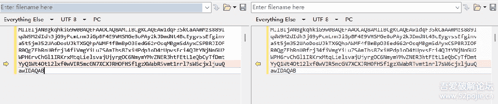

未命名-2.png (251.27 KB, 下载次数: 2)

[href="forum.php?mod=attachment&aid=MjgwOTUzMnxiZDExMGI0MXwxNzkzNTcwNDc2fDE2ODA4NnwyMDY3NTY1&nothumb=yes" target="_blank"](https://www.52pojie.cn/forum.php?mod=attachment&aid=MjgwOTUzMnxiZDExMGI0MXwxNzkzNTcwNDc2fDE2ODA4NnwyMDY3NTY1&nothumb=yes)

2025-10-23 15:11 上传

再回到`x64dbg`中，按照《引用4》帖子中的办法，第一个`Call r8`断下后，`F7`跟踪进去，然后不停地按`F8`，一直走到要替换的位置：

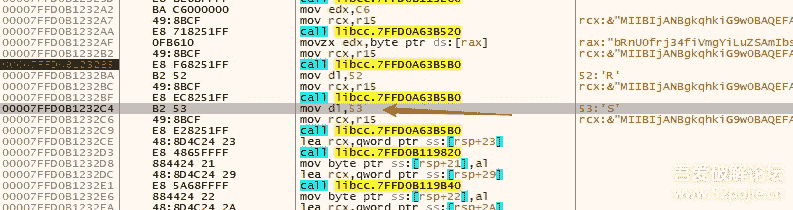

未命名-3.png (271.43 KB, 下载次数: 2)

[href="forum.php?mod=attachment&aid=MjgwOTUzNHw4ZGRjOTliZXwxNzkzNTcwNDc2fDE2ODA4NnwyMDY3NTY1&nothumb=yes" target="_blank"](https://www.52pojie.cn/forum.php?mod=attachment&aid=MjgwOTUzNHw4ZGRjOTliZXwxNzkzNTcwNDc2fDE2ODA4NnwyMDY3NTY1&nothumb=yes)

2025-10-23 15:14 上传

## 3、破解
可以看到，要替换的`S`，正好是来自于程序里的字符串片段。这就简单了，随便找个16进制工具，打开`libcc.dll`，然后搜索"`E8 EC 82 51 FF B2 53`"，找到后，把`53`改成`54`保存即可。

把修改完成后的`libcc.dll`替换到原来的安装目录下。剩下的事情就是激活了。

我比较懒，什么序列号生成啊，`RSA`的加密解密啊，我实在是懒得算，写了一个工具替我算，公钥私钥就是用的上面的方法算出来的，你如果按照我这个做，公钥私钥应该和我的是一样的，

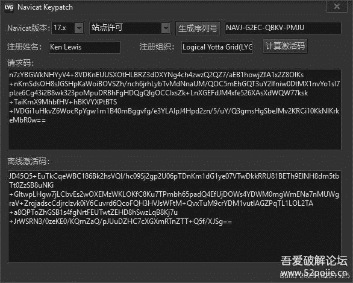

VeryCapture_20251023152505.jpg (69.06 KB, 下载次数: 3)

[href="forum.php?mod=attachment&aid=MjgwOTUzOHw1NTJmMmQ4ZnwxNzkzNTcwNDc2fDE2ODA4NnwyMDY3NTY1&nothumb=yes" target="_blank"](https://www.52pojie.cn/forum.php?mod=attachment&aid=MjgwOTUzOHw1NTJmMmQ4ZnwxNzkzNTcwNDc2fDE2ODA4NnwyMDY3NTY1&nothumb=yes)

2025-10-23 15:25 上传

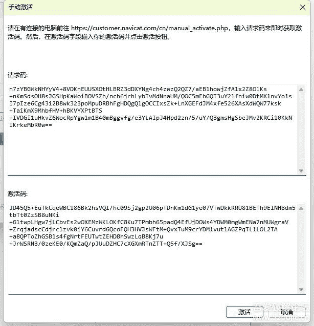

VeryCapture_20251023152517.jpg (75.08 KB, 下载次数: 4)

[href="forum.php?mod=attachment&aid=MjgwOTUzOXxhNWUyMjUyYnwxNzkzNTcwNDc2fDE2ODA4NnwyMDY3NTY1&nothumb=yes" target="_blank"](https://www.52pojie.cn/forum.php?mod=attachment&aid=MjgwOTUzOXxhNWUyMjUyYnwxNzkzNTcwNDc2fDE2ODA4NnwyMDY3NTY1&nothumb=yes)

2025-10-23 15:25 上传

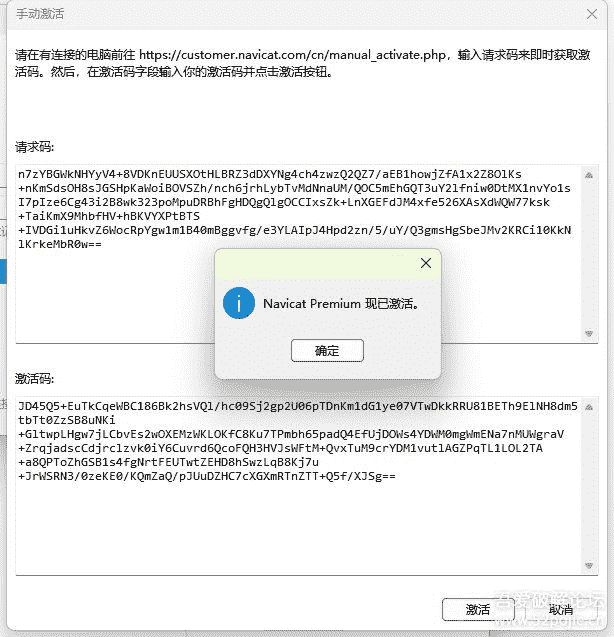

VeryCapture_20251023152528.jpg (78.2 KB, 下载次数: 2)

[href="forum.php?mod=attachment&aid=MjgwOTU0MHw0MGZkOWM0Y3wxNzkzNTcwNDc2fDE2ODA4NnwyMDY3NTY1&nothumb=yes" target="_blank"](https://www.52pojie.cn/forum.php?mod=attachment&aid=MjgwOTU0MHw0MGZkOWM0Y3wxNzkzNTcwNDc2fDE2ODA4NnwyMDY3NTY1&nothumb=yes)

2025-10-23 15:25 上传

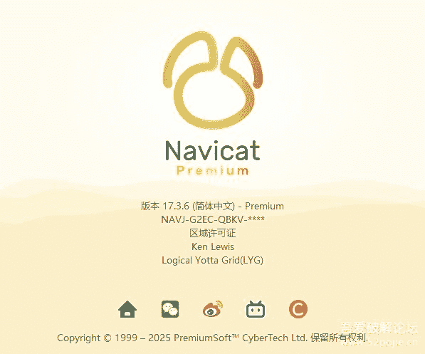

VeryCapture_20251023152540.jpg (24.66 KB, 下载次数: 2)

[href="forum.php?mod=attachment&aid=MjgwOTU0MXw1OTY2M2QzY3wxNzkzNTcwNDc2fDE2ODA4NnwyMDY3NTY1&nothumb=yes" target="_blank"](https://www.52pojie.cn/forum.php?mod=attachment&aid=MjgwOTU0MXw1OTY2M2QzY3wxNzkzNTcwNDc2fDE2ODA4NnwyMDY3NTY1&nothumb=yes)

2025-10-23 15:26 上传

也就是说，Navicat的加密算法不变的话，它每出一个新版本，按照我上面的方法，只需要做第3步，查找，替换，然后就OK了。当然，这个注册机使用的前提仍然是断网，断网，断网！重要的事情说三遍。

### 2026-09-20补充
今天Navicat 升级到`18.02`版本，按照我的方法，`18.02`仍然可以注册。

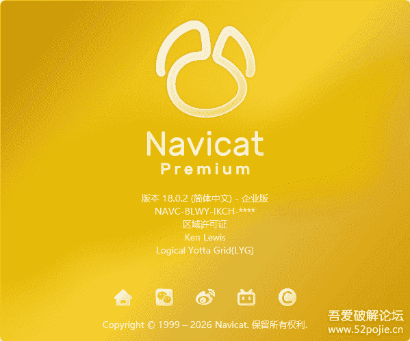

Navicat18.png (272.24 KB, 下载次数: 0)

[href="forum.php?mod=attachment&aid=Mjg4MDQ2Mnw1MDI3YmNmZnwxNzkzNTcwNDc2fDE2ODA4NnwyMDY3NTY1&nothumb=yes" target="_blank"](https://www.52pojie.cn/forum.php?mod=attachment&aid=Mjg4MDQ2Mnw1MDI3YmNmZnwxNzkzNTcwNDc2fDE2ODA4NnwyMDY3NTY1&nothumb=yes)

2026-9-20 09:47 上传
