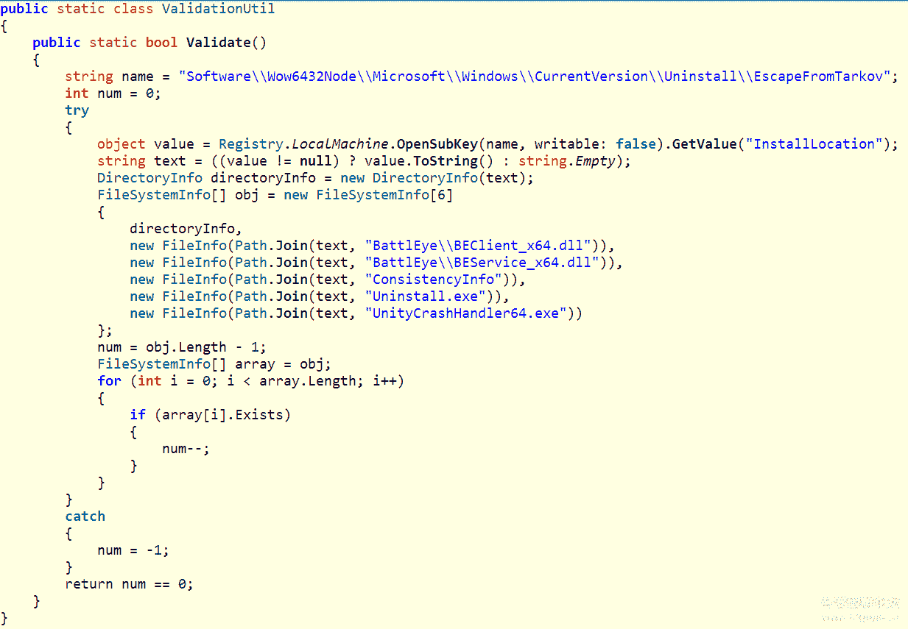
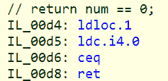
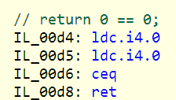
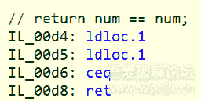
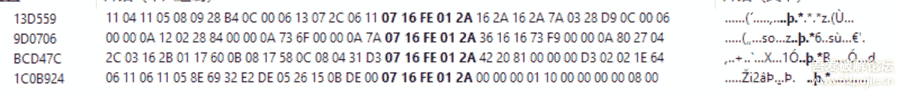
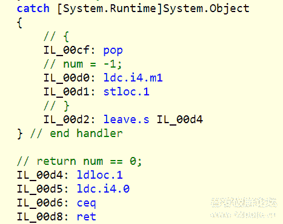
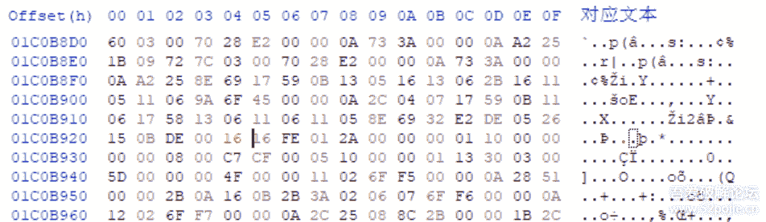

# [.NET逆向] 记一次简单的.NET程序 `patch` 过验证

- 原帖：https://www.52pojie.cn/forum.php?mod=viewthread&tid=2069303
- 抓取时间：2026-11-01T21:59:48

> "人们不想买一个四分之一英寸的钻头。他们想要的是一个四分之一英寸的孔！" -- 西奥多·莱维特

## 背景

某个网络游戏的第三方离线版启动器，可能是基于法务问题等的考量，在启动时会验证是否安装了正版游戏。


`Screenshot 2025-10-23 204951.png` (15.84 KB, 下载次数: 1)

[附件下载](https://www.52pojie.cn/forum.php?mod=attachment&aid=MjgxMTAwNnw4MzU0MmZhYXwxNzkzNTcwMzg2fDE2ODA4NnwyMDY5MzAz&nothumb=yes)

2025-11-1 11:03 上传

而这个启动器是开源的，而且是 `.NET mono`，但每次更新都要重新编译/用 `dnspy` 修补，也是很麻烦的。

于是就有人发明了创建注册表项和占位文件来过验证的方法，但这个方法，我觉得终究是不够优雅。

而众所周知的，这个离线版的客户端启动器是一个基于 `.NET 9` 的程序，在较早的版本中（`4.0.0` 以前）基于 `.NET` 的更早版本。

但它们的原理都是相同的。启动程序时，`CLR` 会接管执行，然后通过 `JIT` 编译器，把 `IL` 转换成本机机器码。

## 定位验证函数

而我们的修补则从 `IL` 入手。我们首先利用 `ILSpy` 工具找到验证函数的代码，

它在这里（几乎同样的源码已经由这个离线版的开发团队开源，可以看到几乎一致）



`image.png` (105.79 KB, 下载次数: 1)

[附件下载](https://www.52pojie.cn/forum.php?mod=attachment&aid=MjgxMTAwN3wzY2QzYWIxYXwxNzkzNTcwMzg2fDE2ODA4NnwyMDY5MzAz&nothumb=yes)

2025-11-1 11:04 上传

接着我们切换到 `IL` 视图，得到了这样的 `IL` 代码



`image.png` (5.32 KB, 下载次数: 1)

[附件下载](https://www.52pojie.cn/forum.php?mod=attachment&aid=MjgxMTAwOHw4YmRmZjYwYXwxNzkzNTcwMzg2fDE2ODA4NnwyMDY5MzAz&nothumb=yes)

2025-11-1 11:04 上传

它所对应的字节码就是：

```
07
16
FE 01
2A
```

关键在于 `07` 和 `16` 这两个字节，在 `IL` 代码中，它们分别代表 `ldloc.1`（加载局部变量1）和 `ldc.i4.0`（压入常量 `0`），它们组成了相等判断的两项。

如果我们改为：

```
16
16
FE 01
2A
```

得到的就是



`image.png` (5.14 KB, 下载次数: 1)

[附件下载](https://www.52pojie.cn/forum.php?mod=attachment&aid=MjgxMTAxMHxkOGE3YTQ3ZHwxNzkzNTcwMzg2fDE2ODA4NnwyMDY5MzAz&nothumb=yes)

2025-11-1 11:06 上传

显然，这永远返回“真”。

同理，改为：

```
07
07
FE 01
2A
```



`image.png` (12.01 KB, 下载次数: 1)

[附件下载](https://www.52pojie.cn/forum.php?mod=attachment&aid=MjgxMTAxMXxlM2NkN2M1ZXwxNzkzNTcwMzg2fDE2ODA4NnwyMDY5MzAz&nothumb=yes)

2025-11-1 11:06 上传

这一样会永远返回真。

## 定位特征码

接着就是定位这段字节序列所在的位置，只需要使用随意哪个十六进制编辑器进行搜索，

但如果直接搜索 `07 16 FE 01 2A` 我们会得到至少 4 个结果



`image.png` (69.94 KB, 下载次数: 1)

[附件下载](https://www.52pojie.cn/forum.php?mod=attachment&aid=MjgxMTAxMnwyZTA1NTEzY3wxNzkzNTcwMzg2fDE2ODA4NnwyMDY5MzAz&nothumb=yes)

2025-11-1 11:07 上传

但与此同时，我们注意到在这段代码前还有 `leave.s IL_00d4` 语句



`image.png` (27.34 KB, 下载次数: 1)

[附件下载](https://www.52pojie.cn/forum.php?mod=attachment&aid=MjgxMTAxM3xiMGE4YjdiM3wxNzkzNTcwMzg2fDE2ODA4NnwyMDY5MzAz&nothumb=yes)

2025-11-1 11:08 上传

因此可以确定图中 `1C0B942` 位置，即 `DE 00 07 16 FE 01 2A` 对应的就是我们要找到的位置，

保险起见我们取特征码到 `26 15 0B DE 00 07 16 FE 01 2A`

## Patch与测试

只 `patch` 一个字节



`Screenshot 2025-10-23 205048.png` (113.22 KB, 下载次数: 1)

[附件下载](https://www.52pojie.cn/forum.php?mod=attachment&aid=MjgxMTAxNHxlZTI1Y2E2M3wxNzkzNTcwMzg2fDE2ODA4NnwyMDY5MzAz&nothumb=yes)

2025-11-1 11:09 上传

测试，启动器成功启动离线版游戏，没有再弹出正版提示。这个方法也可以很方便的编写自动工具，根据特征码找到要修改的 `IL` 代码的位置，`patch` 一个字节，优雅的解决问题
