# [CTF] [HDCTF 2023]enc 题解

- 原帖：<https://www.52pojie.cn/forum.php?mod=viewthread&tid=2072029>
- 抓取时间：`2026-11-01T21:59:29`

最近在疯狂刷TEA/XTEA/XXTEA算法相关的逆向题，刚刷到一道逆向题，感觉很有意思，分享一下。

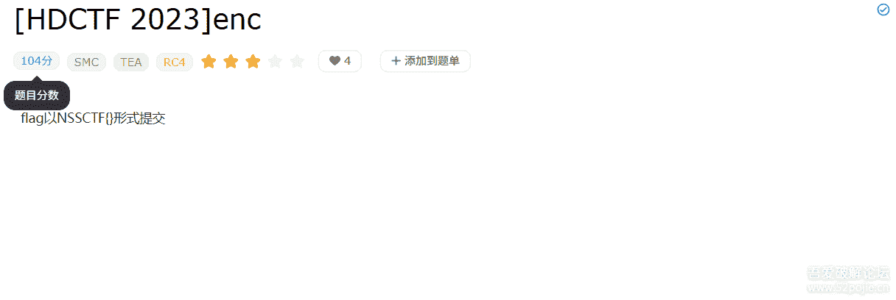

## 一、静态分析

首先拖入IDA中，发现这个程序执行逻辑是：先输入`Key`，随后对`key`进行加密操作后，验证是否正确。如果错误，则退出；否则，进入输入`flag`的逻辑，输入`flag`后，有进行了一个加密处理。

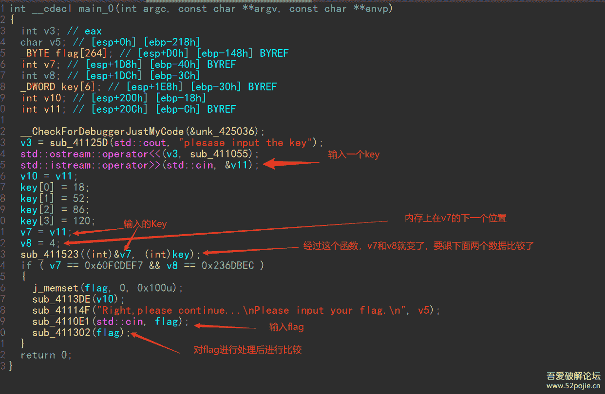

进入后面的`flag`处理函数中发现，代码被加密了，IDA识别不了。

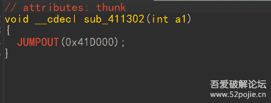

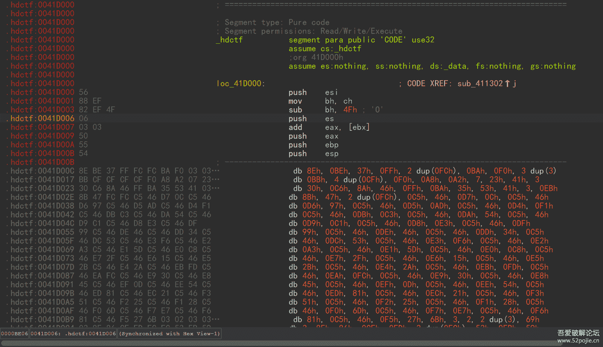

那么整体的逻辑就可以猜出来了，`key`如果正确输入，那么会对这里的代码进行解密。所以我们进入`key`的处理函数看看。

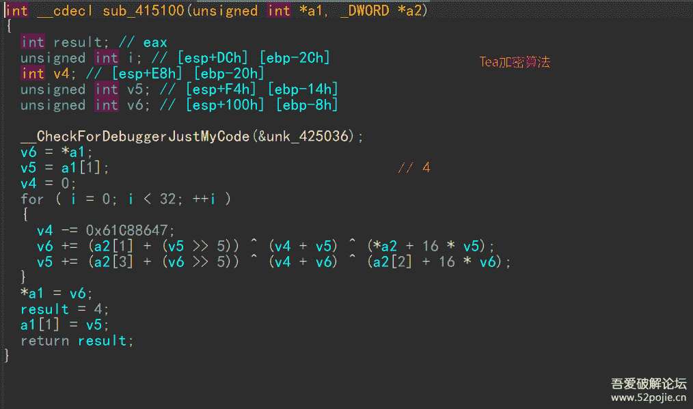

发现是个TEA加密算法，使用脚本进行解密。

```c
#include
#include
#include 

void tea_decrypt(uint32_t* v, const uint32_t* k) {
    uint32_t v0 = v[0], v1 = v[1];

    uint32_t delta = 0x9E3779B9;
    uint32_t sum = delta * 32;
    for (int i = 0; i > 5)) ^ (sum + v0) ^ (k[2] + (v0 > 5)) ^ (sum + v1) ^ (k[0] + (v1 
```

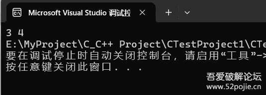

## 二、动态分析

下断点到`0x41D000`，然后输入正确的`key=3`，随后随便输入一个`flag`。

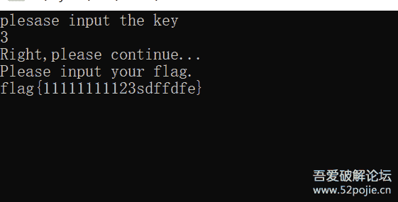

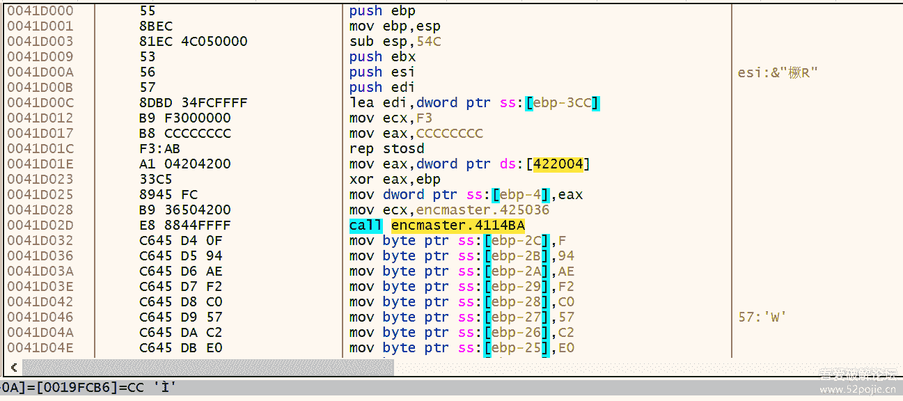

发现代码出来了，将这段代码汇编代码复制出来，在010editor创建一个bin文件，复制到这个文件中，随后用IDA打开，F5。

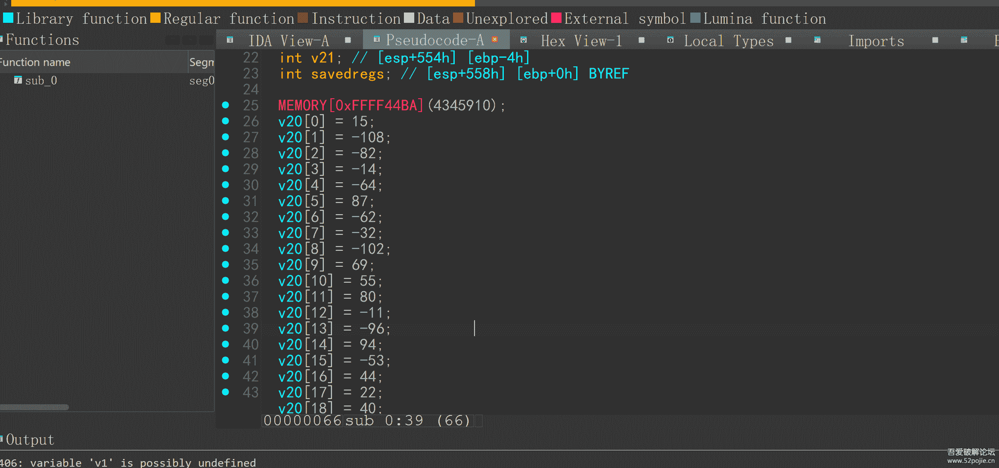

经过分析，该算法是个RC4加密算法，密钥如下：

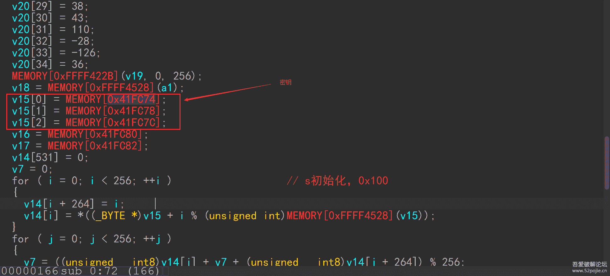

发现是个全局的变量，所以我们回到之前原本的程序IDA中找这个地址，发现`key`为`you_are_master`。

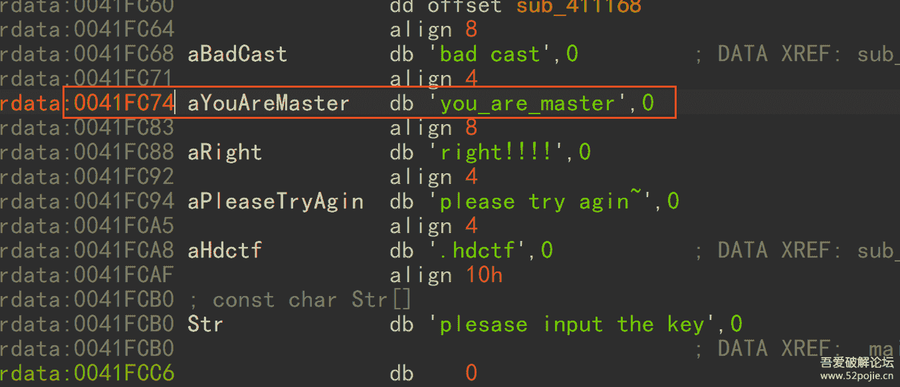

而最后将`flag`加密后跟上面`v20`的内容进行比较，因此我们可以进行解密工作，代码如下：

```python
import base64,urllib.parse

key = "you_are_master"

# enc = "%C2%A6n%C2%87Y%1Ag%3F%C2%A01.%C2%9C%C3%B7%C3%8A%02%C3%80%C2%92W%C3%8C%C3%BA"

enc=[0x0F,0x94,0xAE,0xF2,0xC0,0x57,0xC2,0xE0,0x9A,0x45,0x37,0x50,0xF5,0xA0,0x5E,

     0xCB,0x2C,0x16,0x28,0x29,0xFE,0xFF,0x33,0x46,0x0E,0x57,0x82,0x22,0x52,0x26,0x2B,0x6E,0xE4,0x82]

# enc = urllib.parse.unquote(enc)

s_box = list(range(256))

j = 0

#s盒生成

for i in range(256):

    j = (j + s_box[i] + ord(key[i % len(key)])) % 256

    s_box[i], s_box[j] = s_box[j], s_box[i]

res = []

i = j = 0

#加解密算法操作

for s in enc:

  i = (i + 1) % 256

  j = (j + s_box[i]) % 256

  s_box[i], s_box[j] = s_box[j], s_box[i]

  t = (s_box[i] + s_box[j]) % 256

  k = s_box[t]

  res.append(chr(s ^ k))

mm = "".join(res)

print(mm)
```

最终结果：

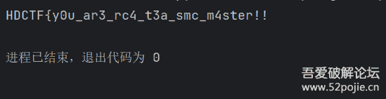
