# [.NET逆向] 新人逆向一个.NET机房管理软件

- 原帖：https://www.52pojie.cn/forum.php?mod=viewthread&tid=2072166
- 抓取时间：2026-11-01T21:59:28

我是光棍节入站的新人，写的不好，请大佬们多多指教了。

## 功能介绍

这个是我们学校使用的机房管理软件，据称可以防止学生通过常规方法脱控。功能介绍如下图：

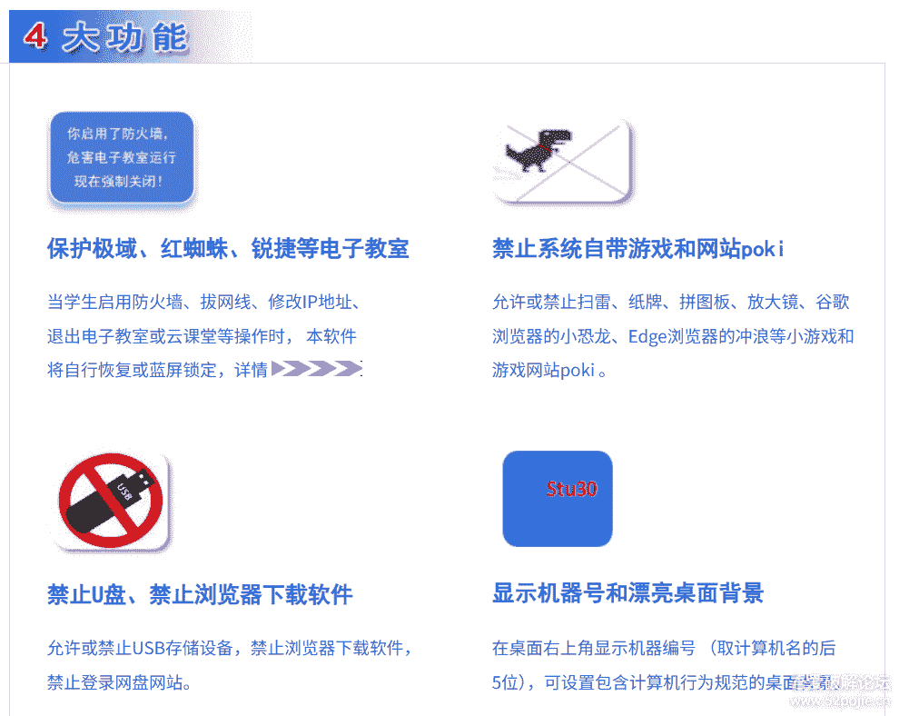

功能介绍1：`QQ20251112-181628.png` (204.74 KB, 下载次数: 0) 2025-11-12 18:16 上传 [下载附件](https://www.52pojie.cn/forum.php?mod=attachment&aid=MjgxMzU4MnwxMWNmYTZjN3wxNzkzNTcwMzY1fDE2ODA4NnwyMDcyMTY2&nothumb=yes)

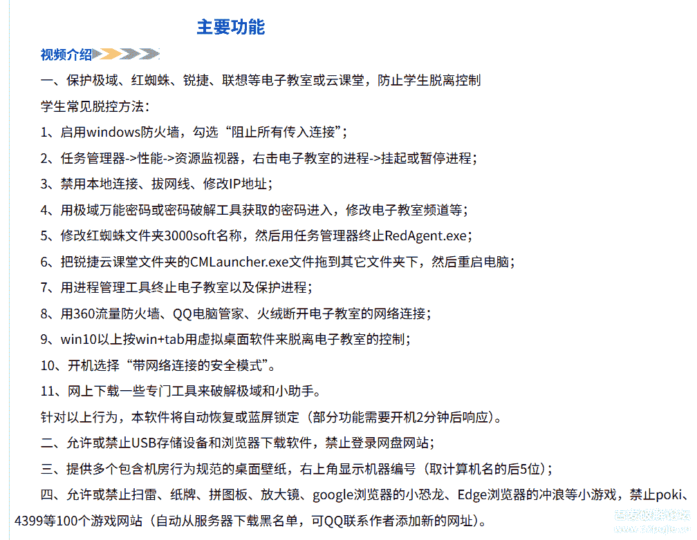

功能介绍2：`QQ20251112-181618.png` (207.76 KB, 下载次数: 0) 2025-11-12 18:16 上传 [下载附件](https://www.52pojie.cn/forum.php?mod=attachment&aid=MjgxMzU4M3w3YzExYzY2YnwxNzkzNTcwMzY1fDE2ODA4NnwyMDcyMTY2&nothumb=yes)

反正我试了下，基本是无解的，只要它检测到电子教室进程不存在、服务停止、U盘插入、启动项被修改等动作都会直接锁定屏幕，要输入老师设置的密码才可以解除。

图为我运行了一个电子教室的软件时：

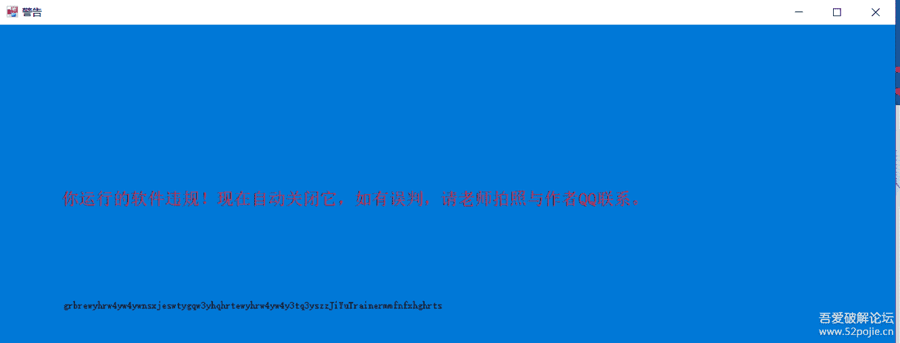

`QQ20251112-183246.png` (62.28 KB, 下载次数: 0) 2025-11-12 18:33 上传 [下载附件](https://www.52pojie.cn/forum.php?mod=attachment&aid=MjgxMzU4OHw1ZWY5ODQwN3wxNzkzNTcwMzY1fDE2ODA4NnwyMDcyMTY2&nothumb=yes)

图为我暂停了电子教室：

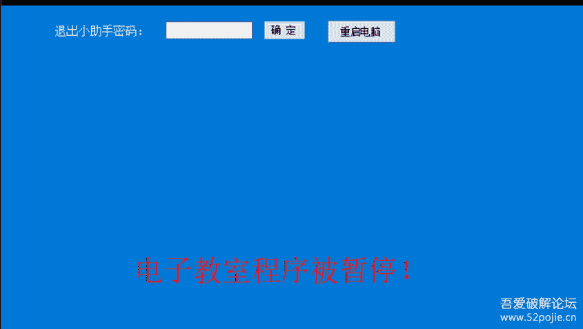

`QQ20251112-183853.png` (39.23 KB, 下载次数: 0) 2025-11-12 18:39 上传 [下载附件](https://www.52pojie.cn/forum.php?mod=attachment&aid=MjgxMzU4OXxhYTE0ZDE4N3wxNzkzNTcwMzY1fDE2ODA4NnwyMDcyMTY2&nothumb=yes)

## 逆向目标

所以，我们逆向的目标就是关于密码的算法。

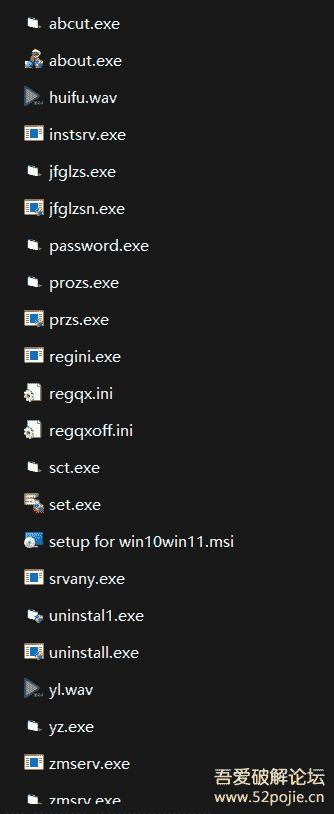

`QQ20251112-182048.png` (35.3 KB, 下载次数: 0) 2025-11-12 18:21 上传 [下载附件](https://www.52pojie.cn/forum.php?mod=attachment&aid=MjgxMzU4NHxkMzQwY2JhM3wxNzkzNTcwMzY1fDE2ODA4NnwyMDcyMTY2&nothumb=yes)

安装目录下有很多可执行程序，大部分都是VB写的空壳，没有实际作用。只有`jfglzsn.exe`、`about.exe`、`przs.exe`、`set.exe`、`zmserv.exe`、`uninstall.exe`、`yz.exe`这几个是有内容的。

先看`about.exe`：

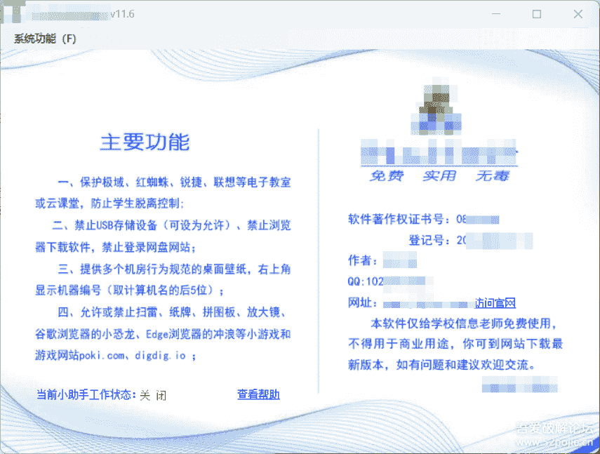

`QQ20251112-182529.png` (279.9 KB, 下载次数: 0) 2025-11-12 18:25 上传 [下载附件](https://www.52pojie.cn/forum.php?mod=attachment&aid=MjgxMzU4NXw2ZGJmNGYzNXwxNzkzNTcwMzY1fDE2ODA4NnwyMDcyMTY2&nothumb=yes)

看起来像是关于页面？

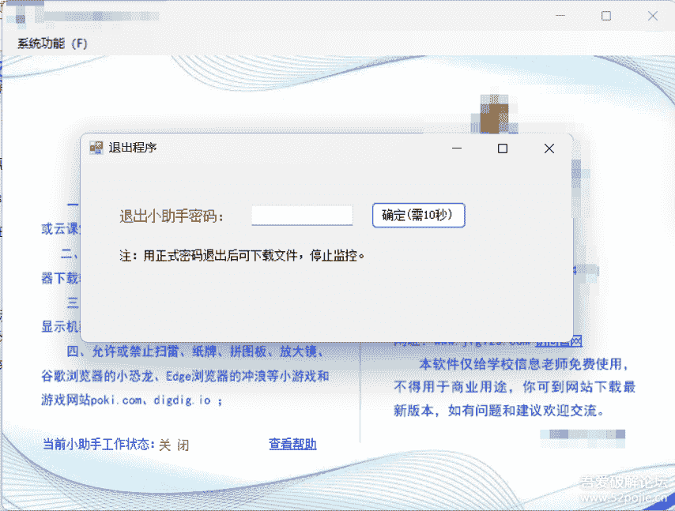

`QQ20251112-182723.png` (232.89 KB, 下载次数: 0) 2025-11-12 18:27 上传 [下载附件](https://www.52pojie.cn/forum.php?mod=attachment&aid=MjgxMzU4Nnw4MjI0NzRhNnwxNzkzNTcwMzY1fDE2ODA4NnwyMDcyMTY2&nothumb=yes)

退出页面。`系统功能`菜单里面就有我们需要的`退出助手`，但是需要密码。

现在目标确认了，直接开始逆向：

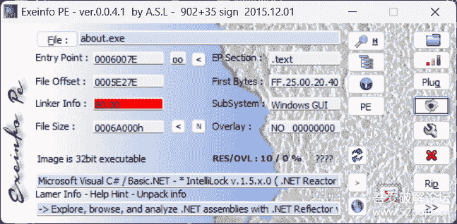

`QQ20251112-182425.png` (184.71 KB, 下载次数: 0) 2025-11-12 18:28 上传 [下载附件](https://www.52pojie.cn/forum.php?mod=attachment&aid=MjgxMzU4N3w0ZmRkZTdlYXwxNzkzNTcwMzY1fDE2ODA4NnwyMDcyMTY2&nothumb=yes)

文件信息。

## 脱壳与密码分析

`exeinfope`看到，这是一个C# .NET编写的程序，使用了IntelliLock v.1.5加壳。那没什么说的了，`de4dot`，启动！

十分顺利脱了壳，使用.NET反编译利器`dnspy`载入程序，如图：

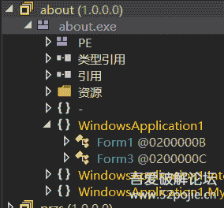

`QQ20251112-183959.png` (22.38 KB, 下载次数: 0) 2025-11-12 18:40 上传 [下载附件](https://www.52pojie.cn/forum.php?mod=attachment&aid=MjgxMzU5MHwwYjlkNzVkY3wxNzkzNTcwMzY1fDE2ODA4NnwyMDcyMTY2&nothumb=yes)

密码验证函数是`InitDatabase`：

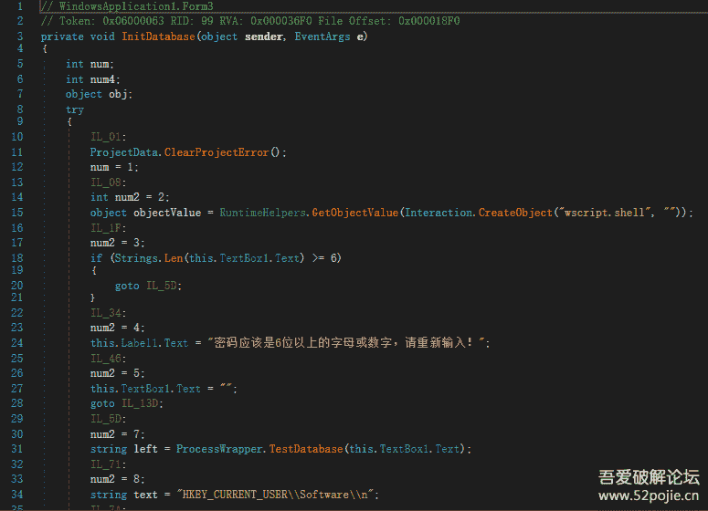

`QQ20251112-184145.png` (70.11 KB, 下载次数: 0) 2025-11-12 18:42 上传 [下载附件](https://www.52pojie.cn/forum.php?mod=attachment&aid=MjgxMzU5MXxlZDlkZGQyNnwxNzkzNTcwMzY1fDE2ODA4NnwyMDcyMTY2&nothumb=yes)

有些长，就不发完整图了。总结了下逻辑：判断密码大于6位，如果大于，就从注册表`HKEY_CURRENT_USER\Software\n`读取密码，并调用`ProcessWrapper.TestDatabase`计算密码输入框的密文进行比较。如果正确，就执行`DisableDatabase`、`CreateDatabase`退出程序。

`ProcessWrapper.TestDatabase`的密码算法过于简单了，各位自己理解吧。

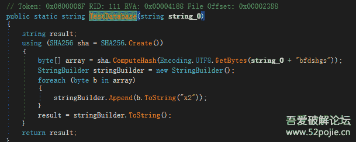

`QQ20251112-184751.png` (38.73 KB, 下载次数: 0) 2025-11-12 18:48 上传 [下载附件](https://www.52pojie.cn/forum.php?mod=attachment&aid=MjgxMzU5Mnw3ZDI1N2I4YnwxNzkzNTcwMzY1fDE2ODA4NnwyMDcyMTY2&nothumb=yes)

## 关闭与自我保护分析

下一个目标：退出它。

由于它的密码算法为加盐`SHA256`，目前不可解，所以我们不考虑解密密码。

安装后，多了两个启动项和一个服务，但是却只有`jfglzsn`、`zmserv`两个进程，`prozs`呢？

只结束这两个进程，过几秒后又会重启，这是什么情况？

我们直接将进程源文件删除，几秒钟后却被未知程序恢复（其实老版本11.0X前是会锁定屏幕的），这是什么情况？

很明显，都是`przs`干的。

`dnspy`载入程序，如图：

有五个窗口，看起来`Form1`的内容最多，而且其它窗口的内容都是由它定义的。`bianhao`是用来在桌面显示电脑名最后5字符，其它窗口基本都是用来警告和锁屏。

### Form1 分析

先分析下`Form1`：

窗口的入口点：`this.ManageWorker`是窗口的构造函数，所以我们来看`this.PublishWorker`。

这个函数就长了，我们来一点点分析：

- 读取启动项
- 计算一个随机文件名
- 使用前面计算的文件名，把自身复制到`C:\Program Files (x86)\随机目录\（五字符随机文件名）.exe`，并运行它
- 读取注册表`HKEY_CURRENT_USER\Software\jfglzs\bianhao`，然后使用`this.PopWorker`判断网络是否连通，然后调用`this.SetupWorker`（这个后面讲）

还负责了哪些功能，下面一个一个贴图展示：

- `CompareWorker`检测`jfglzsn.exe`文件是否存在，如果被删除，从`"C:\windows\jf" + "\jfglzsn.dat"`复制回去
- `CreateWorker`检测`hosts`文件是否存在，如果被删除，从`"C:\Windows\System32\drivers\etc\hosts" + "2"`复制回去
- `ChangeWorker`托盘图标
- `SetupWorker`从一个url下载一个网址清单，加入`hosts`文件内，指向`127.0.0.1`（代码过长，就不发全部了）

让我们回到主题，通过前面的分析，想要关闭它很简单：结束进程`jfglzsn.exe`、`[随机进程名].exe`，停止`zmserv`服务。

我图省事，把`about.exe`（软件的"关于"页面）patch了一下，去掉了密码验证。

下载链接（方便伸手党）：https://pan.huang1111.cn/s/1QDPzTv

## 12.x 更新点

今天看到助手12.0更新了，我们来看看到底更新了什么（编辑时更新到12.1）。

三个点：

- 自动从服务器下载网址黑名单
- 加强密码保护
- 禁止游戏、视频网站

我们来一个一个看：

自动下载黑名单：函数`this.UpdateWatcher`。

```csharp

```


```
private void UpdateWatcher(string fileUrl, string mode)
{
    try
    {
        // 检查网络连接
        if (!LogoutWatcher("223.5.5.5", 1500))
        {
            adapterInterpreter = false;
            return;
        }

        // 下载文件到临时位置
        string tempFile = Path.GetTempFileName();
        using (WebClient webClient = new WebClient())
        {
            webClient.DownloadFile(fileUrl, tempFile);
        }

        // 读取文件内容
        string[] lines = File.ReadAllLines(tempFile);
        
        // 验证文件格式
        if (Strings.InStr(lines[0], "www.", CompareMethod.Binary) == 0)
        {
            adapterInterpreter = false;
            return;
        }

        // 解析文件结构
        int videoStartIndex = -1;
        int videoEndIndex = -1;
        int productStartIndex = -1;
        int productEndIndex = -1;
        
        for (int i = 0; i  existingDomains = new HashSet();
        
        // 解析现有hosts文件中的域名
        string[] hostsLines = hostsContent.Split(new string[] { Environment.NewLine }, StringSplitOptions.None);
        
        foreach (string hostLine in hostsLines)
        {
            string trimmedLine = hostLine.Trim();
            if (trimmedLine.StartsWith("127.0.0.1"))
            {
                string[] parts = trimmedLine.Split(new char[] { ' ' }, StringSplitOptions.RemoveEmptyEntries);
                if (parts.Length > 1)
                {
                    existingDomains.Add(parts[1].ToLower());
                }
            }
        }

        // 构建新的hosts内容
        StringBuilder newHostsContent = new StringBuilder(hostsContent);
        newHostsContent.AppendLine();

        // 添加视频网站域名
        for (int i = 0; i
```

```
/// 监控用户浏览行为，检测是否访问了禁止的网站
private void MonitorBrowserActivity(object sender, EventArgs e)
{
    if (!IsBrowserActive())
        return;

    string windowTitle = GetActiveWindowTitle();

    if (string.IsNullOrEmpty(windowTitle))
        return;

    // 如果是相同的窗口标题，增加计数器
    if (windowTitle == _currentWindowTitle)
    {
        _sameTitleCounter += 1;

        // 连续5次检测到相同标题，重置监控
        if (_sameTitleCounter > 5)
        {
            _currentWindowTitle = "-1";
        }

        return;
    }

    // 新的窗口标题，重置计数器
    _sameTitleCounter = 0;
    _currentWindowTitle = windowTitle;

    string url = GetCurrentUrlFromBrowser();

    if (string.IsNullOrEmpty(url))
    {
        _currentWindowTitle = "-1";
        return;
    }

    // 检查URL是否包含禁止的域名
    CheckForbiddenWebsite(url);
}

/// 检查URL是否访问了禁止的网站
private void CheckForbiddenWebsite(string url)
{
    foreach (string forbiddenDomain in _forbiddenDomains)
    {
        // 检查URL是否包含禁止的域名（以.开头或//开头）
        bool containsForbiddenDomain = url.Contains("." + forbiddenDomain) ||
                                     url.Contains("//" + forbiddenDomain);

        if (containsForbiddenDomain)
        {
            // 如果是相同的URL，触发违规处理
            if (url == _lastForbiddenUrl)
            {
                _isRepeatedViolation = true;
            }
            else
            {
                _isRepeatedViolation = false;
                _lastForbiddenUrl = url;
            }

            _currentWindowTitle = "-1";
            HandleViolation();
            break;
        }
    }
}

/// 处理违规访问行为
private void HandleViolation()
{
    // 模拟按下Alt+F4关闭窗口
    SimulateAltF4();
    Thread.Sleep(100);

    if (_isRepeatedViolation)
    {
        // 发送Alt+F4组合键关闭窗口
        KeybdEvent(18, 0, 0, 0);    // ALT key down
        KeybdEvent(115, 0, 0, 0);   // F4 key down  
        KeybdEvent(115, 0, 2, 0);   // F4 key up
        KeybdEvent(18, 0, 2, 0);    // ALT key up
        Thread.Sleep(500);

        // 重置状态并显示警告
        ResetMonitoringState();
        ShowWarningDialog();
    }
}

/// 从浏览器获取当前URL（通过Ctrl+L, Ctrl+C快捷键）
private string GetCurrentUrlFromBrowser()
{
    try
    {
        // 模拟按下Ctrl+L（地址栏）和Ctrl+C（复制）
        SimulateCtrlL();
        Thread.Sleep(100);
        SimulateCtrlC();
        Thread.Sleep(100);

        // 从剪贴板获取URL
        if (Clipboard.ContainsText())
        {
            return Clipboard.GetText();
        }
    }
    catch (Exception ex)
    {
        // 记录日志（在实际应用中应该记录异常）
    }

    return string.Empty;
}

/// 重置监控状态
private void ResetMonitoringState()
{
    _isRepeatedViolation = false;
    _lastForbiddenUrl = "";
    _currentWindowTitle = "";
    Clipboard.Clear();
}

/// 显示警告对话框
private void ShowWarningDialog()
{
    ConnectionInterpreter.CalcWatcher.Form3.shuoming.Text = "你连续两次打开机房禁止网站！";
    ConnectionInterpreter.CalcWatcher.Form3.shuoming2.Text = "健康上网 学有所成";
    ConnectionInterpreter.CalcWatcher.Form3.Show();
}
```

这已经是十分明显的病毒特征了。

## 11.26更新：

今天回来看到助手更新了12.1版本，来看看增加了什么

禁止压缩软件？（不排除有些学校会教解压缩的）

原因可想而知：一位制作破解助手软件的作者，由于禁止浏览器下载，所以他想到了使用在图片后添加zip数据来下载文件（图片可以直接拖拽出来），打开这样的文件需要压缩软件

我们直接贴出代码：


### 显示违规软件警告对话框

```csharp
private void ShowViolationWarning()
{
    InterpreterHelper.ComputeHelper.Form3.shuoming.Text = "你运行的软件违规！如有误判，请老师拍照与作者QQ联系。";
   
    // 根据违规类型显示不同的警告信息
    switch (_violationType)
    {
        case ViolationType.TaskManager:
            InterpreterHelper.ComputeHelper.Form3.shuoming.Text = "注：电脑死机时，不能用任务管理器，可同时按ctrl+alt+del三个键，点注销，电脑不会自动还原。";
            break;
        case ViolationType.CompressionSoftware:
            InterpreterHelper.ComputeHelper.Form3.shuoming.Text = "你运行了360压缩软件或该软件现在升级，请卸载该软件，它带有杀毒功能会清除小助手。";
            break;
        case ViolationType.ExtractionSoftware:
            InterpreterHelper.ComputeHelper.Form3.shuoming.Text = "禁止解压软件是为了防止学生使用非法工具，老师要使用先退出小助手。";
            break;
    }
   
    // 生成违规报告标识
    string violationReport = GenerateViolationReport(_violatedProcessName);
    InterpreterHelper.ComputeHelper.Form3.shuoming3.Text = violationReport;
   
    InterpreterHelper.ComputeHelper.Form3.Show();
}
```

### 显示杀毒软件/虚拟机类软件警告

```csharp
private void ShowSecuritySoftwareWarning()
{
    InterpreterHelper.ComputeHelper.Form2.shuoming.Text = "你运行了杀毒类、虚拟机类的软件！危害电子教室运行，如有误判，请老师拍照与作者QQ联系。";
   
    string violationReport = GenerateViolationReport(_violatedProcessName);
    InterpreterHelper.ComputeHelper.Form2.shuoming3.Text = violationReport;
   
    InterpreterHelper.ComputeHelper.Form2.Show();
    _warningTimer.Enabled = true;
}
```

### 生成违规报告标识

```csharp
private string GenerateViolationReport(string processName)
{
    string cleanProcessName = processName.Replace(".exe", "");
    return $"grbrewyhrw4yw4ywnsxjeswtygqw3yhqhrtewyhrw4yw4y3tq3yszz{cleanProcessName}mmfnfxhghrts";
}
```

### 进程监控事件处理 - 检测违规软件运行

```csharp
private void ProcessMonitor_EventArrived(object sender, EventArrivedEventArgs e)
{
    ManagementBaseObject targetInstance = (ManagementBaseObject)e.NewEvent["TargetInstance"];
    int processId = Convert.ToInt32(targetInstance["ProcessId"]);
    string processName = targetInstance["Name"].ToString();
   
    Process process = Process.GetProcessById(processId);
    string filePath = process.MainModule.FileName;
   
    bool isForbiddenProcess = false;
    bool isDangerousTool = false;
   
    if (!string.IsNullOrEmpty(filePath))
    {
        FileVersionInfo versionInfo = FileVersionInfo.GetVersionInfo(filePath);
        string productName = versionInfo.ProductName;
        string fileDescription = versionInfo.FileDescription;
        string combinedInfo = productName + fileDescription;
        
        // 检查是否为禁止的进程
        isForbiddenProcess = CheckForbiddenProcess(processName, combinedInfo);
        
        // 检查是否为危险工具
        isDangerousTool = CheckDangerousTool(combinedInfo);
        
        // 根据检测结果采取相应措施
        HandleViolationResponse(process, isForbiddenProcess, isDangerousTool, filePath, processName);
    }
}
```

### 检查是否为禁止的进程

```csharp
private bool CheckForbiddenProcess(string processName, string productInfo)
{
    // 根据配置模式决定检查级别
    int checkLevel = (_securityCheckMode == "off") ? 11 : 1;
   
    // 检查进程黑名单
    while (!string.IsNullOrEmpty(_processBlacklist[checkLevel]))
    {
        string forbiddenPattern = _processBlacklist[checkLevel];
        if (processName.ToUpper().Contains(forbiddenPattern.ToUpper()))
        {
            return true;
        }
        checkLevel++;
    }
   
    return false;
}
```

### 检查是否为危险工具

```csharp
private bool CheckDangerousTool(string productInfo)
{
    // 根据配置模式决定检查级别
    int checkLevel = (_commandCheckMode == "off") ? 2 : 1;
   
    // 检查工具黑名单
    while (!string.IsNullOrEmpty(_toolBlacklist[checkLevel]))
    {
        string toolPattern = _toolBlacklist[checkLevel];
        if (productInfo.Contains(toolPattern))
        {
            return true;
        }
        checkLevel++;
    }
   
    return false;
}
```

### 处理违规响应

```csharp
private void HandleViolationResponse(Process process, bool isForbiddenProcess, bool isDangerousTool,
                                   string filePath, string processName)
{
    if (isForbiddenProcess)
    {
        if (_currentCheckLevel  50)
            {
                process.Kill();
                BeginInvoke(new MethodInvoker(ShowViolationWarning));
                process.WaitForExit(1000);
                File.Delete(process.MainModule.FileName);
            }
            else
            {
                process.Kill();
                BeginInvoke(new MethodInvoker(ShowViolationWarning));
            }
            break;
    }
}
```

### 违规类型枚举

```csharp
private enum ViolationType
{
    General,
    TaskManager,
    CompressionSoftware,
    ExtractionSoftware
}
```

这些是工具黑名单：

```csharp
private void InitializeToolBlacklist()
{
    _toolBlacklist = new string[80];
    // 系统管理工具
    _toolBlacklist[1] = "Windows 命令处理程序";      // cmd.exe
    _toolBlacklist[2] = "Windows PowerShell";       // PowerShell
    _toolBlacklist[3] = "任务管理器";                // 任务管理器
    _toolBlacklist[4] = "注册表编辑器";              // regedit.exe
    _toolBlacklist[5] = "Microsoft 管理控制台";      // MMC
    _toolBlacklist[6] = "Registry Workshop";        // 注册表工作室
    _toolBlacklist[7] = "PC Hunter";                // 系统维护工具
    _toolBlacklist[8] = "IceSword";                 // 冰刃
    _toolBlacklist[9] = "Wsyscheck";                // 系统检测工具
    _toolBlacklist[10] = "SnipeSword";              // 狙剑
    _toolBlacklist[11] = "Process Explorer";        // 进程浏览器
    _toolBlacklist[12] = "狡兔二窟";                 // 系统工具
    _toolBlacklist[13] = "Process-X";               // 进程管理
    _toolBlacklist[14] = "Process Master";          // 进程大师
    _toolBlacklist[15] = "PrcView";                 // 进程查看器
    _toolBlacklist[16] = "Process Viewer";          // 进程查看器
    _toolBlacklist[17] = "PowerTool";               // 系统维护工具
    _toolBlacklist[18] = "Windows Kernel Explorer"; // 内核浏览器
    _toolBlacklist[19] = "FTCleaner";               // 系统清理工具
    _toolBlacklist[20] = "Process Lasso";           // 进程优化工具
    // 进程管理工具
    _toolBlacklist[21] = "process manager";
    _toolBlacklist[22] = "Process Hacker";
    _toolBlacklist[23] = "ProcessOVER";
    // 虚拟桌面工具
    _toolBlacklist[24] = "Dexpot";
    _toolBlacklist[25] = "Deskman";
    _toolBlacklist[26] = "iDesktop";
    _toolBlacklist[27] = "YtMDesk";
    _toolBlacklist[28] = "DexpotProPortable";
    _toolBlacklist[29] = "Desktops";
    _toolBlacklist[30] = "Wise Desktop";
    _toolBlacklist[31] = "VDesktop";
    _toolBlacklist[32] = "MagicDesktop";
    _toolBlacklist[33] = "MultiDesk";
    _toolBlacklist[34] = "小宝虚拟桌面";
    // 系统配置工具
    _toolBlacklist[35] = "系统配置实用程序";          // msconfig
    _toolBlacklist[36] = "资源和性能监视器";          // perfmon
    _toolBlacklist[37] = "Special Setting Program";
    _toolBlacklist[38] = "瑞星防火墙";
    _toolBlacklist[39] = "火绒剑";
    _toolBlacklist[40] = "超级进程王";
    _toolBlacklist[41] = "OpenArk";
    _toolBlacklist[42] = "Procmon";
    _toolBlacklist[43] = "GameBar";
    // 压缩软件
    _toolBlacklist[44] = "360压缩";
    _toolBlacklist[45] = "Bandizip";
    _toolBlacklist[46] = "WinRAR";
    _toolBlacklist[47] = "7-Zip";
    _toolBlacklist[48] = "WinZip";
    _toolBlacklist[49] = "暂 时 备 用";
    _toolBlacklist[50] = "暂 时 备 用";
    // 极域电子教室破解工具
    _toolBlacklist[51] = "极域杀手";
    _toolBlacklist[52] = "极域墓地制造器";
    _toolBlacklist[53] = "极域杀死";
    _toolBlacklist[54] = "翘课";
    _toolBlacklist[55] = "夕颜若雪工具箱";
    _toolBlacklist[56] = "学生机房Hack助手";
    _toolBlacklist[57] = "再见极域";
    _toolBlacklist[58] = "KillControl";
    _toolBlacklist[59] = "去除控制";
    _toolBlacklist[60] = "MsgFlood";
    _toolBlacklist[61] = "极域工具包";
    _toolBlacklist[62] = "Astrum For Online Classroom";
    _toolBlacklist[63] = "JiYu Trainer";
    _toolBlacklist[64] = "掌控课堂";
    _toolBlacklist[65] = "FuckMythware";
    _toolBlacklist[66] = "Hello Teacher";
    _toolBlacklist[67] = "JIYUPLUS";
    _toolBlacklist[68] = "极域Tool";
    _toolBlacklist[69] = "微机课救星";
    _toolBlacklist[70] = "极域X";
    _toolBlacklist[71] = "UnMythware";
    _toolBlacklist[72] = "The curl executable";
}
```


```
_toolBlacklist[73] = "BITS管理实用程序";
_toolBlacklist[74] = "DzjsTools";
_toolBlacklist[75] = "SkiesKiller";
_toolBlacklist[76] = ClientHelper._ParserHelper;
_toolBlacklist[77] = "MultiDeskTop应用程序";
_toolBlacklist[78] = "极域电子教室克星";
_toolBlacklist[79] = ClientHelper.configHelper;
}
```

给出助手12.1下载地址，当个C#的crackme玩一下吧

https://github.com/lzh173/jfglzs-update_lookup/releases/download/release-20251126-111503-19701812413/jfgl2_20251126_111604.zip

[quote]
