# [Web逆向] 某老板直聘四层switch反混淆

- 原帖: https://www.52pojie.cn/forum.php?mod=viewthread&tid=2073419
- 抓取时间: 2026-11-01T21:59:16

老板直聘作为另一类型的多层`switch`混淆的代表还是很有研究价值的，主要的特点就是`switch`起始`index`是不固定的，是调用的时候传参确定的，传不同的`index`，那么就运行不同的代码。

先上链接：`aHR0cHM6Ly93d3cuemhpcGluLmNvbS93dWhhbi8/a2E9Y2l0eS1zaXRlcy0xMDEyMDAxMDA=`，这个站`chrome`是抓不到包的，需要用`fiddler`抓包，先开启`fiddler`，然后打开网页直接找`security-check.html`这里是调用`ABC`生成`cookie` `__zp_stoken__`的地方，先用`fidder`替换掉这个文件，然后在调用处加上`debugger`。

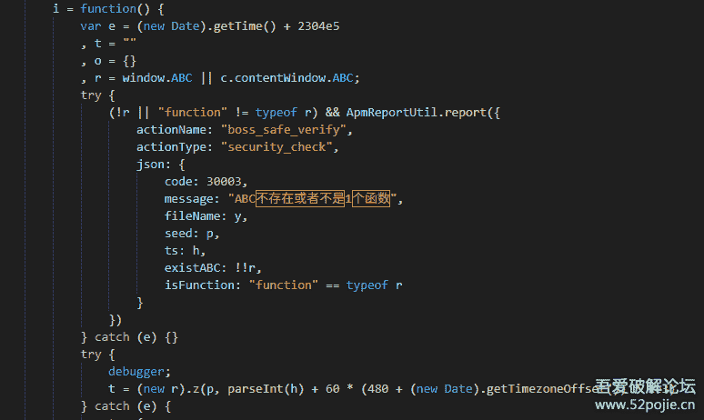

屏幕截图 2025-11-15 133131.png (44.24 KB, 下载次数: 1)

[href="forum.php?mod=attachment&aid=MjgxNDkxM3wyMTZhY2I2NHwxNzkzNTcwMzU0fDE2ODA4NnwyMDczNDE5&nothumb=yes" target="_blank"](https://www.52pojie.cn/forum.php?mod=attachment&aid=MjgxNDkxM3wyMTZhY2I2NHwxNzkzNTcwMzU0fDE2ODA4NnwyMDczNDE5&nothumb=yes)

2025-11-17 09:47 上传

接着要找的第二个文件就是`security-js`文件夹下的`js`文件。后面的`js`文件名是一个随机的字符串，每天会变。

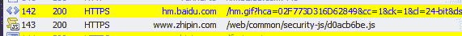

屏幕截图 2025-11-15 133332.png (6.99 KB, 下载次数: 1)

[href="forum.php?mod=attachment&aid=MjgxNDkxNHwwZGZjNDI4MHwxNzkzNTcwMzU0fDE2ODA4NnwyMDczNDE5&nothumb=yes" target="_blank"](https://www.52pojie.cn/forum.php?mod=attachment&aid=MjgxNDkxNHwwZGZjNDI4MHwxNzkzNTcwMzU0fDE2ODA4NnwyMDczNDE5&nothumb=yes)

2025-11-17 09:48 上传

将`js`文件复制出来就可以看到整个混淆过后的`js`代码了。初步分析整个代码，选每一层的第一个`switch`和第一个`case`展开后开始分析，最内层的`case`代码运行后会一层一层的`break`返回最外层，而不会在中间的某一层停留，同样的如果最内层有`return`，那么也会一层一层的返回到最外层，而不会在中间层处理。

那么可以认定整个`switch`由最外层的参数控制，可以将整个`switch`处理成只有最外层参数的一层`switch`。

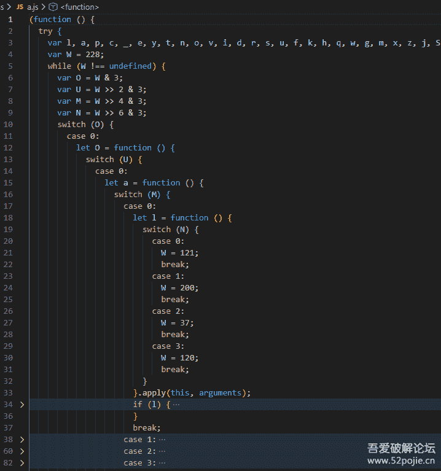

屏幕截图 2025-11-15 140522.png (58.49 KB, 下载次数: 0)

[href="forum.php?mod=attachment&aid=MjgxNDkxOXxmYmE0NDc0M3wxNzkzNTcwMzU0fDE2ODA4NnwyMDczNDE5&nothumb=yes" target="_blank"](https://www.52pojie.cn/forum.php?mod=attachment&aid=MjgxNDkxOXxmYmE0NDc0M3wxNzkzNTcwMzU0fDE2ODA4NnwyMDczNDE5&nothumb=yes)

2025-11-17 09:49 上传

整个文件的操作思路和阿里的231一致，首先收集到所有`w`的值，然后在最内层的`case`中插入收集进入这个`case`时`w`的值的代码，最后删掉`case`中其他的语句，只留下插入的代码和`break`语句。首先收集`W`的值

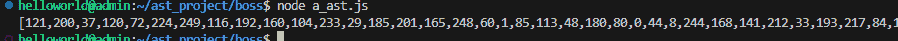

屏幕截图 2025-11-15 204117.png (7.74 KB, 下载次数: 0)

[href="forum.php?mod=attachment&aid=MjgxNDkyMXxmYzAwMDM3Y3wxNzkzNTcwMzU0fDE2ODA4NnwyMDczNDE5&nothumb=yes" target="_blank"](https://www.52pojie.cn/forum.php?mod=attachment&aid=MjgxNDkyMXxmYzAwMDM3Y3wxNzkzNTcwMzU0fDE2ODA4NnwyMDczNDE5&nothumb=yes)

2025-11-17 09:49 上传

然后插入代码

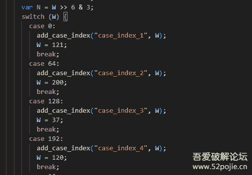

屏幕截图 2025-11-15 205025.png (26.75 KB, 下载次数: 0)

[href="forum.php?mod=attachment&aid=MjgxNDkyM3w2NTA5OTQ4M3wxNzkzNTcwMzU0fDE2ODA4NnwyMDczNDE5&nothumb=yes" target="_blank"](https://www.52pojie.cn/forum.php?mod=attachment&aid=MjgxNDkyM3w2NTA5OTQ4M3wxNzkzNTcwMzU0fDE2ODA4NnwyMDczNDE5&nothumb=yes)

2025-11-17 09:51 上传

最后删掉多余代码

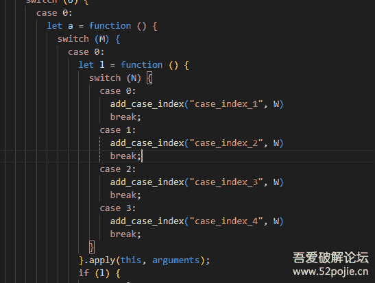

屏幕截图 2025-11-15 203956.png (31.44 KB, 下载次数: 1)

[href="forum.php?mod=attachment&aid=MjgxNDkyOHw4MzVlM2U0Y3wxNzkzNTcwMzU0fDE2ODA4NnwyMDczNDE5&nothumb=yes" target="_blank"](https://www.52pojie.cn/forum.php?mod=attachment&aid=MjgxNDkyOHw4MzVlM2U0Y3wxNzkzNTcwMzU0fDE2ODA4NnwyMDczNDE5&nothumb=yes)

2025-11-17 09:53 上传

将整个`switch`复制出去放在`for`循环中执行，得到每个`case_index_X`对应的`w`的值

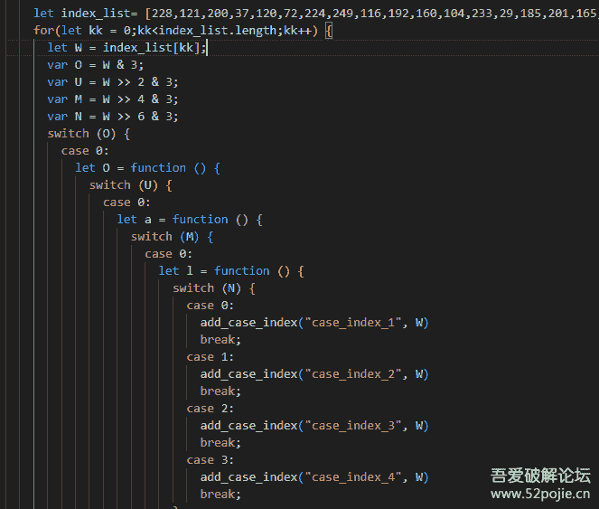

屏幕截图 2025-11-15 204613.png (46.88 KB, 下载次数: 0)

[href="forum.php?mod=attachment&aid=MjgxNDkyMnxiZGY1ZTAzMHwxNzkzNTcwMzU0fDE2ODA4NnwyMDczNDE5&nothumb=yes" target="_blank"](https://www.52pojie.cn/forum.php?mod=attachment&aid=MjgxNDkyMnxiZGY1ZTAzMHwxNzkzNTcwMzU0fDE2ODA4NnwyMDczNDE5&nothumb=yes)

2025-11-17 09:50 上传

得到映射结果。

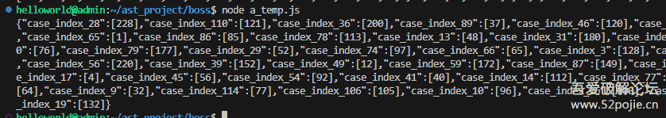

屏幕截图 2025-11-15 204744.png (26.39 KB, 下载次数: 0)

[href="forum.php?mod=attachment&aid=MjgxNDkyOXw5ZTBmMzMyNHwxNzkzNTcwMzU0fDE2ODA4NnwyMDczNDE5&nothumb=yes" target="_blank"](https://www.52pojie.cn/forum.php?mod=attachment&aid=MjgxNDkyOXw5ZTBmMzMyNHwxNzkzNTcwMzU0fDE2ODA4NnwyMDczNDE5&nothumb=yes)

2025-11-17 09:54 上传

根据映射结果将`switch`还原为一个`switch`。

屏幕截图 2025-11-15 205025.png (26.75 KB, 下载次数: 0)

[href="forum.php?mod=attachment&aid=MjgxNDkzMHxkMjhkMjQ2ZnwxNzkzNTcwMzU0fDE2ODA4NnwyMDczNDE5&nothumb=yes" target="_blank"](https://www.52pojie.cn/forum.php?mod=attachment&aid=MjgxNDkzMHxkMjhkMjQ2ZnwxNzkzNTcwMzU0fDE2ODA4NnwyMDczNDE5&nothumb=yes)

2025-11-17 09:54 上传

删掉插入的代码，并将`switch`还原成顺序代码。

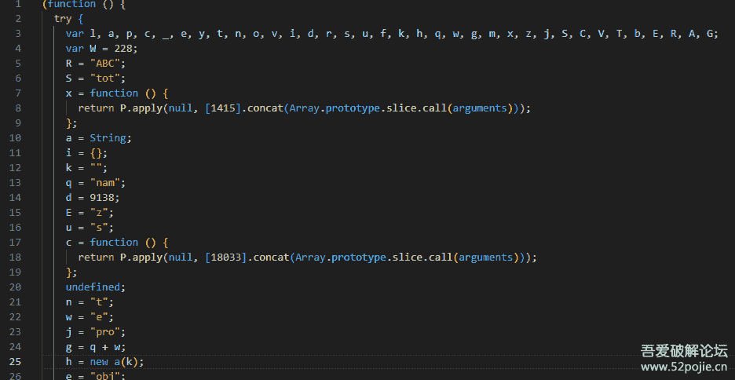

屏幕截图 2025-11-16 134516.png (44.65 KB, 下载次数: 0)

[href="forum.php?mod=attachment&aid=MjgxNDkzMXw4MmExNTMyZnwxNzkzNTcwMzU0fDE2ODA4NnwyMDczNDE5&nothumb=yes" target="_blank"](https://www.52pojie.cn/forum.php?mod=attachment&aid=MjgxNDkzMXw4MmExNTMyZnwxNzkzNTcwMzU0fDE2ODA4NnwyMDczNDE5&nothumb=yes)

2025-11-17 09:55 上传

这只是还原了部分代码，后面还有一个函数也是同样的结构，当然也可以用同样的方法还原，需要注意的是后面函数的部分`case` `index`的值是在函数的`call`中的，只单纯收集函数内`case` `index`的值是不够的。

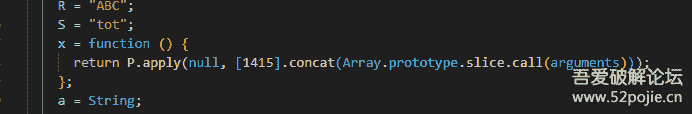

屏幕截图 2025-11-16 135124.png (15.64 KB, 下载次数: 0)

[href="forum.php?mod=attachment&aid=MjgxNDkzMnxhMjlkODhiZHwxNzkzNTcwMzU0fDE2ODA4NnwyMDczNDE5&nothumb=yes" target="_blank"](https://www.52pojie.cn/forum.php?mod=attachment&aid=MjgxNDkzMnxhMjlkODhiZHwxNzkzNTcwMzU0fDE2ODA4NnwyMDczNDE5&nothumb=yes)

2025-11-17 09:56 上传

将函数内的`swtich`还原成一层`switch`后代码是没法运行的，替换原网页的代码后也会报错，原因也很简单，原来的多层`switch`将变量隔离的，当还原后变量的作用域提升了，导致变量污染。

当然解决这个问题也很简单，这样的多入口的`switch`本质是将多个函数融合在了一个函数中，然后用多层的`switch`将变量隔离开，要彻底还原这个`switch`只需要以每个入口的`index`作为起始值，用`ast`将`switch`遍历一遍，把每个经过的`case`取出来然后生成一个新的函数就可以了。

最后看一眼解开所有`switch`之后的结果

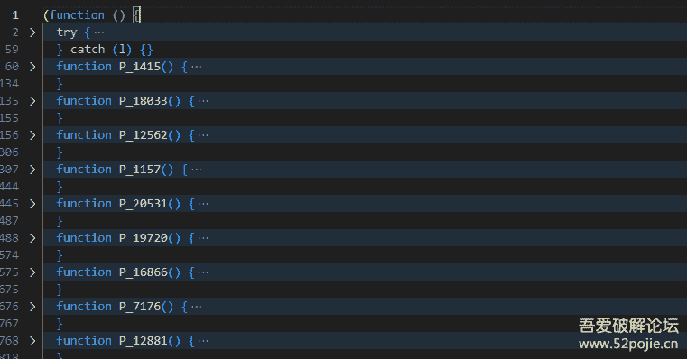

屏幕截图 2025-11-17 011655.png (35.32 KB, 下载次数: 0)

[href="forum.php?mod=attachment&aid=MjgxNDkzM3wxYWU3NTVmYnwxNzkzNTcwMzU0fDE2ODA4NnwyMDczNDE5&nothumb=yes" target="_blank"](https://www.52pojie.cn/forum.php?mod=attachment&aid=MjgxNDkzM3wxYWU3NTVmYnwxNzkzNTcwMzU0fDE2ODA4NnwyMDczNDE5&nothumb=yes)

2025-11-17 09:56 上传

懒得扣代码了，直接放将`js`带入网页的结果

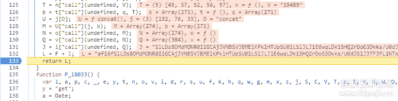

屏幕截图 2025-11-17 011926.png (47.86 KB, 下载次数: 0)

[href="forum.php?mod=attachment&aid=MjgxNDkzNHxhNTE4M2Y2N3wxNzkzNTcwMzU0fDE2ODA4NnwyMDczNDE5&nothumb=yes" target="_blank"](https://www.52pojie.cn/forum.php?mod=attachment&aid=MjgxNDkzNHxhNTE4M2Y2N3wxNzkzNTcwMzU0fDE2ODA4NnwyMDczNDE5&nothumb=yes)

2025-11-17 09:56 上传
