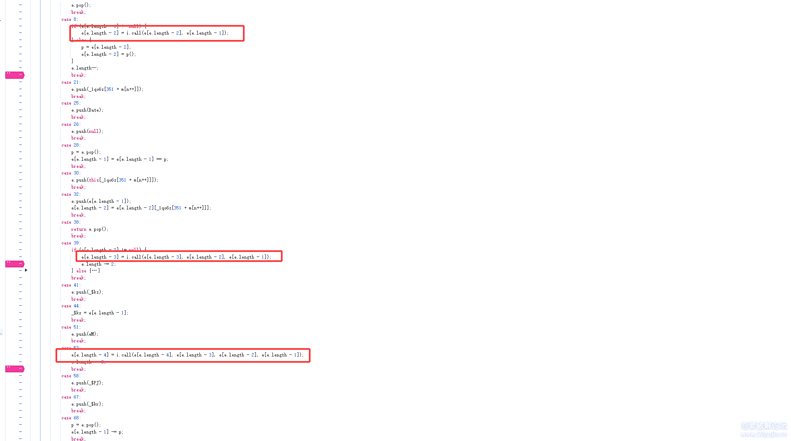
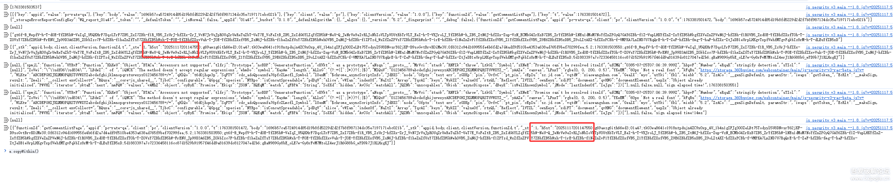
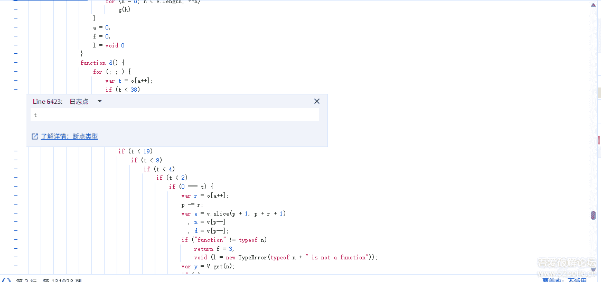
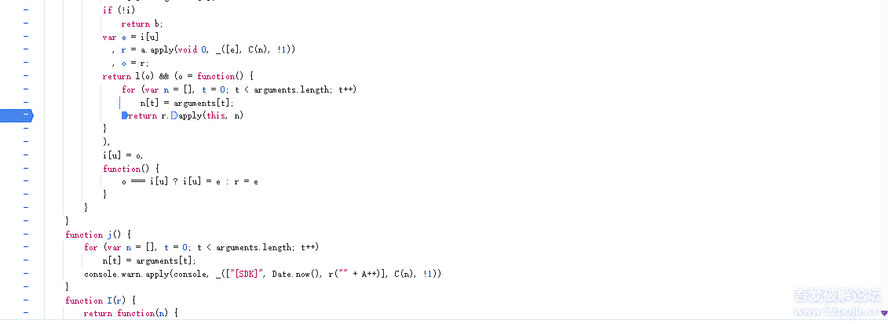
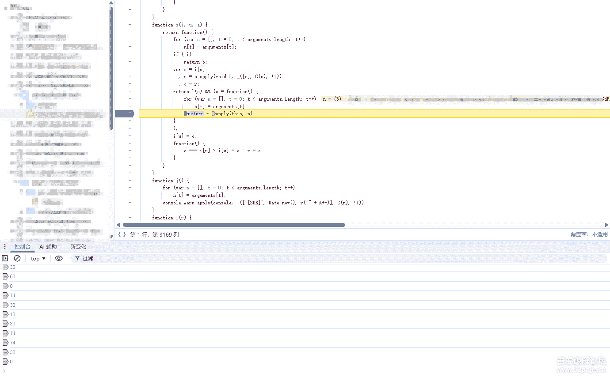
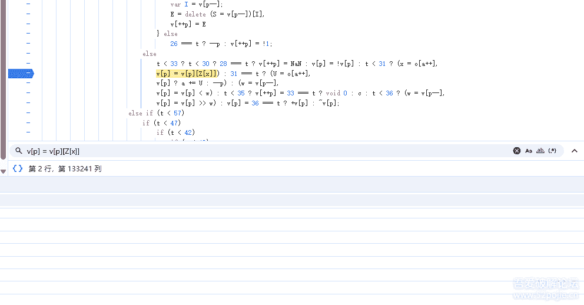
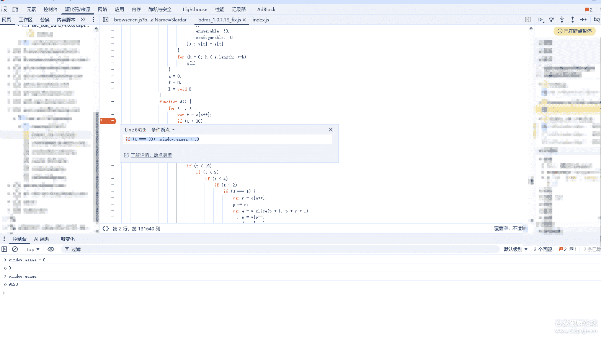
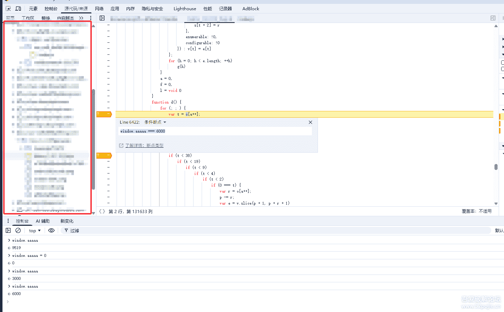
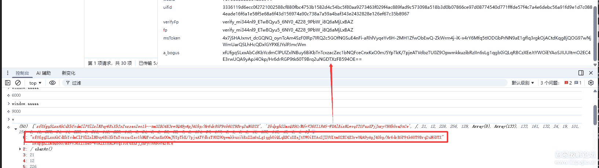

# [Web逆向] 关于JSVMP纯算的一些取巧方式

> 原帖：https://www.52pojie.cn/forum.php?mod=viewthread&tid=2073641
>
> 抓取时间：2026-11-01T21:59:12
>
> 注：本文章仅学习交流，侵权请联系删除

## 一、JSVMP 核心概念

JSVMP 是个啥就不介绍了。今天我们讲的是比较笼统的 JSVMP，即包含控制流。

在 JSVMP 中有几个核心概念：

1. 栈，或者寄存器？保存变量的地方，通常在代码中的表示形式为数组或者其他什么临时变量。
2. 指令。代码怎么运行就是靠他，单个指令在代码中表示形式为数字。

控制流，也就是 `switch/case`。他是通过指定值跳转到不同分支。

注意，重点来了！！！

JSVMP 在我们所见到的代码形式中目前主要是两种。一种就是控制流、另一种就是 `if/else if`，当然还有三目运算或者嵌套三目。而从这里就能得到 `switch` 和 `if` 的控制条件就是指令，所以一种方法就是直接打印所有指令，通过指令反查结果。

而另一种就是他的栈或者寄存器了，前面已经说了栈是一个数组或者其他的临时变量。

临时变量先不管，我们先来分析数组。在 JS 中直接打印数组是不可行的，所以我们需要使用 `JSON.stringify` 对他进行格式化输出，但是！！！对于一些环境值以及一些特殊对象使用格式化是会报错的，导致无法正常打印出数据，所以你可以找 AI 要一份 `JSON` 避免报错的代码。

通常是两种方法搭配使用，以及加上 hook。

## 二、JSVMP 纯算流程

我们先来讲一下最简单的 JSVMP 怎么纯算。

### 最简单的 JSVMP

`image.png` (39.78 KB, 下载次数: 0)

[附件链接](https://www.52pojie.cn/forum.php?mod=attachment&aid=MjgxNTA5MHwxZmFjZjU2YnwxNzkzNTcwMzUwfDE2ODA4NnwyMDczNjQx&nothumb=yes)

1  
2025-11-17 20:12 上传

#### 情况一：只有 `call` 或 `apply` 的 VMP

像这种只有 `call` 或者 `apply` 的 vmp 是最简单的，我们只需要在他的 `call` 或者 `apply` 出打上日志断点就能知道他的加密在哪个地方。

`image.png` (89.96 KB, 下载次数: 0)

[附件链接](https://www.52pojie.cn/forum.php?mod=attachment&aid=MjgxNTA5MXxjMDlkMzZkMnwxNzkzNTcwMzUwfDE2ODA4NnwyMDczNjQx&nothumb=yes)

2  
2025-11-17 20:15 上传

#### 情况二：进入加密流程前输出指令代码

接下来就是第二种情况，再进入加密流程前打上输出指令代码。

##### 1. 输出判断条件的值

我们在开头打上输出判断条件的值。

`image.png` (25.79 KB, 下载次数: 0)

[附件链接](https://www.52pojie.cn/forum.php?mod=attachment&aid=MjgxNTA5OXw3ZjRiMGZjN3wxNzkzNTcwMzUwfDE2ODA4NnwyMDczNjQx&nothumb=yes)

3  
2025-11-17 20:32 上传

##### 2. 在出口打上断点

然后再在出口打上断点，这里的出口不一定是函数出口，也可以是其他地方。

`image.png` (18.07 KB, 下载次数: 0)

[附件链接](https://www.52pojie.cn/forum.php?mod=attachment&aid=MjgxNTEwMHw3NTg1YzUwMHwxNzkzNTcwMzUwfDE2ODA4NnwyMDczNjQx&nothumb=yes)

4  
2025-11-17 20:32 上传

##### 3. 等待打印并定位 `t=30` 分支

接下来等他打印就好了。。。。。

`image.png` (55.06 KB, 下载次数: 0)

[附件链接](https://www.52pojie.cn/forum.php?mod=attachment&aid=MjgxNTEwOXw2MzE5YWY5N3wxNzkzNTcwMzUwfDE2ODA4NnwyMDczNjQx&nothumb=yes)

5  
2025-11-17 20:36 上传

这里我直接找 `t` 等于 30 会在哪个分支，当然你要不想分析也可以直接丢给 AI。这里 AI 给出的结果在这里，我直接打上一个断点刷新。

`image.png` (21.17 KB, 下载次数: 0)

[附件链接](https://www.52pojie.cn/forum.php?mod=attachment&aid=MjgxNTExMnxjYmYwOTRmNnwxNzkzNTcwMzUwfDE2ODA4NnwyMDczNjQx&nothumb=yes)

6  
2025-11-17 20:38 上传

##### 4. 保存日志并设置第 9520 次断点

忘记说了，因为我们不清楚这个 `t=30` 会出现多少次，所以我们先将日志保存到本地，或者也可以打其他的判断条件减少日志的输出。

`image.png` (82.68 KB, 下载次数: 0)

[附件链接](https://www.52pojie.cn/forum.php?mod=attachment&aid=MjgxNTExM3wyZGUwZTQwNHwxNzkzNTcwMzUwfDE2ODA4NnwyMDczNjQx&nothumb=yes)

7  
2025-11-17 20:43 上传

这里我们可以看到 `t=30` 出现了九千多次，就在他第 9520 次打下断点，这里建议再添加一个新的断点或者打阶段性的断点，以保证开发者工具不会崩溃。

`image.png` (69.01 KB, 下载次数: 1)

[附件链接](https://www.52pojie.cn/forum.php?mod=attachment&aid=MjgxNTExNXxmNWJiZDRlY3wxNzkzNTcwMzUwfDE2ODA4NnwyMDczNjQx&nothumb=yes)

8  
2025-11-17 20:52 上传

##### 5. 查看最终结果

到最后我们就可以看到他的结果已经出来了，（其实还并没有完全出来）。

`image.png` (65.95 KB, 下载次数: 1)

[附件链接](https://www.52pojie.cn/forum.php?mod=attachment&aid=MjgxNTExNnwyYzAwZjRiM3wxNzkzNTcwMzUwfDE2ODA4NnwyMDczNjQx&nothumb=yes)

9  
2025-11-17 20:55 上传

通过以上流程我们就可以看到最终的值是存在与 `v` 中，所以这个 `v` 就是前面的栈。所以你也可以分阶段的打印这个 `v`，然后分析。当有莫名奇妙出现的数组或者其他值时可以先多打印几次日志看是否固定，如果不是就需要打特定的条件断点去看。

## 三、总结与难点

好了，目前的 JSVMP 都可以通过以上的方式解出来。但是这并不是最难的，最难的反而是找到加密位置，作者本人对于异步并没有什么好的解决方法，所以只能单步跟栈。以及分析所需要的时间是很长的，不过逆向嘛，就是要有耐心。

国内另一个嵌套多层 `switch` 就需要多打印几个指令。

OK，今天的分享就到这里了，如果各位佬还有什么不明白的或者指导意见可以在评论区留言。
