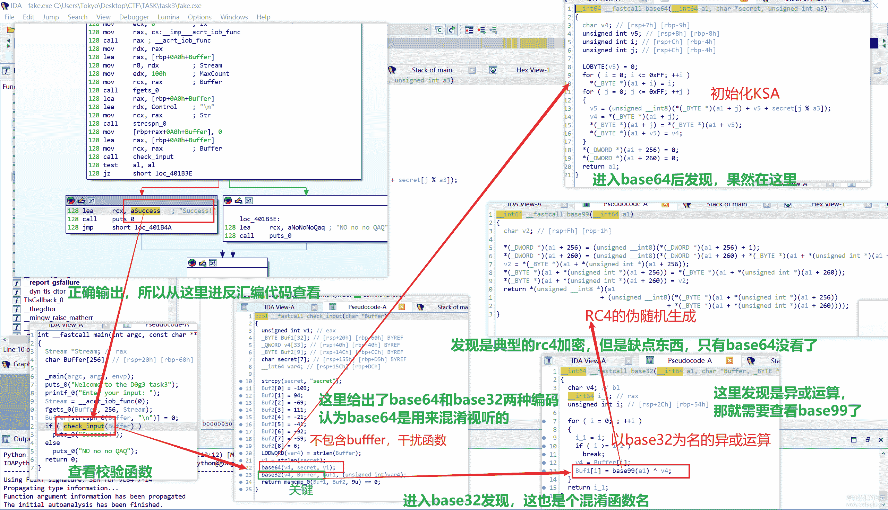
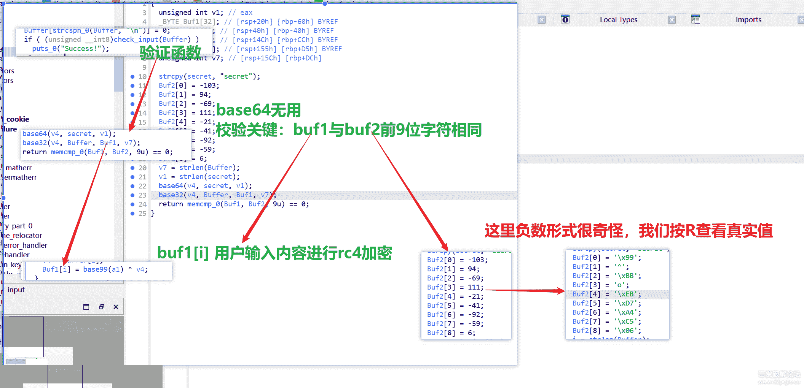
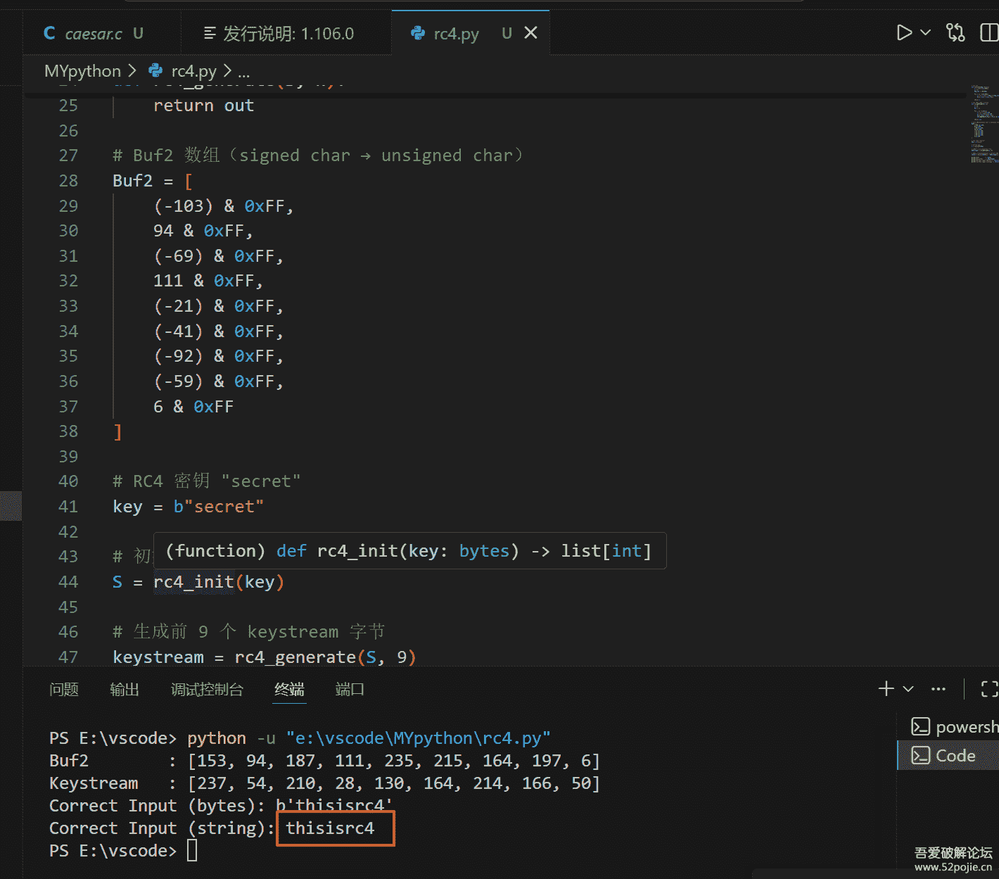

# [CTF] 【基础TASK汇报】TASK 3

- 原帖: `https://www.52pojie.cn/forum.php?mod=viewthread&tid=2073915`
- 抓取时间: `2026-11-01T21:59:10`

## TASK 3

### 0x00 初始汇编

汇编的基本语法：用简单的英文单词控制CPU的语句

结构：`[标签]` `指令` `操作数1, 操作数2` `; 注释`

三大核心结构

指令+操作数

格式：指令 目标, 源

`mov` 移动（赋值）

`add` 加法

`sub` 减法

`cmp` 比较

`jmp` 跳转

`call` 调用函数

`ret` 返回

标签（label）：给一段代码命名

注释（comment）：用“；”表示

寄存器 x86（32 位）：相当于CPU中的一个容器，把数据放进去后才能运算

通用寄存器

`EAX` 函数返回值、加法乘法默认寄存器

`EBX` 地址基址、运算辅助

`ECX` 循环技术、shift/rep指令计数

`EDX` 乘法、除法扩展，高位数据

`ESI` 源地址（字符串/内存读取）

`EDI` 目标地址（字符串/内存写入）

`EBP` 栈帧机制指针

`ESP` 栈顶指针——指向当前栈顶的地址

指令指针

`EIP` 指向下一条指令的地址

标志寄存器：对运算结果进行处理

`EFLAGS`

总结

用英文单词表示指令

每条指令操作寄存器、内存或立即数（写在指令里的常量数值）

通过label来跳转

栈：一种数据结构——先进后出（最后放进去的东西先拿出来）

基本操作

入栈：把一个数据放到栈顶

出栈：把栈顶的数据拿出来

查看栈项：查看当前栈顶的元素，但不移除它

特性：

只能在栈顶操作

遵循先进后出的原则

栈的大小可以有限或动态增长

应用：

数据调用（调用栈）：程序吗调用函数的返回地址、局部变量等信息会放入栈中

表达式求值

撤销操作：栈用来保存历史操作

汇编语言指令

数据传送指令（Data Transfer Instructions）

`MOV` 移动数据

`PUSH`/`POP` 入栈出栈

`XCHG` 交换两个寄存器或寄存器与内存的数据

`LEA` 取地址指令，把内存地址装到寄存器里面

算术指令（Arithmetic Instructions）

`ADD`/`SUB` 加减法

`MUL`/`IMUL` 无符号/有符号乘法

`DIV`/`IDIV` 无符号/有符号除法

`INC`/`DEC` 寄存器或内存加1减1

`NEG` 取负数

逻辑和位操作指令（Logic and Bitwise Instructions）

`AND`/`OR`/`XOR` 按位与、或、异或

`NOT` 按位取反

`SHL`/`SHR`/`SAL`/`SAR` 左移/右移位操作

控制转移指令（Control Transfer Instructions）

`JMP` 无条件跳转

`JE`/`JZ`/`JNE`/`JNZ`/`JL`/`JG` 条件跳转

`CALL`/`RET` 调用函数与返回

`LOOP` 循环指令，根据`ECX`寄存器循环

比较指令（Compare Instructions）

`CMP` 比较两个操作数

`TEST` 按位与比较，不改变操作数，只影响标志寄存器

字符串操作指令（String Instructions）

`MOVSB` / `MOVSW` / `MOVSD`：移动字节、字、双字

`CMPS` / `SCAS` / `LODS` / `STOS`：比较、扫描、装载、存储字符串

`REP` / `REPE` / `REPNE`：重复前面的字符串操作指令

其他常用指令

`NOP`：空操作，占位用

`INT`：触发中断，用于调用系统服务

`CLC` / `STC` / `CMC`：标志寄存器的进位位操作

`HLT`：停止处理器，等待外部中断

### 0x01 学会使用逆向工具

`die`：程序的阻断点（用于终止程序、作为保护机制、控制程序流程）

`010 Editor`

直接编辑当前的文件的二进制（Hex编辑）（反汇编代码不能修改）

模板解析结构（PE、ELF、PNG、ZIG、加密文件格式）

自动解析、查看PE Header

搜索字节序列（Hex）、搜索字符串、搜索正则表达式、搜索结构偏移

理解：`IDA`是用来看和分析的，而`010 Editor`是用来修改的

实战题中`IDA`使用记录

思路分析

fake思路分析.png (705 KB, 下载次数: 0)

`https://www.52pojie.cn/forum.php?mod=attachment&aid=MjgxNTM3MXw5ZjFhNjVkMHwxNzkzNTcwMzQ3fDE2ODA4NnwyMDczOTE1&nothumb=yes`

2025-11-18 20:07 上传

算法分析

算法分析.png (224.49 KB, 下载次数: 0)

`https://www.52pojie.cn/forum.php?mod=attachment&aid=MjgxNTM3Mnw4ODEzODg1NHwxNzkzNTcwMzQ3fDE2ODA4NnwyMDczOTE1&nothumb=yes`

2025-11-18 20:07 上传

解密

解密.png (176.12 KB, 下载次数: 0)

`https://www.52pojie.cn/forum.php?mod=attachment&aid=MjgxNTM3M3xkODMwNTk3NXwxNzkzNTcwMzQ3fDE2ODA4NnwyMDczOTE1&nothumb=yes`

2025-11-18 20:07 上传

### 0x02 虚拟机配置

目前电脑系统文件可能存在错误，但是又有重要文件尚未备份，之后重装系统后会在虚拟机里面配置环境，避免现在这样的情况。

### 0x03 加密算法

`TEA`算法：分组密码算法

特征：固定常量 `0x9E3779B9`（黄金分割值）

流程：

将64位明文分成两组32位 记为`v0`和`v1`

将128位密钥分为4个32位的子密钥，在加密中反复使用

32轮迭代——在每一轮迭代中进行加法和移位、移或和移位、更新、使用密钥、使用常数

最终得到64位的密文

缺点

存在等效密钥：不同的密钥会产生完全相同的加密结果

破解难度低（生日攻击）：

`2`的`23`次方的复杂度相对于现代密码学来说太弱了，普通PC都能跑

64bit分组太小，加密大量数据时容易出现重复块

Key Schedule 过于简单（密钥扩散很差）

常量固定（`0x9E3779B9`）可预测

代码实现过于相似

`xTEA`算法：`TEA`升级版

针对密钥表攻击，使用 `sum` 的不同位做 key 的选择，避免了原来 `TEA` 的机械重复

安全性增强点

等价密钥问题

非均匀扩散和弱差分特征

强化key schedule，减少weak key

更复杂的轮函数

`xxTEA`算法：整体混合算法

每个元素`v[i]`的更新依赖于`v[i+1]`和`v[i-1]`

算法 |

类型 |

分组模式 |

问题 |

现状 |

`TEA`
