# [Web逆向] steam hcaptcha 一些环境监测点分享

- 原帖：<https://www.52pojie.cn/forum.php?mod=viewthread&tid=2074942>
- 抓取时间：2026-11-01T21:59:04

本篇文章适合于对于 hcaptcha 流程稍微熟悉一些的朋友看。

**hcaptcha 整体思路就是不断进行对照试验，然后不断查漏补缺**

## 1. 前置操作

- **a.** `CSP` 不能全删，只能删除最后 `script` 验证，也就是这两个不能删。带有 `integrity` 的地方通通删掉。
- **b.** hcaptcha 的 `wasm` 会有两次调用，第一次是初始化，第二次是用来生成加密。经过测试，初始化可以不要，这样也可以减少一半的日志量，方便你看日志对照环境。
- **c.** `vm_data` 以及 `motionData` 可以先复制浏览器的写死，注意 `\\` 的问题。

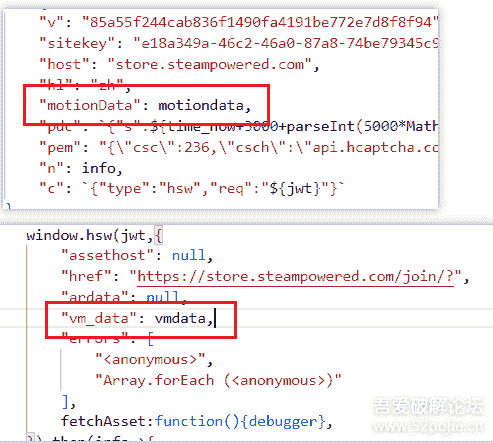
附件：[下载](https://www.52pojie.cn/forum.php?mod=attachment&aid=MjgxNjE4OXwzZTk1ZGMzNXwxNzkzNTcwMzQxfDE2ODA4NnwyMDc0OTQy&nothumb=yes)

- **d.** 上述 a、b、c 三项完成后，复制浏览器的指纹数组，`node` 中给写死/不写死。如果写死能过，不写死过不了才能说明是你环境数组的问题。

## 2. 一些环境检测点详解

### 2.1 `Math` 精度

可以通过搜索 `Math.E` 或者 `Math.PI` 快速定位。

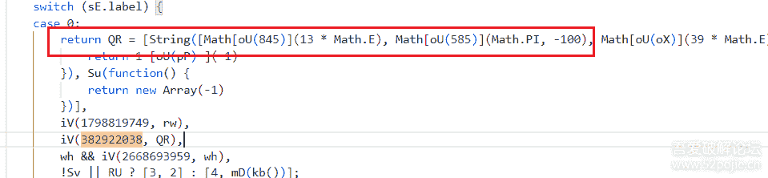
附件：[下载](https://www.52pojie.cn/forum.php?mod=attachment&aid=MjgxNjE5MHw5YWFjMmFkZnwxNzkzNTcwMzQxfDE2ODA4NnwyMDc0OTQy&nothumb=yes)

可以明显看出浏览器和 `node`，在进行 `Math` 计算的时候，会存在微小精度区别（上为浏览器，下为 `node`）：

```
[Math['cos'](13 * Math.E), Math['pow'](Math.PI, -100), Math['sin'](39 * Math.E), Math['tan'](6 * Math['LN2'])]
```

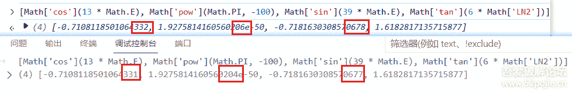
附件：[下载](https://www.52pojie.cn/forum.php?mod=attachment&aid=MjgxNjE5MXwyNTQyMjg2ZXwxNzkzNTcwMzQxfDE2ODA4NnwyMDc0OTQy&nothumb=yes)

### 2.2 `getImageData`

可以简单看看下图流程，简单来说就是：

绘制一个 `canvas` 标签 ---> 利用 `clearRect()` 清空画布 ---> 将画布的宽高设为 2 ---> 设置画布的填充颜色 ---> 对画布进行填充 ---> 利用 `getImageData()` 获取画布数据。

这里 `fillStyle` 的颜色实际是随机的，我这里为了看得清晰些先写死了。这里大家就可以比较清晰地看到，你在补环境的时候，通过 `getImageData()` 获取 `data` 值不能写死，而是要与 `fillStyle` 保持一致。

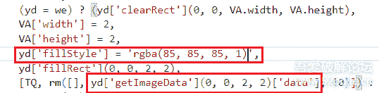
附件：[下载](https://www.52pojie.cn/forum.php?mod=attachment&aid=MjgxNjE5M3w1OWQ2YzZiMHwxNzkzNTcwMzQxfDE2ODA4NnwyMDc0OTQy&nothumb=yes)

类似我下面的写法即可进行动态解析，通过获取 `fillStyle` 的值，进行正则匹配获取 `rgb` 值，其中 255 我写死是因为我看 `a` 值貌似都是 1，这里实际也可以进行动态解析。

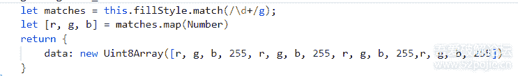
附件：[下载](https://www.52pojie.cn/forum.php?mod=attachment&aid=MjgxNjE5NHwzNTg3YmQyZHwxNzkzNTcwMzQxfDE2ODA4NnwyMDc0OTQy&nothumb=yes)

### 2.3 多种字体指纹

所谓字体指纹，实际就是通过设置字体样式，然后获取其宽度高度等数据。

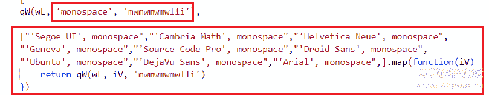
附件：[下载](https://www.52pojie.cn/forum.php?mod=attachment&aid=MjgxNjE5Nnw3ZTkxODc4MnwxNzkzNTcwMzQxfDE2ODA4NnwyMDc0OTQy&nothumb=yes)

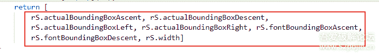
附件：[下载](https://www.52pojie.cn/forum.php?mod=attachment&aid=MjgxNjE5N3wwMDAzNjE0MnwxNzkzNTcwMzQxfDE2ODA4NnwyMDc0OTQy&nothumb=yes)

上图的逻辑实际就是创建一个画布，通过 `measureText()` 方法获取上图中的 7 个值。

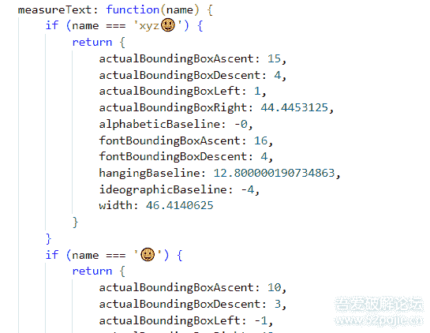
附件：[下载](https://www.52pojie.cn/forum.php?mod=attachment&aid=MjgxNjE5OHxjNzJkMWM5ZXwxNzkzNTcwMzQxfDE2ODA4NnwyMDc0OTQy&nothumb=yes)

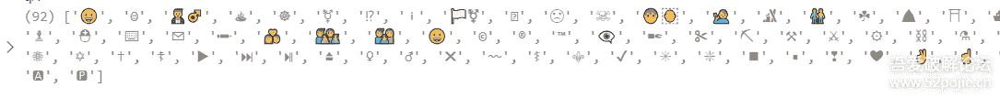
附件：[下载](https://www.52pojie.cn/forum.php?mod=attachment&aid=MjgxNjE5OXw5YTI3OTdhOHwxNzkzNTcwMzQxfDE2ODA4NnwyMDc0OTQy&nothumb=yes)

此外还利用 `measureText()` 方法，获取 92 个 emoji 图像的数据。

### 2.4 音频

这里就是通过 `OfflineAudioContext` 方法，获取音频数据，通过 `Math.abs()` 把这两个数组的值进行求和，所以这里可以尝试进行轻微扰动模拟不同设备。

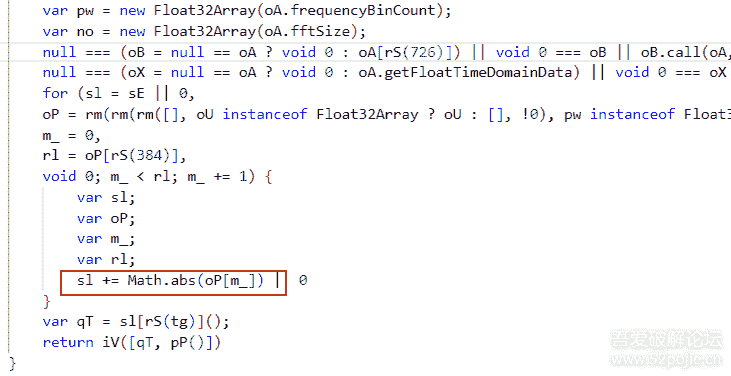
附件：[下载](https://www.52pojie.cn/forum.php?mod=attachment&aid=MjgxNjIwMHxlMDNkYjVhMHwxNzkzNTcwMzQxfDE2ODA4NnwyMDc0OTQy&nothumb=yes)

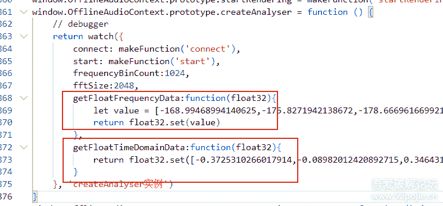
附件：[下载](https://www.52pojie.cn/forum.php?mod=attachment&aid=MjgxNjIwMXw1NTY5NjNhMXwxNzkzNTcwMzQxfDE2ODA4NnwyMDc0OTQy&nothumb=yes)

### 2.5 `toDataURL`

很常见的 `toDataURL`，一共会获取四次，可以先这样进行写死（不同 `hsw.js` 获取顺序好像不同）。

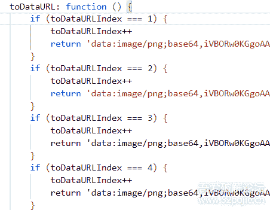
附件：[下载](https://www.52pojie.cn/forum.php?mod=attachment&aid=MjgxNjIwMnw5NDJkODI5NXwxNzkzNTcwMzQxfDE2ODA4NnwyMDc0OTQy&nothumb=yes)

### 2.6 `Worker` 以及 `SharedWorker`

指纹数组里有两个是 `Worker` 和 `SharedWorker` 获取的，这里也不用去新创建个 `vm`，因为不涉及到上下文的什么东西，所以只要能触发 `message` 事件，接收到消息就行。

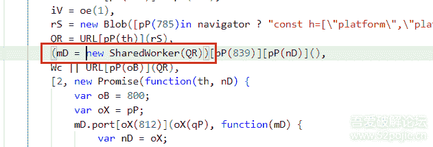
附件：[下载](https://www.52pojie.cn/forum.php?mod=attachment&aid=MjgxNjIwNXxhZTY5MjgwY3wxNzkzNTcwMzQxfDE2ODA4NnwyMDc0OTQy&nothumb=yes)

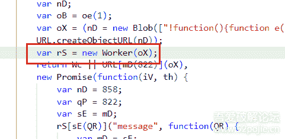
附件：[下载](https://www.52pojie.cn/forum.php?mod=attachment&aid=MjgxNjIwNnwwNThkYTY2OXwxNzkzNTcwMzQxfDE2ODA4NnwyMDc0OTQy&nothumb=yes)

只要能触发事件，怎么写都行，下图只是我写的一种方法，只要能接收到消息就行，随便怎么写。

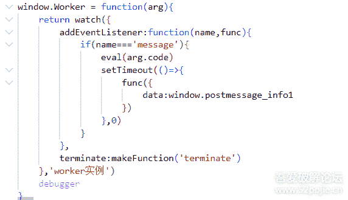
附件：[下载](https://www.52pojie.cn/forum.php?mod=attachment&aid=MjgxNjIwN3w4NzQ5MGVkMXwxNzkzNTcwMzQxfDE2ODA4NnwyMDc0OTQy&nothumb=yes)

### 2.7 描述符检测

会有一块地方，集中对 15 个方法获取描述符，这里必须和浏览器一样，需要有点耐心把这里和浏览器对齐。

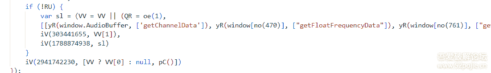
附件：[下载](https://www.52pojie.cn/forum.php?mod=attachment&aid=MjgxNjIwM3w1M2QxYTY0Y3wxNzkzNTcwMzQxfDE2ODA4NnwyMDc0OTQy&nothumb=yes)

得到的结果是类似下面这种，具体逻辑大家到时候自己去看下就行，就几十行。这里算是比较严格一点的地方，要是和浏览器不一致的话，很有可能你就会出图。

```
[274814465,275514479,274614461,3571143656,274714463,548828914,53814445,71715571391,548728912,275114471,1100657912,274514459,549128932,275514479,274614461]
```

实际上就是和浏览器指纹数组不断对比就行，没什么神秘的地方，坐得住就能补出来。

温馨提示：补得差不多就先去试试能不能过，稍微能过几次再继续补才有动力，不然坐着太无聊了，，，


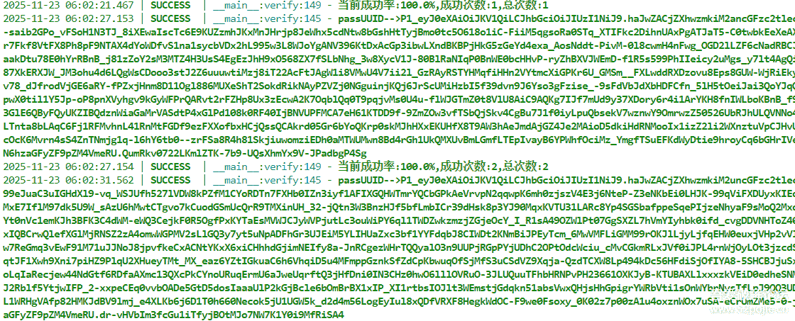


[href="forum.php?mod=attachment&aid=MjgxNjIwNHxhYmUzZDczYnwxNzkzNTcwMzQxfDE2ODA4NnwyMDc0OTQy&nothumb=yes" target="_blank"](https://www.52pojie.cn/forum.php?mod=attachment&aid=MjgxNjIwNHxhYmUzZDczYnwxNzkzNTcwMzQxfDE2ODA4NnwyMDc0OTQy&nothumb=yes)

2025-11-23 06:02 上传

希望有大佬补完直接把无敌并发扔我脸上


