# [Web逆向] 极验滑块第4代逆向分析

- 原帖: https://www.52pojie.cn/forum.php?mod=viewthread&tid=2076316
- 抓取时间: 2026-11-01T21:58:49

极验滑块第4代逆向分析网址：`aHR0cHM6Ly9ndDQuZ2VldGVzdC5jb20v` 好久没水文了，接着之前的极验滑块逆向 https://www.cnblogs.com/FlowerNotGiveYou/p/15800165.html，发现最新的滑块有所变化，新增了一些参数，因此重新瞧瞧新的代码，开启目前的最新滑块进行这一篇文章。

## 加密参数分析

首先请求分析，过滤掉图片请求后找到`load`（加载）和`verify`（验证）两个请求，从分析他们的入参和返回值，可发现验证接口只有一个`W`为加密参数，其他的值都能在`load`的入参或者返回值找到，因此只需要分析`W`值生成就好

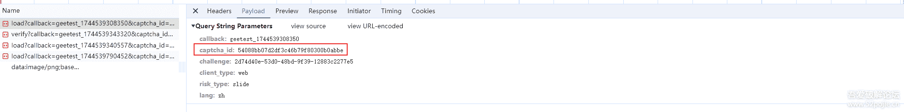
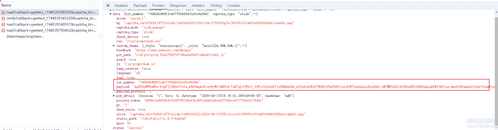
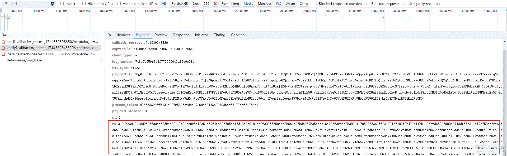

找加密点我是直接通过搜索`process_token`找到`W`的加密位置，你也能直接搜索`W:`来知道，这个和之前版本的一致

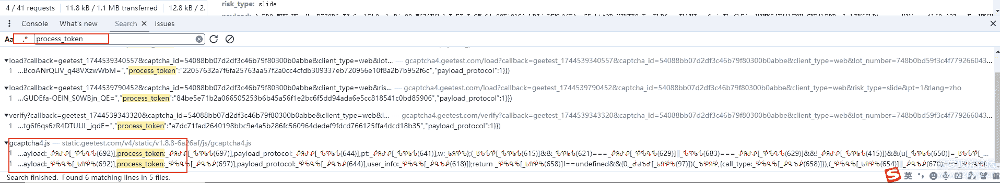

下断点

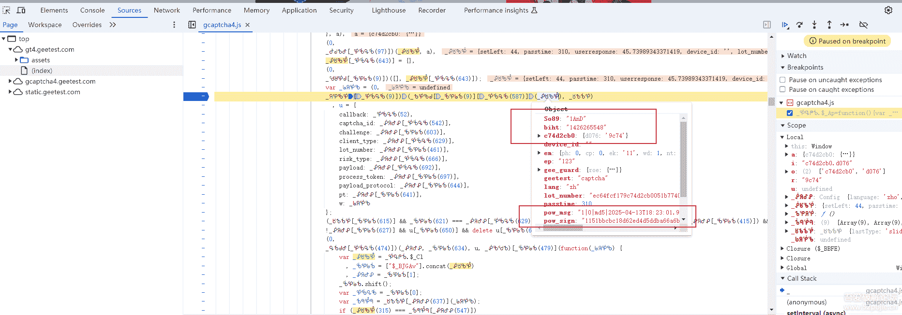

通过多次请求，可以知道计算`W`值的函数内变量有（或者说你需要计算的参数）：`pow_msg`、`pow_sign`、`c74d2cb0`: {`d076`: '9c74'} 计算得来、`passtime` 滑动时间、`setLeft` 滑动距离、`userresponse`、`So89`: "1AnD" 请求不同的js会变化，但是可固定

### 参数 `c74d2cb0`: {`d076`: '9c74'}

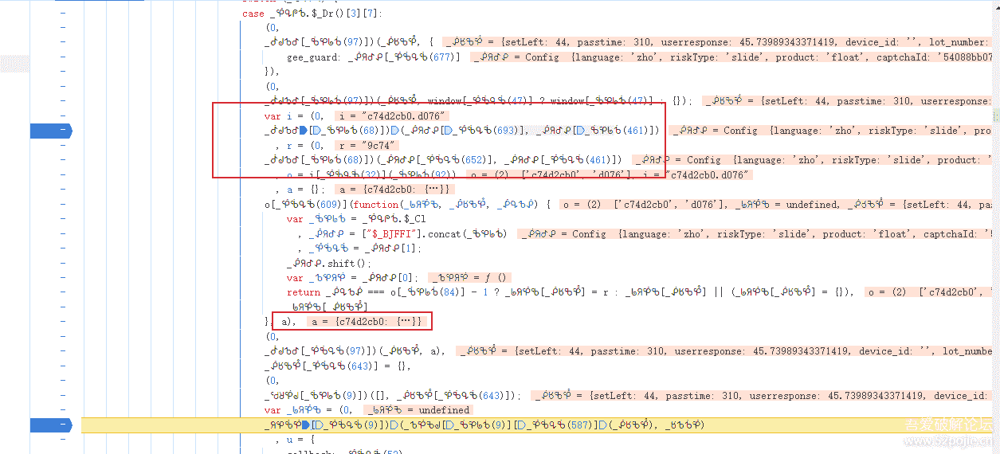

往上翻，发现此参数就是`a`，然后`a`根据`i`和`r`计算得出

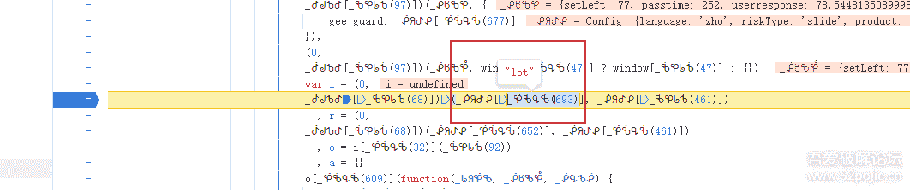
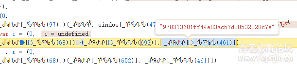
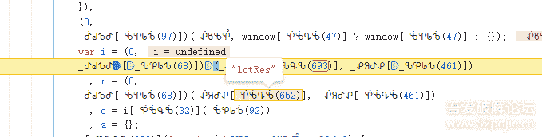

可以看到`i`和`r`计算和`lot`和`lotRes`值有关，直接搜索一下`693`和`652`，`lot`和`lotRes`生成的地方

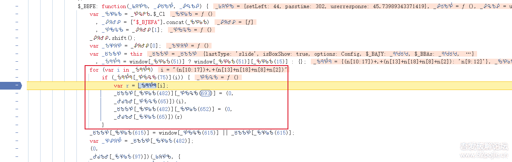

可以看到`lot`的实际赋值与一串字符串有关，刚开始我将这个固定死了（对结果无影响），后来发现直接在前面的一个自执行函数中有赋值，而未知参数`So89`的值也已经有了

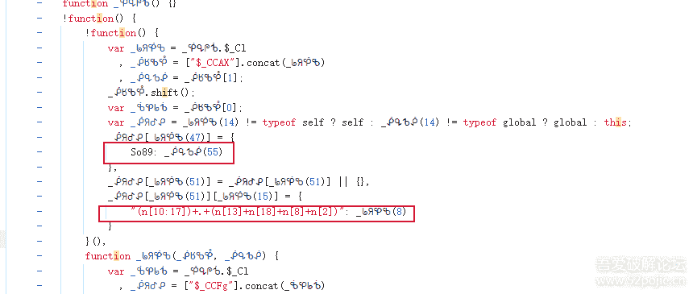

跳转到计算的函数，抠出来后缺啥补啥，大体可以得到这样的目录结构，执行完和目标一致

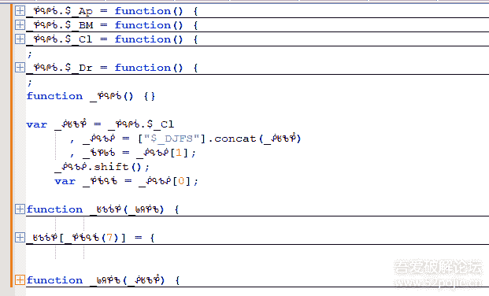
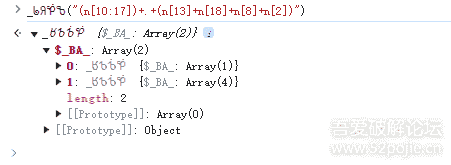

此时新增的键值对已经扣完。

### 参数 `pow_msg`、`pow_sign`

简单看下`pow_msg`组成

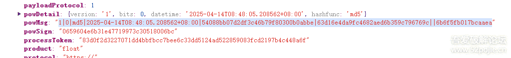

`1|0|md5|2025-04-14T08:48:05.208562+08:00|54088bb07d2df3c46b79f80300b0abbe|63d16e4da9fc4682aed6b359c796769c||6b6f5fb017bcaaea` 可知道这个组成为：时间戳（已知，`load`返回）+ `captcha_id`（已知） + `lot_number`（已知）+ `h` （未知）

直接全局搜`pow_msg`可以找到`pow_msg`生成的位置

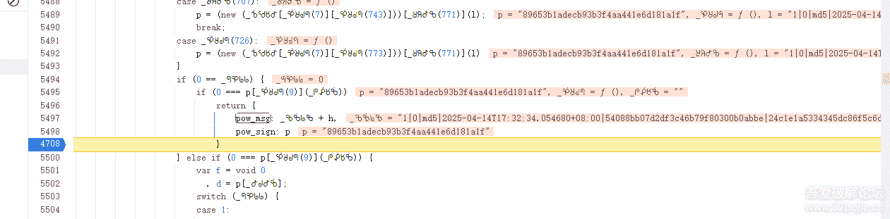

当然你也可以通过堆栈的方式寻找，但是有点麻烦

找到`h`的生成函数，发现和之前的版本一致，一个随机的16位数

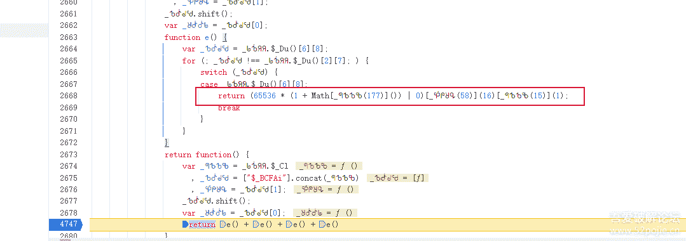

此时`pow_msg`的值已经知道，进一步查看`pow_sign`的生成发现`pow_sign`为`MD5`(`pow_msg`)

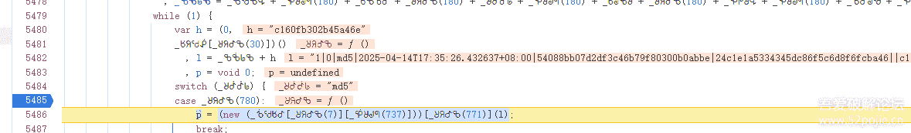

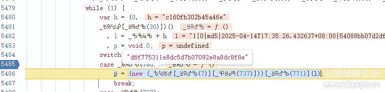
image-20250415080626219.png (19.81 KB, 下载次数: 0)
[href="forum.php?mod=attachment&aid=MjgxNzQ2M3w4ZWFjYTk4ZnwxNzkzNTcwMzI3fDE2ODA4NnwyMDc2MzE2&nothumb=yes" target="_blank"](https://www.52pojie.cn/forum.php?mod=attachment&aid=MjgxNzQ2M3w4ZWFjYTk4ZnwxNzkzNTcwMzI3fDE2ODA4NnwyMDc2MzE2&nothumb=yes)
219
2025-11-28 15:10 上传

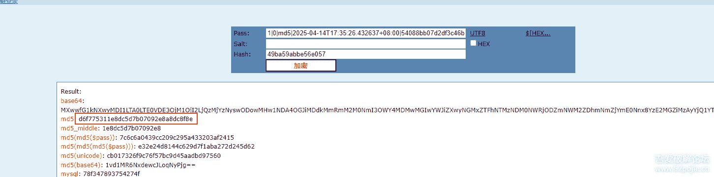
image-20250415080734590.png (41.18 KB, 下载次数: 0)
[href="forum.php?mod=attachment&aid=MjgxNzQ2Mnw5ZTNmOWYxZXwxNzkzNTcwMzI3fDE2ODA4NnwyMDc2MzE2&nothumb=yes" target="_blank"](https://www.52pojie.cn/forum.php?mod=attachment&aid=MjgxNzQ2Mnw5ZTNmOWYxZXwxNzkzNTcwMzI3fDE2ODA4NnwyMDc2MzE2&nothumb=yes)
590
2025-11-28 15:10 上传

对比后发现此`md5`加密未修改有关滑块的距离和时间这些就不分析了，此版本没有对轨迹进行加密，只需要判断滑动距离和时间就 ok

## 3、参数`W`的生成

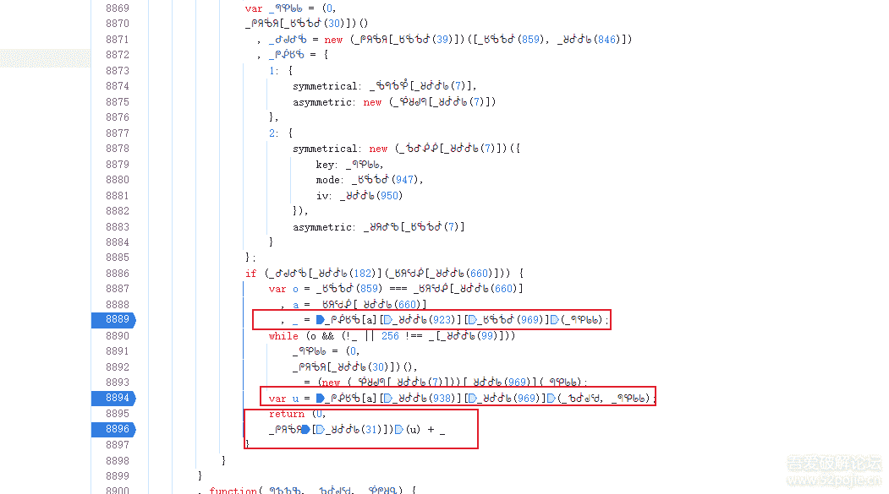
image-20250415081634269.png (42.26 KB, 下载次数: 0)
[href="forum.php?mod=attachment&aid=MjgxNzQ2MXxhNzJmMGNmZXwxNzkzNTcwMzI3fDE2ODA4NnwyMDc2MzE2&nothumb=yes" target="_blank"](https://www.52pojie.cn/forum.php?mod=attachment&aid=MjgxNzQ2MXxhNzJmMGNmZXwxNzkzNTcwMzI3fDE2ODA4NnwyMDc2MzE2&nothumb=yes)
269
2025-11-28 15:10 上传

断点后进入函数，发现又回到了熟悉的两段拼接，进一步分析两段

### 3-1 `_` 值的生成简要分析

`_&#5527;&#5503;&#5530;&#5530;` 传入值为随机16位字符，实际就是 `new (&#5504;&#5512;&#5529;&#5527;[&#5512;&#5496;&#5496;&#5530;(7)])`函数加密16位字符

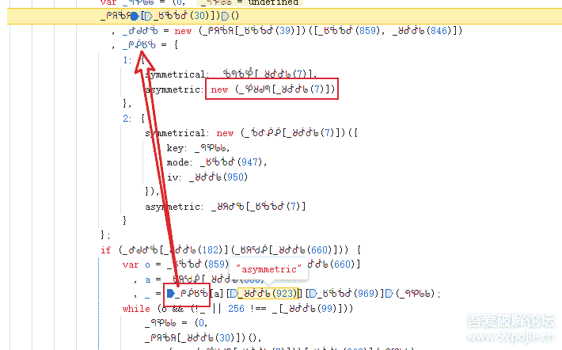
image-20250415084022874.png (36.62 KB, 下载次数: 0)
[href="forum.php?mod=attachment&aid=MjgxNzQ2MHw2OThlMjZlY3wxNzkzNTcwMzI3fDE2ODA4NnwyMDc2MzE2&nothumb=yes" target="_blank"](https://www.52pojie.cn/forum.php?mod=attachment&aid=MjgxNzQ2MHw2OThlMjZlY3wxNzkzNTcwMzI3fDE2ODA4NnwyMDc2MzE2&nothumb=yes)
874
2025-11-28 15:10 上传

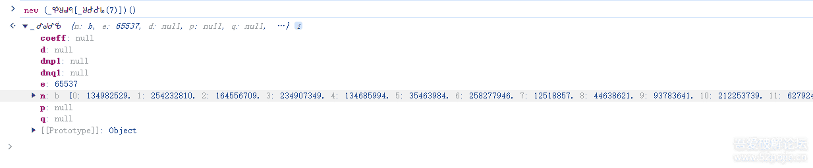
image-20250415090049228.png (15.72 KB, 下载次数: 0)
[href="forum.php?mod=attachment&aid=MjgxNzQ1N3w1ZjRiNzlhNnwxNzkzNTcwMzI3fDE2ODA4NnwyMDc2MzE2&nothumb=yes" target="_blank"](https://www.52pojie.cn/forum.php?mod=attachment&aid=MjgxNzQ1N3w1ZjRiNzlhNnwxNzkzNTcwMzI3fDE2ODA4NnwyMDc2MzE2&nothumb=yes)
228
2025-11-28 15:10 上传

后续就是扣代码了，还是通过全局的思想，将此函数通过`window`全局，方便后面调用大体是这样

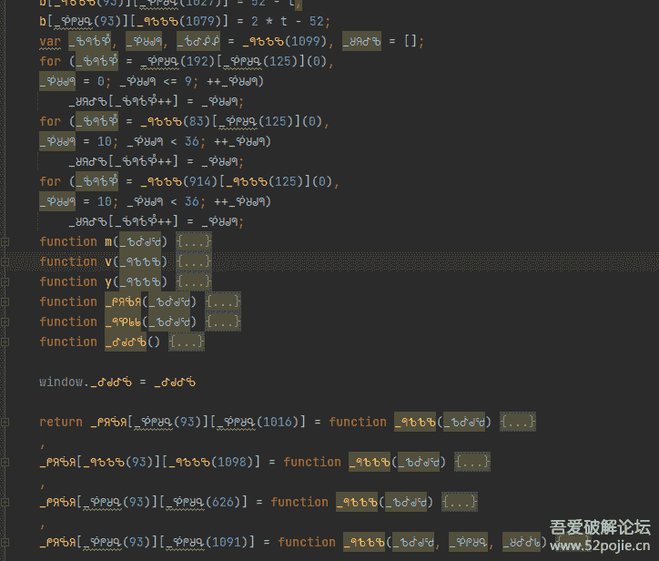
image-20250415085624614.png (83.84 KB, 下载次数: 0)
[href="forum.php?mod=attachment&aid=MjgxNzQ1OHw5OTUzZTVkMnwxNzkzNTcwMzI3fDE2ODA4NnwyMDc2MzE2&nothumb=yes" target="_blank"](https://www.52pojie.cn/forum.php?mod=attachment&aid=MjgxNzQ1OHw5OTUzZTVkMnwxNzkzNTcwMzI3fDE2ODA4NnwyMDc2MzE2&nothumb=yes)
614
2025-11-28 15:10 上传

调用流程需要与chrome步骤保持一致，不然会导致`this`的指向问题

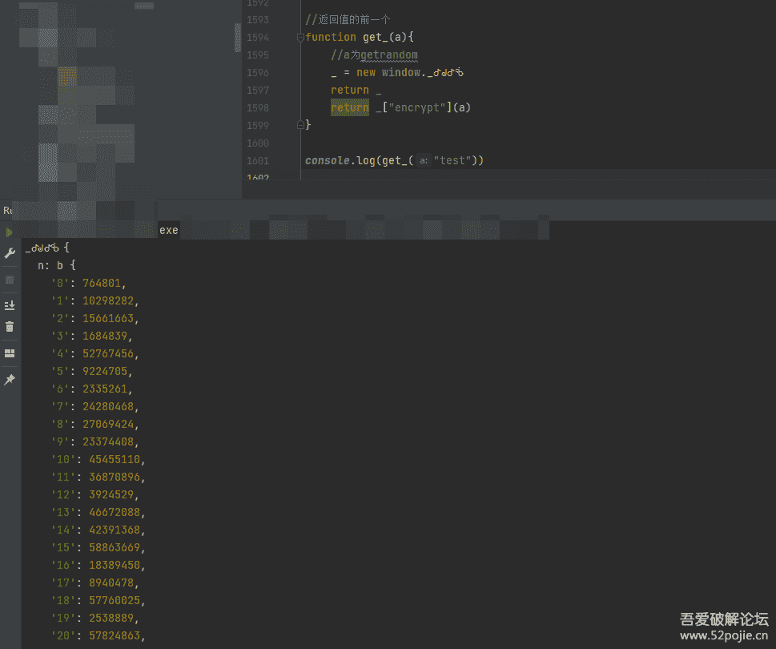
image-20250415090431097.png (68.52 KB, 下载次数: 0)
[href="forum.php?mod=attachment&aid=MjgxNzQ1Nnw1ZTk4MGMyZHwxNzkzNTcwMzI3fDE2ODA4NnwyMDc2MzE2&nothumb=yes" target="_blank"](https://www.52pojie.cn/forum.php?mod=attachment&aid=MjgxNzQ1Nnw1ZTk4MGMyZHwxNzkzNTcwMzI3fDE2ODA4NnwyMDc2MzE2&nothumb=yes)
097
2025-11-28 15:10 上传

调用后能正确返回值，验证`_`的生成

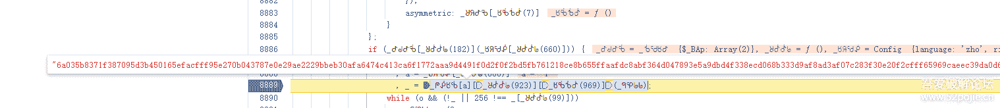
image-20250415090631958.png (24.84 KB, 下载次数: 0)
[href="forum.php?mod=attachment&aid=MjgxNzQ1NXw1YjViZTFjNXwxNzkzNTcwMzI3fDE2ODA4NnwyMDc2MzE2&nothumb=yes" target="_blank"](https://www.52pojie.cn/forum.php?mod=attachment&aid=MjgxNzQ1NXw1YjViZTFjNXwxNzkzNTcwMzI3fDE2ODA4NnwyMDc2MzE2&nothumb=yes)
958
2025-11-28 15:10 上传

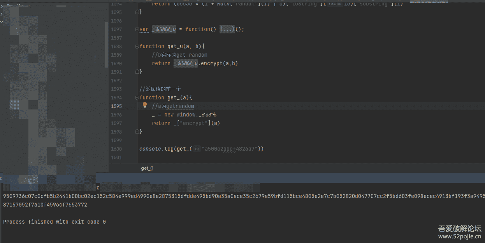
image-20250415090726838.png (69.74 KB, 下载次数: 0)
[href="forum.php?mod=attachment&aid=MjgxNzQ1NHw5MzUwNGJiM3wxNzkzNTcwMzI3fDE2ODA4NnwyMDc2MzE2&nothumb=yes" target="_blank"](https://www.52pojie.cn/forum.php?mod=attachment&aid=MjgxNzQ1NHw5MzUwNGJiM3wxNzkzNTcwMzI3fDE2ODA4NnwyMDc2MzE2&nothumb=yes)
838
2025-11-28 15:10 上传

### 3-2 `u` 值的生成

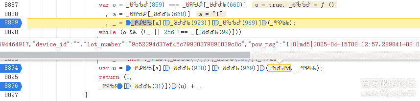
image-20250415091006710.png (23.5 KB, 下载次数: 0)
[href="forum.php?mod=attachment&aid=MjgxNzQ1M3w0NTc3NWIyOXwxNzkzNTcwMzI3fDE2ODA4NnwyMDc2MzE2&nothumb=yes" target="_blank"](https://www.52pojie.cn/forum.php?mod=attachment&aid=MjgxNzQ1M3w0NTc3NWIyOXwxNzkzNTcwMzI3fDE2ODA4NnwyMDc2MzE2&nothumb=yes)
710
2025-11-28 15:10 上传

分析得知，`u`值的加密是函数跟`_`的加密函数大体一致，不同的是`u`的生成取的是`symmetrical`函数依然是全局抠出来

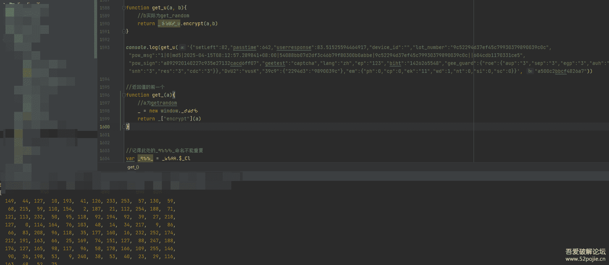
image-20250415093327130.png (101.28 KB, 下载次数: 0)
[href="forum.php?mod=attachment&aid=MjgxNzQ1MnxmMDFkN2YxY3wxNzkzNTcwMzI3fDE2ODA4NnwyMDc2MzE2&nothumb=yes" target="_blank"](https://www.52pojie.cn/forum.php?mod=attachment&aid=MjgxNzQ1MnxmMDFkN2YxY3wxNzkzNTcwMzI3fDE2ODA4NnwyMDc2MzE2&nothumb=yes)
130
2025-11-28 15:10 上传

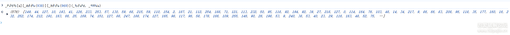
image-20250415093335363.png (14.86 KB, 下载次数: 0)
[href="forum.php?mod=attachment&aid=MjgxNzQ1MXwxN2Y5ZGM3NHwxNzkzNTcwMzI3fDE2ODA4NnwyMDc2MzE2&nothumb=yes" target="_blank"](https://www.52pojie.cn/forum.php?mod=attachment&aid=MjgxNzQ1MXwxN2Y5ZGM3NHwxNzkzNTcwMzI3fDE2ODA4NnwyMDc2MzE2&nothumb=yes)
363
2025-11-28 15:10 上传

可以看到是一致的，最后的一步`arrayToHex`就不扣了。其中需要注意的点，随机的16位字符串保持一致。

## 4、验证结果

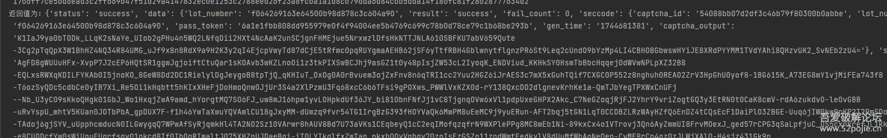
image-20250415094351588.png (131.85 KB, 下载次数: 0)
[href="forum.php?mod=attachment&aid=MjgxNzQ1MHxkZmE4YjBkM3wxNzkzNTcwMzI3fDE2ODA4NnwyMDc2MzE2&nothumb=yes" target="_blank"](https://www.52pojie.cn/forum.php?mod=attachment&aid=MjgxNzQ1MHxkZmE4YjBkM3wxNzkzNTcwMzI3fDE2ODA4NnwyMDc2MzE2&nothumb=yes)
588
2025-11-28 15:10 上传
