# [原创] 实战 某带vmprotect的数字数据恢复软件破解

- 原帖: https://www.52pojie.cn/forum.php?mod=viewthread&tid=2077870
- 抓取时间: 2026-11-01T21:58:41

网站 aHR0cDovL3d3dy43MjBwYy5jb20vaG9tZS9ob21lL2luZGV4LnBocA==

这个软件是用来恢复被勒索病毒绑架的数据的

本教程仅为学习，不提供成品和kygen，不得用于商业行为，不得用于牟利

下载后到安装目录，本体查下壳

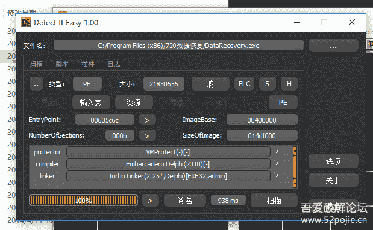

虽然是vmp，但是好像完全没有影响我接下来的调试

先启动软件（我的调试环境 `OllyDbg`+`windows 10`）

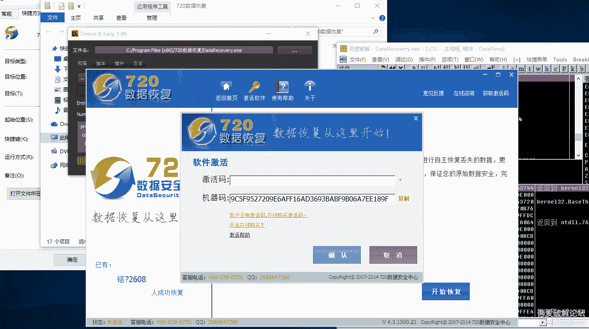

我们随便输入一个激活码，在`MessageBox`下断点，点击激活

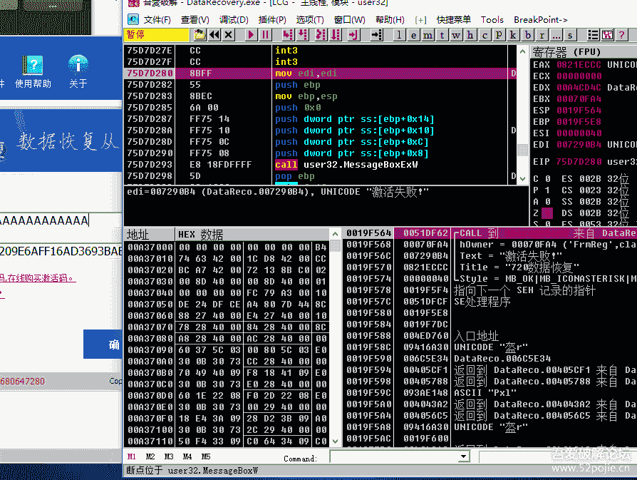

可以看到此时断下了，我们去看下堆栈信息

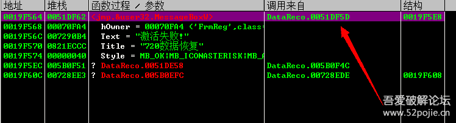

去上一层调用`MessageBox`的地方看下

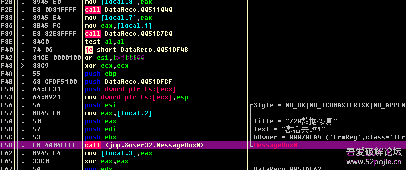

看了一下这个函数，这一层还不没有验证功能，继续向上追，我们按`ctrl+f9`快速回溯这个`call MessageBox`的函数

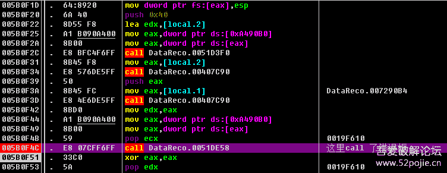

分析一下这一层的函数，看下有没有什么验证逻辑

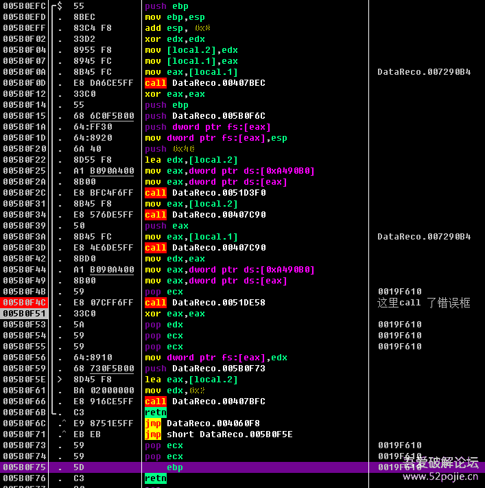

很短的函数，全是线性的，所以这一层也没有验证，继续返回上一层

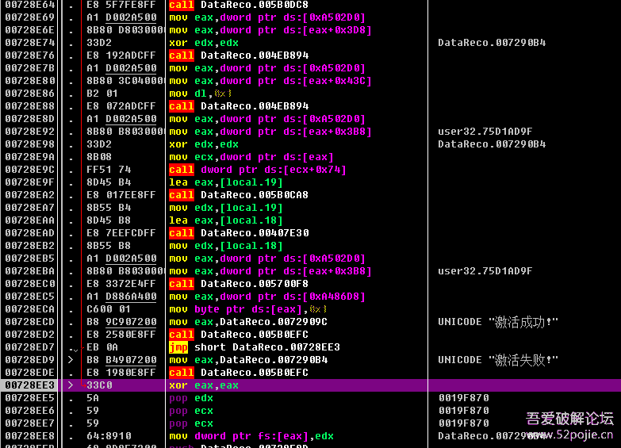

这里就柳暗花明了，可以看到明文提示（目前不排除作者故意给的迷惑消息），继续向上看一下哪里可能是`key jmp`

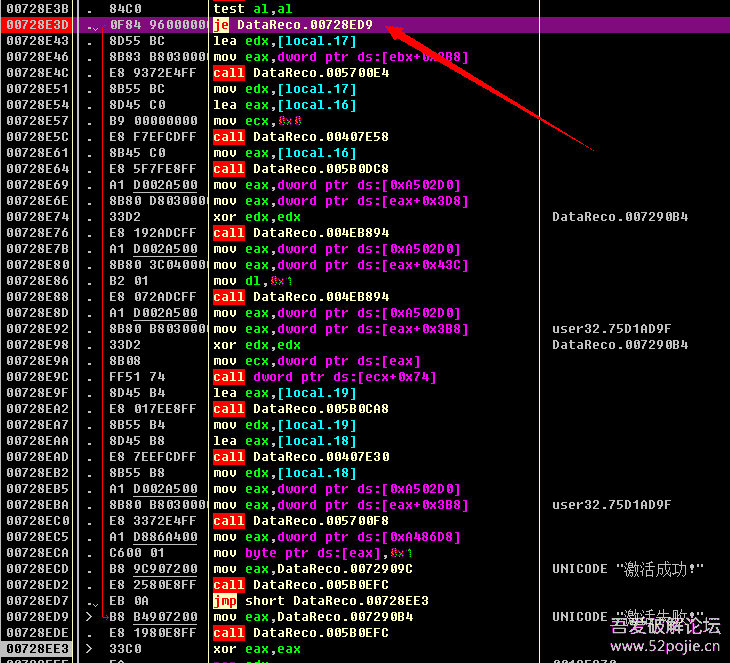

不远处便是一个，我们把它`nop`掉

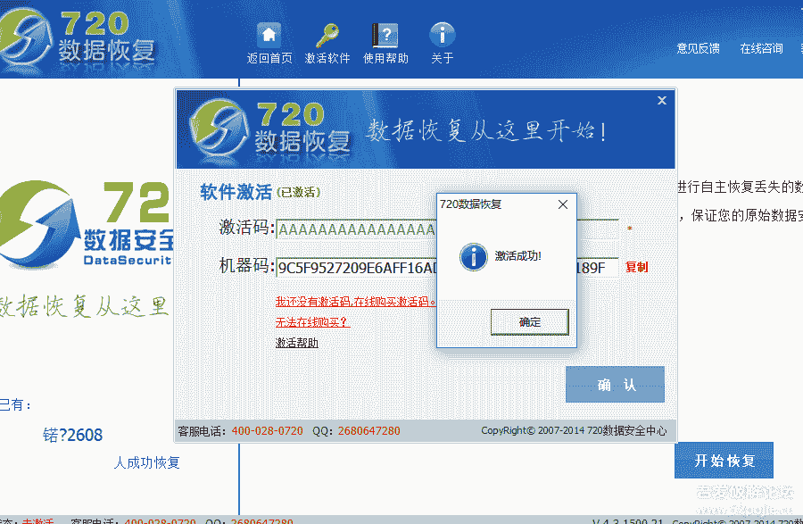

提示success了，去看下能不能使用

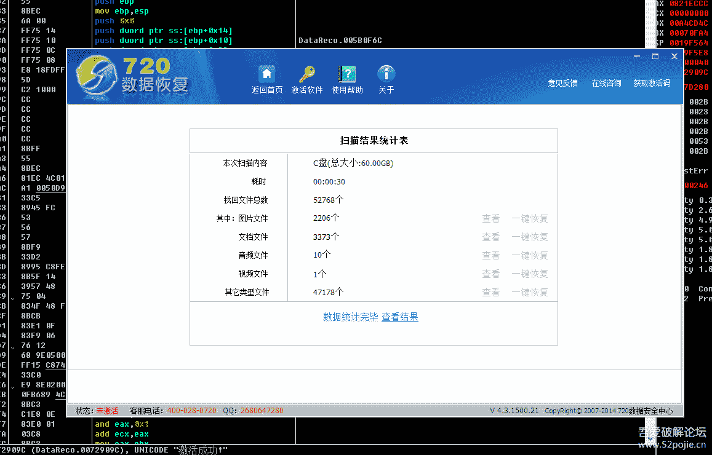

没问题了

那个`key jmp`上面的`call`可能是验证函数，试着把他`ret 1`试试

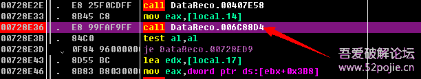

这次应该是永久注册了

只改`je`的话，每次点激活都是一个新的激活节目，改了那个函数，这次激活变成已激活，输入框也灰色了

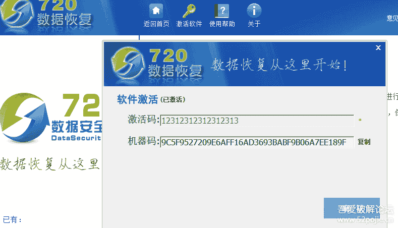

所以那个`call`应该就是验证`call`了，等有空在逆向一下验证算法吧
