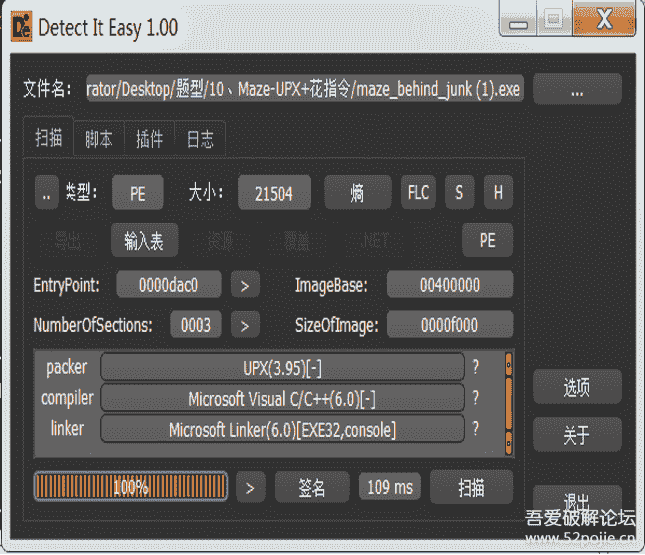
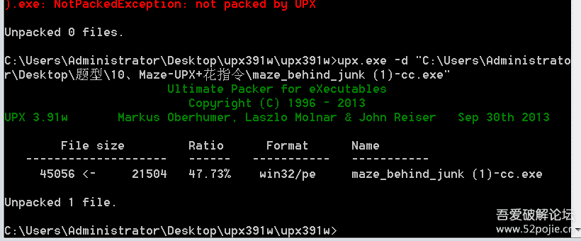
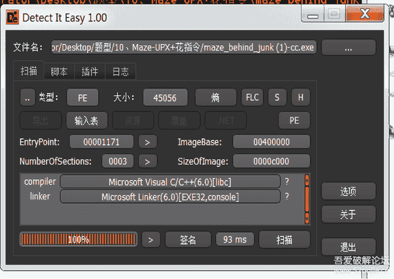
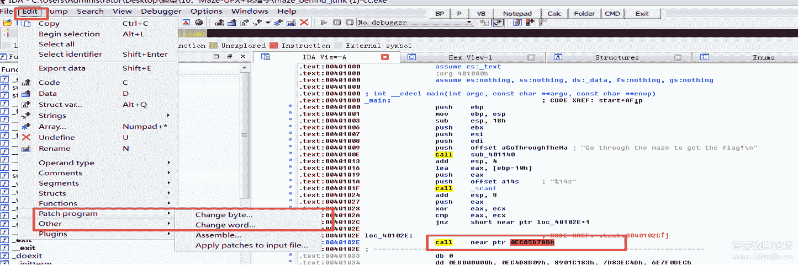
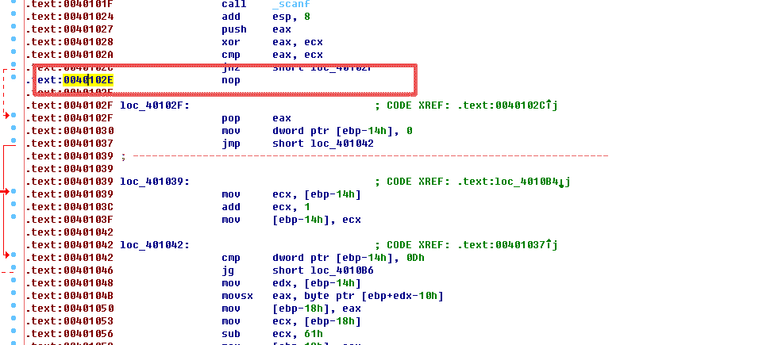
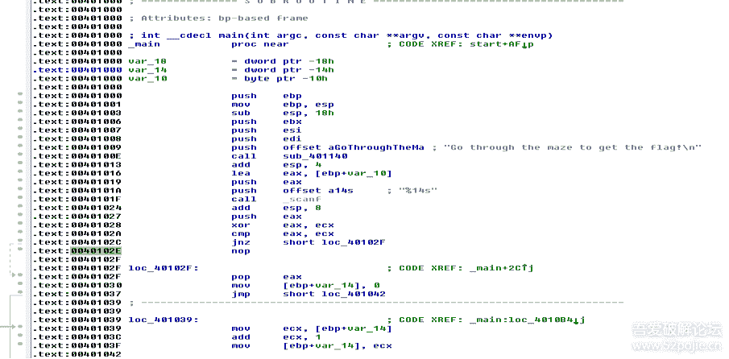
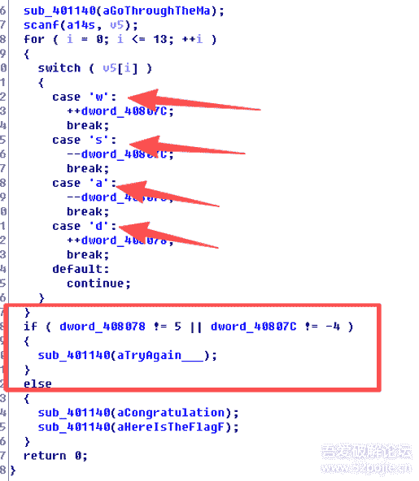
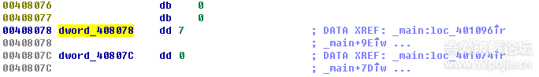
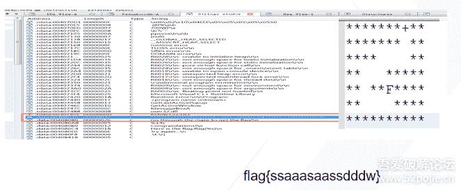

# [CTF] maze

- 原帖: https://www.52pojie.cn/forum.php?mod=viewthread&tid=2078668
- 抓取时间: 2026-11-01T21:58:34

新手一枚，简单做一个 buuctf 的 reverse 【maze】；

考点：壳 + 花指令 + 代码分析。

## 第一步：基本信息解析

**1）`upx` 壳程序；**

`de.png` (161.71 KB, 下载次数: 0) [下载附件](https://www.52pojie.cn/forum.php?mod=attachment&aid=MjgxOTUyMnxlYmQ5MDljYXwxNzkzNTcwMzEyfDE2ODA4NnwyMDc4NjY4&nothumb=yes) 2025-12-9 10:48 上传

**2）通过工具** [https://www.52pojie.cn/forum-5-1.html](https://www.52pojie.cn/forum-5-1.html)；

`upx脱壳.png` (18.13 KB, 下载次数: 1) [下载附件](https://www.52pojie.cn/forum.php?mod=attachment&aid=MjgxOTUyNXw2Y2UxNjJkMnwxNzkzNTcwMzEyfDE2ODA4NnwyMDc4NjY4&nothumb=yes) 2025-12-9 10:49 上传

`脱壳查看.png` (184.29 KB, 下载次数: 0) [下载附件](https://www.52pojie.cn/forum.php?mod=attachment&aid=MjgxOTUzMHw4MmViNjc2OXwxNzkzNTcwMzEyfDE2ODA4NnwyMDc4NjY4&nothumb=yes) 2025-12-9 10:50 上传

## 第二步：ida 分析

**1）ida 加载，发现花指令 `e8 call`；**

`ida加载.png` (175.61 KB, 下载次数: 0) [下载附件](https://www.52pojie.cn/forum.php?mod=attachment&aid=MjgxOTUyNHw3YTcwOWEyNnwxNzkzNTcwMzEyfDE2ODA4NnwyMDc4NjY4&nothumb=yes) 2025-12-9 10:49 上传

花指令常见特征就是 `jnz`，`jn` 之后的 `call` 出现非法指令或者地址；去花之令的方法是选中 `call`，然后点 `edit`，然后点 `patch program`，把 `call` 标识前缀的 `E8` 改成 `90`（`nop` 标识前缀）就欧克了。

**2）函数重建**

`nop` 后可以发现部分地址为红色。选中红色区域，按 `p` 构建 `main` 函数，`f5` 反汇编后即可得到主函数。

`按p构建main函数.png` (23.19 KB, 下载次数: 0) [下载附件](https://www.52pojie.cn/forum.php?mod=attachment&aid=MjgxOTUyNnxhNjAyZjk3Y3wxNzkzNTcwMzEyfDE2ODA4NnwyMDc4NjY4&nothumb=yes) 2025-12-9 10:50 上传

**3）分析伪代码**

`f5` 分析伪代码

`f5分析.png` (70.15 KB, 下载次数: 0) [下载附件](https://www.52pojie.cn/forum.php?mod=attachment&aid=MjgxOTUyM3w4OWVkMWFmYnwxNzkzNTcwMzEyfDE2ODA4NnwyMDc4NjY4&nothumb=yes) 2025-12-9 10:49 上传

`代码逻辑.png` (77.29 KB, 下载次数: 0) [下载附件](https://www.52pojie.cn/forum.php?mod=attachment&aid=MjgxOTUyN3w5NTU2YjU5Y3wxNzkzNTcwMzEyfDE2ODA4NnwyMDc4NjY4&nothumb=yes) 2025-12-9 10:50 上传

**4）出现 `aswd` 疑似移动，可能是个迷宫提，进一步验证；发现初始位置（0，7），最终位置（5，-4）**

关联迷宫图中可以看出 “+” 为入口，“F” 为出口开始走迷宫；最终获取 falg

`位置.png` (9.68 KB, 下载次数: 0) [下载附件](https://www.52pojie.cn/forum.php?mod=attachment&aid=MjgxOTUzMnw0Njk5ZTc2NHwxNzkzNTcwMzEyfDE2ODA4NnwyMDc4NjY4&nothumb=yes) 2025-12-9 10:56 上传

`获取flag.png` (147.02 KB, 下载次数: 1) [下载附件](https://www.52pojie.cn/forum.php?mod=attachment&aid=MjgxOTUyOXw4NmZiZWI3ZXwxNzkzNTcwMzEyfDE2ODA4NnwyMDc4NjY4&nothumb=yes) 2025-12-9 10:50 上传

## 样本

样本：[样本](https://www.52pojie.cn/forum.php?mod=attachment&aid=MjgxOTUzM3w1ZjRjY2VlYXwxNzkzNTcwMzEyfDE2ODA4NnwyMDc4NjY4)

(19.35 KB, 下载次数: 0)

2025-12-9 10:57 上传

点击文件名下载附件

样本

下载积分: 吾爱币 -1 CB
