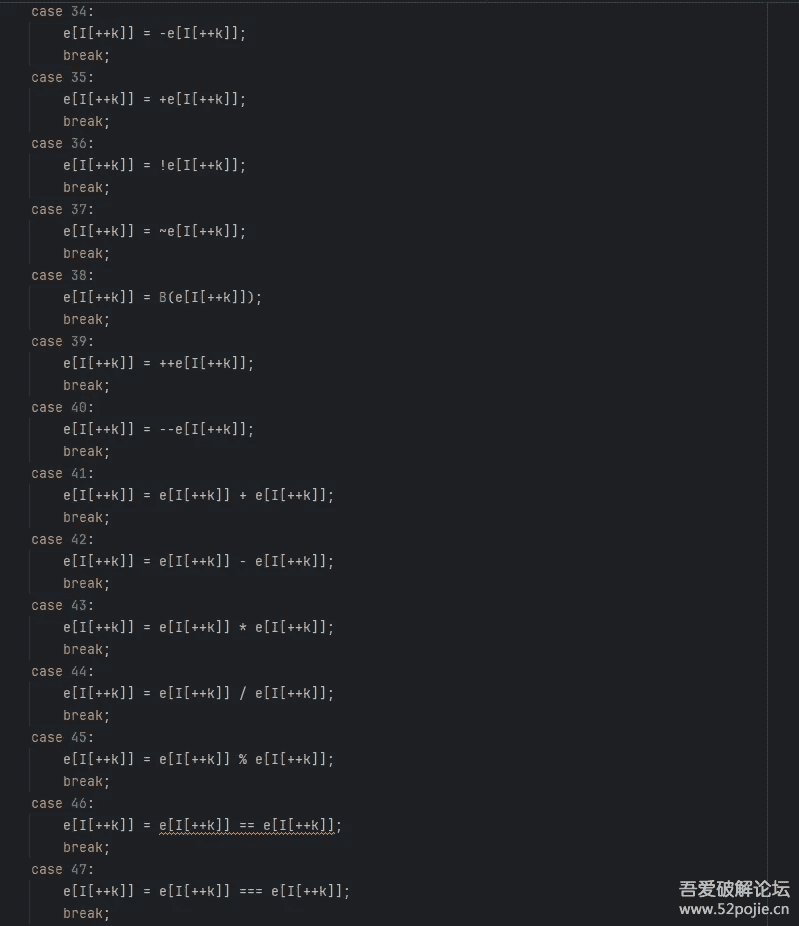
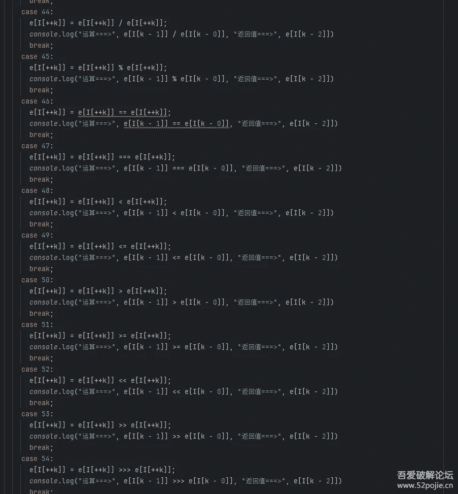
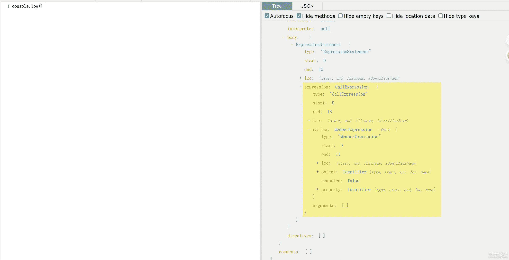
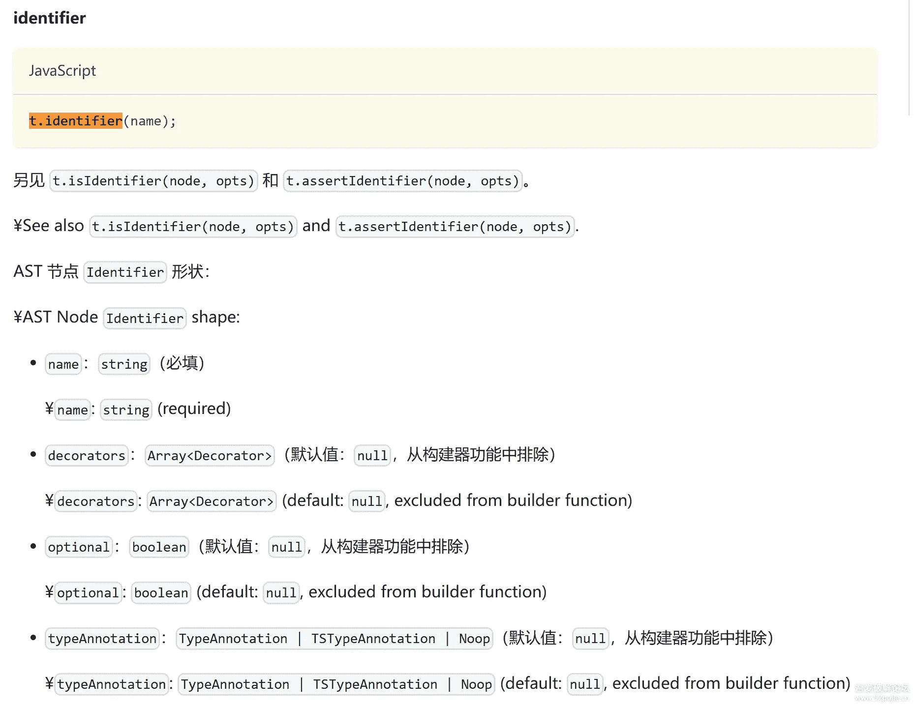
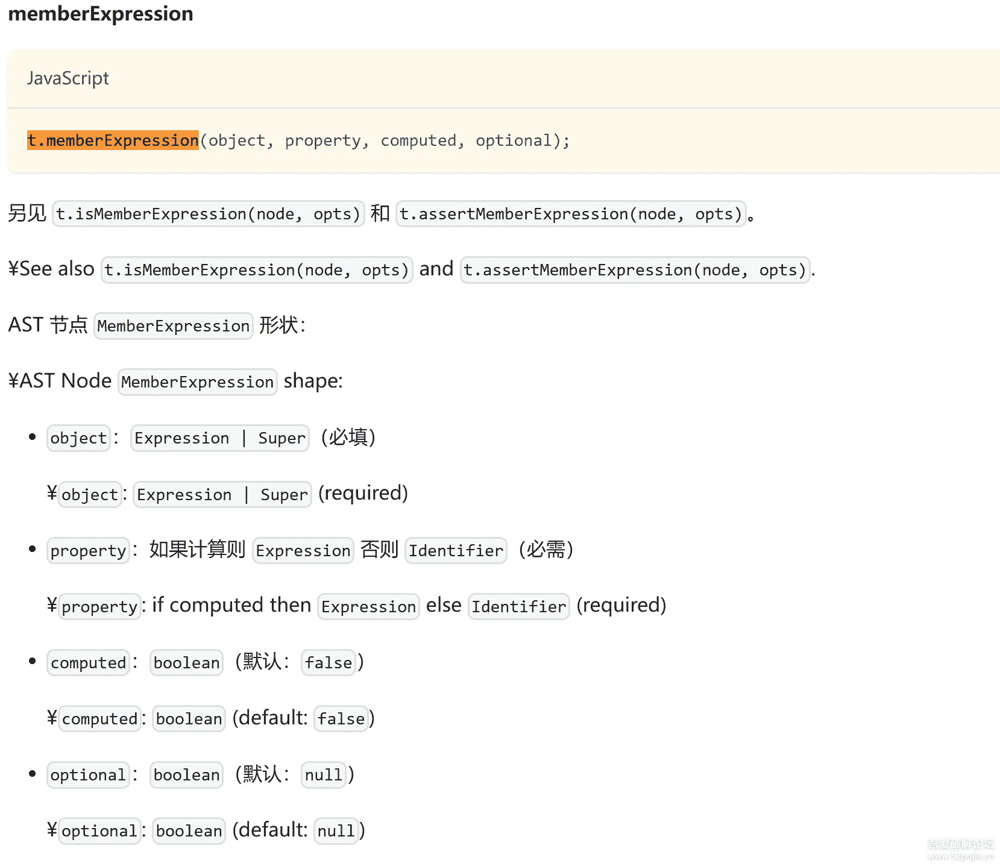
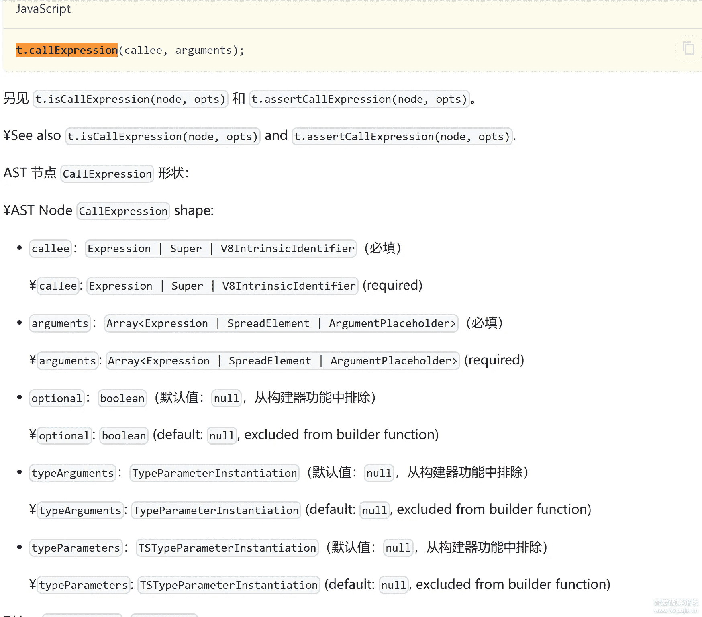
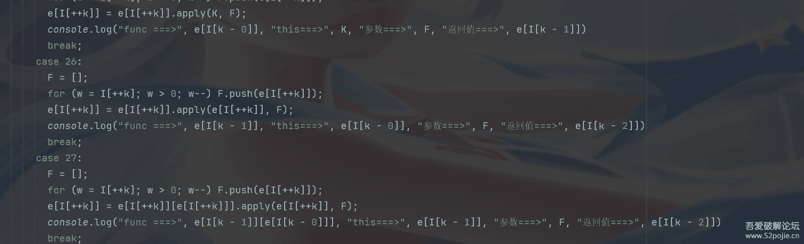
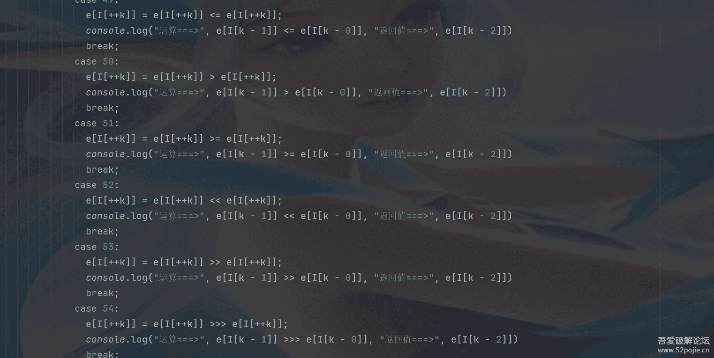

# [Web逆向] AST自动插桩jsvmp的简单实现

- 原帖: `https://www.52pojie.cn/forum.php?mod=viewthread&tid=2079058`
- 抓取时间: 2026-11-01T21:58:32

本文章中所有内容仅供学习交流使用，不用于其他任何目的，不提供完整代码，抓包内容、敏感网址、数据接口等均已做脱敏处理，严禁用于商业用途和非法用途，否则由此产生的一切后果均与作者无关.本文章未经许可禁止转载，禁止任何修改后二次传播，擅自使用本文讲解的技术而导致的任何意外，作者均不负责

项目地址：`https://github.com/buluo533/vmp_demo`

工作上有对vmp的需求，动态vmp手动插桩效率太低，听说大佬有ast的一键插桩，自己找了一个demo捣鼓了一下，没想到成了。

## 一、环境配置

```
npm install @babel/parser
npm install @babel/traverse
npm install @babel/generator
npm install @babel/types
```

```
let parse = require("@babel/parser").parse;let traverse = require("@babel/traverse").default;

let generator = require("@babel/generator").default;

let fs = require("fs");

let type = require("@babel/types");

let js_code = fs.readFileSync("vmpdemo2.js", encoding = "utf-8");

let ast = parse(js_code)

// 核心代码逻辑

let code = generator(ast).code

fs.writeFileSync("./vmp_demo2插桩后.js", code, "utf-8");
```

## 二、样本vmp代码逻辑

需要对vmp有基本的了解，vmp的插桩点主要是在各种运算符和通过`call`和`apply`进行的函数调用，某皮的vmp同时带有控制流的混淆处理，需要先解混淆再进行插桩。以简单结构的vmp作为测试案例，分析vmp动态插桩的实现方案。

### 1、前置处理



image.png (166.78 KB, 下载次数: 1)

[href="forum.php?mod=attachment&aid=MjgxOTg0MXxlMWU2N2NkZHwxNzkzNTcwMzEwfDE2ODA4NnwyMDc5MDU4&nothumb=yes" target="_blank"](https://www.52pojie.cn/forum.php?mod=attachment&aid=MjgxOTg0MXxlMWU2N2NkZHwxNzkzNTcwMzEwfDE2ODA4NnwyMDc5MDU4&nothumb=yes)

vmp1

2025-12-10 20:55 上传

jsvmp通过拆分运算，通过伪字节码的形式实现运算，在加解密的过程中，异或加减运算都是算法的核心实现。所以我们需要对运算符进行插桩（有时间搓一个vmp案例），插桩效果如下：



image.png (402.55 KB, 下载次数: 1)

[href="forum.php?mod=attachment&aid=MjgxOTg0MnxjYmY0MzQ0YXwxNzkzNTcwMzEwfDE2ODA4NnwyMDc5MDU4&nothumb=yes" target="_blank"](https://www.52pojie.cn/forum.php?mod=attachment&aid=MjgxOTg0MnxjYmY0MzQ0YXwxNzkzNTcwMzEwfDE2ODA4NnwyMDc5MDU4&nothumb=yes)

vmp2

2025-12-10 20:56 上传

建议不了解vmp的大佬可以看看app的vmp项目或者windows的，效果更佳直观。

首先是对计算形式的改变，`k`值在实现上动态的，需要根据计算的情况，推算`k`值的真实值，从左到右递减。其次是构造`console.log`节点插桩分析。

#### （1）`console.log`节点构造



image.png (479.21 KB, 下载次数: 1)

[href="forum.php?mod=attachment&aid=MjgxOTg0M3xlMTJjNTAwN3wxNzkzNTcwMzEwfDE2ODA4NnwyMDc5MDU4&nothumb=yes" target="_blank"](https://www.52pojie.cn/forum.php?mod=attachment&aid=MjgxOTg0M3xlMTJjNTAwN3wxNzkzNTcwMzEwfDE2ODA4NnwyMDc5MDU4&nothumb=yes)

vmp3

2025-12-10 20:58 上传

根据ast的解析，`console.log`本质上是两个`Identifier`节点组成的`MemberExpression`再进行调用，形成了`CallExpression`，参数部分是`CallExpression`的`arguments`数组填充。根据bebal官方文档直接进行节点构造。



image.png (697.53 KB, 下载次数: 1)

[href="forum.php?mod=attachment&aid=MjgxOTg0NHw4NTM2YTQ5NXwxNzkzNTcwMzEwfDE2ODA4NnwyMDc5MDU4&nothumb=yes" target="_blank"](https://www.52pojie.cn/forum.php?mod=attachment&aid=MjgxOTg0NHw4NTM2YTQ5NXwxNzkzNTcwMzEwfDE2ODA4NnwyMDc5MDU4&nothumb=yes)

vmp4

2025-12-10 21:00 上传



image.png (614.51 KB, 下载次数: 1)

[href="forum.php?mod=attachment&aid=MjgxOTg0NXw0Y2MyMDJiM3wxNzkzNTcwMzEwfDE2ODA4NnwyMDc5MDU4&nothumb=yes" target="_blank"](https://www.52pojie.cn/forum.php?mod=attachment&aid=MjgxOTg0NXw0Y2MyMDJiM3wxNzkzNTcwMzEwfDE2ODA4NnwyMDc5MDU4&nothumb=yes)

vmp5

2025-12-10 21:01 上传



image.png (934.24 KB, 下载次数: 1)

[href="forum.php?mod=attachment&aid=MjgxOTg0NnxmYjJlYmY2Y3wxNzkzNTcwMzEwfDE2ODA4NnwyMDc5MDU4&nothumb=yes" target="_blank"](https://www.52pojie.cn/forum.php?mod=attachment&aid=MjgxOTg0NnxmYjJlYmY2Y3wxNzkzNTcwMzEwfDE2ODA4NnwyMDc5MDU4&nothumb=yes)

vmp6

2025-12-10 21:01 上传

代码实现：

```
function insert_log(log_arguments) {
  if (!log_arguments instanceof Array) {
    Error("入参应该是数组类型")
  }
  let object_name = "console"
  let property_name = "log"
  let property_create = type.identifier(property_name)
  let object_create = type.identifier(object_name)
  // MemberExpression构建
  let MemberExpression_create = type.memberExpression(object_create, property_create)
  // callExpression
  let callExpression_create = type.callExpression(MemberExpression_create, log_arguments)
  return callExpression_create
}
```

多次调用需要，封装成函数

#### （2）动态`k`值处理实现

动态`k`值的处理涉及到插桩的核心逻辑变化，我是先改变原有的代码，使代码是需要的插桩形式，将插桩代码存入内存后，再还原之前的代码逻辑。首先是对自增节点的处理`UpdateExpression`对应的是`++k`的自增节点，定位节点特征父节点是`SwitchCase`，后兄弟节点是`BreakStatement`是这个语句的特点，再通过深度遍历，提取`UpdateExpression`节点出现次数用做真实动态值计算。

```
traverse(ast, {

  ExpressionStatement: function (path) {

    let {node, parentPath, getNextSibling} = path;

    if (!type.isSwitchCase(parentPath) && !type.isBreakStatement(getNextSibling)) return;

    let {expression} = node;

    if (!type.isAssignmentExpression(expression)) return;

    let updateExpressions = [];

    path.traverse({

      UpdateExpression(_path) {

        updateExpressions.push(_path);

      }

    });

    updateExpressions.reverse().forEach((_path, index) => {

      let countValue = index; // 或者 total - 1 - index

      let binaryExpression_create = type.binaryExpression(

        "-",

        type.identifier("k"),

        type.numericLiteral(countValue)

      );

      _path.parentPath.node.property = binaryExpression_create;

    });

  }

})
```

### 2、插桩处理

首先 ast 实现的一个核心是对关键代码的一个定位，因为这个和 `k` 值的自增定位逻辑上是类似的，不过多赘述

```
let {node, parentPath, getNextSibling} = path;
if (!type.isSwitchCase(parentPath) && !type.isBreakStatement(getNextSibling)) return;
let {expression} = node;
if (!type.isAssignmentExpression(expression)) return;
let {left, right, operator} = expression;
if (!type.isMemberExpression(left)) return;
let return_string = "返回值===>"
let return_string_create = createSafeStringLiteral(return_string)
// 存在一个+=的计算
if (operator !== "=") return;
```

当然代码存在一些遗漏和不足的地方，到时候 todo 啦{:301_998:}

首先是处理运算符计算的插桩逻辑

```
if (type.isBinaryExpression(right)) {

  let operator_list = ["+", "-", "*", "/", "%", "==", "===", "", ">", ">>", "|", "^", "&", ">="]

  let in_right = type.cloneNode(right.right);

  let in_left =  type.cloneNode(right.left);

  let in_operator =right.operator;

  if (!operator_list.includes(in_operator)) return;

  let create_stringLiteral = "运算===>"

  let stringLiteral_create = createSafeStringLiteral(create_stringLiteral)

  let binaryExpression_create = type.binaryExpression(in_operator, in_left, in_right)

  let info_argument = [stringLiteral_create, binaryExpression_create, return_string_create,  type.cloneNode(left)]

  let call = insert_log(info_argument)

  keep_map.set(num, call)

  path.node.flag = type.NumericLiteral(num);

  num++;
```

先是进行类型的判断提取`BinaryExpression`表达式，因为在这里的运算符很明确，为了稳定可以判断一下是否包含，接下来就是构造`log`需要打印的内容，因为目前节点是已经变了，我们应该在还原节点之后再插入内容，我们在当前节点插入一个`flag`，标记是我们要插桩的节点，同时用一个自增的`num`来存储对应`map`结构

同理完成函数调用`call`和`apply`的插桩逻辑


```
else if (type.isCallExpression(right)) {
      // call apply 函数调用插桩处理
      if (!type.isMemberExpression(right.callee)) return;
      let in_object =  type.cloneNode(right.callee.object);
      let in_property_name = right.callee.property.name;
      let in_arguments = right.arguments;
      if (in_property_name === "apply") {
        let first_string = "func ===>"
        let first_stringLiteral_create = createSafeStringLiteral(first_string)
        let this_string = "this===>"
        let this_string_create = createSafeStringLiteral(this_string)
        let this_argument =  type.cloneNode(in_arguments[0])
        const value = type.cloneNode( in_arguments[1]);
        let insert_index = `参数===>`
        let insert_index_create = createSafeStringLiteral(insert_index)
        let apply_argument = [first_stringLiteral_create, in_object, this_string_create, this_argument, insert_index_create, value, return_string_create, type.cloneNode(left)]
        let apply_log = insert_log(apply_argument)
        keep_map.set(num, apply_log)
        path.node.flag = type.NumericLiteral(num);
        num++;
      } else if (in_property_name === "call") {
        let first_string = "func ===>"
        let first_stringLiteral_create = createSafeStringLiteral(first_string)
                let this_string = "this===>"
                let this_string_create = createSafeStringLiteral(this_string)
                let this_argument =  type.cloneNode(in_arguments[0])
                let call_arguments = [first_stringLiteral_create, in_object, this_string_create, this_argument]
                if (in_arguments.length > 1) {
                    for (let index = 1; index `)
                        call_arguments.push(index_string_create)
                        call_arguments.push( type.cloneNode(call_argument))
                    }
                }
                call_arguments.push(return_string_create)
                call_arguments.push( type.cloneNode(left))
                let call_log = insert_log(call_arguments)
                keep_map.set(num, call_log)
                path.node.flag = type.NumericLiteral(num);
                num++;
            }
        }
```

## 3. 代码还原

在对 `++k` 自增逻辑处理后，需要同理进行还原，直接遍历梭哈，构造节点

```
traverse(ast, {

  ExpressionStatement: function (path) {

    let {node, parentPath, getNextSibling} = path;

    if (!type.isSwitchCase(parentPath) && !type.isBreakStatement(getNextSibling)) return;

    let {expression} = node;

    if (!type.isAssignmentExpression(expression)) return;

    let operator = "++"

    let in_argument = type.identifier("k")

    path.traverse({

      BinaryExpression(_path) {

        _path.parentPath.node.property = type.updateExpression(operator, in_argument, true)

      }

    });

  }

})
```

## 4. 提取插桩代码实现

然后就是 `map` 的存在 `map` 里的结构提取出来，塞到要插桩的位置

```
traverse(ast, {
  ExpressionStatement: function (path) {
    let {node} = path;
    if (!node.flage) return
    let insert_path = keep_map.get(node.flage.value)
    path.insertAfter(insert_path)
  }
})
```

## 三、总结

相比于解混淆，插桩难点主要是在特征定位，还有就是插桩时二次调用函数或者结果导致走向错误分支（大佬提醒我的），感谢小伙伴在我卡点对我的指导，还有沙琪玛大佬提供的vmp样本。`ast`代码写的比较丑陋，最终目的还是实现功能。学`ast`还得是蔡老板，最后看一下效果，项目已经开源，大佬们可以玩玩。



`image.png` (373.56 KB, 下载次数: 1)

[forum.php?mod=attachment&aid=MjgxOTg0OXxkOTA0Y2I2NnwxNzkzNTcwMzEwfDE2ODA4NnwyMDc5MDU4&nothumb=yes](https://www.52pojie.cn/forum.php?mod=attachment&aid=MjgxOTg0OXxkOTA0Y2I2NnwxNzkzNTcwMzEwfDE2ODA4NnwyMDc5MDU4&nothumb=yes)

`vmp7`

2025-12-10 21:12 上传



`image.png` (516.59 KB, 下载次数: 1)

[forum.php?mod=attachment&aid=MjgxOTg1MHxkNjcyMDQ0ZXwxNzkzNTcwMzEwfDE2ODA4NnwyMDc5MDU4&nothumb=yes](https://www.52pojie.cn/forum.php?mod=attachment&aid=MjgxOTg1MHxkNjcyMDQ0ZXwxNzkzNTcwMzEwfDE2ODA4NnwyMDc5MDU4&nothumb=yes)

`vmp8`

2025-12-10 21:13 上传
