# [Web逆向] 某qMusicSign参数vmp逆向分析
- 原帖: https://www.52pojie.cn/forum.php?mod=viewthread&tid=2079071
- 抓取时间: 2026-11-01T21:58:31

## 前言
文章中所有内容仅供学习交流使用，不用于其他任何目的，抓包内容、敏感网址、数据接口均已做脱敏处理。严正声明禁止用于商业和非法用途，否则由此产生的一切后果与作者本人无关。
- 站点：某Qmusic的vmp
- 加密点：载荷数据中的`sign`值
- 网址：aHR0cHM6Ly95LnFxLmNvbS8=
- 接口：aHR0cHM6Ly91Ni55LnFxLmNvbS9jZ2gtYmluL211c2ljcy5mY2c/
废话：上一篇的文章写的太糙了，这一篇尽量写的详细。
- 先抓包，找到需要逆向的参数，此次只是以学习目的分析`sign`的生成过程，其他参数不做分析，如图
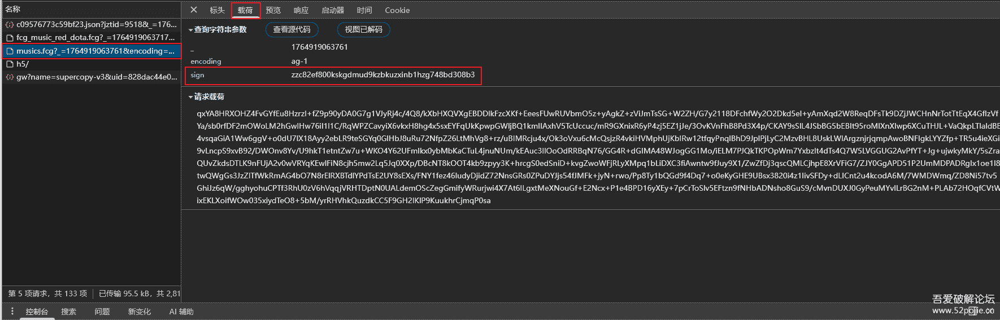
175701-1.png (108.26 KB, 下载次数: 1)
[href="forum.php?mod=attachment&aid=MjgxOTkxOHwyNDVjYTZlOHwxNzkzNTcwMzA4fDE2ODA4NnwyMDc5MDcx&nothumb=yes" target="_blank"](https://www.52pojie.cn/forum.php?mod=attachment&aid=MjgxOTkxOHwyNDVjYTZlOHwxNzkzNTcwMzA4fDE2ODA4NnwyMDc5MDcx&nothumb=yes)
1
2025-12-11 10:01 上传
- 我们直接全局搜索sing值
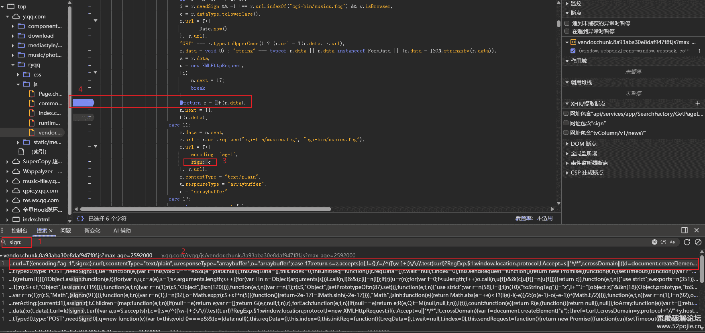
175724-1.png (164.86 KB, 下载次数: 1)
[href="forum.php?mod=attachment&aid=MjgxOTkxOXw2MDlkZDFhY3wxNzkzNTcwMzA4fDE2ODA4NnwyMDc5MDcx&nothumb=yes" target="_blank"](https://www.52pojie.cn/forum.php?mod=attachment&aid=MjgxOTkxOXw2MDlkZDFhY3wxNzkzNTcwMzA4fDE2ODA4NnwyMDc5MDcx&nothumb=yes)
2
2025-12-11 10:01 上传
- 看到 `sign`: `c` 发现这个参数在 `swich-case` 语句中，我们直接在他的上一步 `return` 处打上断点看下。
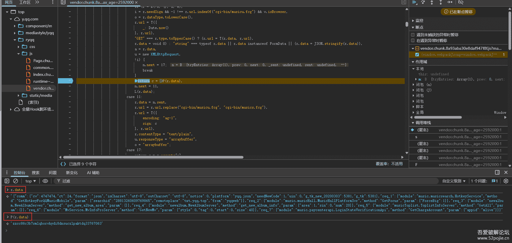
175754-1.png (106.23 KB, 下载次数: 1)
[href="forum.php?mod=attachment&aid=MjgxOTkyMHxiYjk3ODM4NXwxNzkzNTcwMzA4fDE2ODA4NnwyMDc5MDcx&nothumb=yes" target="_blank"](https://www.52pojie.cn/forum.php?mod=attachment&aid=MjgxOTkyMHxiYjk3ODM4NXwxNzkzNTcwMzA4fDE2ODA4NnwyMDc5MDcx&nothumb=yes)
3
2025-12-11 10:01 上传
- 可以看到 `r.data` 的明文值经过了 `P` 方法后生成了我们想要的加密参数，那么猫腻就是这个 `P` 方法了！我们先狠狠的进入这个 `p` 中！
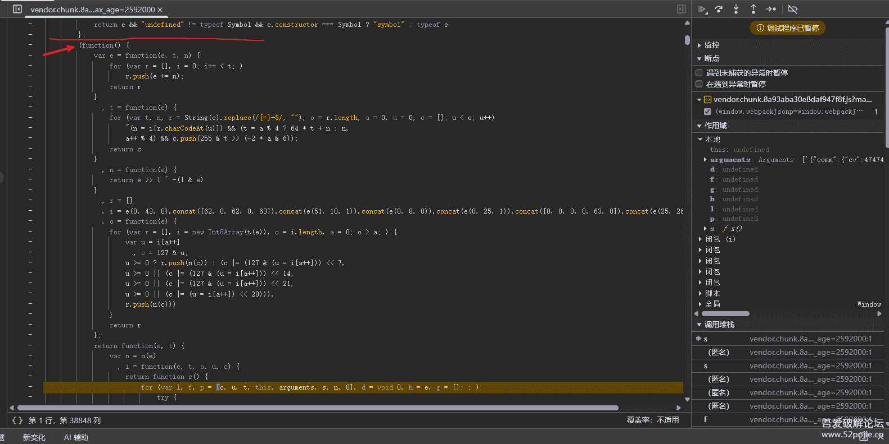
175822-1.png (80.49 KB, 下载次数: 1)
[href="forum.php?mod=attachment&aid=MjgxOTkyMXxmNjQyOGFiYXwxNzkzNTcwMzA4fDE2ODA4NnwyMDc5MDcx&nothumb=yes" target="_blank"](https://www.52pojie.cn/forum.php?mod=attachment&aid=MjgxOTkyMXxmNjQyOGFiYXwxNzkzNTcwMzA4fDE2ODA4NnwyMDc5MDcx&nothumb=yes)
4
2025-12-11 10:01 上传
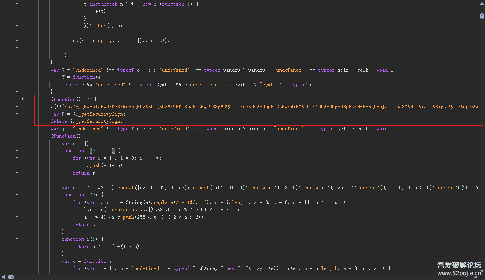
175839-1.png (32.15 KB, 下载次数: 1)
[href="forum.php?mod=attachment&aid=MjgxOTkyMnw2ZmE2YWFjZHwxNzkzNTcwMzA4fDE2ODA4NnwyMDc5MDcx&nothumb=yes" target="_blank"](https://www.52pojie.cn/forum.php?mod=attachment&aid=MjgxOTkyMnw2ZmE2YWFjZHwxNzkzNTcwMzA4fDE2ODA4NnwyMDc5MDcx&nothumb=yes)
5
2025-12-11 10:01 上传
- 稍微往上拉一下代码，可以看到它是在一个自执行函数中，把这个自执行函数折叠起来，可以看到它传入了一长传的字符串巴拉巴拉一堆东西。它比较鬼的是，他把 `G._getSecuritySign` 赋值给 `P`后它就给删除掉了，但其实对我们影响不大，我们把它整个复制出来。
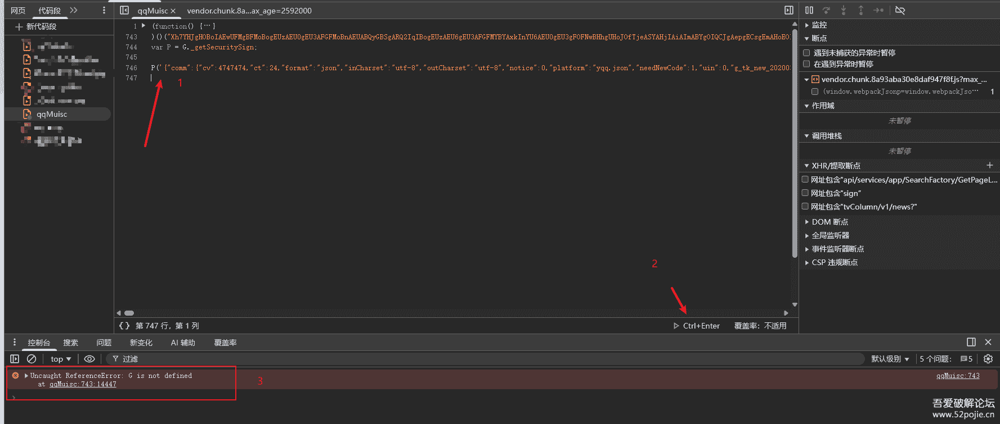
175857-1.png (80.35 KB, 下载次数: 1)
[href="forum.php?mod=attachment&aid=MjgxOTkyM3xhNWFhMzM0NnwxNzkzNTcwMzA4fDE2ODA4NnwyMDc5MDcx&nothumb=yes" target="_blank"](https://www.52pojie.cn/forum.php?mod=attachment&aid=MjgxOTkyM3xhNWFhMzM0NnwxNzkzNTcwMzA4fDE2ODA4NnwyMDc5MDcx&nothumb=yes)
6
2025-12-11 10:01 上传
- 新建一个代码片段，把前面拿到的明文值传进 `P` 方法，点击执行后，发现它报错了，`G` is not defined ，说明 `G` 未找到，我们回到原文去往上翻代码找 `G` 。
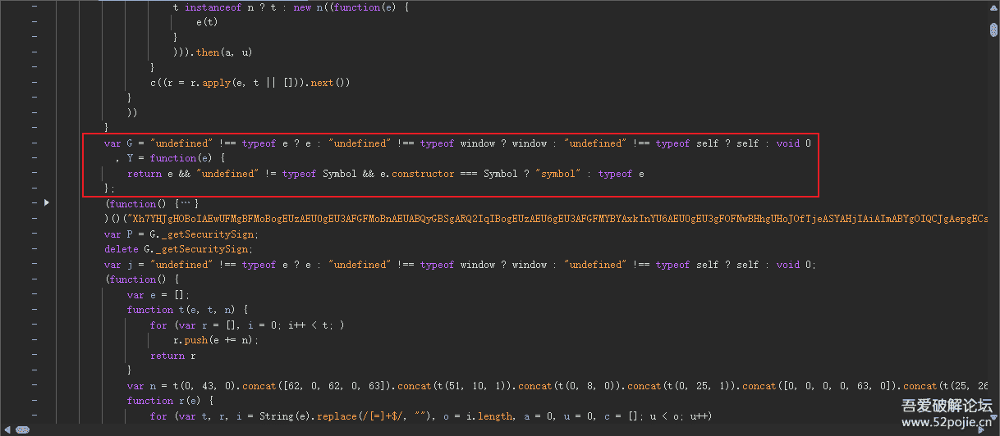
175928-1.png (25.92 KB, 下载次数: 1)
[href="forum.php?mod=attachment&aid=MjgxOTkyNHxmNjZmZTVkN3wxNzkzNTcwMzA4fDE2ODA4NnwyMDc5MDcx&nothumb=yes" target="_blank"](https://www.52pojie.cn/forum.php?mod=attachment&aid=MjgxOTkyNHxmNjZmZTVkN3wxNzkzNTcwMzA4fDE2ODA4NnwyMDc5MDcx&nothumb=yes)
7
2025-12-11 10:01 上传
- 发现 `G` 就在自执行函数上面定义的，我们直接复制下来放到代码片段中再执行。
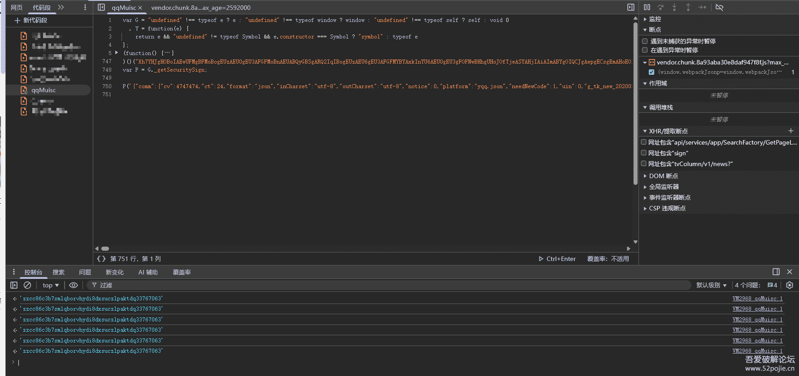
175942-1.png (88.01 KB, 下载次数: 1)
[href="forum.php?mod=attachment&aid=MjgxOTkyNXxkYmU2NjBmNXwxNzkzNTcwMzA4fDE2ODA4NnwyMDc5MDcx&nothumb=yes" target="_blank"](https://www.52pojie.cn/forum.php?mod=attachment&aid=MjgxOTkyNXxkYmU2NjBmNXwxNzkzNTcwMzA4fDE2ODA4NnwyMDc5MDcx&nothumb=yes)
8
2025-12-11 10:01 上传
- 没问题，现在已经可以随便执行，这样方便我们调试代码。
- 我们先简单看下这个代码的执行流程。
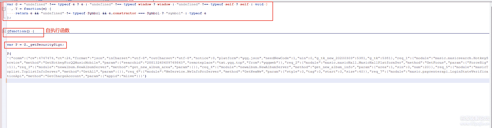
175956-1.png (50.7 KB, 下载次数: 1)
[href="forum.php?mod=attachment&aid=MjgxOTkyNnxjYTI1N2Y5N3wxNzkzNTcwMzA4fDE2ODA4NnwyMDc5MDcx&nothumb=yes" target="_blank"](https://www.52pojie.cn/forum.php?mod=attachment&aid=MjgxOTkyNnxjYTI1N2Y5N3wxNzkzNTcwMzA4fDE2ODA4NnwyMDc5MDcx&nothumb=yes)
9
2025-12-11 10:01 上传
- 这就很明显了，我们把重点放在自执行函数中，进入函数看它先执行的代码位置。
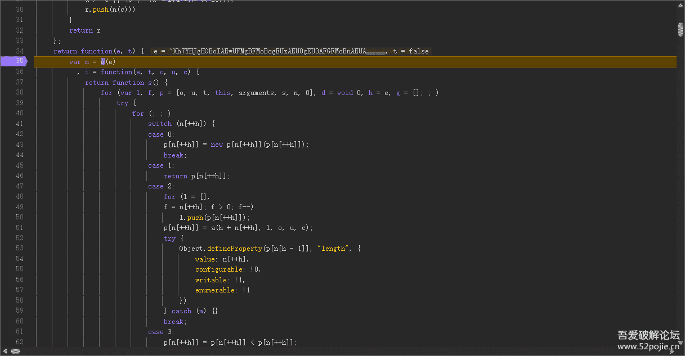
180019-1.png (26.1 KB, 下载次数: 1)
[href="forum.php?mod=attachment&aid=MjgxOTkyN3w3ZmM2ZjAzY3wxNzkzNTcwMzA4fDE2ODA4NnwyMDc5MDcx&nothumb=yes" target="_blank"](https://www.52pojie.cn/forum.php?mod=attachment&aid=MjgxOTkyN3w3ZmM2ZjAzY3wxNzkzNTcwMzA4fDE2ODA4NnwyMDc5MDcx&nothumb=yes)
10
2025-12-11 10:01 上传
- 把 `e` (长字符串)参数传入 `o` 函数中，`o` 函数中又经过了 `t` 函数、`n` 函数，叮叮咣咣的一顿，出来就变成了指令集，这个过程感兴趣的大佬可以自己单步执行去看一下过程，我看不明白，我就不乱说误导了~
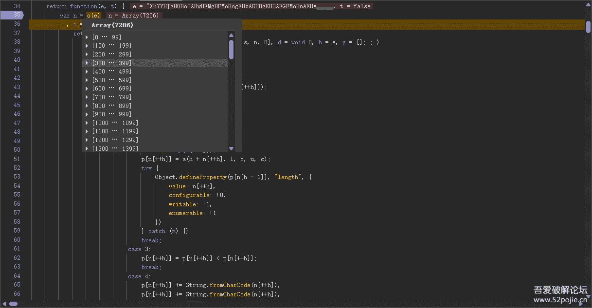
180102-1.png (30.36 KB, 下载次数: 1)
[href="forum.php?mod=attachment&aid=MjgxOTkyOHwzZjc3OGQ1MnwxNzkzNTcwMzA4fDE2ODA4NnwyMDc5MDcx&nothumb=yes" target="_blank"](https://www.52pojie.cn/forum.php?mod=attachment&aid=MjgxOTkyOHwzZjc3OGQ1MnwxNzkzNTcwMzA4fDE2ODA4NnwyMDc5MDcx&nothumb=yes)
11
2025-12-11 10:01 上传
- 出来看 `n` 的返回值就已经变成了指令集。
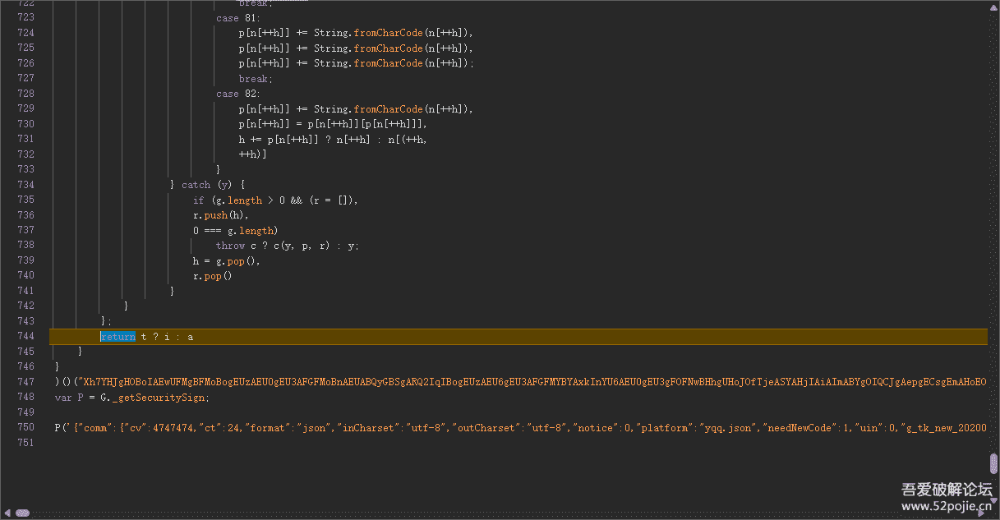
180125-1.png (25.87 KB, 下载次数: 1)
[href="forum.php?mod=attachment&aid=MjgxOTkzMHw1NmNhNzBkYnwxNzkzNTcwMzA4fDE2ODA4NnwyMDc5MDcx&nothumb=yes" target="_blank"](https://www.52pojie.cn/forum.php?mod=attachment&aid=MjgxOTkzMHw1NmNhNzBkYnwxNzkzNTcwMzA4fDE2ODA4NnwyMDc5MDcx&nothumb=yes)
12
2025-12-11 10:02 上传
- 接着进行单步它没有直接跳入`i`或者是 `a` 函数，它是跳到了一个三元表达式，`t` 我们传入的是一个 false 所以它会跳进 `a` 函数中，但是我看了一下，`i` 函数和 `a` 函数俩个是一模一样的，我后边在进行逆推算法时也是在俩个函数中都进行了插桩，因为我记得在 `i` 函数中打印日志也会输出，这个各位大佬可以自行测试下，不知道有没有发生变化。
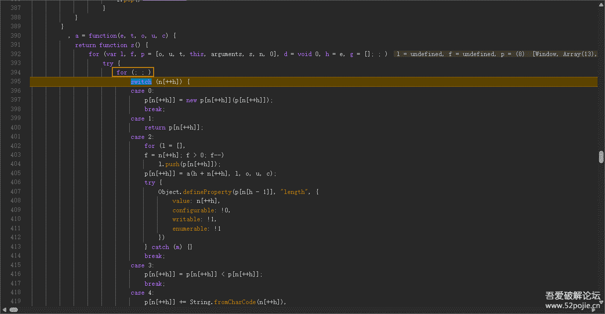
180138-1.png (25.26 KB, 下载次数: 1)
[href="forum.php?mod=attachment&aid=MjgxOTkzMXw1NzBjYmZlN3wxNzkzNTcwMzA4fDE2ODA4NnwyMDc5MDcx&nothumb=yes" target="_blank"](https://www.52pojie.cn/forum.php?mod=attachment&aid=MjgxOTkzMXw1NzBjYmZlN3wxNzkzNTcwMzA4fDE2ODA4NnwyMDc5MDcx&nothumb=yes)
13
2025-12-11 10:02 上传
- 进入到 `a` 函数中就是一个 `for` 的死循环，然后就是 `swich-case` 还好这个不是很多，也不是很繁琐，不需要费太多脑子，我们直接找 `call` 或者是 `apply`，都还是比较明显的，现在这俩个位置打上日志断点看下日志。
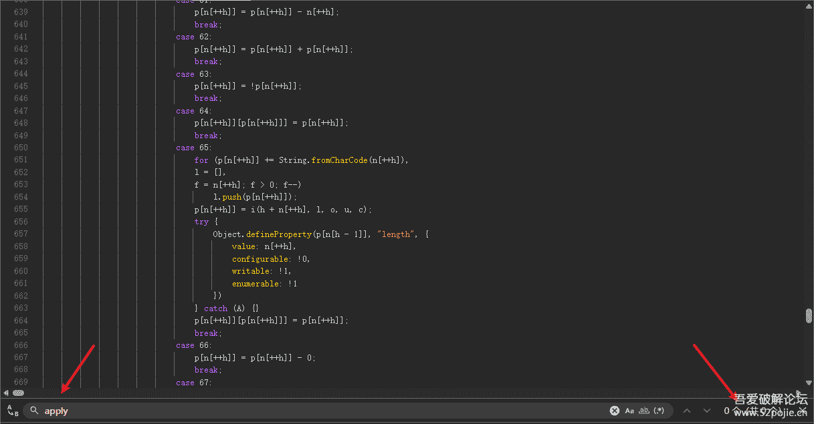
180148-1.png (31.81 KB, 下载次数: 1)
[href="forum.php?mod=attachment&aid=MjgxOTkzMnwyYWI2NGRjYXwxNzkzNTcwMzA4fDE2ODA4NnwyMDc5MDcx&nothumb=yes" target="_blank"](https://www.52pojie.cn/forum.php?mod=attachment&aid=MjgxOTkzMnwyYWI2NGRjYXwxNzkzNTcwMzA4fDE2ODA4NnwyMDc5MDcx&nothumb=yes)
14
2025-12-11 10:02 上传
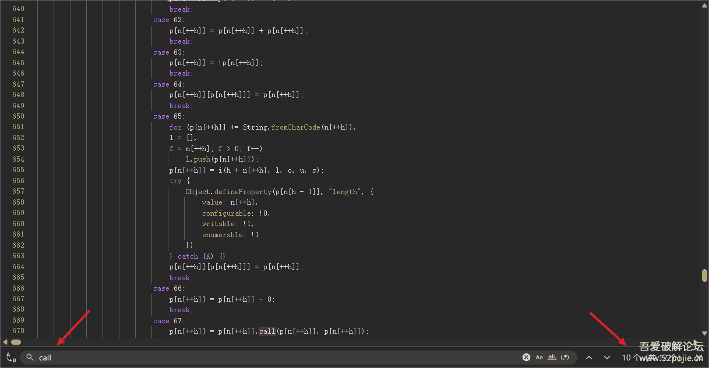
180202-1.png (31.21 KB, 下载次数: 1)
[href="forum.php?mod=attachment&aid=MjgxOTkzM3wyYmJkYjQ2YnwxNzkzNTcwMzA4fDE2ODA4NnwyMDc5MDcx&nothumb=yes" target="_blank"](https://www.52pojie.cn/forum.php?mod=attachment&aid=MjgxOTkzM3wyYmJkYjQ2YnwxNzkzNTcwMzA4fDE2ODA4NnwyMDc5MDcx&nothumb=yes)
15
2025-12-11 10:02 上传
- 可以看到，`apply` 一个都没有，`call` 有12个，建议是在12个 `call` 位置全部都打上日志断点，6个在 `i` 方法，6个在 `a` 方法，也不是很多。唯一需要注意的点就是这个是 `++h` ，要注意打印日志的时候去减掉 ++ 的值，因为我们要看的是 `h`当时的执行结果。
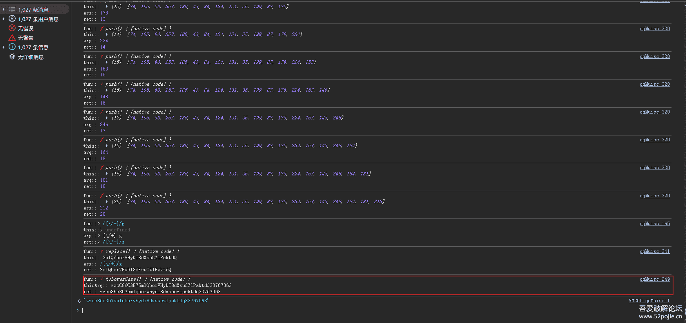
180217-1.png (51.05 KB, 下载次数: 1)
[href="forum.php?mod=attachment&aid=MjgxOTkzNHw0ZTdiYjRmMHwxNzkzNTcwMzA4fDE2ODA4NnwyMDc5MDcx&nothumb=yes" target="_blank"](https://www.52pojie.cn/forum.php?mod=attachment&aid=MjgxOTkzNHw0ZTdiYjRmMHwxNzkzNTcwMzA4fDE2ODA4NnwyMDc5MDcx&nothumb=yes)
16
2025-12-11 10:02 上传
- 打好日志断点后运行，看控制台输出的日志，现在是有1027条日志，接下来才是重头戏，我们先把日志全部都复制出来，简单看一下。
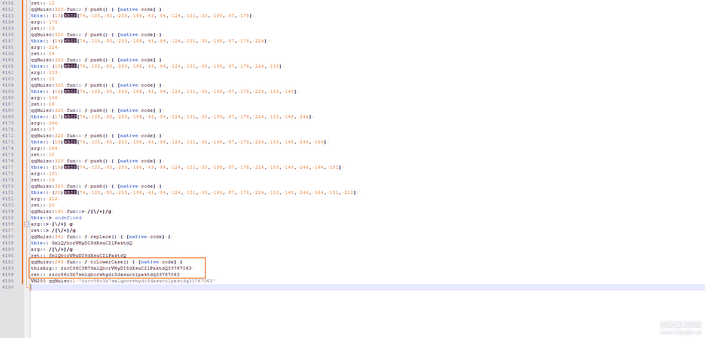
180228-1.png (102.77 KB, 下载次数: 1)
[href="forum.php?mod=attachment&aid=MjgxOTkzNXxkN2E4ODNkMXwxNzkzNTcwMzA4fDE2ODA4NnwyMDc5MDcx&nothumb=yes" target="_blank"](https://www.52pojie.cn/forum.php?mod=attachment&aid=MjgxOTkzNXxkN2E4ODNkMXwxNzkzNTcwMzA4fDE2ODA4NnwyMDc5MDcx&nothumb=yes)
17
2025-12-11 10:03 上传


VMP想做算法还原，只能通过日志一点一点分析代码执行的过程。拿到日志后可以选择从下往上逆推，也可以从头往下看。我是习惯先从下往上推一遍。

这个最后一步可以看出是通过`toLowerCase()`方法把所有字母都变成小写，得到我们想要的参数。

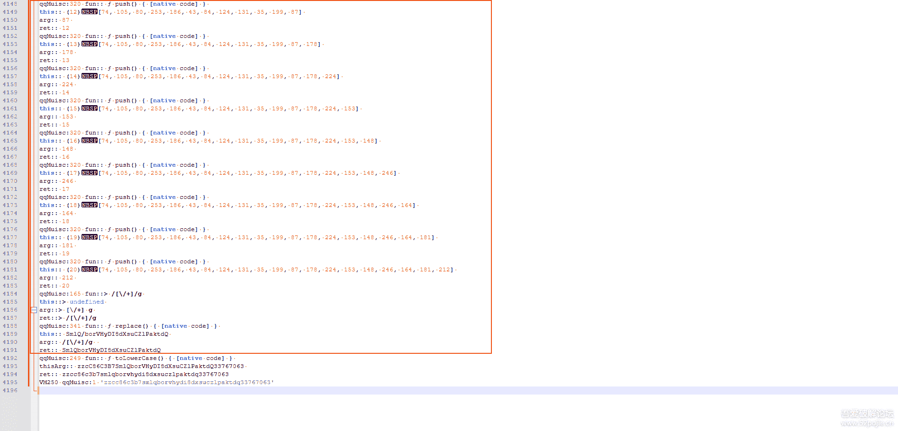

180237-1.png (108.98 KB, 下载次数: 1) · [附件](https://www.52pojie.cn/forum.php?mod=attachment&aid=MjgxOTkzNnxkYTI5OTM5OHwxNzkzNTcwMzA4fDE2ODA4NnwyMDc5MDcx&nothumb=yes) · 18 · 2025-12-11 10:03 上传

目前从这里往上看，发现好像是没关系，看不明白到底是在做什么，没有衔接点。如果遇到这种情况，俩种可能，一，是打的日志点不全，也就是桩插得不够，二，是跟我一样是小白，实战经验不够多。有的大佬通过一个字符串、数字等等，就能知道是在做什么运算、什么加密模式。

不过现在这种情况，就是插桩不够，因为我们只对`call`的位置做了输出，我们只是了解了代码大概的执行流程，能确认我们找的位置是正确的，因为结果输出了。后续还会把所有运算的位置也都补上日志断点。

先接着往上看看，找个大概思路。

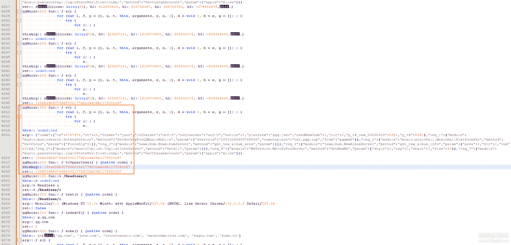

180246-1.png (138.8 KB, 下载次数: 1) · [附件](https://www.52pojie.cn/forum.php?mod=attachment&aid=MjgxOTkzN3w1ZjY4MWIxMnwxNzkzNTcwMzA4fDE2ODA4NnwyMDc5MDcx&nothumb=yes) · 19 · 2025-12-11 10:03 上传

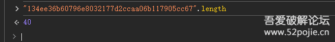

180255-1.png (7.53 KB, 下载次数: 1) · [附件](https://www.52pojie.cn/forum.php?mod=attachment&aid=MjgxOTkzOHwzNzJkNjMwNXwxNzkzNTcwMzA4fDE2ODA4NnwyMDc5MDcx&nothumb=yes) · 20 · 2025-12-11 10:03 上传

看这里返回一个长度为40的十六进制字符串，很有可能是 SHA-1 哈希算法。`toUpperCase()`方法是把这个返回结果的小写字母都转为大写字母。

我们把加密的入参拿到加密网站测试下。

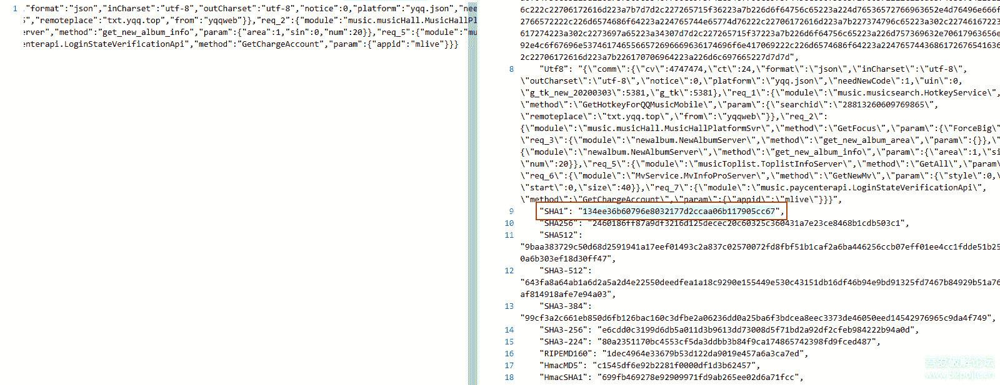

180303-1.png (124.27 KB, 下载次数: 1) · [附件](https://www.52pojie.cn/forum.php?mod=attachment&aid=MjgxOTkzOXwyOWNkZDQzNXwxNzkzNTcwMzA4fDE2ODA4NnwyMDc5MDcx&nothumb=yes) · 21 · 2025-12-11 10:03 上传

ok，我们现在总结下获取到的线索。

- 线索1：最后的返回结果使用了`toLowerCase()`方法。
- 线索2：入参先经过 SHA-1 标准算法哈希并且使用`toUpperCase()`方法，但后边做了什么我们暂时看不出来。

为了方便分析，补完运算过程的日志数量有2216条。

我习惯把传入的参数先设置为`1`，这样日志会少点，方便分析。

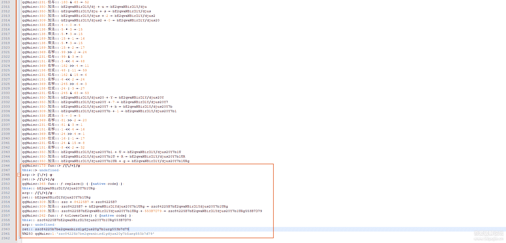

180311-1.png (150.09 KB, 下载次数: 1) · [附件](https://www.52pojie.cn/forum.php?mod=attachment&aid=MjgxOTk0MHxiODkzYmNmNHwxNzkzNTcwMzA4fDE2ODA4NnwyMDc5MDcx&nothumb=yes) · 22 · 2025-12-11 10:03 上传

再看结尾的日志，是不是又变得清晰了一点？

`sign`参数是经过4部分相加得到。

`zzc`像是固定值。

目前除了`zzc`其他部分的值我们都不知道是怎么来的，但往上看`bE2qvaNBirDlYdjus20Y7b1URg`这个值就是一点一点相加得出来的，但是目前看还是有点莫名其妙，感觉日志衔接不起来。

举个简单的例子，在js代码中，想把数字转成字符串，就需要借助`string.fromCharCode()`方法，反之，就需要使用`charCodeAt(0)`方法。但其实这里用到的都不是。即使在所有的`String.fromCharCode()`方法位置打上日志断点，这个日志还是衔接不起来，原因看下图。

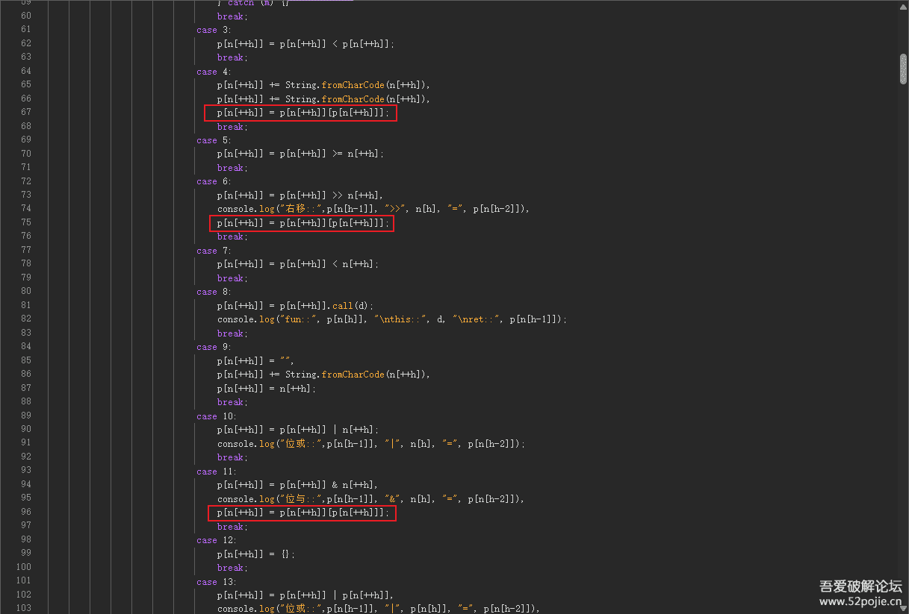

180323-1.png (30.52 KB, 下载次数: 1) · [附件](https://www.52pojie.cn/forum.php?mod=attachment&aid=MjgxOTk0MXw3ZWE5Yzg0N3wxNzkzNTcwMzA4fDE2ODA4NnwyMDc5MDcx&nothumb=yes) · 23 · 2025-12-11 10:03 上传

其实是因为很多运算过后，经过了索引取值，这些位置我们没有打日志断点，所以日志衔接的不清不楚，把这些索引取值的位置都打上日志断点再看。

我这里日志已经变成3289条。

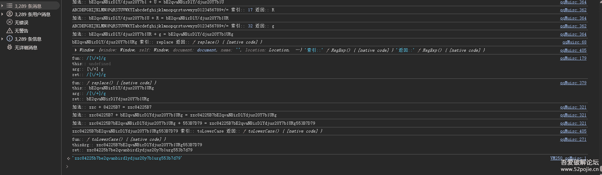

180332-1.png (44.26 KB, 下载次数: 1) · [附件](https://www.52pojie.cn/forum.php?mod=attachment&aid=MjgxOTk0Mnw3MDFkYTZhYXwxNzkzNTcwMzA4fDE2ODA4NnwyMDc5MDcx&nothumb=yes) · 24 · 2025-12-11 10:03 上传

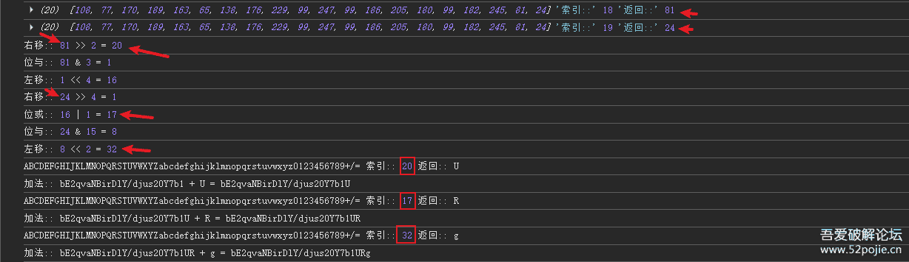

180339-1.png (24.5 KB, 下载次数: 1) · [附件](https://www.52pojie.cn/forum.php?mod=attachment&aid=MjgxOTk0M3w0YWZjNDM2M3wxNzkzNTcwMzA4fDE2ODA4NnwyMDc5MDcx&nothumb=yes) · 2025-12-11 10:03 上传

这个时候日志就非常清晰了，`ABCDEFGHIJKLMNOPQRSTUVWXYZabcdefghijklmnopqrstuvwxyz0123456789+/`这明显是 base64，所以无论怎么用`string.fromCharCode()`方法或者`charCodeAt(0)`方法都是得不到想要的结果。

## `bE2qvaNBirDlYdjus20Y7b1URg`值生成过程简单分析

- `bE2qvaNBirDlYdjus20Y7b1URg`这个值，根据这个日志，简单分析下，通过上面的列表取到俩个值，81和24。
- `81 & 3 = 1`（取值后继续运算，3不确定是不是固定值）
- `1 > 4 = 1`（24是上面列表取到的返回值，4不确定是不是固定值）
- `16 | 1 = 17`（16和1都是上面运算返回的结果，运算的结果拿来 base64 取值）
- `24 & 15 = 8`（24是上面列表取到的返回值，15不确定是不是固定值）
- 8

日志量比较小，可以直接搜索`553B7D79`定位的`ret`的位置往上分析。

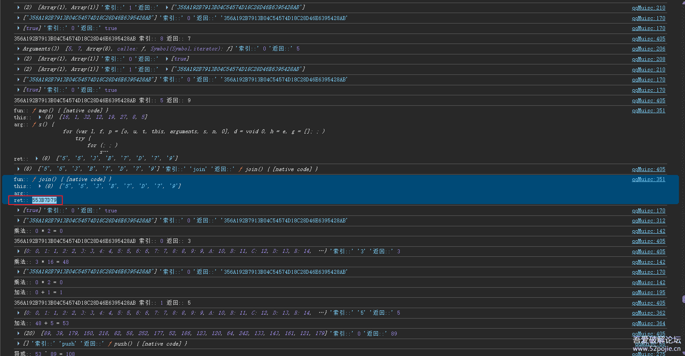

180348-1.png (52.57 KB, 下载次数: 1) · [附件](https://www.52pojie.cn/forum.php?mod=attachment&aid=MjgxOTk0NHxkYzQyZThiMnwxNzkzNTcwMzA4fDE2ODA4NnwyMDc5MDcx&nothumb=yes) · 26 · 2025-12-11 10:03 上传

定位到这儿后，往下看，就是上面分析的值`bE2qvaNBirDlYdjus20Y7b1URg`用到20位长数组（`[108, 77, 170, 189, 163, 65, 138, 176, 229, 99, 247, 99, 186, 205, 180, 99, 182, 245, 81, 24]`）生成的过程，我就不在赘述，我相信各位一定没问题的，我们继续向上看！

`553B7D79`是一个列表，通过`join()`方法拼接起来的，那我们就看这个列表中的各个字符是怎么来的。

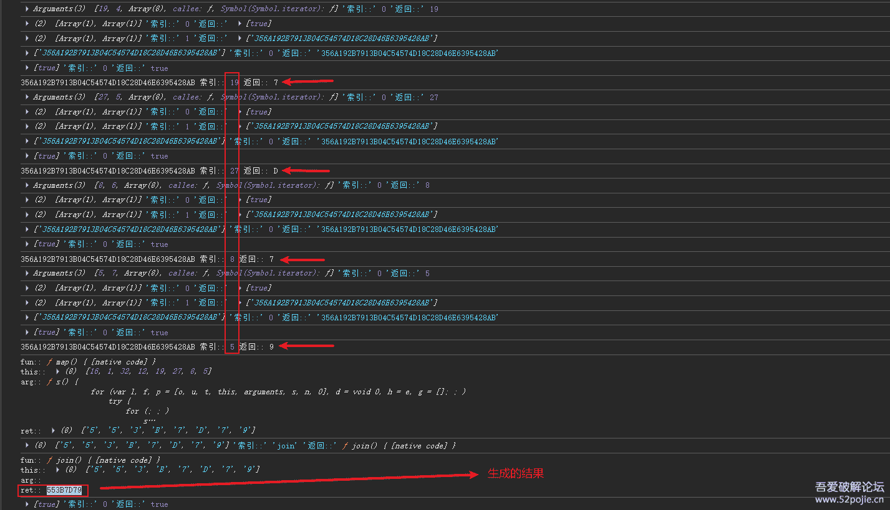

180357-1.png (55.19 KB, 下载次数: 1) · [附件](https://www.52pojie.cn/forum.php?mod=attachment&aid=MjgxOTk0NXwyYTRjMzBhNnwxNzkzNTcwMzA4fDE2ODA4NnwyMDc5MDcx&nothumb=yes) · 27 · 2025-12-11 10:03 上传

我们先确认生成的结果是没问题的，是我们最后加密要用到的，生成的方法就是前面那一串儿字符索引取值得到的，可以看到后四位是`7D79`已经对应上，但是还有个疑问是索引的参数是怎么来的？为什么要取`19,27,8,5`的索引值？

我们先再往上看日志。

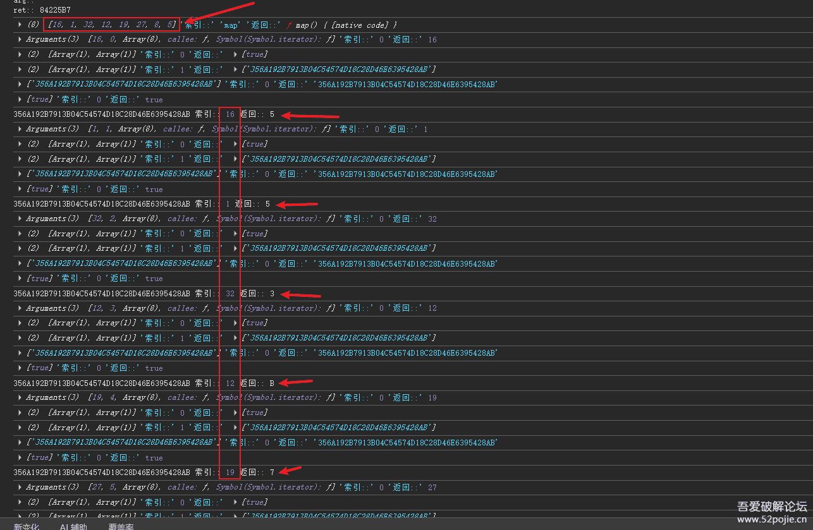

180403-1.png (60.94 KB, 下载次数: 1) · [附件](https://www.52pojie.cn/forum.php?mod=attachment&aid=MjgxOTk0Nnw3NjI2Nzk0NnwxNzkzNTcwMzA4fDE2ODA4NnwyMDc5MDcx&nothumb=yes) · 28 · 2025-12-11 10:03 上传

各位大佬应该已经发现了，索引就是这个列表`[16, 1, 32, 12, 19, 27, 8, 5]`，那么前面的字符串是什么呢？肯定不是 base64，也不是其他的 base 模式。大佬们估计一看这个长度、这个样子，就知道，这不是哪个开头的吊 SHA-1 么！么错！

废话就不说了，另外一个`84225B7`和这个是一模一样的算法，唯一不一样的就是索引列表有区别`[16, 1, 32, 12, 19, 27, 8, 5]`。

到现在我们的算法还原其实就已经完成了，这俩个列表是固定的值。

`84225B7`和`553B7D79`的加密算法是一样的，就是利用入参经过SHA-1哈希后分别取2个固定列表的索引值。

`bE2qvaNBirDlYdjus20Y7b1URg`最长的这个字符串算法，不难，按照我上面说的方法，多分析几个日志块儿，没问题的。整个日志中有多个列表都是固定的值，可以直接利用。

最后就是把固定值`zzc`和经过算法生成的三个字符串拼接起来，通过`toLowerCase()`方法转换即可。

### 看完文章一定要操实操实~

- 极其推荐做为小白新手入门 vmp 案例！！！
- 本文仅学习、分析`sign`参数的生成过程，不考虑其他参数以及实际用处。

## 贴上我丑陋的py代码

```javascript
_log = console.log;

const JScrypt = require('crypto-js');

function listToString(encryptSHA1, list) {

    var lists = [];

    for (let i = 0; i > 2,  // 14

                num5 = list[0] & 3,

                num6 = num5 > 4,

                num8 = num6 | num7,   // 51

                num9 = list[1] & 15,

                num10 = num9 > 6,

                num12 = num10 | num11, // 5

                num13 = list[2] & 63;  // 11

            if (num13 != 0) {

                Base64str += Base64String[num4] + Base64String[num8] + Base64String[num12] + Base64String[num13];

            } else {

                Base64str += Base64String[num4] + Base64String[num8] + Base64String[num12]

            }

        }

    }

    str_4 = Base64str.replace(/[\/+]/g,"");

    sign = str_1 + str_2 + str_4 + str_3;

    return sign.toLowerCase();

}

// 传入参数给getSign函数即可获得sign值

_log('sign值为::>', getSign('111'));
```
