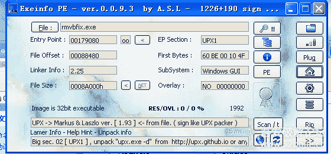
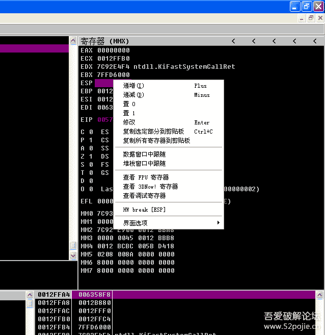
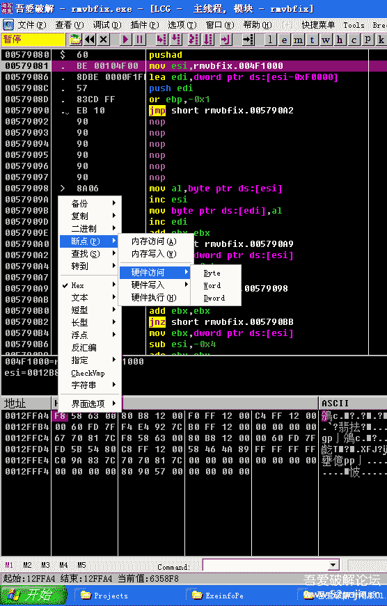
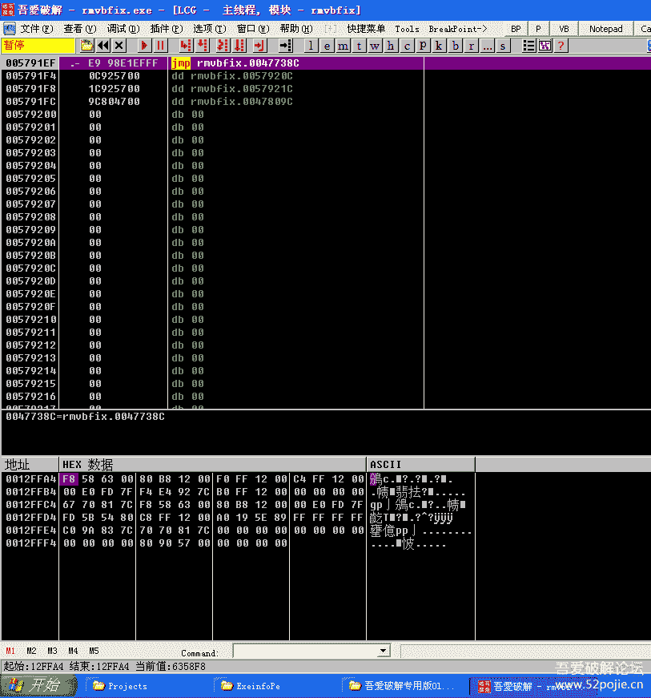
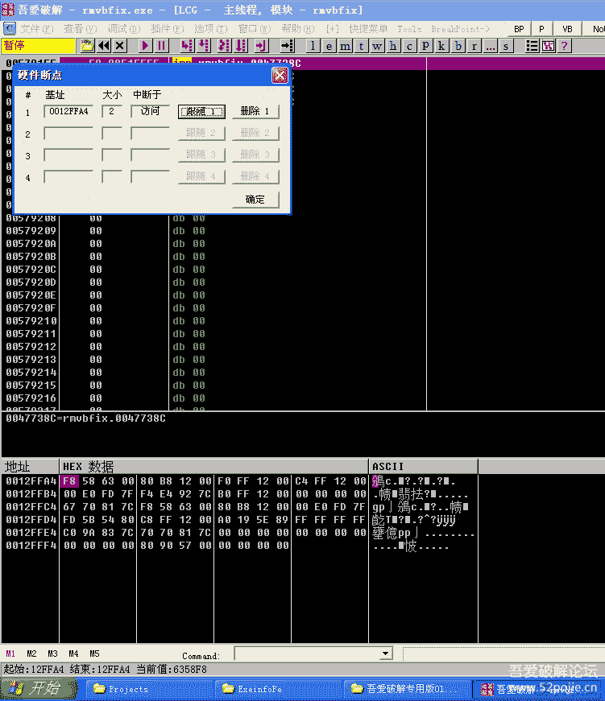
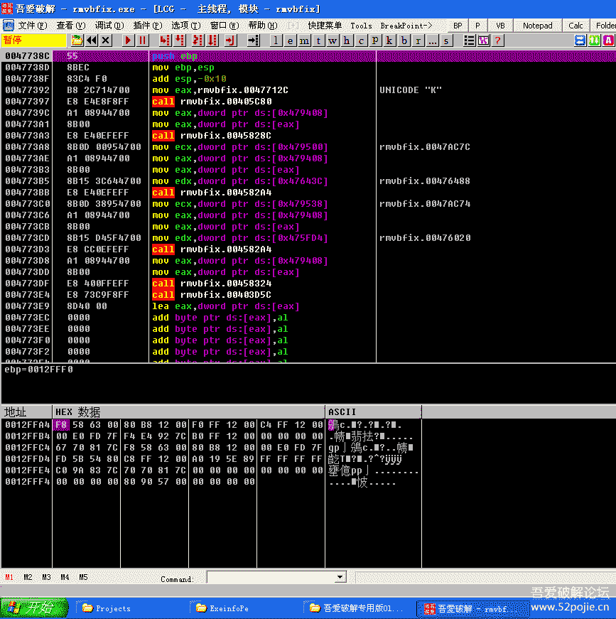
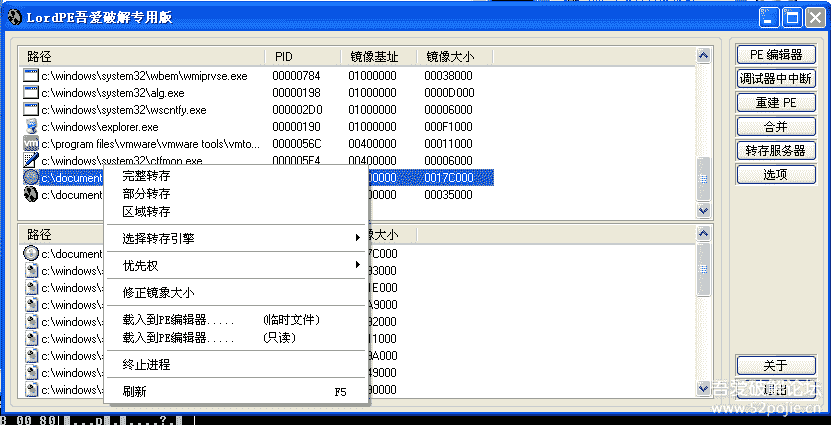
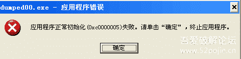
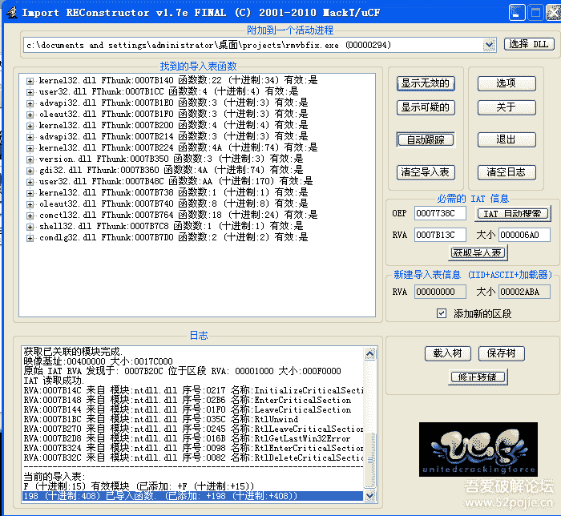

# [分享] 记一次 `upx` 脱壳

- 原帖：<https://www.52pojie.cn/forum.php?mod=viewthread&tid=2079627>
- 抓取时间：2026-11-01T21:58:26

我学完 `x86` 汇编、`PE` 文件格式，新发现一个叫【壳】的东西，这才知道还有加壳/脱壳这么一回事，写个帖子记录一下。

## 前置知识

- 《C++反汇编与逆向分析技术揭秘》钱林松
- 《Windows环境下32位汇编语言程序设计》罗云彬
- 《Windows PE权威指南》戚利

## 工具

- `PEiD`：查壳工具。
- `OllyDbg`：调试程序，寻找 `OEP`。
- `LordPE`：抓取内存映像【`dump`】。
- `ImportREConstructor`：重建输入表。

下文中的演示文件来自于 ximo脱壳基础。

## 一些浅薄的思考

如果 `PE` 基础不错的话，那么就会明白外壳的代码执行完之后，会跳到程序入口点，这个跳转是一个距离很远的跳转。这样的话，很显然 ximo 老师说的【方法1：单步跟踪】，其实就是去找这个距离很远的跳转。如果汇编基础不错的话，那么就会明白程序运行时，平栈很重要，也就是要保证栈平衡。这样的话，很显然 ximo 老师说的【方法2：`ESP` 定律法】，其实是栈平衡。

## 使用 `ESP` 定律法脱壳

具体步骤如下：

1. 查壳，`UPX` 壳，压缩壳。

   

   `1_查壳.png`（103.27 KB，下载次数：0）

   附件：[下载](https://www.52pojie.cn/forum.php?mod=attachment&aid=MjgyMDMyNXw1NzgzN2FhMHwxNzkzNTcwMzA0fDE2ODA4NnwyMDc5NjI3&nothumb=yes)

   上传时间：2025-12-13 01:22

2. 使用 `OllyDbg` 调试，单步步过一次。在 `ESP` 上面右键 - 数据窗口中跟随。

   

   `2-1.png`（27.9 KB，下载次数：0）

   附件：[下载](https://www.52pojie.cn/forum.php?mod=attachment&aid=MjgyMDMyNnw5ZTRlOTQ4YnwxNzkzNTcwMzA0fDE2ODA4NnwyMDc5NjI3&nothumb=yes)

   上传时间：2025-12-13 01:22

3. 数据区 - 右键 - 断点 - 硬件访问 - `word`。

   

   `2-2.png`（51.86 KB，下载次数：0）

   附件：[下载](https://www.52pojie.cn/forum.php?mod=attachment&aid=MjgyMDMyN3xlYTkyNzlhZXwxNzkzNTcwMzA0fDE2ODA4NnwyMDc5NjI3&nothumb=yes)

   上传时间：2025-12-13 01:22

4. 运行。

   

   `2-3-运行.png`（49.9 KB，下载次数：0）

   附件：[下载](https://www.52pojie.cn/forum.php?mod=attachment&aid=MjgyMDMyOHwwMTUwYTBmZXwxNzkzNTcwMzA0fDE2ODA4NnwyMDc5NjI3&nothumb=yes)

   上传时间：2025-12-13 01:22

5. 删除硬件断点。

   

   `2-4-删除硬件断点.png`（52.28 KB，下载次数：0）

   附件：[下载](https://www.52pojie.cn/forum.php?mod=attachment&aid=MjgyMDMyOXw2ODAwMzJhOXwxNzkzNTcwMzA0fDE2ODA4NnwyMDc5NjI3&nothumb=yes)

   上传时间：2025-12-13 01:22

6. 单步执行一次即可看到 `OEP 7738C`。

   

   `2-5-oep.png`（59.99 KB，下载次数：0）

   附件：[下载](https://www.52pojie.cn/forum.php?mod=attachment&aid=MjgyMDMzMHxhZTQzNjQyMHwxNzkzNTcwMzA0fDE2ODA4NnwyMDc5NjI3&nothumb=yes)

   上传时间：2025-12-13 01:22

7. 使用 `LordPE` 来 `dump` 内存映像。

   右键 - 修正镜像大小，右键 - 完整转存。

   

   `3-dump.png`（46.94 KB，下载次数：0）

   附件：[下载](https://www.52pojie.cn/forum.php?mod=attachment&aid=MjgyMDMzMXwwMDQ5YmY0NXwxNzkzNTcwMzA0fDE2ODA4NnwyMDc5NjI3&nothumb=yes)

   上传时间：2025-12-13 01:22

8. 显示程序正常初始化失败。看来是还没有重建 `IAT`。

   

   `4-1.png`（13.64 KB，下载次数：0）

   附件：[下载](https://www.52pojie.cn/forum.php?mod=attachment&aid=MjgyMDMzMnw5MzU2MTE1YnwxNzkzNTcwMzA0fDE2ODA4NnwyMDc5NjI3&nothumb=yes)

   上传时间：2025-12-13 01:22

9. 使用 `ImportREConstructor` 重建输入表，选进程，填写 `OEP` - `IAT` 自动搜索 - 获取导入表 - 修正转储，到刚才 `dump` 下来的文件。

   

   `4-2-iat.png`（73.38 KB，下载次数：0）

   附件：[下载](https://www.52pojie.cn/forum.php?mod=attachment&aid=MjgyMDMzM3w0ZWViMTNlZnwxNzkzNTcwMzA0fDE2ODA4NnwyMDc5NjI3&nothumb=yes)

   上传时间：2025-12-13 01:22

10. 最后运行成功。

    

    `5.png`（11.36 KB，下载次数：0）

    附件：[下载](https://www.52pojie.cn/forum.php?mod=attachment&aid=MjgyMDMzNHxmMTlmNzlkZXwxNzkzNTcwMzA0fDE2ODA4NnwyMDc5NjI3&nothumb=yes)

    上传时间：2025-12-13 01:22

## 学习感想

学习脱壳的过程中，我感觉之前学到的 `PE` 知识、`x86` 汇编知识都活过来了，太妙了。再者，居然还有 `LordPE` 这么方便的工具，亏我之前还费劲地写了一个颜值低、功能少的 `PE` 编辑器，白造轮子了。下次造轮子之前一定先仔细找找是不是有现成的工具，惨痛的教训呀。演示文件在附件中。

默认密码：`52pojie` 或者 `www.52pojie.cn`
