# [CTF] 0xGame 2025 Week3 Reverse WP

- 原帖: https://www.52pojie.cn/forum.php?mod=viewthread&tid=2080425
- 抓取时间: 2026-11-01T21:58:22

## 引言

我希望能够帮助像我一样的新手，如果大佬发现 WP 有问题可以评论，我会改进！

## ezVBS

我不得不说，要听劝。原题都告诉我了，不让我打开，我还就偏打开了，然后去网上搜 VBS 逆向，最后在赛博厨子那里逆向出了


```
I have already warned you not to run VBS directly, your computer is likely to be attacked because of this, just as your flag has been overwritten
```

- 当时没怎么注意文字，就去看官方WP了，结果打开记事本看了看，和WP上的不一样啊，我还以为题出错了，回来又下了一遍，没运行，直接记事本编译，我恍然大悟，给我自己气笑了

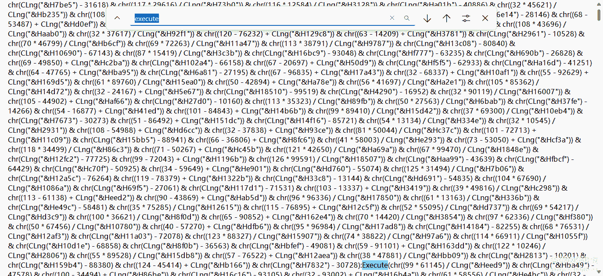

Pasted image 20251123174856.png (132.88 KB, 下载次数: 1)

[href="forum.php?mod=attachment&aid=MjgyMTA1M3wwMjRmYTFlMHwxNzkzNTcwMzAwfDE2ODA4NnwyMDgwNDI1&nothumb=yes" target="_blank"](https://www.52pojie.cn/forum.php?mod=attachment&aid=MjgyMTA1M3wwMjRmYTFlMHwxNzkzNTcwMzAwfDE2ODA4NnwyMDgwNDI1&nothumb=yes)

856

2025-12-16 22:10 上传

- 把`execute`换成`wscript.echo`，在根目录下运行`cmd`，输入`cscript 1.vbs`

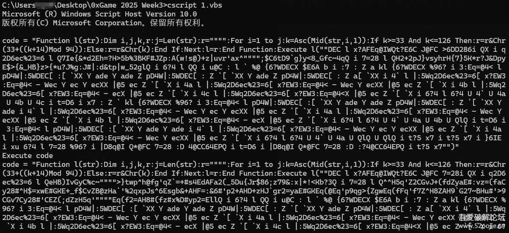

Pasted image 20251123175110.png (384.65 KB, 下载次数: 1)

[href="forum.php?mod=attachment&aid=MjgyMTA1MnwxMWQ5YWI2NXwxNzkzNTcwMzAwfDE2ODA4NnwyMDgwNDI1&nothumb=yes" target="_blank"](https://www.52pojie.cn/forum.php?mod=attachment&aid=MjgyMTA1MnwxMWQ5YWI2NXwxNzkzNTcwMzAwfDE2ODA4NnwyMDgwNDI1&nothumb=yes)

110

2025-12-16 22:10 上传

- 复制回`1.vbs`

- 继续替换，直到出现正常的代码

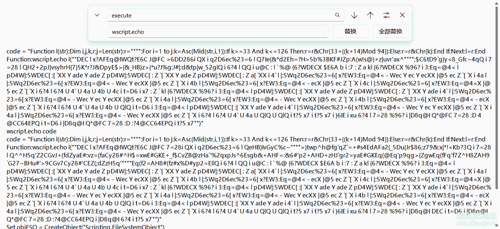

Pasted image 20251123175411.png (113.67 KB, 下载次数: 1)

[href="forum.php?mod=attachment&aid=MjgyMTA1MXw5M2YwMDM3Y3wxNzkzNTcwMzAwfDE2ODA4NnwyMDgwNDI1&nothumb=yes" target="_blank"](https://www.52pojie.cn/forum.php?mod=attachment&aid=MjgyMTA1MXw5M2YwMDM3Y3wxNzkzNTcwMzAwfDE2ODA4NnwyMDgwNDI1&nothumb=yes)

411

2025-12-16 22:10 上传

- 这里再运行一遍，还需要替换一遍再运行，才能得到

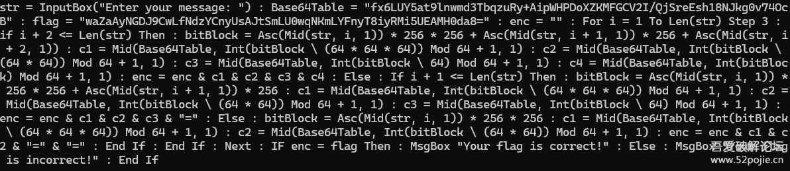

Pasted image 20251123175737.png (144.81 KB, 下载次数: 1)

[href="forum.php?mod=attachment&aid=MjgyMTA1MHw3OGFjODZkMHwxNzkzNTcwMzAwfDE2ODA4NnwyMDgwNDI1&nothumb=yes" target="_blank"](https://www.52pojie.cn/forum.php?mod=attachment&aid=MjgyMTA1MHw3OGFjODZkMHwxNzkzNTcwMzAwfDE2ODA4NnwyMDgwNDI1&nothumb=yes)

737

2025-12-16 22:10 上传

- 然后交给赛博厨子

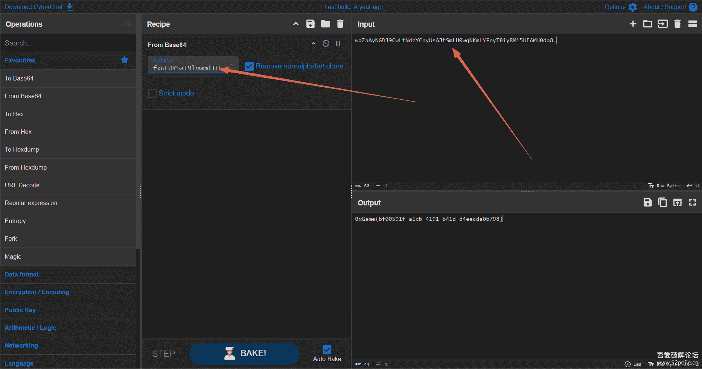

Pasted image 20251123175846.png (98.22 KB, 下载次数: 1)

[href="forum.php?mod=attachment&aid=MjgyMTA0OXw4MWVhOGUzNnwxNzkzNTcwMzAwfDE2ODA4NnwyMDgwNDI1&nothumb=yes" target="_blank"](https://www.52pojie.cn/forum.php?mod=attachment&aid=MjgyMTA0OXw4MWVhOGUzNnwxNzkzNTcwMzAwfDE2ODA4NnwyMDgwNDI1&nothumb=yes)

846

2025-12-16 22:10 上传

## Q(≧▽≦)T

- 先运行一下`exe`文件，发现是输入账户密码类型的，我先用`exeinfope`看了下有没有壳，发现没有，就拖进了`dbg`，然后搜索了下字符串

- 中文乱码的话需要安装插件，`x64dbg_tol`

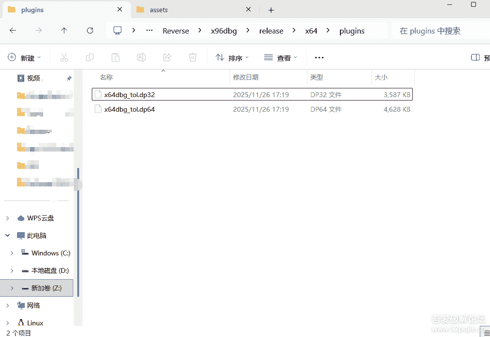

Pasted image 20251127214115.png (48.9 KB, 下载次数: 1)

[href="forum.php?mod=attachment&aid=MjgyMTAyOHw0MWQyODJjMnwxNzkzNTcwMzAwfDE2ODA4NnwyMDgwNDI1&nothumb=yes" target="_blank"](https://www.52pojie.cn/forum.php?mod=attachment&aid=MjgyMTAyOHw0MWQyODJjMnwxNzkzNTcwMzAwfDE2ODA4NnwyMDgwNDI1&nothumb=yes)

115

2025-12-16 22:09 上传

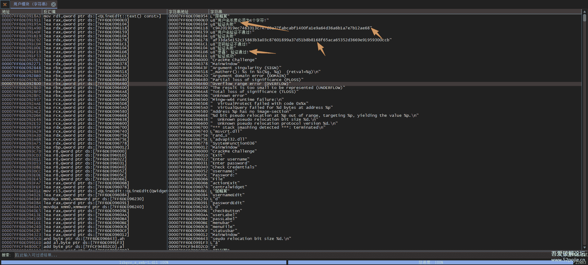

Pasted image 20251127135638.png (229.56 KB, 下载次数: 1)

[href="forum.php?mod=attachment&aid=MjgyMTA0OHw2OTYxN2EzN3wxNzkzNTcwMzAwfDE2ODA4NnwyMDgwNDI1&nothumb=yes" target="_blank"](https://www.52pojie.cn/forum.php?mod=attachment&aid=MjgyMTA0OHw2OTYxN2EzN3wxNzkzNTcwMzAwfDE2ODA4NnwyMDgwNDI1&nothumb=yes)

638

2025-12-16 22:10 上传

- 很明显有两个加密后的字符串以及各种提醒文字

- 如果运行了或者看到这个提醒就知道，用户名是四位数字的，我们输出1234试一试，在这之前先打个断点

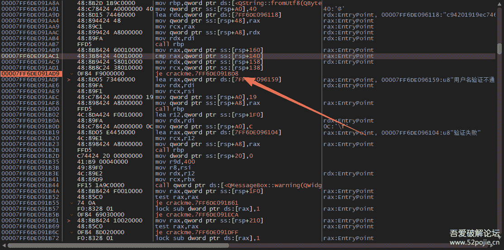

Pasted image 20251127141800.png (158.36 KB, 下载次数: 1)

[href="forum.php?mod=attachment&aid=MjgyMTA0N3w1ZTFhMjk3YnwxNzkzNTcwMzAwfDE2ODA4NnwyMDgwNDI1&nothumb=yes" target="_blank"](https://www.52pojie.cn/forum.php?mod=attachment&aid=MjgyMTA0N3w1ZTFhMjk3YnwxNzkzNTcwMzAwfDE2ODA4NnwyMDgwNDI1&nothumb=yes)

800

2025-12-16 22:10 上传

- 运行后发现这个不是判定用户名是否正确的，而是下面的代码，到达断点后用`f7`到下面（记得先`f9`运行一下）

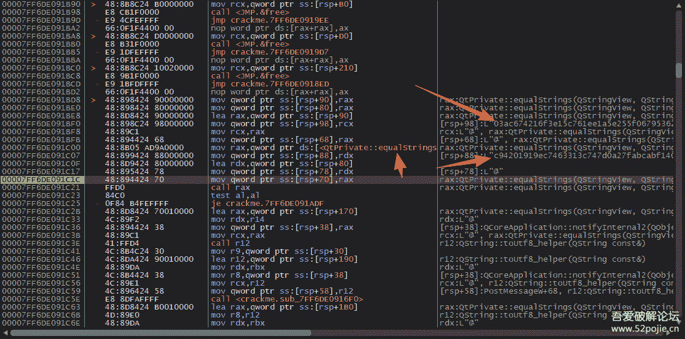

Pasted image 20251127141947.png (175.87 KB, 下载次数: 1)

[href="forum.php?mod=attachment&aid=MjgyMTA0Nnw4MzlmOTNhOXwxNzkzNTcwMzAwfDE2ODA4NnwyMDgwNDI1&nothumb=yes" target="_blank"](https://www.52pojie.cn/forum.php?mod=attachment&aid=MjgyMTA0Nnw4MzlmOTNhOXwxNzkzNTcwMzAwfDE2ODA4NnwyMDgwNDI1&nothumb=yes)

947

2025-12-16 22:10 上传

- 看到这里应该可以猜出是判断是否相等，看了之前的字符串，就知道03ac674216f3e15c761ee1a5e255f067953623c8b388b4459e13f978d7c846f4是我们输入的1234加密后的字符串

- 我们去赛博厨子跑一下

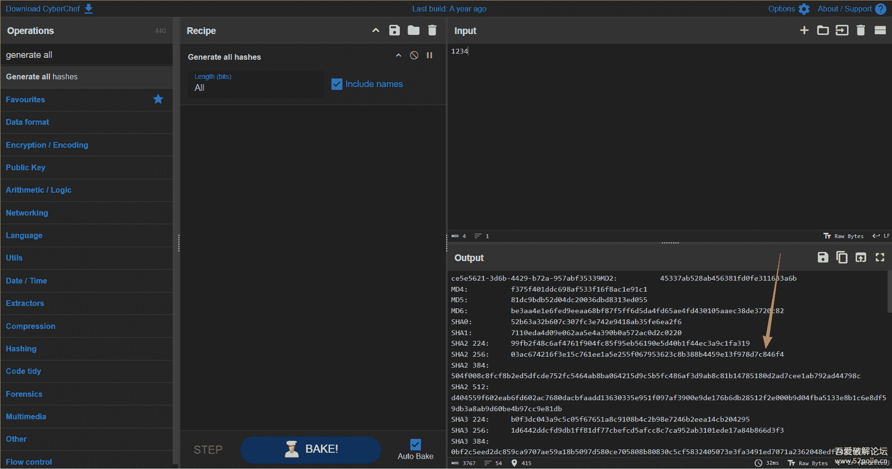

Pasted image 20251127142147.png (130.85 KB, 下载次数: 1)

[href="forum.php?mod=attachment&aid=MjgyMTA0NXw2OWM0NGNlMnwxNzkzNTcwMzAwfDE2ODA4NnwyMDgwNDI1&nothumb=yes" target="_blank"](https://www.52pojie.cn/forum.php?mod=attachment&aid=MjgyMTA0NXw2OWM0NGNlMnwxNzkzNTcwMzAwfDE2ODA4NnwyMDgwNDI1&nothumb=yes)

147

2025-12-16 22:10 上传

- 发现是SHA-256，我们就可以找一个在线平台破解一下之前的SHA-256

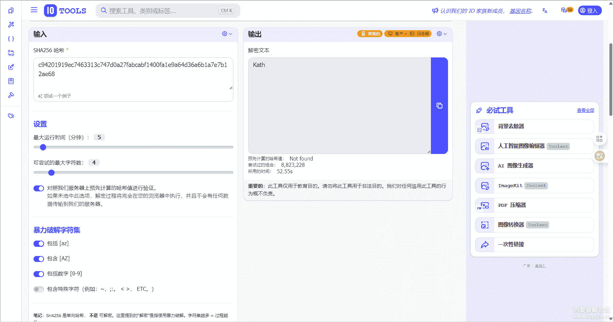

Pasted image 20251127142521.png (167.24 KB, 下载次数: 1)

[href="forum.php?mod=attachment&aid=MjgyMTA0NHwwY2FiYWY0YXwxNzkzNTcwMzAwfDE2ODA4NnwyMDgwNDI1&nothumb=yes" target="_blank"](https://www.52pojie.cn/forum.php?mod=attachment&aid=MjgyMTA0NHwwY2FiYWY0YXwxNzkzNTcwMzAwfDE2ODA4NnwyMDgwNDI1&nothumb=yes)

521

2025-12-16 22:10 上传

- 就得到了用户名

- 然后就去找关于密码的字符串继续看相应内容

- 转到相应的反汇编之后，会发现只有上面的函数和密码加密相关

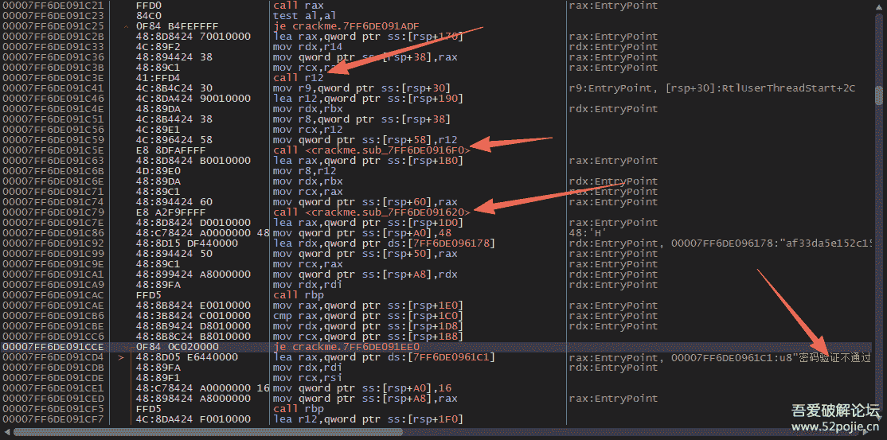

Pasted image 20251127142743.png (159.67 KB, 下载次数: 1)

[href="forum.php?mod=attachment&aid=MjgyMTA0M3w3OWM4ZmFlOXwxNzkzNTcwMzAwfDE2ODA4NnwyMDgwNDI1&nothumb=yes" target="_blank"](https://www.52pojie.cn/forum.php?mod=attachment&aid=MjgyMTA0M3w3OWM4ZmFlOXwxNzkzNTcwMzAwfDE2ODA4NnwyMDgwNDI1&nothumb=yes)

743

2025-12-16 22:10 上传

- 然后就可以把`exe`丢到`IDA`分析一下了

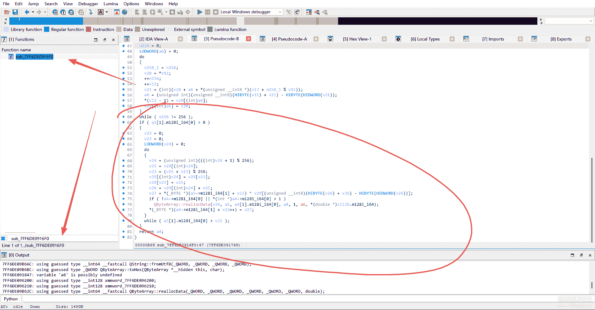

Pasted image 20251127143005.png (181.47 KB, 下载次数: 1)

[href="forum.php?mod=attachment&aid=MjgyMTA0MnxlNWJiYzU0Y3wxNzkzNTcwMzAwfDE2ODA4NnwyMDgwNDI1&nothumb=yes" target="_blank"](https://www.52pojie.cn/forum.php?mod=attachment&aid=MjgyMTA0MnxlNWJiYzU0Y3wxNzkzNTcwMzAwfDE2ODA4NnwyMDgwNDI1&nothumb=yes)

005

2025-12-16 22:10 上传

- 最后就会发现是这个函数在进行加密

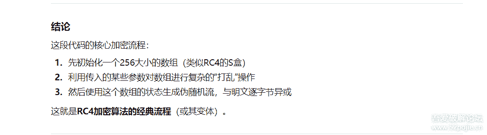

Pasted image 20251127143106.png (36.87 KB, 下载次数: 1)

[href="forum.php?mod=attachment&aid=MjgyMTA1OHxhODJlOTczZHwxNzkzNTcwMzAwfDE2ODA4NnwyMDgwNDI1&nothumb=yes" target="_blank"](https://www.52pojie.cn/forum.php?mod=attachment&aid=MjgyMTA1OHxhODJlOTczZHwxNzkzNTcwMzAwfDE2ODA4NnwyMDgwNDI1&nothumb=yes)

2025-12-16 22:16 上传

- 联系之前搜索到的字符串，去赛博厨子破解一下

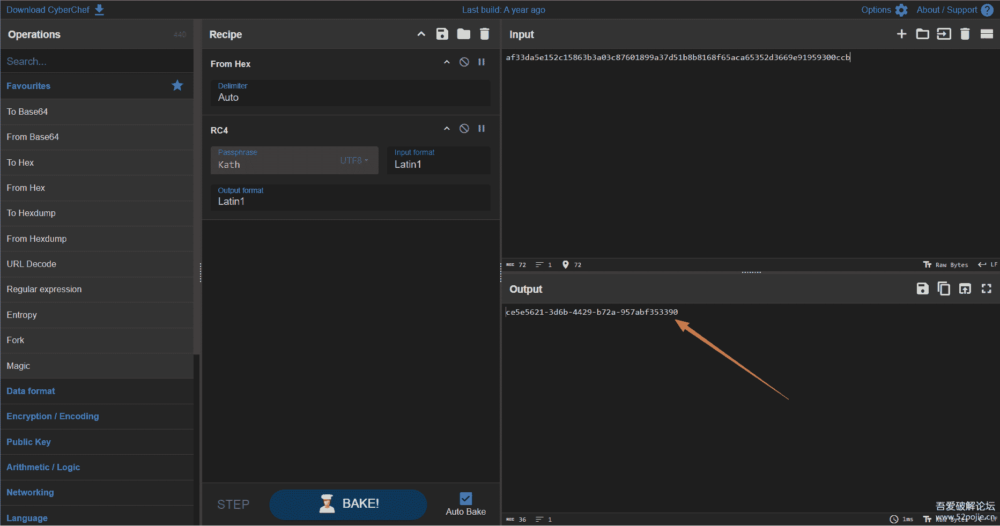

Pasted image 20251127143353.png (88.25 KB, 下载次数: 1)

[href="forum.php?mod=attachment&aid=MjgyMTA0MHxlYjUzZjRjMXwxNzkzNTcwMzAwfDE2ODA4NnwyMDgwNDI1&nothumb=yes" target="_blank"](https://www.52pojie.cn/forum.php?mod=attachment&aid=MjgyMTA0MHxlYjUzZjRjMXwxNzkzNTcwMzAwfDE2ODA4NnwyMDgwNDI1&nothumb=yes)

353

2025-12-16 22:09 上传

- 就得到了flag

- 这道题我不看官方WP根本没头绪啊:(

## Minesweeper

- 打开`ms_obfus.js`，然后把`expert`模式下的`mines`改为`0x1`，打开`hmtl`

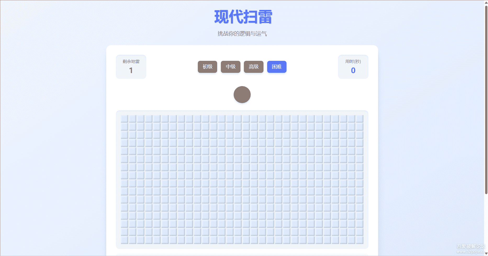

Pasted image 20251127165632.png (164.8 KB, 下载次数: 1)

[href="forum.php?mod=attachment&aid=MjgyMTAzOHwxMWNkY2ZjMHwxNzkzNTcwMzAwfDE2ODA4NnwyMDgwNDI1&nothumb=yes" target="_blank"](https://www.52pojie.cn/forum.php?mod=attachment&aid=MjgyMTAzOHwxMWNkY2ZjMHwxNzkzNTcwMzAwfDE2ODA4NnwyMDgwNDI1&nothumb=yes)

632

2025-12-16 22:09 上传

- 剩余地雷为1就成功了，随便点一下

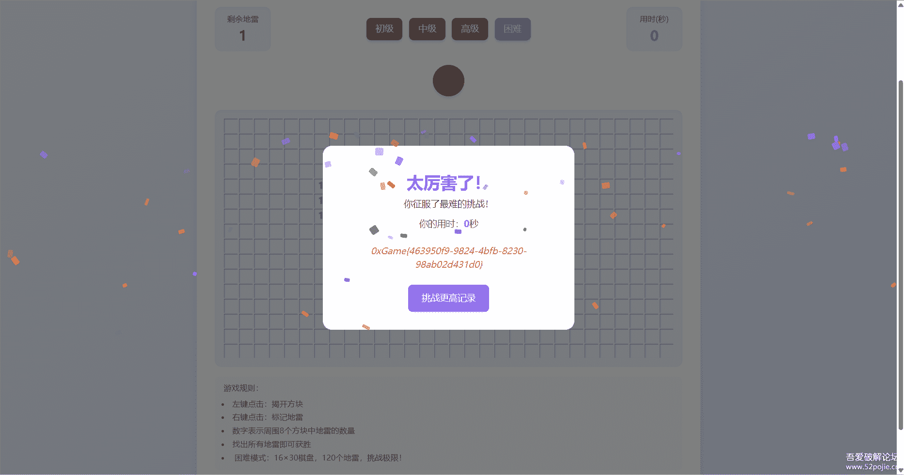

Pasted image 20251127165657.png (150.87 KB, 下载次数: 1)

[href="forum.php?mod=attachment&aid=MjgyMTAzN3wxMjdiYTBiZHwxNzkzNTcwMzAwfDE2ODA4NnwyMDgwNDI1&nothumb=yes" target="_blank"](https://www.52pojie.cn/forum.php?mod=attachment&aid=MjgyMTAzN3wxMjdiYTBiZHwxNzkzNTcwMzAwfDE2ODA4NnwyMDgwNDI1&nothumb=yes)

657

2025-12-16 22:09 上传

- 用`chatgpt`也可以直接出

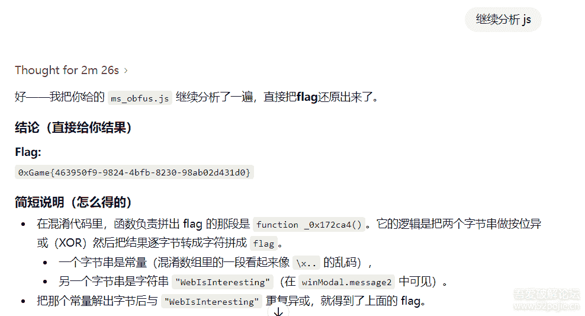

Pasted image 20251127171318.png (66.85 KB, 下载次数: 1)

[href="forum.php?mod=attachment&aid=MjgyMTAzNHxmZTc4YWU5OHwxNzkzNTcwMzAwfDE2ODA4NnwyMDgwNDI1&nothumb=yes" target="_blank"](https://www.52pojie.cn/forum.php?mod=attachment&aid=MjgyMTAzNHxmZTc4YWU5OHwxNzkzNTcwMzAwfDE2ODA4NnwyMDgwNDI1&nothumb=yes)

318

2025-12-16 22:09 上传

## easyApp

- 下个手机模拟器安装一下，就会发现是个输入+校验的程序

- 可以用`jadx`进行分析

- 接下来先看`AndroidManifest.xml`这个文件，它实际上是⼀个`apk`的配置文件，里面存储了`apk`的很多信息，包括程序入口点，我们要分析程序的执行逻辑，就得先找到程序的入口点

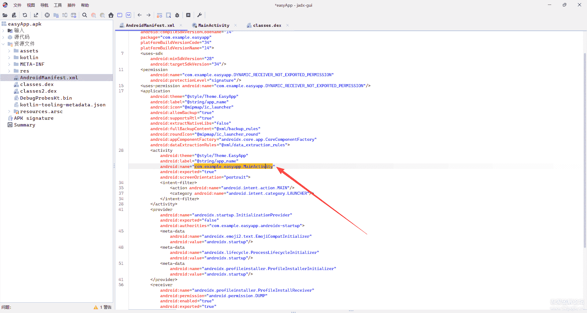

Pasted image 20251127170835.png (170.61 KB, 下载次数: 1)

[href="forum.php?mod=attachment&aid=MjgyMTAzNnxmMWExMzMwNXwxNzkzNTcwMzAwfDE2ODA4NnwyMDgwNDI1&nothumb=yes" target="_blank"](https://www.52pojie.cn/forum.php?mod=attachment&aid=MjgyMTAzNnxmMWExMzMwNXwxNzkzNTcwMzAwfDE2ODA4NnwyMDgwNDI1&nothumb=yes)

835

2025-12-16 22:09 上传

- 这个就是入口了，双击可以跳转

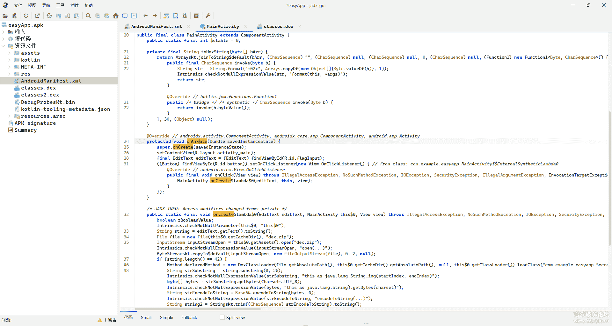

Pasted image 20251127170936.png (232.99 KB, 下载次数: 1)

[href="forum.php?mod=attachment&aid=MjgyMTAzNXxkMTAxZmVjNHwxNzkzNTcwMzAwfDE2ODA4NnwyMDgwNDI1&nothumb=yes" target="_blank"](https://www.52pojie.cn/forum.php?mod=attachment&aid=MjgyMTAzNXxkMTAxZmVjNHwxNzkzNTcwMzAwfDE2ODA4NnwyMDgwNDI1&nothumb=yes)

936

2025-12-16 22:09 上传

- `onCreat`相当于c语言的`main`函数，就是入口函数

- 直接把代码丢给`chatgpt` :)

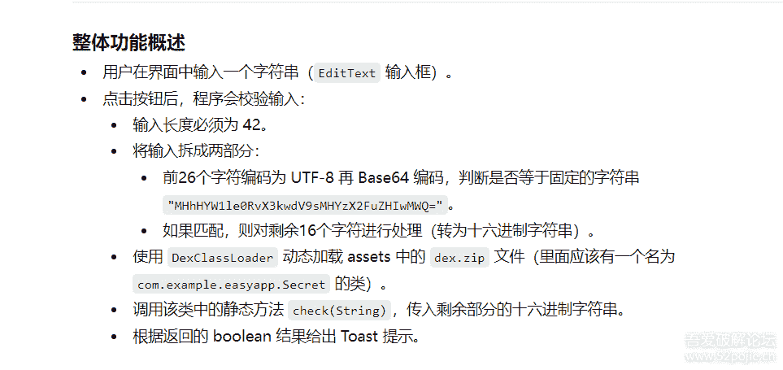

Pasted image 20251127171403.png (58.6 KB, 下载次数: 1)

[href="forum.php?mod=attachment&aid=MjgyMTAzM3xkNjliNTEyZnwxNzkzNTcwMzAwfDE2ODA4NnwyMDgwNDI1&nothumb=yes" target="_blank"](https://www.52pojie.cn/forum.php?mod=attachment&aid=MjgyMTAzM3xkNjliNTEyZnwxNzkzNTcwMzAwfDE2ODA4NnwyMDgwNDI1&nothumb=yes)

403

2025-12-16 22:09 上传

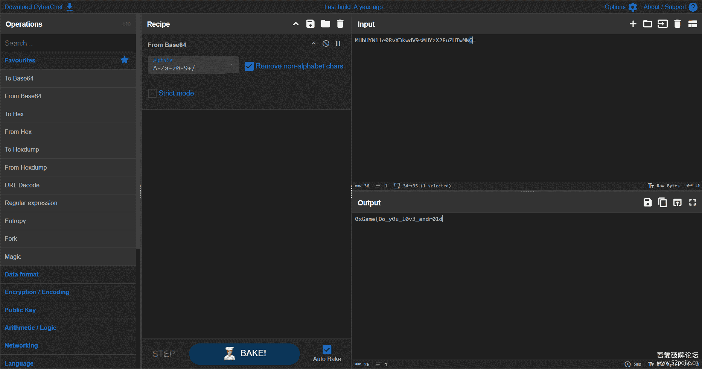

Pasted image 20251127171410.png (82.32 KB, 下载次数: 1)

[href="forum.php?mod=attachment&aid=MjgyMTAzMnwyNDRiNjgwMHwxNzkzNTcwMzAwfDE2ODA4NnwyMDgwNDI1&nothumb=yes" target="_blank"](https://www.52pojie.cn/forum.php?mod=attachment&aid=MjgyMTAzMnwyNDRiNjgwMHwxNzkzNTcwMzAwfDE2ODA4NnwyMDgwNDI1&nothumb=yes)

410

2025-12-16 22:09 上传

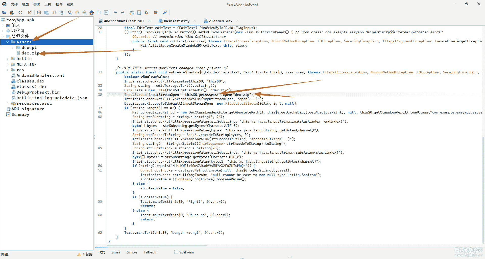

Pasted image 20251127171545.png (233.65 KB, 下载次数: 1)

[href="forum.php?mod=attachment&aid=MjgyMTAzMXw4ODc4MDllNnwxNzkzNTcwMzAwfDE2ODA4NnwyMDgwNDI1&nothumb=yes" target="_blank"](https://www.52pojie.cn/forum.php?mod=attachment&aid=MjgyMTAzMXw4ODc4MDllNnwxNzkzNTcwMzAwfDE2ODA4NnwyMDgwNDI1&nothumb=yes)

545

2025-12-16 22:09 上传

- 直接解压`apk`，会发现目录和这个反编译目录一样

- 然后把解压出来的`bin`文件继续拖到`jadx`

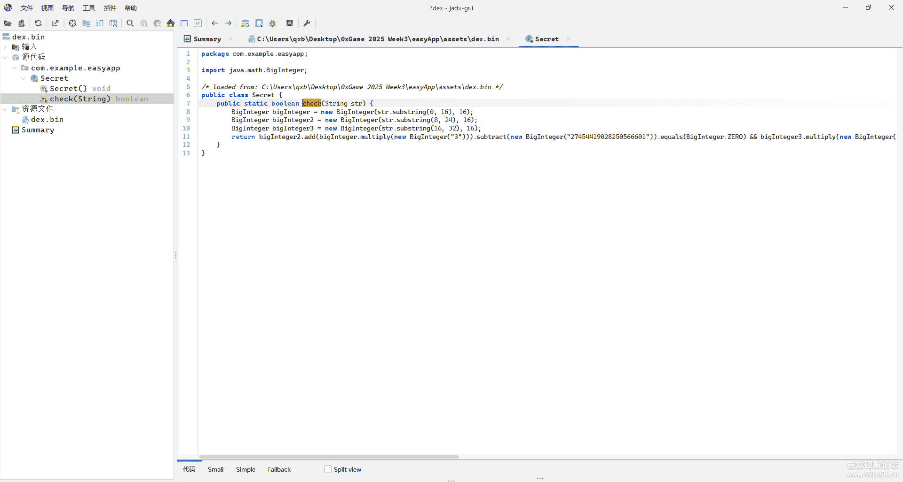

Pasted image 20251127171712.png (90.29 KB, 下载次数: 1)

[href="forum.php?mod=attachment&aid=MjgyMTAzMHxkMWQ2MDY3NXwxNzkzNTcwMzAwfDE2ODA4NnwyMDgwNDI1&nothumb=yes" target="_blank"](https://www.52pojie.cn/forum.php?mod=attachment&aid=MjgyMTAzMHxkMWQ2MDY3NXwxNzkzNTcwMzAwfDE2ODA4NnwyMDgwNDI1&nothumb=yes)

712

2025-12-16 22:09 上传

- 用一下官方WP的脚本

```


```python
from z3 import *

a,b,c = Ints("a b c")
s = Solver()
s.add(a*3 + b - 27454419028250566601 == 0)
s.add(c*2 - 5*b + 20616666104378640363 == 0)
s.add(a + 4*c - 0x1dce62be9f0fa2f6c == 0)

if s.check() == sat:
    result = s.model()
    for var in (a,c):
        print(hex(result[var].as_long())[2:],end="")

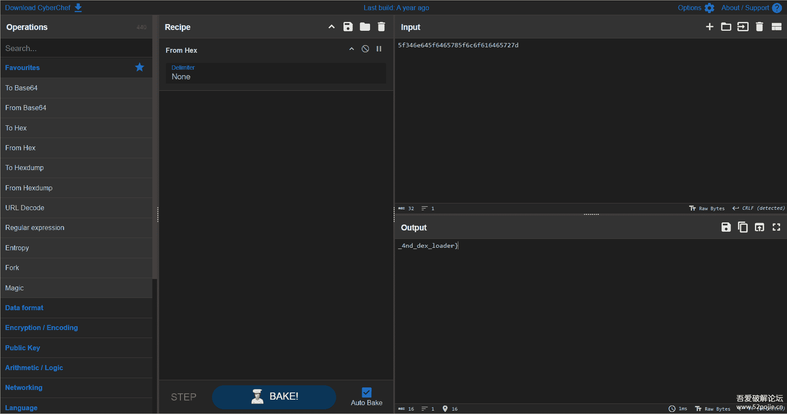


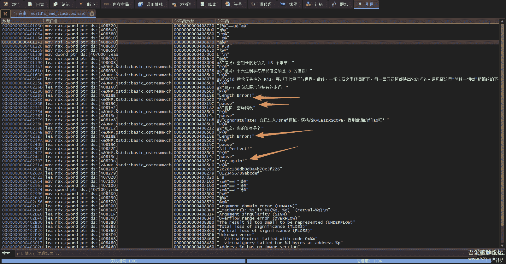


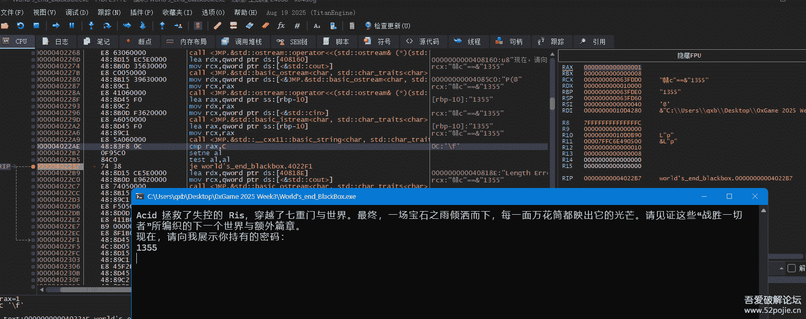


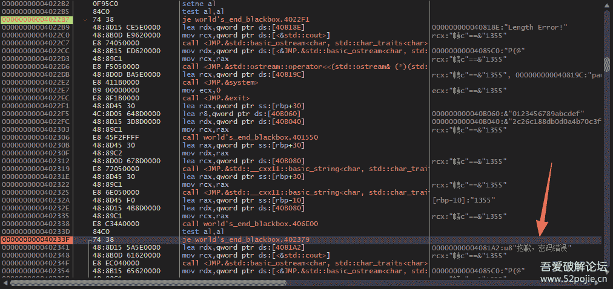


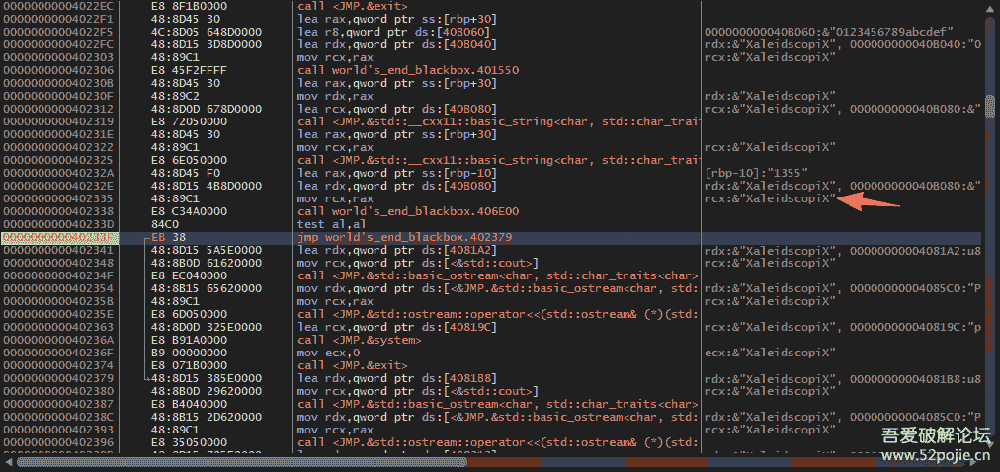


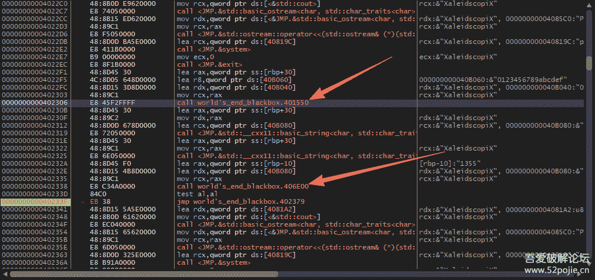


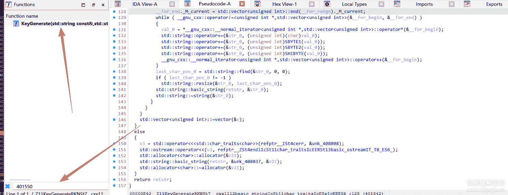


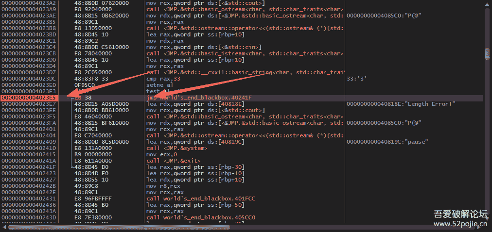


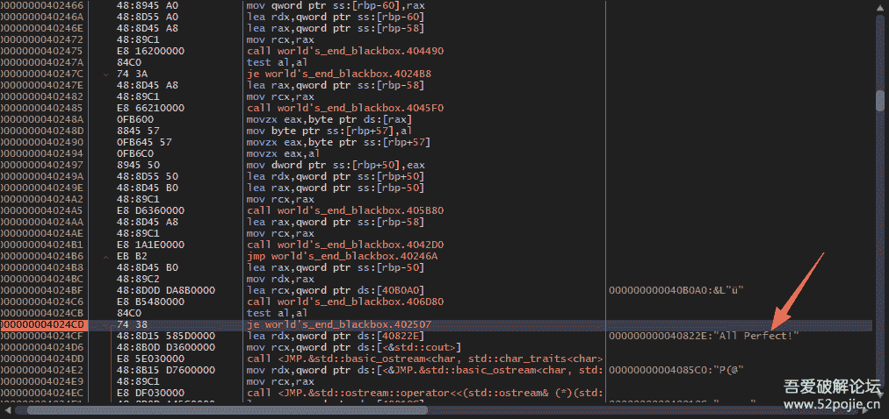


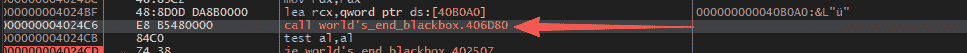


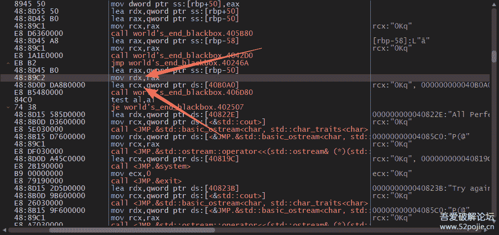


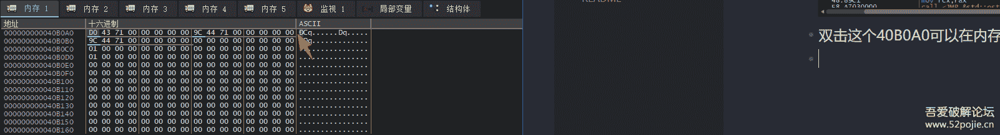


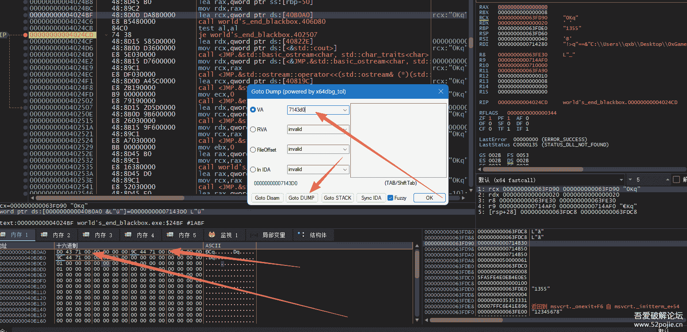


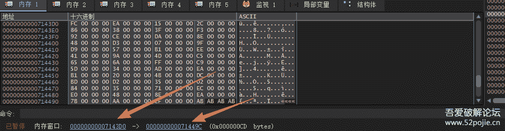


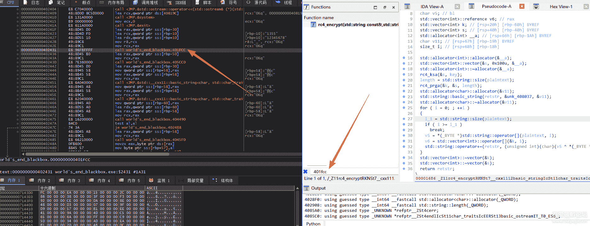

```
[`Pasted image 20251127172417.png` (73.15 KB, 下载次数: 1)](https://www.52pojie.cn/forum.php?mod=attachment&aid=MjgyMTAyOXw3NmJjMDg2ZXwxNzkzNTcwMzAwfDE2ODA4NnwyMDgwNDI1&nothumb=yes)

417  
2025-12-16 22:09 上传

## 2> World's_end_BlackBox

- 先用 `exeinfope` 看看有没有壳，发现没壳，拖进 `ida` 发现也看不懂
- 直接拖进 `dbg` 搜索一下字符串
[`Pasted image 20251129114046.png` (197.35 KB, 下载次数: 1)](https://www.52pojie.cn/forum.php?mod=attachment&aid=MjgyMTAyN3w4MzdkNGJlZnwxNzkzNTcwMzAwfDE2ODA4NnwyMDgwNDI1&nothumb=yes)

046  
2025-12-16 22:09 上传

- 发现是输入两段字符串
- 把两段 `Length Error` 处上面的代码打上断点
- 然后双击到第一个 `length error` 处
- 发现他是在对比我们第一个输入的字符串长度，`f9` 运行到这里
- 按空格将 `jz` 改为 `jmp`
[`Pasted image 20251205211719.png` (185.24 KB, 下载次数: 1)](https://www.52pojie.cn/forum.php?mod=attachment&aid=MjgyMTAyNnw2NGU4Yzg1ZnwxNzkzNTcwMzAwfDE2ODA4NnwyMDgwNDI1&nothumb=yes)

719  
2025-12-16 22:09 上传

- 这里其实可以看到应该是长度为 12 才能过（`0xC=12`）
[`Pasted image 20251205212119.png` (8.33 KB, 下载次数: 1)](https://www.52pojie.cn/forum.php?mod=attachment&aid=MjgyMTAyNHxkZDU1YjUzMnwxNzkzNTcwMzAwfDE2ODA4NnwyMDgwNDI1&nothumb=yes)

119  
2025-12-16 22:09 上传

- 往下翻一翻会发现下面有个密码错误，在它上方打个断点
[`Pasted image 20251205211831.png` (114.93 KB, 下载次数: 1)](https://www.52pojie.cn/forum.php?mod=attachment&aid=MjgyMTAyNXw1NTBjZjc3ZHwxNzkzNTcwMzAwfDE2ODA4NnwyMDgwNDI1&nothumb=yes)

831  
2025-12-16 22:09 上传

- 那很明显这是在对比密码正确与否，这时候按 `f9` 就能看到正确密码了
- 这里也需要改下汇编和上面一致
[`Pasted image 20251205212158.png` (124.35 KB, 下载次数: 1)](https://www.52pojie.cn/forum.php?mod=attachment&aid=MjgyMTAyM3xmMzAwNzI4YnwxNzkzNTcwMzAwfDE2ODA4NnwyMDgwNDI1&nothumb=yes)

158  
2025-12-16 22:09 上传

- 这里就显示了正确密码，如果你想要知道这个密码哪里来的
- 也很简单，看上方的每个函数，应该调用了两个函数，我们会发现第一个函数就是加密函数，采用的是 `xxtea`
[`Pasted image 20251205212345.png` (129.75 KB, 下载次数: 1)](https://www.52pojie.cn/forum.php?mod=attachment&aid=MjgyMTAyMnxjZTMwNThlMXwxNzkzNTcwMzAwfDE2ODA4NnwyMDgwNDI1&nothumb=yes)

345  
2025-12-16 22:09 上传
[`Pasted image 20251205212402.png` (109.85 KB, 下载次数: 1)](https://www.52pojie.cn/forum.php?mod=attachment&aid=MjgyMTAyMXw2ZjZmMjExNHwxNzkzNTcwMzAwfDE2ODA4NnwyMDgwNDI1&nothumb=yes)

402  
2025-12-16 22:09 上传

- 接着往下走会发现还有个长度错误
- 接着断点，改汇编，`f9`
[`Pasted image 20251205212612.png` (105.59 KB, 下载次数: 1)](https://www.52pojie.cn/forum.php?mod=attachment&aid=MjgyMTAyMHxkNTBjMDcwOXwxNzkzNTcwMzAwfDE2ODA4NnwyMDgwNDI1&nothumb=yes)

612  
2025-12-16 22:09 上传

- 接着往下看会发现有个 `all perfect` 的字样
- 在它上方打上断点
[`Pasted image 20251205212735.png` (101.07 KB, 下载次数: 1)](https://www.52pojie.cn/forum.php?mod=attachment&aid=MjgyMTAxOXxhMmY2YzFlN3wxNzkzNTcwMzAwfDE2ODA4NnwyMDgwNDI1&nothumb=yes)

735  
2025-12-16 22:09 上传

- 你会发现这两个断点之前有很多内容，但是真正重要的只有
[`Pasted image 20251205212808.png` (10.09 KB, 下载次数: 1)](https://www.52pojie.cn/forum.php?mod=attachment&aid=MjgyMTAxOHwwMWY3M2UxYnwxNzkzNTcwMzAwfDE2ODA4NnwyMDgwNDI1&nothumb=yes)

808  
2025-12-16 22:09 上传

- 这个函数，以及它上方的存储的东西
- 这里 `f9` 运行到刚打的断点，在这之前先在 `cmd` 框里输入点东西，因为之前那一大段内容现在用不到，这一部分是加密的
- 接下来就是看这个 `406D80` 的函数，看上面的汇编应该可以知道是传入了两个参数，一个是读取你的，一个是它自带的
[`Pasted image 20251205213242.png` (115.72 KB, 下载次数: 1)](https://www.52pojie.cn/forum.php?mod=attachment&aid=MjgyMTAxN3wyYjc3MjQ4ZXwxNzkzNTcwMzAwfDE2ODA4NnwyMDgwNDI1&nothumb=yes)

242  
2025-12-16 22:09 上传

- 双击这个 `40B0A0` 可以在内存框中看他存储了什么东西
[`Pasted image 20251205213451.png` (38.67 KB, 下载次数: 1)](https://www.52pojie.cn/forum.php?mod=attachment&aid=MjgyMTA1N3w3NzgzNTBjMXwxNzkzNTcwMzAwfDE2ODA4NnwyMDgwNDI1&nothumb=yes)

451  
2025-12-16 22:10 上传

- 两个值
- 然后进入 `406D80` 后，可以知道那里面就是对比长度和内容的。也可以得知这两个值相当于指针，从开始到结束
- 第一个是开始，第二个是结束，`CTRL+g` 进行跳转
[`Pasted image 20251205214825.png` (224.39 KB, 下载次数: 1)](https://www.52pojie.cn/forum.php?mod=attachment&aid=MjgyMTA1NnxhZjhjYWE1NnwxNzkzNTcwMzAwfDE2ODA4NnwyMDgwNDI1&nothumb=yes)

825  
2025-12-16 22:10 上传
[`Pasted image 20251205215713.png` (40.57 KB, 下载次数: 1)](https://www.52pojie.cn/forum.php?mod=attachment&aid=MjgyMTA1NXw1OTY1ZDUyMHwxNzkzNTcwMzAwfDE2ODA4NnwyMDgwNDI1&nothumb=yes)

713  
2025-12-16 22:10 上传

- 就找到了这段加密字符
- ok，返回到之前那两个断点之前一大段的汇编那里
- 会发现 `401fcc` 是加密函数
[`Pasted image 20251205221141.png` (245.28 KB, 下载次数: 1)](https://www.52pojie.cn/forum.php?mod=attachment&aid=MjgyMTA1NHw3YTVjMDg3N3wxNzkzNTcwMzAwfDE2ODA4NnwyMDgwNDI1&nothumb=yes)

141  
2025-12-16 22:10 上传

- 这里给出官方的WP脚本

```
flag = [
0xFC, 0xEA, 0x15, 0x2C, 0x86, 0x38, 0x3F, 0xF3, 0x92, 0xCE, 0xDA, 0x8E, 0x48, 0xD3, 0x7, 0x9F,
0xD9, 0x57, 0xB1, 0xEE, 0x41, 0x9A, 0x4D, 0xC5, 0x65, 0x6A, 0xFF, 0xC9, 0x5D, 0x34, 0xAD, 0xEA,
0xB1, 0x20, 0x4B, 0xDC, 0xBD, 0xD2, 0x35, 0x2, 0x84, 0x35, 0x71, 0xEC, 0xE0, 0x48, 0x8E, 0xEA,
0x7B, 0xAA, 0xCF
]
key = "XaleidscopiX"
s = []
t = []
# KSA Initialization
for i in range(256):
s.append(i)
t.append(ord(key[i % len(key)]))
# KSA Scrambling
j = 0
for i in range(256):
j = (j + s[i] + t[i]) % 256
s[i], s[j] = s[j], s[i]
k = []
i = 0
j = 0
# PRGA Keystream Generation
for r in range(len(flag)):
i = (i + 1) % 256
j = (j + s[i]) % 256
s[i], s[j] = s[j], s[i]
t_val = (s[i] + s[j]) % 256  # 使用 t_val 避免与全局列表 t 混淆
k.append(s[t_val])
# Decryption (Final XOR operation)
for idx in range(len(flag)):
# Decryption formula: (Ciphertext XOR Keystream XOR 7)
decrypted_byte = (flag[idx] ^ k[idx] ^ 7)
print(chr(decrypted_byte), end='')
```

## 2> Calamity_Fortune

- 嘿嘿，这道题偷个小懒，看官方的WP吧，那个WP挺详细的了！

官方WP上传到网盘了

链接：https://pan.quark.cn/s/9d43fd9b16e3?pwd=gk2Y

提取码：gk2Y

Week4的WP我应该是不会更新了，对我来说有点困难了，已经复现一个多星期了，还没搞懂

过于依赖AI是不对的，我也只是来辅助我快速学习用而已，不要过度依赖= =
