# [Web逆向] 【JS逆向】某大型电商平台参数逆向分析

- 原帖: https://www.52pojie.cn/forum.php?mod=viewthread&tid=2082647
- 抓取时间: 2026-11-01T21:58:08

## 声明

本文章中所有内容仅供学习交流使用，不用于其他任何目的，严禁用于商业用途和非法用途，否则由此产生的一切后果均与作者无关！若有侵权，请联系作者删除。

## 网址

aHR0cHM6Ly93d3cuamQuY29t

## 分析

这里用第一个使用该参数的接口进行分析

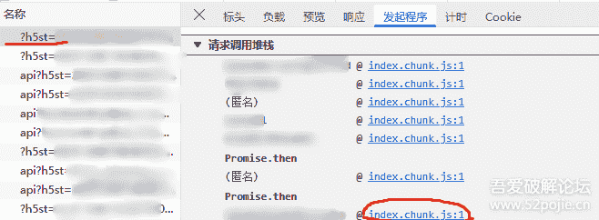

1.png (62.03 KB, 下载次数: 1)

[href="forum.php?mod=attachment&aid=MjgyMzE5NXw3ZjI4YmYxMHwxNzkzNTcwMjg2fDE2ODA4NnwyMDgyNjQ3&nothumb=yes" target="_blank"](https://www.52pojie.cn/forum.php?mod=attachment&aid=MjgyMzE5NXw3ZjI4YmYxMHwxNzkzNTcwMjg2fDE2ODA4NnwyMDgyNjQ3&nothumb=yes)

2025-12-26 17:32 上传

进到加密位置

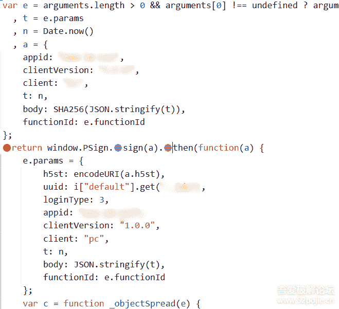

2.png (53.7 KB, 下载次数: 1)

[href="forum.php?mod=attachment&aid=MjgyMzE5OXw2M2Y0ZGEyZXwxNzkzNTcwMjg2fDE2ODA4NnwyMDgyNjQ3&nothumb=yes" target="_blank"](https://www.52pojie.cn/forum.php?mod=attachment&aid=MjgyMzE5OXw2M2Y0ZGEyZXwxNzkzNTcwMjg2fDE2ODA4NnwyMDgyNjQ3&nothumb=yes)

2025-12-26 17:44 上传

跟代码进到`sdmnd`（总感觉coder在骂街）

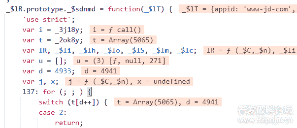

3.png (31.97 KB, 下载次数: 1)

[href="forum.php?mod=attachment&aid=MjgyMzIwNXxiMDY4YTVjZnwxNzkzNTcwMjg2fDE2ODA4NnwyMDgyNjQ3&nothumb=yes" target="_blank"](https://www.52pojie.cn/forum.php?mod=attachment&aid=MjgyMzIwNXxiMDY4YTVjZnwxNzkzNTcwMjg2fDE2ODA4NnwyMDgyNjQ3&nothumb=yes)

2025-12-26 17:58 上传

给这个模块内所有的`call`和函数打上断点（如下所示）

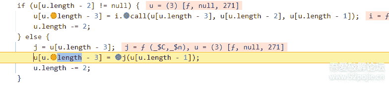

4.png (22 KB, 下载次数: 1)

[href="forum.php?mod=attachment&aid=MjgyMzIwNnxmMmExZGFlMXwxNzkzNTcwMjg2fDE2ODA4NnwyMDgyNjQ3&nothumb=yes" target="_blank"](https://www.52pojie.cn/forum.php?mod=attachment&aid=MjgyMzIwNnxmMmExZGFlMXwxNzkzNTcwMjg2fDE2ODA4NnwyMDgyNjQ3&nothumb=yes)

2025-12-26 18:03 上传

经过一通`f8` `f9`操作后我们能看到生成`fp`的函数

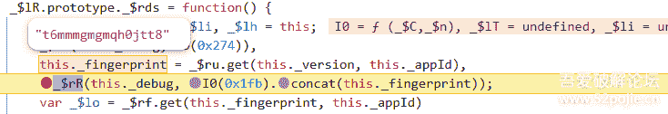

image.png (29.2 KB, 下载次数: 1)

[href="forum.php?mod=attachment&aid=MjgyMzIwOHw5ZjQ5YWUzNHwxNzkzNTcwMjg2fDE2ODA4NnwyMDgyNjQ3&nothumb=yes" target="_blank"](https://www.52pojie.cn/forum.php?mod=attachment&aid=MjgyMzIwOHw5ZjQ5YWUzNHwxNzkzNTcwMjg2fDE2ODA4NnwyMDgyNjQ3&nothumb=yes)

2025-12-26 18:09 上传

继续进行`f8` `f9`我们会发现

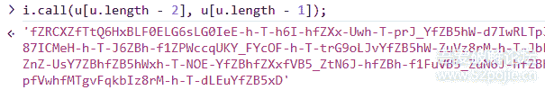

image.png (22 KB, 下载次数: 1)

[href="forum.php?mod=attachment&aid=MjgyMzIyM3xiZTM5ODhmZHwxNzkzNTcwMjg2fDE2ODA4NnwyMDgyNjQ3&nothumb=yes" target="_blank"](https://www.52pojie.cn/forum.php?mod=attachment&aid=MjgyMzIyM3xiZTM5ODhmZHwxNzkzNTcwMjg2fDE2ODA4NnwyMDgyNjQ3&nothumb=yes)

2025-12-26 21:02 上传

跟进去会找到生成模块，依旧在`call`和函数打上断点

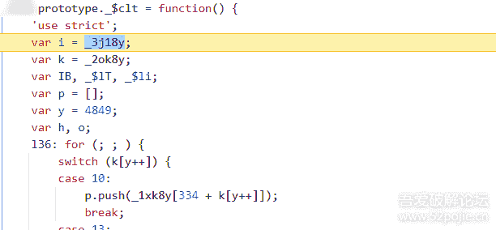

8.png (23.62 KB, 下载次数: 1)

[href="forum.php?mod=attachment&aid=MjgyMzIyNHw0NmQ0OTg0OXwxNzkzNTcwMjg2fDE2ODA4NnwyMDgyNjQ3&nothumb=yes" target="_blank"](https://www.52pojie.cn/forum.php?mod=attachment&aid=MjgyMzIyNHw0NmQ0OTg0OXwxNzkzNTcwMjg2fDE2ODA4NnwyMDgyNjQ3&nothumb=yes)

2025-12-26 21:07 上传

分析后可以知道`clt`模块是对窗口指纹信息包括`fp`进行魔改过后的`base64`编码 这里就不具体进行分析了

在`clt`后紧跟`ms`打好断点跟进代码

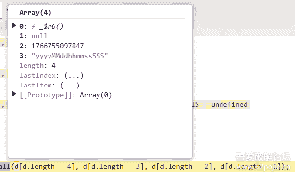

image.png (29.21 KB, 下载次数: 1)

[href="forum.php?mod=attachment&aid=MjgyMzIyNXxjMTlkNDk3Y3wxNzkzNTcwMjg2fDE2ODA4NnwyMDgyNjQ3&nothumb=yes" target="_blank"](https://www.52pojie.cn/forum.php?mod=attachment&aid=MjgyMzIyNXxjMTlkNDk3Y3wxNzkzNTcwMjg2fDE2ODA4NnwyMDgyNjQ3&nothumb=yes)

2025-12-26 21:19 上传

如上图所示 新生成一个时间戳将其转为 `yyyyMMddhhmmssSSS` 格式

继续跟代码 找到生成默认`token`的模块

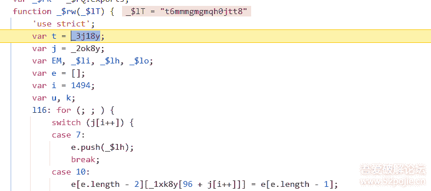

image.png (29.76 KB, 下载次数: 1)

[href="forum.php?mod=attachment&aid=MjgyMzIyNnw2ZjhjOWFiZnwxNzkzNTcwMjg2fDE2ODA4NnwyMDgyNjQ3&nothumb=yes" target="_blank"](https://www.52pojie.cn/forum.php?mod=attachment&aid=MjgyMzIyNnw2ZjhjOWFiZnwxNzkzNTcwMjg2fDE2ODA4NnwyMDgyNjQ3&nothumb=yes)

2025-12-26 21:25 上传

进一步跟进分析（这里断点少打了 为了不中断 更换浏览器来实现这部分）

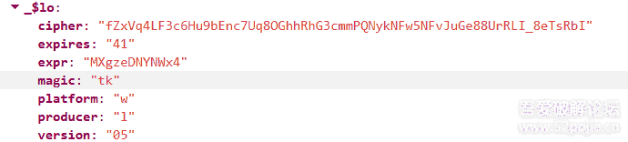

image.png (19.56 KB, 下载次数: 1)

[href="forum.php?mod=attachment&aid=MjgyMzIzNnwzNDM2MDVmMnwxNzkzNTcwMjg2fDE2ODA4NnwyMDgyNjQ3&nothumb=yes" target="_blank"](https://www.52pojie.cn/forum.php?mod=attachment&aid=MjgyMzIzNnwzNDM2MDVmMnwxNzkzNTcwMjg2fDE2ODA4NnwyMDgyNjQ3&nothumb=yes)

2025-12-26 22:05 上传

其中

`expr` 由随机生成表示三个加密算法排列组合的字符串 用随机字符串填充至固定长度 最后由 `base64`进行编码

`cipher` 由固定参数 `fp` 时间戳 随机字符串组合成新字符串（组合顺序不是这个顺序）用平台修改过的`MD5` 获得签名 这组字符串加上签名 由魔改过后的`base64`进行编码

拼接后得到并不完整的`token`

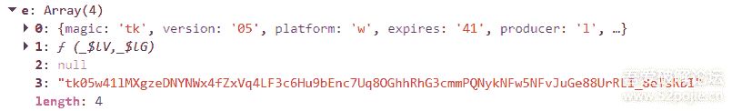

image.png (20.96 KB, 下载次数: 1)

[href="forum.php?mod=attachment&aid=MjgyMzIzOHwzNjM2NWNiZXwxNzkzNTcwMjg2fDE2ODA4NnwyMDgyNjQ3&nothumb=yes" target="_blank"](https://www.52pojie.cn/forum.php?mod=attachment&aid=MjgyMzIzOHwzNjM2NWNiZXwxNzkzNTcwMjg2fDE2ODA4NnwyMDgyNjQ3&nothumb=yes)

2025-12-26 22:26 上传

用平台修改过的`MD5` 获得不完整的`token`的签名

进行`MD5`之前会对字符串加上签名（姑且叫签名吧） 其中的逻辑不再赘述

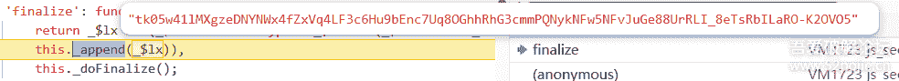

image.png (24.91 KB, 下载次数: 1)

[href="forum.php?mod=attachment&aid=MjgyMzIzOXw4NzU5OWY3ZXwxNzkzNTcwMjg2fDE2ODA4NnwyMDgyNjQ3&nothumb=yes" target="_blank"](https://www.52pojie.cn/forum.php?mod=attachment&aid=MjgyMzIzOXw4NzU5OWY3ZXwxNzkzNTcwMjg2fDE2ODA4NnwyMDgyNjQ3&nothumb=yes)

2025-12-26 22:30 上传

然后就得到了

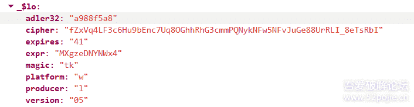

image.png (21.62 KB, 下载次数: 1)

[href="forum.php?mod=attachment&aid=MjgyMzI0MHxlYmE2Mjc5OHwxNzkzNTcwMjg2fDE2ODA4NnwyMDgyNjQ3&nothumb=yes" target="_blank"](https://www.52pojie.cn/forum.php?mod=attachment&aid=MjgyMzI0MHxlYmE2Mjc5OHwxNzkzNTcwMjg2fDE2ODA4NnwyMDgyNjQ3&nothumb=yes)

2025-12-26 22:34 上传

拼接后 获得默认的`token`

image.png (14.7 KB, 下载次数: 1)

[href="forum.php?mod=attachment&aid=MjgyMzI0MXw5ZWUzODFiOHwxNzkzNTcwMjg2fDE2ODA4NnwyMDgyNjQ3&nothumb=yes" target="_blank"](https://www.52pojie.cn/forum.php?mod=attachment&aid=MjgyMzI0MXw5ZWUzODFiOHwxNzkzNTcwMjg2fDE2ODA4NnwyMDgyNjQ3&nothumb=yes)

2025-12-26 22:36 上传

跟进代码 （更换回最开始的浏览器）

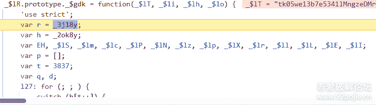

image.png (24.59 KB, 下载次数: 1)

[href="forum.php?mod=attachment&aid=MjgyMzI0Mnw2NTZmMmI0MnwxNzkzNTcwMjg2fDE2ODA4NnwyMDgyNjQ3&nothumb=yes" target="_blank"](https://www.52pojie.cn/forum.php?mod=attachment&aid=MjgyMzI0Mnw2NTZmMmI0MnwxNzkzNTcwMjg2fDE2ODA4NnwyMDgyNjQ3&nothumb=yes)

2025-12-26 22:42 上传

依旧是参数进行拼接 跟据`token`中的`expr`开始加密

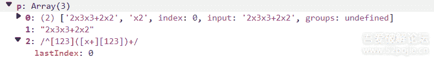

image.png (16.11 KB, 下载次数: 1)

[href="forum.php?mod=attachment&aid=MjgyMzI0NHwzMjM5MTg0ZHwxNzkzNTcwMjg2fDE2ODA4NnwyMDgyNjQ3&nothumb=yes" target="_blank"](https://www.52pojie.cn/forum.php?mod=attachment&aid=MjgyMzI0NHwzMjM5MTg0ZHwxNzkzNTcwMjg2fDE2ODA4NnwyMDgyNjQ3&nothumb=yes)

2025-12-26 22:51 上传

加密算法为 `local_key_1` `local_key_2` `local_key_3` 在加密之前都会数据进行加上签名和对不完整的`token`进行`MD5`之前的操作一样 其中`local_key_1`算法可以确定是平台修改过的`MD5` `local_key_2`算法我推测是修改过的`SHA256` 而`local_key_3`算法则是修改过的`HMAC-SHA256` （欢迎大佬指正）

加密完以后得到这样的依托

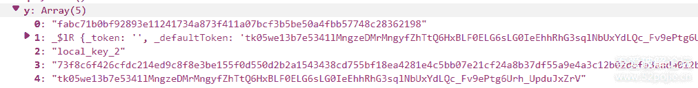

image.png (31.82 KB, 下载次数: 1)

[href="forum.php?mod=attachment&aid=MjgyMzI0NXxlNTIxMjJiZXwxNzkzNTcwMjg2fDE2ODA4NnwyMDgyNjQ3&nothumb=yes" target="_blank"](https://www.52pojie.cn/forum.php?mod=attachment&aid=MjgyMzI0NXxlNTIxMjJiZXwxNzkzNTcwMjg2fDE2ODA4NnwyMDgyNjQ3&nothumb=yes)

2025-12-26 23:11 上传

接着跟代码

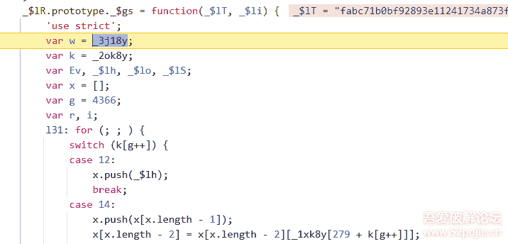

image.png (33.11 KB, 下载次数: 1)

[href="forum.php?mod=attachment&aid=MjgyMzI0N3xlOTJlMGJmYnwxNzkzNTcwMjg2fDE2ODA4NnwyMDgyNjQ3&nothumb=yes" target="_blank"](https://www.52pojie.cn/forum.php?mod=attachment&aid=MjgyMzI0N3xlOTJlMGJmYnwxNzkzNTcwMjg2fDE2ODA4NnwyMDgyNjQ3&nothumb=yes)

2025-12-26 23:21 上传

进入`gs`后 先将如下数据送入`local_key_2`

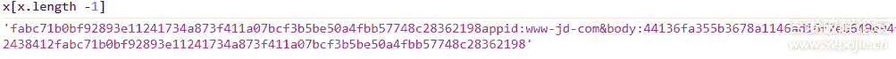

image.png (18.43 KB, 下载次数: 1)

[href="forum.php?mod=attachment&aid=MjgyMzI0OHw3MjUwYzViZHwxNzkzNTcwMjg2fDE2ODA4NnwyMDgyNjQ3&nothumb=yes" target="_blank"](https://www.52pojie.cn/forum.php?mod=attachment&aid=MjgyMzI0OHw3MjUwYzViZHwxNzkzNTcwMjg2fDE2ODA4NnwyMDgyNjQ3&nothumb=yes)
2025-12-26 23:26 上传
得到

image.png (19.83 KB, 下载次数: 1)

[href="forum.php?mod=attachment&aid=MjgyMzI0OXw5MjFiZTAyOXwxNzkzNTcwMjg2fDE2ODA4NnwyMDgyNjQ3&nothumb=yes" target="_blank"](https://www.52pojie.cn/forum.php?mod=attachment&aid=MjgyMzI0OXw5MjFiZTAyOXwxNzkzNTcwMjg2fDE2ODA4NnwyMDgyNjQ3&nothumb=yes)
2025-12-26 23:27 上传
继续跟代码
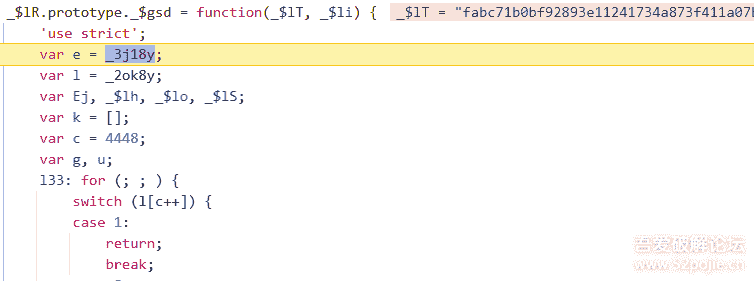
image.png (26.72 KB, 下载次数: 1)

[href="forum.php?mod=attachment&aid=MjgyMzI1MHwyOTdmMmYyNHwxNzkzNTcwMjg2fDE2ODA4NnwyMDgyNjQ3&nothumb=yes" target="_blank"](https://www.52pojie.cn/forum.php?mod=attachment&aid=MjgyMzI1MHwyOTdmMmYyNHwxNzkzNTcwMjg2fDE2ODA4NnwyMDgyNjQ3&nothumb=yes)
2025-12-26 23:29 上传
继续跟
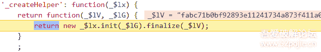
image.png (17.36 KB, 下载次数: 1)

[href="forum.php?mod=attachment&aid=MjgyMzI1MXxhZTU0NTZkM3wxNzkzNTcwMjg2fDE2ODA4NnwyMDgyNjQ3&nothumb=yes" target="_blank"](https://www.52pojie.cn/forum.php?mod=attachment&aid=MjgyMzI1MXxhZTU0NTZkM3wxNzkzNTcwMjg2fDE2ODA4NnwyMDgyNjQ3&nothumb=yes)
2025-12-26 23:32 上传
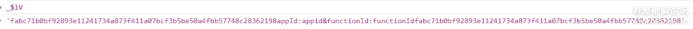
image.png (14.3 KB, 下载次数: 1)

[href="forum.php?mod=attachment&aid=MjgyMzI1Mnw1Y2RmNWMxN3wxNzkzNTcwMjg2fDE2ODA4NnwyMDgyNjQ3&nothumb=yes" target="_blank"](https://www.52pojie.cn/forum.php?mod=attachment&aid=MjgyMzI1Mnw1Y2RmNWMxN3wxNzkzNTcwMjg2fDE2ODA4NnwyMDgyNjQ3&nothumb=yes)
2025-12-26 23:32 上传
即 把数据使用`local_key_2` 加密

image.png (18.74 KB, 下载次数: 1)

[href="forum.php?mod=attachment&aid=MjgyMzI1M3w5OTA5ZjQxMnwxNzkzNTcwMjg2fDE2ODA4NnwyMDgyNjQ3&nothumb=yes" target="_blank"](https://www.52pojie.cn/forum.php?mod=attachment&aid=MjgyMzI1M3w5OTA5ZjQxMnwxNzkzNTcwMjg2fDE2ODA4NnwyMDgyNjQ3&nothumb=yes)
2025-12-26 23:33 上传
最后一个参数 拿来即用 固定参数
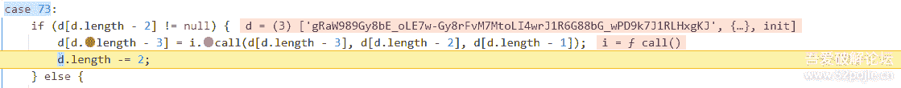
image.png (22.05 KB, 下载次数: 1)

[href="forum.php?mod=attachment&aid=MjgyMzI1NHw3NjRjNGI3Y3wxNzkzNTcwMjg2fDE2ODA4NnwyMDgyNjQ3&nothumb=yes" target="_blank"](https://www.52pojie.cn/forum.php?mod=attachment&aid=MjgyMzI1NHw3NjRjNGI3Y3wxNzkzNTcwMjg2fDE2ODA4NnwyMDgyNjQ3&nothumb=yes)
2025-12-26 23:39 上传
最终我们得到
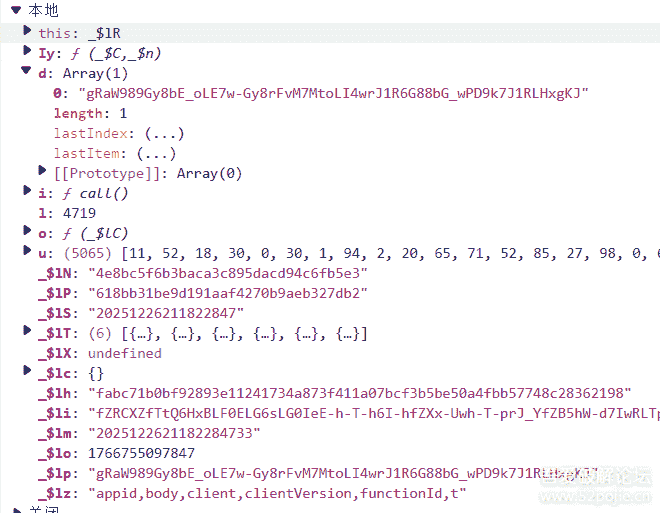
image.png (60.28 KB, 下载次数: 1)

[href="forum.php?mod=attachment&aid=MjgyMzI1NXwyYzIzZWM1OXwxNzkzNTcwMjg2fDE2ODA4NnwyMDgyNjQ3&nothumb=yes" target="_blank"](https://www.52pojie.cn/forum.php?mod=attachment&aid=MjgyMzI1NXwyYzIzZWM1OXwxNzkzNTcwMjg2fDE2ODA4NnwyMDgyNjQ3&nothumb=yes)
2025-12-26 23:42 上传
拼接后
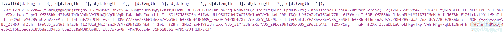
image.png (50.98 KB, 下载次数: 1)

[href="forum.php?mod=attachment&aid=MjgyMzI1NnwxNmYyOGU0YXwxNzkzNTcwMjg2fDE2ODA4NnwyMDgyNjQ3&nothumb=yes" target="_blank"](https://www.52pojie.cn/forum.php?mod=attachment&aid=MjgyMzI1NnwxNmYyOGU0YXwxNzkzNTcwMjg2fDE2ODA4NnwyMDgyNjQ3&nothumb=yes)
2025-12-26 23:44 上传
实现逻辑 整个请求验证
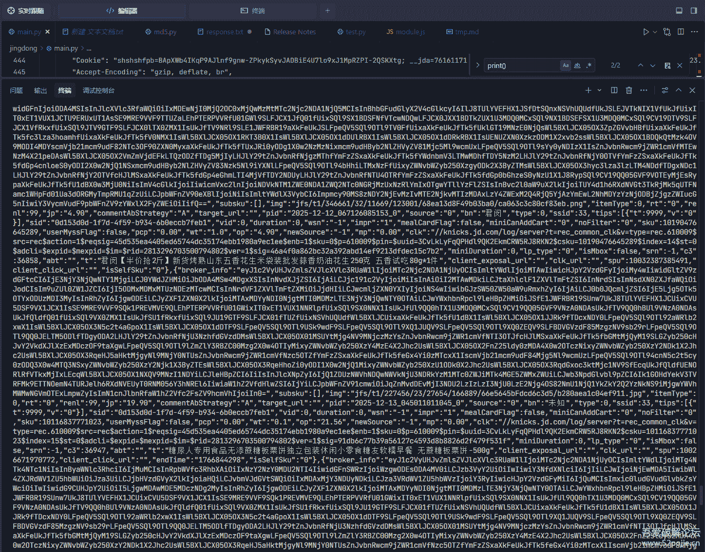
image.png (425.4 KB, 下载次数: 1)

[href="forum.php?mod=attachment&aid=MjgyMzI1N3xjZjMwNmZjYXwxNzkzNTcwMjg2fDE2ODA4NnwyMDgyNjQ3&nothumb=yes" target="_blank"](https://www.52pojie.cn/forum.php?mod=attachment&aid=MjgyMzI1N3xjZjMwNmZjYXwxNzkzNTcwMjg2fDE2ODA4NnwyMDgyNjQ3&nothumb=yes)
2025-12-26 23:48 上传

#### 结束

这是我第一次分享 感谢大家耐着性子看完 新人发帖有缺陷的地方欢迎大家指正 也欢迎大家讨论

最后 祝大家事业有成 技术进步
