# [原创] ACProtect 1.X IAT分析与Ollydbg脚本编写

- 原帖: https://www.52pojie.cn/forum.php?mod=viewthread&tid=2082800
- 抓取时间: 2026-11-01T21:58:06

## ACProtect 1.X IAT分析与Ollydbg脚本编写

看了 ximo 的基础脱壳教程17：脱ACProtect(存在Stolen Code)，我成功的找到了OEP，但是按照ximo的方法无法修复IAT，ImportREC的跟踪级别1和跟踪级别3都不行，我只好写了一个用于IAT修复的Ollydbg脚本，写个帖子记录一下。

下文中的演示文件来自于 爱盘， ximo 的基础脱壳教程。

### 目录

- 第一部分：寻找OEP。
- 第二部分：复现IAT修复失败的场景。
- 第三部分：编写Ollydbg脚本，修复IAT。

### 第一部分：寻找OEP。

使用最后一次异常法寻找OEP。

具体的步骤：

1. 查壳，ACProtect 1.X壳。（1-查壳）

   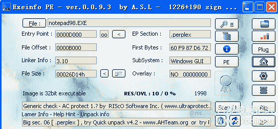

   `1_查壳.png` (98.67 KB, 下载次数: 0)

   [href="forum.php?mod=attachment&aid=MjgyMzQxMnxjYmI4YWNmZXwxNzkzNTcwMjg0fDE2ODA4NnwyMDgyODAw&nothumb=yes" target="_blank"](https://www.52pojie.cn/forum.php?mod=attachment&aid=MjgyMzQxMnxjYmI4YWNmZXwxNzkzNTcwMjg0fDE2ODA4NnwyMDgyODAw&nothumb=yes)

   2025-12-27 23:54 上传

2. 使用OllyDbg调试。

3. 选项-调试设置-异常-取消勾选 非法访问内存。（2-1，2-2）

   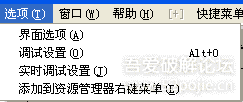

   `2-1.png` (8.29 KB, 下载次数: 0)

   [href="forum.php?mod=attachment&aid=MjgyMzQxM3xlYjUzNWViNXwxNzkzNTcwMjg0fDE2ODA4NnwyMDgyODAw&nothumb=yes" target="_blank"](https://www.52pojie.cn/forum.php?mod=attachment&aid=MjgyMzQxM3xlYjUzNWViNXwxNzkzNTcwMjg0fDE2ODA4NnwyMDgyODAw&nothumb=yes)

   2025-12-27 23:54 上传

   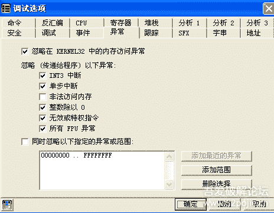

   `2-2.png` (22.92 KB, 下载次数: 0)

   [href="forum.php?mod=attachment&aid=MjgyMzQxNHw4NWI5ODA0ZHwxNzkzNTcwMjg0fDE2ODA4NnwyMDgyODAw&nothumb=yes" target="_blank"](https://www.52pojie.cn/forum.php?mod=attachment&aid=MjgyMzQxNHw4NWI5ODA0ZHwxNzkzNTcwMjg0fDE2ODA4NnwyMDgyODAw&nothumb=yes)

   2025-12-27 23:54 上传

4. 插件-StrongOD-Options-取消勾选 Skip Some Exceptions-Save。（2-3，2-4）

   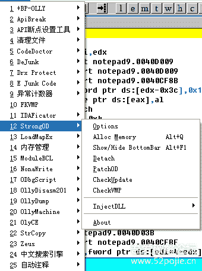

   `2-3.png` (19.85 KB, 下载次数: 0)

   [href="forum.php?mod=attachment&aid=MjgyMzQxNXw0ODM1ODVhYnwxNzkzNTcwMjg0fDE2ODA4NnwyMDgyODAw&nothumb=yes" target="_blank"](https://www.52pojie.cn/forum.php?mod=attachment&aid=MjgyMzQxNXw0ODM1ODVhYnwxNzkzNTcwMjg0fDE2ODA4NnwyMDgyODAw&nothumb=yes)

   2025-12-27 23:54 上传

   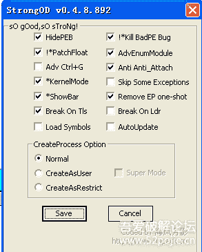

   `2-4.png` (19 KB, 下载次数: 0)

   [href="forum.php?mod=attachment&aid=MjgyMzQwOHw1MjVmNzdlM3wxNzkzNTcwMjg0fDE2ODA4NnwyMDgyODAw&nothumb=yes" target="_blank"](https://www.52pojie.cn/forum.php?mod=attachment&aid=MjgyMzQwOHw1MjVmNzdlM3wxNzkzNTcwMjg0fDE2ODA4NnwyMDgyODAw&nothumb=yes)

   2025-12-27 23:54 上传

5. shift+F9，在"SE处理程序"上面 右键-在数据窗口跟随。（2-5，2-6）

   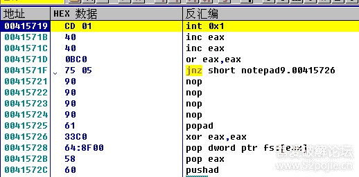

   `2-5.png` (13.82 KB, 下载次数: 0)

   [href="forum.php?mod=attachment&aid=MjgyMzQwOXxjMDBjMjIyNXwxNzkzNTcwMjg0fDE2ODA4NnwyMDgyODAw&nothumb=yes" target="_blank"](https://www.52pojie.cn/forum.php?mod=attachment&aid=MjgyMzQwOXxjMDBjMjIyNXwxNzkzNTcwMjg0fDE2ODA4NnwyMDgyODAw&nothumb=yes)

   2025-12-27 23:54 上传

   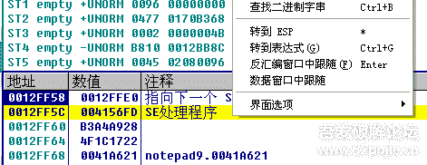

   `2-6.png` (13.25 KB, 下载次数: 0)

   [href="forum.php?mod=attachment&aid=MjgyMzQxMHw0MjdmNzMzZXwxNzkzNTcwMjg0fDE2ODA4NnwyMDgyODAw&nothumb=yes" target="_blank"](https://www.52pojie.cn/forum.php?mod=attachment&aid=MjgyMzQxMHw0MjdmNzMzZXwxNzkzNTcwMjg0fDE2ODA4NnwyMDgyODAw&nothumb=yes)

   2025-12-27 23:54 上传

6. 右键-断点-内存访问，shift+F9。（2-7）

   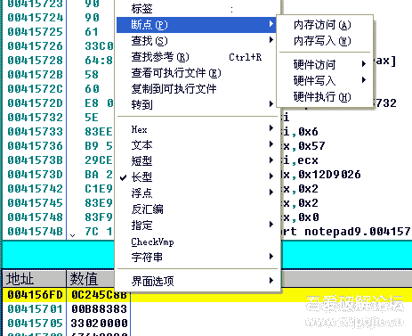

   `2-7.png` (18.04 KB, 下载次数: 0)

   [href="forum.php?mod=attachment&aid=MjgyMzQxMXwxYjk4ZGMzNHwxNzkzNTcwMjg0fDE2ODA4NnwyMDgyODAw&nothumb=yes" target="_blank"](https://www.52pojie.cn/forum.php?mod=attachment&aid=MjgyMzQxMXwxYjk4ZGMzNHwxNzkzNTcwMjg0fDE2ODA4NnwyMDgyODAw&nothumb=yes)

   2025-12-27 23:54 上传

7. 右键-断点-切换，shift+F9；右键-断点-切换，shift+F9。（2-8，2-9）

   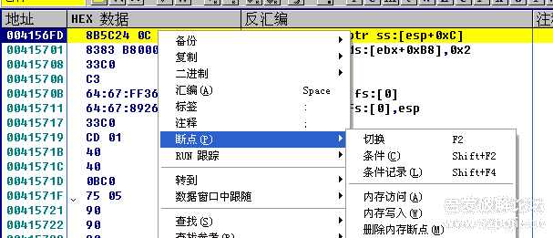

   `2-8.png` (18.79 KB, 下载次数: 0)

   [href="forum.php?mod=attachment&aid=MjgyMzQxN3xlNzUyZmMxYnwxNzkzNTcwMjg0fDE2ODA4NnwyMDgyODAw&nothumb=yes" target="_blank"](https://www.52pojie.cn/forum.php?mod=attachment&aid=MjgyMzQxN3xlNzUyZmMxYnwxNzkzNTcwMjg0fDE2ODA4NnwyMDgyODAw&nothumb=yes)

   2025-12-27 23:54 上传

   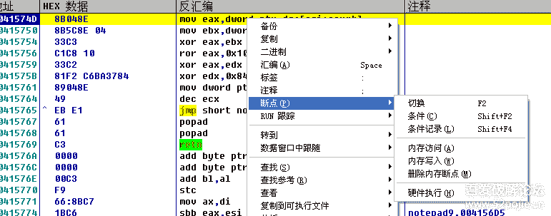

   `2-9.png` (22.15 KB, 下载次数: 0)

   [href="forum.php?mod=attachment&aid=MjgyMzQxOHw5MDEyOGExYnwxNzkzNTcwMjg0fDE2ODA4NnwyMDgyODAw&nothumb=yes" target="_blank"](https://www.52pojie.cn/forum.php?mod=attachment&aid=MjgyMzQxOHw5MDEyOGExYnwxNzkzNTcwMjg0fDE2ODA4NnwyMDgyODAw&nothumb=yes)

   2025-12-27 23:54 上传

8. 右键-断点-删除内存断点；查看-断点-删除这2个断点。（3-1，3-2）

   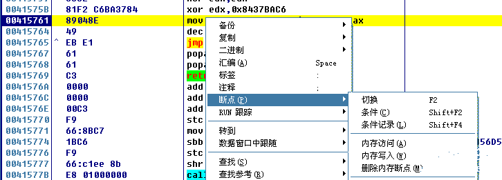

   `3-1.png` (18.29 KB, 下载次数: 0)

   [href="forum.php?mod=attachment&aid=MjgyMzQxOXw2ODc2N2JkOHwxNzkzNTcwMjg0fDE2ODA4NnwyMDgyODAw&nothumb=yes" target="_blank"](https://www.52pojie.cn/forum.php?mod=attachment&aid=MjgyMzQxOXw2ODc2N2JkOHwxNzkzNTcwMjg0fDE2ODA4NnwyMDgyODAw&nothumb=yes)

   2025-12-27 23:54 上传

   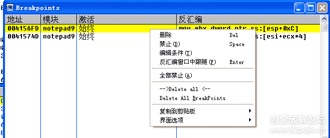

   `3-2.png` (19.78 KB, 下载次数: 0)

   [href="forum.php?mod=attachment&aid=MjgyMzQyMHxiYWUxOGJjZXwxNzkzNTcwMjg0fDE2ODA4NnwyMDgyODAw&nothumb=yes" target="_blank"](https://www.52pojie.cn/forum.php?mod=attachment&aid=MjgyMzQyMHxiYWUxOGJjZXwxNzkzNTcwMjg0fDE2ODA4NnwyMDgyODAw&nothumb=yes)

   2025-12-27 23:54 上传

9. 接下来，运行到下面的`retn`，右键-断点-运行到选定位置。（3-3）

   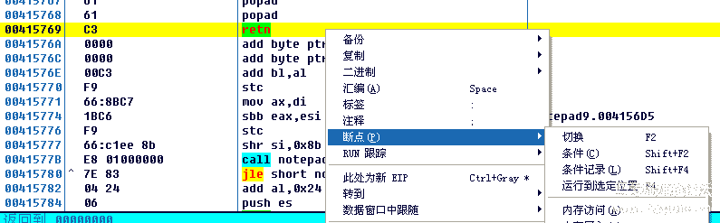

   `3-3.png` (18.71 KB, 下载次数: 0)

   [href="forum.php?mod=attachment&aid=MjgyMzQxNnxlNjkwOTE1M3wxNzkzNTcwMjg0fDE2ODA4NnwyMDgyODAw&nothumb=yes" target="_blank"](https://www.52pojie.cn/forum.php?mod=attachment&aid=MjgyMzQxNnxlNjkwOTE1M3wxNzkzNTcwMjg0fDE2ODA4NnwyMDgyODAw&nothumb=yes)

   2025-12-27 23:54 上传

10. 调试-设置条件-勾选 命令是一个 -填写`push ebp`，调试-跟踪步入。（3-4，3-5）

    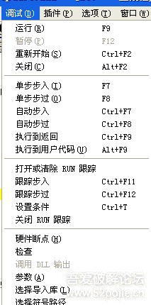

    `3-4.png` (12.86 KB, 下载次数: 0)

    [href="forum.php?mod=attachment&aid=MjgyMzQyNHxhNjBiYzk4ZXwxNzkzNTcwMjg0fDE2ODA4NnwyMDgyODAw&nothumb=yes" target="_blank"](https://www.52pojie.cn/forum.php?mod=attachment&aid=MjgyMzQyNHxhNjBiYzk4ZXwxNzkzNTcwMjg0fDE2ODA4NnwyMDgyODAw&nothumb=yes)

    2025-12-27 23:55 上传

    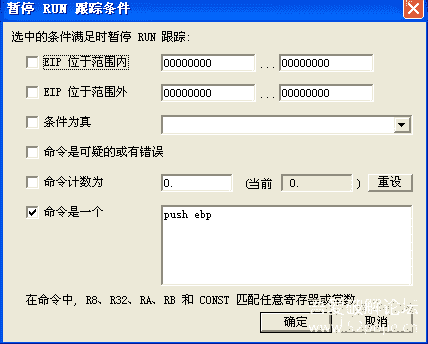

    `3-5.png` (18.53 KB, 下载次数: 0)

    [href="forum.php?mod=attachment&aid=MjgyMzQyNXw5MGRkZWEzM3wxNzkzNTcwMjg0fDE2ODA4NnwyMDgyODAw&nothumb=yes" target="_blank"](https://www.52pojie.cn/forum.php?mod=attachment&aid=MjgyMzQyNXw5MGRkZWEzM3wxNzkzNTcwMjg0fDE2ODA4NnwyMDgyODAw&nothumb=yes)

    2025-12-27 23:55 上传

11. 等待几分钟，跟踪完毕之后，到了Stolen Code，选中这三行，右键-二进制-二进制复制。（3-6）

    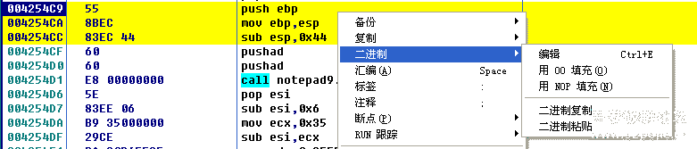

    `3-6.png` (14.95 KB, 下载次数: 0)

    [href="forum.php?mod=attachment&aid=MjgyMzQyNnxlMzAyMWQzYXwxNzkzNTcwMjg0fDE2ODA4NnwyMDgyODAw&nothumb=yes" target="_blank"](https://www.52pojie.cn/forum.php?mod=attachment&aid=MjgyMzQyNnxlMzAyMWQzYXwxNzkzNTcwMjg0fDE2ODA4NnwyMDgyODAw&nothumb=yes)

    2025-12-27 23:55 上传

12. 查看-内存-找到`401000`-右键-在访问上设置中断，shift+F9。（3-7）

    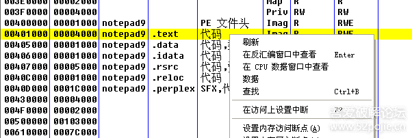

    `3-7.png` (14.83 KB, 下载次数: 0)

    [href="forum.php?mod=attachment&aid=MjgyMzQyMXw4ZmI1NTg3ZnwxNzkzNTcwMjg0fDE2ODA4NnwyMDgyODAw&nothumb=yes" target="_blank"](https://www.52pojie.cn/forum.php?mod=attachment&aid=MjgyMzQyMXw4ZmI1NTg3ZnwxNzkzNTcwMjg0fDE2ODA4NnwyMDgyODAw&nothumb=yes)

    2025-12-27 23:55 上传

13. 二进制粘贴到这一行前面（如果字节不够，就`nop`一下之前的字节），在`4010CC`，右键-此处为新EIP。（3-8）

    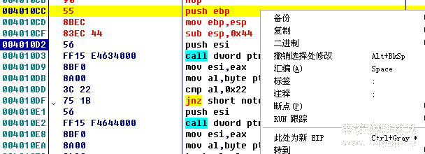

    `3-8.png` (15.18 KB, 下载次数: 0)

    [href="forum.php?mod=attachment&aid=MjgyMzQyMnxiYmU1YTdmOHwxNzkzNTcwMjg0fDE2ODA4NnwyMDgyODAw&nothumb=yes" target="_blank"](https://www.52pojie.cn/forum.php?mod=attachment&aid=MjgyMzQyMnxiYmU1YTdmOHwxNzkzNTcwMjg0fDE2ODA4NnwyMDgyODAw&nothumb=yes)

    2025-12-27 23:55 上传

14. OEP为`4010CC`。

15. 使用LordPE来dump内存映像，右键-完整转存。 （3-9）

    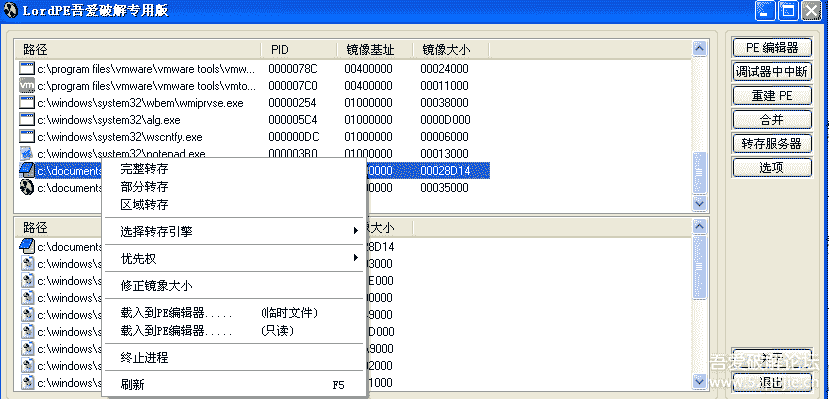

    `3-9.png` (44.67 KB, 下载次数: 0)

    [href="forum.php?mod=attachment&aid=MjgyMzQyM3w2YzM2ZGI0N3wxNzkzNTcwMjg0fDE2ODA4NnwyMDgyODAw&nothumb=yes" target="_blank"](https://www.52pojie.cn/forum.php?mod=attachment&aid=MjgyMzQyM3w2YzM2ZGI0N3wxNzkzNTcwMjg0fDE2ODA4NnwyMDgyODAw&nothumb=yes)

    2025-12-27 23:55 上传


### 第二部分：复现`IAT`修复失败的场景。
- 打开 `ImportREConstructor`，选进程，填写`OEP` -`IAT`自动搜索-获取导入表-显示无效的。（4-1）
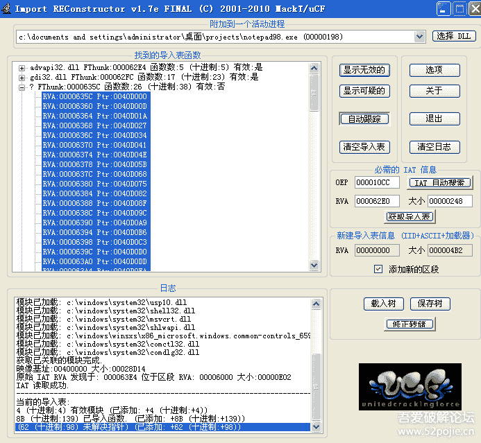
4-1.png (65.41 KB, 下载次数: 0)
- 使用 跟踪级别1，修复第一个失效，失败。（4-2）
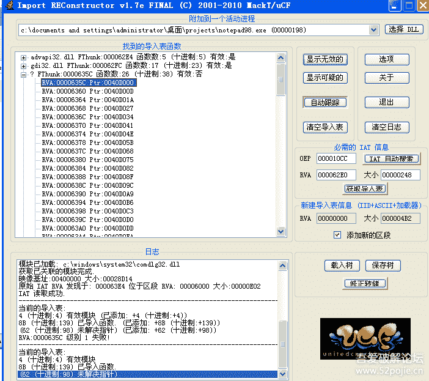
4-2.png (63.5 KB, 下载次数: 0)
- 使用 跟踪级别2，修复第一个失效，卡死。
- 使用 跟踪级别3，修复第一个失效，卡死。（4-3）
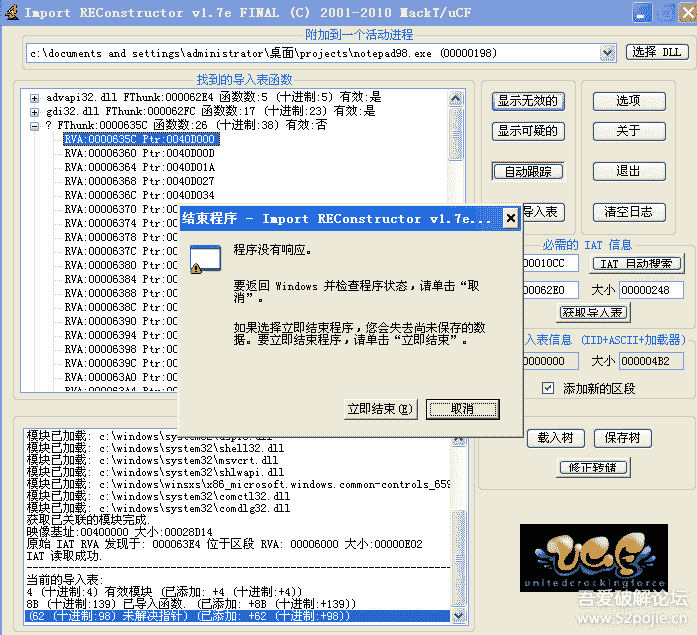
4-3.png (68.48 KB, 下载次数: 0)

### 第三部分：编写`Ollydbg`脚本，修复`IAT`。
- 找到`IAT`的方法有很多，我这里使用 `ImportREConstructor`，第一个无效函数的`RVA`是 `635C`。那么，右键-转到-表达式，填写 `635C-RVA-OK`。（5-1，5-2）
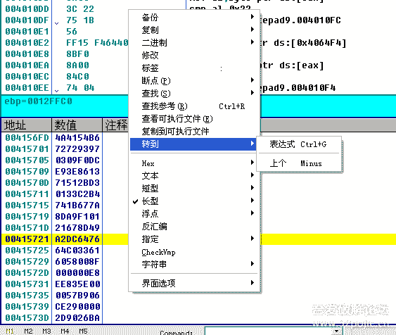
5-1.png (24.41 KB, 下载次数: 0)
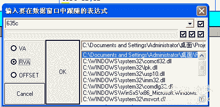
5-2.png (19.68 KB, 下载次数: 0)
- 上下翻一翻，很显然，完整`IAT`是从 `4062E4` 开始，`406524` 结束。无效函数，分为2段，第一段，`0040635C`~`004063F4`；第二段，`00406414`~`00406504`。（5-3，5-4）
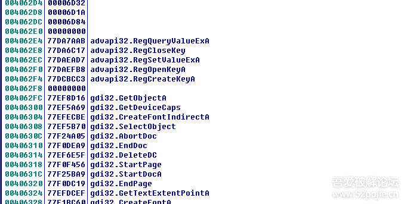
5-3.png (18.24 KB, 下载次数: 0)
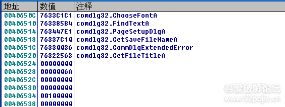
5-4.png (12.53 KB, 下载次数: 0)
- 第一个无效函数的地址，`0040635C`，里面存储的值是 `0040D000` 。在反汇编界面 转到该地址，发现，每一个无效函数的加密方法都是 异或2个值。（5-5，5-6）
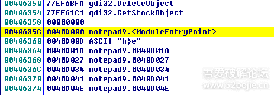
5-5.png (10.04 KB, 下载次数: 0)
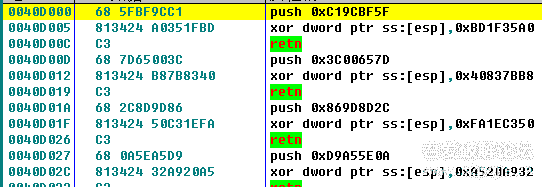
5-6.png (13.58 KB, 下载次数: 0)
- 下面为`Ollydbg`脚本的代码。
```
;IAT重建,  ximo基础脱壳教程17：脱ACProtect(存在Stolen Code)

;初始化变量
mov iat_a ,0040635C
mov iat_b ,004063F4 
mov iat_c ,00406414
mov iat_d ,00406504

;初始化循环变量iat = a
mov iat,iat_a

@loop_start:

    ;循环条件判断: iat  d，跳出循环

    ;判断: if(iat - 4 == b)
    mov  iat_2 , iat      ; iat_2 = iat  iat的临时副本
    sub  iat_2 , 4        ; iat_2 = iat_2 - 4
    cmp  iat_2 , iat_b    ; 比较iat-4和b
    jne  [//www.52pojie.cn/home.php?mod=space&uid=315772" target="_blank"](https://www.52pojie.cn/home.php?mod=space&uid=315772:href="https)    ; 不相等则跳过赋值

    ;执行iat = c
    mov  iat , iat_c      ; iat = c

@work:
    ; 循环体: 重建iat
    mov iat_nei , [iat]     ;取出指针iat指向的地址里面的值
    mov api_1,[iat_nei +1]
    mov api_2,[iat_nei +8]
    xor api_1,api_2        ;不要把xor误写成了or
    mov [iat],api_1       ;重建iat

    ;循环增量: iat = iat + 4
    add  iat , 4

    ;跳回循环开始
    jmp  @loop_start

@loop_end:
    MSG "OK IAT 修复已经完成iat"
    ret
```
- 写好脚本保存到一个`TXT`文件，在反汇编界面，右键-`script function`-脚本运行窗口；在脚本运行窗口，右键-载入脚本-打开。（5-7，5-8）
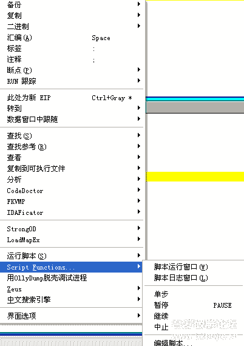
5-7.png (16 KB, 下载次数: 0)
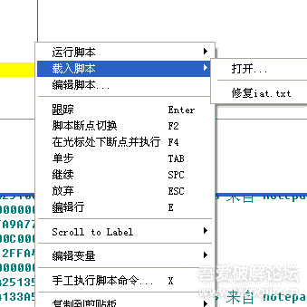
5-8.png (13.46 KB, 下载次数: 0)
- 运行脚本，脚本一运行完成，左下角的`IAT`瞬间变了（5-9）
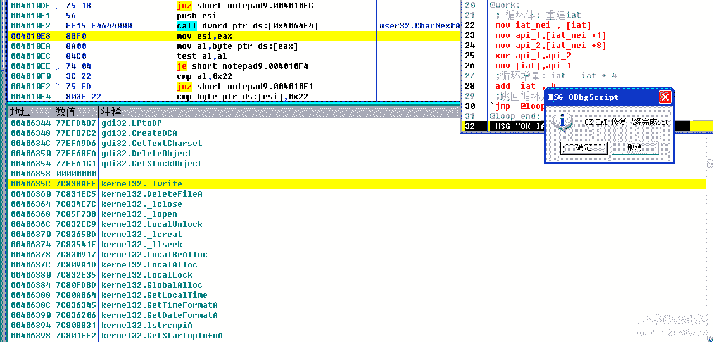
5-9.png (42.62 KB, 下载次数: 0)
- 使用`ImportREConstructor`重建输入表，选进程，填写`OEP` -`IAT`自动搜索-获取导入表-显示无效的。只有一个无效，剪切掉它。修正转储 到刚才`dump`下来的文件。（6-1，6-2，6-3）
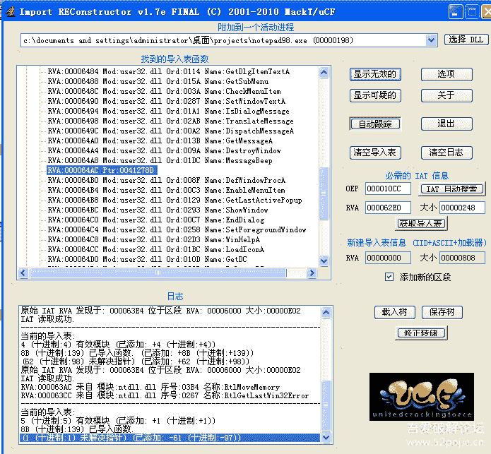
6-1.png (69.99 KB, 下载次数: 0)
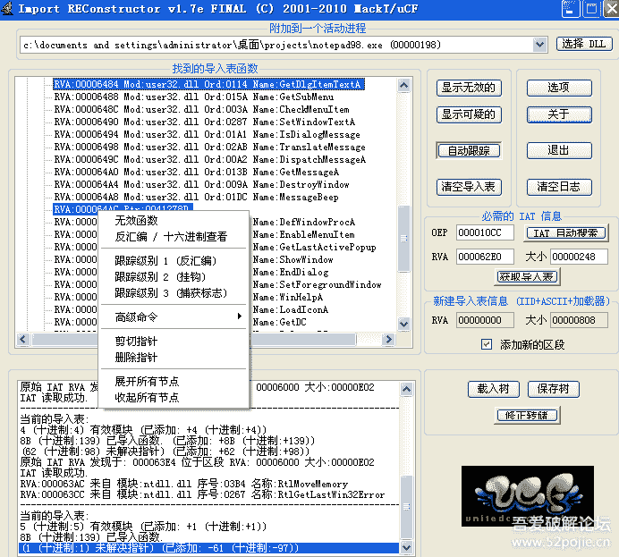
6-2.png (69.28 KB, 下载次数: 0)
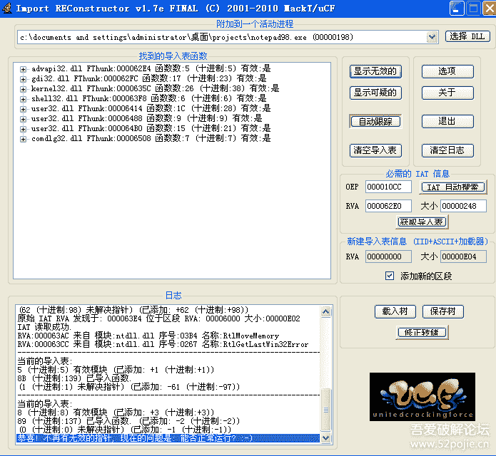
6-3.png (62.25 KB, 下载次数: 0)
- 最后运行成功。（6-4）

6-4.png (20.99 KB, 下载次数: 0)
